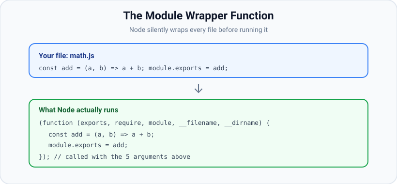
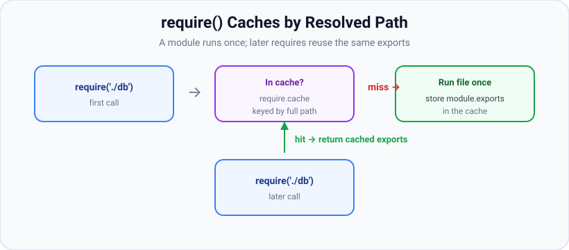

# CommonJS Modules

*10 min read · Updated 24 Jul 2026 Topic 11 of 70 Bookmark Mark done Why it matters Every non · Topic 11 of 70*

**Source:** [https://www.geekyfrontend.in/learn/nodejs-backend-kit/commonjs-modules](https://www.geekyfrontend.in/learn/nodejs-backend-kit/commonjs-modules)

---

## Why it matters

Every non-trivial Node program is split across many files, and CommonJS (CJS) is the mechanism that has glued those files together since Node's first release in 2009. When you type `require('express')` or `module.exports = router`, you are using CommonJS. Even in 2025, with ES Modules fully supported, the overwhelming majority of packages on npm still ship CommonJS, and the default for a `.js` file with no `"type"` declaration is still CommonJS. If you cannot explain what `require`, `module.exports`, and `exports` actually do, you will hit bugs that feel like magic: a value that is mysteriously `undefined`, a module that runs twice, or a circular dependency that returns half an object.

CommonJS is also a favourite interview topic precisely because it looks trivial but hides real machinery: a wrapper function, a resolution algorithm, and a cache. Understanding it separates people who copy-paste `require` lines from people who can debug a production module-loading problem at 2 a.m.

## The concept, simply

A CommonJS module is just a file. Each file gets its own private scope — variables you declare at the top level of a file are *not* global, they belong to that file. To share something with other files, you attach it to a special object called `module.exports`. To pull in what another file shared, you call `require('./that-file')`, which returns whatever that file assigned to its `module.exports`.

Two directions, two keywords:

- **Export** — `module.exports = something` (or `exports.name = something`) publishes a value.
- **Import** — `const x = require('./file')` reads that published value synchronously.

The reason each file has a private scope is not a language feature of JavaScript — it is a trick Node plays. Before running your file, Node wraps its source in a function. That single fact explains almost everything surprising about CommonJS.



Node wraps every module's source in a function before executing it, which is why top-level variables stay private and why exports, require, module, \_\_filename and \_\_dirname are magically available.

## How it works

**The module wrapper.** Node never runs your file's source directly. It concatenates it into a function that looks exactly like this:

javascript

```
(function (exports, require, module, __filename, __dirname) {
  // ... your file's code goes here ...
});
```

Node then calls that function with the five arguments. This is why `require`, `module`, `exports`, `__filename`, and `__dirname` appear "out of nowhere" in every file — they are ordinary function parameters, not globals. It is also why a `const` declared at the top of a file does not leak: it is a local variable inside that wrapper function. You can even see the template at `require('module').wrapper` in older versions, or inspect `arguments.length === 5` at the top of any module.

**module.exports vs exports.** When the wrapper runs, Node sets up `module.exports = {}` and then does `exports = module.exports`. So `exports` starts as a reference to the same empty object. Mutating that object works for both: `exports.add = ...` and `module.exports.add = ...` touch the same object. But *reassigning* `exports = someNewThing` only rebinds the local parameter — it no longer points at `module.exports`, so nothing is exported. The value that is actually returned to the caller is always `module.exports`. Rule of thumb: to export one thing (a class, a function), write `module.exports = X`; to export several named things, attach them with `exports.name = ...` or `module.exports.name = ...`.

**The resolution + cache flow.** When you call `require(spec)`, Node runs the module resolution algorithm to turn `spec` into a single absolute file path (covered in depth in the module-resolution topic). It then checks `require.cache`, an object keyed by that resolved absolute path. If an entry exists, Node returns its `.exports` immediately — the file is **not** re-run. If there is no entry, Node creates a new `Module` object, stores it in the cache *before* executing (this is what lets circular dependencies terminate), wraps and runs the file, and finally returns `module.exports`.



The first require of a path runs the file and stores its exports; every later require of the same resolved path returns the cached object without re-running the module — modules are effectively singletons.

**Caching means modules are singletons.** Because the cache is keyed by resolved path, requiring the same module ten times from ten files gives every file the exact same object. This is how a database connection or a config object is shared across an app. The side effect of a module's top-level code runs exactly once per process. If you truly need a fresh evaluation you must delete the cache entry (`delete require.cache[require.resolve('./x')]`) — a hack used in test tooling and hot-reloaders, almost never in application code.

**\_\_dirname and \_\_filename.** `__filename` is the absolute path of the current file; `__dirname` is the directory containing it. Both are computed by Node per file and injected via the wrapper. They are essential for building paths that work regardless of the process's current working directory — always prefer `path.join(__dirname, 'data.json')` over a bare relative string, because `fs` resolves bare relative paths against `process.cwd()`, not against the file.

**require is synchronous.** `require` reads and executes the target file on the spot, blocking until it returns. That is acceptable because it happens at startup, but it is also why `require` cannot load ES Modules (which may need asynchronous, top-level `await`) in older Node versions — bridging the two worlds needs the async `import()` instead.

## Code examples

**1. Exporting several named values.**

javascript

```
// math.js
function add(a, b) { return a + b; }
function sub(a, b) { return a - b; }

exports.add = add;          // same as module.exports.add
module.exports.sub = sub;   // both attach to the one exports object

// app.js
const math = require('./math');
console.log(math.add(2, 3)); // 5
const { sub } = require('./math'); // destructure named exports
console.log(sub(9, 4));      // 5
```

**2. Exporting a single thing (the classic gotcha).**

javascript

```
// logger.js  — WRONG
exports = function log(msg) { console.log(msg); };
// reassigns the local 'exports' param; module.exports is still {}

// logger.js  — RIGHT
module.exports = function log(msg) { console.log(msg); };

// app.js
const log = require('./logger');
log('hello'); // works only with the RIGHT version
```

**3. The cache makes modules singletons.**

javascript

```
// counter.js
let count = 0;
module.exports = {
  inc() { return ++count; },
  get() { return count; },
};

// a.js
const c = require('./counter');
c.inc(); c.inc();

// b.js
const c = require('./counter');
console.log(c.get()); // 2 — same instance as a.js, count is shared
```

**4. Reading a file next to the module, safely.**

javascript

```
const fs = require('node:fs');
const path = require('node:path');

// Robust: resolves against THIS file, not the process cwd.
const configPath = path.join(__dirname, 'config.json');
const config = JSON.parse(fs.readFileSync(configPath, 'utf8'));
module.exports = config;
```

## Common mistakes & gotchas

- **Reassigning `exports`.** `exports = fn` silently exports nothing. Only `module.exports = fn` works for single-value exports.
- **Expecting a fresh module each require.** The cache returns the same object; top-level side effects run once. Do not put per-request state at module scope.
- **Assuming top-level `const` is global.** It is scoped to the file's wrapper — that is by design, and it is why one file cannot see another file's locals.
- **Bare relative paths in `fs`.** `fs.readFileSync('config.json')` resolves against `process.cwd()`, so it breaks when the app is started from another directory. Use `__dirname`.
- **Circular dependencies returning a partial object.** If A requires B while B is still requiring A, B receives A's *incomplete* `module.exports` (whatever was assigned so far). Move the `require` below the code that finishes populating exports, or restructure.
- **Mutating another module's exports object.** Because it is a shared singleton, changing a property leaks to every other requirer. Treat imported objects as read-only.
- **Requiring inside a hot loop.** After the first call it is a cache lookup, but it still costs a resolution hash and clutters code — require at the top of the file.

## Best practices

- Put all `require` calls at the top of the file so dependencies are obvious and load order is predictable.
- Prefer `module.exports = { a, b, c }` (one object literal) over many `exports.x =` lines — it reads as a clear public API and avoids the `exports`-reassignment trap.
- Use the `node:` prefix for builtins (`require('node:fs')`) so it is unambiguous a core module is meant and never shadowed by a package named `fs`.
- Keep top-level module code cheap and side-effect-light; heavy work (opening connections) should be a function you call, so the cost is explicit.
- Always build filesystem paths with `path.join(__dirname, ...)`.
- Avoid `delete require.cache[...]` in application code — it is a testing/tooling hack that leads to memory leaks and duplicate singletons.
- Break circular dependencies by extracting the shared piece into a third module both can require.

## ⭐ Interview lens

> **Q: What is the module wrapper function and why does it exist?** Node wraps each file's source in `(function (exports, require, module, __filename, __dirname) { ... })` and calls it. It gives every file a private scope (top-level vars are locals, not globals) and injects the five module-scoped identifiers as parameters. This is why `require` and `__dirname` "just exist" without being imported.

> **Q: Difference between `module.exports` and `exports`?** They start pointing at the same object (`exports = module.exports = {}`). Mutating properties on either works. But only `module.exports` is returned to the caller, so reassigning `exports` to a new value breaks the export while reassigning `module.exports` works. Trap: interviewers show `exports = function(){}` and ask what the caller receives — answer: an empty object `{}`.

> **Q: Is `require` synchronous or asynchronous, and where is the result stored?** Synchronous — it reads and executes the file immediately, blocking. Results are cached in `require.cache`, keyed by the module's resolved absolute path, so the file runs at most once per process.

> **Q: What happens with a circular dependency in CommonJS?** Node stores the module in the cache *before* executing it. If A→B→A, the second require of A returns A's partially-built exports (whatever existed at that moment), not a crash and not the finished object. This can yield `undefined` for members assigned later. Fix by reordering requires or extracting shared code.

> **Q: How do you make a module NOT be a singleton?** You can't cleanly — the cache guarantees a singleton per resolved path. Options: export a factory function callers invoke to get fresh instances, or (hack) delete the cache entry. The idiomatic answer is "export a factory."

> **Q: Why is `path.join(__dirname, 'x.json')` safer than `'./x.json'` for `fs`?** `fs` resolves relative paths against `process.cwd()` (where `node` was launched), not the file's location. `__dirname` is always the file's own directory, so the path is correct no matter where the process started.

## Cheat-card

- **Wrapper:** `(exports, require, module, __filename, __dirname) => {}` — private scope + injected identifiers.
- **Export one:** `module.exports = X`. **Export many:** `exports.a = ...`.
- **Never** `exports = X` — rebinds the param, exports nothing.
- **require** is synchronous; result cached in `require.cache` by resolved absolute path.
- **Modules are singletons** — top-level code runs once per process.
- **Circular dep** → partial exports, not a crash (cached before execution).
- **\_\_dirname** = file's dir, **\_\_filename** = file's path; use `path.join(__dirname, ...)`.
- Prefix builtins: `require('node:fs')`.
- **`require.main === module`:** true only in the entry file. `require.main` is `undefined` when the entry is ESM; the ESM equivalent is `import.meta.main` (v24.2.0+).
- **`createRequire(import.meta.url)`:** gives ESM a real `require` (CJS files, JSON, `require.resolve`). Pass an absolute path or URL.
- **`require(esm)`:** works for ES modules without top-level `await` (unflagged v22.12.0 / v20.19.0, stable v24.15.0). Returns the namespace (default under `.default`, or the `"module.exports"` export). Top-level `await` throws `ERR_REQUIRE_ASYNC_MODULE`.

---

## Learn More

- [Modules: CommonJS modules nodejs.org](https://nodejs.org/api/modules.html)
- [JavaScript modules (import / export) developer.mozilla.org](https://developer.mozilla.org/en-US/docs/Web/JavaScript/Guide/Modules)
- [Node JS Tutorial for Beginners #6 - Modules and require() Net Ninja](https://www.youtube.com/watch?v=xHLd36QoS4k)
- [How to Import and Export Modules in Node JS (CommonJS) Nikita Dev](https://www.youtube.com/watch?v=XTND4rjATXA)

---

## Additional topics

*Added 7 Oct 2026 · examples verified on Node v24.19.0*

### `require.main === module`

`require.main` is a property that Node sets once, at startup, to the `Module` object of the entry file, the file named on the `node` command line. `module` is the current file's own `Module` object, one of the five wrapper parameters. So `require.main === module` is true in exactly one file: the one Node was started with. It lets a file be both a library (`module.exports = …`) and a runnable script, without the script part running when another file requires it. Without the check, requiring a CLI-style file runs its command-line code as a side effect, reads the wrong `process.argv`, and may even call `process.exit()` inside the importing program.

How it works:

1. `node slugify.js …` creates a `Module` for `slugify.js`, stores it as `require.main`, and runs the file. Inside it, `module` is that same object, so the check is `true`.
2. `node app.js` sets `require.main` to `app.js`'s module. When `app.js` calls `require('./slugify')`, `slugify.js` gets a new, different `module`, so the check is `false` there.
3. When the entry file is an ES module, there is no CommonJS main module. `require.main` is `undefined` in every CommonJS file of that process, and the check is never true.
4. The ESM equivalent is `import.meta.main` (added in v24.2.0, Stability 1.0 - Early development).

**Example — one file used as a library and as a CLI.**

javascript

```
// slugify.js — a library function that is also a tiny CLI
function slugify(text) {
  return text.toLowerCase().trim().replace(/[^a-z0-9]+/g, '-').replace(/^-|-$/g, '');
}
module.exports = slugify;

if (require.main === module) {
  // Only runs for `node slugify.js ...`, never for require('./slugify')
  console.log(slugify(process.argv.slice(2).join(' ')));
}
```

javascript

```
// app.js
const slugify = require('./slugify');
console.log('app sees:', slugify('Hello, World!'));
console.log('require.main is app.js:', require.main === module);
```

bash

```
$ node slugify.js Hello Node World
hello-node-world
$ node app.js
app sees: hello-world
require.main is app.js: true
```

When `app.js` is the entry, the CLI branch in `slugify.js` did not run.

### `module.createRequire(filename)`

`createRequire` (from `node:module`, added in v12.2.0) builds an ordinary CommonJS `require` function, with `require.resolve` and `require.cache`, that resolves specifiers as if it were called from the file you name. ES modules have no `require`, because the CommonJS wrapper never runs for them. `createRequire(import.meta.url)` gives one back. That is how ESM code loads a CommonJS-only file synchronously, reads JSON without an import attribute, or asks `require.resolve` where a package lives.

How it works:

1. You pass an absolute path, a `file:` URL string or a `URL` object. That location becomes the base for resolving relative specifiers and for the `node_modules` lookup.
2. The returned function runs the normal CommonJS algorithm from that base: resolve, check the cache, wrap and run the file, return `module.exports`.
3. A relative path is rejected with `ERR_INVALID_ARG_VALUE`, because it has no unambiguous base.

**Example — `require` inside an ES module.** In the same folder as `slugify.js`, with a `package.json` of `{ "name": "l11-demo" }`:

javascript

```
// entry.mjs — an ES module entry point
import { createRequire } from 'node:module';
const require = createRequire(import.meta.url);

const slugify = require('./slugify.js');          // a CommonJS file
console.log('from ESM:', slugify('Node Modules 101'));
console.log(require('./package.json').name);       // JSON, synchronously
console.log(require.resolve('./slugify.js').endsWith('/slugify.js'));
console.log('import.meta.main:', import.meta.main);

try {
  createRequire('./');
} catch (err) {
  console.log(err.code, '-', err.message.split('\n')[0]);
}
```

bash

```
$ node entry.mjs
from ESM: node-modules-101
l11-demo
true
import.meta.main: true
ERR_INVALID_ARG_VALUE - The argument 'filename' must be a file URL object, file URL string, or absolute path string. Received './'
```

### `require(esm)`: loading an ES module with `require()`

The core of this lesson says `require` is synchronous, and that is why it could not load ES modules: an ES module may use top-level `await`, and `require` cannot wait. Modern Node handles the common case. If the whole ES module graph is synchronous (no top-level `await` anywhere in it), `require()` loads, links and evaluates it on the spot and returns its **module namespace object**. If any module in the graph uses top-level `await`, `require()` throws `ERR_REQUIRE_ASYNC_MODULE` and you must use `import()`. Before this existed, a CommonJS app could not `require()` an ESM-only package at all and failed with `ERR_REQUIRE_ESM`.

Version history (from the modules docs' History table):

- Added in v22.0.0 / v20.17.0 behind `--experimental-require-module`.
- Changed in v23.0.0 / v22.12.0 / v20.19.0: no longer behind the flag. v23.0.0 / v22.12.0 also added the `"module.exports"` interop export.
- Changed in v23.5.0 / v22.13.0 / v20.19.0: no `ExperimentalWarning` by default. `--trace-require-module` can still print one.
- Changed in v24.15.0: no longer experimental. On v24.19.0 nothing is printed by default, and `process.features.require_module` is `true`.

How it works:

1. `require(spec)` resolves the path as usual and decides the file is ESM: a `.mjs` extension, a `.js` file under `"type": "module"`, or a `.js` file with no `"type"` that contains ESM syntax.
2. Node loads and links the whole static `import` graph of that file synchronously.
3. If any module in the graph contains top-level `await`, Node throws `ERR_REQUIRE_ASYNC_MODULE`.
4. Otherwise Node evaluates the graph and returns the namespace object: named exports as properties, the default export under `.default`, plus `__esModule: true` when a default export exists, so code compiled by older tools finds it.
5. If the module exports a binding under the string name `"module.exports"`, `require()` returns that value instead of the namespace. The ES modules lesson covers that from the module author's side.

**Example — what `require()` returns, and the top-level-await limit.**

javascript

```
// point.mjs — an ES module with a default and a named export
export default class Point {
  constructor(x, y) { this.x = x; this.y = y; }
}
export function distance(a, b) { return Math.hypot(b.x - a.x, b.y - a.y); }
```

javascript

```
// main.cjs — CommonJS requiring an ES module, synchronously
const ns = require('./point.mjs');
console.log(ns);
const Point = ns.default;                       // the default export lives on .default
console.log(ns.distance(new Point(0, 0), new Point(3, 4)));
console.log('require_module:', process.features.require_module);
```

javascript

```
// config.mjs — top-level await makes this module asynchronous
const { setTimeout: sleep } = await import('node:timers/promises');
await sleep(10);
export const port = 4300;
```

javascript

```
// tla.cjs — require() refuses an ES module graph that uses top-level await
try {
  require('./config.mjs');
} catch (err) {
  console.log(err.code);
  console.log(err.message.split('\n')[0]);
}
import('./config.mjs').then((ns) => console.log('import() works:', ns.port));
```

bash

```
$ node main.cjs
[Module: null prototype] {
  __esModule: true,
  default: [class Point],
  distance: [Function: distance]
}
5
require_module: true
$ node tla.cjs
ERR_REQUIRE_ASYNC_MODULE
require() cannot be used on an ESM graph with top-level await. Use import() instead. To see where the top-level await comes from, use --experimental-print-required-tla.
import() works: 4300
$ node --trace-require-module=all main.cjs 2>&1 >/dev/null
(node:115942) ExperimentalWarning: CommonJS module /…/main.cjs is loading ES Module /…/point.mjs using require().
Support for loading ES Module in require() is an experimental feature and might change at any time
(Use `node --trace-warnings ...` to show where the warning was created)
$ npx node@22.11.0 main.cjs
node:internal/modules/cjs/loader:1309
    throw new ERR_REQUIRE_ESM(filename, true);
    ^

Error [ERR_REQUIRE_ESM]: require() of ES Module /…/point.mjs not supported.
Instead change the require of /…/point.mjs to a dynamic import() which is available in all CommonJS modules.
    at TracingChannel.traceSync (node:diagnostics_channel:315:14)
    at Object.<anonymous> (/…/main.cjs:2:12) {
  code: 'ERR_REQUIRE_ESM'
}

Node.js v22.11.0
```

On v22.12.0 the same `main.cjs` printed the namespace plus an `ExperimentalWarning`. The trace flag on v24.19.0 still uses the old "experimental" wording, although the docs mark the feature stable since v24.15.0.

### Common mistakes & gotchas (additional topics)

- **Forgetting `.default`.** `const Point = require('./point.mjs')` gives the namespace object, not the class. `new Point()` throws `TypeError: Point is not a constructor`. Use `require('./point.mjs').default`, unless the module exports `"module.exports"`.
- **Adding top-level `await` to a library.** Every CommonJS consumer that `require()`s it, directly or through a chain of imports, starts failing with `ERR_REQUIRE_ASYNC_MODULE`. For a package, that is a breaking change.
- **Assuming every supported Node version has `require(esm)`.** v22.11.0 still throws `ERR_REQUIRE_ESM` without the flag. Check `process.features.require_module` or keep `import()` as the fallback while you support older lines.
- **Calling `createRequire` with a relative path.** It throws `ERR_INVALID_ARG_VALUE`. Pass `import.meta.url` or an absolute path.
- **Depending on `__esModule`.** The docs call the property experimental and meant for code-conversion tools. Hand-written CommonJS should read `.default` directly.

### Edge case worked through: `require.main` under an ES module entry

A CommonJS file can be loaded by a process whose entry point is an ES module, for example an `.mjs` server or a test runner. Then there is no CommonJS main module at all:

javascript

```
// who.cjs — prints how it was loaded
console.log('require.main:', require.main === undefined ? 'undefined' : require.main.filename.split('/').pop());
console.log('am I main?', require.main === module);
```

javascript

```
// start.mjs
import './who.cjs';
```

bash

```
$ node who.cjs
require.main: who.cjs
am I main? true
$ node start.mjs
require.main: undefined
am I main? false
```

Code that reads `require.main.filename` to find "the app's directory" crashes with a `TypeError` under an ESM entry, because `require.main` is `undefined`. Use `__dirname` of a known file, or `process.argv[1]` for the entry script's path.

### ⭐ Interview lens (additional topics)

> **Q: “Can CommonJS `require()` an ES module today?”**  
> A: Yes, if the ES module graph has no top-level `await`. It has been unflagged since v22.12.0 / v20.19.0 and stable since v24.15.0. `require()` returns the namespace object, with the default export under `.default`, or the value the module exports as `"module.exports"`. If the graph uses top-level `await`, it throws `ERR_REQUIRE_ASYNC_MODULE`, and `await import()` is the answer. *Trap:* saying "never, you get `ERR_REQUIRE_ESM`". That is true only for v22.11 and older lines without the flag.

> **Q: “How do you write a file that is both a module and a script?”**  
> A: Guard the script part with `if (require.main === module)`. `require.main` is the entry file's `Module`, so the check is true only for `node thatfile.js`. In ESM the equivalent is `import.meta.main` (v24.2.0+). When the entry point is ESM, `require.main` is `undefined`.
