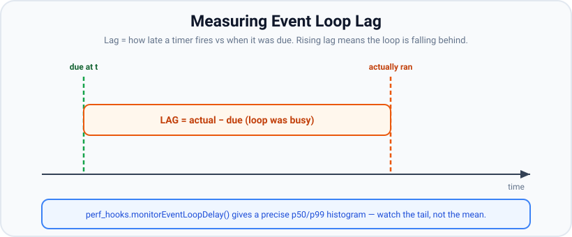

# Performance Tuning Checklist

*16 min read · Updated 12 Oct 2026 · Topic 115 of 117 · added to this kit, not part of the original course*

**Source:** written for this kit — examples verified on Node v24.19.0 and Express 5.3.0, compression 1.8.2, pg 8.23.1 with PostgreSQL 18.4 (embedded-postgres, run locally), ioredis 6.0.0 with Redis 8.0.5, pino 10.4.0

---

## Why it matters

Most slow Node services are slow for a small set of reasons that repeat from project to project: the event loop is blocked, connections are opened again for every request, responses are bigger than they need to be, the same data is fetched again and again, requests wait for a database connection, one page runs a hundred queries, or logging eats CPU. Each of these can be checked in a few minutes with a short script, and each has a known fix.

The trap is fixing things by feel. A change that sounds faster (compress everything, raise the pool size, switch loggers) can make no difference or make things worse on your workload. This checklist gives, for each item, **what to measure**, **a small check you can run** (with the real output from this machine), **the usual fix**, and **the kit lesson that covers it in depth**. Measure first, change one thing, measure again ([lesson 114](114-load-testing-and-profiling.md) shows that loop with a load generator).

## The concept, simply

Think of a request's time as a sum of parts:

text

```
request time ≈ wait for the event loop        (item 1: event-loop delay)
             + connection setup                (item 2: keep-alive)
             + wait for a pooled DB connection (item 5: pool)
             + database round trips × count    (item 6: N+1)
             + work to build the response      (items 4, 7, 8: caching, payload, logging)
             + bytes on the wire ÷ bandwidth   (items 3, 7: compression, payload size)
```

Tuning means finding which part is large for *your* requests and shrinking that one. A part that is already small is not worth touching. The checks below each isolate one part, so you can see its size directly instead of guessing from total latency.

## How it works

The checklist, in the order worth checking:

1. **Event-loop delay.** Measure p99 and max lag with `monitorEventLoopDelay()`. Fix synchronous hot spots (lesson 10).
2. **Keep-alive.** Count TCP connections per request, outbound and inbound. Reuse sockets; align idle timeouts with the proxy (lessons 75 and 61).
3. **Compression.** Compare bytes on the wire and server time per response. Compress large text responses, skip small ones (lesson 80).
4. **Caching layers.** Measure latency and hit counts per layer: in-process, Redis, origin (lesson 64).
5. **Connection pools.** Watch `waitingCount` and the time spent in `pool.connect()`. Size the pool for your concurrency and the database's limits (lesson 46).
6. **N+1 queries.** Count queries per request. Replace per-row queries with a JOIN or one batched `IN`/`ANY` query (lessons 101–104).
7. **Payload size.** Measure response bytes and `JSON.stringify` time. Select only the needed columns and paginate (lessons 41 and 80).
8. **Logging cost.** Measure time per log line with your logger and destination. Keep disabled levels cheap and avoid `util.inspect`-style formatting on hot paths (lesson 56).

**How the checks were run.** Every number below comes from running the script shown, on one laptop: Intel Core i5-1135G7 (4 cores, 8 threads), 15 GB RAM, Ubuntu 26.04, Node v24.19.0. PostgreSQL and Redis ran on the same machine, so database "round trips" are loopback round trips, much shorter than across a real network. Other jobs (other people's builds and servers) were loading the machine at the same time: the 1-minute load average was between 4 and 8 during these runs. Timings moved a lot from run to run (the N+1 check below ranged from 20 to 58 ms within one output), so compare numbers only within one output block, and treat them as sizes, not benchmarks.

**What each item's fields mean.** *Measure* is the number to look at. *Check* is a script you can run on your own app or machine. *Fix* is the usual change. *In depth* points to the kit lesson with the mechanism and more examples.

## Code examples

**Example 1 — event-loop delay.**

*Measure:* p99 and max of the event-loop delay histogram, not the mean. While one callback runs synchronously, every other request, timer and socket on that process waits. `perf_hooks.monitorEventLoopDelay()` (added in v11.10.0) samples a timer at a fixed `resolution` and records how late it fired. A loop that is blocked now and then shows a fine median and a bad tail.


*Figure: Measuring event-loop lag. Look at: "LAG = actual − due" and the note to watch the tail (p99), not the mean.*

*Check:*

javascript

```
// eld.js — event-loop delay with and without a 40 ms synchronous block every 200 ms
import { monitorEventLoopDelay } from 'node:perf_hooks';
import { setTimeout as sleep } from 'node:timers/promises';

const RES = 10;                                  // sample every 10 ms; each value includes RES
const ms = (ns) => Math.max(0, ns / 1e6 - RES).toFixed(1);

async function measure(label, blockMs) {
  const h = monitorEventLoopDelay({ resolution: RES });
  h.enable();
  await sleep(50);                               // let the histogram's timer start (see lesson 10)
  const timer = setInterval(() => {              // stand-in for a handler that does sync work
    const end = Date.now() + blockMs;
    while (Date.now() < end) {}
  }, 200);
  await sleep(3000);
  clearInterval(timer);
  h.disable();
  console.log(`${label.padEnd(22)} p50=${ms(h.percentile(50))}ms p99=${ms(h.percentile(99))}ms ` +
    `max=${ms(h.max)}ms samples=${h.count}`);
}

await measure('no blocking', 0);
await measure('40 ms block / 200 ms', 40);
```

bash

```
$ node eld.js
no blocking            p50=0.1ms p99=1.3ms max=4.0ms samples=300
40 ms block / 200 ms   p50=0.1ms p99=38.7ms max=39.2ms samples=250
```

With a 40 ms block every 200 ms the median lag stayed at 0.1 ms, because most samples fall between blocks. Only p99 and max show that some requests waited about 39 ms. The values subtract the 10 ms sampling interval, which every sample includes (lesson 10 shows this on an idle loop).

*Fix:* find the synchronous function with a CPU profile (`node --cpu-prof`, lesson 10's appendix; lesson 114 profiles a server under load), then remove it from the request path: cache its result, do less work, split it into chunks, or move it to a worker pool (piscina). Export p99 lag as a metric and alert on it (lesson 66).

*In depth:* [Blocking the Event Loop](10-blocking-the-event-loop.md).

**Example 2 — keep-alive, outbound and inbound.**

*Measure:* TCP connections opened per request. Every new connection costs a TCP handshake (one round trip), and for HTTPS a TLS handshake on top. An agent with keep-alive reuses idle sockets.

*Check:* 200 sequential requests to a local server that counts the connections it accepts.

javascript

```
// keepalive.js — 200 sequential requests to a local server, counting the TCP connections it accepts
import http from 'node:http';
import { once } from 'node:events';

let accepted = 0;
const server = http.createServer((req, res) => res.end('ok'));
server.on('connection', () => accepted++);
server.listen(0, '127.0.0.1');
await once(server, 'listening');
const { port } = server.address();

function get(agent) {
  return new Promise((resolve, reject) => {
    http.get({ host: '127.0.0.1', port, path: '/', agent }, (res) => {
      res.resume();
      res.on('end', resolve);
    }).on('error', reject);
  });
}

async function run(label, agent) {
  accepted = 0;
  const t0 = performance.now();
  for (let i = 0; i < 200; i++) await get(agent);
  console.log(`${label.padEnd(38)} ${(performance.now() - t0).toFixed(0).padStart(4)} ms, ` +
    `${accepted} TCP connections`);
  agent?.destroy();
}

console.log('http.globalAgent.keepAlive =', http.globalAgent.keepAlive);
await run('new http.Agent({ keepAlive: false })', new http.Agent({ keepAlive: false }));
await run('new http.Agent({ keepAlive: true })', new http.Agent({ keepAlive: true }));
await run('default (http.globalAgent)', undefined);

await (await fetch(`http://127.0.0.1:${port}/`)).text();  // warm-up: loads undici, opens a socket
accepted = 0;
const t0 = performance.now();
for (let i = 0; i < 200; i++) await (await fetch(`http://127.0.0.1:${port}/`)).text();
console.log(`${'fetch() (undici global dispatcher)'.padEnd(38)} ${(performance.now() - t0).toFixed(0).padStart(4)} ms, ${accepted} TCP connections`);

console.log('server.keepAliveTimeout =', server.keepAliveTimeout, 'ms');
server.closeAllConnections();
server.close();
```

bash

```
$ node keepalive.js
http.globalAgent.keepAlive = true
new http.Agent({ keepAlive: false })    181 ms, 200 TCP connections
new http.Agent({ keepAlive: true })      63 ms, 1 TCP connections
default (http.globalAgent)               53 ms, 1 TCP connections
fetch() (undici global dispatcher)      463 ms, 1 TCP connections
server.keepAliveTimeout = 5000 ms
```

- `keepAlive: false` opened 200 connections for 200 requests; with keep-alive, one connection carried all of them. On loopback a connection costs well under a millisecond; across a network add one round trip each (plus TLS for HTTPS).
- `http.globalAgent` already has keep-alive on (changed in v19.0.0), so the cost appears only when code creates its own `new http.Agent()` without `keepAlive: true`, or sends `Connection: close`.
- `fetch()` also reused one connection, but 200 sequential calls took 463 ms against 53 ms for `http.get` on this machine, after a warm-up call. Per-call overhead matters only when you make many small calls in a row; measure it on your workload before switching APIs.
- **Inbound:** `server.keepAliveTimeout` is 5000 ms. Behind a proxy or load balancer that keeps idle connections longer (nginx upstream `keepalive_timeout` defaults to 60 s), Node closes them first and the proxy has to reconnect. Lesson 61's appendix counts this with nginx.

*Fix:* use one shared agent or dispatcher per upstream host, with keep-alive on, and do not create agents per request. Set `server.keepAliveTimeout` longer than the idle timeout of the proxy in front of you.

*In depth:* [Outbound HTTP: fetch, undici and http.request](75-outbound-http-fetch-undici-and-http-request.md) (agents, pools, `maxSockets`); [The cluster module](61-the-cluster-module.md) (appendix: nginx upstream keepalive).

**Example 3 — compression.**

*Measure:* bytes on the wire (without compression vs with it) and server time per response. Compression trades CPU on the server for fewer bytes.

*Check:* an Express 5 app returning 1,000 user rows (113 KB of JSON), with and without the `compression` middleware. `node:http` does not decode gzip or Brotli, so the script counts the bytes that actually crossed the socket.

javascript

```
// compress.js — bytes on the wire and time per request, with and without compression()
import express from 'express';
import compression from 'compression';
import http from 'node:http';
import { once } from 'node:events';

const rows = Array.from({ length: 1000 }, (_, i) => ({
  id: i, email: `user${i}@example.com`, name: `User ${i}`, role: i % 10 ? 'member' : 'admin',
  createdAt: new Date(Date.UTC(2026, 0, 1) + i * 60_000).toISOString(),
}));

const app = express();
app.get('/plain/users', (req, res) => res.json(rows));
app.use('/gz', compression());                    // default threshold: 1kb
app.get('/gz/users', (req, res) => res.json(rows));
app.get('/gz/tiny', (req, res) => res.json({ ok: true }));

const server = app.listen(0, '127.0.0.1');
await once(server, 'listening');
const base = `http://127.0.0.1:${server.address().port}`;

// node:http does not decode gzip, so this counts the bytes that crossed the socket
function get(path, accept) {
  return new Promise((resolve, reject) => {
    http.get(base + path, { headers: { 'Accept-Encoding': accept } }, (res) => {
      let n = 0;
      res.on('data', (c) => (n += c.length));
      res.on('end', () => resolve({ n, enc: res.headers['content-encoding'] ?? 'none', vary: res.headers.vary ?? '-' }));
    }).on('error', reject);
  });
}

for (const [path, accept] of [['/plain/users', 'gzip, br'], ['/gz/users', 'gzip, br'],
                              ['/gz/users', 'gzip'], ['/gz/tiny', 'gzip, br']]) {
  const first = await get(path, accept);
  const t0 = performance.now();
  for (let i = 0; i < 200; i++) await get(path, accept);
  const avg = (performance.now() - t0) / 200;
  console.log(`${path.padEnd(12)} accept="${accept}"`.padEnd(32) + ` encoding=${first.enc.padEnd(4)} ` +
    `vary=${first.vary.padEnd(15)} bytes=${String(first.n).padStart(6)}  ${avg.toFixed(2)} ms/request`);
}
server.close();
```

bash

```
$ node compress.js
/plain/users accept="gzip, br"   encoding=none vary=-               bytes=113571  1.22 ms/request
/gz/users    accept="gzip, br"   encoding=br   vary=Accept-Encoding bytes=  4930  4.46 ms/request
/gz/users    accept="gzip"       encoding=gzip vary=Accept-Encoding bytes= 11248  3.42 ms/request
/gz/tiny     accept="gzip, br"   encoding=none vary=Accept-Encoding bytes=    11  0.35 ms/request
```

- With `Accept-Encoding: gzip, br`, `compression` 1.8.2 chose Brotli (`br`; Brotli support was added in 1.8.0, and its default quality is 4 in the middleware source) and cut 113,571 bytes to 4,930. With gzip only it sent 11,248 bytes.
- The response under the 1 kb `threshold` was sent uncompressed, but `Vary: Accept-Encoding` was still set so caches keep the variants apart.
- Time per request (measured by the client, 200 sequential requests on loopback) went from 1.22 ms to 3.42 ms with gzip and 4.46 ms with Brotli. A rerun on a quieter machine gave 1.11, 1.52 and 2.12 ms: smaller numbers, same order. See Example 9 for when that trade pays.

*Fix:* compress large text responses (JSON, HTML, CSS, JS); leave small responses and already-compressed formats (images, video, zip) alone. If a reverse proxy or CDN in front of Node compresses, do it there and not twice. For static assets, compress once at build time instead of on every request.

*In depth:* [zlib: gzip, deflate and Brotli](80-zlib-compression.md).

**Example 4 — caching layers.**

*Measure:* latency of each layer and how many requests each layer answers (hit counts). A cache only helps if lookups are much cheaper than the origin *and* most requests hit it.

*Check:* a "top customers" query that scans 500,000 rows in PostgreSQL, in front of which sit Redis (shared by all instances, 60 s TTL) and an in-process `Map` (one per process, 1 s TTL).

javascript

```
// layers.js — time a lookup at each cache layer: in-process Map, Redis, then the database
import pg from 'pg';
import Redis from 'ioredis';

const pool = new pg.Pool({ connectionString: process.env.DATABASE_URL, max: 2 });
const redis = new Redis(process.env.REDIS_URL);

await pool.query(`DROP TABLE IF EXISTS orders;
  CREATE TABLE orders (id int, customer_id int, total numeric);
  INSERT INTO orders SELECT g, g % 1000, (g % 500) + 0.5 FROM generate_series(1, 500000) g;
  ANALYZE orders;`);

// the expensive read: per-customer totals, a full scan of 500,000 rows
const origin = async () => (await pool.query(
  'SELECT customer_id, sum(total)::float AS spent FROM orders GROUP BY customer_id ORDER BY spent DESC LIMIT 10')).rows;

const l1 = new Map();                                  // per-process; each instance has its own copy
const stats = { l1: 0, l2: 0, origin: 0 };
async function topCustomers() {
  const hit = l1.get('top');
  if (hit && hit.expires > Date.now()) { stats.l1++; return hit.value; }
  const cached = await redis.get('top');               // shared by every instance
  let value;
  if (cached) { stats.l2++; value = JSON.parse(cached); }
  else { stats.origin++; value = await origin(); await redis.set('top', JSON.stringify(value), 'EX', 60); }
  l1.set('top', { value, expires: Date.now() + 1000 });
  return value;
}

async function time(label, n, before) {
  const t = [];
  for (let i = 0; i < n; i++) {
    await before?.();
    const t0 = performance.now();
    await topCustomers();
    t.push(performance.now() - t0);
  }
  t.sort((a, b) => a - b);
  console.log(`${label.padEnd(26)} median ${t[n >> 1].toFixed(3)} ms  (n=${n}, min ${t[0].toFixed(3)}, max ${t[n - 1].toFixed(3)})`);
}

await redis.del('top');
await time('origin (miss, incl. SET)', 9, async () => { l1.clear(); await redis.del('top'); });
await time('L2 hit (Redis)', 200, async () => l1.clear());
await time('L1 hit (in-process Map)', 200);
console.log('hits by layer:', stats);
await redis.quit();
await pool.end();
```

bash

```
$ node layers.js
origin (miss, incl. SET)   median 82.933 ms  (n=9, min 70.870, max 108.187)
L2 hit (Redis)             median 0.105 ms  (n=200, min 0.067, max 0.300)
L1 hit (in-process Map)    median 0.001 ms  (n=200, min 0.001, max 0.006)
hits by layer: { l1: 200, l2: 200, origin: 9 }
```

On this machine the origin query took about 80 ms, a Redis hit about 0.1 ms (a loopback round trip plus `JSON.parse`), and an in-process hit about 0.001 ms. The counters show which layer served each call; in production, export them as metrics and watch the hit ratio after deploys and TTL changes.

*Fix:* cache data that is read much more often than it changes, with a TTL that matches how stale it may be. Use the in-process layer only for small, hot, briefly-stale data, since every instance holds its own copy and they expire at different times. Protect the origin from a stampede when a hot key expires (lesson 64 uses a lock with a unique token).

*In depth:* [Caching with Redis](64-caching-with-redis.md).

**Example 5 — connection pools.**

*Measure:* `pool.waitingCount` (requests queued for a connection) and how long `pool.connect()` takes. Time spent waiting for a pooled connection looks like database slowness in request timings, but the database is idle during it.

A pool keeps a fixed number of open database connections. A request borrows one, runs its queries and returns it. When all are in use, the next request waits in the pool's queue until one is released.


*Figure: How a connection pool works. Look at: "req C (waits)" and "req D (waits)": with `max: 2`, extra requests queue for a connection.*

*Check:* 20 concurrent 50 ms queries through a pool of 2 and a pool of 10.

javascript

```
// pool.js — 20 concurrent 50 ms queries through a pg Pool of size 2 and of size 10
import pg from 'pg';

const url = process.env.DATABASE_URL;
for (const max of [2, 10]) {
  const pool = new pg.Pool({ connectionString: url, max });
  await Promise.all(Array.from({ length: max }, () => pool.query('SELECT 1')));  // open the connections
  let peakWaiting = 0;
  const probe = setInterval(() => { peakWaiting = Math.max(peakWaiting, pool.waitingCount); }, 5);

  const waits = [];
  const t0 = performance.now();
  await Promise.all(Array.from({ length: 20 }, async () => {
    const asked = performance.now();
    const client = await pool.connect();            // time spent here = waiting for a free connection
    waits.push(performance.now() - asked);
    try { await client.query('SELECT pg_sleep(0.05)'); } finally { client.release(); }
  }));
  const total = performance.now() - t0;
  clearInterval(probe);
  waits.sort((a, b) => a - b);
  console.log(`max=${String(max).padEnd(2)} total ${total.toFixed(0)} ms | totalCount=${pool.totalCount} ` +
    `peak waitingCount=${peakWaiting} | acquire wait p50=${waits[10].toFixed(0)} ms max=${waits[19].toFixed(0)} ms`);
  await pool.end();
}
```

bash

```
$ node pool.js
max=2  total 509 ms | totalCount=2 peak waitingCount=18 | acquire wait p50=255 ms max=458 ms
max=10 total 104 ms | totalCount=10 peak waitingCount=10 | acquire wait p50=52 ms max=54 ms
```

With `max: 2`, the 20 queries ran two at a time: about 500 ms in total, up to 18 requests waiting, and the last one waited 458 ms for a connection before its 50 ms query even started. With `max: 10` the total was about 100 ms.

*Fix:* size the pool for the concurrency you need, but remember the total: instances × pool size must stay under the database's `max_connections` (PostgreSQL's default is "typically 100", per its docs), and more connections than the database has cores to run them does not make queries faster. Always release clients (`try … finally`). If the wait is long because the queries are slow, fix the queries, not the pool size.

*In depth:* [Connection Pooling](46-connection-pooling.md) (sizing, `pool.on('error')`, pool statistics, shutdown).

**Example 6 — N+1 queries.**

*Measure:* queries per request. The N+1 pattern runs one query for a list and then one more query per row. Each query costs a round trip, so the time grows with the number of rows.

*Check:* list 100 posts with each author's name, three ways, counting queries with a wrapper around `pool.query`.

javascript

```
// nplus1.js — list 100 posts with their author's name: N+1 queries vs one JOIN vs one batched IN
import pg from 'pg';

const pool = new pg.Pool({ connectionString: process.env.DATABASE_URL, max: 5 });
let queries = 0;
const q = (text, params) => { queries++; return pool.query(text, params); };

await pool.query(`DROP TABLE IF EXISTS posts, authors;
  CREATE TABLE authors (id int PRIMARY KEY, name text NOT NULL);
  CREATE TABLE posts (id int PRIMARY KEY, author_id int NOT NULL REFERENCES authors, title text NOT NULL);
  INSERT INTO authors SELECT g, 'Author ' || g FROM generate_series(1, 50) g;
  INSERT INTO posts SELECT g, 1 + g % 50, 'Post ' || g FROM generate_series(1, 1000) g;`);

const strategies = {
  async 'N+1 (query per post)'() {
    const { rows: posts } = await q('SELECT id, author_id, title FROM posts ORDER BY id LIMIT 100');
    for (const p of posts) {
      const { rows } = await q('SELECT name FROM authors WHERE id = $1', [p.author_id]);
      p.author = rows[0].name;
    }
    return posts;
  },
  async 'JOIN (1 query)'() {
    const { rows } = await q(`SELECT p.id, p.author_id, p.title, a.name AS author
      FROM posts p JOIN authors a ON a.id = p.author_id ORDER BY p.id LIMIT 100`);
    return rows;
  },
  async 'batched IN (2 queries)'() {
    const { rows: posts } = await q('SELECT id, author_id, title FROM posts ORDER BY id LIMIT 100');
    const ids = [...new Set(posts.map((p) => p.author_id))];
    const { rows } = await q('SELECT id, name FROM authors WHERE id = ANY($1)', [ids]);
    const byId = new Map(rows.map((a) => [a.id, a.name]));
    return posts.map((p) => ({ ...p, author: byId.get(p.author_id) }));
  },
};

for (const [name, fn] of Object.entries(strategies)) {
  await fn();                                        // warm-up
  const times = [];
  let result;
  for (let i = 0; i < 7; i++) {
    queries = 0;
    const t0 = performance.now();
    result = await fn();
    times.push(performance.now() - t0);
  }
  times.sort((a, b) => a - b);
  console.log(`${name.padEnd(24)} queries=${String(queries).padEnd(3)} rows=${result.length} ` +
    `post 1 author="${result[0].author}" | median ${times[3].toFixed(1)} ms (7 runs, ${times[0].toFixed(1)}–${times[6].toFixed(1)})`);
}
await pool.end();
```

bash

```
$ node nplus1.js
N+1 (query per post)     queries=101 rows=100 post 1 author="Author 2" | median 33.1 ms (7 runs, 20.2–58.3)
JOIN (1 query)           queries=1   rows=100 post 1 author="Author 2" | median 1.1 ms (7 runs, 0.8–1.1)
batched IN (2 queries)   queries=2   rows=100 post 1 author="Author 2" | median 1.2 ms (7 runs, 1.1–2.0)
```

The N+1 version ran 101 queries and took 20–58 ms; the JOIN and the batched `ANY($1)` version ran 1 and 2 queries and took about 1 ms. These are loopback round trips. With 1 ms of network latency per query, the 100 extra queries alone would add about 100 ms (arithmetic, not measured).

*Fix:* JOIN, or collect the ids and fetch the related rows with one `WHERE id = ANY($1)` (or `IN (…)`), then match them up in a `Map`. ORMs have options that do this for you (Prisma `include`, Drizzle relational queries, Sequelize `include`, TypeORM `relations`); turn on query logging to confirm how many queries they actually send. For GraphQL resolvers, batch with DataLoader (lesson 68).

*In depth:* [Prisma ORM](101-prisma-orm.md), [Drizzle ORM](102-drizzle-orm.md), [Sequelize and TypeORM](103-sequelize-and-typeorm.md), [Knex Query Builder](104-knex-query-builder.md); trade-offs in [Choosing Between Raw SQL, a Query Builder and an ORM](106-choosing-raw-sql-query-builder-or-orm.md).

**Example 7 — payload size.**

*Measure:* response bytes and the time to serialise them. `JSON.stringify` runs on the event loop, so a large response blocks every other request while it is built, then costs bandwidth and client parse time.

*Check:* 5,000 posts with a ~2 KB body each, serialised three ways.

javascript

```
// payload.js — what "SELECT *" plus no pagination costs in JSON.stringify time and bytes
const body = 'Lorem ipsum dolor sit amet. '.repeat(70);          // ~2 KB article body per row
const rows = Array.from({ length: 5000 }, (_, i) => ({
  id: i, title: `Post ${i}`, slug: `post-${i}`, body, authorId: i % 50,
  createdAt: new Date(Date.UTC(2026, 0, 1) + i * 60_000).toISOString(), tags: ['node', 'perf'],
}));

function cost(label, make) {
  const times = [];
  let bytes = 0;
  for (let i = 0; i < 20; i++) {
    const t0 = performance.now();
    bytes = Buffer.byteLength(JSON.stringify(make()));
    times.push(performance.now() - t0);
  }
  times.sort((a, b) => a - b);
  console.log(`${label.padEnd(36)} ${String(bytes).padStart(9)} bytes  ` +
    `stringify median ${times[10].toFixed(2)} ms (20 runs, min ${times[0].toFixed(2)}, max ${times[19].toFixed(2)})`);
}

cost('all 5000 rows, every column', () => rows);
cost('all 5000 rows, list columns only', () => rows.map(({ id, title, slug, createdAt }) => ({ id, title, slug, createdAt })));
cost('page of 20 rows, list columns only', () => rows.slice(0, 20).map(({ id, title, slug, createdAt }) => ({ id, title, slug, createdAt })));
```

bash

```
$ node payload.js
all 5000 rows, every column           10480671 bytes  stringify median 39.83 ms (20 runs, min 35.52, max 46.08)
all 5000 rows, list columns only        446671 bytes  stringify median 2.07 ms (20 runs, min 1.56, max 4.73)
page of 20 rows, list columns only        1651 bytes  stringify median 0.01 ms (20 runs, min 0.01, max 0.21)
```

Sending every column of every row produced 10.5 MB and blocked the loop for about 40 ms per response. Selecting the four columns a list view needs cut it to 447 KB and 2 ms. A page of 20 rows was 1.6 KB.

*Fix:* select only the columns the client needs (no `SELECT *` into a list response), paginate every list endpoint with a maximum page size, and fetch large fields such as bodies only on detail endpoints. Compression (Example 3) shrinks bytes on the wire, but not the serialisation time or the database work.

*In depth:* [Validation, Pagination, Filtering & Sorting](41-validation-pagination-filtering-sorting.md); [zlib: gzip, deflate and Brotli](80-zlib-compression.md).

**Example 8 — logging cost.**

*Measure:* time per log line with your real logger and destination. Every line is serialised and written on the main thread (or handed to a worker), so a service that logs several lines per request pays for it on every request.

*Check:* write 100,000 request-log lines with each logger, three runs each, with stdout redirected to a file. `loop ms` is the time inside the logging loop; `process wall ms` includes Node startup and flushing before exit.

javascript

```
// log-worker.js — write 100,000 request-log lines with one logger; stdout goes to a file
import pino from 'pino';

const N = 100_000;
const mode = process.argv[2];
const entry = (i) => ({ reqId: `r-${i}`, method: 'GET', url: '/api/users/42', status: 200, ms: 3.2 });

let log;
if (mode === 'console.log(JSON)') log = (o) => console.log(JSON.stringify({ level: 30, time: Date.now(), ...o, msg: 'done' }));
if (mode === 'console.log(object)') log = (o) => console.log({ level: 30, time: Date.now(), ...o, msg: 'done' });
if (mode === 'pino()') { const l = pino(); log = (o) => l.info(o, 'done'); }
if (mode === 'pino sync:true') { const l = pino(pino.destination({ sync: true })); log = (o) => l.info(o, 'done'); }
if (mode === 'pino sync:false') { const l = pino(pino.destination({ sync: false, minLength: 4096 })); log = (o) => l.info(o, 'done'); }
if (mode === 'pino debug (level=info)') { const l = pino({ level: 'info' }); log = (o) => l.debug(o, 'done'); }

const t0 = performance.now();
for (let i = 0; i < N; i++) log(entry(i));
const loopMs = performance.now() - t0;
process.on('exit', () => process.stderr.write(`${loopMs.toFixed(0)}\n`)); // time in the logging loop
```

javascript

```
// logcost.js — run log-worker.js 3 times per logger, stdout redirected to a file
import { spawnSync } from 'node:child_process';
import { openSync, closeSync, statSync } from 'node:fs';

const modes = ['console.log(JSON)', 'console.log(object)', 'pino()', 'pino sync:true',
  'pino sync:false', 'pino debug (level=info)'];
for (const mode of modes) {
  const loop = [], wall = [];
  let size = 0;
  for (let run = 0; run < 3; run++) {
    const fd = openSync('out.log', 'w');
    const t0 = performance.now();
    const r = spawnSync('node', ['log-worker.js', mode], { stdio: ['ignore', fd, 'pipe'] });
    wall.push(Math.round(performance.now() - t0));
    closeSync(fd);
    loop.push(Number(r.stderr.toString().trim()));
    size = statSync('out.log').size;
  }
  console.log(`${mode.padEnd(24)} loop ms: ${loop.join(', ').padEnd(16)} process wall ms: ${wall.join(', ').padEnd(17)} file ${(size / 1e6).toFixed(1)} MB`);
}
```

bash

```
$ node logcost.js
console.log(JSON)        loop ms: 643, 601, 649    process wall ms: 753, 692, 711     file 12.4 MB
console.log(object)      loop ms: 1036, 1020, 1097 process wall ms: 1127, 1087, 1189  file 14.1 MB
pino()                   loop ms: 647, 758, 616    process wall ms: 828, 969, 836     file 16.7 MB
pino sync:true           loop ms: 668, 660, 710    process wall ms: 764, 732, 813     file 16.7 MB
pino sync:false          loop ms: 616, 582, 641    process wall ms: 775, 783, 850     file 16.7 MB
pino debug (level=info)  loop ms: 9, 8, 8          process wall ms: 122, 95, 101      file 0.0 MB
```

A sample line from each (`hostname` value removed):

text

```
{"level":30,"time":1791826541353,"reqId":"r-0","method":"GET","url":"/api/users/42","status":200,"ms":3.2,"msg":"done"}
{"level":30,"time":1791826541691,"pid":1766565,"hostname":"…","reqId":"r-0","method":"GET","url":"/api/users/42","status":200,"ms":3.2,"msg":"done"}
{
  level: 30,
  time: 1791826542336,
  reqId: 'r-0',
  method: 'GET',
  url: '/api/users/42',
  status: 200,
  ms: 3.2,
  msg: 'done'
}
```

- **Writing JSON costs about 4–8 µs per line** here, whether it comes from `console.log(JSON.stringify(…))` or pino. pino's line is longer (it adds `pid` and `hostname`), so it wrote 16.7 MB against 12.4 MB. In the run shown, the three pino destinations were within the run-to-run spread of each other and of `console.log(JSON)`. A second full run, on a quieter machine (load average 4.1), gave `pino()` 445–510 ms and `sync:false` 435–454 ms against 505–586 ms for `console.log(JSON)`, with `sync:true` at 542–585 ms. So the gap between them is small and changes between runs; measure with your own destination.
- **`console.log(object)` was the slowest** (about 1.0–1.1 s): it formats with `util.inspect` and writes multi-line, non-JSON output that log tools cannot parse.
- **A disabled level is nearly free:** 100,000 `debug` calls with `level: 'info'` took 8–9 ms, because pino checks the level before serialising.

These numbers are for a local file on one machine. A pipe to a log shipper, a container log driver, or a slow disk changes them; measure with your real destination. To turn the number into a budget: at 7 µs a line, 10,000 requests per second with 2 lines each costs 140 ms of main-thread time per second, about 14% of one core.

*Fix:* log structured JSON with a logger that skips disabled levels cheaply (pino); log one line per request rather than several; do not build expensive log arguments before the call; keep pretty-printing out of production. Consider pino's asynchronous destination (`sync: false`) or a transport for slow destinations, and accept that buffered lines can be lost in a hard crash.

*In depth:* [Logging](56-logging.md).

**Example 9 — edge case: compression made the response slower.**

In Example 3, compressing a 113 KB response cut it to 4,930 bytes but raised the time per request from 1.22 ms to 4.46 ms. On loopback, where bandwidth is effectively unlimited, the client got its data *later* with compression. Whether compression helps depends on the link:

text

```
transfer time = bytes × 8 ÷ link speed (calculated, not measured)

link            113,571 B uncompressed     4,930 B Brotli (+~3 ms CPU)
loopback        ~0 ms                      ~0 ms + 3 ms  → slower
1 Gbit/s LAN    0.9 ms                     0.04 ms + 3 ms → slower
10 Mbit/s       90.9 ms                    3.9 ms + 3 ms  → much faster
```

1. Measure the extra time per response on your hardware. Example 3 gave about 3 ms for Brotli on 113 KB in the run shown and about 1 ms in the rerun; the table uses 3 ms.
2. Estimate the transfer time saved on your clients' typical link: bytes saved × 8 ÷ link speed.
3. Compress when the saving is larger than the cost. For mobile and public clients it usually is; for service-to-service calls inside one data center, often not.

The transfer rows are arithmetic from the measured byte counts, not measurements, and they ignore TCP slow start and round trips, which make large uncompressed responses slower still on real networks.

## Common mistakes & gotchas

- **Watching averages.** A 40 ms block every 200 ms left the median event-loop lag at 0.1 ms. Alert on p99 and max (lesson 114 shows the same for request latency).
- **Creating an agent or client per request.** It throws away keep-alive: 200 connections for 200 requests in Example 2. Create one per upstream and reuse it.
- **Node's keep-alive timeout shorter than the load balancer's.** Node closes idle connections after 5 s by default; most proxies keep them longer.
- **Compressing everything.** Small responses grow or stay the same, and on fast links compression can add latency (Example 9). Compress twice (Node and the proxy) and you pay twice.
- **Raising the pool size to fix slow queries.** It only moves the queue into the database. Fix the queries; keep instances × pool size under `max_connections`.
- **Forgetting to release a pooled client.** One leaked client per error path and the pool is empty after `max` errors; every later request waits forever.
- **ORM lazy loading in a loop.** It is N+1 with nicer syntax. Turn on query logging and count.
- **Caching without measuring the hit ratio.** A cache with a 5% hit rate adds a network hop to 95% of requests.
- **`console.log(obj)` on a hot path.** It is the slowest option measured here and produces output log tools cannot parse.
- **Benchmarking on a busy machine and trusting one run.** The N+1 check ranged from 20 to 58 ms within one output. Run several times and report the spread.

## Best practices

- **Measure before and after every change,** with the same script, several runs each, and report the spread. Change one thing at a time.
- **Export the numbers the checks use as metrics:** event-loop delay p99, pool `waitingCount`, cache hits by layer, queries per request, response size. Then a regression shows up on a dashboard instead of in an incident.
- **Set budgets per endpoint:** maximum queries, maximum response size, p99 latency. Fail a test or a load test when one is exceeded (lesson 114 shows k6 thresholds).
- **Fix the largest part first.** The request-time sum in "The concept, simply" tells you which item to look at.
- **Keep the checks in the repo** (a `scripts/perf/` folder) so the next person can rerun them on new hardware or a new Node version.

## ⭐ Interview lens

> **Q: “p50 latency is fine but p99 is ten times worse. Where do you look first?”**  
> A: Something affects only some requests. Check event-loop delay p99: a periodic synchronous job (a large `JSON.stringify`, a sync crypto call, a regex) blocks every request that arrives during it. Then check pool `waitingCount` (bursts that exceed the pool queue), cache misses (the slow path behind a cache), and GC pauses. Measure each one; do not guess from the mean. *Trap:* averages hide this. A 40 ms block every 200 ms left the median lag at 0.1 ms.

> **Q: “How do you size a database connection pool?”**  
> A: Start from concurrency: the pool needs about as many connections as queries you want in flight at once, and requests beyond that wait (`waitingCount`). Then apply the global limit: instances × pool size must stay under the database's `max_connections`, leaving room for admin and migration connections. More connections than the database can run in parallel do not make anything faster. Measure acquire time under load. In the check here, 20 × 50 ms queries took 500 ms with `max: 2` and 100 ms with `max: 10`.

> **Q: “What is the N+1 problem and how do you detect it?”**  
> A: Loading a list with one query and then each row's related data with one query per row: 1 + N round trips. Detect it by counting queries per request (query logging, a wrapper around the driver, or APM spans). Fix with a JOIN or one batched `WHERE id = ANY($1)` query, or the ORM's eager-loading option; in GraphQL, DataLoader. Here: 101 queries and about 30 ms against 1–2 queries and about 1 ms, all on loopback.

> **Q: “Should a Node API always enable gzip?”**  
> A: Not always. Compression costs CPU per response and saves bytes. It pays on slow links and large text responses, but not for small responses (the middleware skips those under its 1 kb threshold) or on fast internal links, where it can add latency. If a proxy or CDN in front already compresses, do it there. Measure bytes and server time and decide per route.

## Cheat-card

- **Event loop:** `monitorEventLoopDelay({ resolution })`, read p99/max minus the resolution; fix sync hot spots (lesson 10).
- **Keep-alive:** `http.globalAgent.keepAlive` is `true` (since v19); a `new http.Agent()` needs `keepAlive: true`; `server.keepAliveTimeout` default 5000 ms, set it above the proxy's idle timeout (lessons 75, 61).
- **Compression:** `compression` 1.8.2 prefers `br` (quality 4), threshold 1 kb, sets `Vary: Accept-Encoding`; costs ms of CPU per large response (lesson 80).
- **Caching:** measure per-layer latency and hits; here origin ~80 ms, Redis ~0.1 ms, in-process ~0.001 ms (lesson 64).
- **Pools:** watch `waitingCount` and acquire time; instances × `max` < `max_connections`; release in `finally` (lesson 46).
- **N+1:** count queries per request; JOIN or `= ANY($1)` batch (lessons 101–104).
- **Payload:** select only needed columns, paginate; `JSON.stringify` of 10 MB blocked about 40 ms here (lesson 41).
- **Logging:** ~4–8 µs per JSON line here; `console.log(obj)` slowest; disabled pino levels nearly free (lesson 56).
- **Method:** same script, several runs, report the spread, state the machine and its load.

---

## Learn More

- [perf_hooks: monitorEventLoopDelay (Node.js docs) nodejs.org](https://nodejs.org/api/perf_hooks.html)
- [Don't block the event loop (Node.js guide) nodejs.org](https://nodejs.org/en/learn/asynchronous-work/dont-block-the-event-loop)
- [HTTP: Agent and server.keepAliveTimeout (Node.js docs) nodejs.org](https://nodejs.org/api/http.html)
- [compression middleware github.com](https://github.com/expressjs/compression)
- [pg.Pool API node-postgres.com](https://node-postgres.com/apis/pool)
- [pino getpino.io](https://getpino.io/)
