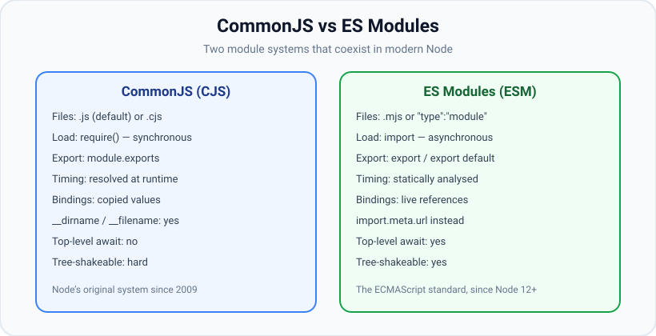

# ES Modules

*10 min read · Updated 24 Jul 2026 Topic 12 of 70 Bookmark Mark done Why it matters ES Modules · Topic 12 of 70*

**Source:** [https://www.geekyfrontend.in/learn/nodejs-backend-kit/es-modules](https://www.geekyfrontend.in/learn/nodejs-backend-kit/es-modules)

---

## Why it matters

ES Modules (ESM) are the official, standardized module system of JavaScript — the same `import` and `export` syntax that runs in browsers. For years Node had only CommonJS; today Node fully supports ESM, and a large and growing slice of the ecosystem is ESM-only or dual-published. If you are writing new backend code, publishing a library, or sharing code between a Node server and a browser bundle, you need to be fluent in ESM. Just as importantly, the boundary between ESM and CommonJS is where a huge number of real-world errors live — `ERR_REQUIRE_ESM`, `Cannot use import statement outside a module`, `__dirname is not defined`. Understanding both systems and how they interoperate is what makes those errors instantly diagnosable instead of terrifying.

ESM is not just "new syntax for the same thing." It changes *when* dependencies are resolved (statically, before execution), *how* bindings behave (live, not copied), and *what* is available (top-level `await`, but no `__dirname`). Those differences have practical consequences the moment you switch.

## The concept, simply

Instead of `require`/`module.exports`, ESM uses declarative `import` and `export` statements:

javascript

```
// math.mjs
export function add(a, b) { return a + b; }
export const PI = 3.14159;
export default function multiply(a, b) { return a * b; }

// app.mjs
import multiply, { add, PI } from './math.mjs';
```

The key mental shift: `import`/`export` are not function calls that run line by line — they are *static declarations* that the engine reads before any code executes. Node parses the whole dependency graph first, links it, and only then runs module bodies. That is why `import` must appear at the top level (not inside an `if`) and why the specifier must be a string literal, not a computed expression. For genuinely dynamic loading, ESM offers `await import(expr)`, which is an async function returning a promise.



CommonJS and ES Modules differ in more than syntax: loading model (sync vs async), binding semantics (copied values vs live references), and available globals all change when you switch.

## How it works

**Telling Node a file is ESM.** Node decides a file's module system by three signals, in order: a `.mjs` extension is always ESM; a `.cjs` extension is always CommonJS; a plain `.js` file follows the nearest `package.json`'s `"type"` field — `"type": "module"` makes `.js` ESM, `"type": "commonjs"` (or absent) makes it CommonJS. So the same `.js` source can be interpreted either way depending on the package it lives in.

**Three phases: parse, link, evaluate.** ESM loading is not a single synchronous read like `require`. Node (1) *parses* every module in the graph to discover its imports and exports without running any code, (2) *links* them — connecting each import to the exact exported binding it refers to — and (3) *evaluates* module bodies in dependency order. This static, ahead-of-time analysis is what enables bundler tree-shaking and what makes circular ESM graphs behave more predictably than CommonJS ones.

**Live bindings, not copies.** A CommonJS `require` gives you a snapshot of `module.exports` at require time. An ESM `import` gives you a *live, read-only view* of the exporter's binding. If the exporting module later reassigns an exported `let`, importers see the new value. You cannot reassign an imported binding — imports are constant references into the source module.

javascript

```
// counter.mjs
export let count = 0;
export function inc() { count++; }

// app.mjs
import { count, inc } from './counter.mjs';
console.log(count); // 0
inc();
console.log(count); // 1  — live binding reflects the change
// count = 5;       // TypeError: Assignment to constant variable-like binding
```

**Top-level await.** ESM module bodies may use `await` at the top level. Node treats such a module as asynchronous: any module importing it waits for its top-level awaits to settle before its own body runs. This is impossible in CommonJS and is a major reason `require` cannot synchronously load an ESM module that uses it.

**Evaluated once, then cached.** Like CommonJS, ESM keeps a module map (the module registry) keyed by the resolved URL, so a given module's body runs exactly once per process no matter how many files import it. The difference is what the cache holds: CommonJS caches the finished `module.exports` object, whereas ESM caches a *Module Record* whose exported bindings stay live. Import the same module from ten places and every importer shares one instance — the same singleton guarantee that makes a shared config or connection pool work, and the same trap if you mutate module-level state expecting isolation. One subtlety: the registry key is the fully-resolved URL including any query string, so `import './x.js?v=1'` and `import './x.js?v=2'` are two *separate* instances — the closest thing ESM has to cache-busting, since there is no `delete require.cache` equivalent.

**`import.meta` — per-module metadata.** `import.meta` is an object the host populates with information about the current module. Node always provides `import.meta.url` (the module's absolute `file:` URL) and, on Node 20.11+/21.2+, the convenience properties `import.meta.dirname` and `import.meta.filename`. It also exposes `import.meta.resolve(specifier)`, the ESM counterpart to `require.resolve`, which returns the URL a specifier would resolve to without loading it — handy for locating an asset shipped beside your code. Because `import.meta.url` is a real URL string, the idiomatic way back to a filesystem path is always `fileURLToPath(import.meta.url)`; slicing off the `file://` prefix by hand breaks on Windows drive letters and on paths containing spaces or non-ASCII characters, which is exactly why the `node:url` helper exists.

**No `__dirname`, no `require`.** ESM files do not get the CommonJS wrapper, so `require`, `module`, `exports`, `__filename`, and `__dirname` do not exist. Instead you get `import.meta.url` (the module's URL). Reconstruct the old values with the `url` module, or on modern Node use the built-in helpers:

javascript

```
import { fileURLToPath } from 'node:url';
import path from 'node:path';

const __filename = fileURLToPath(import.meta.url);
const __dirname = path.dirname(__filename);
// Node 20.11+ / 21.2+ also expose import.meta.dirname and import.meta.filename directly.
```

**ESM ↔ CJS interop.** The two systems meet under clear rules:

- **ESM importing CJS:** allowed. The CommonJS `module.exports` object becomes the ESM *default* export. So `import pkg from 'some-cjs-lib'` gives you `module.exports`. Node also tries to statically detect named exports (`import { readFile } from 'node:fs'` works for builtins and many packages), but detection is best-effort — when it fails, import the default and destructure.
- **CJS importing ESM:** historically forbidden — `require()` of an ESM file threw `ERR_REQUIRE_ESM`. The universal escape hatch is dynamic `await import()`, which works in both worlds. (Recent Node versions can `require()` a synchronous ESM module — one with no top-level await — but `import()` remains the portable answer.)
- File extensions are mandatory in relative ESM specifiers: `import './util.js'`, not `import './util'`. CommonJS's extension guessing does not apply.

## Code examples

**1. Named, default, and namespace imports.**

javascript

```
// shapes.mjs
export const PI = 3.14159;
export function area(r) { return PI * r * r; }
export default class Circle { constructor(r) { this.r = r; } }

// app.mjs
import Circle, { area, PI } from './shapes.mjs'; // default + named
import * as shapes from './shapes.mjs';          // namespace object
console.log(shapes.PI, shapes.default);          // 3.14159, [class Circle]
```

**2. Top-level await at module scope.**

javascript

```
// config.mjs
const res = await fetch('https://example.com/config.json');
export const config = await res.json();

// server.mjs — waits for config.mjs's top-level awaits before running
import { config } from './config.mjs';
console.log('Loaded config:', config);
```

**3. Loading a CommonJS module from ESM.**

javascript

```
// legacy-lib is CommonJS: module.exports = { greet }
import legacy from 'legacy-lib';   // whole module.exports as default
legacy.greet('world');
// Named import may also work if Node detects it:
import { greet } from 'legacy-lib'; // best-effort static analysis
```

**4. Loading ESM from CommonJS with dynamic import.**

javascript

```
// index.cjs (CommonJS)
async function main() {
  const { default: chalk } = await import('chalk'); // chalk is ESM-only
  console.log(chalk.green('works from CJS via import()'));
}
main();
```

## Common mistakes & gotchas

- **Omitting the file extension.** `import './util'` throws `ERR_MODULE_NOT_FOUND` in ESM — write `'./util.js'`.
- **Using `__dirname` in ESM.** Not defined — reconstruct from `import.meta.url` or use `import.meta.dirname`.
- **`require` of an ESM package.** Classic `ERR_REQUIRE_ESM`. Use `await import()` instead, or make your own file ESM.
- **Forgetting `"type": "module"`.** A `.js` file using `import` in a default package throws `Cannot use import statement outside a module`.
- **Expecting `import` to run conditionally.** Static `import` is hoisted and always evaluated. For conditional/dynamic loading use `await import()`.
- **Assuming named imports always exist on a CJS package.** Node's named-export detection is heuristic; import the default and destructure when it fails.
- **Trying to reassign an import.** Imports are read-only live bindings — assignment is a syntax/type error.
- **Mixing `module.exports` and `export` in one file.** A file is one system or the other; you cannot use both.

## Best practices

- For new projects, prefer ESM: set `"type": "module"` and use `.js` with `import`/`export`.
- Always include explicit file extensions in relative imports.
- Replace `__dirname` with `import.meta.dirname` (or `fileURLToPath(import.meta.url)` for older Node).
- When publishing a library, ship **dual** builds and wire them with the `exports` field's `import`/`require` conditions so both worlds work.
- Use `await import()` as the portable bridge whenever you must load ESM from CJS or load a module conditionally/lazily.
- Keep top-level `await` deliberate — it delays every importer; do not use it for work that could be a lazily-called async function.
- Prefer named exports for tree-shakeable, discoverable APIs; reserve `default` for a single primary export.

## ⭐ Interview lens

> **Q: Name three concrete differences between ESM and CommonJS beyond syntax.** (1) Loading: `require` is synchronous and runtime; `import` is statically analysed and async. (2) Bindings: CJS gives a copied snapshot of exports; ESM gives live read-only bindings. (3) Environment: ESM has top-level `await` and `import.meta` but no `__dirname`/`require`.

> **Q: What does "live binding" mean?** An imported name is a reference into the exporting module's variable, not a copy. If the exporter reassigns an exported `let` later, importers observe the new value. In CommonJS you would have captured the old value at require time.

> **Q: How does Node decide whether a `.js` file is ESM or CJS?** The nearest `package.json`'s `"type"` field: `"module"` → ESM, `"commonjs"` or absent → CJS. `.mjs` is always ESM and `.cjs` always CJS regardless of `"type"`.

> **Q: You get `ERR_REQUIRE_ESM`. What is happening and how do you fix it?** Code is calling `require()` on an ESM-only package. Options: convert the calling file to ESM, or use `const mod = await import('pkg')` which works from both systems. Trap: interviewers may ask why you can't "just require it" — because ESM may use top-level await, which cannot resolve synchronously.

> **Q: How do you get `__dirname` in an ES module?** `const __dirname = path.dirname(fileURLToPath(import.meta.url))`, or directly `import.meta.dirname` on Node 20.11+.

> **Q: When you `import x from` a CommonJS module, what is `x`?** The module's entire `module.exports` object, bound as the default export. Named imports may additionally work if Node's static analysis detects them.

## Cheat-card

- **ESM signals:** `.mjs`, or `.js` + `"type":"module"`. **CJS:** `.cjs`, or `.js` default.
- **Syntax:** `export` / `export default` / `import x, { y } from './f.js'`.
- **Extensions required** in relative ESM specifiers.
- **Live bindings** (read-only) vs CJS copied snapshot.
- **Top-level await** allowed in ESM only; makes the module async.
- **No `__dirname`** → use `import.meta.dirname` / `fileURLToPath(import.meta.url)`.
- **Interop:** ESM imports CJS as default; CJS loads ESM via `await import()`.
- **`await import(expr)`** = dynamic/conditional loading, works in both systems.
- **JSON:** `import x from './x.json' with { type: 'json' }`, default export only. `assert { … }` was removed in v22.0.0.
- **Hooks:** `module.registerHooks({ resolve, load })` (sync, in-thread, RC since v24.13.1), loaded via `--import`. `module.register()` is deprecated (DEP0205, v24.15.0).
- **TypeScript:** `node file.ts` strips types, and imports use `.ts` extensions. See [TypeScript with Node](71-typescript-with-node.md).
- **For `require()` callers:** no top-level `await`. Export `"module.exports"` to choose what `require()` returns. `"module-sync"` serves one ESM file to `require` and `import`.

---

## Learn More

- [Modules: ECMAScript modules nodejs.org](https://nodejs.org/api/esm.html)
- [JavaScript modules (import / export) developer.mozilla.org](https://developer.mozilla.org/en-US/docs/Web/JavaScript/Guide/Modules)
- [ESM vs CommonJS in your Node Projects Covalence](https://www.youtube.com/watch?v=I3DrifH-rJE)
- [Outbound HTTP: fetch, undici and http.request (this kit)](75-outbound-http-fetch-undici-and-http-request.md)

---

## Additional topics

*Added 7 Oct 2026 · examples verified on Node v24.19.0*

### Import attributes: `with { type: 'json' }`

An import attribute is a key-value list written after the specifier (`import data from './x.json' with { type: 'json' }`) that tells the loader which format the importer expects. Node supports one key, `type`. It accepts `'json'` (JSON modules) and `'text'` (text modules, which on v24.19.0 need `--experimental-import-text`, added in v24.19.0, Stability 1.0). The attribute exists because a file extension alone is not proof of format. Requiring `type: 'json'` means a JSON import can never be evaluated as JavaScript, and the attribute is part of the module cache key. Without the attribute, a JSON import fails with `ERR_IMPORT_ATTRIBUTE_MISSING`.

Version history (from the ESM docs' History tables):

- v17.1.0 / v16.14.0: experimental *import assertions*, `assert { type: 'json' }`.
- v21.0.0 / v20.10.0 / v18.20.0: switched to *import attributes*, `with { type: 'json' }`.
- v22.0.0: dropped support for import assertions. On v24.19.0, `assert { … }` is a syntax error.
- v23.1.0 / v22.12.0 / v20.18.3 / v18.20.5: import attributes and JSON modules are no longer experimental.

How it works:

1. The parser reads the `with` clause along with the specifier. For dynamic `import()`, the attributes go in the second argument: `import(spec, { with: { type: 'json' } })`.
2. The loader determines the file's format (`.json` → `json`) and checks that the attribute matches. A JSON file without `type: 'json'` throws `ERR_IMPORT_ATTRIBUTE_MISSING`.
3. The JSON text is parsed once and exposed as the module's **default** export only. There are no named exports.
4. The parsed object is also stored in the CommonJS cache, so a `require()` of the same path returns the same object.

**Example — static and dynamic JSON imports.** With `config.json` = `{ "port": 4300, "features": ["a", "b"] }` and a `package.json` of `{ "name": "l12-demo", "version": "1.4.0" }`:

javascript

```
// attrs.mjs
import config from './config.json' with { type: 'json' };
import { createRequire } from 'node:module';

console.log(config.port, config.features);

// Dynamic form: the attributes go in the second argument, under `with`
const { default: pkg } = await import('./package.json', { with: { type: 'json' } });
console.log(pkg.name, pkg.version);

// One shared object: the JSON module is also put in the CommonJS cache
const require = createRequire(import.meta.url);
console.log('same object as require():', require('./config.json') === config);
```

bash

```
$ node attrs.mjs
4300 [ 'a', 'b' ]
l12-demo 1.4.0
same object as require(): true
```

And the three ways to get it wrong, each a one-line file:

bash

```
$ node noattr.mjs      # import c from './config.json';
…
TypeError [ERR_IMPORT_ATTRIBUTE_MISSING]: Module "file:///…/config.json" needs an import attribute of "type: json"
…
$ node assert.mjs      # import c from './config.json' assert { type: 'json' };
file:///…/assert.mjs:1
import c from './config.json' assert { type: 'json' }; console.log(c);
                              ^^^^^^

SyntaxError: Unexpected identifier 'assert'
…
$ node named.mjs       # import { port } from './config.json' with { type: 'json' };
file:///…/named.mjs:1
…
SyntaxError: The requested module './config.json' does not provide an export named 'port'
…
```

### Module customization hooks: `module.registerHooks()` and `module.register()`

Customization hooks are functions you put into Node's module loader. A `resolve` hook turns a specifier into a URL, and a `load` hook turns a URL into `{ format, source }`. They exist so tools can teach Node new things without a build step: TypeScript loaders (tsx registers hooks), mocking, import maps, loading `.sql` or `.yaml` files as modules. `node:module` has two APIs:

- **`module.registerHooks({ resolve, load })`.** Added in v23.5.0 / v22.15.0, **Stability 1.2 - Release candidate** since v24.13.1. The hooks are plain synchronous functions that run on the same thread as your code. They apply to `import`, `import()` and `require()` alike, and the returned object has `deregister()`.
- **`module.register(specifier, parentURL)`.** Added in v20.6.0 / v18.19.0. It loads a *module* of async hooks and runs them on a separate loader thread. It is **deprecated since v24.15.0** (DEP0205, documentation-only, Stability 0). The docs give its reasons (worker-thread orchestration, caveats with CommonJS) and say to migrate to `registerHooks()`. On v24.19.0 it still works and prints no warning, even with `--pending-deprecation`.

How a load goes through the hook chain:

1. You register hooks before the code they should affect is loaded, usually with `node --import ./hooks.mjs app.mjs` (or `--require`).
2. For each `import` or `require`, Node calls the last-registered `resolve` hook with `(specifier, context, nextResolve)`. Each hook either returns `{ url }` or calls `nextResolve` to pass the work down the chain, ending at Node's default resolver.
3. Node then calls the `load` chain with `(url, context, nextLoad)`. A hook can return its own `{ format, source }`. `format` is one of `'module'`, `'commonjs'`, `'json'`, `'module-typescript'`, `'commonjs-typescript'`, `'wasm'`, `'builtin'` or `'addon'`.
4. A hook that returns without calling `next…()` must set `shortCircuit: true`, or Node throws. That rule catches hooks that break the chain by accident.
5. Node evaluates the returned source in that format.

**Example — a tiny `load` hook that makes `.sql` files importable.**

javascript

```
// sql-hooks.mjs — let `import q from './x.sql'` and `require('./x.sql')` return the file's text
import { registerHooks } from 'node:module';
import { readFileSync } from 'node:fs';
import { fileURLToPath } from 'node:url';

registerHooks({
  load(url, context, nextLoad) {
    if (!url.endsWith('.sql')) return nextLoad(url, context);   // everything else: default loader
    const text = readFileSync(fileURLToPath(url), 'utf8');
    return {
      format: 'module',
      source: `export default ${JSON.stringify(text)};`,
      shortCircuit: true,                                        // we did not call nextLoad
    };
  },
});
```

javascript

```
// app.mjs  (get-user.sql contains: SELECT id, name FROM users WHERE id = $1;)
import getUser from './get-user.sql';
import { createRequire } from 'node:module';
console.log('import :', getUser.trim());
const require = createRequire(import.meta.url);
console.log('require:', require('./get-user.sql').default.trim());
```

bash

```
$ node --import ./sql-hooks.mjs app.mjs
import : SELECT id, name FROM users WHERE id = $1;
require: SELECT id, name FROM users WHERE id = $1;
$ node app.mjs
…
TypeError [ERR_UNKNOWN_FILE_EXTENSION]: Unknown file extension ".sql" for /…/get-user.sql
…
```

The same synchronous hook served both `import` and `require()`. The `require()` call returned a namespace (hence `.default`), because the hook said the format is `'module'` and `require(esm)` returns the namespace object.

### TypeScript files

On v24.19.0, Node runs `.ts`, `.mts` and `.cts` files directly by stripping type annotations (stable since v24.12.0). This follows the same ESM rules as this lesson. `.mts` is always ESM, `.ts` follows `"type"`, and relative imports need the real extension (`import './env.ts'`). Type-only imports must be marked `import type`, because Node keeps every other import as a runtime import. Nothing is type-checked. The full setup (`tsconfig.json` with `nodenext`, `erasableSyntaxOnly`, `verbatimModuleSyntax`, `tsc --noEmit`, typed Express handlers) is in [TypeScript with Node](71-typescript-with-node.md).

### `require(esm)` from the ES module author's side

Since v22.12.0 / v20.19.0 (unflagged), and stable since v24.15.0, a CommonJS file can `require()` your ES module. This works only while your module's graph is synchronous. What CommonJS callers receive is therefore part of your package's API, and you control three things: the shape they get, whether `require()` is allowed at all (top-level `await`), and which file they get (the `"module-sync"` condition).

How it works for the author:

1. **Default shape.** `require()` returns your module namespace object: named exports as properties, the default export under `.default`, and `__esModule: true` when a default exists.
2. **Custom shape.** Export a binding under the string name `"module.exports"` (`export { log as 'module.exports' }`, supported since v23.0.0 / v22.12.0) and `require()` returns that value itself, like a CommonJS `module.exports = log`. Your other named exports are then invisible to `require()` callers unless you attach them to that value. `import` callers still see everything.
3. **Top-level `await` is the line.** If your module, or anything it statically imports, uses top-level `await`, every `require()` of it throws `ERR_REQUIRE_ASYNC_MODULE`. Adding top-level `await` is therefore a breaking change for CommonJS users.
4. **`"module-sync"` condition.** In `"exports"`, `"module-sync"` matches for `import`, `import()` *and* `require()`, but only on Node versions where `require(esm)` is enabled. It was added in v22.10.0 / v20.19.0, and on v22.10 and v22.11 it is active only with `--experimental-require-module`. List it before a CommonJS `"default"` and every caller on new Node gets one ESM file, while older Node keeps getting the CommonJS build. The file must not use top-level `await`.

**Example — the `"module.exports"` export.**

javascript

```
// logger.mjs — ESM that hands CommonJS callers a plain function
export default function log(msg) { console.log(`[log] ${msg}`); }
export const level = 'info';                     // lost to require() callers
export { log as 'module.exports' };
```

javascript

```
// use-logger.cjs
const log = require('./logger.mjs');
log('hello from CJS');
console.log(typeof log, log.level);
import('./logger.mjs').then((ns) => console.log(Object.keys(ns)));
```

bash

```
$ node use-logger.cjs
[log] hello from CJS
function undefined
[ 'default', 'level', 'module.exports' ]
```

**Example — one ESM file for everyone with `"module-sync"`.** `node_modules/greet/package.json`:

json

```
{
  "name": "greet",
  "exports": {
    "module-sync": "./index.mjs",
    "default": "./index.cjs"
  }
}
```

The two entry files:

javascript

```
// node_modules/greet/index.mjs
export function greet(name) { return `hi ${name} (from index.mjs)`; }
```

javascript

```
// node_modules/greet/index.cjs
exports.greet = (name) => `hi ${name} (from index.cjs)`;
```

The caller:

javascript

```
// use-greet.cjs
const { greet } = require('greet');
console.log('require:', greet('Ada'));
import('greet').then((m) => console.log('import :', m.greet('Ada')));
```

bash

```
$ node use-greet.cjs
require: hi Ada (from index.mjs)
import : hi Ada (from index.mjs)
$ node --no-require-module use-greet.cjs
require: hi Ada (from index.cjs)
import : hi Ada (from index.cjs)
$ npx node@22.11.0 use-greet.cjs
require: hi Ada (from index.cjs)
import : hi Ada (from index.cjs)
```

Both callers get the same `index.mjs`, so there is one module instance and no dual-package hazard (two copies of the package's state). Where `require(esm)` is off, Node skips `"module-sync"` and falls back to `"default"`.

### Common mistakes & gotchas (additional topics)

- **Still writing `assert { type: 'json' }`.** Removed in v22.0.0. It is now `SyntaxError: Unexpected identifier 'assert'`. Use `with`.
- **Named imports from JSON.** `import { port } from './config.json' with { type: 'json' }` fails. JSON modules have only a default export.
- **Building new hooks on `module.register()` or `--loader`.** `register()` is deprecated (DEP0205), and `--experimental-loader` prints a warning telling you to use `register()` instead. Use `module.registerHooks()`.
- **Hooks that end the chain silently.** A `load` hook that returns `{ format, source }` without calling `nextLoad()` or setting `shortCircuit: true` throws `TypeError [ERR_INVALID_RETURN_PROPERTY_VALUE]: Expected true to be returned for the "shortCircuit" from the "load" hook but got undefined.`
- **Using `"module.exports"` and expecting named exports to survive.** `require()` callers get only that value: `log.level` was `undefined` above.

### Edge case worked through: registering hooks in the file that needs them

Static `import` declarations are all loaded and linked *before* any code in the importing module runs. A hook registered by one static import therefore does not exist yet while its sibling imports load:

javascript

```
// inline.mjs — registers the hook in the same file that needs it
import './sql-hooks.mjs';                 // runs registerHooks()
import query from './get-user.sql';      // static: linked BEFORE any code above runs
console.log(query);
```

javascript

```
// inline-fixed.mjs — register first, then load with dynamic import()
import './sql-hooks.mjs';
const { default: query } = await import('./get-user.sql');
console.log(query.trim());
```

bash

```
$ node inline.mjs
…
TypeError [ERR_UNKNOWN_FILE_EXTENSION]: Unknown file extension ".sql" for /…/get-user.sql
…
$ node inline-fixed.mjs
SELECT id, name FROM users WHERE id = $1;
```

`sql-hooks.mjs` appears first, but Node has to load `get-user.sql` during linking, before `sql-hooks.mjs` has been evaluated. Register hooks with `--import`/`--require`, or load the affected modules with `import()` / `require()` after registering.

### ⭐ Interview lens (additional topics)

> **Q: “Why does importing JSON need `with { type: 'json' }`, and what happened to `assert`?”**  
> A: The attribute states the format the importer expects, so the loader checks it before evaluating anything, and a JSON import can never run as code. It is also part of the module cache key. The older `assert` syntax (import assertions) was replaced by `with` (import attributes) in v21.0.0 / v20.10.0 and removed in v22.0.0. JSON modules expose only a default export.

> **Q: “You maintain an ESM-only package. How do you keep CommonJS users working?”**  
> A: Keep the module graph free of top-level `await`, so `require(esm)` works on v20.19+ / v22.12+. Decide what `require()` should return: either the namespace (callers use `.default`) or a value exported as `"module.exports"`. If you must also support older Node, publish a CommonJS build under `"default"` and put `"module-sync"` before it, pointing at the ESM file. *Trap:* adding top-level `await` later. That breaks every `require()` caller with `ERR_REQUIRE_ASYNC_MODULE`.
