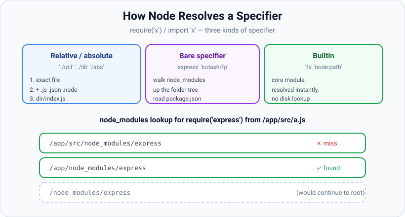
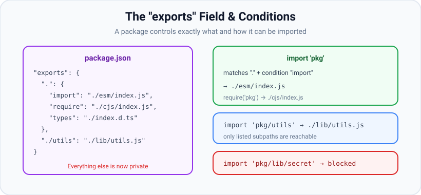

# Module Resolution

*10 min read · Updated 24 Jul 2026 Topic 13 of 70 Bookmark Mark done Why it matters Module resolution is the algorithm that turns a short string like · Topic 13 of 70*

**Source:** [https://www.geekyfrontend.in/learn/nodejs-backend-kit/module-resolution](https://www.geekyfrontend.in/learn/nodejs-backend-kit/module-resolution)

---

## Why it matters

Module resolution is the algorithm that turns a short string like `'express'` or `'./utils'` into one exact file on disk. It runs on every `require` and every `import`, and when it goes wrong you get the two most common Node errors in existence: `MODULE_NOT_FOUND` and `ERR_MODULE_NOT_FOUND`. Understanding resolution is what lets you answer questions that otherwise feel like black magic: "Why did it find version 2 of this package and not version 3?", "Why does `import 'pkg/internal'` suddenly fail after an upgrade?", "Why does my monorepo pick the wrong copy of a dependency?" These are all resolution questions.

Resolution is also central to modern package design. The `exports` field and conditional exports let a package author decide precisely which files consumers can reach and whether they get the ESM or CommonJS build. If you publish libraries — or debug why a dependency behaves differently under `import` than `require` — resolution is the topic that explains it.

## The concept, simply

Every specifier you pass falls into one of three buckets, and each is resolved differently:

- **Relative or absolute** — starts with `./`, `../`, or `/`. Node treats it as a path from the current file (or filesystem root) and looks for a matching file or directory.
- **Bare specifier (a package name)** — `'express'`, `'lodash/fp'`, `'@scope/pkg'`. Node searches `node_modules` folders, walking up the directory tree.
- **Builtin** — `'fs'`, `'path'`, or the explicit `'node:fs'` form. Resolved instantly from Node itself, no disk lookup.



A specifier is relative/absolute, a bare package name, or a builtin. Package names trigger a walk up successive node\_modules folders until the package is found or the filesystem root is reached.

## How it works

**Relative/absolute resolution (CommonJS).** Given `require('./util')`, Node tries, in order: (1) the exact path as a file — `./util`; (2) the path plus extensions — `./util.js`, then `./util.json`, then `./util.node`; (3) the path as a directory — it reads `./util/package.json` and uses its `main` field, or falls back to `./util/index.js`. The first hit wins. This "try several extensions and an index file" behaviour is the convenient extension guessing that CommonJS is known for.

**Relative resolution (ESM) is stricter.** ES Modules do *not* guess extensions and do *not* auto-resolve `index.js` for a bare directory. `import './util'` fails; you must write `import './util.js'` or `import './util/index.js'` explicitly. This strictness is intentional — it makes resolution unambiguous and matches browser behaviour.

**Bare specifier resolution — the `node_modules` walk.** For `require('express')` from `/app/src/server.js`, Node looks for `express` in a series of `node_modules` directories, starting next to the file and climbing toward the root: `/app/src/node_modules/express`, then `/app/node_modules/express`, then `/node_modules/express`. The first one found wins. This upward walk is exactly why a nested dependency can have its own private copy of a package (in its local `node_modules`) while the top-level app uses a different version — the resolution starts from wherever the requiring file lives.

**Inside a found package.** Once Node locates `node_modules/express`, it reads that package's `package.json` to decide the entry file. Modern resolution consults the `exports` field first (if present); otherwise it uses `main` (and, for some tools, `module` or `browser`); with neither, it falls back to `index.js`. A subpath like `'lodash/fp'` means "the `fp` entry inside the `lodash` package," resolved either through the package's `exports` subpaths or as a literal file path when no `exports` map exists.

**The `exports` field — encapsulation.** When a package declares `"exports"`, it becomes the *only* gateway into the package. Any file not listed is unreachable, even if it physically exists — `import 'pkg/lib/internal.js'` throws `ERR_PACKAGE_PATH_NOT_EXPORTED`. This lets authors ship internal files without them becoming part of the public API. The map keys are subpaths (`"."` is the package root, `"./utils"` a named subpath) and the values are the real files.



The exports field maps public subpaths to real files and can branch on conditions like import vs require; anything not listed becomes private and un-importable.

**Conditional exports.** An entry can be an object whose keys are *conditions* Node evaluates against the current environment, matched top-to-bottom (order matters):

- `"import"` — used when the package is loaded via `import` / `await import()` (ESM).
- `"require"` — used when loaded via `require()` (CJS).
- `"node"`, `"browser"`, `"default"` — platform/fallback conditions; `"default"` matches anything and should come last.
- `"types"` — where TypeScript should look for declarations (must come first among conditions).

This is how one package serves an ESM build to `import` and a CommonJS build to `require` from the same install — the classic "dual package." It is also the mechanism behind subtle bugs where the `import` and `require` paths load different files with slightly different behaviour.

**Conditions are matched, not merged.** Node walks the condition keys of an `exports` object *in the order they are written* and takes the first one that applies to the current request, then stops — it never blends two branches. That single rule explains most misconfigured packages: if `"default"` sits above `"import"`, the ESM branch is dead code because `"default"` already matched; if `"types"` is not first, TypeScript resolves a JavaScript file before it ever sees the declarations. A request also carries more than one active condition at once — an `import` from Node matches *both* `"import"` and `"node"` — so specificity, not just presence, decides the winner, and the author controls that purely through key order. The table below shows what is active for common load styles.

| How the package is loaded | Active conditions (most to least specific) |
| --- | --- |
| `import 'pkg'` in Node | `node`, `import`, `module-sync`, `default` |
| `require('pkg')` in Node | `node`, `require`, `default` |
| bundled for the browser | `browser`, `import`/`require`, `default` |
| type-checked by TypeScript | `types` (must precede the runtime keys), then the runtime set |

**Self-referencing and the resolution's endpoint.** A useful consequence of the `exports` map is that a package can import *itself* by name — `import { thing } from 'mylib'` from inside `mylib` resolves through its own `exports`, so tests and internal files exercise the exact public surface consumers see, not a relative shortcut that skips the map. Whichever branch is chosen, resolution ends the same way for every specifier type: the algorithm produces one absolute path (CommonJS) or one `file:` URL (ESM), and that fully-resolved string — not the original specifier — is the key used for caching. Two different specifiers that resolve to the same real file therefore share one cached instance, which is why a symlinked or path-aliased dependency can accidentally load twice if the two routes normalise to different absolute paths.

**Other resolution features.** `imports` (with keys starting `#`) defines private, internal-only aliases usable within the package (`import x from '#internal/thing'`). The `NODE_PATH` environment variable adds extra global lookup directories but is discouraged. `require.resolve('pkg')` runs the algorithm and returns the resolved path without loading — invaluable for debugging "which file is this actually?".

## Code examples

**1. Inspect what a specifier resolves to.**

javascript

```
// Prints the exact file Node would load — great for debugging duplicates.
console.log(require.resolve('express'));
// e.g. /app/node_modules/express/lib/express.js
console.log(require.resolve('./utils'));
// e.g. /app/src/utils/index.js
console.log(module.paths); // the ordered node_modules dirs Node will search
```

**2. A dual-package `exports` map.**

json

```
{
  "name": "mylib",
  "version": "1.0.0",
  "type": "module",
  "exports": {
    ".": {
      "types": "./dist/index.d.ts",
      "import": "./dist/index.mjs",
      "require": "./dist/index.cjs",
      "default": "./dist/index.mjs"
    },
    "./utils": "./dist/utils.js"
  }
}
```

**3. Encapsulation in action.**

javascript

```
import mylib from 'mylib';          // -> dist/index.mjs (import condition)
import u from 'mylib/utils';        // -> dist/utils.js (listed subpath)
import x from 'mylib/dist/secret.js';
// throws ERR_PACKAGE_PATH_NOT_EXPORTED — not listed in "exports"
```

**4. Internal imports with the `#` prefix.**

json

```
{
  "imports": {
    "#config": "./src/config.js",
    "#utils/*": "./src/utils/*.js"
  }
}
```

javascript

```
// Anywhere inside the package:
import config from '#config';         // -> ./src/config.js
import { slug } from '#utils/string'; // -> ./src/utils/string.js
```

## Common mistakes & gotchas

- **Relying on extension guessing in ESM.** Works in CJS, fails in ESM — always write the full filename in `import`.
- **Reaching into a package's internals.** `import 'pkg/lib/x'` breaks when the author adds an `exports` field. Use only documented entry points.
- **Duplicate copies of a package.** The upward `node_modules` walk can load two versions of the same library (e.g. two React copies), causing "invalid hook" style bugs. Diagnose with `require.resolve` and `npm ls pkg`.
- **Wrong condition order.** Putting `"default"` before `"import"` in `exports` makes `"default"` always win; conditions match top-down, so specific ones come first and `"default"` last.
- **Forgetting `"types"` first.** TypeScript needs the `"types"` condition to appear before `"import"`/`"require"` or it won't find declarations.
- **Assuming `main` still applies with `exports`.** When `exports` is present it takes precedence for module resolution; `main` becomes a fallback for legacy tools only.
- **Casing on case-insensitive filesystems.** `require('./Util')` may work on macOS/Windows but fail on Linux/CI. Match the real filename exactly.
- **Abusing `NODE_PATH`.** It hides real dependencies and is non-portable; declare deps in `package.json` instead.

## Best practices

- Use `require.resolve('pkg')` and `npm ls pkg` to confirm exactly which file/version is loaded when debugging.
- Import packages only through their documented entry points, never deep internal paths.
- When publishing, define an `exports` field to encapsulate internals and to serve correct ESM/CJS builds via conditions.
- Order conditions carefully: `"types"` first, then `"import"`/`"require"`, with `"default"` last.
- Prefer the `#`-prefixed `imports` map for internal aliases over brittle relative-path chains.
- Write full file extensions in every relative ESM specifier.
- Keep the dependency tree flat and deduped (lockfile + `npm dedupe`) to avoid duplicate-copy bugs.

## ⭐ Interview lens

> **Q: Walk me through how Node resolves `require('express')`.** It is a bare specifier, so Node searches `node_modules` folders from the requiring file's directory upward: `./node_modules/express`, `../node_modules/express`, and so on to the filesystem root. On the first hit it reads that package's `package.json`, consulting `exports` (else `main`, else `index.js`) to pick the entry file.

> **Q: How does resolving `'./util'` differ between CJS and ESM?** CJS tries `util`, then `util.js/.json/.node`, then `util/index.js` — it guesses extensions and index files. ESM does none of that; you must write the exact filename with extension. Trap: code that "worked" is really relying on CJS guessing and breaks on the switch to ESM.

> **Q: What does the `exports` field do that `main` doesn't?** It *encapsulates* the package — only listed subpaths are importable, everything else becomes private (`ERR_PACKAGE_PATH_NOT_EXPORTED`) — and it supports *conditional* resolution (different files for `import` vs `require`, node vs browser). `main` is a single legacy entry point with no encapsulation or conditions.

> **Q: How can one `require` and `import` of the same package load different code?** Via conditional exports: `"exports": { ".": { "import": "./esm.js", "require": "./cjs.js" } }`. Node picks the branch matching how the package was loaded. This is the dual-package pattern (and a source of "dual package hazard" if the two builds hold separate state).

> **Q: You suspect two versions of a library are loaded. How do you confirm?** `require.resolve('lib')` from different files shows the actual paths; `npm ls lib` shows every version in the tree. Duplicates arise because the `node_modules` walk resolves from each file's location, so nested deps can pin their own copy.

> **Q: What is the `#` in `import '#config'`?** A package-internal import defined in the `imports` field of `package.json`. It creates a private alias usable only inside that package — a clean alternative to long `../../` relative chains.

## Cheat-card

- **Three specifier types:** relative/absolute · bare (package) · builtin (`node:`).
- **CJS relative:** exact → +`.js/.json/.node` → `dir/index.js`. **ESM:** exact filename only.
- **Bare:** walk `node_modules` upward to root; first hit wins.
- **Entry pick:** `exports` → `main` → `index.js`.
- **`exports` field** encapsulates: unlisted paths = `ERR_PACKAGE_PATH_NOT_EXPORTED`.
- **Conditions** (top-down): `types` → `import`/`require`/`node`/`browser` → `default` last.
- **`imports` + `#`** = private internal aliases.
- **Debug:** `require.resolve('x')`, `module.paths`, `npm ls x`.
- **Subpath patterns:** `"./features/*": "./src/features/*.js"`; `*` is plain string substitution (may contain `/`); the longest prefix wins; a `null` target blocks a subfolder (`ERR_PACKAGE_PATH_NOT_EXPORTED`).
- **Symlinks:** Node resolves a symlinked module to its real path (cache key and lookup base); pnpm's `.pnpm` layout depends on it; `--preserve-symlinks` keeps the link path and breaks that layout.

---

## Learn More

- [Modules: Packages (resolution, exports, imports) nodejs.org](https://nodejs.org/api/packages.html)
- [Modules: CommonJS modules (module resolution algorithm) nodejs.org](https://nodejs.org/api/modules.html)
- [Node JS Tutorial for Beginners #7 - Module Patterns Net Ninja](https://www.youtube.com/watch?v=9UaZtgB5tQI)

---

## Additional topics

*Added 7 Oct 2026 · examples verified on Node v24.19.0*

### Subpath patterns in `exports`

A subpath pattern is an `exports` key containing one `*`, such as `"./features/*": "./src/features/*.js"` (added in v14.13.0 and v12.20.0; pattern trailers like `"./features/*.js"` added in v16.9.0 and v14.19.0). It lets a package with dozens of entry points expose a whole folder without listing every file, while still keeping everything outside that folder private. A `null` target (`"./features/internal/*": null`) carves a private hole out of a pattern. Without patterns, authors either list every file by hand or drop `exports` entirely, which makes every internal file importable.

How it works:

1. Node takes the part of the specifier after the package name, prefixed with `./` (`feat-kit/features/billing` gives `./features/billing`).
2. It looks for an exact key first. If none matches, it compares the subpath with every pattern key and picks the one with the **longest matching prefix** before the `*`, so `"./features/internal/*"` beats `"./features/*"` for `./features/internal/flags`.
3. The text the `*` matched is substituted into every `*` on the right-hand side. It is plain string replacement: the match may contain `/`, and Node adds no extension and strips none.
4. If the chosen target is `null`, Node throws `ERR_PACKAGE_PATH_NOT_EXPORTED`. If no key matches at all, it throws the same error, even if the file exists on disk.
5. Otherwise the target file is loaded; if it does not exist, the error is `ERR_MODULE_NOT_FOUND` (ESM) or `MODULE_NOT_FOUND` (CommonJS).

**Example — patterns, a `null` hole, and the extension trap.** `node_modules/feat-kit/package.json`:

json

```
{
  "name": "feat-kit",
  "version": "1.0.0",
  "type": "module",
  "exports": {
    ".": "./src/index.js",
    "./features/*": "./src/features/*.js",
    "./features/internal/*": null
  }
}
```

`try.mjs`:

javascript

```
const specs = [
  'feat-kit/features/billing',         // * = "billing"
  'feat-kit/features/reports/weekly',  // * = "reports/weekly" (may contain /)
  'feat-kit/features/billing.js',      // * = "billing.js" -> billing.js.js
  'feat-kit/features/internal/flags',  // longer key wins: null target
  'feat-kit/src/features/billing.js',  // file exists, but no key matches
];
for (const s of specs) {
  try {
    const m = await import(s);
    console.log('OK  ', s, '->', m.name);
  } catch (e) {
    console.log('FAIL', s, '->', e.code);
    console.log('     ', e.message.replaceAll(process.cwd(), '.').split('\n')[0]);
  }
}
```

Real output (Node v24.19.0; `…` replaces the scratch directory path):

bash

```
$ find node_modules/feat-kit/src -type f | sort
node_modules/feat-kit/src/features/billing.js
node_modules/feat-kit/src/features/internal/flags.js
node_modules/feat-kit/src/features/reports/weekly.js
node_modules/feat-kit/src/index.js
$ node try.mjs
OK   feat-kit/features/billing -> billing
OK   feat-kit/features/reports/weekly -> reports/weekly
FAIL feat-kit/features/billing.js -> ERR_MODULE_NOT_FOUND
      Cannot find module './node_modules/feat-kit/src/features/billing.js.js' imported from ./try.mjs
FAIL feat-kit/features/internal/flags -> ERR_PACKAGE_PATH_NOT_EXPORTED
      Package subpath './features/internal/flags' is not defined by "exports" in ./node_modules/feat-kit/package.json imported from ./try.mjs
FAIL feat-kit/src/features/billing.js -> ERR_PACKAGE_PATH_NOT_EXPORTED
      Package subpath './src/features/billing.js' is not defined by "exports" in ./node_modules/feat-kit/package.json imported from ./try.mjs
$ node -e "require('feat-kit/features/internal/flags')" 2>&1 | grep -m1 Error | sed 's#in .*/node_modules#in …/node_modules#'
Error [ERR_PACKAGE_PATH_NOT_EXPORTED]: Package subpath './features/internal/flags' is not defined by "exports" in …/node_modules/feat-kit/package.json
```

The third line is the trap: because the key's `*` already maps to `*.js`, a consumer who writes the extension gets `billing.js.js`. Decide on one style. Either write keys without extensions (as here) and tell consumers to omit them, or use trailers on both sides (`"./features/*.js": "./src/features/*.js"`), which also restricts the export to `.js` files.

### Symlinks and the pnpm layout

pnpm builds `node_modules` out of symlinks. Every package version lives once, at `node_modules/.pnpm/<name>@<version>/node_modules/<name>`, with its own dependencies as symlinked siblings in that same inner `node_modules`. The project's top-level `node_modules` holds only symlinks for the dependencies the project declares. This only works because of one Node rule: **by default the module loader resolves a symlinked module to its real path and uses that real path both as the cache key and as the starting point for the module's own `node_modules` lookups.** Without that rule, a package reached through `node_modules/debug` would look for its dependencies next to the symlink, where pnpm deliberately put nothing.

text

```
app/
├── package.json                 "dependencies": { "debug": "4.4.3" }
└── node_modules/
    ├── debug -> .pnpm/debug@4.4.3/node_modules/debug        (declared, so linked)
    └── .pnpm/
        ├── debug@4.4.3/node_modules/
        │   ├── debug/           real files (hard links into the pnpm store)
        │   └── ms -> ../../ms@2.1.3/node_modules/ms         (debug's own dependency)
        └── ms@2.1.3/node_modules/
            └── ms/              real files
```

How it works:

1. `require('debug')` from `app/index.js` walks up and finds `app/node_modules/debug`, which is a symlink.
2. Node calls `realpath` on it and gets `app/node_modules/.pnpm/debug@4.4.3/node_modules/debug`. That real path becomes the module's `filename` and its `require.cache` key.
3. Inside `debug`, `require('ms')` starts the walk from the real path: `…/debug/src/node_modules`, `…/debug/node_modules`, then `.pnpm/debug@4.4.3/node_modules/ms`, the sibling symlink, which is found.
4. `ms` is again resolved to its real path, `.pnpm/ms@2.1.3/node_modules/ms`. Any other package that depends on `ms@2.1.3` resolves to that same real path, so they share one module instance.
5. `--preserve-symlinks` (added in v6.3.0) switches step 2 off for dependencies: Node keeps the symlink path as the identifier and walks from there. `--preserve-symlinks-main` (added in v10.2.0) does the same for the entry file. With pnpm, step 3 then walks from `app/node_modules/debug/src`, never passes the `.pnpm` sibling folder, and fails.

**Example — symlink, realpath and the cache key.** A pnpm 10.34.6 project with `"dependencies": { "debug": "4.4.3", "ms": "2.1.3" }`, and `where.cjs`:

javascript

```
const fs = require('node:fs');
const path = require('node:path');
const rel = (p) => path.relative(__dirname, p);

console.log('symlink :', 'node_modules/ms ->', fs.readlinkSync('node_modules/ms'));
console.log('realpath:', rel(fs.realpathSync('node_modules/ms')));
console.log('resolve :', rel(require.resolve('ms')));

require('ms');
const keys = Object.keys(require.cache).filter((k) => k.includes(`${path.sep}ms${path.sep}`));
console.log('require.cache key:', keys.map(rel));
```

Real output:

bash

```
$ node where.cjs
symlink : node_modules/ms -> .pnpm/ms@2.1.3/node_modules/ms
realpath: node_modules/.pnpm/ms@2.1.3/node_modules/ms
resolve : node_modules/.pnpm/ms@2.1.3/node_modules/ms/index.js
require.cache key: [ 'node_modules/.pnpm/ms@2.1.3/node_modules/ms/index.js' ]
$ node --preserve-symlinks where.cjs
symlink : node_modules/ms -> .pnpm/ms@2.1.3/node_modules/ms
realpath: node_modules/.pnpm/ms@2.1.3/node_modules/ms
resolve : node_modules/ms/index.js
require.cache key: [ 'node_modules/ms/index.js' ]
```

By default the cache key is the real path inside `.pnpm`. With `--preserve-symlinks` the same file is identified by the symlink path, so a second route to the same files (for example, a workspace package linked from two places) would produce a second module instance.

### Common mistakes & gotchas (additional topics)

- **Writing the extension twice.** With `"./features/*": "./src/features/*.js"`, the specifier `pkg/features/x.js` loads `x.js.js`. Match the consumer-facing style to the key.
- **Expecting the most general pattern to win.** Node picks the key with the longest prefix before the `*`, so a `null` entry for a subfolder blocks it even though a broader pattern also matches.
- **Thinking `null` deletes files.** A `null` target only blocks the specifier; the file is still on disk and still reachable by its absolute path. `exports` controls specifiers, not file access.
- **Turning on `--preserve-symlinks` in a pnpm project.** pnpm's layout depends on real-path resolution; dependencies of dependencies stop resolving (edge case below).
- **Comparing paths from `require.resolve` with symlink paths.** Under default settings `require.resolve` returns the real path inside `.pnpm`, not `node_modules/<name>/…`. Code that checks `filename.includes('node_modules/debug/')` misses it.

### Edge case worked through: `--preserve-symlinks` breaks a pnpm install

The project declares only `debug`; `debug` declares `ms`. `run.cjs`:

javascript

```
// The app declares only "debug"; debug itself depends on "ms".
const path = require('node:path');
const rel = (p) => path.relative(__dirname, p);

console.log('debug resolves to:', rel(require.resolve('debug')));
try {
  require('debug');
  console.log('debug loaded OK');
} catch (e) {
  console.log(e.code, '-', e.message.split('\n')[0]);
}
```

bash

```
$ find node_modules -maxdepth 4 -not -name '.*' | sort
node_modules
node_modules/debug
node_modules/.pnpm/debug@4.4.3
node_modules/.pnpm/debug@4.4.3/node_modules
node_modules/.pnpm/debug@4.4.3/node_modules/debug
node_modules/.pnpm/debug@4.4.3/node_modules/ms
node_modules/.pnpm/lock.yaml
node_modules/.pnpm/ms@2.1.3
node_modules/.pnpm/ms@2.1.3/node_modules
node_modules/.pnpm/ms@2.1.3/node_modules/ms
node_modules/.pnpm/node_modules
node_modules/.pnpm/node_modules/ms
$ readlink node_modules/debug node_modules/.pnpm/debug@4.4.3/node_modules/ms
.pnpm/debug@4.4.3/node_modules/debug
../../ms@2.1.3/node_modules/ms
$ node run.cjs
debug resolves to: node_modules/.pnpm/debug@4.4.3/node_modules/debug/src/index.js
debug loaded OK
$ node --preserve-symlinks run.cjs
debug resolves to: node_modules/debug/src/index.js
MODULE_NOT_FOUND - Cannot find module 'ms'
```

With default resolution, `debug`'s real path sits inside `.pnpm/debug@4.4.3/node_modules/`, next to its `ms` symlink, so `require('ms')` succeeds. With `--preserve-symlinks`, `debug` is identified as `node_modules/debug/src/index.js`, its walk checks `node_modules/debug/src/node_modules`, `node_modules/debug/node_modules` and `node_modules/ms`, finds nothing, and fails. (`.pnpm/node_modules/ms` is pnpm's hidden hoisting folder; it is not on that walk either.) The Node docs describe the opposite failure for this flag too: a native addon reached through two symlink paths is loaded twice.

### ⭐ Interview lens (additional topics)

> **Q: “A package exports `"./features/*": "./src/features/*.js"`. What do `pkg/features/a/b` and `pkg/features/a.js` load?”**  
> A: `*` is plain string substitution and may contain `/`, so `pkg/features/a/b` loads `./src/features/a/b.js`. `pkg/features/a.js` substitutes `a.js` and loads `./src/features/a.js.js`, which fails with `ERR_MODULE_NOT_FOUND`. A file outside `src/features`, or one under a `null`-targeted key, fails with `ERR_PACKAGE_PATH_NOT_EXPORTED`.

> **Q: “How can pnpm's symlinked `node_modules` work when Node knows nothing about pnpm?”**  
> A: Node resolves a symlinked module to its real path and then resolves that module's own imports from the real location. pnpm puts each package's dependencies next to its real location inside `.pnpm/<name>@<version>/node_modules`, so the normal walk finds them, and every dependent of the same version shares one real path and one cached instance. `--preserve-symlinks` disables that and breaks the layout.
