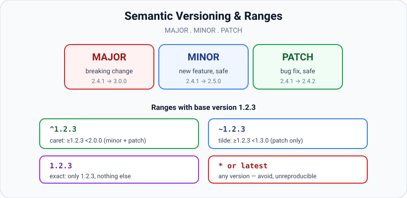

# package.json & Semantic Versioning

*10 min read · Updated 24 Jul 2026 Topic 14 of 70 Bookmark Mark done Why it matters package · Topic 14 of 70*

**Source:** [https://www.geekyfrontend.in/learn/nodejs-backend-kit/package-json-semver](https://www.geekyfrontend.in/learn/nodejs-backend-kit/package-json-semver)

---

## Why it matters

`package.json` is the manifest at the heart of every Node project — it names the project, lists its dependencies, defines its scripts, and controls how the package is published and consumed. Get it right and installs are reproducible, upgrades are predictable, and CI is green. Get it wrong and you ship the classic disasters: "works on my machine," a dependency that silently jumped a major version and broke production, or a deploy that pulled different code than your laptop did. Almost every reproducibility and supply-chain incident traces back to a misunderstanding of two things in this file: version ranges (`^` vs `~`) and the role of the lockfile.

Semantic Versioning (semver) is the contract that makes ranges meaningful. It is a shared promise between package authors and consumers about what a version number change implies. Interviewers love this topic because it is where "I can install packages" becomes "I understand why my build is or isn't reproducible."

## The concept, simply

A semver version has three numbers: **MAJOR.MINOR.PATCH**, e.g. `4.18.2`. The promise is:

- **MAJOR** — incremented for a *breaking* change. Upgrading may require code changes on your side.
- **MINOR** — new functionality added in a *backward-compatible* way. Safe to take.
- **PATCH** — a backward-compatible *bug fix*. Safe to take.

In `package.json` you rarely pin one exact version. Instead you write a *range* — a rule for which versions are acceptable — using prefixes like `^` (caret) and `~` (tilde). The range says "install the newest version that satisfies this rule." A separate *lockfile* then records the exact version that was actually installed, so everyone and every deploy gets byte-identical dependencies.



Semver encodes intent — major means breaking, minor means new-and-safe, patch means fix — and range operators like caret and tilde decide how far npm may upgrade automatically.

## How it works

**Key `package.json` fields.**

- `name` and `version` — identity; required to publish. `version` must be valid semver.
- `type` — `"module"` or `"commonjs"`; decides how `.js` files are interpreted.
- `main` / `exports` — the package's entry point(s) (see module-resolution).
- `scripts` — named commands run with `npm run` (see npm-and-scripts).
- `dependencies` — packages your code needs at *runtime*; installed for anyone who installs your package.
- `devDependencies` — packages needed only to *develop/build/test* (bundlers, test runners, TypeScript, linters). Skipped when your package is installed as someone else's dependency, and skippable in production with `npm ci --omit=dev`.
- `peerDependencies` — packages the host app must provide (e.g. a React plugin declares `react` as a peer so it shares the app's single copy).
- `optionalDependencies` — install failures are tolerated (platform-specific binaries).
- `engines` — declares supported Node/npm versions. It is advisory: npm only prints an `EBADENGINE` warning and installs anyway, unless `engine-strict=true` is set in `.npmrc`, which turns the warning into an install error. It does nothing at runtime — `node` never reads it.
- `files` — allowlist of what actually gets published to npm; keeps the tarball lean.
- `bin` — maps a command name to an executable file, powering CLIs and `npx`.

**Range operators against a base version (say `1.2.3`).**

- `^1.2.3` (**caret**) — allows changes that do not modify the left-most non-zero digit: `>=1.2.3 <2.0.0`. Takes new minors and patches, not a new major. This is npm's default when you `npm install pkg`. Special zero-rules: `^0.2.3` means `>=0.2.3 <0.3.0` (minor is treated as breaking when major is 0), and `^0.0.3` means exactly `0.0.3` patch range `>=0.0.3 <0.0.4`.
- `~1.2.3` (**tilde**) — allows patch-level changes if a minor is specified: `>=1.2.3 <1.3.0`. Takes patches only.
- `1.2.3` (**exact**) — only that version.
- `1.2.x` / `1.2` — any patch of `1.2`. `1.x` — any minor/patch of major 1.
- `>=1.2.3 <2.0.0` — explicit compound range (what caret expands to).
- `*` or `latest` — any/newest version; unreproducible, avoid.

**The lockfile is the source of truth for installs.** Ranges describe what is *allowed*; the lockfile records what was *chosen*. npm writes `package-lock.json`, yarn writes `yarn.lock`, pnpm writes `pnpm-lock.yaml`. It captures the exact resolved version and integrity hash of every package in the entire tree — including transitive dependencies. Commit it. Two commands behave very differently:

- `npm install` — may update the lockfile to newer versions still satisfying your ranges, and can mutate `package.json`.
- `npm ci` — installs *exactly* what the lockfile says, fails if `package.json` and the lockfile disagree, and deletes `node_modules` first. This is the command for CI and production because it is deterministic.

**The caret's real rule: the left-most non-zero digit.** The single sentence that makes caret behaviour predictable is "allow anything that does not change the left-most non-zero part of the version." For a normal `1.x.y` release the left-most non-zero digit is the major, so `^1.2.3` floats the minor and patch up to (but not including) `2.0.0`. Drop into pre-1.0 territory and the left-most non-zero digit shifts right, which is why the operator quietly tightens. This is not npm being inconsistent — it is one rule applied uniformly, and pre-1.0 packages lean on it because SemVer explicitly says `0.y.z` offers no stability guarantee, so every `0.x` bump is treated as potentially breaking. The table makes the shift concrete:

| Range | Expands to | Takes |
| --- | --- | --- |
| `^1.2.3` | `>=1.2.3 <2.0.0` | minor + patch |
| `^0.2.3` | `>=0.2.3 <0.3.0` | patch only (minor is treated as breaking) |
| `^0.0.3` | `>=0.0.3 <0.0.4` | nothing — effectively pinned |
| `~1.2.3` | `>=1.2.3 <1.3.0` | patch only |
| `~1.2` | `>=1.2.0 <1.3.0` | patch only |
| `~1` | `>=1.0.0 <2.0.0` | minor + patch |

**Pre-release tags sit outside the ordinary ranges.** A version can carry a pre-release suffix such as `2.0.0-beta.1` or `2.0.0-rc.2`, and SemVer orders these *below* the matching stable release: `2.0.0-beta.1 < 2.0.0-rc.2 < 2.0.0`. Crucially, npm will not hand a pre-release to a plain range by default — `^1.2.3` never selects `2.0.0-beta.1`, and even `^2.0.0-beta.1` only matches other `2.0.0` pre-releases, not later ones — precisely so an unfinished build cannot sneak into a normal install. You opt in explicitly, e.g. `npm install pkg@next` or a range like `2.0.0-rc.2`. Build metadata after a `+` (`1.4.0+20240115`) is ignored entirely for ordering. This is why a teammate on a beta and a teammate on the range can end up on genuinely different code even though both "satisfy" the intent — another reason the committed lockfile, not the range, is the real record of what shipped.

**Why ranges + lockfile together.** Ranges let you accept safe upgrades when you deliberately run `npm update`; the lockfile guarantees that, until you do, everyone installs identical code. Without a lockfile, `^4.18.2` could resolve to `4.18.2` today and `4.20.0` next week, and "it worked yesterday" becomes unexplainable. This is precisely why the caret default is safe in practice — the lockfile pins the real version even though the range would allow drift.

## Code examples

**1. A realistic `package.json`.**

json

```
{
  "name": "my-api",
  "version": "1.4.0",
  "type": "module",
  "engines": { "node": ">=20" },
  "main": "./dist/index.js",
  "scripts": {
    "dev": "node --watch src/index.js",
    "build": "tsc -p tsconfig.json",
    "test": "node --test"
  },
  "dependencies": {
    "express": "^4.18.2",
    "zod": "~3.23.8"
  },
  "devDependencies": {
    "typescript": "^5.5.0"
  },
  "files": ["dist"]
}
```

**2. What each range accepts.**

javascript

```
// Given published versions: 1.2.3, 1.2.9, 1.3.0, 1.9.5, 2.0.0
// "^1.2.3" -> highest of 1.2.3 .. 1.9.5 (any minor/patch, not 2.x) -> 1.9.5
// "~1.2.3" -> highest of 1.2.3 .. 1.2.9 (patch only, not 1.3.0)    -> 1.2.9
// "1.2.3"  -> exactly 1.2.3
// "*"      -> 2.0.0 (newest, unpredictable over time)
```

**3. Reproducible install in CI.**

javascript

```
// package.json + package-lock.json are committed together.
// CI / Dockerfile:
//   npm ci                 // exact lockfile install, deterministic
//   npm ci --omit=dev      // production: skip devDependencies
// NOT `npm install` in CI — it may silently bump versions.
```

**4. Pinning when you cannot risk any drift.**

javascript

```
// Save an exact version instead of a caret range:
//   npm install lodash --save-exact   // writes "lodash": "4.17.21"
// Or set once in .npmrc:  save-exact=true
```

## Common mistakes & gotchas

- **Not committing the lockfile.** Installs stop being reproducible; teammates and CI can get different transitive versions.
- **Using `npm install` in CI.** It may update versions and the lockfile. Use `npm ci`.
- **Confusing dependencies with devDependencies.** Putting a build tool in `dependencies` bloats production installs; putting a runtime library in `devDependencies` makes production crash with "module not found."
- **Assuming `^0.x` behaves like `^1.x`.** With a `0` major, caret does NOT allow minor bumps — `^0.2.0` stays within `0.2.x` because pre-1.0 packages treat every minor as potentially breaking.
- **Trusting semver blindly.** Authors make mistakes; a "patch" can break you. That is exactly why the lockfile plus a test suite matter.
- **Using `*` or `latest` ranges.** Non-deterministic; a future major can land unannounced.
- **Editing versions by hand and forgetting the lockfile.** The two drift apart; `npm ci` then refuses to install.
- **Ignoring `peerDependencies` warnings.** Mismatched peers cause duplicate copies and subtle runtime bugs.

## Best practices

- Always commit the lockfile and treat it as reviewed source.
- Use `npm ci` (not `npm install`) in CI and Docker builds; add `--omit=dev` for production images.
- Classify dependencies correctly: runtime → `dependencies`, tooling → `devDependencies`, host-provided → `peerDependencies`.
- Keep the caret default for most deps (safe with a lockfile), but pin exact versions for anything security- or behaviour-critical, or use tilde for cautious patch-only updates.
- Set `engines.node` to document the supported runtime, and add `engine-strict=true` to the project's `.npmrc` if you want installs on an unsupported Node to fail fast — without it npm only warns. Other package managers differ: Yarn 1 fails by default (`--ignore-engines` skips the check), pnpm installs by default and fails with `engine-strict=true` (`ERR_PNPM_UNSUPPORTED_ENGINE`), and Yarn 4 ignores `engines` entirely.

  Real output with `"engines": { "node": ">=99" }` on Node v24.19.0 / npm 11.17.0:

  ```
  $ npm install            # first warning shown; exit code 0
  npm warn EBADENGINE Unsupported engine {
  npm warn EBADENGINE   package: 'app@1.0.0',
  npm warn EBADENGINE   required: { node: '>=99' },
  npm warn EBADENGINE   current: { node: 'v24.19.0', npm: '11.17.0' }
  npm warn EBADENGINE }
  added 1 package in 183ms

  $ echo "engine-strict=true" > .npmrc && npm install     # exit code 1
  npm error code EBADENGINE
  npm error engine Unsupported engine
  npm error engine Not compatible with your version of node/npm: app@1.0.0
  ```

  (Package-manager behaviour verified with npm 11.17.0, pnpm 10.34.6 and 12.9.1, Yarn 1.22.22 and 4.18.1.)
- Add a `files` allowlist (or `.npmignore`) so you publish only what is needed.
- Upgrade deliberately with `npm update` / `npm outdated`, then run tests, then commit the new lockfile.
- Never hand-edit `package-lock.json`; let the CLI manage it.

## ⭐ Interview lens

> **Q: Explain `^1.2.3` vs `~1.2.3`.** Caret allows minor and patch updates: `>=1.2.3 <2.0.0`. Tilde allows patch updates only (when a minor is given): `>=1.2.3 <1.3.0`. Caret is npm's default and takes more updates; tilde is more conservative.

> **Q: If `package.json` pins ranges, why do we also need a lockfile?** Ranges say what is *allowed*, not what is *installed*. Without a lockfile, `^4.18.2` can resolve to different actual versions over time and across machines. The lockfile records the exact resolved version and integrity hash of every package (including transitive deps), making installs byte-reproducible.

> **Q: Difference between `npm install` and `npm ci`?** `npm install` resolves ranges, may update the lockfile and `package.json`, and installs on top of existing `node_modules`. `npm ci` wipes `node_modules` and installs the lockfile exactly, failing if it disagrees with `package.json`. Use `ci` for deterministic CI/production installs.

> **Q: dependencies vs devDependencies vs peerDependencies?** `dependencies` ship to consumers and are needed at runtime. `devDependencies` are for building/testing and are not installed when your package is a dependency of another. `peerDependencies` declare something the host app must supply, so a plugin shares the app's single copy (e.g. React) instead of bundling its own.

> **Q: Trap — what does `^0.2.3` allow?** Only `>=0.2.3 <0.3.0`. When MAJOR is 0, caret does not permit minor bumps because pre-1.0 packages may break in any minor. Many candidates wrongly say it allows up to `<1.0.0`.

> **Q: A "patch" upgrade broke production. What went wrong and how do you prevent it?** Semver is a promise authors can violate; a patch release contained a breaking change. Prevention: a committed lockfile + `npm ci` so upgrades only happen when you choose, plus a test suite run before adopting the new lockfile. Consider pinning exact versions for critical packages.

## Cheat-card

- **Semver:** MAJOR = breaking · MINOR = new+safe · PATCH = fix+safe.
- **^1.2.3** → `>=1.2.3 <2.0.0` (minor+patch, npm default).
- **~1.2.3** → `>=1.2.3 <1.3.0` (patch only).
- **^0.2.3** → `>=0.2.3 <0.3.0` (0-major quirk).
- **Avoid** `*` / `latest` — unreproducible.
- **deps** = runtime · **devDeps** = build/test · **peerDeps** = host-provided.
- **Lockfile** pins exact tree + hashes — commit it.
- **`npm ci`** = deterministic lockfile install for CI/prod (`--omit=dev`).
- **`overrides`** (root only) pins any package in the tree; scope with `{ "parent": { "child": "x" } }`; conflict with a direct dep → `EOVERRIDE`, fix with `"$name"`.
- **`workspaces`** = globs of local packages, symlinked into root `node_modules`, one lockfile (see lesson 74).
- **`packageManager`** = `"pnpm@x.y.z+sha…"`; enforced by Corepack shims, ignored by npm.
- **`private: true`** → real `npm publish` fails with `EPRIVATE`; single-package `--dry-run` does not check it (npm 11.17.0).
- **`sideEffects`** = bundler hint for dropping unused modules; Node ignores it.

---

## Learn More

- [package.json docs.npmjs.com](https://docs.npmjs.com/cli/v10/configuring-npm/package-json)
- [About semantic versioning docs.npmjs.com](https://docs.npmjs.com/about-semantic-versioning)
- [Modules: Packages (package.json fields) nodejs.org](https://nodejs.org/api/packages.html)
- [NPM Semantic Versioning (SemVer) Explained for Beginners! CodeLucky](https://www.youtube.com/watch?v=3GmNhGBow7Q)

---

## Additional topics

*Added 7 Oct 2026 · examples verified on Node v24.19.0*

### `overrides`

`overrides` is an npm field in the **root** `package.json` that replaces the version npm would pick for a package anywhere in the tree, including transitive dependencies you do not list yourself. It exists for the case where a dependency of a dependency has a security fix or a bug you cannot wait for its parent to adopt. Without it you either fork the parent or live with the vulnerable version. Yarn's equivalent field is `resolutions`, and pnpm has its own `overrides` setting (see pnpm.io/settings).

How it works:

1. During tree building, every time npm is about to resolve a dependency edge (`debug` wants `ms@^2.1.3`), it checks the root `overrides` for a rule whose key matches that package name (optionally scoped under a parent, such as `"debug": { "ms": "…" }`).
2. If a rule matches, npm resolves the override's spec instead of the original range, even if the result is outside that range.
3. The chosen version is written to `package-lock.json`, and `npm ls` labels it `overridden`.
4. npm reads `overrides` only from the root project. Overrides inside installed packages or workspace packages are ignored.
5. Overriding a package you also list directly is rejected with `EOVERRIDE` unless the specs are identical or the override uses a `$name` reference to your direct dependency's spec (edge case below).

**Example — pin a transitive dependency, globally and only under one parent.** `debug@4.4.3` asks for `ms@^2.1.3`. Root `package.json` with a global override:

json

```
{
  "name": "app",
  "version": "1.0.0",
  "private": true,
  "dependencies": { "debug": "4.4.3" },
  "overrides": { "ms": "2.1.2" }
}
```

Real output (Node v24.19.0, npm 11.17.0):

bash

```
$ npm view debug@4.4.3 dependencies
{ ms: '^2.1.3' }
$ npm install >/dev/null && npm ls --all | tail -n +2
└─┬ debug@4.4.3
  └── ms@2.1.3
$ npm install >/dev/null && npm ls --all | tail -n +2
└─┬ debug@4.4.3
  └── ms@2.1.2 overridden
$ grep -A1 '"node_modules/ms"' package-lock.json
    "node_modules/ms": {
      "version": "2.1.2",
$ npm install >/dev/null && npm ls --all | tail -n +2
├─┬ debug@4.4.3
│ └── ms@2.1.2 overridden
└── ms@2.1.3
```

The first tree is the normal resolution; the second shows `ms@2.1.2 overridden`, outside `debug`'s own `^2.1.3` range. The last command used a scoped rule, `"overrides": { "debug": { "ms": "2.1.2" } }`, with a direct `"ms": "^2.1.3"` dependency in the app: only the copy under `debug` changed, so npm nested it.

### `workspaces`

`workspaces` is an array of folder paths or globs in the root `package.json`. Each matching folder that has its own `package.json` becomes a workspace: npm resolves all workspaces' dependencies together, writes one lockfile, and creates a symlink in the root `node_modules` under the workspace's `name`. It exists so several packages in one repository can depend on each other's current source without publishing. Without it you would publish after every change or wire things up with `npm link` by hand. The full treatment (layouts, pnpm and Yarn, orchestration, publishing) is in [Monorepos and Workspaces](74-monorepos-and-workspaces.md).

How it works:

1. npm expands the globs (`packages/*`) into folders that contain a `package.json`.
2. Each folder joins the dependency graph under its `name`; a dependency on that name with a satisfied range resolves to the local folder.
3. npm symlinks `node_modules/<name>` to the folder and hoists third-party packages to the root `node_modules`.
4. Root-only fields (`overrides`, for example) are read from the root manifest, not from workspaces.

**Example — workspace links, and a workspace-level `overrides` that npm ignores.**

bash

```
$ cat package.json packages/a/package.json
{
  "name": "root",
  "private": true,
  "workspaces": ["packages/*"]
}
{
  "name": "a",
  "version": "1.0.0",
  "dependencies": { "b": "^1.0.0", "debug": "4.4.3" },
  "overrides": { "ms": "2.1.2" }
}
$ npm install >/dev/null && npm ls --all | tail -n +2
├─┬ a@1.0.0 -> ./packages/a
│ ├── b@1.0.0 deduped -> ./packages/b
│ └─┬ debug@4.4.3
│   └── ms@2.1.3
└── b@1.0.0 -> ./packages/b
$ readlink node_modules/a node_modules/b
../packages/a
../packages/b
```

`b` was linked rather than downloaded, and `ms` stayed at 2.1.3 because the `overrides` block sits in `packages/a/package.json`, which npm does not read for overrides.

### `packageManager` and Corepack

`packageManager` is a string field such as `"pnpm@10.34.6+sha512.…"`: a package-manager name (`npm`, `pnpm` or `yarn`), an exact version, and an optional hash of that release. npm and Node do not act on it. **Corepack** does: it is a set of shims for `pnpm` and `yarn` that read the nearest `package.json`, download and cache the exact version named there, check the hash, and run it. It exists so every developer and CI job uses the same package-manager release without a global install. Corepack ships with Node v24 as an experimental feature (added in v16.9.0 and v14.19.0) and is disabled until you run `corepack enable`; the v24 docs say it "will no longer be distributed starting with Node.js v25", after which it is installed as a separate npm package.

How it works:

1. `corepack enable` writes shims named `pnpm`, `pnpx`, `yarn` and `yarnpkg` next to the Corepack install, or into `--install-directory <dir>`. It does not shim `npm` unless asked.
2. When you run `pnpm …`, the shim walks up to the nearest `package.json` and reads `packageManager`.
3. If the field names pnpm, Corepack downloads that exact version into `COREPACK_HOME` (default `$HOME/.cache/node/corepack` on Linux), verifies the hash if present, and runs it.
4. If the field names a different manager, the shim refuses to run, so a Yarn command cannot write a `yarn.lock` into a pnpm project.
5. `corepack use pnpm@x.y.z` writes the field, including the hash, and runs an install.

**Example — pin pnpm and watch the shims enforce it.** Everything is in a throwaway directory: the shims go to `--install-directory`, and `COREPACK_HOME` points into the same scratch area, so the real Node install and `$HOME` are not touched.

bash

```
$ corepack --version
0.35.0
$ corepack enable --install-directory …/shims && ls …/shims
pnpm
pnpx
yarn
yarnpkg
$ corepack use pnpm@10.34.6 | tail -1 && cat package.json
Done in 307ms using pnpm v10.34.6
{
  "name": "app",
  "private": true,
  "packageManager": "pnpm@10.34.6+sha512.7e1ae66a83a9143c118cc1944f37cc4f2b8acddeda4b001cfa78908f6e46e45e15292739ca6c9d026426cc757e9318cc98c5551d6a16c165097b0028ba87b4e6"
}
$ which pnpm && pnpm --version
…/shims/pnpm
10.34.6
$ yarn install; echo "exit code $?"
This project is configured to use pnpm because …/pm-demo/package.json has a "packageManager" field
exit code 1
$ npm install >/dev/null; echo "exit code $?"
exit code 0
```

`pnpm` ran the pinned 10.34.6; `yarn` was refused because the project names pnpm; plain `npm install` succeeded, because `npm` was not shimmed and npm itself does not read the field.

### `private`

`"private": true` tells npm to refuse to publish the package. It exists to protect application repositories, monorepo roots and internal packages from an accidental `npm publish`, which would upload your source to the public registry. Without it, a mistyped command in the wrong folder is enough.

How it works:

1. `npm publish` packs the tarball and runs its checks: credentials, then whether the version already exists on the registry.
2. For a single package, the `private` check happens in the publish library just before the upload, so it only runs on a real publish. In npm 11.17.0, `npm publish --dry-run` stops before that point and reports success even for a private package.
3. In a workspace publish (`--workspaces`), npm checks `private` earlier for each workspace, skips private ones with a warning, and publishes the rest; this check does run in a dry run.

**Example — the real refusal, captured without publishing anything.** Because `--dry-run` does not exercise the check, the second command performs a real publish against a local stand-in registry on port 4601 that answers every request with an error (`registry.log` records what npm sent):

javascript

```
// Local stand-in registry: answers every GET with 404 and refuses every PUT.
require('node:http').createServer((req, res) => {
  console.error('[registry]', req.method, req.url);
  res.writeHead(req.method === 'GET' ? 404 : 403, { 'content-type': 'application/json' });
  res.end('{"error":"not found"}');
}).listen(4601, '127.0.0.1');
```

bash

```
$ npm publish --dry-run 2>&1 | grep -v 'npm notice [0-9a-z]'
npm notice
npm notice 📦  internal-app@1.0.0
npm notice Tarball Contents
npm notice Tarball Details
npm notice
npm warn publish This command requires you to be logged in to https://registry.npmjs.org/ (dry-run)
npm notice Publishing to https://registry.npmjs.org/ with tag latest and default access (dry-run)
+ internal-app@1.0.0
$ npm publish --registry http://127.0.0.1:4601/ --//127.0.0.1:4601/:_authToken=fake-token 2>&1 | grep -v 'npm notice'
npm error code EPRIVATE
npm error This package has been marked as private
npm error Remove the 'private' field from the package.json to publish it.
npm error A complete log of this run can be found in: …/_logs/….log
$ cat registry.log
[registry] GET /internal-app
[registry] GET /internal-app
$ npm publish --dry-run --workspaces 2>&1 | grep -E '^\+|Skipping'
+ @acme/utils@1.0.0
npm warn publish Skipping workspace @acme/api, marked as private
```

The dry run printed `+ internal-app@1.0.0` as if the publish would succeed. The real publish stopped with `EPRIVATE` after only two `GET` requests; no upload (`PUT`) reached the registry. The workspace dry run (the repository from lesson 74, whose `@acme/api` is private) skipped the private workspace.

### `sideEffects`

`sideEffects` is a field read by **bundlers** (webpack, esbuild, Rollup), not by Node. `"sideEffects": false` is the package author's promise that importing any of its files does nothing except define exports, so a bundler may drop a module entirely when none of its exports are used. An array (`["./track.js", "*.css"]`) lists the files that do have import-time effects and must be kept. Without the hint, a bundler has to keep every module that a used module re-exports from, because running it might matter.

How it works:

1. The bundler follows `import { add } from 'fx-lib'` into `index.js`, which re-exports from `add.js` and `track.js`.
2. It marks which exports are used: only `add`.
3. For `track.js`, nothing is used. If the package says `"sideEffects": false` (or `track.js` is not in the array), the bundler drops the whole module, including its top-level `console.log`.
4. If `sideEffects` is `true` or missing, the bundler keeps `track.js`'s top-level statements and drops only unused exports.
5. Node never reads the field: `node app.mjs` evaluates every imported module, whatever the field says.

**Example — the same import, run by Node and bundled by esbuild 0.28.2.** `node_modules/fx-lib/package.json`, `index.js`, `track.js`, and the app:

json

```
{
  "name": "fx-lib",
  "version": "1.0.0",
  "type": "module",
  "exports": "./index.js",
  "sideEffects": false
}
```

javascript

```
export { add } from './add.js';
export { track } from './track.js';
```

javascript

```
console.log('track.js ran: analytics installed');
export const track = (e) => console.log('track', e);
```

javascript

```
import { add } from 'fx-lib';
console.log('add(2, 3) =', add(2, 3));
```

bash

```
$ npx esbuild --version
0.28.2
$ node app.mjs
track.js ran: analytics installed
add(2, 3) = 5
$ npx esbuild app.mjs --bundle --format=esm --log-level=warning
// node_modules/fx-lib/add.js
var add = (a, b) => a + b;

// app.mjs
console.log("add(2, 3) =", add(2, 3));
$ sed -i 's/"sideEffects": false/"sideEffects": true/' node_modules/fx-lib/package.json && grep sideEffects node_modules/fx-lib/package.json
  "sideEffects": true
$ npx esbuild app.mjs --bundle --format=esm --log-level=warning
// node_modules/fx-lib/add.js
var add = (a, b) => a + b;

// node_modules/fx-lib/track.js
console.log("track.js ran: analytics installed");

// app.mjs
console.log("add(2, 3) =", add(2, 3));
```

Node ran `track.js` (the first line of output). esbuild's bundle omitted it while the field said `false`, and kept its `console.log` once the field said `true`. If a file that really does something at import time (a polyfill, a CSS import, a global registration) is covered by `"sideEffects": false`, the bundled app silently loses that behaviour.

### Common mistakes & gotchas (additional topics)

- **Putting `overrides` in a workspace package.** npm reads it only from the root manifest and ignores it elsewhere without a warning (workspace example above).
- **Expecting a changed `overrides` to apply to an existing lockfile.** In npm 11.17.0, adding the override to an already-installed single-package project put `ms@2.1.2` in `node_modules/debug/node_modules/ms` rather than replacing the root copy, and in a workspace repository it left `ms@2.1.3` until `node_modules` and `package-lock.json` were deleted; that clean install then installed 2.1.2 but `npm ls` reported it as `invalid` instead of `overridden`. After editing overrides, reinstall from scratch and check with `npm ls <pkg>`.
- **Trusting `npm publish --dry-run` to catch `private`.** It does not for a single package in npm 11.17.0; only a real publish raises `EPRIVATE`.
- **Assuming `packageManager` is enforced by npm.** Only Corepack shims (or tools that read the field) enforce it.
- **Marking a package with import-time effects as `"sideEffects": false`.** Bundlers then remove polyfills, CSS imports or registrations. List those files in an array instead.
- **Expecting `sideEffects` to change Node behaviour.** Node ignores it; it matters only once a bundler processes the code.

### Edge case worked through: overriding a package you also depend on directly

The app depends on `"ms": "^2.1.3"` and tries a global `"overrides": { "ms": "2.1.2" }`:

json

```
{
  "name": "app",
  "version": "1.0.0",
  "private": true,
  "dependencies": { "debug": "4.4.3", "ms": "^2.1.3" },
  "overrides": { "ms": "2.1.2" }
}
```

bash

```
$ npm install; echo "exit code $?"
npm error code EOVERRIDE
npm error Override for ms@^2.1.3 conflicts with direct dependency
npm error A complete log of this run can be found in: …/_logs/….log
exit code 1
$ npm pkg set 'overrides.ms=$ms' && npm install >/dev/null && npm ls --all | tail -n +2
├─┬ debug@4.4.3
│ └── ms@2.1.3 deduped
└── ms@2.1.3
```

npm refuses an override that conflicts with a direct dependency, because the override would silently contradict the range you wrote yourself. The `$ms` reference means "use the spec of my direct dependency `ms`", which makes the override consistent with it. Here that pins every copy of `ms` in the tree to your `^2.1.3`, so the transitive copy under `debug` dedupes to the same 2.1.3.

### ⭐ Interview lens (additional topics)

> **Q: “A transitive dependency has a CVE fixed in a patch release, but the package that depends on it hasn't updated. What do you do?”**  
> A: Add an `overrides` entry in the root `package.json` (Yarn: `resolutions`, pnpm: its `overrides` setting) pinning the fixed version, scoped under the parent if only one path needs it, reinstall, and confirm with `npm ls <pkg>` that it shows `overridden`. Overrides in workspaces or dependencies are ignored, and a conflict with a direct dependency needs the `$name` reference. *Trap:* editing the dependency's `package.json` inside `node_modules`, which the next install erases.

> **Q: “What do `private`, `packageManager` and `sideEffects` each control, and who reads them?”**  
> A: `private` is read by npm and blocks `npm publish` (`EPRIVATE`; workspace publishes skip private packages). `packageManager` is read by Corepack, which runs the exact package-manager version named there and refuses a different manager; npm itself ignores it. `sideEffects` is read only by bundlers, which may drop unused modules when it is `false`; Node ignores it.
