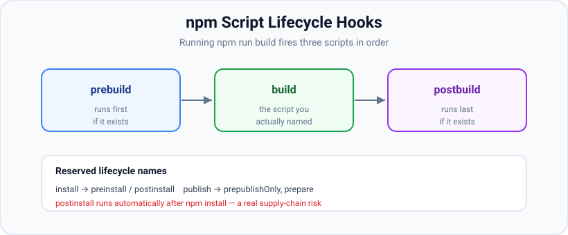

# npm & Scripts

*9 min read · Updated 24 Jul 2026 Topic 15 of 70 Bookmark Mark done Why it matters npm is the package manager that ships with Node and the front door to the largest software registry in the world · Topic 15 of 70*

**Source:** [https://www.geekyfrontend.in/learn/nodejs-backend-kit/npm-and-scripts](https://www.geekyfrontend.in/learn/nodejs-backend-kit/npm-and-scripts)

---

## Why it matters

npm is the package manager that ships with Node and the front door to the largest software registry in the world. Every day you use it to install dependencies, run tasks, execute one-off tools, and — if you publish — share your own code. The scripts you define in `package.json` become the shared vocabulary of a project: `npm run dev`, `npm test`, `npm run build` mean the same thing on every machine and in CI, regardless of the developer's local setup. Mastering npm scripts, `npx`, the alternative clients (yarn, pnpm), and security tooling like `npm audit` is what turns "I can install stuff" into "I can run and ship a real Node project safely."

This is also a security surface. Installing a package runs its lifecycle scripts on your machine; publishing exposes your code and credentials to the world. Knowing how scripts fire and how to audit dependencies is table stakes for professional Node work.

## The concept, simply

**npm scripts** are named shell commands stored under `"scripts"` in `package.json`. You run them with `npm run <name>` — and a few names (`start`, `test`, `stop`, `restart`) can drop the `run`. When a script runs, npm temporarily adds your project's `node_modules/.bin` to the `PATH`, so you can call locally-installed tools (like `tsc` or `eslint`) by their bare name without a global install.

**`npx`** executes a package's binary without permanently installing it — ideal for scaffolding (`npx create-vite`) or running a tool once. **yarn** and **pnpm** are alternative clients that read the same `package.json` but store dependencies differently and offer speed or disk-efficiency gains. **`npm audit`** scans your dependency tree against a vulnerability database.



npm runs pre and post hooks around any script automatically, and reserved lifecycle names like postinstall fire during install — a real supply-chain consideration.

## How it works

**Script lifecycle hooks.** For any script `x`, npm automatically runs `prex` before it and `postx` after it, if those scripts exist. So defining `build`, `prebuild`, and `postbuild` makes `npm run build` execute all three in order. This is how projects clean a folder, compile, then copy assets without a task runner. Several names are *reserved lifecycle* scripts that npm fires at specific moments: `preinstall`/`install`/`postinstall` run during `npm install`; `prepare` runs on local install and before publishing (commonly used to build a package or set up git hooks); `prepublishOnly` runs only before `npm publish`.

**Why lifecycle scripts are a security concern.** Because `postinstall` runs automatically whenever someone installs a package, a malicious dependency can execute arbitrary code on your machine at install time. This is a real supply-chain attack vector. Mitigations include reviewing dependencies, using `npm ci` with `--ignore-scripts` in sensitive environments, and pinning versions via the lockfile so you don't silently pull a compromised release.

**Passing arguments and chaining.** Pass flags to the underlying command with `--`: `npm run test -- --watch` forwards `--watch` to the test runner. Chain scripts by calling `npm run other` inside a script, or run several with `&&` (sequential) — for parallelism reach for a tool like `npm-run-all` or `concurrently`, since raw `&` is not portable to Windows.

**node\_modules/.bin on PATH.** When a script runs, npm prepends `node_modules/.bin` to `PATH`. That directory holds the executables of your installed packages (created from each package's `bin` field). So `"build": "tsc"` works even though `tsc` isn't installed globally — it resolves to your local TypeScript. This keeps tool versions pinned per-project.

**npx resolution.** `npx foo` looks for `foo` in the local `node_modules/.bin` first; if not found, it downloads the package to a temporary cache, runs it, and (by default) discards it. `npx create-next-app` is the canonical use — run a scaffolder once without polluting global installs. You can pin a version with `npx pkg@1.2.3`.

**yarn vs pnpm vs npm.** All three consume the same `package.json`. Practical differences: **npm** is built-in, uses a flattened `node_modules`, lockfile `package-lock.json`. **yarn** (classic and modern/Berry) popularised fast, deterministic installs and workspaces; modern yarn offers Plug'n'Play (no `node_modules`). **pnpm** stores every package version once in a global content-addressable store and links it into projects, saving huge amounts of disk and creating a stricter, non-flattened `node_modules` that prevents "phantom dependency" access to undeclared packages. Each has its own lockfile — do not mix clients in one repo, or you'll get competing lockfiles.

**Publishing basics.** To share a package: ensure `name`/`version` are set and the version is bumped (use `npm version patch|minor|major`, which updates `package.json` and creates a git tag), authenticate with `npm login`, control what ships with the `files` allowlist (or `.npmignore`), preview the tarball with `npm pack --dry-run`, then run `npm publish` (add `--access public` for a scoped public package). A `prepublishOnly` or `prepare` script commonly runs the build first.

**Auditing.** `npm audit` compares your installed tree against the advisory database and reports known vulnerabilities by severity. `npm audit fix` upgrades within your ranges automatically; `--force` allows breaking upgrades (review carefully). Audit is advisory — not every finding is exploitable in your usage — but it is a fast first pass and belongs in CI.

## Code examples

**1. Scripts with pre/post hooks and local binaries.**

json

```
{
  "scripts": {
    "clean": "rimraf dist",
    "prebuild": "npm run clean",
    "build": "tsc -p tsconfig.json",
    "postbuild": "cp -r public dist/public",
    "dev": "node --watch src/index.js",
    "test": "node --test",
    "lint": "eslint ."
  }
}
```

**2. Running scripts and forwarding args.**

javascript

```
// npm run build        -> runs prebuild, build, postbuild in order
// npm test             -> shorthand for `npm run test`
// npm run test -- --watch   // forwards --watch to node --test
// npm run lint -- --fix     // forwards --fix to eslint
```

**3. npx for one-off tools.**

javascript

```
// Scaffold a project without a global install:
//   npx create-vite@latest my-app
// Run a specific version once:
//   npx prettier@3.3.3 --check "src/**/*.js"
// Uses local node_modules/.bin if the tool is already installed.
```

**4. Publish flow and audit.**

javascript

```
// One-time: npm login
// Bump version (also creates a git tag):
//   npm version patch        // 1.4.0 -> 1.4.1
// Preview exactly what will be published:
//   npm pack --dry-run
// Publish (scoped public package):
//   npm publish --access public
// Security pass:
//   npm audit                 // report
//   npm audit fix             // safe upgrades within ranges
```

## Common mistakes & gotchas

- **Forgetting `--` when passing flags.** `npm run test --watch` gives the flag to npm, not your script. Use `npm run test -- --watch`.
- **Global installs of project tools.** Leads to version mismatches across machines. Install locally and call via scripts or `npx`.
- **Mixing package managers.** Running `yarn` then `npm install` creates two lockfiles and inconsistent trees. Pick one client per repo.
- **Ignoring `postinstall` risk.** Untrusted dependencies can run code at install time; audit deps and consider `--ignore-scripts` in CI for sensitive builds.
- **Using `&` for parallel scripts.** Not portable to Windows; use `npm-run-all -p` or `concurrently`.
- **Publishing more than intended.** Without a `files` allowlist you may ship source, tests, or secrets. Preview with `npm pack --dry-run`.
- **Publishing a scoped package without `--access public`.** It fails or publishes privately unexpectedly.
- **Treating every audit finding as critical.** Advisories may not apply to your code path; assess severity and reachability, and avoid blind `audit fix --force`, which can introduce breaking major upgrades.

## Best practices

- Standardise on a small set of scripts (`dev`, `build`, `test`, `lint`, `start`) so every project feels the same.
- Install tools locally and invoke them through scripts/`npx`; avoid global installs of project dependencies.
- Use pre/post hooks for setup and teardown instead of pulling in a heavier task runner.
- Pick one package manager per repo and commit only its lockfile; consider pnpm for large monorepos to save disk and catch phantom deps.
- Run `npm audit` (and dependency review) in CI; keep dependencies few and reputable to shrink the attack surface.
- Before publishing: bump with `npm version`, gate the build behind `prepublishOnly`/`prepare`, restrict output with `files`, and dry-run with `npm pack`.
- In CI/Docker use `npm ci` for reproducibility; add `--ignore-scripts` where install-time code execution is a concern.

## ⭐ Interview lens

> **Q: How do npm script lifecycle hooks work?** For any script `x`, npm runs `prex` before and `postx` after automatically if defined. Reserved lifecycle names (`preinstall`/`postinstall`, `prepare`, `prepublishOnly`) fire during install and publish. That is how `npm run build` can run clean → compile → copy without a task runner.

> **Q: Difference between `npm install pkg` and `npx pkg`?** `npm install` adds the package to `node_modules` and `package.json` for repeated use. `npx` executes a package's binary once — using a local copy if present, otherwise downloading to a temp cache and discarding it — ideal for scaffolders and one-off tools.

> **Q: How does `npm run build` find `tsc` without a global install?** npm prepends `node_modules/.bin` to `PATH` when running a script. That folder contains executables for locally-installed packages (from each package's `bin` field), so bare tool names resolve to the project-local, version-pinned copies.

> **Q: Why are `postinstall` scripts a security risk?** They run automatically on `npm install`, so a malicious dependency executes arbitrary code on your machine or CI at install time — a supply-chain attack. Mitigate with dependency review, lockfile pinning, and `--ignore-scripts` in sensitive environments.

> **Q: npm vs yarn vs pnpm — what actually differs?** They share `package.json` but differ in storage and lockfiles. npm flattens `node_modules` (`package-lock.json`). pnpm uses a global content-addressable store with symlinks — big disk savings and a strict layout that blocks phantom (undeclared) dependencies. yarn added fast installs, workspaces, and optional Plug'n'Play (no `node_modules`). Don't mix them in one repo.

> **Q: Walk through publishing a package safely.** `npm login`; bump with `npm version patch|minor|major` (updates version + git tag); restrict output via the `files` allowlist; build in a `prepublishOnly`/`prepare` script; preview with `npm pack --dry-run`; then `npm publish` (`--access public` for scoped). Run `npm audit` beforehand.

## Cheat-card

- **Run scripts:** `npm run x`; `start`/`test`/`stop`/`restart` skip `run`.
- **Hooks:** `prex` → `x` → `postx` auto-fire; reserved: `postinstall`, `prepare`, `prepublishOnly`.
- **Pass flags:** `npm run x -- --flag`.
- **Local bins:** npm adds `node_modules/.bin` to PATH.
- **npx** = run a binary once (local first, else temp download).
- **pnpm** = shared store + strict layout; **yarn** = workspaces/PnP; one client per repo.
- **Publish:** `npm version` → `files` allowlist → `npm pack --dry-run` → `npm publish [--access public]`.
- **Security:** `npm audit` / `audit fix`; `--ignore-scripts` for untrusted installs.
- **Workspaces:** `-w <name>` one, `--workspaces` all (glob order), `--if-present`; see lesson 74.
- **`npm link`:** global symlink + `bin`, then `npm link <name>` in the app; extraneous unless `--save`; try it with `npm_config_prefix=<scratch>`.
- **Portable env:** `cross-env NAME=v cmd`, or `node --env-file=.env` (environment wins over the file).
- **Provenance:** `npm publish --provenance` from GitHub Actions/GitLab with `id-token: write`; trusted publishing = OIDC, no npm token; local run → `EUSAGE`.

---

## Learn More

- [scripts docs.npmjs.com](https://docs.npmjs.com/cli/v10/using-npm/scripts)
- [An introduction to the npm package manager nodejs.org](https://nodejs.org/en/learn/getting-started/an-introduction-to-the-npm-package-manager)
- [npm run-script docs.npmjs.com](https://docs.npmjs.com/cli/v10/commands/npm-run-script)
- [NPM Scripts | Define Custom Scripts in package.json Rapid Tutor](https://www.youtube.com/watch?v=4oz0rqoB6VM)
- [Node.js Crash Course Traversy Media](https://www.youtube.com/watch?v=fBNz5xF-Kx4)

---

## Additional topics

*Added 7 Oct 2026 · examples verified on Node v24.19.0*

### Scripts in workspaces and monorepos

In a repository with a `workspaces` field, every npm script command accepts a workspace selector: `-w <name>` (or `--workspace`) runs the command in one workspace, `--workspaces` in all of them, and `--if-present` skips workspaces that do not define the script. This exists so a root script can drive many packages without `cd packages/x && npm run build` chains, which break as soon as a folder moves. The layouts, pnpm/Yarn differences, build caching and publishing are covered in [Monorepos and Workspaces](74-monorepos-and-workspaces.md).

How it works:

1. npm reads the root `workspaces` globs and maps each folder to its package `name`.
2. With `-w <name>`, npm runs that workspace's script with the workspace folder as the working directory, and puts every `node_modules/.bin` from the workspace folder up to the repository root on `PATH`.
3. With `--workspaces`, it repeats step 2 for every workspace in the order the globs list them, which is not dependency order.
4. `npm exec -w <name> -- <cmd>` runs an arbitrary command inside that workspace the same way.

**Example — one workspace, from the repository root.** (The Example 1 repository from lesson 74.)

bash

```
$ npm run build -w @acme/utils

> @acme/utils@1.0.0 build
> node -e "console.log('build utils')"

build utils
$ npm exec -w @acme/api -- node -p "require('./package.json').name + ' in ' + process.cwd().split('/').slice(-2).join('/')"
@acme/api in apps/api
```

### `npm link`

`npm link` connects a package you are developing to a project that uses it, through two symlinks, so you can test changes without publishing. It works in two steps: `npm link` inside the package creates a symlink in npm's **global** `lib/node_modules` (and links its `bin` entries into the global `bin`), and `npm link <name>` inside the project points the project's `node_modules/<name>` at the package folder. Without it you would publish a prerelease or copy files by hand for every change. Because step 1 writes into the global prefix, the example below sets `npm_config_prefix` to a throwaway folder so the real global install is never touched.

How it works:

1. In `greet-cli/`, `npm link` creates `<prefix>/lib/node_modules/greet-cli -> <path to greet-cli>` and `<prefix>/bin/greet -> ../lib/node_modules/greet-cli/bin/greet.js`.
2. In `app/`, `npm link greet-cli` finds that global entry and creates `app/node_modules/greet-cli`, a symlink straight to the source folder.
3. Node follows the symlink to the real path, so `require('greet-cli')` loads the source files you are editing; edits are visible immediately, with no reinstall.
4. The link is not recorded in `app/package.json` unless you pass `--save`, so npm treats it as `extraneous`.
5. `npm unlink -g` inside the package removes the global entries again.

**Example — link a CLI into a project inside a throwaway prefix.** `greet-cli/package.json`, `index.js` and `bin/greet.js`:

json

```
{
  "name": "greet-cli",
  "version": "0.1.0",
  "bin": { "greet": "bin/greet.js" },
  "main": "index.js"
}
```

javascript

```
module.exports = (name) => `hello, ${name} (from ${__dirname})`;
```

javascript

```
#!/usr/bin/env node
console.log(require('../index.js')(process.argv[2] ?? 'world'));
```

Real output (Node v24.19.0, npm 11.17.0), run with `npm_config_prefix=<throwaway>/prefix` exported (`…` replaces the throwaway directory; the `sed` only removes the permission and date columns from `ls -l`):

bash

```
$ npm config get prefix
…/link/prefix
$ npm link >/dev/null && ls -l ../prefix/lib/node_modules ../prefix/bin | sed 's/^.* \([^ ]* -> \)/\1/'
../prefix/bin:
total 0
greet -> ../lib/node_modules/greet-cli/bin/greet.js

../prefix/lib/node_modules:
total 0
greet-cli -> ../../../greet-cli
$ ../prefix/bin/greet Ada
hello, Ada (from …/link/greet-cli)
$ npm link greet-cli >/dev/null && readlink node_modules/greet-cli && npm ls
../../greet-cli
app@1.0.0 …/link/app
└── greet-cli@0.1.0 extraneous -> ./../greet-cli
$ node -p "require('greet-cli')('app')"
hello, app (from …/link/greet-cli)
```

The `__dirname` in the output proves the app is running the linked source folder, not a copy.

### cross-env and portable environment variables

`cross-env` is a small CLI (`cross-env NAME=value command …`) that sets environment variables and then spawns the command, so the same `package.json` script works in POSIX shells and in Windows `cmd.exe`. It exists because npm runs scripts through the system shell (`sh` on Linux and macOS, `cmd.exe` on Windows; npm's `script-shell` setting changes it), and only POSIX shells understand the `NAME=value command` prefix. Without it, `"start": "NODE_ENV=production node app.js"` fails on a Windows shell. cross-env 10.1.0 is an ES module package that requires Node `>=20`.

How it works:

1. npm hands the script string to the shell.
2. The shell runs `cross-env`, which parses the leading `NAME=value` arguments.
3. cross-env copies `process.env`, adds the new variables, and spawns the remaining command with that environment.
4. The child exits and cross-env exits with the same code.

There are two dependency-free alternatives. `node --env-file=<file>` (added in v20.6.0, no longer experimental since v24.10.0) loads variables from a file before the app starts, with a variable already set in the environment taking precedence over the file; `--env-file-if-exists` (added in v22.9.0) does the same without failing when the file is missing. Or keep the logic in Node itself, for example a small `scripts/start.js` that sets `process.env` before importing the app, which runs the same way in every shell.

**Example — three ways to set `NODE_ENV`.** `package.json` and `show-env.js`:

json

```
{
  "name": "xenv",
  "private": true,
  "scripts": {
    "start:posix": "NODE_ENV=production node show-env.js",
    "start:cross": "cross-env NODE_ENV=production node show-env.js",
    "start:envfile": "node --env-file=.env.production show-env.js"
  },
  "devDependencies": { "cross-env": "^10.1.0" }
}
```

javascript

```
console.log(`NODE_ENV=${process.env.NODE_ENV} PORT=${process.env.PORT ?? '(unset)'}`);
```

bash

```
$ cat .env.production
NODE_ENV=production
PORT=4600
$ npm run start:posix

> start:posix
> NODE_ENV=production node show-env.js

NODE_ENV=production PORT=(unset)
$ npm run start:cross

> start:cross
> cross-env NODE_ENV=production node show-env.js

NODE_ENV=production PORT=(unset)
$ npm run start:envfile

> start:envfile
> node --env-file=.env.production show-env.js

NODE_ENV=production PORT=4600
$ NODE_ENV=staging npm run start:envfile

> start:envfile
> node --env-file=.env.production show-env.js

NODE_ENV=staging PORT=4600
$ npm ls cross-env | tail -n +2 && npm view cross-env@10.1.0 engines type
└── cross-env@10.1.0

engines = { node: '>=20' }
type = 'module'
```

All three give `NODE_ENV=production` on Linux. Only the `--env-file` version also loads `PORT` from the file, and the run with `NODE_ENV=staging` already exported shows the environment winning over the file.

> ⚠️ Unverified: the failure of `start:posix` and the success of `start:cross` on Windows `cmd.exe` were not reproduced; no Windows machine was available. The cmd.exe behaviour is taken from the cross-env README.

### Provenance and trusted publishing

A **provenance statement** is a signed attestation, attached to a published package version, that records which source repository, commit and CI workflow built it; it is signed through Sigstore and logged in a public transparency log, and `npm audit signatures` verifies it. **Trusted publishing** removes the long-lived npm token: you register a specific CI workflow (GitHub Actions, GitLab CI/CD or CircleCI, cloud-hosted runners only) as a trusted publisher on npmjs.com, and the npm CLI exchanges the CI's short-lived OIDC identity token for publish rights at publish time. These exist because stolen publish tokens and tampered release builds are a supply-chain attack path; without them a consumer cannot tell whether a tarball came from the repository it claims. Per docs.npmjs.com, provenance needs npm 9.5.0 or later and a public `repository` field that matches the publishing repository; trusted publishing needs npm 11.5.1 or later and Node 22.14.0 or later, and generates provenance automatically without the `--provenance` flag.

How it works (GitHub Actions, as described on docs.npmjs.com):

1. The workflow is granted `permissions: id-token: write` and runs on a GitHub-hosted runner.
2. During `npm publish --provenance` (or a trusted-publishing `npm publish`), npm detects the CI provider and requests an OIDC ID token from it.
3. For trusted publishing, npm sends that token to the registry, which checks it against the trusted-publisher configuration (organisation, repository, workflow filename, optional environment) and returns a short-lived token for this publish.
4. For provenance, npm uses the identity token to get a signing certificate from Sigstore, signs a statement describing the build, and uploads it with the tarball; the registry records it in the transparency log.
5. Outside a supported CI provider there is no identity token, so a provenance publish fails before upload.

The parts that can run locally:

bash

```
$ npm publish --help | grep -o '\[--provenance|--provenance-file <file>\]'
[--provenance|--provenance-file <file>]
$ npm publish --provenance --access public --dry-run 2>&1 | grep -v 'npm notice [0-9a-z]'
npm notice
npm notice 📦  @acme-demo/prov-check@0.0.1
npm notice Tarball Contents
npm notice Tarball Details
npm notice
npm warn publish This command requires you to be logged in to https://registry.npmjs.org/ (dry-run)
npm notice Publishing to https://registry.npmjs.org/ with tag latest and public access (dry-run)
+ @acme-demo/prov-check@0.0.1
$ npm publish --provenance --access public --registry http://127.0.0.1:4601/ --//127.0.0.1:4601/:_authToken=fake-token 2>&1 | grep -v 'npm notice'
npm error code EUSAGE
npm error Automatic provenance generation not supported for provider: null
npm error A complete log of this run can be found in: …/_logs/….log
$ cat registry.log
[registry] GET /@acme-demo%2fprov-check
[registry] GET /@acme-demo%2fprov-check
$ npm trust --help | head -8
Create a trusted relationship between a package and a OIDC provider

Usage:
npm trust github [package] --file [--repo|--repository] [--env|--environment] [--allow-publish] [--allow-stage-publish] [-y|--yes]
npm trust gitlab [package] --file [--project|--repo|--repository] [--env|--environment] [--allow-publish] [--allow-stage-publish] [-y|--yes]
npm trust circleci [package] --org-id <uuid> --project-id <uuid> --pipeline-definition-id <uuid> --vcs-origin <origin> [--context-id <uuid>...] [--allow-publish] [--allow-stage-publish] [-y|--yes]
npm trust list [package]
npm trust revoke [package] --id=<trust-id>
```

The dry run accepted `--provenance` but did not exercise it (it printed the normal dry-run lines). The real publish, sent to the same local stand-in registry used in lesson 14 (every request answered with an error, `registry.log` lists them), failed with `EUSAGE` because no CI provider was detected; only two `GET` requests reached the registry and nothing was uploaded. npm 11.17.0 also ships `npm trust`, which configures trusted publishers from the CLI instead of the npmjs.com settings page.

A publish workflow following the docs.npmjs.com trusted-publishing example:

text

```
name: Publish Package
on:
  push:
    tags:
      - 'v*'
permissions:
  id-token: write   # Required for OIDC
  contents: read
jobs:
  publish:
    runs-on: ubuntu-latest
    steps:
      - uses: actions/checkout@v6
      - uses: actions/setup-node@v6
        with:
          node-version: '24'
          registry-url: 'https://registry.npmjs.org'
          package-manager-cache: false
      - run: npm ci
      - run: npm run build --if-present
      - run: npm test
      - run: npm publish
```

> ⚠️ Unverified: the workflow above, the OIDC token exchange, the provenance signing and `npm audit signatures` output were not run; they need a GitHub Actions or GitLab CI/CD runner, a trusted-publisher configuration on npmjs.com and a real package to publish. Steps 2 to 4 are summarised from docs.npmjs.com ("Generating provenance statements" and "Trusted publishing for npm packages"), not observed.

### Common mistakes & gotchas (additional topics)

- **Running `npm link` against the real global prefix in experiments.** It writes into the global `lib/node_modules` and `bin`. Set `npm_config_prefix` to a scratch folder when trying it, and run `npm unlink -g` afterwards.
- **Forgetting that a link is extraneous.** Without `--save`, the link is not in `package.json`, and installing another package removes it (edge case below).
- **Linking a package that has peer dependencies.** The linked package resolves its own imports from its real folder, so if that folder has its own `node_modules` (from developing it), it loads its own copy of, say, a framework instead of the app's. Prefer workspaces for packages developed together.
- **Hard-coding `NAME=value cmd` in scripts that must run on Windows.** Use cross-env, `node --env-file`, or a Node script.
- **Expecting `--env-file` to override the environment.** Values already in the environment win over the file.
- **Expecting `npm publish --provenance --dry-run` to test provenance.** It does not; provenance only runs on a real publish from a supported CI runner.

### Edge case worked through: installing another package silently removes a link

Continuing in the same `app/` with the same throwaway prefix:

bash

```
$ npm install >/dev/null && ls node_modules
greet-cli
$ npm install ms@2.1.3 >/dev/null && ls node_modules && npm ls
ms
app@1.0.0 …/link/app
└── ms@2.1.3
$ npm link greet-cli --save >/dev/null && npm pkg get dependencies && npm ls
{
  "greet-cli": "file:../greet-cli",
  "ms": "^2.1.3"
}
app@1.0.0 …/link/app
├── greet-cli@0.1.0 -> ./../greet-cli
└── ms@2.1.3
$ npm unlink -g >/dev/null; ls ../prefix/lib/node_modules ../prefix/bin
../prefix/bin:

../prefix/lib/node_modules:
```

A plain `npm install` kept the extraneous link, but `npm install ms@2.1.3` rebuilt the tree from `package.json`, where `greet-cli` was not listed, and removed `node_modules/greet-cli`; any `require('greet-cli')` would now fail. `npm link greet-cli --save` records it as `"file:../greet-cli"`, so it survives later installs; remember to restore the real range before committing. Finally `npm unlink -g` emptied the throwaway global folders.

### ⭐ Interview lens (additional topics)

> **Q: “How do you test a local library inside an app without publishing it?”**  
> A: In a monorepo, make both workspaces and depend on the library by name; the install symlinks it. Across repositories, `npm link` in the library (a global symlink plus its `bin`), then `npm link <name>` in the app, which points `node_modules/<name>` at the library folder. Node follows the symlink, so edits are live. *Trap:* the link is extraneous unless saved, and the next `npm install <pkg>` removes it.

> **Q: “What is npm provenance, and what does trusted publishing add?”**  
> A: Provenance is a Sigstore-signed statement attached to the published version that links it to the source repository, commit and CI workflow that built it, recorded in a public transparency log and checkable with `npm audit signatures`. Trusted publishing replaces long-lived npm tokens: npm exchanges the CI job's short-lived OIDC token for publish rights, only for the workflow registered on npmjs.com, and provenance is generated automatically. Both need a supported cloud CI runner; a local `npm publish --provenance` fails with `EUSAGE`.
