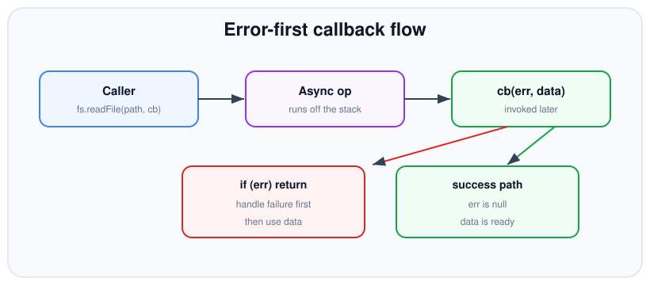
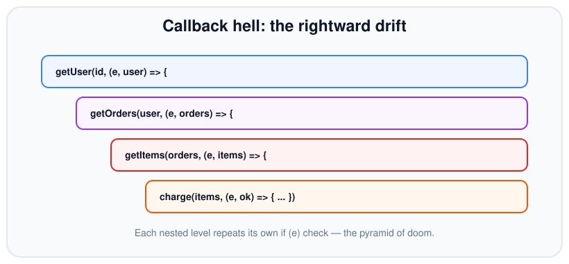

# Callbacks

*10 min read · Updated 24 Jul 2026 Topic 16 of 70 Bookmark Mark done Why it matters Node · Topic 16 of 70*

**Source:** [https://www.geekyfrontend.in/learn/nodejs-backend-kit/callbacks](https://www.geekyfrontend.in/learn/nodejs-backend-kit/callbacks)

---

## Why it matters

Node.js is single-threaded for your JavaScript, yet it powers servers that juggle thousands of simultaneous connections. It pulls that off by never blocking the one thread on slow work — reading a file, querying a database, calling another service. Instead of freezing until the result is ready, Node takes a function from you, walks away to do the slow work elsewhere, and calls your function back when the answer arrives. That function is a **callback**, and it is the original, foundational async pattern in Node. Promises and `async/await` are built on top of it.

You cannot really understand Node without understanding callbacks. Every higher-level abstraction — the entire streams system, the `EventEmitter`, most of the classic `fs` and `net` APIs, and countless npm packages written before 2016 — speaks callbacks. When you debug a stack trace that jumps out of nowhere, or wrap an old library so it returns a promise, you are working directly with this pattern. Interviewers reach for it constantly because it exposes whether you actually understand the event loop or just memorised `await`.

## The concept, simply

A callback is just a function you pass to another function, to be invoked *later*, when some work finishes. Synchronous callbacks (like the function you give `Array.map`) run immediately. The interesting ones are **asynchronous** callbacks: you hand them over now, your code keeps running, and Node invokes them on a future turn of the event loop once the awaited event happens.

Node standardised a convention called the **error-first callback** (sometimes "node-style" or "errback"): the callback's first parameter is an error, and the actual result comes after it. If the operation failed, the first argument is an `Error` and the rest are undefined; if it succeeded, the first argument is `null` and the data follows. This single convention makes thousands of unrelated APIs feel consistent.



In an error-first callback the failure branch is always checked first; only then is the data used.

## How it works

When you call `fs.readFile('a.txt', cb)`, Node does not read the file on your thread. It registers the request with the operating system (via the libuv thread pool for file I/O) and returns immediately — the very next line of your code runs before the file is read. Your callback is parked. When the read completes, libuv places your callback on a queue, and once the current call stack is empty the event loop picks it up and runs it. This is why a `console.log` after the `readFile` call prints *before* the callback fires.

The critical consequence: a callback runs on a **fresh, empty call stack**, disconnected from the code that scheduled it. The function that called `readFile` has long since returned. That is why you cannot wrap an async callback in a `try/catch` and expect to catch its error — by the time the callback throws, the `try` block is gone from the stack. The error-first convention exists precisely because `throw` is useless here: errors must be passed *as data* into the callback instead.

Because each async step schedules the next one only from inside its own callback, sequencing several dependent operations means nesting callbacks inside callbacks. Each level must independently check its own error argument. This is where the pattern's ergonomics break down — the code drifts to the right and error handling is duplicated at every level.

There's a subtle timing distinction worth internalising. Not all deferrals are equal: `process.nextTick(cb)` runs your callback *before* the event loop continues to the next phase — effectively at the front of the queue, even ahead of promise microtasks — whereas `setImmediate(cb)` runs it on the next loop iteration's check phase, and `setTimeout(cb, 0)` runs it in the timers phase. For merely making a synchronous path asynchronous, `setImmediate` is the safest default because `nextTick` can starve the event loop if you schedule it recursively. The takeaway for callbacks specifically: when you need to defer to avoid releasing Zalgo, prefer `setImmediate` unless you have a concrete reason to jump the queue.

The three ways to defer a callback differ in *when* on the loop they run, and confusing them causes ordering bugs that only appear under load:

| Primitive | Runs | Drains | Starvation risk |
| --- | --- | --- | --- |
| `process.nextTick(cb)` | Before the loop advances, ahead of promise microtasks | Fully, after each operation | High — recursive scheduling blocks the loop |
| Promise `.then` / `queueMicrotask` | After nextTick, before the next phase | Fully, before any macrotask | High if scheduled recursively |
| `setImmediate(cb)` | Next iteration, in the check phase | One per iteration | Low — yields between iterations |
| `setTimeout(cb, 0)` | Timers phase, after a ≥1ms clamp | One per iteration | Low |

One more mechanic behind file-system callbacks explains a lot of otherwise-baffling throughput ceilings. Network sockets use the operating system's own event notification, so thousands can be in flight at once. File I/O and a few CPU-bound operations (`crypto.pbkdf2`, `zlib`, DNS `lookup`) cannot be done that way, so libuv runs them on a small pool of worker threads whose default size is only **four** (`UV_THREADPOOL_SIZE`). Fire off five concurrent `fs.readFile` calls and the fifth callback waits for a worker to free up, even though your JavaScript looks fully parallel. Knowing which of your callbacks share that pool tells you which ones can actually overlap and which merely queue.



Dependent async steps nest, each repeating its own error check — the pyramid of doom.

## Code examples

The canonical error-first pattern. Notice the error branch is handled first and returns early, so the success code never runs on a failure:

javascript

```
const fs = require('node:fs');

fs.readFile('config.json', 'utf8', (err, data) => {
  if (err) {
    console.error('Failed to read config:', err.message);
    return; // stop — do NOT fall through to use data
  }
  const config = JSON.parse(data);
  console.log('Port:', config.port);
});

console.log('This logs FIRST — readFile is async.');
```

Sequencing dependent steps produces the nesting the diagram showed. Each step needs the previous step's result:

javascript

```
getUser(1, (err, user) => {
  if (err) return done(err);
  getOrders(user.id, (err, orders) => {
    if (err) return done(err);
    getItems(orders[0].id, (err, items) => {
      if (err) return done(err);
      done(null, items); // finally, the result
    });
  });
});
```

Writing an async function of your own means *always* calling the callback the same way — error first, and never both calling back with an error and continuing. Deferring with `setImmediate` keeps the API consistently asynchronous:

javascript

```
function loadUser(id, cb) {
  if (typeof id !== 'number') {
    // Defer so the callback never runs synchronously — see gotchas below.
    return setImmediate(() => cb(new Error('id must be a number')));
  }
  db.find(id, (err, row) => {
    if (err) return cb(err);        // pass the error along
    cb(null, { id: row.id, name: row.name }); // null error on success
  });
}
```

Running independent callback operations in parallel and collecting results by hand shows why libraries and promises were welcomed. You must count completions yourself and guard against calling `done` twice:

javascript

```
function loadAll(ids, done) {
  const results = [];
  let remaining = ids.length;
  let finished = false;
  if (remaining === 0) return done(null, results);

  ids.forEach((id, i) => {
    loadUser(id, (err, user) => {
      if (finished) return;         // already errored out
      if (err) { finished = true; return done(err); }
      results[i] = user;            // preserve order by index
      if (--remaining === 0) done(null, results);
    });
  });
}
```

## Common mistakes & gotchas

- **Wrapping an async callback in try/catch.** The `try` block has already unwound by the time the callback runs, so it catches nothing. Handle the `err` argument instead.
- **Forgetting to `return` after handling the error.** Without the early return, execution falls through and runs the success path with undefined data — often crashing on `JSON.parse(undefined)` or a null dereference.
- **Calling the callback more than once.** Firing `cb` on error and then again on success (or in a loop) causes duplicated downstream work and double responses. Guard with a `finished` flag or return after each call.
- **Releasing Zalgo — a callback that is sometimes sync, sometimes async.** If `loadUser` called `cb` synchronously for the validation error but asynchronously for the DB path, callers get inconsistent ordering and subtle bugs. Always defer synchronous callbacks with `setImmediate` or `process.nextTick`.
- **Swallowing errors.** An empty `if (err) {}` or an ignored first argument hides real failures. At minimum log and stop.
- **Losing `this`.** Passing a method as a bare callback (`emitter.on('x', obj.handle)`) detaches `this`. Use an arrow wrapper or `.bind()`.
- **Assuming `fs` callbacks run in parallel.** They share libuv's four-thread pool by default, so heavy concurrent file, crypto, or zlib work serialises behind it. Raise `UV_THREADPOOL_SIZE` (set it before the first pool use) or throttle the work if throughput plateaus.

## Best practices

- Follow the error-first convention rigidly in every callback you author — first arg is the error, and only the error.
- Handle the error branch first and `return` immediately, so the happy path reads linearly below it.
- Keep callbacks async-only: never invoke a callback synchronously; defer with `setImmediate` to avoid Zalgo.
- Name your callback functions instead of deeply nesting anonymous ones — flatter code and better stack traces.
- For anything beyond one or two steps, promote to promises with `util.promisify` or use the promise-based core APIs (`fs.promises`) rather than hand-nesting.
- Never call a callback twice; enforce it with a guard flag when the control flow makes it possible.

## ⭐ Interview lens

> **Q: What is an error-first callback and why did Node adopt it?**  
> Because an async callback runs on a fresh stack, `throw` cannot reach the original caller. Passing the error as the first argument gives every async API a uniform, throw-free way to report failure, so callers always check the same place.

> **Q: Why does `console.log` after `fs.readFile` print before the file contents?**  
> `readFile` offloads the work and returns immediately; the callback is queued and only runs after the current synchronous code finishes and the stack empties. This is the event loop deferring the callback to a later tick.

> **Q: Can a `try/catch` catch an error thrown inside an async callback?**  
> No. The `try` block has already returned by the time the callback fires on a new stack. The thrown error escapes as an uncaught exception. This is the core reason errors are passed as data, not thrown.

> **Q: What is "callback hell" and what actually causes it?**  
> Deeply nested callbacks caused by sequencing dependent async steps — each step can only schedule the next from inside its own callback. The trap: it isn't just ugly, it also duplicates error handling at every level and makes early exit awkward.

> **Q: What is "releasing Zalgo"? (trap)**  
> Writing a function that invokes its callback synchronously on one path and asynchronously on another. Callers can't reason about ordering, leading to race-like bugs. Fix by always deferring the synchronous path with `setImmediate` or `process.nextTick`.

> **Q: How do you convert a callback API into a promise?**  
> Wrap it with `util.promisify(fn)` (which relies on the error-first convention), or construct a `new Promise` and call `resolve(data)` / `reject(err)` from inside the callback.

## Cheat-card

- **Shape:** `(err, data) => {}` — error first, always.
- **Runs:** later, on an empty stack, via the event loop.
- **Errors:** passed as arg #1, never thrown — `try/catch` won't catch them.
- **Rule:** handle `err`, then `return`; never call `cb` twice.
- **Zalgo:** keep callbacks always-async; defer sync paths with `setImmediate`.
- **Escape hatch:** `util.promisify` / `fs.promises` to move up to promises.
- **Back to callbacks:** `util.callbackify(asyncFn)` → `(…args, cb)`; a falsy rejection arrives as an `Error` with `code ERR_FALSY_VALUE_REJECTION` and the value in `err.reason`.
- **Cancel a callback API:** pass `{ signal }` in the options (`fs.readFile`, `exec`, `execFile`); the callback gets `AbortError`, `code ABORT_ERR`.

---

## Learn More

- [JavaScript Asynchronous Programming and Callbacks nodejs.org](https://nodejs.org/en/learn/asynchronous-work/javascript-asynchronous-programming-and-callbacks)
- [Introducing asynchronous JavaScript developer.mozilla.org](https://developer.mozilla.org/en-US/docs/Learn_web_development/Extensions/Async_JS/Introducing)
- [Async JS Crash Course - Callbacks, Promises, Async Await Traversy Media](https://www.youtube.com/watch?v=PoRJizFvM7s)
- [Error First Callback Patterns in JS Steve Griffith - Prof3ssorSt3v3](https://www.youtube.com/watch?v=0pNo1O42m6k)

---

## Additional topics

*Added 7 Oct 2026 · examples verified on Node v24.19.0*

### `util.callbackify`: from a promise back to a callback

`util.callbackify(fn)` (added in v8.2.0) is the reverse of `util.promisify`. It takes a function that returns a promise (usually an `async` function) and returns a new function that takes the same arguments plus an error-first callback at the end. You need it when an older API expects a callback (a plugin hook, a test framework, a library that calls `cb(err, value)`) and the code you want to plug in is written with `async`/`await`. Without it you would write the same `.then(v => cb(null, v), e => cb(e))` adapter by hand each time, and the hand-written version usually gets the edge cases below wrong.

How it works:

1. You call the wrapper with the original arguments and a callback last: `wrapped(a, b, cb)`.
2. The wrapper calls `fn(a, b)` and gets a promise.
3. If the promise fulfils with `value`, the wrapper calls `cb(null, value)`.
4. If it rejects with a truthy `reason`, the wrapper calls `cb(reason)`.
5. If it rejects with a falsy reason (`null`, `undefined`, `0`, `''`, `false`), the wrapper cannot pass it as the first argument, because a falsy first argument means "no error". It creates an `Error` with `code: 'ERR_FALSY_VALUE_REJECTION'` and the original value in an own property `reason`, and calls `cb(thatError)`.
6. The callback always runs asynchronously, on a later tick. If it throws, the error is not turned into a rejection; it becomes an `uncaughtException`.

**Example — wrapping an `async` function for a callback API.**

javascript

```
const { callbackify } = require('node:util');

async function getUser(id) {
  if (id < 0) throw new Error(`no user ${id}`);
  return { id, name: 'Ada' };
}
const getUserCb = callbackify(getUser);   // same arguments, plus a callback at the end

getUserCb(1, (err, user) => {
  console.log('ok    ->', err, user);
});
getUserCb(-1, (err, user) => {
  console.log('error ->', err.message, user);
});
console.log('sync code finished first');

// Real output (Node v24.19.0):
//   sync code finished first
//   ok    -> null { id: 1, name: 'Ada' }
//   error -> no user -1 undefined
```

The callback runs after the synchronous code, as step 6 says, so a callbackified function never "releases Zalgo".

### AbortSignal with callback APIs

The callback-style core APIs take the same `AbortSignal` as the promise APIs (see [`73-abortcontroller-and-abortsignal.md`](73-abortcontroller-and-abortsignal.md)). The signal goes into the options object, and the abort shows up as the callback's `err`. `fs.readFile(path, { signal }, cb)` supports it since v15.2.0, `child_process.exec` since v15.4.0, and `execFile` since v15.4.0 (all from the History tables of the v24 docs). Without a signal, a callback API has no way to stop work you no longer need: the read keeps buffering the whole file, and the child process keeps running.

How it works:

1. Create an `AbortController` and pass `{ signal: controller.signal }` in the options.
2. The API registers an abort listener and starts the work.
3. When you call `controller.abort()`, `fs.readFile` stops its internal buffering between chunk reads (the docs note it does not cancel a single OS read already in progress). `exec` sends the child its `killSignal`, `'SIGTERM'` by default.
4. The callback is called once, with `err` set to Node's `AbortError` (`err.name === 'AbortError'`, `err.code === 'ABORT_ERR'`, the abort reason in `err.cause`) and no data.

**Example — cancelling `fs.readFile` and `child_process.exec` (local file and local command only).**

javascript

```
const fs = require('node:fs');
const { exec } = require('node:child_process');

fs.writeFileSync('big.bin', Buffer.alloc(200 * 1024 * 1024));   // 200 MiB local file

// 1. fs.readFile: the signal goes in the options object, before the callback
const readAc = new AbortController();
fs.readFile('big.bin', { signal: readAc.signal }, (err, data) => {
  if (err) console.log('readFile ->', err.name, err.code, '| data:', data);
  else console.log('readFile -> read', data.length, 'bytes');
  fs.rmSync('big.bin');
});
readAc.abort();          // abort right after starting

// 2. child_process.exec: Node kills the child with killSignal (default 'SIGTERM')
const execAc = new AbortController();
const child = exec('sleep 1 && echo finished > marker.txt', { signal: execAc.signal }, (err) => {
  console.log('exec     ->', err.name, err.code, '| err.killed:', err.killed, '| err.signal:', err.signal);
});
child.on('exit', (code, signal) => console.log('child exit -> code:', code, '| signal:', signal));
setTimeout(() => execAc.abort(), 200);

setTimeout(() => console.log('marker.txt written?', fs.existsSync('marker.txt')), 1500);

// Real output (Node v24.19.0):
//   readFile -> AbortError ABORT_ERR | data: undefined
//   exec     -> AbortError ABORT_ERR | err.killed: undefined | err.signal: undefined
//   child exit -> code: null | signal: SIGTERM
//   marker.txt written? false
```

The `exec` callback still gets exactly one call, with the `AbortError`. The `'exit'` event shows the shell was killed by `SIGTERM`, and `marker.txt` was never written, so the command really stopped.

### Common mistakes & gotchas (additional topics)

- **Throwing inside a callbackified function's callback.** The throw does not reach any `catch` or promise. It becomes an `uncaughtException` (verified: a handler registered with `process.on('uncaughtException')` received `bug in the callback, got value`). Handle errors inside the callback.
- **Testing `if (err === null)` after a falsy rejection.** A promise that rejects with `null` reaches the callback as a real `Error` with `code === 'ERR_FALSY_VALUE_REJECTION'`, not as `null`. The original value is in `err.reason`.
- **Reading `err.killed` / `err.signal` after aborting `exec`.** When `exec` is stopped by a signal, the error is the `AbortError`, and `err.killed` and `err.signal` are `undefined` (they are set when the `timeout` option kills the child). Use the child's `'exit'` event to see the kill signal.
- **Passing the signal itself instead of `{ signal }`.** `fs.readFile(path, signal, cb)` does not throw; the signal is silently ignored. In a test run with an already-aborted signal passed this way, the callback got `err === null` and the whole file. Always wrap it: `{ signal }`.

### Edge case worked through: a promise that rejects with a falsy value

A hand-written adapter like `fn().then(v => cb(null, v), e => cb(e))` breaks when `fn` rejects with `null`: the callback receives `cb(null)` and treats the failure as a success with `undefined` data. The first line of output below shows it; `util.callbackify` handles the case:

javascript

```
const { callbackify } = require('node:util');

// A hand-written adapter: looks fine, but a null rejection reaches cb as "no error"
const naive = (fn) => (cb) => fn().then((v) => cb(null, v), (e) => cb(e));
naive(() => Promise.reject(null))((err, v) => {
  console.log('hand-written adapter, reject(null) -> err:', err, '| treated as success:', !err);
});

// util.callbackify wraps every falsy reason in a real Error
for (const reason of [null, undefined, 0, '', false]) {
  const rejects = callbackify(() => Promise.reject(reason));
  rejects((err) => {
    console.log(
      `reject(${JSON.stringify(reason) ?? 'undefined'}) ->`,
      `${err.constructor.name} | message: ${JSON.stringify(err.message)} | code: ${err.code}`,
      `| has own 'reason': ${Object.hasOwn(err, 'reason')} | err.reason: ${JSON.stringify(err.reason) ?? 'undefined'}`,
    );
  });
}

// Real output (Node v24.19.0):
//   hand-written adapter, reject(null) -> err: null | treated as success: true
//   reject(null) -> Error | message: "Promise was rejected with falsy value" | code: ERR_FALSY_VALUE_REJECTION | has own 'reason': true | err.reason: null
//   reject(undefined) -> Error | message: "Promise was rejected with falsy value" | code: ERR_FALSY_VALUE_REJECTION | has own 'reason': true | err.reason: undefined
//   reject(0) -> Error | message: "Promise was rejected with falsy value" | code: ERR_FALSY_VALUE_REJECTION | has own 'reason': true | err.reason: 0
//   reject("") -> Error | message: "Promise was rejected with falsy value" | code: ERR_FALSY_VALUE_REJECTION | has own 'reason': true | err.reason: ""
//   reject(false) -> Error | message: "Promise was rejected with falsy value" | code: ERR_FALSY_VALUE_REJECTION | has own 'reason': true | err.reason: false
```

Every falsy reason, including `undefined`, arrives as an `Error` whose message is `Promise was rejected with falsy value` and whose own `reason` property holds the original value. The `if (err) return …` check from the error-first convention therefore still works.

### ⭐ Interview lens (additional topics)

> **Q: “What does `util.callbackify` do when the promise rejects with `null`?”**  
> A: It cannot call `cb(null)`, because a falsy first argument means success. It wraps the value in an `Error` with `code: 'ERR_FALSY_VALUE_REJECTION'` and stores the original `null` in `err.reason`. *Trap:* a hand-rolled `.then(v => cb(null, v), cb)` adapter gets this wrong and reports success.

> **Q: “How do you cancel an `fs.readFile` or an `exec` that uses a callback?”**  
> A: Pass `{ signal }` from an `AbortController` in the options and call `abort()`. The callback runs once with an `AbortError` (`code 'ABORT_ERR'`); for `exec`, Node also sends the child `killSignal` (default `SIGTERM`).
