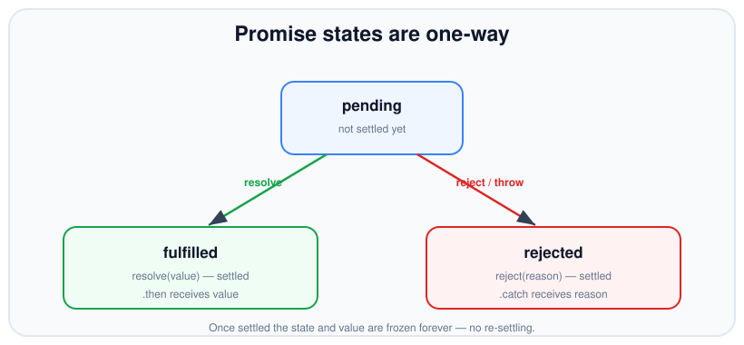
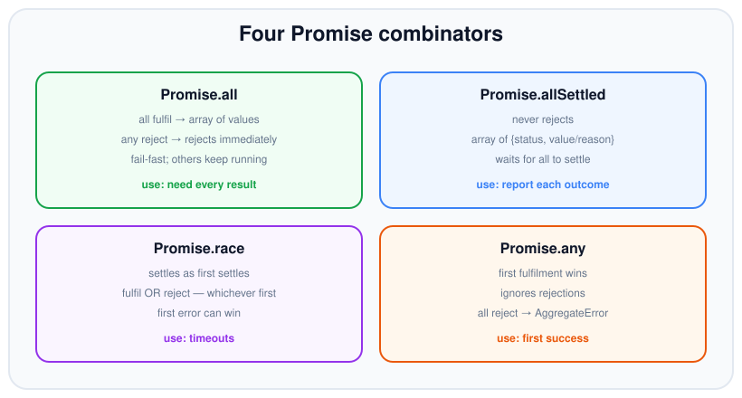

# Promises

*9 min read · Updated 24 Jul 2026 Topic 17 of 70 Bookmark Mark done Why it matters Promises are the backbone of modern asynchronous JavaScript · Topic 17 of 70*

**Source:** [https://www.geekyfrontend.in/learn/nodejs-backend-kit/promises](https://www.geekyfrontend.in/learn/nodejs-backend-kit/promises)

---

## Why it matters

Promises are the backbone of modern asynchronous JavaScript. `async/await` — the syntax you probably reach for first — is not a separate mechanism; it is sugar over promises. Every `await` unwraps a promise, and every `async` function returns one. If your mental model of promises is fuzzy, then `async/await` will occasionally do surprising things and you won't know why. Master promises and the rest of asynchronous Node stops being mysterious.

Promises also solved the concrete problems callbacks created: the rightward nesting, the duplicated error checks, the inability to compose. A promise is a *value you can pass around and combine* — you can return it, store it, hand it to `Promise.all`, or chain transformations onto it. That composability is why the whole ecosystem migrated. In interviews, promise combinators (`all`, `allSettled`, `race`, `any`) and the exact rules of chaining are among the most common questions because they reveal whether you can reason about concurrency, not just await one thing.

## The concept, simply

A promise is an object representing the eventual result of an asynchronous operation. It is a placeholder for a value that isn't ready yet. A promise is always in exactly one of three states: **pending** (still working), **fulfilled** (finished with a value), or **rejected** (failed with a reason). The move from pending to either fulfilled or rejected is called **settling**, and it happens *at most once*. After a promise settles, its state and value are frozen forever — you cannot un-settle it or change the value.



A promise settles once and only once; the transition is one-way and irreversible.

You read a promise's outcome with three methods. `.then(onFulfilled, onRejected)` registers what to do when it fulfils (and optionally when it rejects). `.catch(onRejected)` handles rejection. `.finally(fn)` runs a cleanup callback regardless of outcome, without touching the value. All three return *new* promises, which is what makes chaining possible.

## How it works

Consider the resolution process. When you construct `new Promise((resolve, reject) => {...})`, the executor runs **synchronously** right away. Calling `resolve(value)` settles the promise as fulfilled; `reject(reason)` settles it as rejected. Crucially, resolving with another promise (a "thenable") doesn't fulfil with that promise as a value — it *adopts* it, waiting for the inner promise to settle first. This flattening is why you rarely see promises nested inside promises.

The handlers you attach with `.then` never run synchronously, even if the promise is already settled. They are scheduled as **microtasks**. The microtask queue drains completely after the current synchronous call stack finishes and *before* the event loop processes the next macrotask (like a `setTimeout` callback or I/O event). This is why a `.then` callback runs before a `setTimeout(fn, 0)` queued at the same time.


Promise callbacks are microtasks: they drain fully before the next timer or I/O callback.

Chaining works because each `.then` returns a new promise resolved with whatever its callback returns. Return a plain value and the next `.then` receives it; return a promise and the chain waits for it to settle before continuing. **Throw** inside a handler (or return a rejected promise) and the chain skips every subsequent `.then` until it hits a `.catch` — errors propagate down the chain looking for a rejection handler, exactly like exceptions bubble up a call stack.

Two mechanics are worth pinning down because interview answers hinge on them. First, `Promise.resolve(x)` returns `x` unchanged when it is already a native promise and otherwise wraps it — so it is the cheap, correct way to normalise a "value or promise" without the `new Promise` anti-pattern. Second, a "thenable" is *any* object with a `.then` method, not only a real `Promise`; the resolution algorithm calls that `.then` to adopt it, which is how promises from different libraries interoperate. Adopting a thenable costs an **extra microtask tick** — the engine schedules an internal `.then` to unwrap it — so a handler that returns `Promise.resolve(v)` resumes one tick later than one that returns `v` directly. This rarely affects correctness but explains surprising ordering in tight benchmarks.

Working through an explicit ordering puzzle cements the microtask rule. Predict the output before reading it:

javascript

```
console.log('1 sync');
setTimeout(() => console.log('2 timeout'), 0);
Promise.resolve().then(() => console.log('3 microtask'));
queueMicrotask(() => console.log('4 microtask'));
console.log('5 sync');

// Output:
// 1 sync        ← runs now, on the call stack
// 5 sync        ← runs now, on the call stack
// 3 microtask   ← microtask queue drains before any timer
// 4 microtask   ← same queue, in registration order
// 2 timeout     ← macrotask — only after every microtask
```

A single table captures how the four combinators differ on the two axes that matter — when they settle and how they treat failure:

| Combinator | Fulfils when | Rejects when | Result shape |
| --- | --- | --- | --- |
| `Promise.all` | Every input fulfils | First input rejects (fail-fast) | Array of values |
| `Promise.allSettled` | All inputs settle | Never | Array of `{status, value|reason}` |
| `Promise.race` | First input to settle was a fulfilment | First input to settle was a rejection | Single value / reason |
| `Promise.any` | First input fulfils | Every input rejects | Value / `AggregateError` |

All four accept any iterable and, apart from `allSettled`, propagate the first relevant settlement without cancelling the others — there is no cancellation primitive in the promise model, so siblings always run to completion regardless of which combinator you chose.

## Code examples

Promisifying a callback API by hand. The executor runs now; `resolve`/`reject` settle it later from inside the callback:

javascript

```
function delay(ms, value) {
  return new Promise((resolve, reject) => {
    if (ms < 0) return reject(new Error('ms must be >= 0'));
    setTimeout(() => resolve(value), ms);
  });
}

delay(100, 'done').then((v) => console.log(v)); // 'done' after 100ms
```

A chain that transforms a value step by step. Each `.then` hands its return to the next; the single `.catch` at the end handles a failure anywhere above it:

javascript

```
fetchUser(1)
  .then((user) => fetchOrders(user.id)) // return a promise → chain waits
  .then((orders) => orders.filter((o) => o.paid))
  .then((paid) => console.log('paid orders:', paid.length))
  .catch((err) => console.error('chain failed:', err.message))
  .finally(() => console.log('done, success or not'));
```

The four combinators cover distinct concurrency needs. `Promise.all` fails fast; `allSettled` reports every outcome:

javascript

```
// all: need every result; one rejection rejects the whole thing.
const [a, b, c] = await Promise.all([load('a'), load('b'), load('c')]);

// allSettled: never rejects — inspect each result individually.
const results = await Promise.allSettled([load('a'), load('b')]);
for (const r of results) {
  if (r.status === 'fulfilled') console.log('ok', r.value);
  else console.log('failed', r.reason.message);
}
```

`Promise.race` settles on the first to finish (win or lose) — ideal for timeouts. `Promise.any` waits for the first *success*, ignoring rejections until all fail:

javascript

```
// race: timeout wrapper — whichever settles first wins.
function withTimeout(promise, ms) {
  const timeout = new Promise((_, reject) =>
    setTimeout(() => reject(new Error('timed out')), ms));
  return Promise.race([promise, timeout]);
}

// any: first mirror to succeed; rejects with AggregateError only if all fail.
const fastest = await Promise.any([mirror1(), mirror2(), mirror3()]);
```



Pick the combinator by intent: every result (all), every outcome (allSettled), first settle (race), first success (any).

## Common mistakes & gotchas

- **Forgetting to return inside `.then`.** If you call `fetchOrders(...)` without `return`, the chain doesn't wait for it and the next `.then` gets `undefined`. Always return the promise you want the chain to await.
- **The floating promise.** Starting a promise without `await`, `return`, or `.catch` means its rejection goes unhandled and its completion is unordered relative to your code.
- **The forgotten `.catch`.** An unhandled rejection triggers a process warning and, by default in current Node, can crash the process. Every chain needs a terminal `.catch` (or an `await` inside a `try/catch`).
- **The explicit-construction anti-pattern.** Wrapping a function that already returns a promise in `new Promise((resolve) => fn().then(resolve))` loses error propagation and is pointless — just return `fn()`.
- **Assuming `Promise.all` cancels siblings on rejection.** It rejects immediately, but the other promises keep running to completion — there is no cancellation. Their later rejections may become unhandled.
- **Mixing up `race` and `any`.** `race` settles on the first to settle, so an early rejection wins; `any` ignores rejections and waits for the first fulfilment.
- **Expecting a settled promise's `.then` to run synchronously.** It never does — it's always a microtask, so ordering with sync code can surprise you.

## Best practices

- Always terminate a chain with `.catch`, or `await` it inside `try/catch` — never leave a rejection unhandled.
- Return the promise from inside `.then` so the chain waits; a missing return is the most common promise bug.
- Prefer the built-in combinators over hand-rolled counters, and choose the one that matches your intent (all / allSettled / race / any).
- Reject with `Error` objects, not strings, so you keep a stack trace and a `.message`.
- Don't wrap existing promises in `new Promise`; return or chain them directly.
- Use `allSettled` when partial failure is acceptable and you need to report each outcome; use `all` only when you truly need every result.

## ⭐ Interview lens

> **Q: What are the three states of a promise and which transitions are legal?**  
> Pending, fulfilled, rejected. It starts pending and moves once — pending → fulfilled or pending → rejected. Settling is one-way and happens at most once; the value is then frozen.

> **Q: Does a `.then` handler run synchronously if the promise is already resolved?**  
> No. `.then` callbacks are always scheduled as microtasks, running after the current synchronous stack finishes but before the next timer or I/O callback.

> **Q: Difference between `Promise.all` and `Promise.allSettled`?**  
> `all` rejects as soon as any input rejects (fail-fast) and otherwise fulfils with an array of values. `allSettled` never rejects; it waits for all and returns an array of `{status, value|reason}` descriptors.

> **Q: `Promise.race` vs `Promise.any`? (trap)**  
> `race` settles with the first promise to *settle*, so a fast rejection can win. `any` settles with the first to *fulfil*, ignoring rejections, and only rejects (with an `AggregateError`) if every input rejects.

> **Q: If `Promise.all` rejects, what happens to the other promises?**  
> Nothing stops them — there's no cancellation. They keep running; `all` just ignores their later results. If one of those later rejects with no handler, you can get an unhandled rejection.

> **Q: What does `resolve`-ing a promise with another promise do?**  
> It adopts the inner promise: the outer stays pending until the inner settles, then takes on its state and value. This thenable-flattening is why promises don't nest.

## Cheat-card

- **States:** pending → fulfilled | rejected. Settles once, frozen after.
- **Read with:** `.then` / `.catch` / `.finally` — each returns a new promise.
- **Handlers:** always microtasks; run before timers, never sync.
- **all** = every result, fail-fast. **allSettled** = every outcome, never rejects.
- **race** = first to settle (loss can win). **any** = first to fulfil (ignores rejects).
- **Rules:** return inside `.then`; always terminate with `.catch`; reject with `Error`.
- **`Promise.withResolvers()`** → `{ promise, resolve, reject }` to settle from elsewhere (Node 22+).
- **`Promise.try(fn, ...args)`** runs `fn` now and turns a sync throw into a rejection (Node 23+, not in 22).
- **Cancel for real:** pass an `AbortSignal` to the operation; `race` alone never stops the loser.

---

## Learn More

- [Using promises developer.mozilla.org](https://developer.mozilla.org/en-US/docs/Web/JavaScript/Guide/Using_promises)
- [Promise developer.mozilla.org](https://developer.mozilla.org/en-US/docs/Web/JavaScript/Reference/Global_Objects/Promise)
- [Promise.prototype.then() developer.mozilla.org](https://developer.mozilla.org/en-US/docs/Web/JavaScript/Reference/Global_Objects/Promise/then)
- [JavaScript Promise in 100 Seconds Fireship](https://www.youtube.com/watch?v=RvYYCGs45L4)
- [JavaScript Promises In 10 Minutes Web Dev Simplified](https://www.youtube.com/watch?v=DHvZLI7Db8E)

---

## Additional topics

*Added 7 Oct 2026 · examples verified on Node v24.19.0*

### `Promise.withResolvers()`

`Promise.withResolvers()` returns a plain object `{ promise, resolve, reject }`: a new pending promise plus the two functions that settle it. It is the same as writing `let resolve, reject; const promise = new Promise((res, rej) => { resolve = res; reject = rej; });`, without the outer `let` variables. You need it when the code that creates the promise is not the code that settles it: a request map that resolves when a reply with the matching id arrives, a queue, a "ready" latch, a test helper. Without it, every such place repeats the executor trick, and the `let` variables are easy to read before the executor has assigned them.

It is part of the language (ES2024), not a Node API, so the Node docs have no History entry for it. Measured with `npx node@<version> -p "typeof Promise.withResolvers"`: `undefined` on Node v21.7.3 (V8 11.8), `function` on Node v22.0.0 (V8 12.4) and on v24.19.0 (`node -p "typeof Promise.withResolvers"` → `function`).

How it works:

1. `Promise.withResolvers()` creates a pending promise and returns it together with its `resolve` and `reject` functions.
2. You return `promise` to the caller and store `resolve` / `reject` somewhere the settling code can reach (a `Map`, an object field).
3. Later, other code calls `resolve(value)` or `reject(err)`. The usual rules apply: the first call wins, later calls are ignored, and `.then` handlers run as microtasks.
4. Remove the stored functions once they have been used, or the map keeps growing.

**Example — a reply map: the promise is settled by a different event.**

javascript

```
import { EventEmitter } from 'node:events';

// A tiny RPC client: each call waits for a reply event that carries the same id.
const wire = new EventEmitter();
const pending = new Map();                 // id -> { resolve, reject }
let nextId = 1;

wire.on('reply', ({ id, ok, value }) => {
  const p = pending.get(id);
  if (!p) return;
  pending.delete(id);
  ok ? p.resolve(value) : p.reject(new Error(value));
});

function call(method) {
  const id = nextId++;
  const { promise, resolve, reject } = Promise.withResolvers();
  pending.set(id, { resolve, reject });    // settle it later, from somewhere else
  setTimeout(() => wire.emit('reply', method === 'boom'
    ? { id, ok: false, value: 'remote failure' }
    : { id, ok: true, value: `${method} result` }), 10 * id);
  return promise;
}

console.log(await call('getUser'));
const results = await Promise.allSettled([call('a'), call('boom')]);
console.log(results.map((r) => r.status === 'fulfilled' ? r.value : `rejected: ${r.reason.message}`));
console.log('pending entries left:', pending.size);

// Real output (Node v24.19.0):
//   getUser result
//   [ 'a result', 'rejected: remote failure' ]
//   pending entries left: 0
```

### `Promise.try()`

`Promise.try(fn, ...args)` calls `fn(...args)` **right away, synchronously**, and returns a promise for the result. If `fn` returns a value, the promise fulfils with it. If `fn` returns a promise, the returned promise follows it. If `fn` throws synchronously, the promise rejects with the thrown error instead of the throw escaping to the caller. It exists because a function that "returns a promise" can still throw before it gets to return one (bad arguments, a `JSON.parse` on the first line), and a caller that only attached `.catch()` never sees that error.

It is also ES2025 language, not a Node API. Measured the same way: `undefined` on every Node 22 release tested (v22.0.0, v22.9.0, v22.10.0, v22.23.3; V8 12.4), `function` on Node v23.0.0 (V8 12.9) and on v24.19.0. So code that must also run on Node 22 cannot use it.

How it works:

1. `Promise.try` calls `fn` with the extra arguments, inside an internal `try`.
2. A return value (or returned promise) resolves the new promise.
3. A synchronous throw rejects the new promise.
4. Because `fn` runs immediately, it runs before any microtask. `Promise.resolve().then(fn)` also turns throws into rejections, but runs `fn` one microtask later.

**Example — sync throws become rejections, and `fn` runs immediately.**

javascript

```
function parse(json) {           // a sync function that may throw
  return JSON.parse(json).id;
}
const log = (label) => [(v) => console.log(label, 'fulfilled:', v), (e) => console.log(label, 'rejected:', e.message)];

// 1. Calling it directly: a sync throw escapes, it is NOT a rejection
try { parse('{bad'); } catch (e) { console.log('direct call threw synchronously:', e.constructor.name); }

// 2. Promise.try runs fn now (synchronously) and turns a throw into a rejection
console.log('before Promise.try');
Promise.try(() => { console.log('  fn runs inside Promise.try, synchronously'); return parse('{"id":7}'); }).then(...log('try ok '));
Promise.try(parse, '{bad').then(...log('try bad'));      // extra arguments are passed to fn

// 3. Promise.resolve().then(fn) also catches the throw, but fn runs a tick later
Promise.resolve().then(() => console.log('  fn runs inside .then, later'));
console.log('after both calls');

// Real output (Node v24.19.0):
//   direct call threw synchronously: SyntaxError
//   before Promise.try
//     fn runs inside Promise.try, synchronously
//   after both calls
//   try ok  fulfilled: 7
//   try bad rejected: Expected property name or '}' in JSON at position 1 (line 1 column 2)
//     fn runs inside .then, later
```

`fn runs inside Promise.try, synchronously` prints before `after both calls`, while the `.then` version prints last.

### Cancellation with AbortController

Promises have no cancel operation. `Promise.race` only decides which result you *use*; it does not stop the others (see the combinator note above). Real cancellation needs the operation itself to accept a signal and stop. In Node that is `AbortController` / `AbortSignal`; the full treatment is in [`73-abortcontroller-and-abortsignal.md`](73-abortcontroller-and-abortsignal.md). Here is how it replaces the `withTimeout()` helper from this lesson's Code examples.

How it works:

1. Create the deadline as a signal: `AbortSignal.timeout(ms)`.
2. Pass the signal to the operation (`fetch`, `timers/promises`, `fs/promises` and most core APIs take `{ signal }`).
3. When the deadline passes, the signal aborts and the operation stops its own work and rejects.
4. In `catch`, check `signal.aborted` to tell a timeout from a real failure.
5. If the work finishes first, nothing is left running: the timer behind `AbortSignal.timeout` does not keep the process alive.

**Example — a `withTimeout` that really stops the work.**

javascript

```
import { setTimeout as sleep } from 'node:timers/promises';

// The work takes a signal and stops when it aborts
const work = (ms, signal) => sleep(ms, ms, { signal }).then((v) => { console.log(`  work(${ms}) finished`); return v; });

async function withTimeout(fn, ms) {
  const signal = AbortSignal.timeout(ms);   // no timer left behind: it does not hold the process open
  try {
    return await fn(signal);
  } catch (err) {
    if (signal.aborted) throw new Error(`timed out after ${ms} ms`, { cause: err });
    throw err;
  }
}

const t0 = performance.now();
const ms = () => `${Math.round((performance.now() - t0) / 100) * 100} ms`;
process.on('exit', () => console.log(`process exited at ~${ms()}`));

console.log('fast work:', await withTimeout((s) => work(100, s), 1500), `at ~${ms()}`);
await withTimeout((s) => work(1000, s), 300).catch((e) => console.log('slow work:', e.message, `at ~${ms()}`));

// Real output (Node v24.19.0):
//     work(100) finished
//   fast work: 100 at ~100 ms
//   slow work: timed out after 300 ms at ~400 ms
//   process exited at ~400 ms
```

`work(1000)` never prints `finished`: the sleep was cancelled at 300 ms. The process exits at about 400 ms, as soon as the last real work is done.

### Common mistakes & gotchas (additional topics)

- **Assuming `Promise.race` cancels the loser.** It only ignores the loser's result. Pass a signal and abort it.
- **Leaving the race timer running.** The `setTimeout` inside a hand-made timeout promise stays scheduled after the race is over, keeping the process alive and the closure in memory (see the edge case below). Clear it, or use `AbortSignal.timeout`.
- **Using `Promise.try` on Node 22.** It is `undefined` on every Node 22 release tested; calling it throws `TypeError: Promise.try is not a function`. It needs Node 23+.
- **Leaking stored resolvers.** With `Promise.withResolvers`, delete the map entry when the promise settles. A reply that never arrives leaves the entry forever, so pair it with a timeout.
- **Expecting `Promise.try(fn)` to defer `fn`.** It runs `fn` synchronously, in the current call stack. Use `Promise.resolve().then(fn)` if you need it to run later.

### Edge case worked through: the `withTimeout` above keeps the process alive

The `withTimeout(promise, ms)` in this lesson's Code examples gives the right answers, but run it and time the process:

javascript

```
// The withTimeout() from this lesson's Code examples, unchanged
function withTimeout(promise, ms) {
  const timeout = new Promise((_, reject) =>
    setTimeout(() => reject(new Error('timed out')), ms));
  return Promise.race([promise, timeout]);
}
const work = (ms) => new Promise((r) => setTimeout(() => { console.log(`  work(${ms}) finished anyway`); r(ms); }, ms));

const t0 = performance.now();
const ms = () => `${Math.round((performance.now() - t0) / 100) * 100} ms`;
process.on('exit', () => console.log(`process exited at ~${ms()}`));

console.log('fast work:', await withTimeout(work(100), 1500), `at ~${ms()}`);
await withTimeout(work(1000), 300).catch((e) => console.log('slow work:', e.message, `at ~${ms()}`));

// Real output (Node v24.19.0):
//     work(100) finished anyway
//   fast work: 100 at ~100 ms
//   slow work: timed out at ~400 ms
//     work(1000) finished anyway
//   process exited at ~1500 ms
```

Two things go wrong. The slow `work(1000)` keeps running after the timeout and finishes at about 1400 ms, for nobody. And the fast call's 1500 ms timeout timer was never cleared, so the process cannot exit until about 1500 ms, although every result was ready at 400 ms. The `AbortSignal` version above fixes both: the work stops at the deadline, and no timer is left holding the event loop.

### ⭐ Interview lens (additional topics)

> **Q: “What is `Promise.withResolvers()` and when would you use it?”**  
> A: It returns `{ promise, resolve, reject }`, a pending promise plus its settle functions, so code other than the creator can settle it. Typical uses are reply maps keyed by request id, queues and latches. It replaces the "capture `resolve` from the executor into an outer `let`" pattern. Available from Node 22.

> **Q: “How is `Promise.try(fn)` different from `Promise.resolve().then(fn)`?”**  
> A: Both turn a synchronous throw from `fn` into a rejection. `Promise.try` calls `fn` immediately, in the current call stack; `.then(fn)` calls it in a later microtask. *Trap:* `Promise.try` needs Node 23 or later; it is missing on Node 22.
