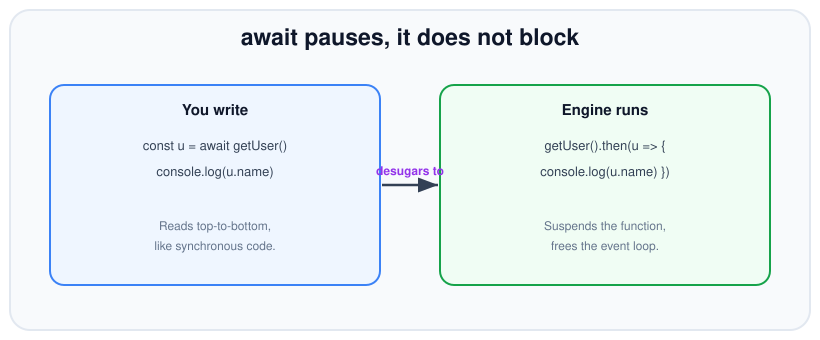
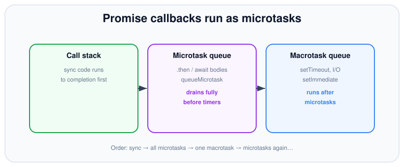
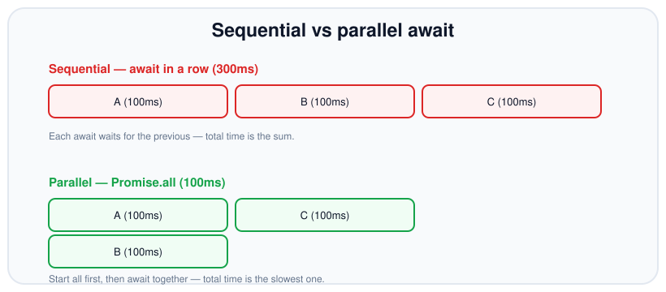

# Async / Await

*9 min read · Updated 24 Jul 2026 Topic 18 of 70 Bookmark Mark done Why it matters async · Topic 18 of 70*

**Source:** [https://www.geekyfrontend.in/learn/nodejs-backend-kit/async-await](https://www.geekyfrontend.in/learn/nodejs-backend-kit/async-await)

---

## Why it matters

`async/await` is how modern Node code reads: top to bottom, like synchronous logic, even though it's fully asynchronous underneath. It removes the nesting of callbacks and the boilerplate of long `.then` chains, and it lets you use ordinary language features — `try/catch`, `for` loops, `if`, early `return` — with asynchronous values. For most day-to-day backend code, this is the pattern you'll write.

But its readability is also a trap. Because `await` makes async code *look* sequential, it's dangerously easy to make everything sequential by accident — awaiting three independent requests one after another when they could have run together, turning a 100ms operation into 300ms. Interviewers love this exact scenario: give the candidate a snippet with three awaits and ask how to make it faster. Knowing that `async/await` is just promise syntax, and knowing when to break out of the sequential reading to run things in parallel, is what separates people who *use* it from people who *understand* it.

## The concept, simply

Marking a function `async` does two things: it makes the function always return a promise (whatever you return becomes the fulfilment value; whatever you throw becomes the rejection reason), and it allows `await` inside it. `await` takes a promise, pauses the async function until that promise settles, and then evaluates to the fulfilled value — or throws the rejection reason as if it were a normal exception.

The key mental correction: `await` **pauses your function, it does not block the thread**. While your function is suspended at an `await`, the event loop is free to run other work — handle other requests, fire timers, process I/O. Nothing is frozen; only *this one function* is parked until its promise is ready.



await reads like synchronous code but the engine turns it into a suspended continuation — the thread stays free.

## How it works

An `async` function is a state machine. When execution reaches an `await`, the function *suspends*: it saves its local state, attaches a continuation to the awaited promise (conceptually a `.then`), and returns control to the caller. The rest of the function body becomes that continuation, scheduled as a microtask when the promise settles. So `const u = await getUser()` is, roughly, `getUser().then(u => { /* rest of function */ })`. This is why everything after an `await` runs on a later microtask, never synchronously.

Because the continuation runs as a microtask, the same ordering rules from promises apply: code after an `await` runs before a `setTimeout(fn, 0)` scheduled beforehand. And because a rejected awaited promise *throws* at the `await` point, ordinary `try/catch` works again — the async error handling that callbacks couldn't offer is restored, because the language rethrows the rejection synchronously into your paused function.



The code after an await resumes as a microtask, ahead of any timer or I/O callback queued at the same time.

The performance model follows directly. Two `await`s in a row mean the second operation doesn't even *start* until the first has finished — that's sequential, and the total time is the sum. To run independent operations concurrently you must **start them all first** (call the functions, collect the promises) and only then `await` them together, typically with `Promise.all`. Then the total time is roughly the slowest single operation.



Awaiting in a row sums the durations; starting all the promises first and awaiting together takes only as long as the slowest.

Unbounded parallelism is the failure mode on the far side of the sequential trap. `await Promise.all(tenThousandIds.map(fetchRow))` starts all ten thousand operations at once, opening as many sockets or file handles, and typically collapses under its own weight or trips a downstream rate limit. The middle ground is **bounded concurrency**: run at most N operations in flight at a time. A well-worn library such as `p-limit` does this, but the idea is small enough to hand-roll with a fixed pool of workers pulling from a shared index — which is worth being able to write on a whiteboard.

A minimal concurrency limiter: N workers drain a shared queue, and results stay in input order because each worker writes to the index it claimed.

javascript

```
async function mapLimit(items, limit, fn) {
  const results = new Array(items.length);
  let next = 0;
  async function worker() {
    while (next < items.length) {
      const i = next++;              // claim an index — safe on one thread
      results[i] = await fn(items[i], i);
    }
  }
  const size = Math.min(limit, items.length);
  await Promise.all(Array.from({ length: size }, worker));
  return results;
}

// At most 5 requests in flight at once, regardless of ids.length.
const rows = await mapLimit(ids, 5, fetchRow);
```

One more subtlety about `await Promise.all`: it rejects with the *first* rejection the instant it arrives, but the other in-flight promises are **not** cancelled — they run to completion and their results are simply discarded. If one of those stragglers later rejects with nothing awaiting it, you can still get an `unhandledRejection` after your `catch` has already run. When partial success is acceptable, prefer `Promise.allSettled` so every outcome is captured and nothing is left dangling.

## Code examples

The sequential trap and its fix. The first version takes the sum of all three; the second takes the max because the requests overlap:

javascript

```
// SLOW — sequential: each await waits for the previous (≈300ms).
async function slow() {
  const a = await load('a'); // 100ms
  const b = await load('b'); // another 100ms
  const c = await load('c'); // another 100ms
  return [a, b, c];
}

// FAST — parallel: start all three, then await together (≈100ms).
async function fast() {
  const [a, b, c] = await Promise.all([load('a'), load('b'), load('c')]);
  return [a, b, c];
}
```

Sequential is correct — and required — when steps *depend* on each other. You cannot parallelise what needs the previous result:

javascript

```
async function checkout(userId) {
  const user = await getUser(userId);        // must run first
  const cart = await getCart(user.cartId);   // needs user
  const charge = await pay(cart.total);      // needs cart
  return charge.receipt;
}
```

Error handling reads like synchronous code — the rejected promise throws at the `await`, and `catch` receives it. `finally` runs either way:

javascript

```
async function safeLoad(id) {
  try {
    const data = await load(id);
    return process(data);
  } catch (err) {
    console.error('load failed:', err.message);
    return null;                 // graceful fallback
  } finally {
    console.log('attempt finished'); // always runs
  }
}
```

Iterating with `await` in a `for...of` is sequential by design — use it when order matters or to limit concurrency. For unordered parallelism, map to promises and `Promise.all`. Note that `forEach` does *not* await:

javascript

```
// Sequential, ordered — one at a time.
for (const id of ids) {
  await handle(id);
}

// Parallel — all at once, results in order.
const results = await Promise.all(ids.map((id) => handle(id)));

// BUG: forEach ignores the returned promise — these run "in the background",
// and the outer function does NOT wait for them.
ids.forEach(async (id) => { await handle(id); }); // don't do this
```

## Common mistakes & gotchas

- **The forgotten `await`.** Dropping `await` gives you the pending *promise object*, not the value — so `if (user.isAdmin)` reads a property off a Promise and is silently truthy/undefined. The operation also isn't sequenced.
- **Accidental sequential awaits.** Awaiting independent operations one per line serialises them needlessly. Start them together and `await Promise.all`.
- **Floating promise from a missing `await` or `return`.** The function returns before the async work finishes, and any rejection becomes unhandled.
- **`await` inside `Array.forEach`/`map` without collecting.** `forEach` ignores the returned promise entirely; an `async` callback runs detached. Use `for...of` for sequential or `Promise.all(map(...))` for parallel.
- **Unbounded parallelism.** `Promise.all(hugeArray.map(fetch))` can open thousands of sockets at once and exhaust resources. Batch or use a concurrency limiter.
- **`return await` confusion.** Inside a `try` block, `return await fn()` is needed so the `catch` can catch a rejection; outside a `try` it's a harmless minor extra tick.
- **Top-level `await` availability.** It works in ES modules (`.mjs` or `"type":"module"`) but not in classic CommonJS module scope.

## Best practices

- Default to `async/await` for readability; drop to `Promise.all` the moment operations are independent.
- Start independent promises *before* awaiting — collect them, then `await Promise.all`.
- Use `try/catch/finally` for error handling and cleanup; it works naturally with `await`.
- Use `for...of` with `await` for ordered/sequential work; never rely on `forEach` to await.
- Cap concurrency for large collections with batching or a limiter (e.g. p-limit) instead of a bare `Promise.all` over thousands of items.
- Await or return every promise you create; a lint rule for floating promises catches the rest.

## ⭐ Interview lens

> **Q: Does `await` block the event loop?**  
> No. It suspends only the current async function and returns control to the event loop, which is free to run other work. The thread is never frozen — a common misconception.

> **Q: These three awaits take 300ms — make them 100ms.**  
> They're independent but awaited sequentially, so each waits for the last. Start all three (call the functions to get promises) and `await Promise.all([...])`; total time drops to the slowest single call.

> **Q: What does an `async` function return?**  
> Always a promise. A returned value becomes the fulfilment; a thrown error (or a rejected awaited promise) becomes the rejection. Even `return 5` yields `Promise<5>`.

> **Q: Why doesn't `await` work inside `forEach`? (trap)**  
> `forEach` doesn't look at the promise its callback returns, so it doesn't wait — the loop finishes immediately while the async callbacks run detached. Use `for...of` for sequential or `Promise.all(arr.map(...))` for parallel.

> **Q: What is `async/await` compiled to conceptually?**  
> A promise-based state machine. Each `await` suspends the function and attaches its continuation to the awaited promise as a microtask — essentially the code after it becomes a `.then` callback.

> **Q: When does `return await x` differ from `return x`?**  
> Inside a `try` block: `return await` lets the local `catch` handle a rejection, whereas `return x` hands the still-pending promise to the caller and skips your `catch`. Outside a `try` the difference is a negligible extra microtask.

## Cheat-card

- **`async` fn** → always returns a promise; `return` = fulfil, `throw` = reject.
- **`await`** pauses the function, frees the event loop — never blocks the thread.
- **Sequential** awaits sum durations; use only for dependent steps.
- **Parallel:** start promises first, then `await Promise.all([...])`.
- **Errors:** `try/catch` works because a rejected await throws.
- **Loops:** `for...of` awaits; `forEach` does not. Cap huge parallelism.
- **`for await`** drives `[Symbol.asyncIterator]()` → `next()` one item at a time; `break` calls `return()` (generator `finally` runs, a stream is destroyed).
- **Not for arrays of started promises:** an early rejection there is unhandled and crashes; use `Promise.all` / `allSettled`.
- **Deadlines:** one `AbortSignal.timeout(ms)` passed to every awaited call; check `signal.aborted` in `catch`.

---

## Learn More

- [async function (MDN) MDN](https://developer.mozilla.org/en-US/docs/Web/JavaScript/Reference/Statements/async_function)
- [Using promises (MDN) MDN](https://developer.mozilla.org/en-US/docs/Web/JavaScript/Guide/Using_promises)
- [async/await simply explained YouTube](https://www.youtube.com/watch?v=wKY4-WMmbZw)
- [async/await vs promises YouTube](https://www.youtube.com/watch?v=spvYqO_Kp9Q)
- [async/await is easy! YouTube](https://www.youtube.com/watch?v=9j1dZwFEJ-c)

---

## Additional topics

*Added 7 Oct 2026 · examples verified on Node v24.19.0*

### `for await` and async iterators

An **async iterable** is any object with a `[Symbol.asyncIterator]()` method. That method returns an **async iterator**: an object whose `next()` returns a promise for `{ value, done }`, and which may also have a `return()` method for cleanup. `for await (const x of source)` is the loop that drives this protocol: it calls `next()`, awaits the promise, runs the body with `value`, and repeats until `done` is `true`. It exists for data that arrives over time and in pieces (pages of an API, chunks of a file, rows from a database cursor, messages from a queue). Without it you either load everything into one array first, which costs memory and delays the first item, or you write a manual `while` loop around `next()` and forget the cleanup on early exit.

There are three ways to get an async iterable in Node:

- **Async generators.** `async function* gen() { … yield x; … }`. Calling `gen()` returns an object that is both the iterable and the iterator. Inside, you can `await` before each `yield`.
- **Your own object** with `[Symbol.asyncIterator]()`, written by hand.
- **Built-in sources.** Every `stream.Readable` (including `fs.createReadStream`, an HTTP request, `process.stdin`), `events.on(emitter, name)`, `readline` interfaces, and `timers/promises.setInterval`.

How it works:

1. `for await` calls `source[Symbol.asyncIterator]()` once to get the iterator.
2. Each round it calls `iterator.next()` and awaits the returned promise. The async function pauses here; the event loop runs other work.
3. If the result has `done: false`, the loop body runs with `value`. If `done: true`, the loop ends.
4. The next `next()` call is made only after the body finishes (including any `await` inside it), so there is never more than one item in flight. This is built-in backpressure.
5. If the loop exits early (`break`, `return`, or a `throw` in the body), `for await` calls `iterator.return()`. In an async generator this runs its `finally` blocks; on a `Readable` stream it destroys the stream.
6. If `next()` rejects, the loop throws that error at the `for await` line, where a surrounding `try/catch` can catch it.

`for await` is only valid inside an `async` function or at the top level of an ES module.

**Example — an async generator, a hand-written iterator, and early `break`.**

javascript

```
import { setTimeout as sleep } from 'node:timers/promises';

// 1. An async generator: `async function*` + `yield`. Each value can be awaited before it is yielded.
async function* pages(total) {
  try {
    for (let page = 1; page <= total; page++) {
      await sleep(10);                       // stands in for one HTTP call per page
      console.log(`  fetched page ${page}`);
      yield [`row ${page}a`, `row ${page}b`];
    }
  } finally {
    console.log('  generator cleanup ran');  // runs on normal end AND on early break
  }
}

for await (const rows of pages(3)) console.log('loop got', rows);

// 2. The same protocol by hand: an object with [Symbol.asyncIterator]() returning { next, return }
const countdown = {
  [Symbol.asyncIterator]() {
    let n = 3;
    return {
      async next() { return n > 0 ? { value: n--, done: false } : { value: undefined, done: true }; },
      async return() { console.log('  return() called'); return { value: undefined, done: true }; },
    };
  },
};
for await (const n of countdown) {
  console.log('countdown', n);
  if (n === 2) break;                        // early exit calls return()
}

// 3. Early break on the generator: return() runs its finally block, no more pages are fetched
for await (const rows of pages(100)) {
  console.log('loop got', rows, '-> break');
  break;
}

// Real output (Node v24.19.0):
//     fetched page 1
//   loop got [ 'row 1a', 'row 1b' ]
//     fetched page 2
//   loop got [ 'row 2a', 'row 2b' ]
//     fetched page 3
//   loop got [ 'row 3a', 'row 3b' ]
//     generator cleanup ran
//   countdown 3
//   countdown 2
//     return() called
//     fetched page 1
//   loop got [ 'row 1a', 'row 1b' ] -> break
//     generator cleanup ran
```

The first loop runs the generator to the end, so its `finally` runs after page 3. The countdown object shows the raw protocol: `break` at `2` makes `for await` call `return()`. The last loop breaks after one page out of 100: `return()` runs the generator's `finally` and page 2 is never fetched.

**Example — `for await` over a `Readable` stream, and what `break` does to it.**

javascript

```
import { createReadStream } from 'node:fs';
import { writeFile, rm } from 'node:fs/promises';

await writeFile('log.txt', 'line\n'.repeat(10_000));          // 50,000-byte local file

// Every Readable is an async iterable: each iteration awaits the next chunk.
let chunks = 0, bytes = 0;
for await (const chunk of createReadStream('log.txt', { highWaterMark: 16 * 1024 })) {
  chunks++; bytes += chunk.length;
}
console.log(`full read: ${chunks} chunks, ${bytes} bytes`);

// Breaking out early calls the iterator's return(), which destroys the stream.
const stream = createReadStream('log.txt', { highWaterMark: 16 * 1024 });
stream.on('close', () => console.log("stream 'close' event"));
for await (const chunk of stream) {
  console.log('first chunk', chunk.length, 'bytes -> break');
  break;
}
console.log('after break: destroyed =', stream.destroyed, '| bytesRead =', stream.bytesRead);
await new Promise((r) => setImmediate(r));
await rm('log.txt');

// Real output (Node v24.19.0):
//   full read: 4 chunks, 50000 bytes
//   first chunk 16384 bytes -> break
//   after break: destroyed = true | bytesRead = 16384
//   stream 'close' event
```

`highWaterMark: 16 * 1024` is set explicitly so the chunk count does not depend on the default (64 KiB since Node 22, see lesson 26): 50,000 bytes arrive as 4 chunks. After `break`, `return()` has destroyed the stream: `destroyed` is `true`, only the first 16,384 bytes were read, and `'close'` fires. The file descriptor is released without any explicit cleanup in your code.

### Timeouts with AbortSignal

`await` waits as long as the promise takes, which can be forever. A timeout in async/await code is a deadline that makes the pending `await` reject, and the right way to build one is an `AbortSignal` from `AbortSignal.timeout(ms)` (added in v17.3.0) passed into every operation the function awaits. The operations then stop their own work at the deadline instead of only being ignored. Full coverage is in [`73-abortcontroller-and-abortsignal.md`](73-abortcontroller-and-abortsignal.md).

How it works:

1. Create the deadline once: `const signal = AbortSignal.timeout(ms)`.
2. Accept `{ signal }` in your async function and pass it to each awaited call (`fetch`, `timers/promises`, `fs/promises`, your own signal-aware functions).
3. When the deadline passes, the call currently being awaited rejects. Node core APIs reject with an `AbortError` whose `cause` is the `TimeoutError`; `fetch` rejects with the `TimeoutError` itself.
4. The rejection throws at that `await`, so the rest of the function is skipped and your `try/catch` runs.
5. In `catch`, check `signal.aborted` to tell "our deadline passed" from "the operation failed".
6. For a `for await` loop, pass the signal to the iterable (for example `timers/promises.setInterval(ms, value, { signal })`). The pending `next()` rejects and the loop throws.

**Example — a deadline for a whole async function, and for a `for await` loop.**

javascript

```
import { setTimeout as sleep, setInterval as every } from 'node:timers/promises';

const fakeQuery = (ms, signal) => sleep(ms, `rows after ${ms} ms`, { signal });

// 1. A deadline for a whole async function: one signal, passed to every await inside
async function buildReport({ signal }) {
  const a = await fakeQuery(100, signal);
  const b = await fakeQuery(100, signal);
  const c = await fakeQuery(100, signal);           // the deadline passes during this one
  return [a, b, c];
}
const deadline = AbortSignal.timeout(250);
try {
  console.log(await buildReport({ signal: deadline }));
} catch (err) {
  if (!deadline.aborted) throw err;                 // a real failure, not our timeout
  console.log('report:', err.name, '| cause:', err.cause.name);
}

// 2. A deadline for a for-await loop: the iterator rejects and the loop throws
let ticks = 0;
try {
  for await (const _ of every(100, null, { signal: AbortSignal.timeout(350) })) {
    console.log('poll', ++ticks);
  }
} catch (err) {
  console.log(`poller stopped after ${ticks} ticks:`, err.name, err.code);
}

// Real output (Node v24.19.0):
//   report: AbortError | cause: TimeoutError
//   poll 1
//   poll 2
//   poll 3
//   poller stopped after 3 ticks: AbortError ABORT_ERR
```

`buildReport` gets through two 100 ms queries; the third is cancelled at 250 ms. The error is Node's `AbortError` with `cause.name === 'TimeoutError'`. The poller yields three ticks (100, 200, 300 ms) and then the iterator rejects at 350 ms.

### Common mistakes & gotchas (additional topics)

- **`for await` over an array of already-started promises.** The loop awaits them one at a time, in array order. A later promise that rejects while the loop is still waiting on an earlier one has no handler yet, and the process crashes with an unhandled rejection (see the edge case below). Use `Promise.all` / `Promise.allSettled` for a set of promises; keep `for await` for sources that produce items over time.
- **Expecting `for await` to run items in parallel.** It is sequential by design: the next `next()` waits for the body to finish.
- **Breaking out of a stream loop and then reading the stream again.** `break` calls `return()`, which destroys the stream. Use `stream.iterator({ destroyOnReturn: false })` (added in v16.3.0, stable since v24.0.0) if you need to keep it open; in a test run, a second loop over the same stream then read the remaining items.
- **Forgetting `finally` in an async generator.** Cleanup written after the loop inside the generator does not run on early `break`; only `finally` does.
- **A timeout that does not reach the operation.** `Promise.race([op(), timeoutPromise])` throws on time but leaves `op()` running. Pass the signal into `op`.

### Edge case worked through: `for await` over an array of promises crashes on an early rejection

javascript

```
const sleep = (ms, v, fail) => new Promise((res, rej) => setTimeout(() => fail ? rej(new Error(v)) : res(v), ms));

const promises = [sleep(200, 'slow ok'), sleep(50, 'fast failure', true)];
try {
  for await (const v of promises) console.log('got', v);
} catch (err) {
  console.log('caught in loop:', err.message);   // never reached
}
```

bash

```
$ node edge.mjs; echo "exit code $?"
file:///…/l18/edge.mjs:1
const sleep = (ms, v, fail) => new Promise((res, rej) => setTimeout(() => fail ? rej(new Error(v)) : res(v), ms));
                                                                                     ^

Error: fast failure
    at Timeout._onTimeout (file:///…/l18/edge.mjs:1:86)
    at listOnTimeout (node:internal/timers:635:17)
    at process.processTimers (node:internal/timers:571:7)

Node.js v24.19.0
exit code 1
```

The `catch` never runs. At 50 ms the second promise rejects, but `for await` is still waiting on the first one (200 ms) and has not attached anything to the second. Node sees a rejection with no handler and, in the default `--unhandled-rejections=throw` mode, ends the process with exit code 1. `Promise.all` attaches a handler to every promise immediately, so the same failure is caught:

javascript

```
const sleep = (ms, v, fail) => new Promise((res, rej) => setTimeout(() => fail ? rej(new Error(v)) : res(v), ms));

const promises = [sleep(200, 'slow ok'), sleep(50, 'fast failure', true)];
try {
  for (const v of await Promise.all(promises)) console.log('got', v);
} catch (err) {
  console.log('caught:', err.message);   // Promise.all attached a handler to every promise at once
}

// Real output (Node v24.19.0):
//   caught: fast failure
```

### ⭐ Interview lens (additional topics)

> **Q: “What happens to a `Readable` stream when you `break` out of `for await (const chunk of stream)`?”**  
> A: `for await` calls the iterator's `return()`, and the stream's iterator responds by destroying the stream: `destroyed` becomes `true`, the file descriptor or socket is released, and `'close'` is emitted. In an async generator, the same `return()` call runs its `finally` blocks.

> **Q: “How do you put a deadline on an async function that awaits several calls?”**  
> A: Create one `AbortSignal.timeout(ms)` and pass it to every awaited call. At the deadline, the call in progress rejects and the error throws at its `await`. In `catch`, `signal.aborted` tells you it was the deadline. *Trap:* racing against a timer promise only stops you waiting; the work keeps running.
