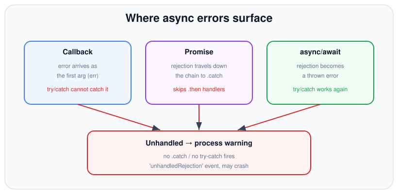

# Error Handling in Async Code

*10 min read · Updated 24 Jul 2026 Topic 19 of 70 Bookmark Mark done Why it matters Synchronous error handling is a solved problem · Topic 19 of 70*

**Source:** [https://www.geekyfrontend.in/learn/nodejs-backend-kit/error-handling-async](https://www.geekyfrontend.in/learn/nodejs-backend-kit/error-handling-async)

---

## Why it matters

Synchronous error handling is a solved problem: `throw` unwinds the stack, `try/catch` catches it, done. Asynchronous errors are where real Node applications fall over — because an error that fires *after* the stack that scheduled it has unwound cannot be caught the same way, and the three async styles (callbacks, promises, `async/await`) each surface errors in a different place. Get this wrong and errors vanish silently, a single unhandled rejection crashes the whole process, or a failed request hangs forever with no response.

This topic is disproportionately represented in interviews and code reviews because it separates people who can write a happy path from people who can ship a service that stays up. Knowing exactly *where* an error appears in each style, how it propagates, and what happens when nobody handles it is core backend competence.

## The concept, simply

The single most important idea: **an async error surfaces at a different place depending on the style**. In a callback, the error is the first argument — `throw` is useless and `try/catch` won't help. In a promise, the error is a *rejection* that travels down the chain to the nearest `.catch`. In `async/await`, the rejection is re-thrown at the `await` point, so ordinary `try/catch` catches it again. Three styles, three landing spots.



Each async style surfaces errors in its own place; anything left unhandled becomes a process-level rejection that can crash Node.

And the safety net matters: if none of those handlers fire, the error becomes a global event — an `uncaughtException` for a thrown sync error, or an `unhandledRejection` for a promise nobody caught. In current Node these are treated as fatal by default and terminate the process.

## How it works

**Callbacks.** Because the callback runs on a fresh stack, the function that scheduled it has already returned. A `throw` inside the callback can't reach that caller — it escapes as an `uncaughtException`. So the convention is to pass the error as the first argument, and every layer must check it and forward it (`if (err) return cb(err)`). Miss one check and the error is silently swallowed.

**Promises.** Throwing inside a `.then` handler, or returning a rejected promise, rejects the promise that handler returned. That rejection then *skips every subsequent `.then`* and looks downward for a `.catch` (or the rejection handler of a later `.then`). This mirrors how synchronous exceptions skip code and unwind to a `catch` — except it travels *down* the chain rather than *up* the stack. A `.catch` that handles the error and returns a value puts the chain back on the fulfilled track.

**async/await.** When you `await` a promise that rejects, the engine re-throws the rejection reason as a synchronous exception at that line inside your function. That's the whole trick: it re-enters the normal exception machinery, so `try/catch/finally` behaves exactly as it does for sync code. An uncaught throw in an `async` function simply rejects the promise that function returned — pushing the problem to *its* caller.

**The unhandled path.** A promise that rejects with no handler attached (by the time the microtask queue drains) emits `process.on('unhandledRejection')`. A synchronous throw that nothing catches emits `process.on('uncaughtException')`. Both default to crashing. The correct response to `uncaughtException` is to *log and exit*, not to resume — the process is in an unknown state.

**Custom Error subclasses.** Branching on `err.message.includes('not found')` is fragile — messages get reworded, localised, or wrapped. The robust pattern is to subclass `Error` so callers branch on a *type* or a stable `code` instead of prose. Extend `Error`, call `super(message)`, and set `this.name = this.constructor.name` so the stack header reads correctly. Because a rejection reason travels through the chain by *reference* (it is never copied), `instanceof` keeps working across every `await` and `.catch` between the throw site and the boundary. Give each subclass a machine-readable `code` and an HTTP `status`, and the boundary handler becomes a lookup rather than a pile of string matches.

A small hierarchy of typed errors makes the boundary handler declarative:

javascript

```
class AppError extends Error {
  constructor(message, { code, status } = {}) {
    super(message);
    this.name = this.constructor.name;   // fixes the stack's error label
    this.code = code ?? 'INTERNAL';
    this.status = status ?? 500;
    Error.captureStackTrace?.(this, this.constructor); // trim our own frame
  }
}
class NotFoundError extends AppError {
  constructor(what) { super(what + ' not found', { code: 'NOT_FOUND', status: 404 }); }
}

async function handler(req, res) {
  try {
    res.json(await loadUser(req.id));    // may throw NotFoundError
  } catch (err) {
    const status = err instanceof AppError ? err.status : 500;
    res.status(status).json({ error: err.code ?? 'INTERNAL', message: err.message });
  }
}
```

One built-in subclass is specific to async code: `AggregateError`, the reason `Promise.any` rejects with when *every* input fails. It carries an `.errors` array holding each individual rejection, so you inspect the collection rather than a single reason — the one common case where a rejection reason is naturally a bundle of errors instead of one.

## Code examples

The same failure in all three styles, so the landing spot is obvious:

javascript

```
// Callback: error is arg #1. try/catch here would catch NOTHING.
readConfig((err, cfg) => {
  if (err) return console.error('callback error:', err.message);
  use(cfg);
});

// Promise: rejection flows to .catch, skipping the .then above it.
readConfig()
  .then((cfg) => use(cfg))
  .catch((err) => console.error('promise error:', err.message));

// async/await: rejection is re-thrown at the await; try/catch works.
async function run() {
  try {
    const cfg = await readConfig();
    use(cfg);
  } catch (err) {
    console.error('await error:', err.message);
  }
}
```

Propagation: re-throwing (or letting it throw) lets a higher layer decide. Don't catch just to log and swallow — that hides failures:

javascript

```
async function loadUser(id) {
  const row = await db.find(id);
  if (!row) throw new Error('user not found: ' + id); // becomes a rejection
  return row;
}

async function handler(req, res) {
  try {
    const user = await loadUser(req.id);
    res.json(user);
  } catch (err) {
    // Handle ONCE, at the boundary — map to a response.
    res.status(err.message.includes('not found') ? 404 : 500)
       .json({ error: err.message });
  }
}
```

Partial failure with `allSettled`, so one bad item doesn't sink the batch — and a global safety net for anything that slips through:

javascript

```
const results = await Promise.allSettled(ids.map(loadUser));
const users = results.filter((r) => r.status === 'fulfilled').map((r) => r.value);
const failures = results.filter((r) => r.status === 'rejected');
console.log('loaded', users.length, 'failed', failures.length);

// Last-resort net: log and exit — never silently resume.
process.on('unhandledRejection', (reason) => {
  console.error('UNHANDLED REJECTION:', reason);
  process.exit(1);
});
process.on('uncaughtException', (err) => {
  console.error('UNCAUGHT EXCEPTION:', err);
  process.exit(1);
});
```

A subtle propagation trap — `return` vs `return await` inside `try`:

javascript

```
async function a() {
  try {
    return await mightReject(); // await → rejection caught here
  } catch (err) {
    return fallback();          // this runs on rejection
  }
}
// With plain 'return mightReject()' the pending promise leaves the try
// block first, so the catch never fires and the caller gets the rejection.
```

## Common mistakes & gotchas

- **Wrapping async callbacks in `try/catch`.** It catches nothing — the callback runs on a new stack. Check the `err` argument instead.
- **The missing `.catch` / unhandled rejection.** A rejected promise with no handler warns and, by default, crashes current Node. Every chain needs a terminal handler.
- **Swallowing errors.** `catch (e) {}` or a `.catch` that only logs and returns hides real failures and leaves callers thinking things succeeded.
- **Catching too early.** Handling an error deep in a helper and returning `null` forces every caller to guess whether `null` means "empty" or "failed". Prefer to propagate and handle once at the boundary.
- **Rejecting/throwing non-Errors.** `throw 'oops'` or `reject('bad')` loses the stack trace and breaks `err.message`. Always use `Error` objects.
- **`return` vs `return await` in a `try`.** Without `await`, the promise escapes the `try` before it can reject, so the local `catch` never runs.
- **Trying to resume after `uncaughtException`.** The process state is corrupt; log and exit (let a supervisor restart), don't continue serving.
- **Sibling rejections in `Promise.all`.** After `all` rejects, other promises keep running; if one later rejects unhandled, you get a separate unhandled rejection.
- **Losing the subclass by cloning the error.** Serialising an error to JSON and rethrowing the plain object strips its prototype, so `instanceof` and `code` checks fail downstream. Pass the original `Error` by reference through the chain, and only serialise it at the very edge (the log line or HTTP body).

## Best practices

- Always terminate promise chains with `.catch`, or `await` them inside `try/catch`.
- Propagate errors to a single boundary (route handler, job runner) and translate them to responses/retries there — handle once.
- Throw and reject with `Error` subclasses so you keep stacks and can branch on `error.code` or `instanceof`.
- Register `unhandledRejection` and `uncaughtException` handlers that log and **exit**; rely on a process manager to restart.
- Use `allSettled` when partial success is acceptable, so one failure doesn't discard every good result.
- Add cleanup in `finally` (release connections, clear timers) so it runs on both success and failure.
- Enable a linter rule for floating promises and unhandled rejections — catch the bug before production does.

## ⭐ Interview lens

> **Q: Why can't `try/catch` catch an error from an async callback?**  
> The callback runs on a fresh stack after the `try` block has already returned. The throw escapes as an `uncaughtException`. That's why the error is passed as the callback's first argument instead.

> **Q: How does an error propagate through a promise chain?**  
> A throw or rejection skips every subsequent `.then` and travels down to the nearest rejection handler (`.catch` or a `.then`'s second argument), much like an exception unwinding to a `catch`.

> **Q: What happens on an unhandled promise rejection in current Node?**  
> It emits `process.on('unhandledRejection')` and, by default, terminates the process with a non-zero exit code. You should attach handlers and, for uncaught cases, log and exit rather than resume.

> **Q: `unhandledRejection` vs `uncaughtException` — difference?**  
> `uncaughtException` is a synchronous throw nothing caught; `unhandledRejection` is a rejected promise with no handler when the microtask queue drains. Both are last-resort signals; the safe action for both is log and exit.

> **Q: Should you keep serving after an `uncaughtException`? (trap)**  
> No. The process may be in a corrupt, unknown state. Log, run fast cleanup, and exit; let a supervisor (pm2, systemd, Kubernetes) restart a clean process.

> **Q: Why prefer propagating an error over catching it deep inside a helper?**  
> Local catches that return `null` force every caller to disambiguate "no data" from "failure" and scatter handling everywhere. Propagating to one boundary centralises the policy (status code, retry, log) and keeps helpers honest.

## Cheat-card

- **Callback:** error is arg #1; `try/catch` can't catch it — check & forward.
- **Promise:** rejection flows down to `.catch`, skipping `.then`s.
- **await:** rejection re-throws at the await → normal `try/catch`.
- **Unhandled:** `unhandledRejection` / `uncaughtException` → default crash.
- **Rule:** throw `Error`s, propagate to one boundary, handle once.
- **Safety net:** global handlers should log & `process.exit(1)`, not resume.
- **Wrap with cause:** `new Error('msg', { cause: err })` keeps the original error; `cause` is non-enumerable, so `JSON.stringify` drops it.
- **`--unhandled-rejections`:** `throw` (default since v15), `strict`, `warn`, `warn-with-error-code`, `none`; under `throw` an `unhandledRejection` listener replaces the crash.
- **System errors:** branch on `err.code` (`ENOENT`, `EACCES`, `ECONNREFUSED`); `errno` is a platform-specific negative number; `util.getSystemErrorName(errno)` maps it back.

---

## Learn More

- [try...catch developer.mozilla.org](https://developer.mozilla.org/en-US/docs/Web/JavaScript/Reference/Statements/try...catch)
- [Node.js Errors nodejs.org](https://nodejs.org/api/errors.html)
- [JavaScript Async Await Web Dev Simplified](https://www.youtube.com/watch?v=V_Kr9OSfDeU)
- [Async JS Crash Course - Callbacks, Promises, Async Await Traversy Media](https://www.youtube.com/watch?v=PoRJizFvM7s)

---

## Additional topics

*Added 7 Oct 2026 · examples verified on Node v24.19.0*

### `Error` with `{ cause }`

`new Error(message, { cause })` creates a new error and stores the error that led to it in its own `cause` property (`error.cause`, added in v16.9.0). It exists for the "translate at a layer boundary" step from the propagation section above. A data layer catches `ENOENT` and throws "could not load config", and without `cause` the original error, with its `code`, `path` and stack, is gone. Callers then either get a vague message or you are tempted to concatenate messages into a string that nobody can branch on.

How it works:

1. The constructor reads `options.cause` and, only if the key is present, defines `cause` as an own, non-enumerable property holding exactly that value (the same object, not a copy).
2. Nothing else changes: `message`, `name` and `stack` describe the new error only.
3. `util.inspect()`, and so `console.log`, prints the chain recursively as nested `[cause]` entries.
4. Because `cause` is non-enumerable, `Object.keys`, object spread and `JSON.stringify` skip it. A logger that serializes errors by hand must walk `err.cause` itself.

**Example — wrap a low-level error at a boundary.**

javascript

```
// cause.mjs: wrap a low-level error without losing it.
import { readFile } from 'node:fs/promises';

async function loadConfig(path) {
  try {
    return JSON.parse(await readFile(path, 'utf8'));
  } catch (err) {
    throw new Error(`could not load config from ${path}`, { cause: err });
  }
}

try {
  await loadConfig('./missing.json');
} catch (err) {
  console.log(err.message);
  console.log('cause code:', err.cause.code);
  console.log('cause is the original object:', err.cause instanceof Error);
  console.log('own property, not enumerable:', Object.hasOwn(err, 'cause'),
    Object.keys(err).includes('cause'));
  console.log('JSON.stringify drops it:', JSON.stringify(err));
}

// Real output (Node v24.19.0):
//   could not load config from ./missing.json
//   cause code: ENOENT
//   cause is the original object: true
//   own property, not enumerable: true false
//   JSON.stringify drops it: {}
```

**Example — how a chain prints, and how to walk it.**

javascript

```
// chain.cjs: how a cause chain prints, and how to walk it.
Error.stackTraceLimit = 0;            // keep the printed output short for this demo

const root = Object.assign(new Error('connect ECONNREFUSED 127.0.0.1:5432'), { code: 'ECONNREFUSED' });
const mid = new Error('query users failed', { cause: root });
const top = new Error('GET /users failed', { cause: mid });

console.log(top);                     // util.inspect prints every [cause]

function causeChain(err) {
  const out = [];
  const seen = new Set();             // a cause can point back up the chain
  for (let e = err; e && !seen.has(e); e = e.cause) {
    seen.add(e);
    out.push(e.code ?? e.message);
  }
  return out;
}
console.log(causeChain(top));

// Real output (Node v24.19.0):
//   [Error: GET /users failed] {
//     [cause]: [Error: query users failed] {
//       [cause]: [Error: connect ECONNREFUSED 127.0.0.1:5432] {
//         code: 'ECONNREFUSED'
//       }
//     }
//   }
//   [ 'GET /users failed', 'query users failed', 'ECONNREFUSED' ]
```

### The `--unhandled-rejections` modes

`--unhandled-rejections=mode` (added in v12.0.0 and v10.17.0) is the switch that decides what Node does when a promise rejects and no handler is attached by the time the microtask queue drains. The "Unhandled" bullet in the Cheat-card says the default is a crash. This flag is where that default comes from, and it is how a service can end up silently ignoring rejections. The Node CLI docs list five modes:

| Mode | Behaviour (from the CLI docs) |
| --- | --- |
| `throw` | **The default** (changed in v15.0.0; before that a warning was emitted). Emit `unhandledRejection`. If no listener is set, raise the rejection as an uncaught exception. |
| `strict` | Raise the rejection as an uncaught exception. If that exception is handled (by an `uncaughtException` listener), `unhandledRejection` is emitted. |
| `warn` | Always print a warning, whether or not an `unhandledRejection` listener is set. |
| `warn-with-error-code` | Emit `unhandledRejection`. If no listener is set, print a warning and set the exit code to 1. |
| `none` | Silence all warnings. |

The docs add one exception: a rejection during the static loading phase of an ES module entry point is always raised as an uncaught exception.

How it works:

1. A promise rejects with no handler attached.
2. After the current macrotask's microtasks have drained, Node checks its list of pending unhandled rejections.
3. For each one it applies the mode. Depending on the mode it emits the `process` `unhandledRejection` event, prints an `UnhandledPromiseRejectionWarning`, sets `process.exitCode = 1`, or converts the rejection into an uncaught exception (which crashes unless an `uncaughtException` listener exists).
4. Set the mode on the command line or through the environment: `NODE_OPTIONS=--unhandled-rejections=strict` is accepted.

**Example — every mode, with and without an `unhandledRejection` listener.** Each row runs a child process that rejects one promise and then sets a 10 ms timer. "kept running" means the timer fired.

javascript

```
// modes.cjs: one unhandled rejection under every --unhandled-rejections mode,
// first without and then with a process.on('unhandledRejection') hook.
const { spawnSync } = require('node:child_process');

const child = `
  if (process.argv.includes('hook')) {
    process.on('unhandledRejection', () => console.log('hook'));
  }
  Promise.reject(new Error('db down'));
  setTimeout(() => console.log('timer'), 10);
`;
const modes = [null, 'throw', 'strict', 'warn', 'warn-with-error-code', 'none'];

for (const hook of [false, true]) {
  for (const mode of modes) {
    const args = mode ? [`--unhandled-rejections=${mode}`] : [];
    args.push('-e', child);
    if (hook) args.push('--', 'hook');
    const r = spawnSync(process.execPath, args, { encoding: 'utf8' });
    const out = r.stdout.split('\n');
    console.log(
      (hook ? 'hook    ' : 'no hook ') + (mode ?? '(default)').padEnd(21),
      'hook ran:', out.includes('hook') ? 'yes' : 'no ',
      '| kept running:', out.includes('timer') ? 'yes' : 'no ',
      '| warning:', r.stderr.includes('UnhandledPromiseRejectionWarning') ? 'yes' : 'no ',
      '| crashed:', /^Error: db down/m.test(r.stderr) ? 'yes' : 'no ',
      '| exit', r.status,
    );
  }
}

// Real output (Node v24.19.0):
//   no hook (default)             hook ran: no  | kept running: no  | warning: no  | crashed: yes | exit 1
//   no hook throw                 hook ran: no  | kept running: no  | warning: no  | crashed: yes | exit 1
//   no hook strict                hook ran: no  | kept running: no  | warning: no  | crashed: yes | exit 1
//   no hook warn                  hook ran: no  | kept running: yes | warning: yes | crashed: no  | exit 0
//   no hook warn-with-error-code  hook ran: no  | kept running: yes | warning: yes | crashed: no  | exit 1
//   no hook none                  hook ran: no  | kept running: yes | warning: no  | crashed: no  | exit 0
//   hook    (default)             hook ran: yes | kept running: yes | warning: no  | crashed: no  | exit 0
//   hook    throw                 hook ran: yes | kept running: yes | warning: no  | crashed: no  | exit 0
//   hook    strict                hook ran: no  | kept running: no  | warning: no  | crashed: yes | exit 1
//   hook    warn                  hook ran: yes | kept running: yes | warning: yes | crashed: no  | exit 0
//   hook    warn-with-error-code  hook ran: yes | kept running: yes | warning: no  | crashed: no  | exit 0
//   hook    none                  hook ran: yes | kept running: yes | warning: no  | crashed: no  | exit 0
```

Read the table by column. With the default `throw`, an `unhandledRejection` listener **replaces** the crash: the process keeps running with exit code 0. That is why the safety-net handler earlier in this topic must call `process.exit(1)` itself. `strict` crashes even when that listener exists. `warn` and `none` never stop the process, and `none` prints nothing at all.

### System error codes: `err.code`, `errno`, `syscall`

When an operating-system call fails (open a file, connect a socket, bind a port), libuv returns a negative error number and Node turns it into a `SystemError`. That is an ordinary `Error` with extra properties describing the failed call. Branching on these properties instead of on `err.message` is the system-level version of the "custom Error subclasses" advice above. The message text includes paths and addresses, and the numbers differ between platforms. The `code` string is the stable part.

How it works:

1. A call such as `open('./x')` fails in the kernel, and libuv maps the result to a negative number (on Linux, `ENOENT` is -2).
2. Node creates the error and sets `code` (the string name, for example `'ENOENT'`), `errno` (that negative number), `syscall` (`'open'`, `'connect'`, …), and, when they apply, `path`, `dest`, `address` and `port`.
3. `util.getSystemErrorName(errno)` (added in v9.7.0) maps the number back to the name. `util.getSystemErrorMessage(errno)` (added in v23.1.0 and v22.12.0) gives the short text. `util.getSystemErrorMap()` (added in v16.0.0 and v14.17.0) returns all pairs for the current platform.
4. Common codes from the errors docs: `ENOENT` (no such file or directory), `EACCES` (permission denied), `EADDRINUSE` (port already bound), `ECONNREFUSED` (nothing listening at the target), `ECONNRESET` (peer closed the connection), `EEXIST`, `EISDIR`, `EMFILE` (too many open files), `ENOTDIR`, `ENOTEMPTY`, `EPERM`, `EPIPE`, `ETIMEDOUT`.

**Example — three real system errors and their fields.**

javascript

```
// syserr.mjs: three system errors and the fields Node puts on them.
import { readFile, chmod, writeFile } from 'node:fs/promises';
import net from 'node:net';
import util from 'node:util';

function show(err) {
  const { code, errno, syscall, path, address, port } = err;
  console.log({ code, errno, syscall, path, address, port,
    name: util.getSystemErrorName(errno),
    text: util.getSystemErrorMessage(errno) });
}

// ENOENT: the path does not exist
await readFile('./no-such-file.txt').catch(show);

// EACCES: a file we own but made unreadable
await writeFile('./secret.txt', 'x');
await chmod('./secret.txt', 0o000);
await readFile('./secret.txt').catch(show);
await chmod('./secret.txt', 0o600);

// ECONNREFUSED: nothing listens on 127.0.0.1:4299
await new Promise((resolve) => {
  net.connect(4299, '127.0.0.1').on('error', (err) => { show(err); resolve(); });
});

// Real output (Node v24.19.0, Linux):
//   {
//     code: 'ENOENT',
//     errno: -2,
//     syscall: 'open',
//     path: './no-such-file.txt',
//     address: undefined,
//     port: undefined,
//     name: 'ENOENT',
//     text: 'no such file or directory'
//   }
//   {
//     code: 'EACCES',
//     errno: -13,
//     syscall: 'open',
//     path: './secret.txt',
//     address: undefined,
//     port: undefined,
//     name: 'EACCES',
//     text: 'permission denied'
//   }
//   {
//     code: 'ECONNREFUSED',
//     errno: -111,
//     syscall: 'connect',
//     path: undefined,
//     address: '127.0.0.1',
//     port: 4299,
//     name: 'ECONNREFUSED',
//     text: 'connection refused'
//   }
```

The `errno` values above are Linux numbers. The docs say the mapping is platform-dependent, so compare `err.code`, never `err.errno`. (The `EACCES` case assumes you are not root, since root can read a mode-000 file.)

### Common mistakes & gotchas (additional topics)

- **Wrapping without `cause`.** `throw new Error('save failed: ' + err.message)` keeps the text and loses `code`, `path` and the original stack. Pass `{ cause: err }`.
- **Expecting `JSON.stringify(err)` to include the cause.** `cause`, `message` and `stack` are all non-enumerable, so it prints `{}`. Serialize by walking the chain (as `causeChain` does) or use a logger that understands `cause`.
- **A log-only `unhandledRejection` listener under the default mode.** It turns "crash with exit 1" into "keep running with exit 0" (the `hook (default)` row). If you add the listener, exit from it.
- **Setting `--unhandled-rejections=warn` or `none` to "stop the crashes".** The rejected work is still lost. You only stop hearing about it, and with `none` nothing is printed at all.
- **Comparing `err.errno` with a number.** It is -111 for `ECONNREFUSED` on Linux; the docs say the mapping is platform-dependent. Compare `err.code`.
- **Matching on `err.message` for system errors.** It contains the path or address (`connect ECONNREFUSED 127.0.0.1:5432`), so the text changes per call. `err.code` and `err.syscall` do not.

### Edge case worked through: `err.code` does not mean "system error"

Node's own argument checks also set `err.code` (`ERR_INVALID_ARG_TYPE`, `ERR_OUT_OF_RANGE`, …), but those errors have no `errno` or `syscall`. A wrapper error may have no `code` at all, with the system error one level down in `cause`. Code that does `util.getSystemErrorName(err.errno)` for "any error with a code" throws on the first kind:

javascript

```
// codes-edge.mjs: err.code exists on more than system errors.
import { readFile } from 'node:fs/promises';
import util from 'node:util';

const errors = [
  await readFile('./no-such-file.txt').catch((e) => e),   // system error from libuv
  await readFile(42n).catch((e) => e),                    // Node.js argument validation
  new Error('wrapped', { cause: await readFile('./x').catch((e) => e) }),
];

for (const err of errors) {
  console.log(err.code ?? '(no code)', '| errno:', err.errno, '| syscall:', err.syscall);
  try {
    console.log('  name from errno:', util.getSystemErrorName(err.errno));
  } catch (e) {
    console.log('  getSystemErrorName threw', e.code);
  }
}

// A safe check: system errors are the ones with a numeric errno.
const isSystemError = (e) => typeof e?.errno === 'number' && typeof e?.syscall === 'string';
console.log(errors.map(isSystemError), '| via cause:', isSystemError(errors[2].cause));

// Real output (Node v24.19.0):
//   ENOENT | errno: -2 | syscall: open
//     name from errno: ENOENT
//   ERR_INVALID_ARG_TYPE | errno: undefined | syscall: undefined
//     getSystemErrorName threw ERR_INVALID_ARG_TYPE
//   (no code) | errno: undefined | syscall: undefined
//     getSystemErrorName threw ERR_INVALID_ARG_TYPE
//   [ true, false, false ] | via cause: true
```

`util.getSystemErrorName` accepts only a negative integer: it threw `ERR_INVALID_ARG_TYPE` for `undefined`, and in a separate run it threw `ERR_OUT_OF_RANGE` for the positive number `13`. Check for a numeric `errno` first, and look in `err.cause` when the top-level error is a wrapper.

### ⭐ Interview lens (additional topics)

> **Q: “You add `process.on('unhandledRejection', console.error)` and the service stops crashing. Is that a fix?”**  
> A: No. Under the default `--unhandled-rejections=throw`, a listener on `unhandledRejection` replaces the crash, so the process now runs on with exit code 0 after work has failed. Fix the missing `.catch`/`await` at the source. Keep the listener only as a last-resort net that logs and calls `process.exit(1)`, or run with `--unhandled-rejections=strict`, which crashes even when the listener exists. *Trap:* reaching for `warn` or `none`, which only hide the failure.

> **Q: “How do you branch on 'file not found' versus 'permission denied'?”**  
> A: On `err.code`: `'ENOENT'` versus `'EACCES'`. Also check `err.syscall` and `err.path` when you need context. Do not branch on the message, which includes the path, or on `errno`, whose numbers are platform-dependent. If the error was wrapped, look at `err.cause.code`.
