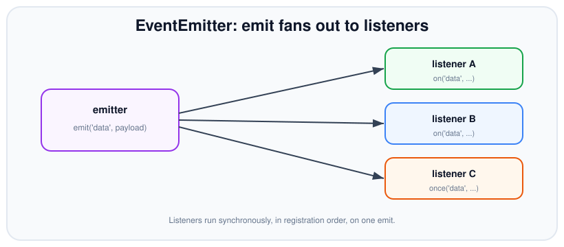

# EventEmitter

*10 min read · Updated 24 Jul 2026 Topic 20 of 70 Bookmark Mark done Why it matters Promises and async · Topic 20 of 70*

**Source:** [https://www.geekyfrontend.in/learn/nodejs-backend-kit/eventemitter](https://www.geekyfrontend.in/learn/nodejs-backend-kit/eventemitter)

---

## Why it matters

Promises and `async/await` model a *single* future result. But a huge amount of Node is about things that happen *repeatedly* over time: a socket receiving many chunks, an HTTP server handling request after request, a stream emitting `data` then `end`, a file watcher firing on every change. A promise can't model "this will happen many times." That's what the **EventEmitter** is for, and it sits at the heart of Node's most important subsystems — streams, servers, sockets, the process object itself.

Understanding `EventEmitter` is what lets you read Node's own APIs fluently (`req.on('data', ...)`, `server.on('connection', ...)`) and build clean decoupled architectures of your own. It's also a classic interview topic: the memory-leak warning about too many listeners, the difference between `on` and `once`, the fact that emission is synchronous, and the special status of the `'error'` event all trip up people who've only ever used it casually.

## The concept, simply

An `EventEmitter` is an object that lets you **publish** named events and **subscribe** to them — the observer (pub/sub) pattern, built into Node's core. You register a listener with `emitter.on('event', handler)`, and later something calls `emitter.emit('event', ...args)`, which invokes every registered handler for that name, in order, passing along the arguments. The emitter and the listeners don't know about each other's internals — that decoupling is the whole point.



A single emit call invokes every registered listener for that event synchronously, in the order they were added.

Two subscription verbs matter: `on` (alias `addListener`) registers a handler that fires *every* time the event is emitted; `once` registers one that fires *only the first time* and then removes itself automatically. You unsubscribe with `off` (alias `removeListener`). Most Node objects you use daily — streams, servers, sockets — *are* EventEmitters or inherit from one.

## How it works

Internally an emitter keeps a map from event name to an array of listener functions. `emit(name, ...args)` looks up that array and calls each function **synchronously**, one after another, on the current stack — right there, before `emit` returns. This surprises people: emitting an event is *not* asynchronous. If a listener does slow synchronous work, it blocks. If a listener throws, it propagates out of the `emit` call and can stop later listeners from running. Listeners fire in registration order; `emit` returns `true` if there were listeners, `false` if none.

`once` works by wrapping your handler: the wrapper removes itself from the listener array before (or as) it calls your function, guaranteeing a single invocation. `removeListener`/`off` splices the function out of the array — which is why you must pass the *same function reference* you registered; an inline arrow can't be removed because you no longer hold its reference.

Two special behaviours are worth memorising. First, the `'error'` event is privileged: if an emitter emits `'error'` and there is **no** listener for it, Node *throws* the error, typically crashing the process. So any long-lived emitter must have an `'error'` listener. Second, there's a built-in leak guard: if you add more than `defaultMaxListeners` (10) listeners for a single event, Node prints a `MaxListenersExceededWarning`. It's not an error — it's a heuristic that you're probably adding listeners in a loop and forgetting to remove them.

It helps to contrast the EventEmitter with a promise directly, because they solve genuinely different shapes of problem. A promise is a *value*: it settles exactly once, it caches its result, and a consumer that subscribes *after* it settles still gets the value. An event is a *notification*: `emit` fans out to whoever is listening *at that moment*, keeps no history, and a listener that subscribes after the emission simply misses it. That single difference — replayable value versus fire-and-forget signal — is the deciding factor when you're choosing between them. Repeated occurrences, multiple independent subscribers, or "tell me each time X happens" all point to events; "give me the one result of this operation" points to a promise.

A few more mechanics round out the model. `emitter.listenerCount(name)` tells you how many handlers are registered, and `emitter.eventNames()` lists the events that currently have any. `prependListener` adds a handler to the *front* of the array so it runs before existing ones — occasionally useful for instrumentation. `emitter.setMaxListeners(n)` raises the warning threshold for that instance, and `EventEmitter.defaultMaxListeners` changes it globally. And because listeners run synchronously, the value `emit` returns (`true` if any listener ran, else `false`) is known immediately — there is no waiting involved.

The core method surface is small; this table is effectively the whole working vocabulary:

| Method | Effect |
| --- | --- |
| `on(name, fn)` / `addListener` | Subscribe; fires on every emission |
| `once(name, fn)` | Subscribe; fires once, then self-removes |
| `off(name, fn)` / `removeListener` | Unsubscribe by function reference |
| `emit(name, ...args)` | Invoke every listener synchronously; returns `true` if any ran |
| `prependListener(name, fn)` | Subscribe at the front of the queue |
| `removeAllListeners(name?)` | Drop all listeners for one event, or for every event |
| `listenerCount(name)` / `eventNames()` | Introspect current subscriptions |
| `setMaxListeners(n)` | Raise this instance's leak-warning threshold |

Because listeners run synchronously and share the emitter's stack, a listener that `await`s does *not* make `emit` wait: `emit` returns the instant the synchronous portion of every listener has run, long before any async work inside them settles. The EventEmitter contract simply has no way to report "all listener work finished" — if you need that, collect the listeners' promises yourself or model the flow with a promise instead. The same shared stack is why a throw inside one listener can stop the listeners registered after it from running at all: the exception unwinds `emit` before it reaches them. Keeping each listener fast, non-throwing, and self-contained is therefore not just style — it is what keeps one subscriber from silently breaking the others.

## Code examples

Basic pub/sub with `on`, `once`, and `emit`. Note the once-listener fires a single time:

javascript

```
const { EventEmitter } = require('node:events');
const bus = new EventEmitter();

bus.on('order', (id, total) => console.log('order', id, 'for', total));
bus.once('ready', () => console.log('ready — fires only once'));

bus.emit('ready');           // logs
bus.emit('ready');           // nothing — once already removed itself
bus.emit('order', 42, 999);  // logs: order 42 for 999
```

Building your own emitter by extending the class — the idiomatic way to give an object an event API:

javascript

```
class Job extends EventEmitter {
  async run() {
    this.emit('start');
    try {
      const result = await doWork();
      this.emit('done', result); // listeners run synchronously here
    } catch (err) {
      this.emit('error', err);   // MUST have an 'error' listener
    }
  }
}

const job = new Job();
job.on('start', () => console.log('started'));
job.on('done', (r) => console.log('finished', r));
job.on('error', (e) => console.error('failed', e.message)); // required
job.run();
```

Removing listeners correctly (keep the reference) and proving emission is synchronous:

javascript

```
function onData(chunk) { console.log('got', chunk); }
bus.on('data', onData);
bus.off('data', onData);      // works — same reference
// bus.off('data', (c) => {}); // would NOT remove anything

console.log('before emit');
bus.on('sync', () => console.log('during emit'));
bus.emit('sync');
console.log('after emit');
// Order: before emit → during emit → after emit  (synchronous!)
```

Bridging an event-based flow to a promise with `events.once` — useful when you want to `await` the next occurrence of an event:

javascript

```
const { once } = require('node:events');

async function waitForConnect(server) {
  server.listen(3000);
  await once(server, 'listening'); // resolves on the event, rejects on 'error'
  console.log('server is up');
}
```

## Common mistakes & gotchas

- **No `'error'` listener.** An emitted `'error'` with no handler is *thrown* and usually crashes the process. Always attach an `'error'` listener to long-lived emitters (streams, sockets, servers).
- **Assuming `emit` is async.** Listeners run synchronously on the current stack before `emit` returns. Slow listener work blocks; if you need async, defer inside the listener.
- **The memory leak: adding listeners in a loop.** Registering a listener per request/iteration without removing them grows the array unboundedly. The `MaxListenersExceededWarning` at 11 listeners is Node telling you so.
- **Removing an anonymous listener.** You can only `off`/`removeListener` a function you hold a reference to. Inline arrows can never be removed — keep a named reference or use `once`.
- **A throwing listener halting the rest.** An exception in one synchronous listener propagates out of `emit` and can prevent later listeners from running. Keep listeners defensive.
- **Bumping `setMaxListeners` to silence the warning.** That hides a real leak. Fix the registration/removal logic instead, and only raise the limit when you genuinely need many listeners.
- **Using events for one-shot request/response.** If something happens exactly once and you need its value, a promise is clearer than wiring up and tearing down listeners.

## Best practices

- Always register an `'error'` listener on any emitter that can emit one; unhandled `'error'` crashes the process.
- Use `once` for one-time events so the listener cleans itself up automatically.
- Keep named references to listeners you'll need to remove, and remove them when the subscriber goes away to prevent leaks.
- Keep listeners fast and non-throwing; do heavy or async work by scheduling it, not inline in the listener.
- Treat the `MaxListenersExceededWarning` as a leak signal to investigate, not noise to suppress.
- Reach for `events.once(emitter, name)` to `await` a single future event, and `events.on` (async iterator) to consume a stream of them.
- Choose events for *recurring* or *broadcast* notifications; choose promises for a *single* eventual result.

## ⭐ Interview lens

> **Q: Is `emit` synchronous or asynchronous?**  
> Synchronous. It invokes every listener for the event in registration order, on the current stack, before `emit` returns. This surprises people who assume events are always deferred.

> **Q: What happens if you emit `'error'` with no listener? (trap)**  
> Node throws the error as an exception, which typically crashes the process. The `'error'` event is special-cased precisely so silent failures don't go unnoticed — always attach a handler.

> **Q: Difference between `on` and `once`?**  
> `on` fires the listener on every emission; `once` fires it only the first time and then auto-removes it. `once` is implemented as a self-removing wrapper around your handler.

> **Q: What causes the MaxListenersExceededWarning and is it an error?**  
> Adding more than 10 listeners (the default) for one event name. It's a warning, not an error — a heuristic that you're likely leaking listeners by adding them repeatedly without removing them.

> **Q: Why can't you remove an inline arrow-function listener?**  
> `removeListener`/`off` matches by function reference. An inline arrow creates a new function you don't keep a handle to, so there's nothing to pass back to remove it. Keep a named reference.

> **Q: When would you use an EventEmitter over a promise?**  
> When the thing happens more than once or is broadcast to multiple independent subscribers — streaming data, connection events, progress updates. Promises model a single eventual value; events model an ongoing stream of occurrences.

## Cheat-card

- **Pattern:** pub/sub — `on`/`once` to subscribe, `emit` to publish.
- **`emit` is synchronous** — listeners run in order, on the current stack.
- **`once`** fires once and self-removes; `off` needs the same reference.
- **`'error'`** with no listener throws and crashes — always handle it.
- **Leak guard:** >10 listeners on one event → warning; fix removal, don't mute.
- **Use events** for many/broadcast occurrences; **promises** for a single result.
- **`events.on(ee, name, { close, signal })`:** async iterator; buffers events while the loop body is busy; `'error'` makes the loop throw; give it an exit.
- **`captureRejections: true`:** routes rejected promises from `async` listeners to `'error'` (or `Symbol.for('nodejs.rejection')`); off by default.
- **`errorMonitor`:** observe `'error'` first without handling it; no regular listener still means `emit` throws.
- **`EventTarget`:** web API (`addEventListener`/`dispatchEvent`, one `Event` object), used by `AbortSignal`; no duplicate listeners, no special `'error'`, a throwing listener does not stop the others.

---

## Learn More

- [Events (EventEmitter) API nodejs.org](https://nodejs.org/api/events.html)
- [The Node.js Event emitter nodejs.org](https://nodejs.org/en/learn/asynchronous-work/the-nodejs-event-emitter)
- [Node JS Tutorial for Beginners #8 - The Node Event Emitter Net Ninja](https://www.youtube.com/watch?v=NtrnaTKqFPQ)
- [Node.js "Event Emitters" Explained Software Developer Diaries](https://www.youtube.com/watch?v=wINRm5arVlM)

---

## Additional topics

*Added 7 Oct 2026 · examples verified on Node v24.19.0*

### `events.on`: consuming events with `for await`

`events.on(emitter, eventName[, options])` (added in v13.6.0 and v12.16.0) returns an **async iterator**. Each `await` of it gives you the argument array of the next `eventName` emission. It turns "call me back on every event" into a loop you can write top to bottom, with `try/catch`, `break` and sequential `await`s inside. Without it, a consumer that must process events one at a time has to manage its own queue and its own "am I busy?" flag inside a listener. `events.once` (shown above) covers a single event; `events.on` covers a stream of them.

How it works:

1. Calling `on()` immediately adds listeners to the emitter: one for `eventName`, one for `'error'`, and one for each name in `options.close` (the `close` option was added in v20.0.0).
2. Every emission is pushed into an internal queue, or handed straight to a pending `next()` if the loop is already waiting. While your loop body is busy (for example awaiting a database write), new events wait in that queue, so the body handles one event at a time, in order.
3. An `'error'` event makes the next `next()` reject, so the `for await` throws. An aborted `options.signal` throws an `AbortError`.
4. A `close` event, `break`, `return` or a throw removes all of those listeners. Events already in the queue are still delivered first.
5. With no `close`, no `signal` and no `break`, the iterator never finishes, because an emitter has no built-in "end" (see the edge case below).
6. `highWaterMark` / `lowWaterMark` (supported since v20.0.0 under the spelling `highWatermark`; renamed in v22.0.0 and v20.13.0) call `pause()`/`resume()` on emitters that have them, such as readable streams, to bound the queue.

**Example — `for await` with `close`, and a slow consumer.**

javascript

```
// on-iter.mjs: consume events with for await; stop on 'end'; buffer while busy.
import { EventEmitter, on } from 'node:events';
import { setTimeout as sleep } from 'node:timers/promises';

const feed = new EventEmitter();
const rows = on(feed, 'row', { close: ['end'] });   // listeners are added here
console.log('listening to:', feed.eventNames());

setTimeout(() => {
  feed.emit('row', 1);
  feed.emit('row', 2);     // the loop body has not even started yet
  feed.emit('row', 3);
  feed.emit('end');        // removes the listeners at once...
  console.log('after end, listening to:', feed.eventNames());
}, 10);

for await (const [n] of rows) {
  console.log('row', n);   // ...but rows already queued are still delivered
  await sleep(20);
}
console.log('loop finished');

// Real output (Node v24.19.0):
//   listening to: [ 'row', 'error', 'end' ]
//   after end, listening to: []
//   row 1
//   row 2
//   row 3
//   loop finished
```

**Example — `'error'` and `AbortSignal` end the loop by throwing.**

javascript

```
// on-error.mjs: an 'error' event ends the loop by throwing; an AbortSignal does too.
import { EventEmitter, on } from 'node:events';

const a = new EventEmitter();
setTimeout(() => { a.emit('row', 1); a.emit('error', new Error('socket closed')); }, 10);
try {
  for await (const [n] of on(a, 'row')) console.log('row', n);
} catch (err) {
  console.log('loop threw:', err.message, '| listeners left:', a.eventNames());
}

const b = new EventEmitter();
const ac = new AbortController();
setTimeout(() => { b.emit('row', 1); ac.abort(); }, 10);
try {
  for await (const [n] of on(b, 'row', { signal: ac.signal })) console.log('row', n);
} catch (err) {
  console.log('loop threw:', err.name, err.code);
}

// Real output (Node v24.19.0):
//   row 1
//   loop threw: socket closed | listeners left: []
//   row 1
//   loop threw: AbortError ABORT_ERR
```

### `captureRejections`: async listeners that reject

`emit()` calls listeners synchronously and ignores what they return. If a listener is an `async` function and throws, it returns a rejected promise that nobody holds. That is an unhandled rejection, which by default crashes the process even though you registered an `'error'` listener. `captureRejections` (the constructor option added in v13.4.0 and v12.16.0, no longer experimental since v17.4.0 and v16.14.0; default `false`) makes the emitter attach a rejection handler to each promise a listener returns.

How it works:

1. Create the emitter with `new EventEmitter({ captureRejections: true })`, or set `EventEmitter.captureRejections = true` to change the default for all emitters created afterwards.
2. On `emit()`, if a listener returns a promise, the emitter attaches `.then(undefined, handler)` to it.
3. When the promise rejects, the handler runs asynchronously, after `emit()` has returned. It calls `this[Symbol.for('nodejs.rejection')](err, eventName, ...args)` if the object defines that method (exported as `events.captureRejectionSymbol`). Otherwise it emits `'error'` with the rejection reason.
4. Rejections from `'error'` listeners themselves are not captured, to avoid an infinite loop. The docs recommend not using `async` functions as `'error'` listeners.

**Example — the same throwing async listener, with and without the option.**

javascript

```
// capture.cjs: an async listener that rejects, with and without captureRejections.
const { EventEmitter } = require('node:events');

const plain = new EventEmitter();
const captured = new EventEmitter({ captureRejections: true });

for (const [name, ee] of [['plain', plain], ['captured', captured]]) {
  ee.on('order', async (id) => {
    throw new Error(`charge failed for order ${id}`);
  });
  ee.on('error', (err) => console.log(`${name}: 'error' listener got:`, err.message));
}

process.on('unhandledRejection', (reason) => {
  console.log('process unhandledRejection:', reason.message);
});

console.log('captured emit returned', captured.emit('order', 1));
console.log('plain emit returned', plain.emit('order', 2));

// Real output (Node v24.19.0):
//   captured emit returned true
//   plain emit returned true
//   captured: 'error' listener got: charge failed for order 1
//   process unhandledRejection: charge failed for order 2
```

The `plain` emitter's `'error'` listener never ran: its rejection went to the process. Without the `process.on('unhandledRejection')` line, a separate run of the `plain` case printed `Error: boom` and exited with code 1, even though an `'error'` listener was registered.

**Example — a class that handles its own listeners' rejections.**

javascript

```
// capture-symbol.cjs: a class decides what to do with its own listeners' rejections.
const { EventEmitter, captureRejectionSymbol } = require('node:events');

class Job extends EventEmitter {
  constructor() { super({ captureRejections: true }); }
  [captureRejectionSymbol](err, eventName, ...args) {
    console.log(`rejection from '${eventName}' listener (args ${JSON.stringify(args)}):`, err.message);
  }
}

const job = new Job();
job.on('done', async (result) => { throw new Error('could not save ' + result); });
job.emit('done', 'report.pdf');
console.log('emit returned synchronously; the rejection is routed later');
console.log('captureRejectionSymbol is', captureRejectionSymbol.toString());

// Real output (Node v24.19.0):
//   emit returned synchronously; the rejection is routed later
//   captureRejectionSymbol is Symbol(nodejs.rejection)
//   rejection from 'done' listener (args ["report.pdf"]): could not save report.pdf
```

### `errorMonitor`: observing errors without handling them

`events.errorMonitor` (added in v13.6.0 and v12.17.0) is a symbol you can use as an event name. A listener registered with `emitter.on(errorMonitor, fn)` runs on every `'error'` emission **before** the regular `'error'` listeners, and it does **not** count as handling the error. It is meant for instrumentation (metrics, tracing, logging) added by code that does not own the emitter. If that code added a normal `'error'` listener instead, an emitter that used to crash on an unexpected error would quietly carry on.

How it works:

1. `emit('error', err)` first calls every listener registered under `errorMonitor`, in order.
2. It then looks for regular `'error'` listeners. If there are some, they run as usual.
3. If there are none, `emit` throws `err`, exactly as it would without the monitor. `listenerCount('error')` does not include monitor listeners.

**Example — monitor first, handler second; no handler still throws.**

javascript

```
// monitor.cjs: errorMonitor sees every 'error' first and does not handle it.
const { EventEmitter, errorMonitor } = require('node:events');

const conn = new EventEmitter();
conn.on(errorMonitor, (err) => console.log('monitor (metrics/log):', err.message));
conn.on('error', (err) => console.log('handler (recovery):', err.message));
conn.emit('error', new Error('ECONNRESET'));

const bare = new EventEmitter();
bare.on(errorMonitor, (err) => console.log('monitor saw:', err.message));
try {
  bare.emit('error', new Error('no handler'));
} catch (err) {
  console.log('emit still threw:', err.message);
}
console.log('listenerCount("error"):', bare.listenerCount('error'));

// Real output (Node v24.19.0):
//   monitor (metrics/log): ECONNRESET
//   handler (recovery): ECONNRESET
//   monitor saw: no handler
//   emit still threw: no handler
//   listenerCount("error"): 0
```

### `EventTarget` and how it differs from `EventEmitter`

`EventTarget` is Node's implementation of the web platform's event API (added in v14.5.0, a global since v15.0.0, no longer experimental since v15.4.0). Node APIs that follow web standards use it: `AbortSignal` is an `EventTarget`, and so are `MessagePort` and `BroadcastChannel`. Code written against `addEventListener` therefore runs in both browsers and Node. You need to know it because some Node objects you will meet are not EventEmitters. They have no `on`/`emit`, and their error behaviour is different.

How it works:

1. `target.addEventListener(type, listener, options)` registers a function, or an object with a `handleEvent` method. Options include `once` and `signal`; aborting the signal removes the listener.
2. `target.dispatchEvent(event)` takes a single `Event` object (or a subclass such as `CustomEvent`, whose `detail` carries data; global since v19.0.0 and stable since v22.1.0 and v20.13.0). It calls the listeners synchronously in the order they were added, then returns `false` only if a cancelable event had `preventDefault()` called.
3. Node's `EventTarget` has no hierarchy, so there is no capture or bubble propagation through parent targets as in the DOM.

| | `EventEmitter` | `EventTarget` |
| --- | --- | --- |
| Register / fire | `on(name, fn)` / `emit(name, ...args)` | `addEventListener(type, fn)` / `dispatchEvent(event)` |
| What listeners receive | any number of plain arguments | one `Event` object |
| Same function added twice | called twice | ignored the second time |
| `'error'` with no listener | `emit` throws | no special meaning |
| A listener throws | the throw leaves `emit`; later listeners do not run | other listeners still run; the error is reported as an uncaught exception on `process.nextTick` |
| A listener's promise rejects | unhandled rejection unless `captureRejections` | captured and treated like a sync throw |
| Removal | `off(name, sameFn)` | `removeEventListener(type, sameFn)` or `{ signal }` |
| Extras | `prependListener`, `errorMonitor`, `newListener` event | `once` / `signal` options, `handleEvent` objects |

**Example — the same situations on both.**

javascript

```
// target.cjs: the same three situations on an EventTarget and on an EventEmitter.
const { EventEmitter } = require('node:events');

// 1. Payload: one Event object vs any number of plain arguments.
const target = new EventTarget();
target.addEventListener('order', (event) => {
  console.log('EventTarget got', event.constructor.name, event.type, event.detail);
});
target.dispatchEvent(new CustomEvent('order', { detail: { id: 7 } }));

const ee = new EventEmitter();
ee.on('order', (id, total) => console.log('EventEmitter got', id, total));
ee.emit('order', 7, 999);

// 2. The same function added twice.
let t = 0, e = 0;
const countT = () => t++;
const countE = () => e++;
target.addEventListener('ping', countT);
target.addEventListener('ping', countT);   // ignored: already registered
target.dispatchEvent(new Event('ping'));
ee.on('ping', countE);
ee.on('ping', countE);                      // added a second time
ee.emit('ping');
console.log('calls: EventTarget', t, '| EventEmitter', e);

// 3. 'error' has no special meaning on an EventTarget.
console.log('dispatch error with no listener returns', target.dispatchEvent(new Event('error')));
try { ee.emit('error', new Error('boom')); } catch (err) { console.log('EventEmitter threw:', err.message); }

// 4. Removal through an AbortSignal (an AbortSignal is itself an EventTarget).
const ac = new AbortController();
target.addEventListener('tick', () => console.log('tick'), { signal: ac.signal });
target.dispatchEvent(new Event('tick'));
ac.abort();
target.dispatchEvent(new Event('tick'));    // listener already removed
console.log('AbortSignal is an EventTarget:', ac.signal instanceof EventTarget);

// Real output (Node v24.19.0):
//   EventTarget got CustomEvent order { id: 7 }
//   EventEmitter got 7 999
//   calls: EventTarget 1 | EventEmitter 2
//   dispatch error with no listener returns true
//   EventEmitter threw: boom
//   tick
//   AbortSignal is an EventTarget: true
```

**Example — a throwing listener on each.**

javascript

```
// target-throw.cjs: a throwing listener on each kind of emitter.
const { EventEmitter } = require('node:events');

process.on('uncaughtException', (err) => console.log('uncaughtException:', err.message));

const target = new EventTarget();
target.addEventListener('save', () => { throw new Error('listener A failed'); });
target.addEventListener('save', () => console.log('EventTarget: listener B still ran'));
console.log('dispatchEvent returned', target.dispatchEvent(new Event('save')));
console.log('-- sync code after dispatchEvent continues');

const ee = new EventEmitter();
ee.on('save', () => { throw new Error('listener A failed'); });
ee.on('save', () => console.log('EventEmitter: listener B still ran'));
try { ee.emit('save'); } catch (err) { console.log('emit threw:', err.message, '(listener B never ran)'); }

// Real output (Node v24.19.0):
//   EventTarget: listener B still ran
//   dispatchEvent returned true
//   -- sync code after dispatchEvent continues
//   emit threw: listener A failed (listener B never ran)
//   uncaughtException: listener A failed
```

The `EventTarget` error cannot be caught with `try/catch` around `dispatchEvent`, because it surfaces later as an uncaught exception. Without an `uncaughtException` listener, the docs say it terminates the process.

### Common mistakes & gotchas (additional topics)

- **`async` listeners on a plain emitter.** A throw inside becomes an unhandled rejection, not an `'error'` event, and crashes the process by default. Use `captureRejections: true`, or `try/catch` inside the listener.
- **An `async` `'error'` listener.** Its own rejections are never captured, so it can crash the process while handling an error. Keep `'error'` listeners synchronous.
- **Using a normal `'error'` listener just to log.** It also marks errors as handled, so an emitter that should crash keeps running. Use `errorMonitor` for observation.
- **`for await (… of on(…))` with no way to end.** Without `close`, `signal` or `break`, the loop never finishes (edge case below).
- **Assuming `events.on` drops events while you are busy.** It buffers them all. A fast producer and a slow loop body grow that queue without limit unless the emitter supports `pause()`/`resume()` and you set `highWaterMark`.
- **Expecting `EventEmitter` habits on an `EventTarget`.** There is no `emit`, listeners get one `Event`, the same function cannot be added twice, `'error'` is not special, and `try/catch` around `dispatchEvent` does not catch a listener's throw.

### Edge case worked through: the loop that never ends, and the process that exits anyway

`events.on` cannot know that an emitter is "done". In an ES module, a top-level `for await` over it with no `close` or `signal` waits for the next event forever. When nothing else keeps the event loop alive (the timer has fired, nothing else is open), Node exits **in the middle of the loop**. The code after it never runs, and the exit code is 13, Node's code for an unsettled top-level `await`:

javascript

```
// on-hang.mjs: no 'close' event and no signal, so the loop can never end.
import { EventEmitter, on } from 'node:events';

const feed = new EventEmitter();
setTimeout(() => feed.emit('row', 1), 10);

for await (const [n] of on(feed, 'row')) {
  console.log('row', n);
}
console.log('never printed');

// Real output (Node v24.19.0), then `echo $?` printed 13:
//   row 1
//   Warning: Detected unsettled top-level await at file:///…/on-hang.mjs:7
//   for await (const [n] of on(feed, 'row')) {
//                      ^
```

With a socket or server open instead, the same loop would keep the process alive forever without printing anything. Give every `events.on` loop an exit: a `close` event (`{ close: ['end'] }`), an `AbortSignal`, or a `break` on a sentinel value.

### ⭐ Interview lens (additional topics)

> **Q: “An `async` listener throws, and the emitter has an `'error'` listener. Why does the process still crash?”**  
> A: `emit` calls listeners synchronously and discards their return values, so the rejected promise from the `async` listener has no handler and becomes an unhandled rejection (fatal by default). The `'error'` listener is only called by `emit('error')`. Enable `captureRejections: true` so the emitter attaches a rejection handler and routes the error to `'error'` (or to `Symbol.for('nodejs.rejection')`), or catch inside the listener.

> **Q: “What is the difference between `EventEmitter` and `EventTarget` in Node?”**  
> A: `EventEmitter` is Node's own API: `on`/`emit` with any number of arguments, duplicate registrations allowed, and `'error'` with no listener throws. `EventTarget` is the web API used by `AbortSignal` and similar objects: `addEventListener`/`dispatchEvent` with one `Event` object, each function registered at most once, no special `'error'`, and a throwing listener does not stop the others but surfaces as an uncaught exception. Node's `EventTarget` has no DOM-style propagation.
