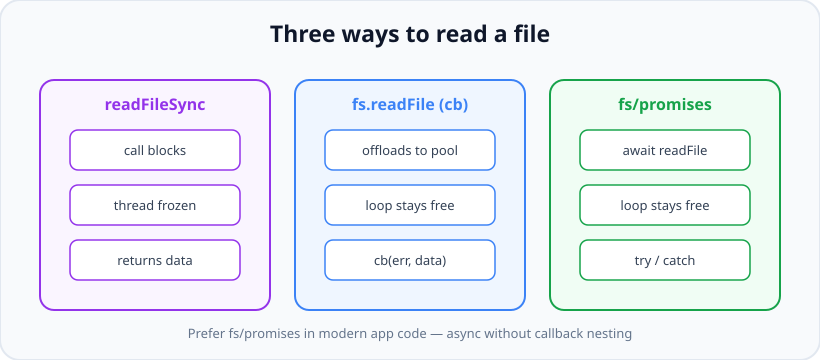

# The fs Module: Reading & Writing Files

*10 min read · Updated 24 Jul 2026 Topic 21 of 70 Bookmark Mark done Why it matters Almost every real backend touches the file system · Topic 21 of 70*

**Source:** [https://www.geekyfrontend.in/learn/nodejs-backend-kit/fs-module](https://www.geekyfrontend.in/learn/nodejs-backend-kit/fs-module)

---

## Why it matters

Almost every real backend touches the file system. You read a config file at boot, stream an uploaded avatar to disk, write structured logs, generate a PDF invoice, cache a rendered template, or serve a static asset. Node's built-in `fs` module is the single door to all of that, and how you open that door decides whether your server stays responsive under load or freezes for every user at once.

The `fs` module is also the place where the difference between *blocking* and *non-blocking* code becomes concrete and unforgiving. JavaScript on the server runs your application logic on a single main thread. A file read that blocks that thread does not just slow down the one request that asked for the file — it stops *every* concurrent request, every timer, and every incoming connection until the disk answers. Interviewers probe `fs` precisely because it is where candidates reveal whether they truly understand Node's execution model or have only memorised syntax. Getting this right is foundational; getting it wrong quietly caps your throughput at one slow disk operation at a time.

## The concept, simply

The `fs` module ships in three flavours that do the same jobs with different control flow. **Synchronous** methods (`readFileSync`) run to completion and return the result directly, blocking the thread while they wait. **Callback** methods (`fs.readFile(path, cb)`) hand the work to Node's internal thread pool and call you back later with an error-first callback. **Promise** methods, imported from `node:fs/promises`, do the same non-blocking work but return a promise you can `await`, which reads like synchronous code but never blocks.

The mental model: sync is a phone call where you hold the line until you have your answer; async is texting a request and getting on with your day until a reply buzzes back. On a server serving many people, you always want the second one.



The same file read expressed three ways. Only the sync form freezes the thread; both async forms keep the event loop free.

## How it works (deep)

When you call an asynchronous `fs` method, Node does not read the file on the main thread. File-system calls are handed to **libuv**, the C library underneath Node, which maintains a small pool of worker threads (four by default, tunable with the `UV_THREADPOOL_SIZE` environment variable). A worker performs the actual blocking `read()` or `write()` syscall while your main thread keeps running other JavaScript. When the worker finishes, libuv queues your callback (or resolves your promise) so the event loop can run it on the next available tick. This is why "non-blocking" is accurate from JavaScript's point of view even though the underlying OS call is blocking — the blocking simply happens on a thread that is not yours.

Synchronous methods skip all of that. `readFileSync` performs the syscall directly on the main thread and does not return until the kernel hands back the bytes. During that window nothing else in your process advances: no HTTP requests are accepted, no timers fire, no promises resolve. On a laptop reading a 2 KB config this is microseconds and invisible; under a server handling hundreds of requests per second against a slow network drive it is a self-inflicted outage.


Sync I/O serialises everyone behind the disk. Async lets the single thread serve other requests while the read is in flight.

The `fs/promises` API is not a thin wrapper you bolt on yourself — it is a first-class, separately maintained surface (`node:fs/promises`) that returns native promises directly from libuv completions. Under the hood it uses the same thread pool as the callback API, so it carries no extra cost; it simply gives you `async/await` ergonomics, real `try/catch` error handling, and clean composition with other async work. For code written today, it is the default you should reach for.

One more layer worth knowing: reading an entire file with `readFile` buffers the whole thing into memory before you see a single byte. That is perfect for small files but ruinous for large ones — a 2 GB file becomes a 2 GB allocation. For large or unbounded data you switch to **streams** (`fs.createReadStream` / `createWriteStream`), which move data in small chunks with built-in back-pressure so memory stays flat regardless of file size.

## Code examples

Reading and writing with the modern promise API, with proper error handling:

javascript

```
import { readFile, writeFile } from 'node:fs/promises';

async function loadConfig() {
  try {
    const raw = await readFile('config.json', 'utf8'); // string, not Buffer
    return JSON.parse(raw);
  } catch (err) {
    if (err.code === 'ENOENT') {
      // File missing: fall back to defaults instead of crashing.
      return { port: 3000 };
    }
    throw err; // Anything else (permissions, corrupt JSON) is a real error.
  }
}

async function saveConfig(cfg) {
  await writeFile('config.json', JSON.stringify(cfg, null, 2), 'utf8');
}
```

Passing the `'utf8'` encoding makes `readFile` return a decoded string. Omit it and you get a raw `Buffer` instead — useful for binary data, wrong for JSON parsing.

Appending log lines, creating directories, and checking existence the right way:

javascript

```
import { appendFile, mkdir, access, constants } from 'node:fs/promises';

// mkdir with recursive:true is idempotent — safe to call every boot.
await mkdir('logs', { recursive: true });

// Append never truncates; it creates the file if absent.
await appendFile('logs/app.log', `${new Date().toISOString()} started
`);

// Prefer trying the operation over checking first (see gotchas: TOCTOU).
async function canRead(path) {
  try {
    await access(path, constants.R_OK);
    return true;
  } catch {
    return false;
  }
}
```

Streaming a large file instead of buffering it, using the pipeline helper that wires up back-pressure and error propagation for you:

javascript

```
import { createReadStream, createWriteStream } from 'node:fs';
import { pipeline } from 'node:stream/promises';
import { createGzip } from 'node:zlib';

// Compress a 5 GB file with flat memory — chunks flow through, nothing buffers.
await pipeline(
  createReadStream('backup.tar'),
  createGzip(),
  createWriteStream('backup.tar.gz')
);
console.log('done — memory stayed constant regardless of file size');
```

Watching a file for changes, for a dev-time reload or a config hot-reload:

javascript

```
import { watch } from 'node:fs/promises';

// Async-iterator watcher: clean, cancellable with an AbortSignal.
const ac = new AbortController();
setTimeout(() => ac.abort(), 60_000); // stop watching after a minute

try {
  for await (const event of watch('config.json', { signal: ac.signal })) {
    console.log('config changed:', event.eventType);
  }
} catch (err) {
  if (err.name !== 'AbortError') throw err;
}
```

## Common mistakes & gotchas

- **Using `*Sync` methods inside a request handler.** It works in every test with one user and collapses under real concurrency because it blocks the whole event loop. Sync is fine at startup or in CLI scripts; it is a bug in a hot server path.
- **Forgetting the encoding and being surprised by a `Buffer`.** `await readFile('x.txt')` returns a `Buffer`; `JSON.parse` on it happens to work (it stringifies) but `.trim()` or string comparisons will not behave as expected. Pass `'utf8'` when you want text.
- **The check-then-act (TOCTOU) race.** Calling `existsSync` or `access` and *then* reading/writing invites a race: the file can vanish or appear between the two calls. Just attempt the operation and handle the error code (`ENOENT`, `EEXIST`). `fs.exists` is deprecated for exactly this reason.
- **Swallowing the error-first callback's first argument.** In callback style, `(err, data) => { use(data) }` that ignores `err` will read `undefined` data and crash later with a confusing stack. Always check `err` first.
- **Reading a huge file with `readFile`.** It allocates the entire file in memory at once. A few concurrent large reads can OOM the process. Stream anything that is not comfortably small and bounded.
- **Assuming `writeFile` is atomic.** A crash mid-write can leave a truncated file. For durability, write to a temp file and `rename` it into place — `rename` is atomic on the same filesystem.
- **Relative paths depending on the current working directory.** `readFile('data.json')` resolves against `process.cwd()`, not the file's own folder, so it breaks when the process is launched from elsewhere. Anchor paths to `import.meta.dirname` (or `__dirname`).

## Best practices

- **Default to `node:fs/promises` with `async/await`.** It is non-blocking, composes cleanly, and gives you real `try/catch`.
- **Reserve `*Sync` for startup and scripts.** Loading config before the server listens, or one-off CLI tooling, is exactly where sync is acceptable and even clearer.
- **Stream anything large or of unknown size,** using `stream/promises` `pipeline` so errors and back-pressure are handled for you.
- **Branch on `err.code`, not on message strings.** Codes like `ENOENT`, `EACCES`, `EEXIST` are stable; human-readable messages are not.
- **Build paths with the `path` module and anchor to `import.meta.dirname`,** never by concatenating strings with `/`.
- **Write-then-rename for files that must not be seen half-written.** Temp file plus atomic `rename` gives you crash-safety cheaply.
- **Prefer attempting an operation over pre-checking existence,** to avoid TOCTOU races and an extra syscall.

## ⭐ Interview lens

> **Q: What is the real difference between `fs.readFileSync` and `fs.readFile`?** `readFileSync` blocks the main thread until the OS returns the bytes, so nothing else in the process runs meanwhile. `readFile` hands the work to libuv's thread pool and invokes your callback later, keeping the event loop free to serve other requests. The trap is claiming sync is "faster" — for one isolated read the latency is similar, but on a server sync destroys concurrency.

> **Q: If Node is single-threaded, how does async file I/O actually run in parallel?** Your JavaScript is single-threaded, but I/O is delegated to libuv's thread pool (default size 4). Those worker threads perform the blocking syscalls; when they finish, the completion callback is queued back onto the single main thread. So the parallelism is in the C layer, not in your JS.

> **Q: Why prefer `fs/promises` over the callback API if they use the same thread pool?** They have identical performance because the mechanism is the same. The win is purely ergonomic: `await` avoids callback nesting, `try/catch` handles errors naturally, and it composes with other promises. There is no runtime downside.

> **Q: You must read a 4 GB file and transform it. How?** Never `readFile` it — that would try to allocate 4 GB. Use `createReadStream` and process chunks, ideally via `pipeline` so back-pressure and error handling are automatic. Memory stays flat regardless of file size.

> **Q: How do you check if a file exists before reading it?** The trick answer: usually you should not. Pre-checking with `access`/`existsSync` then reading opens a TOCTOU race and costs an extra syscall. Just `readFile` and catch `err.code === 'ENOENT'`. This shows you understand races, not just APIs.

> **Q: How would you make a config write crash-safe?** Write to a temporary file in the same directory, then `rename` it over the target. `rename` within one filesystem is atomic, so a reader ever sees either the old file or the fully new one, never a truncated write.

## Cheat-card

- `import { readFile, writeFile } from 'node:fs/promises'` — the default modern API.
- Pass `'utf8'` for a string; omit it for a raw `Buffer`.
- Async = libuv thread pool (default 4, set `UV_THREADPOOL_SIZE`); main thread stays free.
- `*Sync` only at startup / in scripts — never in a request handler.
- Large or unbounded data → `createReadStream` + `pipeline`, not `readFile`.
- Switch on `err.code`: `ENOENT` (missing), `EACCES` (permissions), `EEXIST` (already there).
- `mkdir(dir, { recursive: true })` is idempotent; `appendFile` creates + never truncates.
- Crash-safe write = temp file + atomic `rename`.
- Anchor paths to `import.meta.dirname`, never `process.cwd()`.
- `stat` follows symlinks; `lstat` describes the link. `throwIfNoEntry: false` on `fsPromises.stat` since v24.15.0.
- `readdir(dir, { withFileTypes: true, recursive: true })`: Dirents with `parentPath`; a symlink is neither `isFile()` nor `isDirectory()`.
- `unlink` = one name (not dirs, `EISDIR`); `rm(p, { recursive, force })` = `rm -rf`, never follows links.
- `copyFile(src, dst, COPYFILE_EXCL)` for one file; `cp(src, dst, { recursive, filter })` for trees (stable since v22.3.0).
- `glob` / `globSync` stable since v24.0.0; the promise form is an async iterator (`Array.fromAsync`).
- `FileHandle`: positional `read`/`write`, always `close()` (or `await using`); GC close prints `DEP0137`.
- Broken symlink: `existsSync` is `false`, `'wx'` gives `EEXIST`, `'w'` creates the target.
- Mode bits: `(stat.mode & 0o777).toString(8)`; umask trims new files; root ignores read/write bits.
- `fs.watch(dir, { recursive: true })` on Linux (v19.1.0+): one inotify watch per entry, duplicate events, `filename` may be `null`, debounce.

---

## Learn More

- [File system | Node.js Documentation nodejs.org](https://nodejs.org/api/fs.html)
- [Reading files with Node.js nodejs.org](https://nodejs.org/en/learn/manipulating-files/reading-files-with-nodejs)
- [Working with file descriptors in Node.js nodejs.org](https://nodejs.org/en/learn/manipulating-files/working-with-file-descriptors-in-nodejs)
- [A Beginner's Guide To The File System Module In Node.js Catalin Pit](https://www.youtube.com/watch?v=QkwHP4d01xA)

---

## Additional topics

*Added 10 Oct 2026 · examples verified on Node v24.19.0*

All examples below ran on Linux as an ordinary user (uid 1001, umask `0002`) in a scratch directory on tmpfs. Each one is a standalone `.mjs` file you can run with `node file.mjs`.

### `stat` and `lstat`

`stat(path)` asks the kernel for a file's inode metadata and returns an `fs.Stats` object: type, size, permission bits, owner, link count, inode number and four timestamps. It never reads the file's contents. `lstat(path)` does the same, except that when `path` is a symbolic link it describes the **link itself** instead of following it to the target. Without them you cannot tell a file from a directory, check a size before reading, or compare modification times.

How it works:

1. `stat` calls `stat(2)` on a thread-pool thread (`lstat` calls `lstat(2)`), and the kernel fills in a `struct stat`.
2. Node copies it into an `fs.Stats` object. The type is encoded in the high bits of `mode` (`0o100000` regular file, `0o040000` directory, `0o120000` symlink). `isFile()`, `isDirectory()` and `isSymbolicLink()` decode it.
3. Timestamps come both as `Date` objects (`mtime`) and as millisecond numbers (`mtimeMs`). `{ bigint: true }` gives `BigInt` fields plus nanosecond `mtimeNs`.
4. If the path does not exist, the promise rejects with `ENOENT`, unless you pass `throwIfNoEntry: false`. That option was added to `fsPromises.stat` and `fs.stat` in v24.15.0 (`statSync` has had it since v15.3.0 and v14.17.0). It then resolves to `undefined`.

**Example — reading a Stats object.**

javascript

```
// stat.mjs — what a Stats object holds, and what stat does on a missing path
import { stat, mkdir, writeFile } from 'node:fs/promises';

await mkdir('demo', { recursive: true });
await writeFile('demo/a.txt', 'hello\n');

const s = await stat('demo/a.txt');
console.log('isFile:', s.isFile(), '| isDirectory:', s.isDirectory(), '| size:', s.size);
console.log('mode (octal):', s.mode.toString(8), '| permission bits:', (s.mode & 0o777).toString(8));
console.log('mtime:', s.mtime instanceof Date, '| mtimeMs:', typeof s.mtimeMs, '| ino:', typeof s.ino, '| nlink:', s.nlink);

const d = await stat('demo');
console.log('demo/ isDirectory:', d.isDirectory(), '| mode:', d.mode.toString(8));

const big = await stat('demo/a.txt', { bigint: true });
console.log('bigint mtimeNs:', typeof big.mtimeNs, '| size:', big.size);

try { await stat('demo/missing.txt'); } catch (err) { console.log('stat missing:', err.code); }
console.log('throwIfNoEntry: false ->', await stat('demo/missing.txt', { throwIfNoEntry: false }));

// Real output (Node v24.19.0):
//   isFile: true | isDirectory: false | size: 6
//   mode (octal): 100664 | permission bits: 664
//   mtime: true | mtimeMs: number | ino: number | nlink: 1
//   demo/ isDirectory: true | mode: 40775
//   bigint mtimeNs: bigint | size: 6n
//   stat missing: ENOENT
//   throwIfNoEntry: false -> undefined
```

`100664` is "regular file" (`100000`) plus permission bits `664`; `40775` is "directory" plus `775`. The symlink case, where `stat` and `lstat` disagree, is shown in the symlinks topic below.

### `readdir`: `withFileTypes` and `recursive`

`readdir(dir)` returns the names in a directory, without `.` and `..`, in whatever order the file system returns them. Two options change what you get back:

- **`withFileTypes: true`** returns `fs.Dirent` objects instead of strings (added in v10.10.0 for `fs.readdir`, v10.11.0 for `fsPromises.readdir`). Each Dirent has `name`, `parentPath` (added in v21.4.0, v20.12.0 and v18.20.0; stable since v24.0.0) and the same `isFile()`/`isDirectory()`/`isSymbolicLink()` methods as Stats. Linux reports the entry type in the directory listing itself, so no extra `stat` call is made per entry (strace of a `withFileTypes` read showed two `getdents64` calls and no `stat` calls for the entries).
- **`recursive: true`** walks the whole tree and returns paths relative to `dir` (added in v20.1.0 and v18.17.0).

How it works:

1. Node opens the directory and reads its entries in batches (`getdents64` on Linux).
2. With `withFileTypes`, each entry's type comes from that listing. It describes the entry itself, so a symlink is reported as a symlink, not as its target.
3. With `recursive`, every entry that is a directory (not a symlink to one) is read as well.
4. The whole list is built in memory before the promise resolves. For a directory with very many entries, `fs.promises.opendir()` gives an async iterator instead.

**Example — names, Dirents and a recursive listing.**

javascript

```
// readdir.mjs — names, Dirent objects, and a recursive listing
import { readdir, mkdir, writeFile, symlink, rm } from 'node:fs/promises';

await rm('tree', { recursive: true, force: true });
await mkdir('tree/src/lib', { recursive: true });
await writeFile('tree/package.json', '{}');
await writeFile('tree/src/index.js', '');
await writeFile('tree/src/lib/util.js', '');
await symlink('src/index.js', 'tree/main.js');

console.log('names   :', (await readdir('tree')).sort());

for (const d of (await readdir('tree', { withFileTypes: true })).sort((a, b) => a.name.localeCompare(b.name))) {
  console.log('dirent  :', d.name.padEnd(13), d.isFile() ? 'file' : d.isDirectory() ? 'dir' : d.isSymbolicLink() ? 'symlink' : '?', '| parentPath:', d.parentPath);
}

console.log('recursive:', (await readdir('tree', { recursive: true })).sort());

const files = (await readdir('tree', { recursive: true, withFileTypes: true }))
  .filter((d) => d.isFile())
  .map((d) => `${d.parentPath}/${d.name}`);
console.log('files only:', files.sort());

// Real output (Node v24.19.0):
//   names   : [ 'main.js', 'package.json', 'src' ]
//   dirent  : main.js       symlink | parentPath: tree
//   dirent  : package.json  file | parentPath: tree
//   dirent  : src           dir | parentPath: tree
//   recursive: [
//     'main.js',
//     'package.json',
//     'src',
//     'src/index.js',
//     'src/lib',
//     'src/lib/util.js'
//   ]
//   files only: [ 'tree/package.json', 'tree/src/index.js', 'tree/src/lib/util.js' ]
```

`main.js` is a symlink to a file, but `d.isFile()` is `false` for it, so the "files only" filter drops it. Use `stat` on the entry if you want to follow links.

### `rm` and `unlink`

`unlink(path)` removes one directory entry: a file name or a symlink. The data is freed when no other hard link and no open file descriptor refers to it any more. It refuses directories. `rm(path, options)` (added in v14.14.0) is the higher-level remover, modelled on `rm -rf`: it removes files, removes whole trees with `recursive: true`, and ignores a missing path with `force: true`.

How it works:

1. `unlink` maps to `unlink(2)`. On a directory Linux returns `EISDIR`.
2. `rm` first checks what the path is without following a symlink (strace shows `statx` with `AT_SYMLINK_NOFOLLOW`). For a file or a symlink it unlinks it. For a directory without `recursive` it fails with `ERR_FS_EISDIR`, Node's own error code.
3. With `recursive: true`, it removes the directory's contents depth-first and then the directory (strace on a test tree `rr`: `unlink("rr/x/f")`, then `rmdir("rr/x")`, then `rmdir("rr")`). It does not follow symlinks, so removing a link to a directory removes only the link.
4. `force: true` turns `ENOENT` into success. Other errors (`EACCES`, `EBUSY`) still reject. `maxRetries` and `retryDelay` retry `EBUSY`/`EMFILE`/`ENFILE`/`ENOTEMPTY`/`EPERM`, which matters mostly on Windows.

**Example — what each call accepts and refuses.**

javascript

```
// rm.mjs — unlink removes one name; rm removes files or (with recursive) whole trees
import { rm, unlink, mkdir, writeFile, symlink, readdir } from 'node:fs/promises';

const tryIt = async (label, fn) => {
  try { await fn(); console.log(label.padEnd(38), 'ok'); }
  catch (err) { console.log(label.padEnd(38), err.code); }
};

await rm('trash', { recursive: true, force: true });
await mkdir('trash/dir/sub', { recursive: true });
await writeFile('trash/file.txt', 'x');
await writeFile('trash/dir/sub/deep.txt', 'x');
await symlink('dir', 'trash/link-to-dir');

await tryIt('unlink(file.txt)', () => unlink('trash/file.txt'));
await tryIt('unlink(file.txt) again', () => unlink('trash/file.txt'));
await tryIt('unlink(dir)', () => unlink('trash/dir'));
await tryIt('rm(dir)', () => rm('trash/dir'));
await tryIt('rm(missing.txt)', () => rm('trash/missing.txt'));
await tryIt('rm(missing.txt, { force: true })', () => rm('trash/missing.txt', { force: true }));
await tryIt('rm(link-to-dir, { recursive: true })', () => rm('trash/link-to-dir', { recursive: true }));
console.log('dir survived its link being removed:', (await readdir('trash/dir', { recursive: true })).sort());
await tryIt('rm(dir, { recursive: true })', () => rm('trash/dir', { recursive: true }));
console.log('left in trash/:', await readdir('trash'));

// Real output (Node v24.19.0):
//   unlink(file.txt)                       ok
//   unlink(file.txt) again                 ENOENT
//   unlink(dir)                            EISDIR
//   rm(dir)                                ERR_FS_EISDIR
//   rm(missing.txt)                        ENOENT
//   rm(missing.txt, { force: true })       ok
//   rm(link-to-dir, { recursive: true })   ok
//   dir survived its link being removed: [ 'sub', 'sub/deep.txt' ]
//   rm(dir, { recursive: true })           ok
//   left in trash/: []
```

### `copyFile` and `cp`

`copyFile(src, dest, mode)` copies one file's bytes (added in v8.5.0). On Linux libuv asks the kernel to do the copy: strace showed one `copy_file_range(2)` call for a 100,000-byte file, so the bytes never passed through JavaScript. `mode` is a bit mask: `COPYFILE_EXCL` fails if `dest` exists, `COPYFILE_FICLONE` asks for a copy-on-write clone where the file system supports it. `cp(src, dest, options)` (added in v16.7.0) copies files **and directory trees**, with `recursive`, `filter`, `force`, `errorOnExist`, `dereference`, `preserveTimestamps` and `verbatimSymlinks`. It was experimental at first. The docs' history says "This API is no longer experimental" in v22.3.0, so on v24 `fs.cp`, `fs.cpSync` and `fsPromises.cp` are stable.

How it works:

1. `copyFile` overwrites `dest` by default. `COPYFILE_EXCL` makes it fail with `EEXIST` if `dest` is there.
2. `cp` on a directory needs `recursive: true`, or it fails with `ERR_FS_EISDIR`.
3. For each entry, `cp` calls `filter(src, dest)` if given. Returning `false` for a directory skips its whole subtree.
4. By default an existing destination is overwritten (`force: true`). With `force: false` it is silently kept, unless `errorOnExist: true` makes it fail with `ERR_FS_CP_EEXIST`.

**Example — one file, then a filtered tree.**

javascript

```
// copy.mjs — copyFile for one file, cp for trees
import { copyFile, cp, mkdir, writeFile, readdir, rm, constants } from 'node:fs/promises';

await rm('cpdemo', { recursive: true, force: true });
await mkdir('cpdemo/src/assets', { recursive: true });
await writeFile('cpdemo/src/index.js', 'console.log(1)');
await writeFile('cpdemo/src/assets/logo.png', 'png');
await writeFile('cpdemo/src/notes.tmp', 'scratch');

await copyFile('cpdemo/src/index.js', 'cpdemo/index.copy.js');      // overwrites by default
try {
  await copyFile('cpdemo/src/index.js', 'cpdemo/index.copy.js', constants.COPYFILE_EXCL);
} catch (err) { console.log('copyFile with COPYFILE_EXCL:', err.code); }

try { await cp('cpdemo/src', 'cpdemo/out'); } catch (err) { console.log('cp of a dir without recursive:', err.code); }

await cp('cpdemo/src', 'cpdemo/out', {
  recursive: true,
  filter: (src) => !src.endsWith('.tmp'),          // skip scratch files
});
console.log('copied tree:', (await readdir('cpdemo/out', { recursive: true })).sort());

try {
  await cp('cpdemo/src', 'cpdemo/out', { recursive: true, force: false, errorOnExist: true });
} catch (err) { console.log('cp again with errorOnExist:', err.code); }

// Real output (Node v24.19.0):
//   copyFile with COPYFILE_EXCL: EEXIST
//   cp of a dir without recursive: ERR_FS_EISDIR
//   copied tree: [ 'assets', 'assets/logo.png', 'index.js' ]
//   cp again with errorOnExist: ERR_FS_CP_EEXIST
```

### `fs.glob`

`glob(pattern, options)` expands shell-style patterns (`*`, `**`, `?`, `{a,b}`, `[abc]`) against the file system. It comes in three forms: `fsPromises.glob` returns an async iterator, `fs.glob` takes a callback, and `fs.globSync` returns an array. They were added in v22.0.0 and **marked stable in v24.0.0**. On v24.19.0 they print no warning. The `exclude` option takes glob patterns since v23.7.0 and v22.14.0, or a function, and `withFileTypes` was added in v22.2.0. Before this, projects needed a package such as `glob` or `fast-glob`.

How it works:

1. Node reads the directories the pattern can reach, starting at `cwd`, and matches each entry name against the matching segment of the pattern.
2. `**` matches zero or more directory levels. It does not follow symlinks to directories unless you pass `followSymlinks: true` (added in v24.16.0).
3. Paths are yielded relative to `cwd` (default `process.cwd()`).
4. `exclude` removes matches. A directory that matches `exclude` is not read at all: with `exclude: ['node_modules']`, strace showed no `open` of `proj/node_modules`.

**Example — the three forms and `exclude`.**

javascript

```
// glob.mjs — fs.glob, fs/promises glob and globSync on v24 (stable since v24.0.0)
import { glob } from 'node:fs/promises';
import { globSync, mkdirSync, writeFileSync, rmSync } from 'node:fs';

rmSync('proj', { recursive: true, force: true });
for (const f of ['src/a.js', 'src/b.test.js', 'src/lib/c.js', 'node_modules/x/index.js', 'README.md']) {
  mkdirSync(`proj/${f}`.replace(/\/[^/]+$/, ''), { recursive: true });
  writeFileSync(`proj/${f}`, '');
}

// promise API: an async iterator, not an array
const it = glob('**/*.js', { cwd: 'proj' });
console.log('returns:', Object.prototype.toString.call(it));
console.log('all .js :', (await Array.fromAsync(it)).sort());

// exclude takes glob patterns (v23.7.0 / v22.14.0) or a function
console.log('excluded:', (await Array.fromAsync(glob('**/*.js', {
  cwd: 'proj', exclude: ['node_modules/**', '**/*.test.js'] }))).sort());

// sync API returns an array; withFileTypes gives Dirents
console.log('sync    :', globSync('src/*.{js,md}', { cwd: 'proj' }).sort());
console.log('dirents :', globSync('*', { cwd: 'proj', withFileTypes: true })
  .map((d) => `${d.name}:${d.isDirectory() ? 'dir' : 'file'}`).sort());

// Real output (Node v24.19.0):
//   returns: [object AsyncGenerator]
//   all .js : [
//     'node_modules/x/index.js',
//     'src/a.js',
//     'src/b.test.js',
//     'src/lib/c.js'
//   ]
//   excluded: [ 'src/a.js', 'src/lib/c.js' ]
//   sync    : [ 'src/a.js', 'src/b.test.js' ]
//   dirents : [ 'README.md:file', 'node_modules:dir', 'src:dir' ]
```

The promise form returns an `AsyncGenerator`, so `await glob(...)` gives you the generator, not the paths. Use `for await` or `Array.fromAsync`.

### `FileHandle` and file descriptors

A **file descriptor** (fd) is a small integer the kernel hands to a process when it opens a file. It indexes the process's table of open files, and each entry holds the current offset and the open flags. `fsPromises.open()` returns a `FileHandle`, an object that wraps one fd and has methods for it: `read`, `write`, `readFile`, `stat`, `truncate`, `close` and more. You need it when you open a file once and do many operations on it, especially reads and writes at chosen byte positions, as with fixed-size records, file headers or resumable downloads.

How it works:

1. `open(path, flags)` calls `open(2)`. `'r'` opens for reading, `'w'` creates or truncates, `'a'` appends, `'w+'` creates or truncates for reading and writing, and `'wx'` fails if the file exists. `fh.fd` is the number.
2. `fh.read(buffer, offset, length, position)` and `fh.write(buffer, offset, length, position)` use `pread(2)`/`pwrite(2)` when `position` is a number. The file's current offset does not move, so concurrent positional reads do not interfere. With `position` `null` they use and advance the current offset.
3. Reading past the end is not an error. It resolves with `bytesRead: 0`.
4. `fh.close()` releases the fd. After that `fh.fd` is `-1` and every method rejects with `EBADF`.
5. If you forget to close it, the fd stays open until the FileHandle is garbage-collected. Node then closes it and prints a warning. The v24 docs say not to rely on this: "it can be unreliable and the file may not be closed". A process has a limited number of fds (`ulimit -n`), and once they run out every `open`, `accept` and `connect` fails with `EMFILE`.
6. `FileHandle` implements `Symbol.asyncDispose` (added in v20.4.0 and v18.18.0, no longer experimental in v24.2.0). So `await using fh = await open(...)` closes it when the block exits. The `await using` syntax ran without a flag on v24.19.0 (V8 13.6).

**Example — fixed-size records read and written in place.**

javascript

```
// fh.mjs — a FileHandle wraps a numeric fd; read and write at explicit positions
import { open } from 'node:fs/promises';

const fh = await open('records.bin', 'w+');            // create or truncate, read + write
console.log('fd:', fh.fd);
try {
  // three fixed-size 8-byte records
  for (const [i, name] of ['alice', 'bob', 'carol'].entries()) {
    await fh.write(Buffer.from(name.padEnd(8, '.')), 0, 8, i * 8);
  }
  // overwrite record 1 in place, without touching the others
  await fh.write(Buffer.from('BOB!....'), 0, 8, 8);

  const buf = Buffer.alloc(8);
  const { bytesRead } = await fh.read(buf, 0, 8, 16);   // read record 2 only
  console.log('record 2:', bytesRead, 'bytes ->', buf.toString());

  console.log('whole file:', (await fh.readFile()).toString(), '| size:', (await fh.stat()).size);
  const past = await fh.read(Buffer.alloc(8), 0, 8, 1000); // reading past the end is not an error
  console.log('read at 1000:', past.bytesRead, 'bytes');
} finally {
  await fh.close();                                      // always close, also on error
}
console.log('fd after close:', fh.fd);
try { await fh.read(Buffer.alloc(1), 0, 1, 0); } catch (err) { console.log('read after close:', err.code); }

// await using closes it for you at the end of the block (Symbol.asyncDispose, stable since v24.2.0)
{
  await using h = await open('records.bin');
  console.log('await using fd:', h.fd);
}

// Real output (Node v24.19.0):
//   fd: 20
//   record 2: 8 bytes -> carol...
//   whole file: alice...BOB!....carol... | size: 24
//   read at 1000: 0 bytes
//   fd after close: -1
//   read after close: EBADF
//   await using fd: 20
```

The same fd number (20) came back after the first handle was closed, because the kernel reuses the lowest free number. The exact number depends on what else the process has open.

**Example — the garbage-collection close warning.**

javascript

```
// leak.cjs — run with: node --expose-gc leak.cjs
const { open } = require('node:fs/promises');

async function leak() {
  const fh = await open(__filename);   // opened, never closed
  return fh.fd;
}

leak().then((fd) => {
  console.log('leaked fd', fd);
  setImmediate(() => { globalThis.gc(); setTimeout(() => {}, 100); });
});
```

bash

```
$ node --expose-gc leak.cjs
leaked fd 20
(node:…) Warning: Closing file descriptor 20 on garbage collection
(Use `node --trace-warnings ...` to show where the warning was created)
(node:…) [DEP0137] DeprecationWarning: Closing a FileHandle object on garbage collection is deprecated. Please close FileHandle objects explicitly using FileHandle.prototype.close(). In the future, an error will be thrown if a file descriptor is closed during garbage collection.
```

(The process id in the warning is replaced with `…`.) The second warning, `DEP0137`, says that in the future this will throw instead of closing the fd for you.

### Symbolic links

A **symbolic link** (symlink) is a small file whose content is a path, the *target*. When a system call such as `open` or `stat` reaches a symlink, the kernel reads that path and continues from it. A **hard link**, by contrast, is a second directory entry for the same inode. Symlinks are how release directories (`current -> releases/v2`), `node_modules/.bin` and pnpm's store work.

How it works:

1. `symlink(target, path)` creates `path` with the text `target` inside. The target does not have to exist, and a relative target is resolved relative to the **link's directory**, not to `process.cwd()`.
2. `readlink(path)` returns that text unchanged.
3. `stat(path)` follows the link (and any chain of links) and describes the target. `lstat(path)` describes the link; its `size` is the length of the target text.
4. `realpath(path)` resolves every symlink, `.` and `..` in the path and returns the canonical absolute path.
5. If the target is missing, the link is **broken** (dangling). `lstat` and `readlink` still work, `stat` and `realpath` fail with `ENOENT`, and `existsSync` returns `false` because it follows the link.

**Example — a release-style link, then breaking it.**

javascript

```
// links.mjs — symlink, readlink, realpath, stat vs lstat, and a broken link
import { symlink, readlink, realpath, stat, lstat, mkdir, writeFile, rm } from 'node:fs/promises';
import { existsSync } from 'node:fs';

await rm('ln', { recursive: true, force: true });
await mkdir('ln/releases/v2', { recursive: true });
await writeFile('ln/releases/v2/app.js', 'v2');
await symlink('releases/v2', 'ln/current');           // the target is stored as text, relative to the link

console.log('readlink :', await readlink('ln/current'));
console.log('realpath :', (await realpath('ln/current/app.js')).replace(process.cwd(), '.'));
const s = await stat('ln/current'), l = await lstat('ln/current');
console.log('stat     : isDirectory', s.isDirectory(), '| isSymbolicLink', s.isSymbolicLink());
console.log('lstat    : isDirectory', l.isDirectory(), '| isSymbolicLink', l.isSymbolicLink(), '| size', l.size, '(length of the target text)');

// break the link by removing what it points to
await rm('ln/releases/v2', { recursive: true });
console.log('--- after deleting releases/v2');
console.log('readlink :', await readlink('ln/current'));
console.log('lstat    : isSymbolicLink', (await lstat('ln/current')).isSymbolicLink());
for (const [name, fn] of [['stat', stat], ['realpath', realpath]]) {
  try { await fn('ln/current'); } catch (err) { console.log(name.padEnd(9), ':', err.code); }
}
console.log('existsSync:', existsSync('ln/current'));

// Real output (Node v24.19.0):
//   readlink : releases/v2
//   realpath : ./ln/releases/v2/app.js
//   stat     : isDirectory true | isSymbolicLink false
//   lstat    : isDirectory false | isSymbolicLink true | size 11 (length of the target text)
//   --- after deleting releases/v2
//   readlink : releases/v2
//   lstat    : isSymbolicLink true
//   stat      : ENOENT
//   realpath  : ENOENT
//   existsSync: false
```

### Permissions and `chmod`

On POSIX systems every file has an owner, a group and 12 **mode bits**: three each of read (4), write (2) and execute (1) for owner, group and others, plus setuid, setgid and sticky. Written in octal, `0o640` means owner read/write, group read, others nothing. On a directory, "read" lets you list names, "write" lets you create, delete and rename entries, and "execute" lets you pass through it to reach the entries. `chmod(path, mode)` changes the bits; only the owner (or root) may.

How it works:

1. When a file is created, the `mode` you pass (`0o666` by default for `writeFile` and `open`) is reduced by the process's **umask**. With umask `0002`, `0o666` becomes `0o664`.
2. On every `open`, the kernel checks the bits for the class you fall into (owner, group, or other) against the access you asked for. If they don't match, the call fails with `EACCES`.
3. Path lookup needs execute permission on every directory along the path. Without it even `stat` fails with `EACCES`.
4. Root (uid 0) bypasses these read and write checks (the `CAP_DAC_OVERRIDE` capability in capabilities(7)). So a test that "proves" permissions work must run as a normal user, as this one does (uid 1001).
5. `stat().mode & 0o777` gives the permission bits. Format them with `.toString(8)`.

**Example — EACCES as a non-root user.**

javascript

```
// perms.mjs — mode bits, chmod, and EACCES as a non-root user (run as uid 1001)
import { writeFile, chmod, stat, readFile, mkdir, rm, access, constants } from 'node:fs/promises';

const bits = async (p) => ((await stat(p)).mode & 0o777).toString(8).padStart(3, '0');
console.log('uid:', process.getuid());

await rm('perm', { recursive: true, force: true });
await mkdir('perm');
await writeFile('perm/secret.txt', 'token', { mode: 0o666 });
console.log('created with 0o666 ->', await bits('perm/secret.txt'), '(umask removed some bits)');

await chmod('perm/secret.txt', 0o600);                  // rw for owner only
console.log('after chmod 0o600  ->', await bits('perm/secret.txt'));

await chmod('perm/secret.txt', 0o200);                  // write-only for owner
try { await readFile('perm/secret.txt'); } catch (err) { console.log('readFile on 200    ->', err.code, err.syscall); }
try { await access('perm/secret.txt', constants.R_OK); } catch (err) { console.log('access R_OK        ->', err.code); }

await chmod('perm', 0o500);                             // directory: no write bit -> cannot create entries
try { await writeFile('perm/new.txt', 'x'); } catch (err) { console.log('create in dir 500  ->', err.code); }
await chmod('perm', 0o600);                             // directory: no x bit -> cannot reach entries
try { await stat('perm/secret.txt'); } catch (err) { console.log('stat in dir 600    ->', err.code); }

await chmod('perm', 0o700);
await chmod('perm/secret.txt', 0o600);
console.log('restored           ->', await bits('perm'), await bits('perm/secret.txt'));

// Real output (Node v24.19.0):
//   uid: 1001
//   created with 0o666 -> 664 (umask removed some bits)
//   after chmod 0o600  -> 600
//   readFile on 200    -> EACCES open
//   access R_OK        -> EACCES
//   create in dir 500  -> EACCES
//   stat in dir 600    -> EACCES
//   restored           -> 700 600
```

The v24 docs' caveat for Windows is that "only the write permission can be changed", and there is no owner, group and other distinction.

### `fs.watch` with `recursive`: what you really get

`fs.watch(dir, { recursive: true }, listener)` reports changes anywhere under `dir`. The listener gets `(eventType, filename)`. `eventType` is `'rename'` (a name appeared or disappeared) or `'change'` (content or metadata changed). `filename` is relative to `dir`. Recursive watching on Linux was added in v19.1.0 ("Added recursive support for Linux, AIX and IBMi" in the docs' history table).

How it works on Linux (from `lib/internal/fs/recursive_watch.js` in v24.19.0):

1. Linux's `inotify` can watch one directory at a time, not a tree. So Node walks the tree with `readdirSync` and opens one non-recursive `fs.watch` (one inotify watch) **per file and per directory**, and `statSync`s each one.
2. When a watched directory reports an event, Node re-reads it, and every name it has not seen before is emitted as `'rename'` and gets its own watcher.
3. When a watched file reports an event, Node `stat`s it again. If it is gone it emits `'rename'`; otherwise it emits `'change'`.
4. Each inotify watch counts against `fs.inotify.max_user_watches` (65536 on this machine). A large tree, such as a `node_modules`, can exhaust it.

The docs add more caveats. `filename` "is not always guaranteed to be provided", so it can be `null`. On network and virtualised file systems watching "can be unreliable". And on Linux and macOS the watch is attached to an inode, so a file that is deleted and re-created is no longer watched.

**Example — the events for five common edits.**

javascript

```
// watch.mjs — what fs.watch({ recursive: true }) reports on Linux for common edits
import { watch } from 'node:fs';
import { mkdir, writeFile, appendFile, rename, rm } from 'node:fs/promises';
import { setTimeout as sleep } from 'node:timers/promises';

await rm('w', { recursive: true, force: true });
await mkdir('w/src', { recursive: true });
await writeFile('w/src/config.json', '{}');

const watcher = watch('w', { recursive: true }, (eventType, filename) => {
  console.log(`   ${eventType.padEnd(6)} ${filename}`);
});
await sleep(100);                                            // let the watcher settle

const step = async (label, fn) => { console.log(label); await fn(); await sleep(150); };
await step('1. writeFile (overwrite) src/config.json', () => writeFile('w/src/config.json', '{"a":1}'));
await step('2. appendFile src/config.json', () => appendFile('w/src/config.json', '\n'));
await step('3. atomic save: write .tmp, rename over config.json', async () => {
  await writeFile('w/src/.config.json.tmp', '{"a":2}');
  await rename('w/src/.config.json.tmp', 'w/src/config.json');
});
await step('4. mkdir src/new, then a file inside it', async () => {
  await mkdir('w/src/new');
  await writeFile('w/src/new/file.txt', 'x');
});
await step('5. rm src/new/file.txt', () => rm('w/src/new/file.txt'));
watcher.close();

// Real output (Node v24.19.0):
//   1. writeFile (overwrite) src/config.json
//      change src/config.json
//      change src/config.json
//   2. appendFile src/config.json
//      change src/config.json
//   3. atomic save: write .tmp, rename over config.json
//      rename src/.config.json.tmp
//      change src/.config.json.tmp
//      change src/config.json
//      rename src/.config.json.tmp
//      change src/config.json
//      change src/config.json
//   4. mkdir src/new, then a file inside it
//      rename src/new
//      rename src/new/file.txt
//      change src/new/file.txt
//   5. rm src/new/file.txt
//      rename src/new/file.txt
```

Three runs gave identical output. Things to notice:

- **Duplicates:** one `writeFile` produced two `change` events, and the atomic save produced six events for one logical save.
- **Atomic save shows up as `change`, not `rename`:** some editors, and many libraries that write config files, save by writing a temporary file and renaming it over the original. A plain non-recursive `fs.watch('w1')` on the same sequence reported `rename .tmp`, `change .tmp`, `rename .tmp`, `rename config.json`. Recursive mode turned the last one into `change config.json`, because Node `stat`s the path and finds a file there.
- **The temporary file's name leaks out:** `src/.config.json.tmp` appears in the events. Filter names you don't care about.
- **Debounce:** collect events for 50–100 ms, then re-read the files you care about, instead of reacting to each event.

### Common mistakes & gotchas (additional topics)

- **Using `stat` where you mean `lstat`.** `stat` follows symlinks, so a tree walker that uses it treats a link to a directory as that directory and walks into it, possibly outside the tree or in a loop. Use `lstat` (or Dirent types) when walking a tree.
- **Treating `d.isFile()` as "is a readable file".** For a symlink to a file it is `false` (see the `readdir` example). Decide explicitly whether your code follows links.
- **Using `existsSync` to decide whether a path is free.** It follows symlinks and returns `false` for a broken link, yet the name is taken (see the edge case below). Create with the `'wx'` flag and handle `EEXIST`.
- **Calling `unlink` or `rm` without `recursive` on a directory.** They fail with `EISDIR` and `ERR_FS_EISDIR`. The `recursive` option of `rmdir` has been deprecated since v14.14.0 (with a runtime warning since v16.0.0); use `rm`.
- **`rm(path, { recursive: true, force: true })` on a computed path.** It is `rm -rf`. Check that the resolved path is inside the directory you meant before calling it.
- **Expecting `cp` to fail on an existing destination.** The default is `force: true`, which overwrites. With `force: false` and no `errorOnExist`, it silently skips.
- **`await glob(...)` without iterating.** The promise API returns an async iterator, not a promise of an array.
- **Leaving FileHandles to the garbage collector.** It prints `DEP0137` and may close the fd late or never, and fd exhaustion shows up as `EMFILE` far from the leak. Close in `finally`, or use `await using`.
- **Testing permission checks as root.** Root bypasses read and write bits, so `chmod 000` "doesn't work" in a root container. Run such tests as a normal user.
- **Trusting `fs.watch` events one by one.** Expect duplicates, `null` filenames and `change` where you expected `rename`. Debounce, then re-read the files.

### Edge case worked through: a broken symlink that "does not exist" but blocks creation

A broken symlink is a name in a directory whose target is missing. Code that checks `existsSync` sees `false`. But the name is in use, and writing to it follows the link and creates the target file:

javascript

```
// dangling.mjs — a broken symlink: "does not exist", yet it is there
import { symlink, writeFile, readdir, readlink, lstat, rm, mkdir, readFile } from 'node:fs/promises';
import { existsSync } from 'node:fs';

await rm('dg', { recursive: true, force: true });
await mkdir('dg');
await symlink('settings.real.json', 'dg/settings.json');   // the target does not exist yet

console.log('existsSync           :', existsSync('dg/settings.json'));
try { await writeFile('dg/settings.json', '{"a":1}', { flag: 'wx' }); }   // "create only if absent"
catch (err) { console.log('writeFile flag wx    :', err.code); }

await writeFile('dg/settings.json', '{"a":1}');            // default flag 'w' follows the link
console.log('entries now          :', (await readdir('dg')).sort());
console.log('link still a link    :', (await lstat('dg/settings.json')).isSymbolicLink(), '->', await readlink('dg/settings.json'));
console.log('content via the link :', await readFile('dg/settings.json', 'utf8'));

// Real output (Node v24.19.0):
//   existsSync           : false
//   writeFile flag wx    : EEXIST
//   entries now          : [ 'settings.json', 'settings.real.json' ]
//   link still a link    : true -> settings.real.json
//   content via the link : {"a":1}
```

Step by step:

1. `existsSync` calls `stat`, which follows the link to `settings.real.json`, finds nothing, and returns `false`.
2. `writeFile` with `flag: 'wx'` asks the kernel for `O_CREAT | O_EXCL`. With `O_EXCL` the kernel does not follow a symlink in the last path component, sees that the name exists, and fails with `EEXIST`.
3. With the default `'w'` flag, `open` follows the link and creates `settings.real.json`, the target. The link stays a link.

So "check with `existsSync`, then create" is wrong twice here. It reports the name as free when it isn't, and the write lands in a different file from the one you named. An attacker who can create links in a shared directory such as `/tmp` can use the second effect to make your process write somewhere else. Use `'wx'` for "create a new file", and use `lstat` when you need to know what a name is.

### ⭐ Interview lens (additional topics)

> **Q: “What is the difference between `stat` and `lstat`, and when does it matter?”**  
> A: `stat` follows symbolic links and describes the target. `lstat` describes the link itself (`isSymbolicLink()` is `true`, and `size` is the length of the target path). It matters when you walk a directory tree. Following links can copy or delete files outside the tree, or loop forever on a link to a parent directory. For a broken link, `stat` fails with `ENOENT` while `lstat` succeeds.

> **Q: “Your service fails with `EMFILE: too many open files` after a few hours. What do you look for?”**  
> A: File descriptors that are opened and never closed: a `FileHandle` without `close()` on an error path, streams that are never destroyed, sockets left open. A process has a fixed fd limit (`ulimit -n`). `DEP0137` warnings ("Closing a FileHandle object on garbage collection is deprecated") point at the leaking handles. Fix it with `try/finally { await fh.close() }` or `await using`, and use `pipeline()` for streams.
