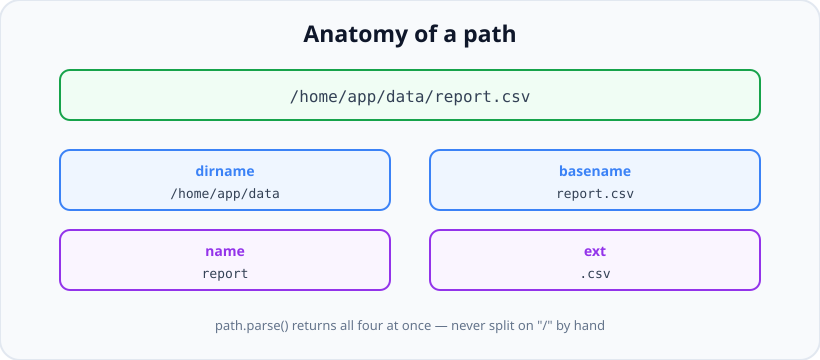

# path, os & URL: Portable Filesystem and Environment Info

*10 min read · Updated 24 Jul 2026 Topic 22 of 70 Bookmark Mark done Why it matters Code that hand · Topic 22 of 70*

**Source:** [https://www.geekyfrontend.in/learn/nodejs-backend-kit/path-os-url](https://www.geekyfrontend.in/learn/nodejs-backend-kit/path-os-url)

---

## Why it matters

Code that hand-builds file paths by gluing strings together with `'/'` is a bug waiting for a Windows machine, a trailing slash, or a `..` in user input. The `path` module exists so you never have to think about those edge cases: it joins, resolves, and dissects paths correctly on every operating system. Alongside it, `os` tells you about the machine you are running on — CPU count, free memory, platform, temp directory — which you need for sizing worker pools, choosing scratch space, and logging diagnostics. And the WHATWG `URL` class parses and builds URLs safely, replacing the error-prone string-splitting that leads to security holes.

These three modules are unglamorous but they show up in nearly every backend, and interviewers use them to separate people who understand portability and safe parsing from those who improvise. A single `path.join` in the right place is the difference between code that runs identically on your Mac, your Linux server, and a teammate's Windows box.

## The concept, simply

**`path`** manipulates path *strings* — it never touches the disk. `join` concatenates segments with the correct separator and collapses redundant slashes. `resolve` produces an absolute path by walking from right to left until it has one. `basename`, `dirname`, `extname`, and `parse` pull a path apart into its pieces. **`os`** reports facts about the host: `os.cpus()`, `os.freemem()`, `os.platform()`, `os.tmpdir()`, `os.hostname()`. **`URL`** (a global, no import needed) parses a URL string into structured parts — `protocol`, `hostname`, `pathname`, `searchParams` — and lets you build and mutate URLs without manual escaping.



path.parse() decomposes a path into dir, base, name, and ext in one call — no manual string splitting.

## How it works (deep)

The key insight about `path` is that it is *platform-aware*. On POSIX systems the separator is `/`; on Windows it is `\` (and both are accepted on input). `path.join('a', 'b')` yields `a/b` on Linux and `a\b` on Windows automatically. If you ever need to force one behaviour regardless of host, `path.posix` and `path.win32` give you the platform-specific variants explicitly — handy when constructing URL-style paths that must always use forward slashes.

`join` versus `resolve` trips people up. `join` simply concatenates and normalises: `path.join('/a', 'b', '..', 'c')` gives `/a/c`. `resolve` builds an *absolute* path by processing arguments right-to-left, prepending `process.cwd()` only if it has not yet reached an absolute segment: `path.resolve('b', 'c')` gives `/current/working/dir/b/c`, while `path.resolve('/a', 'b')` gives `/a/b` because `/a` is already absolute and short-circuits the walk. Rule of thumb: use `join` to stitch known relative pieces, use `resolve` when you need a guaranteed absolute path.

The `os` module reads from the operating system at call time. `os.cpus()` returns one entry per logical core, which is the canonical way to size a cluster or worker pool. `os.tmpdir()` returns the correct scratch directory for the platform (respecting `TMPDIR`/`TEMP` env vars), so temp files land somewhere writable and auto-cleaned rather than in your project folder. `os.platform()` returns `'linux'`, `'darwin'`, or `'win32'` — useful for platform branches, though you should lean on cross-platform APIs before branching.

The `URL` class implements the WHATWG URL Standard — the exact same parser browsers use — so its behaviour is precisely specified and consistent. `new URL(str)` throws on an invalid absolute URL, which is a feature: it fails loudly instead of silently mis-parsing. `searchParams` is a live `URLSearchParams` object that handles percent-encoding for you: `url.searchParams.get('q')` returns the decoded value, and `set`/`append` re-encode correctly. The legacy `querystring` module and the old `url.parse()` function still exist but are effectively superseded — `URL` and `URLSearchParams` are the standard, safer choice for new code.

Beyond `join` and `resolve`, a handful of smaller `path` helpers earn their keep once you internalise them. `path.normalize` collapses `.`, `..`, and duplicate separators *without* making the path absolute — it is the string clean-up half of `resolve`. `path.isAbsolute` answers the platform-specific question the right way (on Windows, `C:\x` and `\\server\share` are absolute; a bare `/x` is not). `path.relative(from, to)` computes the `..`-laden hop from one location to another, which is how build tools print tidy relative paths. And two constants matter for cross-platform correctness: `path.sep` is the segment separator (`/` or `\`), while `path.delimiter` is the *list* separator used inside variables like `PATH` (`:` on POSIX, `;` on Windows) — splitting `process.env.PATH` on a hard-coded `':'` is a classic Windows bug.

It helps to see how the two main joiners diverge on identical inputs. The table below assumes a current working directory of `/home/app` on a POSIX host:

| Call | Result | Why |
| --- | --- | --- |
| `path.join('a', 'b', 'c')` | `a/b/c` | Concatenates; stays relative. |
| `path.join('/a', '/b')` | `/a/b` | A leading slash on a later arg is just a separator, not a reset. |
| `path.resolve('a', 'b')` | `/home/app/a/b` | Prepends `cwd` to reach an absolute path. |
| `path.resolve('/a', 'b')` | `/a/b` | The absolute `/a` short-circuits the right-to-left walk. |
| `path.resolve('/a', '/b')` | `/b` | The *last* absolute arg wins; earlier ones are discarded. |
| `path.normalize('a//b/../c')` | `a/c` | Cleans separators and `..` without going absolute. |

## Code examples

Building paths portably and anchoring to the current module's directory:

javascript

```
import path from 'node:path';
import { readFile } from 'node:fs/promises';

// import.meta.dirname (Node 20.11+) is the folder THIS file lives in.
const dataFile = path.join(import.meta.dirname, 'data', 'users.json');

const users = JSON.parse(await readFile(dataFile, 'utf8'));

// join vs resolve
path.join('/var', 'log', '..', 'www');   // '/var/www'
path.resolve('src', 'index.js');          // '/abs/cwd/src/index.js'
path.resolve('/etc', 'src');              // '/etc/src' (abs arg short-circuits)
```

Decomposing a path and safely swapping an extension:

javascript

```
import path from 'node:path';

const p = '/home/app/reports/q3.csv';
path.basename(p);          // 'q3.csv'
path.basename(p, '.csv');  // 'q3'  (strips the given suffix)
path.dirname(p);           // '/home/app/reports'
path.extname(p);           // '.csv'
path.parse(p);
// { root:'/', dir:'/home/app/reports', base:'q3.csv', name:'q3', ext:'.csv' }

// Change the extension the correct way:
const asJson = path.format({ ...path.parse(p), base: undefined, ext: '.json' });
// '/home/app/reports/q3.json'
```

Reading machine info to size a worker pool and pick scratch space:

javascript

```
import os from 'node:os';
import path from 'node:path';

const workers = os.cpus().length;                 // one per logical core
const scratch = path.join(os.tmpdir(), 'myapp');  // correct temp dir per OS

console.log({
  platform: os.platform(),      // 'linux' | 'darwin' | 'win32'
  cores: workers,
  freeMemMB: Math.round(os.freemem() / 1024 / 1024),
  home: os.homedir(),
});
```

Parsing and building URLs with the WHATWG API instead of string surgery:

javascript

```
const u = new URL('https://api.example.com/v2/search?q=node+fs&page=2');

u.protocol;                    // 'https:'
u.hostname;                    // 'api.example.com'
u.pathname;                    // '/v2/search'
u.searchParams.get('q');       // 'node fs'  (decoded automatically)
u.searchParams.get('page');    // '2'

// Mutate safely — encoding is handled for you:
u.searchParams.set('page', '3');
u.searchParams.append('sort', 'date');
u.toString(); // '...?q=node+fs&page=3&sort=date'

// Resolve a relative URL against a base (great for API clients):
new URL('../users', 'https://api.example.com/v2/search').href;
// 'https://api.example.com/users'
```

## Common mistakes & gotchas

- **Concatenating paths with `'/'` or template strings.** It breaks on Windows and mishandles trailing slashes and `..`. Always use `path.join`/`path.resolve`.
- **Confusing `join` and `resolve`.** `join` just concatenates; `resolve` guarantees an absolute path and short-circuits on the first absolute argument (right-to-left). Reaching for the wrong one gives subtly wrong paths.
- **Path traversal from user input.** `path.join(uploadDir, req.body.name)` where `name` is `'../../etc/passwd'` escapes your directory. Resolve the full path and verify it still starts with the intended base directory before touching it.
- **Assuming `__dirname` exists in ES modules.** In ESM there is no `__dirname`/`__filename`. Use `import.meta.dirname`/`import.meta.filename` (Node 20.11+), or derive them from `import.meta.url`.
- **Using the legacy `url.parse()`.** It is lenient in unsafe ways and predates the WHATWG standard. Prefer `new URL()`, which rejects malformed input.
- **Manually encoding query strings.** Hand-rolled `encodeURIComponent` concatenation drifts from spec. `URLSearchParams` encodes and decodes correctly, including repeated keys and spaces.
- **Treating `os.freemem()` as "available" memory.** On Linux free memory excludes reclaimable cache, so it can look alarmingly low while the system is healthy. It is a rough signal, not a capacity planner.
- **Splitting `PATH` (or any list env var) on a hard-coded `':'`.** Windows separates `PATH` entries with `;`, so `process.env.PATH.split(':')` mangles drive letters like `C:`. Split on `path.delimiter` instead, and join segments with `path.sep`.
- **Assuming `path.win32` paths behave on POSIX (and vice-versa).** The active `path` API follows the host OS. If you must parse or build the *other* platform's paths — e.g. handling a Windows path on a Linux CI runner — reach for `path.win32.*` or `path.posix.*` explicitly rather than trusting the default.
- **Forgetting that a WHATWG `URL` needs a base for relative inputs.** `new URL('/v2/users')` throws because it is not absolute; pass a base as the second argument (`new URL('/v2/users', origin)`) or the parse fails.

## Best practices

- **Never build a path by hand;** always go through `path.join`/`resolve` so the code is portable by construction.
- **Anchor file access to `import.meta.dirname`** (or `__dirname` in CommonJS), not `process.cwd()`, so it works no matter where the process is launched.
- **Validate resolved user paths against a base directory** before reading or writing, to block traversal attacks.
- **Size pools with `os.cpus().length`** rather than hard-coding a worker count.
- **Write temp files under `os.tmpdir()`,** never inside your project or CWD.
- **Use `new URL()` and `URLSearchParams` for all URL work;** let the standard parser handle encoding and validation.
- **Use `path.posix` explicitly** when you need forward-slash paths regardless of host (e.g. building URL paths on Windows).

## ⭐ Interview lens

> **Q: Why use `path.join` instead of just writing `dir + '/' + file`?** Portability and correctness. `join` uses the OS-correct separator (`\` on Windows), collapses duplicate slashes, and resolves `.`/`..` segments. String concatenation breaks across platforms and mishandles trailing slashes.

> **Q: What is the difference between `path.join` and `path.resolve`?** `join` concatenates and normalises segments, staying relative if the inputs are relative. `resolve` always produces an absolute path, processing arguments right-to-left and prepending `process.cwd()` only until it hits an absolute segment, which short-circuits the rest.

> **Q: How do you prevent a path-traversal attack when joining user input?** Resolve the final absolute path, then confirm it is still inside the intended base directory (e.g. `resolved.startsWith(baseDir + path.sep)`). If it escaped via `..`, reject it. Never trust the raw filename.

> **Q: How do you get the current file's directory in an ES module?** Use `import.meta.dirname` (Node 20.11+). There is no `__dirname` in ESM; older code derived it from `fileURLToPath(import.meta.url)`.

> **Q: Why prefer the `URL` class over `querystring` or `url.parse()`?** `URL`/`URLSearchParams` implement the WHATWG standard that browsers use, so parsing is consistent and encoding is handled correctly. `url.parse()` is legacy and lenient in unsafe ways; `querystring` is superseded by `URLSearchParams`.

> **Q: How would you decide how many worker processes to spawn?** Base it on `os.cpus().length` — typically one worker per logical core for CPU-bound work — rather than a hard-coded number, so it scales with the host.

## Cheat-card

- `path.join(...)` = concatenate + normalise; `path.resolve(...)` = force absolute, right-to-left.
- `basename` / `dirname` / `extname` / `parse` / `format` dissect and rebuild paths.
- `path` only edits strings — it never hits the disk.
- ESM: `import.meta.dirname` / `import.meta.filename` (no `__dirname`).
- `os.cpus().length` sizes pools; `os.tmpdir()` for scratch; `os.platform()` for branches.
- `new URL(str)` throws on bad input; `url.searchParams` decodes/encodes automatically.
- Guard user paths: resolve, then check it still starts with the base dir.
- Legacy `url.parse()` and `querystring` → use `URL` / `URLSearchParams`.
- `os.availableParallelism()` (v19.4.0/v18.14.0) = CPUs this process may use (affinity + cgroup quota); prefer it over `os.cpus().length` for pool sizes.
- `os.EOL` = `'\n'` (POSIX) or `'\r\n'` (Windows): use it to write; split input on `/\r?\n/`.
- `URL.canParse(input, base)` (v19.9.0/v18.17.0) = syntax check only; `URL.parse` (v22.1.0) returns `null` on failure; check `origin`/`protocol` yourself.
- `URLPattern`: global since v24.0.0, experimental; `:name(regex)`, `*` → group `"0"`, `{ ignoreCase: true }`.

---

## Learn More

- [Path | Node.js Documentation nodejs.org](https://nodejs.org/api/path.html)
- [OS | Node.js Documentation nodejs.org](https://nodejs.org/api/os.html)
- [URL | Node.js Documentation nodejs.org](https://nodejs.org/api/url.html)
- [Node.js File Paths nodejs.org](https://nodejs.org/en/learn/manipulating-files/nodejs-file-paths)
- [Node JS Path Module | path.resolve | path.join | path.normalize Tech Altum Tutorial](https://www.youtube.com/watch?v=BapA-vG9HZI)

---

## Additional topics

*Added 10 Oct 2026 · examples verified on Node v24.19.0*

### `os.availableParallelism()` and `os.EOL`

`os.availableParallelism()` (added in v19.4.0 and v18.14.0) returns an estimate of how many CPUs **this process** can use. It wraps libuv's `uv_available_parallelism()`, which on Linux counts the CPUs in the process's affinity mask and lowers that to the cgroup CPU quota if there is one. `os.cpus().length` counts the logical CPUs of the **machine**. The two differ inside a CPU-limited container or under `taskset`, and a pool sized from `cpus()` there starts more CPU-bound workers than it has CPUs. So where this lesson says to size pools with `os.cpus().length`, prefer `os.availableParallelism()`. Lesson 07's appendix, [`os.availableParallelism()` vs `os.cpus().length`](07-libuv-the-thread-pool.md), shows the affinity and cgroup cases in detail.

`os.EOL` (added in v0.7.8) is the line ending of the host OS: `'\n'` on POSIX, `'\r\n'` on Windows. It is a constant string. Node does not translate line endings for you when it reads or writes files.

How it works:

1. `availableParallelism()` reads the affinity mask (`sched_getaffinity`) and the cgroup's `cpu.max`, and returns the smaller count, never less than 1.
2. `cpus()` reads one entry per logical CPU from `/proc` on Linux, and ignores affinity and quotas.
3. Neither changes the libuv thread pool, which stays at 4 threads unless `UV_THREADPOOL_SIZE` is set.
4. `os.EOL` is set once from the platform (`isWindows ? '\r\n' : '\n'` in `lib/os.js`) and is read-only. Use it when you **write** text meant for local tools on this OS. When you **read** text that may come from any OS, split on `/\r?\n/`.

**Example — CPU counts under `taskset`, and line endings.**

javascript

```
// osinfo.mjs — the CPU count to size pools with, and the line ending
import os from 'node:os';

console.log('availableParallelism():', os.availableParallelism(), '| cpus().length:', os.cpus().length);
console.log('EOL:', JSON.stringify(os.EOL), '| platform:', os.platform());

// joining lines for a file meant for this OS vs splitting text that came from anywhere
const report = ['id,total', '1,10', '2,20'].join(os.EOL) + os.EOL;
console.log('bytes written with EOL:', Buffer.byteLength(report));
const fromWindows = 'id,total\r\n1,10\r\n2,20\r\n';
console.log('split on os.EOL :', fromWindows.split(os.EOL));
console.log('split on /\\r?\\n/:', fromWindows.split(/\r?\n/));
```

bash

```
$ node osinfo.mjs
availableParallelism(): 8 | cpus().length: 8
EOL: "\n" | platform: linux
bytes written with EOL: 19
split on os.EOL : [ 'id,total\r', '1,10\r', '2,20\r', '' ]
split on /\r?\n/: [ 'id,total', '1,10', '2,20', '' ]
$ taskset -c 0-1 node osinfo.mjs
availableParallelism(): 2 | cpus().length: 8
EOL: "\n" | platform: linux
bytes written with EOL: 19
split on os.EOL : [ 'id,total\r', '1,10\r', '2,20\r', '' ]
split on /\r?\n/: [ 'id,total', '1,10', '2,20', '' ]
```

`taskset -c 0-1` limited the process to two CPUs: `availableParallelism()` followed, `cpus().length` did not. Splitting a Windows file on `os.EOL` (`'\n'` on Linux) left a `'\r'` at the end of every line.

### `URL.canParse()`

`URL.canParse(input[, base])` (added in v19.9.0 and v18.17.0) runs the same WHATWG URL parser as `new URL()` and returns `true` or `false` instead of throwing. It replaces the `try { new URL(s) } catch {}` pattern when you only need a yes/no answer. Its companion `URL.parse(input[, base])` (added in v22.1.0) returns the `URL` object, or `null` when parsing fails.

How it works:

1. If `base` is given, it is parsed first. A relative `input` is resolved against it, and an absolute `input` ignores it.
2. The parser applies the WHATWG rules. A scheme followed by `:` makes the input absolute, so `mailto:` and `javascript:` URLs pass. Spaces in a host, an invalid port, or a relative input with no base fail.
3. `canParse` returns whether step 2 succeeded. It does not check the scheme, the host or anything else about what you meant.

**Example — absolute, relative and invalid inputs.**

javascript

```
// canparse.mjs — validate a URL without try/catch, then parse it
const inputs = ['https://api.example.com/v1?x=1', 'api.example.com', '/v1/users', 'http://[::1]:8080/', 'https://exa mple.com', 'mailto:ada@example.com'];

for (const s of inputs) {
  console.log(s.padEnd(32), URL.canParse(s), '| with base:', URL.canParse(s, 'https://api.example.com'));
}

// URL.parse (added in v22.1.0) returns null instead of throwing
console.log(URL.parse('/v1/users', 'https://api.example.com')?.href, URL.parse('nope'));

// Real output (Node v24.19.0):
//   https://api.example.com/v1?x=1   true | with base: true
//   api.example.com                  false | with base: true
//   /v1/users                        false | with base: true
//   http://[::1]:8080/               true | with base: true
//   https://exa mple.com             false | with base: false
//   mailto:ada@example.com           true | with base: true
//   https://api.example.com/v1/users null
```

### `URLPattern`

`URLPattern` matches a URL against a pattern with named groups, per component (protocol, hostname, port, pathname, search, hash). It was added in v23.8.0, became a global in v24.0.0, and is **Stability 1, Experimental**. [Lesson 72](72-modern-node-features-tour.md) (Examples 12 and 13) covers the syntax, the string-plus-base form and how a base pins the host. The example here uses it as a small router table.

How it works:

1. You give a pattern per component. `:name` is a named group, `:name(regex)` constrains it, and `*` is an unnamed wildcard reported as group `"0"`.
2. Components you leave out of the object form match anything, and also show up as group `"0"`.
3. `exec(url)` returns `null` or a result with `.groups` per component. `test(url)` returns a boolean.
4. The options object `{ ignoreCase: true }` makes matching case-insensitive.

**Example — routes by extension, by subdomain and by query.**

javascript

```
// pattern.mjs — a tiny router table built on URLPattern (global since v24.0.0, experimental)
const routes = [
  ['image',  new URLPattern({ pathname: '/static/*.:ext(png|jpe?g|webp)' }, { ignoreCase: true })],
  ['tenant', new URLPattern({ hostname: ':tenant.example.com', pathname: '/dashboard' })],
  ['order',  new URLPattern({ pathname: '/orders/:id(\\d+)', search: 'expand=:what' })],
];

function match(url) {
  for (const [name, p] of routes) {
    const m = p.exec(url);
    if (m) return { name, path: m.pathname.groups, host: m.hostname.groups, search: m.search.groups };
  }
  return null;
}

for (const url of [
  'https://cdn.test/static/img/Logo.PNG',
  'https://acme.example.com/dashboard',
  'https://example.com/dashboard',
  'https://shop.test/orders/42?expand=items',
  'https://shop.test/orders/42',
  'https://shop.test/orders/42?expand=items&page=2',
  'https://shop.test/orders/42?page=2&expand=items',
]) console.log(url.padEnd(48), JSON.stringify(match(url)));

// Real output (Node v24.19.0):
//   https://cdn.test/static/img/Logo.PNG             {"name":"image","path":{"0":"img/Logo","ext":"PNG"},"host":{"0":"cdn.test"},"search":{"0":""}}
//   https://acme.example.com/dashboard               {"name":"tenant","path":{},"host":{"tenant":"acme"},"search":{"0":""}}
//   https://example.com/dashboard                    null
//   https://shop.test/orders/42?expand=items         {"name":"order","path":{"id":"42"},"host":{"0":"shop.test"},"search":{"what":"items"}}
//   https://shop.test/orders/42                      null
//   https://shop.test/orders/42?expand=items&page=2  {"name":"order","path":{"id":"42"},"host":{"0":"shop.test"},"search":{"what":"items&page=2"}}
//   https://shop.test/orders/42?page=2&expand=items  null
```

A `search` pattern is matched against the whole query string, as text. `/orders/42` without `?expand=` does not match the `order` route. `?expand=items&page=2` does match, but `what` captured `items&page=2`, and the same two parameters in the other order do not match at all. For query parameters, match the pathname only and read `url.searchParams`.

### Common mistakes & gotchas (additional topics)

- **Sizing pools with `os.cpus().length` in containers.** It reports the host's CPUs. `os.availableParallelism()` follows affinity and the cgroup quota.
- **Splitting input on `os.EOL`.** It is the line ending of the machine you run on, not of the file. Split on `/\r?\n/`.
- **Treating `URL.canParse(x) === true` as "safe to fetch".** `javascript:alert(1)` and `//evil.test` both pass (see below). Check `protocol` and `origin` after parsing.
- **Using `URLPattern` in production code without pinning Node.** It is experimental in v24, so its behaviour can change between releases.
- **Using a `URLPattern` `search` pattern to read query parameters.** It matches the whole query string as text, so parameter order matters and a group can swallow `&page=2`. Use `url.searchParams`.

### Edge case worked through: `canParse` against a base accepts other origins

An API client takes a path from configuration and resolves it against its base URL. `URL.canParse(input, base)` looks like the right validation. It isn't:

javascript

```
// edge.mjs — canParse says "parsable", not "what you meant"
const base = 'https://api.example.com/v1/';
for (const input of ['users', '/users', 'api.example.com', '//evil.test/users', 'javascript:alert(1)']) {
  const ok = URL.canParse(input, base);
  const u = URL.parse(input, base);
  console.log(input.padEnd(20), ok, '->', u.href, '| same origin:', u.origin === new URL(base).origin);
}

// Real output (Node v24.19.0):
//   users                true -> https://api.example.com/v1/users | same origin: true
//   /users               true -> https://api.example.com/users | same origin: true
//   api.example.com      true -> https://api.example.com/v1/api.example.com | same origin: true
//   //evil.test/users    true -> https://evil.test/users | same origin: false
//   javascript:alert(1)  true -> javascript:alert(1) | same origin: false
```

Every input "can be parsed". `'api.example.com'` became a path segment, not a host. `'//evil.test/users'` is a *scheme-relative* URL: it keeps the base's `https:` and replaces the host, so a request built from it goes to another server. `'javascript:alert(1)'` has its own scheme and ignores the base completely. The check you want is to parse first, then compare `url.origin` (and `url.protocol`) with what you expect.

### ⭐ Interview lens (additional topics)

> **Q: “How many worker threads should a CPU-bound pool start in a container?”**  
> A: `os.availableParallelism()`, not `os.cpus().length`. The first counts the CPUs the process may use: its affinity mask, capped by the cgroup quota. The second counts the host's CPUs, so in a 2-CPU container on an 8-core host it says 8. *Trap:* neither one changes the libuv thread pool size.

> **Q: “How do you validate that a user-supplied URL points to your own API?”**  
> A: Parse it with `URL.parse(input, base)` (or `new URL` in a `try`), then compare `url.origin` with the expected origin and check `url.protocol`. `URL.canParse` only says the string is syntactically a URL. `//evil.test/x` and `javascript:...` both pass it.
