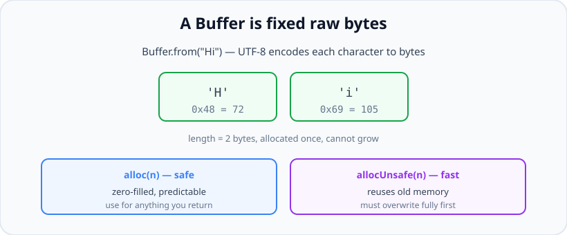
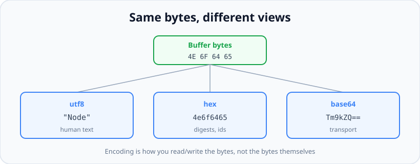

# Buffer: Working with Binary Data

*10 min read · Updated 24 Jul 2026 Topic 23 of 70 Bookmark Mark done Why it matters JavaScript grew up in the browser handling text and objects · Topic 23 of 70*

**Source:** [https://www.geekyfrontend.in/learn/nodejs-backend-kit/buffer](https://www.geekyfrontend.in/learn/nodejs-backend-kit/buffer)

---

## Why it matters

JavaScript grew up in the browser handling text and objects, not raw bytes off a socket or disk. The server needs both. Every file you read, every TCP packet, every image upload, every cryptographic digest is fundamentally a sequence of bytes, and Node represents those bytes with the `Buffer` class. If you have ever wondered why `fs.readFile` without an encoding returns something that prints as `<Buffer 48 69>`, or why a multi-byte emoji breaks when you slice a chunk in half, the answer is buffers.

Understanding `Buffer` is what lets you handle uploads, parse binary protocols, convert between encodings, and reason about memory correctly. It is also a favourite interview topic because it exposes whether you understand the boundary between *bytes* and *characters* — a distinction that, when blurred, produces corrupted data, wrong lengths, and subtle security bugs. Buffers are where "it's just a string" stops being true.

## The concept, simply

A `Buffer` is a fixed-length chunk of raw memory holding bytes, each an integer from 0 to 255. It is Node's original binary type, built on top of the standard `Uint8Array` (in fact a `Buffer` *is* a `Uint8Array` with extra convenience methods). Unlike a JavaScript string, a buffer is not text and has no inherent character meaning — it is just bytes. To turn bytes into readable text, or text into bytes, you apply an **encoding** (`utf8`, `hex`, `base64`, `ascii`, `latin1`). The same bytes look completely different depending on which encoding you use to view them.



A Buffer is fixed raw bytes. alloc zero-fills for safety; allocUnsafe is faster but hands you old memory you must overwrite.

## How it works (deep)

Buffers live in memory allocated outside the main V8 JavaScript heap. This matters: it keeps large binary blobs from bloating the heap and pressuring the garbage collector, and it allows fast, zero-copy handoff to C++ and the OS during I/O. A buffer is backed by an `ArrayBuffer` — the raw memory — and the `Buffer` instance is a typed view over it.

The crucial property is that a buffer has a **fixed length set at allocation**. You cannot grow it. If you need more room you allocate a new, larger buffer and copy, or you collect chunks in an array and `Buffer.concat` them at the end. This is the opposite of a JavaScript string or array that grows on demand, and it is why streaming code accumulates chunks and joins once rather than appending repeatedly.

Allocation comes in two forms with a real safety difference. `Buffer.alloc(n)` returns `n` bytes **zero-filled** — safe and predictable. `Buffer.allocUnsafe(n)` is faster because it hands you a slice of previously used memory *without clearing it*, which means it may contain leftover data from earlier operations — potentially another request's secrets. It is safe only if you immediately overwrite every byte before reading or returning it. Use `alloc` by default; reach for `allocUnsafe` only in hot paths where you provably fill the whole buffer.

Encoding is where bytes meet characters, and it is the number-one source of buffer bugs. In **UTF-8**, ASCII characters take one byte but many characters take two, three, or four — an emoji like a face is four bytes. So `Buffer.byteLength(str)` (bytes) and `str.length` (UTF-16 code units) frequently disagree. Worse, if you split a UTF-8 byte stream at an arbitrary boundary — as happens between stream chunks — you can cut a multi-byte character in half, and decoding each half independently produces garbage. The fix is `string_decoder`'s `StringDecoder`, which buffers incomplete multi-byte sequences across chunk boundaries.



One buffer, three encodings. Encoding is how you interpret bytes for reading or writing — it does not change the underlying bytes.

You typically encounter buffers whenever data crosses the process boundary as bytes: `fs` reads without an encoding, network sockets, `crypto` digests and random bytes, `zlib` compression, image and file processing, and any binary protocol. Text-first APIs hide buffers behind an encoding argument; drop the encoding and the buffer surfaces.

It is worth being precise about what each **encoding label** actually means, because they are not interchangeable views of the same idea. `'utf8'` is the real text codec — variable-width, 1–4 bytes per character, and the correct default for anything human-readable. `'hex'` and `'base64'` are *transport* encodings: they render arbitrary bytes as safe ASCII (2 hex chars or ~1.33 base64 chars per byte) so binary can ride through JSON, URLs, or headers — Node also accepts `'base64url'`, the URL-safe variant. `'latin1'` (a.k.a. `'binary'`) is a 1:1 byte-to-code-point map that never fails but silently corrupts real Unicode. `'ascii'` is 7-bit only and masks the high bit off every byte, so it mangles anything above `0x7F`. Choosing `'ascii'` or `'latin1'` for what is genuinely UTF-8 data is a common, quiet source of mojibake.

Two ownership details separate people who *use* buffers from people who *debug* them. First, `Buffer.from(arrayBuffer)` creates a **view that shares** the underlying `ArrayBuffer` — no copy — whereas `Buffer.from(string)` and `Buffer.from(array)` allocate fresh memory. Second, small buffers are quietly pooled: for allocations under `Buffer.poolSize >> 1` (4 KB by default), `Buffer.allocUnsafe` and `Buffer.from` carve a slice out of a shared internal `ArrayBuffer`. That is why `buf.byteOffset` is often non-zero and why `buf.buffer` can be far larger than `buf.length` — the `Buffer` is a window onto a bigger pool, not a private allocation. If you hand `buf.buffer` to another API expecting the whole thing, you leak neighbouring buffers' bytes; always pass `buf.byteOffset` and `buf.byteLength` too.

## Code examples

Creating buffers and converting between bytes and encodings:

javascript

```
// From text (defaults to utf8):
const buf = Buffer.from('Node');
buf;                       // 
buf.length;                // 4 bytes
buf.toString('hex');       // '4e6f6465'
buf.toString('base64');    // 'Tm9kZQ=='
buf.toString('utf8');      // 'Node'

// Decode data that arrived in a different encoding:
const fromB64 = Buffer.from('Tm9kZQ==', 'base64');
fromB64.toString('utf8');  // 'Node'

// Safe vs fast allocation:
const zeroed = Buffer.alloc(8);        // 
const fast   = Buffer.allocUnsafe(8);  // arbitrary leftover bytes — must fill!
fast.fill(0);                          // now safe to use
```

Why byte length and character length differ — the classic emoji trap:

javascript

```
const s = 'a\u{1F600}';        // 'a' + a 4-byte emoji
s.length;                       // 3  (UTF-16 code units)
Buffer.byteLength(s, 'utf8');   // 5  (1 byte + 4 bytes)

// Slicing bytes blindly can cut a character in half:
const b = Buffer.from(s, 'utf8');
b.subarray(0, 2).toString('utf8'); // 'a\uFFFD' — broken: half an emoji
```

Collecting stream chunks the right way — accumulate, then concat once:

javascript

```
import { createReadStream } from 'node:fs';

async function readAllBytes(path) {
  const chunks = [];
  for await (const chunk of createReadStream(path)) {
    chunks.push(chunk); // each chunk is a Buffer
  }
  return Buffer.concat(chunks); // single allocation at the end
}

// For text streams, decode across chunk boundaries safely:
import { StringDecoder } from 'node:string_decoder';
const decoder = new StringDecoder('utf8');
// decoder.write(chunk) holds back any partial multi-byte char until complete.
```

Reading and writing fixed-width binary fields (parsing a simple protocol header):

javascript

```
// Build a 4-byte big-endian header: version(1) + payloadLength(uint16) + flag(1)
const header = Buffer.alloc(4);
header.writeUInt8(2, 0);          // version = 2 at offset 0
header.writeUInt16BE(512, 1);     // length  = 512 at offset 1 (2 bytes)
header.writeUInt8(1, 3);          // flag    = 1 at offset 3

// Read it back:
header.readUInt8(0);     // 2
header.readUInt16BE(1);  // 512
```

## Common mistakes & gotchas

- **Confusing `str.length` with byte length.** `str.length` counts UTF-16 code units; bytes on the wire are `Buffer.byteLength(str, 'utf8')`. They differ for any non-ASCII text, which breaks `Content-Length` headers and offset math.
- **Slicing a multi-byte character in half.** Splitting UTF-8 bytes at a chunk boundary and decoding each half yields replacement characters (garbage). Use `StringDecoder` for streamed text.
- **Using `allocUnsafe` without fully overwriting it.** It exposes leftover memory — possibly another request's data — which is both a correctness and a security bug. Default to `alloc`.
- **Trusting the deprecated `new Buffer()` constructor.** `new Buffer(number)` historically returned uninitialised memory. It is deprecated; always use `Buffer.alloc`/`Buffer.from`.
- **Building a big buffer by repeated `Buffer.concat` in a loop.** Buffers cannot grow, so each concat reallocates and copies — O(n²). Push chunks into an array and `Buffer.concat` once.
- **Assuming `buf.slice()` copies.** Both `slice` and `subarray` return a *view* sharing the same memory — mutating one changes the other. Use `Buffer.from(buf)` for an independent copy.
- **Forgetting endianness in binary protocols.** `readUInt16BE` vs `readUInt16LE` read the same bytes as different numbers. Match the protocol's byte order exactly.
- **Passing `buf.buffer` to another API without the offset and length.** Because small buffers are pooled, `buf.buffer` is frequently a shared 8 KB `ArrayBuffer`, not your bytes alone. Handing the bare `ArrayBuffer` to `new Uint8Array(buf.buffer)` or a crypto call exposes unrelated buffers' data. Always pass `buf.byteOffset` and `buf.byteLength`, or copy with `Buffer.from(buf)`.
- **Reading multi-byte integers that exceed 48 bits with the `*BE`/`*LE` helpers.** `readUInt32BE` is fine, but JavaScript numbers lose precision past 2^53, so 64-bit fields must use `readBigUInt64BE`/`LE` (which return a `BigInt`). Using the non-Big variants silently truncates.
- **Picking `'ascii'` or `'latin1'` for text that is actually UTF-8.** Both decode byte-per-character and never throw, so the bug is invisible until a non-ASCII character arrives and turns into mojibake. Use `'utf8'` for text and a transport encoding (`'hex'`/`'base64'`) for raw bytes.

## Best practices

- **Use `Buffer.alloc` and `Buffer.from`;** never the deprecated `new Buffer()` constructor.
- **Default to `alloc` (zero-filled);** use `allocUnsafe` only in hot paths where you overwrite every byte.
- **Measure wire size with `Buffer.byteLength(str, 'utf8')`,** not `str.length`.
- **Decode streamed text with `StringDecoder`** so multi-byte characters survive chunk boundaries.
- **Accumulate chunks in an array and `Buffer.concat` once** rather than concatenating repeatedly.
- **Copy with `Buffer.from(buf)` when you need independence;** remember `slice`/`subarray` share memory.
- **Be explicit about encoding and endianness** at every byte boundary — never let it default by accident.

## ⭐ Interview lens

> **Q: What is a Buffer and how does it differ from a string?** A `Buffer` is a fixed-length region of raw bytes (0–255 each), stored outside the V8 heap and backed by an `ArrayBuffer`; it is a `Uint8Array` subclass. A string is text made of UTF-16 code units with character meaning. Buffers are bytes; strings are characters. You convert between them with an explicit encoding.

> **Q: Why is `allocUnsafe` "unsafe"?** It skips zero-filling and hands you a slice of previously used memory, which may still hold sensitive data from earlier operations. If you read it before overwriting, you can leak that data. It is only safe when you immediately fill every byte, and it exists purely for performance.

> **Q: `'caf\u00e9'.length` is 4, but how many bytes is it in UTF-8?** Five — the accented e is two bytes in UTF-8 while the other three are one each. This is why you must use `Buffer.byteLength` for anything that counts wire bytes, like `Content-Length`.

> **Q: You read a stream in chunks and decode each with `chunk.toString()`; some characters are garbled. Why?** A multi-byte UTF-8 character was split across two chunks, so each half decoded to a replacement character. Fix it with `StringDecoder`, which holds incomplete byte sequences until the next chunk completes them.

> **Q: Does `buf.slice(0, 4)` copy the data?** No. `slice` (and `subarray`) return a view over the same underlying memory, so mutating the slice mutates the original. Use `Buffer.from(buf.subarray(0,4))` for a real copy.

> **Q: Why are buffers stored off the V8 heap?** To avoid bloating the JavaScript heap with large binary blobs and pressuring the garbage collector, and to allow zero-copy handoff to native code and the OS during I/O. It keeps binary-heavy workloads efficient.

## Cheat-card

- `Buffer` = fixed-length raw bytes (0–255), a `Uint8Array` subclass, off the V8 heap.
- Create: `Buffer.from(str)`, `Buffer.alloc(n)` (zeroed), `Buffer.allocUnsafe(n)` (fast, must fill).
- Convert: `buf.toString('hex'|'base64'|'utf8')`; `Buffer.from(s, 'base64')`.
- Bytes on the wire = `Buffer.byteLength(str,'utf8')`, not `str.length`.
- Streamed text → `StringDecoder` to survive chunk splits.
- Many chunks → array + one `Buffer.concat` (buffers can't grow).
- `slice`/`subarray` share memory; `Buffer.from(buf)` copies.
- Binary fields: `readUInt16BE`/`LE` — mind endianness.
- Never use deprecated `new Buffer()`.
- `Buffer.poolSize` is 65536 since v24.18.0 (was 8192); small Buffers share a 64 KiB `ArrayBuffer`, so pass `(buf.buffer, buf.byteOffset, buf.byteLength)`, never `buf.buffer` alone.
- `buf.slice()` = view (deprecated, use `subarray`); `Uint8Array.prototype.slice` = copy.
- `u8.toString()` joins numbers (`"104,105"`); decode with `TextDecoder` or wrap in a Buffer.
- `Buffer.from(arrayBuffer)` shares memory; `Buffer.from(uint8array)` copies.
- Web binary APIs (`TextEncoder`, `Blob`, `structuredClone`): see [lesson 84](84-binary-web-apis.md).

---

## Learn More

- [Buffer | Node.js Documentation nodejs.org](https://nodejs.org/api/buffer.html)
- [Uint8Array - JavaScript | MDN developer.mozilla.org](https://developer.mozilla.org/en-US/docs/Web/JavaScript/Reference/Global_Objects/Uint8Array)
- [Node.js Tutorial - 24 - Streams and Buffers Codevolution](https://www.youtube.com/watch?v=br8VB99qPzE)

---

## Additional topics

*Added 10 Oct 2026 · examples verified on Node v24.19.0*

### From `Buffer` to the web binary APIs (lesson 84)

Node also ships the byte and text APIs that browsers and edge runtimes share: `TextEncoder`/`TextDecoder`, `Blob`/`File`, `atob`/`btoa` and `structuredClone`. [Lesson 84](84-binary-web-apis.md) covers them in full. They all work on `Uint8Array` and `ArrayBuffer`, the two types `Buffer` is built from, so data moves between the two worlds with one call. The only question each time is whether that call shares memory or copies it.

How it works:

1. Web APIs return a plain `Uint8Array` (`TextEncoder.encode`, `blob.bytes()`) or an `ArrayBuffer` (`blob.arrayBuffer()`, `crypto.subtle.*`).
2. `Buffer.from(arrayBuffer, byteOffset, length)` wraps that memory without copying. Writes through either object are visible in the other.
3. `Buffer.from(uint8array)` copies the bytes into a new Buffer.
4. Going the other way needs nothing, because a `Buffer` is a `Uint8Array`: pass it straight to `new Blob([buf])`, `TextDecoder.decode(buf)` or `crypto.subtle.digest('SHA-256', buf)`.

**Example — moving bytes between `Buffer` and the web APIs.**

javascript

```
// Bridge: the web binary types and Buffer convert without surprises if you know who copies
const u8 = new TextEncoder().encode('Zoë');            // Uint8Array, not a Buffer
console.log(u8.constructor.name, Buffer.isBuffer(u8));

const view = Buffer.from(u8.buffer, u8.byteOffset, u8.byteLength);   // shares u8's memory
const copy = Buffer.from(u8);                                          // copies the bytes
u8[0] = 0x7a;                                                          // 'Z' -> 'z'
console.log('view:', view.toString(), '| copy:', copy.toString());

// A Buffer goes anywhere a Uint8Array is accepted
const blob = new Blob([copy, '!']);
console.log('Blob from a Buffer:', await blob.text());
console.log('TextDecoder on a Buffer:', new TextDecoder().decode(copy));
console.log('Buffer from blob.arrayBuffer():', Buffer.from(await blob.arrayBuffer()).toString('hex'));

// Real output (Node v24.19.0):
//   Uint8Array false
//   view: zoë | copy: Zoë
//   Blob from a Buffer: Zoë!
//   TextDecoder on a Buffer: Zoë
//   Buffer from blob.arrayBuffer(): 5a6fc3ab21
```

Changing `u8[0]` changed `view` (it shares memory) but not `copy`. The `Blob`, the `TextDecoder` and `Buffer.from(await blob.arrayBuffer())` all accepted or produced the same bytes (`5a 6f c3 ab 21` = `Zoë!`).

### `Buffer` vs `Uint8Array`

`Buffer` is a subclass of `Uint8Array` (since v3.0.0): `Buffer.prototype` inherits from `Uint8Array.prototype`. So every typed-array method and property works on a Buffer, and every API that takes a `Uint8Array` takes a Buffer. The subclass adds encodings, binary read/write helpers and the allocation pool. It also changes a few inherited behaviours, and those changes are where bugs hide:

| | `Buffer` | plain `Uint8Array` |
|---|---|---|
| Class | `class Buffer extends Uint8Array` (since v3.0.0) | the standard typed array |
| `slice(a, b)` | a **view** sharing memory. Deprecated since v17.5.0 and v16.15.0 in favour of `subarray` | a **copy** |
| `subarray(a, b)` | a view (a `Buffer`) | a view |
| `toString()` | decodes the bytes (`'utf8'` by default; `'hex'`, `'base64'`…) | joins the numbers: `"104,105"` |
| `JSON.stringify` | `{"type":"Buffer","data":[…]}` | `{"0":104,"1":105}` |
| Allocation | `Buffer.from(string / array)`, `Buffer.concat` and `Buffer.allocUnsafe(n)` take a slice of a shared pool when the size is at most half of `Buffer.poolSize`, so `byteOffset` is often > 0; `Buffer.alloc` never does | always its own `ArrayBuffer`, `byteOffset` 0 |
| Extras | `readUInt16BE`, `writeInt32LE`, `equals`, `compare`, `indexOf(str)`, `Buffer.concat`, `Buffer.byteLength` | none; use `DataView` for multi-byte reads |
| Portability | Node (and runtimes that polyfill it) | every JavaScript runtime |

**The pool size changed in v24.18.0.** `Buffer.poolSize` defaults to **65536** (the docs: "Default raised from 8192 to 65536"). Small allocations therefore come from a 64 KiB `ArrayBuffer`, and the pooling threshold is `poolSize >>> 1` = 32 KiB. The paragraph and gotcha above describe the pre-v24.18.0 values (8 KiB pool, 4 KiB threshold). In a separate run, `npx node@24.17.0` printed `poolSize=8192 pool=8192` and `npx node@24.18.0` printed `poolSize=65536 pool=65536`.

How it works:

1. `Buffer.from('aa')` asks the pool for 2 bytes. The pool hands out the next free range of its shared `ArrayBuffer`, so `a.byteOffset` is wherever the pool's cursor was. In the run below, two 2-byte allocations were 8 bytes apart, because `alignPool()` in `lib/buffer.js` rounds the cursor up to a multiple of 8 after each allocation.
2. `a.buffer` is the **whole** pool, not your 2 bytes. Only `(buffer, byteOffset, length)` together describe your data.
3. `buf.slice()` and `buf.subarray()` create a new Buffer over the same memory with a different offset and length. Nothing is copied.
4. `Uint8Array.prototype.slice` (even when called on a Buffer) allocates new memory and copies.
5. `Buffer.from(arrayBuffer)` wraps the given memory, while `Buffer.from(typedArray)` and `Buffer.from(buffer)` copy.

**Example — proving each difference.**

javascript

```
const buf = Buffer.from('hello');

// 1. Buffer IS a Uint8Array: same prototype chain, every TypedArray method works
console.log(buf instanceof Uint8Array, Object.getPrototypeOf(Buffer.prototype) === Uint8Array.prototype);
console.log(buf.map((b) => b - 32), buf.at(-1), ArrayBuffer.isView(buf));

// 2. The pool: small Buffers are windows into one shared ArrayBuffer
console.log('Buffer.poolSize:', Buffer.poolSize);
const a = Buffer.from('aa'), b = Buffer.from('bb');
console.log('same ArrayBuffer:', a.buffer === b.buffer, '| a.buffer.byteLength:', a.buffer.byteLength, '| b.byteOffset - a.byteOffset:', b.byteOffset - a.byteOffset);
console.log('new Uint8Array(buf.buffer) sees', new Uint8Array(a.buffer).length, 'bytes; the right view sees',
  new Uint8Array(a.buffer, a.byteOffset, a.byteLength).length);
console.log('Buffer.alloc is not pooled:', Buffer.alloc(2).buffer.byteLength, '| a Uint8Array never is:', new Uint8Array(2).buffer.byteLength);

// 3. slice: Buffer.prototype.slice is a VIEW (deprecated), Uint8Array.prototype.slice COPIES
const src = Buffer.from('abcdef');
const bSlice = src.slice(0, 3);
const bSub = src.subarray(0, 3);
const u8Slice = Uint8Array.prototype.slice.call(src, 0, 3);   // the TypedArray method on the same bytes
src[0] = 0x58;                                                 // 'a' -> 'X'
console.log('buf.slice   :', bSlice.toString(), '(view)');
console.log('buf.subarray:', bSub.toString(), '(view)');
console.log('u8 slice    :', Buffer.from(u8Slice).toString(), '(copy)', '| result is a', u8Slice.constructor.name);
const plain = new Uint8Array([1, 2, 3]);
const plainSlice = plain.slice(0, 2); plain[0] = 9;
console.log('plain Uint8Array slice after change:', plainSlice);

// 4. toString: Buffer decodes bytes, Uint8Array joins numbers
const bytes = new Uint8Array([104, 105]);
console.log(JSON.stringify(Buffer.from(bytes).toString()), JSON.stringify(bytes.toString()), JSON.stringify(Buffer.from(bytes).toString('hex')));
console.log('JSON:', JSON.stringify(Buffer.from(bytes)), JSON.stringify(bytes));

// 5. Buffer.from(arrayBuffer) shares memory; Buffer.from(typedArray) copies
const ab = new ArrayBuffer(4);
const shared = Buffer.from(ab);
const copied = Buffer.from(new Uint8Array(ab));
new Uint8Array(ab)[0] = 255;
console.log('from(arrayBuffer):', shared[0], '| from(uint8array):', copied[0]);

// Real output (Node v24.19.0):
//   true true
//   <Buffer 48 45 4c 4c 4f> 111 true
//   Buffer.poolSize: 65536
//   same ArrayBuffer: true | a.buffer.byteLength: 65536 | b.byteOffset - a.byteOffset: 8
//   new Uint8Array(buf.buffer) sees 65536 bytes; the right view sees 2
//   Buffer.alloc is not pooled: 2 | a Uint8Array never is: 2
//   buf.slice   : Xbc (view)
//   buf.subarray: Xbc (view)
//   u8 slice    : abc (copy) | result is a Buffer
//   plain Uint8Array slice after change: Uint8Array(2) [ 1, 2 ]
//   "hi" "104,105" "6869"
//   JSON: {"type":"Buffer","data":[104,105]} {"0":104,"1":105}
//   from(arrayBuffer): 255 | from(uint8array): 0
```

Both `Buffer.from('aa')` and `Buffer.from('bb')` live in the same 65,536-byte `ArrayBuffer`, 8 bytes apart. After `src[0]` changed, `buf.slice` and `buf.subarray` both show `Xbc`, and the TypedArray `slice` still shows `abc`. That copy is itself a `Buffer`, because typed-array methods create their result through the receiver's constructor (`Symbol.species`). `toString` and `JSON.stringify` differ completely. `Buffer.from(arrayBuffer)` saw the later write (`255`), and `Buffer.from(uint8array)` did not (`0`).

**Example — APIs that accept either, and what each returns.**

javascript

```
import { writeFile, readFile, rm } from 'node:fs/promises';
import { createHash } from 'node:crypto';

const u8 = new TextEncoder().encode('plain bytes\n');      // a plain Uint8Array

// Node core APIs that take "binary data" accept any Uint8Array, not only Buffers
await writeFile('out.bin', u8);
console.log('fs.writeFile(Uint8Array) ->', JSON.stringify(await readFile('out.bin', 'utf8')));
console.log('hash.update(Uint8Array)  ->', createHash('sha256').update(u8).digest('hex').slice(0, 16) + '…');
console.log('Buffer.concat mixes both ->', Buffer.concat([Buffer.from('a'), new Uint8Array([98])]).toString());
console.log('Buffer.compare mixes both->', Buffer.compare(Buffer.from('ab'), new Uint8Array([97, 98])));

// What comes back differs by API
const fromFs = await readFile('out.bin');
const fromBlob = await new Blob([u8]).bytes();
const fromSubtle = await crypto.subtle.digest('SHA-256', u8);
console.log('readFile ->', fromFs.constructor.name, '| blob.bytes ->', fromBlob.constructor.name, '| subtle.digest ->', fromSubtle.constructor.name);

// Buffer-only methods are missing on a plain Uint8Array
console.log('u8.readUInt16BE:', typeof u8.readUInt16BE, '| u8.equals:', typeof u8.equals);
// Wrap without copying to get them, or use a DataView
const asBuf = Buffer.from(u8.buffer, u8.byteOffset, u8.byteLength);
console.log('wrapped readUInt16BE(0):', asBuf.readUInt16BE(0), '| DataView getUint16(0):', new DataView(u8.buffer, u8.byteOffset).getUint16(0));
await rm('out.bin');

// Real output (Node v24.19.0):
//   fs.writeFile(Uint8Array) -> "plain bytes\n"
//   hash.update(Uint8Array)  -> e816a3bb9b048c85…
//   Buffer.concat mixes both -> ab
//   Buffer.compare mixes both-> 0
//   readFile -> Buffer | blob.bytes -> Uint8Array | subtle.digest -> ArrayBuffer
//   u8.readUInt16BE: undefined | u8.equals: undefined
//   wrapped readUInt16BE(0): 28780 | DataView getUint16(0): 28780
```

`fs.writeFile`, `hash.update`, `Buffer.concat` and `Buffer.compare` took a plain `Uint8Array` as readily as a Buffer. Outputs differ by API: `fs` gives a `Buffer`, `blob.bytes()` a plain `Uint8Array`, and Web Crypto an `ArrayBuffer`. When you need `Buffer` methods on someone else's `Uint8Array`, wrap it without copying (`Buffer.from(u8.buffer, u8.byteOffset, u8.byteLength)`) or read it with a `DataView`.

### Common mistakes & gotchas (additional topics)

- **Relying on `buf.slice()` to copy.** It is a view on a `Buffer` but a copy on a plain `Uint8Array`, so the same code behaves differently depending on which type it receives. Use `subarray()` for a view and `Buffer.from(buf)` (or `Uint8Array.prototype.slice`) for a copy, and stop using the deprecated `buf.slice()`.
- **Calling `toString()` on a `Uint8Array` to get text.** It returns `"104,105"`. Decode with `new TextDecoder().decode(u8)` or `Buffer.from(u8.buffer, u8.byteOffset, u8.byteLength).toString()`.
- **Passing `buf.buffer` alone to a web API.** On v24.18.0 and later it is a 64 KiB pool shared with unrelated Buffers. Pass `(buf.buffer, buf.byteOffset, buf.byteLength)`, or pass the Buffer itself, which every `Uint8Array`-accepting API takes.
- **Assuming `Buffer.from(x)` always copies.** It copies strings, arrays, typed arrays and Buffers, but wraps an `ArrayBuffer` without copying.
- **Expecting `Buffer` methods on web API results.** `TextEncoder.encode()` and `blob.bytes()` return plain `Uint8Array`s with no `readUInt16BE` or `equals`.

### Edge case worked through: `buf.buffer` leaks other Buffers' bytes

javascript

```
// A request handler copies a session token into a small Buffer...
const token = Buffer.from('sess_9f8e7d6c5b4a');
// ...and later another small Buffer is created for a public reply
const reply = Buffer.from('ok');

// Bug: hand reply.buffer (the whole pool) to a web API that takes an ArrayBuffer
const leaked = new TextDecoder().decode(reply.buffer);
console.log('reply.length         :', reply.length, '| reply.buffer.byteLength:', reply.buffer.byteLength);
console.log('contains the token   :', leaked.includes('sess_9f8e7d6c5b4a'));

// Fix 1: a view with the right offset and length
console.log('view of reply only   :', new TextDecoder().decode(new Uint8Array(reply.buffer, reply.byteOffset, reply.length)));
// Fix 2: copy into a fresh, exactly-sized ArrayBuffer
const own = reply.buffer.slice(reply.byteOffset, reply.byteOffset + reply.length);
console.log('own ArrayBuffer      :', own.byteLength, 'bytes ->', new TextDecoder().decode(own));

// Real output (Node v24.19.0):
//   reply.length         : 2 | reply.buffer.byteLength: 65536
//   contains the token   : true
//   view of reply only   : ok
//   own ArrayBuffer      : 2 bytes -> ok
```

`reply` is 2 bytes, but `reply.buffer` is the 65,536-byte pool. Decoding it as a whole recovered the session token that `token` had put in the same pool earlier. Any API that takes an `ArrayBuffer` and is given `buf.buffer` alone sees all of that memory: `TextDecoder`, `new Uint8Array(ab)`, `postMessage`, `crypto.subtle.digest`, a `Blob`. A view with the right offset and length, or `ArrayBuffer.prototype.slice` into an exactly-sized copy, contains only the 2 bytes of `reply`.

### ⭐ Interview lens (additional topics)

> **Q: “A `Buffer` is a `Uint8Array`. Name two behaviours that differ anyway.”**  
> A: `slice()`: on a Buffer it returns a view that shares memory (deprecated in favour of `subarray()`), on a `Uint8Array` it returns a copy. `toString()`: a Buffer decodes its bytes as UTF-8 (or another encoding), a `Uint8Array` joins the numbers with commas. Also, small Buffers come from a shared pool, so `buf.buffer` can be far larger than `buf.length` and `byteOffset` is often non-zero. *Trap:* the pool is 64 KiB since v24.18.0, not the 8 KiB many articles quote.

> **Q: “How do you turn the `ArrayBuffer` from `blob.arrayBuffer()` or `crypto.subtle` into a Buffer without copying?”**  
> A: `Buffer.from(arrayBuffer)`, optionally with `byteOffset` and `length`. It wraps the same memory, so writes through either object are visible in the other. `Buffer.from(uint8array)` would copy instead.
