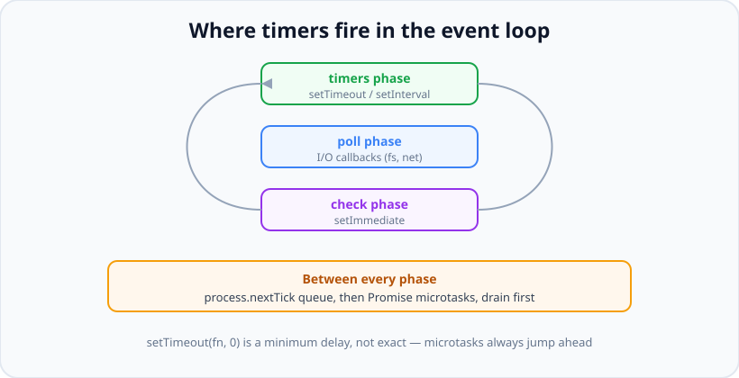

# Timers: setTimeout, setInterval, setImmediate & the Event Loop

*10 min read · Updated 24 Jul 2026 Topic 25 of 70 Bookmark Mark done Why it matters Timers look like the simplest API in Node · Topic 25 of 70*

**Source:** [https://www.geekyfrontend.in/learn/nodejs-backend-kit/timers](https://www.geekyfrontend.in/learn/nodejs-backend-kit/timers)

---

## Why it matters

Timers look like the simplest API in Node — "run this later" — yet they are where the event loop's behaviour becomes visible, and where subtle ordering bugs and memory leaks hide. You use timers constantly: retry backoffs, request timeouts, polling, debouncing, rate limiting, scheduled cleanup. Understanding *when* a timer callback actually runs, and how that interacts with promises and I/O, is what lets you reason about ordering instead of guessing.

Interviewers love timers because a single question — "what order do these logs print?" — instantly reveals whether you understand the event loop, microtasks versus macrotasks, and the fact that `setTimeout(fn, 0)` does not mean "now." These are not trivia; timeout handling and leaked intervals are real production concerns. This topic ties the whole chapter's async foundation together.

## The concept, simply

Node gives you three scheduling primitives. **`setTimeout(fn, ms)`** runs `fn` once after *at least* `ms` milliseconds. **`setInterval(fn, ms)`** runs `fn` repeatedly every `ms` until you stop it. **`setImmediate(fn)`** runs `fn` on the very next loop iteration, after the current I/O phase. Each returns a handle you cancel with `clearTimeout`, `clearInterval`, or `clearImmediate`. Two more sit alongside them at higher priority: **`process.nextTick(fn)`** and **Promise microtasks**, which drain *before* the loop moves on. The single most important truth: timers specify a *minimum* delay, not an exact one — the callback runs when the event loop reaches the timers phase and the thread is free, never sooner.



setTimeout fires in the timers phase, setImmediate in check. process.nextTick and Promise microtasks drain between every phase, ahead of both.

## How it works (deep)

The event loop runs in **phases**, cycling continuously. The three that matter for timers are: the **timers** phase, where expired `setTimeout`/`setInterval` callbacks run; the **poll** phase, where I/O callbacks (completed file reads, incoming sockets) run and where the loop will wait for new I/O; and the **check** phase, where `setImmediate` callbacks run. Between *every* phase transition, Node drains two higher-priority queues first: the `process.nextTick` queue, then the Promise microtask queue. This is why an `await` continuation or a `.then` callback always runs before the next `setTimeout`, even a zero-delay one.

That ordering explains the classic puzzle. `setTimeout(fn, 0)` does not run immediately: the callback is registered, the current synchronous code finishes, then microtasks drain, and only when the loop reaches the timers phase does `fn` run. Meanwhile a `Promise.resolve().then(...)` queued in the same tick runs first because microtasks jump ahead of the next macrotask. And a `process.nextTick` beats even that, because its queue drains before microtasks. The hierarchy per turn is: current synchronous code → `process.nextTick` queue → Promise microtasks → next event-loop phase (timers/poll/check).

The relationship between `setTimeout(fn, 0)` and `setImmediate(fn)` is famously order-dependent at the top level. Called from the main module, their order is non-deterministic because it depends on how much time the loop has already consumed before reaching the timers phase. But called from *inside an I/O callback* (the poll phase), `setImmediate` *always* fires first, because `check` is the very next phase after `poll`, whereas `timers` is a full loop away. That deterministic difference is a common interview follow-up.

Timers also carry practical weight. A `setInterval` that is never cleared runs forever and, if its callback closes over large objects, leaks memory — a frequent cause of slowly growing servers. Timers also keep the process alive: by default a pending timer prevents Node from exiting. If you have a background poller that should not block shutdown, call `.unref()` on the handle so the loop can exit while it is the only thing left. Finally, `setInterval` does not guarantee even spacing: if the callback (or a blocked loop) takes longer than the interval, executions bunch up or drift, which is why a self-scheduling `setTimeout` is often better for reliable spacing.

A detail that bites people building long schedulers: Node stores a timer's delay as a **signed 32-bit integer**, so the maximum is `2147483647` ms (about 24.8 days). Pass anything larger — or `NaN`, `Infinity`, or a negative — and Node clamps the delay to `1` ms and emits a `TimeoutOverflowWarning`. So a naive `setTimeout(fn, days * 86400000)` for a 30-day reminder fires almost immediately instead of a month later. Long delays must be chunked (re-arm the timer in bounded steps) or driven by a real scheduler that compares wall-clock time. On the input side, a non-integer delay is truncated and a delay below `1` is treated as `1`.

The modern `node:timers/promises` module is worth reaching for by default in async code. `setTimeout(ms, value, { signal, ref })` returns a promise that resolves to `value` after the delay, so `await setTimeout(200)` replaces the hand-rolled `new Promise(r => setTimeout(r, 200))` wrapper. It accepts an `AbortSignal` so a pending delay can be cancelled (rejecting with an `AbortError`), and a `{ ref: false }` option that mirrors `.unref()`. There is also a `setInterval` async-generator form — `for await (const _ of setInterval(1000, null, { signal }))` — that yields on each tick and, because your loop body is awaited before the next yield, sidesteps the bunching problem that the callback-based `setInterval` suffers from. It is the cleanest way to write a cancellable, non-overlapping poller.

## Code examples

The ordering that interviewers ask about — predict the output:

javascript

```
console.log('1: sync start');

setTimeout(() => console.log('2: setTimeout 0'), 0);

Promise.resolve().then(() => console.log('3: promise microtask'));

process.nextTick(() => console.log('4: nextTick'));

console.log('5: sync end');

// Output order:
// 1: sync start
// 5: sync end
// 4: nextTick          (nextTick queue drains first)
// 3: promise microtask (microtasks next)
// 2: setTimeout 0      (timers phase last)
```

Clearing timers to cancel work, and using `unref` so a poller does not block exit:

javascript

```
// A cancellable interval:
const handle = setInterval(() => console.log('poll'), 1000);
// Later, stop it — otherwise it runs forever and can leak memory:
clearInterval(handle);

// A background heartbeat that must not keep the process alive on shutdown:
const beat = setInterval(() => sendHeartbeat(), 30_000);
beat.unref(); // process can exit even while this timer is pending
```

A promise-based delay and a timeout wrapper — the modern way to add deadlines:

javascript

```
import { setTimeout as delay } from 'node:timers/promises';

// Await a delay without wrapping setTimeout by hand:
await delay(200);
console.log('ran after ~200ms');

// Race any promise against a deadline using AbortSignal.timeout:
async function fetchWithTimeout(url, ms) {
  const res = await fetch(url, { signal: AbortSignal.timeout(ms) });
  return res.json();
}
// If the request exceeds ms, it rejects with a TimeoutError.
```

Reliable fixed spacing with self-scheduling `setTimeout` instead of `setInterval`:

javascript

```
// setInterval can bunch up if the task runs long; this waits for completion,
// THEN schedules the next run — guaranteeing a real gap between executions.
async function poll(task, gapMs) {
  while (true) {
    await task();
    await new Promise((r) => setTimeout(r, gapMs));
  }
}
```

## Common mistakes & gotchas

- **Believing `setTimeout(fn, 0)` runs "immediately."** It runs after the current sync code, the `nextTick` queue, and all microtasks — and only when the timers phase is reached. Zero is a minimum, not an exact delay.
- **Never clearing a `setInterval`.** It runs forever and, if it captures large state, leaks memory. Always keep the handle and `clearInterval` when done.
- **Expecting `setInterval` to space runs evenly.** If the callback or a blocked event loop overruns the interval, executions drift or pile up. Self-schedule with `setTimeout` for guaranteed gaps.
- **Blocking the event loop and blaming the timer.** A long synchronous computation delays *all* timers, because callbacks only run when the loop is free. The timer is fine; the blocking code is the problem.
- **Assuming `setTimeout(0)` vs `setImmediate` ordering at the top level.** It is non-deterministic in the main module; it is only guaranteed (`setImmediate` first) inside an I/O callback.
- **Forgetting timers keep the process alive.** A pending timer blocks a clean exit. Use `.unref()` for background timers that should not.
- **Starving the loop with recursive `process.nextTick`.** Because `nextTick` drains fully before the loop advances, an ever-growing `nextTick` chain can starve I/O and timers entirely.
- **Scheduling a delay longer than ~24.8 days.** The delay is a signed 32-bit int; anything over `2147483647` ms (or `NaN`/`Infinity`/negative) is clamped to `1` ms with a `TimeoutOverflowWarning`, so a "fire in 30 days" timer fires now. Chunk long waits or use a wall-clock scheduler.
- **Leaking a promise-based timer's `AbortSignal` listener.** When you race `timers/promises` `setTimeout` against other work, pass an `AbortController` and abort the loser; otherwise the pending timer (and its signal listener) lingers until it fires, quietly retaining whatever the callback closed over.

## Best practices

- **Always store and clear timer handles;** treat an uncleared `setInterval` as a leak.
- **Prefer self-scheduling `setTimeout` over `setInterval`** when even spacing or waiting for async work matters.
- **Use `node:timers/promises`** (`setTimeout`/`setInterval` promise forms) for clean `await`-based delays.
- **Implement deadlines with `AbortSignal.timeout`,** which cancels the underlying work rather than just ignoring a late result.
- **Call `.unref()` on background timers** that should not keep the process alive.
- **Keep event-loop turns short;** offload heavy CPU work to worker threads so timers and I/O stay responsive.
- **Reason about ordering explicitly:** sync → `nextTick` → microtasks → timers/check, every turn.

## ⭐ Interview lens

> **Q: Does `setTimeout(fn, 0)` run `fn` immediately?** No. It schedules `fn` to run in the timers phase after the current synchronous code completes and after the `nextTick` and microtask queues drain. Zero is a minimum delay; the actual delay depends on when the loop reaches the timers phase and whether the thread is free.

> **Q: In what order do `setTimeout(0)`, `Promise.then`, and `process.nextTick` run?** `process.nextTick` first (its queue drains before everything), then Promise microtasks, then the `setTimeout` callback in the timers phase. Microtasks always beat macrotasks; `nextTick` beats even microtasks.

> **Q: `setTimeout(fn,0)` vs `setImmediate(fn)` — which runs first?** At the top level it is non-deterministic and depends on loop timing. But *inside an I/O callback*, `setImmediate` always runs first, because `check` is the phase immediately after `poll`, whereas the timers phase is a full loop iteration away.

> **Q: Why did my `setTimeout(fn, 1000)` fire much later than 1 second?** Because a timer's delay is a minimum. If the event loop was busy — a long synchronous task or a backlog of callbacks — `fn` waits until the loop is free and reaches the timers phase. The timer was not late; the loop was blocked.

> **Q: How can a `setInterval` cause a memory leak?** If it is never cleared and its callback closes over objects, those objects are retained for the life of the process, and the interval itself keeps running. Always clear intervals you no longer need, and use `.unref()` for ones that should not block shutdown.

> **Q: Why prefer a self-scheduling `setTimeout` over `setInterval` for polling an API?** `setInterval` fires on a fixed schedule regardless of whether the previous call finished, so slow responses cause overlapping or bunched requests. Re-scheduling with `setTimeout` after each call completes guarantees a real gap and no overlap.

## Cheat-card

- `setTimeout` = once after ≥ ms; `setInterval` = repeat; `setImmediate` = next loop, check phase.
- Cancel with `clearTimeout`/`clearInterval`/`clearImmediate`.
- Per turn: sync → `process.nextTick` → Promise microtasks → timers/poll/check.
- Delay is a *minimum*, never exact — a blocked loop delays every timer.
- Inside an I/O callback, `setImmediate` beats `setTimeout(0)` deterministically.
- Uncleared `setInterval` = leak + keeps process alive; use `.unref()` for background timers.
- Even spacing / await async work → self-scheduling `setTimeout`, not `setInterval`.
- Modern: `node:timers/promises` for `await` delays; `AbortSignal.timeout` for deadlines.
- **`t.refresh()`** (v10.2.0): restart the same timer from now, same delay; re-arms a timer that already fired.
- **`t.hasRef()`** (v11.0.0): `true` if the timer holds the process open; `unref()` → `false`, `ref()` → `true`.
- **`scheduler.wait(ms, { signal })` / `scheduler.yield()`** (Experimental, v17.3.0): promise `setTimeout` / promise `setImmediate`; yield inside long loops.

---

## Learn More

- [Timers | Node.js Documentation nodejs.org](https://nodejs.org/api/timers.html)
- [Discover JavaScript Timers nodejs.org](https://nodejs.org/learn/asynchronous-work/discover-javascript-timers)
- [Node.js Timers (setTimeout, setInterval, setImmediate) Thomas Gentilhomme](https://www.youtube.com/watch?v=hkvCtgxdaMU)
- [Outbound HTTP: fetch, undici and http.request (this kit)](75-outbound-http-fetch-undici-and-http-request.md)

---

## Additional topics

*Added 7 Oct 2026 · examples verified on Node v24.19.0*

### `timeout.refresh()`

`timeout.refresh()` (added in v10.2.0) sets an existing `Timeout`'s start time to *now* and reschedules it to fire after its original delay, with the same callback. It returns the same `Timeout` object. You need it for timers that are pushed back on every event: an idle timeout on a socket or session, a watchdog, a debounce. Without it, each event does `clearTimeout(t); t = setTimeout(fn, ms)`, which allocates a new `Timeout` object and needs a mutable variable that every piece of code holding the old handle must see.

How it works:

1. `setTimeout(fn, ms)` creates a `Timeout` that records its start time and `ms`.
2. `t.refresh()` sets the start time to the current time. The timer now fires `ms` after this call, not after the original start.
3. The callback, delay and ref/unref state stay the same, and the method returns `t` itself.
4. If the timer has already fired, `refresh()` re-arms it, so the callback runs again (the docs say "will reactivate the timer"; see the edge case below).
5. After `clearTimeout(t)`, `refresh()` does not bring the timer back (observed in the edge case run).

**Example — an idle timeout that activity keeps pushing back.**

javascript

```
// An idle timeout: close the "session" after 300 ms with no activity.
// refresh() restarts the same Timeout object from now, with the same delay and callback.
const t0 = Date.now();
const at = () => `~${Math.round((Date.now() - t0) / 100) * 100} ms`;

const idle = setTimeout(() => console.log(`idle timeout fired at ${at()}`), 300);

// "Activity" at 100, 200 and 300 ms keeps pushing the deadline back
for (const ms of [100, 200, 300]) {
  setTimeout(() => { idle.refresh(); console.log(`activity at ${at()} -> refresh()`); }, ms);
}
// No more activity: it fires 300 ms after the last refresh, at ~600 ms

// refresh() returns the same object, so it chains and needs no new handle
console.log('refresh() returns the same timer:', idle.refresh() === idle);

// Real output (Node v24.19.0):
//   refresh() returns the same timer: true
//   activity at ~100 ms -> refresh()
//   activity at ~200 ms -> refresh()
//   activity at ~300 ms -> refresh()
//   idle timeout fired at ~600 ms
```

Each activity moves the deadline to 300 ms after itself, so the timeout fires at about 600 ms, 300 ms after the last activity.

### `timeout.hasRef()`

`timeout.hasRef()` (added in v11.0.0; `immediate.hasRef()` too) returns `true` if the timer currently keeps the event loop alive, and `false` after `unref()`. A *ref'd* handle counts as pending work: while it exists, Node does not exit. `unref()` takes the timer out of that count and `ref()` puts it back. `hasRef()` lets code check that state instead of tracking it in a separate flag, for example a library that only unrefs its internal timer if the caller has not asked for a ref'd one, or a test asserting that a background timer will not hold the process open.

How it works:

1. A new `Timeout` or `Immediate` is ref'd: `hasRef()` is `true`.
2. `t.unref()` marks it as not holding the loop open: `hasRef()` is `false`. The timer still fires if the process is still running at that time.
3. `t.ref()` reverses that: `hasRef()` is `true` again.
4. When only unref'd handles remain, the loop has no ref'd work and the process exits.

**Example — reading the ref state.**

javascript

```
const t = setTimeout(() => {}, 1000);
console.log('new timer      hasRef():', t.hasRef());
t.unref();
console.log('after unref()  hasRef():', t.hasRef());
t.ref();
console.log('after ref()    hasRef():', t.hasRef());

const imm = setImmediate(() => {});
console.log('setImmediate   hasRef():', imm.hasRef());

// A library can check before deciding whether its timer should hold the process open
t.unref();
console.log('unref() again  hasRef():', t.hasRef(), '-> the script exits now instead of in 1 s');

// Real output (Node v24.19.0):
//   new timer      hasRef(): true
//   after unref()  hasRef(): false
//   after ref()    hasRef(): true
//   setImmediate   hasRef(): true
//   unref() again  hasRef(): false -> the script exits now instead of in 1 s
```

The last state is unref'd, so nothing holds the loop open and the script exits at once instead of waiting for the 1-second timer. A timed run (`/usr/bin/time -f '%e s elapsed' node hasref.mjs`) printed `0.02 s elapsed`.

### `scheduler.wait()` and `scheduler.yield()` from `timers/promises`

`node:timers/promises` exports a `scheduler` object with two methods that follow the web platform's Scheduling APIs draft. Both are **Stability 1 – Experimental** and both were added in v17.3.0 and v16.14.0 (per the v24 docs). On v24.19.0 they print no `ExperimentalWarning`, but experimental APIs can change in any release.

- **`scheduler.wait(delay[, options])`** returns a promise that resolves (with `undefined`) after `delay` ms. The docs define it as equal to `timersPromises.setTimeout(delay, undefined, options)`. `options` takes `signal` (an `AbortSignal` to cancel the wait) and `ref` (`false` so the wait does not hold the process open).
- **`scheduler.yield()`** returns a promise that resolves in the next check phase. The docs define it as equal to `timersPromises.setImmediate()` with no arguments.

Without `yield`, a long synchronous loop in an async function holds the thread until it ends: every other callback (other requests, I/O completions, timers) waits behind it. Awaiting `scheduler.yield()` every N items splits the work across event-loop turns.

How it works:

1. `await scheduler.yield()` queues the rest of your async function as a `setImmediate`-style callback and returns control to the event loop.
2. The loop runs whatever is already due: the rest of the current phase, then poll (I/O), then the check phase, where callbacks queued before yours run first.
3. Your function resumes in the check phase and processes the next batch.
4. `await scheduler.wait(ms, { signal })` works like the promise `setTimeout`: the function resumes in the timers phase after `ms`, or the promise rejects with an `AbortError` when the signal aborts.

**Example — `wait` with and without a signal, and `yield` letting a queued callback run.**

javascript

```
import { scheduler } from 'node:timers/promises';

// scheduler.wait(ms, { signal, ref }) — same as timers/promises setTimeout(ms, undefined, options)
const t0 = Date.now();
const v = await scheduler.wait(100);
console.log(`wait(100) resolved with ${v} after ~${Math.round((Date.now() - t0) / 100) * 100} ms`);

const err = await scheduler.wait(5000, { signal: AbortSignal.timeout(50) }).catch((e) => e);
console.log('wait with signal:', err.name, err.code, '| cause:', err.cause.name);

// scheduler.yield() — same as timers/promises setImmediate(): resume in the next check phase.
// Some other callback is already queued (think: another request waiting for its turn).
async function crunch(label, yieldEvery) {
  setImmediate(() => console.log(`  [${label}] other callback ran`));
  let sum = 0;
  for (let i = 1; i <= 3_000; i++) {
    sum += i;
    if (yieldEvery && i % yieldEvery === 0) {
      console.log(`  [${label}] processed ${i}, yielding`);
      await scheduler.yield();
    }
  }
  console.log(`  [${label}] loop done, sum = ${sum}`);
}
console.log('without yield:');
await crunch('A', 0);
await scheduler.yield();             // let A's queued callback run before the next demo
console.log('with yield every 1,000 items:');
await crunch('B', 1_000);

// Real output (Node v24.19.0):
//   wait(100) resolved with undefined after ~100 ms
//   wait with signal: AbortError ABORT_ERR | cause: TimeoutError
//   without yield:
//     [A] loop done, sum = 4501500
//     [A] other callback ran
//   with yield every 1,000 items:
//     [B] processed 1000, yielding
//     [B] other callback ran
//     [B] processed 2000, yielding
//     [B] processed 3000, yielding
//     [B] loop done, sum = 4501500
```

In run A the queued callback waits until the whole loop is done. In run B it runs at the first `yield`, between the first and second batch.

### Common mistakes & gotchas (additional topics)

- **Expecting `refresh()` to be a no-op on a timer that already fired.** It re-arms the timer and the callback runs again. Clear the timer with `clearTimeout` when you are done with it.
- **Expecting `refresh()` to change the delay.** It reuses the original delay. For a different delay, clear the timer and create a new one.
- **Reading `hasRef() === false` as "this timer will not fire".** An unref'd timer still fires if the process is alive at that time. `hasRef()` only says whether the timer holds the process open.
- **Treating `scheduler` as stable.** Both methods are Stability 1 (Experimental). For production code that must not change, `setTimeout` / `setImmediate` from `node:timers/promises` do the same jobs and are stable.
- **Yielding too often.** Each `scheduler.yield()` costs a full event-loop turn. Yield every batch of work (here every 1,000 items), not every item.

### Edge case worked through: `refresh()` after the timer has fired

javascript

```
// refresh() on a timer that has ALREADY fired re-arms it: the callback runs again.
const t0 = Date.now();
const at = () => `~${Math.round((Date.now() - t0) / 100) * 100} ms`;
let runs = 0;

const t = setTimeout(() => console.log(`callback run ${++runs} at ${at()}`), 100);

setTimeout(() => {
  console.log(`at ${at()} the timer already fired; calling refresh()`);
  t.refresh();
}, 200);

// clearTimeout() is what stops it for good; refresh() after clear does nothing
setTimeout(() => { clearTimeout(t); t.refresh(); console.log(`at ${at()} cleared, then refresh()`); }, 500);
setTimeout(() => console.log(`at ${at()} total callback runs: ${runs}`), 800);

// Real output (Node v24.19.0):
//   callback run 1 at ~100 ms
//   at ~200 ms the timer already fired; calling refresh()
//   callback run 2 at ~300 ms
//   at ~500 ms cleared, then refresh()
//   at ~800 ms total callback runs: 2
```

The callback ran a second time, 100 ms after `refresh()` was called at about 200 ms, although the timer had already fired at about 100 ms. After `clearTimeout(t)`, the same `refresh()` call did nothing: the total stays at 2. So a "fire once" timer that some code path refreshes after it fired turns into a second, unexpected run, unless that path checks whether the work is still needed or the timer is cleared.

### ⭐ Interview lens (additional topics)

> **Q: “How would you implement an idle timeout that resets on every incoming message, without creating a new timer each time?”**  
> A: Create one `setTimeout(onIdle, ms)` and call `timer.refresh()` on every message. `refresh()` restarts the same `Timeout` object from now with the same delay and callback, so no new handle is allocated. Clear it with `clearTimeout` when the connection closes. *Trap:* calling `refresh()` after the timer fired re-arms it, so the idle callback can run twice.

> **Q: “What is `scheduler.yield()` and when would you use it?”**  
> A: An experimental `timers/promises` method (Stability 1, added in v17.3.0) that resolves in the next check phase, the same as the promise form of `setImmediate()`. Awaiting it every N items inside a long CPU loop lets other callbacks run between batches instead of waiting for the whole loop.
