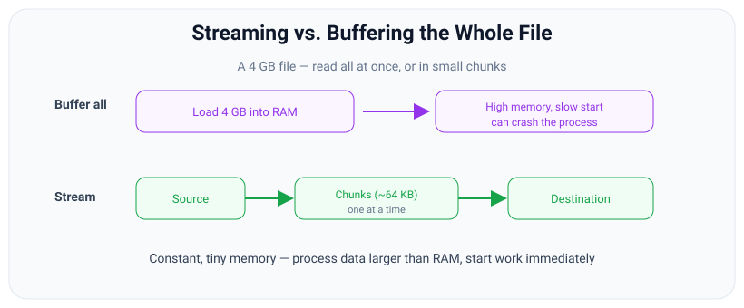

# Streams Overview

*11 min read · Updated 24 Jul 2026 Topic 26 of 70 Bookmark Mark done Why it matters Imagine a user uploads a 4 GB video and your server has to hash it · Topic 26 of 70*

**Source:** [https://www.geekyfrontend.in/learn/nodejs-backend-kit/streams-overview](https://www.geekyfrontend.in/learn/nodejs-backend-kit/streams-overview)

---

## Why it matters

Imagine a user uploads a 4 GB video and your server has to hash it, resize a thumbnail, and store it. The naive approach — `const data = fs.readFileSync('video.mp4')` — pulls all four gigabytes into a single Buffer in RAM before you touch a single byte. Ten users doing that at once is 40 GB of memory the process does not have, and it dies with `JavaScript heap out of memory`. The file did not get bigger; your strategy for reading it was wrong.

Streams are Node's answer to this. Instead of “load everything, then work,” a stream lets you work on the data *as it arrives*, in small pieces called chunks, and then let each piece go. Memory stays flat — a few tens of kilobytes — whether the file is 4 KB or 4 TB. This is not a niche optimization: HTTP requests and responses, file I/O, TCP sockets, child-process stdout, compression, and crypto are **all** streams under the hood. If you understand streams, you understand how data actually moves through a Node server. If you do not, you will write code that works in development on tiny test files and falls over the moment real traffic hits it.

Interviewers lean on streams for exactly this reason: the concept separates people who have shipped I/O-heavy Node services from people who have only built CRUD apps on small payloads. “How would you process a file too big to fit in memory?” is a stream question in disguise.

## The concept, simply

A stream is an abstraction for a sequence of data that is not available all at once and does not have to fit in memory. Think of it like watching a movie on Netflix versus downloading the whole file first. Streaming means you start watching after a few seconds and only ever hold a few seconds of video in your buffer; downloading means you wait for the entire thing and store all of it. Streams are the “start now, hold little” model applied to data.



Buffering loads everything into memory before you start; streaming moves small chunks through a pipeline with constant, tiny memory use.

Two properties make streams powerful. First, **constant memory**: you process data in chunks and discard each one, so peak memory is bounded by the size of a chunk (plus a small buffer), not the size of the data. Second, **time-to-first-byte**: you can start producing output before you have consumed all the input. A gzip stream emits compressed bytes while it is still reading the source; an HTTP server can start sending a response body before the whole body exists. Buffering forfeits both benefits.

Node models four kinds of stream, and every stream you meet is one of them:

- **Readable** — a source you read *from*. Examples: `fs.createReadStream()`, an incoming HTTP request (`req`), `process.stdin`, a child process's `stdout`.
- **Writable** — a sink you write *to*. Examples: `fs.createWriteStream()`, an HTTP response (`res`), `process.stdout`, a socket.
- **Duplex** — readable *and* writable, with the two sides independent. The classic example is a TCP socket: what you write out and what you read in are unrelated streams that happen to share one object.
- **Transform** — a special Duplex where the output is a function of the input. You write bytes in, transformed bytes come out. Examples: `zlib.createGzip()`, a crypto cipher, a CSV-to-JSON parser.


Readable is a source, Writable is a sink, Duplex is both independently, and Transform is a Duplex whose output is computed from its input.

## How it works

Under every stream is an **internal buffer** and a threshold called the `highWaterMark`. When a Readable source produces data faster than you consume it, the extra bytes queue up in that internal buffer. The `highWaterMark` is the size (in bytes for binary streams, or number of objects in object mode) at which the stream considers its buffer “full enough” and stops asking the underlying source for more. The default is **64 KiB (65536 bytes) for every byte stream** — Readable, Writable, Duplex, Transform, file streams and sockets alike (changed in v22; Node 21 and earlier used 16 KiB for generic streams, while `fs.createReadStream` was already 64 KiB). The one type that differs is **object mode**, where the default is **16 objects**, not bytes. Read the real value from the stream instead of memorising it:

javascript

```
import { Readable, Writable, getDefaultHighWaterMark } from 'node:stream';
import { createReadStream } from 'node:fs';

console.log(getDefaultHighWaterMark(false));                          // byte streams
console.log(getDefaultHighWaterMark(true));                           // object mode
console.log(new Writable({ write(c, e, cb) { cb(); } }).writableHighWaterMark);
console.log(new Readable({ objectMode: true, read() {} }).readableHighWaterMark);
console.log(createReadStream('package.json').readableHighWaterMark);

// Real output (Node v24.19.0):
//   65536
//   16
//   65536
//   16
//   65536
```

It is a soft target, not a hard cap — a single `push` larger than the mark is still accepted — but it is the dial that governs how much memory a stream is willing to hold.

This buffer is what makes **backpressure** possible. Backpressure is the mechanism by which a slow consumer tells a fast producer to slow down. On the Writable side, `stream.write(chunk)` returns a boolean: `true` means “buffer has room, keep writing,” `false` means “buffer is at or over the highWaterMark, please stop.” When it returns `false`, a well-behaved producer waits for the `'drain'` event before writing again. On the Readable side, in paused mode you only pull what you can handle. When you connect a Readable to a Writable with `.pipe()` or `pipeline()`, Node wires this entire dance up for you — it pauses the source when the destination is full and resumes it after a drain. Backpressure is the single most important thing streams do, and it is covered in depth in the last topic of this chapter.

Streams communicate through **events** because they extend `EventEmitter`. The events you will actually use:

- `'data'` (Readable) — a chunk is available. Attaching this listener switches the stream into flowing mode and starts data pushing at you.
- `'readable'` (Readable) — data is buffered and ready to be pulled with `read()`; this is paused-mode consumption.
- `'end'` (Readable) — no more data will be produced; the source is exhausted.
- `'drain'` (Writable) — the buffer has emptied below the highWaterMark after a `write()` returned `false`; safe to resume writing.
- `'finish'` (Writable) — `end()` was called and all buffered data has been flushed to the underlying resource.
- `'close'` — the stream and its underlying resource (file descriptor, socket) have been closed.
- `'error'` — something failed. This is the event people forget, and forgetting it crashes the process, because an unhandled `'error'` on an EventEmitter throws.

One more foundational idea: a chunk is a **Buffer** by default (raw bytes), unless you set an encoding (then you get strings) or put the stream in **object mode** (then each chunk can be any JavaScript value — a parsed record, an object, a number). Object-mode streams are how you build data pipelines that pass structured records instead of raw bytes, and they use the highWaterMark as a *count of objects* rather than a byte size.

## Code examples

**1. Copy a file with constant memory.** The whole point of streams in one snippet — this copies a file of any size while holding only ~64 KB at a time.

javascript

```
import { createReadStream, createWriteStream } from 'node:fs';
import { pipeline } from 'node:stream/promises';

// pipeline() reads chunks from the source and writes them to the
// destination, handling backpressure and errors for you.
await pipeline(
  createReadStream('big-input.bin'),
  createWriteStream('copy-output.bin')
);
console.log('Copied without ever holding the whole file in RAM.');
```

**2. Consume a Readable and watch its events.** Notice we never build a giant string — we count bytes chunk by chunk.

javascript

```
import { createReadStream } from 'node:fs';

const stream = createReadStream('big-input.bin', { highWaterMark: 64 * 1024 });
let bytes = 0;
let chunks = 0;

stream.on('data', (chunk) => {   // Buffer of up to 64 KB
  bytes += chunk.length;
  chunks++;
});
stream.on('end', () => {
  console.log(`Done: ${chunks} chunks, ${bytes} bytes total`);
});
stream.on('error', (err) => {    // ALWAYS handle this
  console.error('Read failed:', err.message);
});
```

**3. An HTTP server is just streams.** `req` is a Readable, `res` is a Writable. Streaming a file to the client never buffers it in the server.

javascript

```
import { createServer } from 'node:http';
import { createReadStream } from 'node:fs';
import { pipeline } from 'node:stream/promises';

createServer(async (req, res) => {
  // req: Readable (the request body)  |  res: Writable (the response)
  res.setHeader('Content-Type', 'video/mp4');
  try {
    await pipeline(createReadStream('./movie.mp4'), res);
  } catch (err) {
    if (!res.headersSent) res.statusCode = 500;
    res.end();               // client disconnect or read error
  }
}).listen(3000);
```

## Common mistakes & gotchas

- **Reaching for `readFileSync` / `readFile` on large or unbounded data.** It works on your 2 KB fixture and detonates on a 2 GB upload. If the size is user-controlled, stream it.
- **Concatenating every chunk into one big Buffer or string.** Doing `data += chunk` across a stream defeats the purpose — you have re-created the buffer-everything problem the stream was avoiding.
- **Forgetting the `'error'` listener.** An unhandled `'error'` event is thrown as an exception and takes the whole process down. Every stream in a chain can emit it.
- **Assuming a chunk is a complete logical unit.** A chunk is a byte boundary, not a line or a JSON record. One chunk may contain half a line and the start of the next; a multi-byte UTF-8 character can be split across two chunks. Never `JSON.parse` a raw chunk.
- **Thinking the `highWaterMark` is a hard limit.** It is a threshold that governs when the stream stops pulling; a single oversized `push` still goes through.

## Best practices

- **Default to streaming for any I/O whose size you do not control** — file uploads, proxied responses, DB exports, log processing.
- **Prefer `pipeline()` (ideally the promise version from `node:stream/promises`) over manual `.pipe()` and hand-wired events.** It handles backpressure, propagates errors, and cleans up every stream on failure.
- **Always attach an `'error'` handler** to every stream you touch, or use `pipeline()` which funnels all errors to one place.
- **Set an explicit `highWaterMark`** when you have a reason to (larger for high-throughput file copies, smaller to cap memory under many concurrent streams). Otherwise trust the defaults.
- **Use object mode** when your pipeline passes records rather than bytes — it keeps the same backpressure guarantees for structured data.

## ⭐ Interview lens

> **Q: What problem do streams solve that `fs.readFile` does not?**  
> Streams process data in chunks with bounded memory and start producing output before all input is read. `readFile` loads the entire payload into one Buffer first, so peak memory scales with data size and you cannot begin work until the whole thing is in RAM. For large or unbounded data, streaming keeps memory flat and improves time-to-first-byte.

> **Q: Name the four stream types and give a real example of each.**  
> Readable (fs read stream, HTTP request), Writable (fs write stream, HTTP response), Duplex (TCP socket — independent read and write sides), Transform (gzip, crypto cipher — a Duplex whose output is computed from its input).

> **Q: Is a Transform stream a Readable or a Writable?** (Trap.)  
> Both — it is a Duplex. You write input to its writable side and read transformed output from its readable side. The distinguishing feature versus a plain Duplex is that the output is derived from the input rather than being an unrelated channel.

> **Q: What is the `highWaterMark`?**  
> The threshold size of a stream's internal buffer (default 64 KiB for byte streams since Node 22 — 16 KiB for generic streams before that — and 16 objects in object mode; check `readableHighWaterMark` / `writableHighWaterMark` on the stream). It controls when a Readable stops pulling from its source and when `write()` starts returning `false` — i.e., it is the knob that drives backpressure. It is a soft target, not a hard ceiling.

> **Q: Why can a chunk not be treated as a complete line or JSON object?**  
> Chunks are split on byte boundaries determined by the buffer, not on logical boundaries in your data. A record can span multiple chunks, a chunk can contain multiple partial records, and even a single UTF-8 character can be split across two chunks. You must reassemble logical units yourself, typically with a Transform stream or a line-splitter.

> **Q: Which event, if unhandled, will crash your process, and why?**  
> `'error'`. Streams are EventEmitters, and an `'error'` emitted with no listener is re-thrown as an uncaught exception. This is why `pipeline()` is preferred — it guarantees a single error path.

## Cheat-card

- **Stream** = process data in chunks, bounded memory, start early.
- **Types**: Readable (from), Writable (to), Duplex (both, independent), Transform (out = f(in)).
- **Buffer + highWaterMark**: internal queue; default 64 KiB for byte streams (changed in v22; was 16 KiB), 16 objects in object mode; drives backpressure.
- **Key events**: `data`, `readable`, `end` (Readable); `drain`, `finish` (Writable); `close`, `error` (both).
- **Chunk** = Buffer by default; string with encoding; any value in object mode. Not a logical record.
- **Always**: handle `'error'`; prefer `pipeline()`; stream anything size-unbounded.

---

## Learn More

- [Stream | Node.js Documentation nodejs.org](https://nodejs.org/api/stream.html)
- [How To Use Streams | Node.js Learn nodejs.org](https://nodejs.org/en/learn/modules/how-to-use-streams)
- [Streams API | MDN developer.mozilla.org](https://developer.mozilla.org/en-US/docs/Web/API/Streams_API)
- [How to use "Streams" to improve performance in Node.js? Software Developer Diaries](https://www.youtube.com/watch?v=VSBq9Q7QrGk)
- [Everything You Should Know about Node.js Streams Erick Wendel](https://www.youtube.com/watch?v=BdePYKgrMh0)
