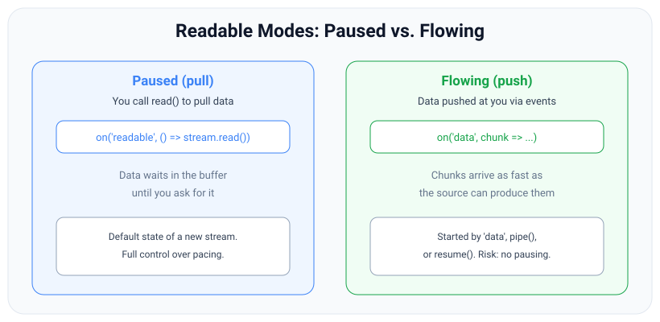
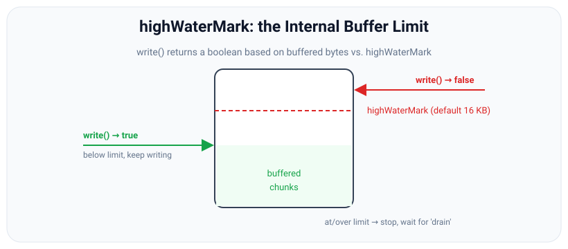

# Readable & Writable Streams

*10 min read · Updated 24 Jul 2026 Topic 27 of 70 Bookmark Mark done Why it matters Readable and Writable are the two halves of every data movement in Node · Topic 27 of 70*

**Source:** [https://www.geekyfrontend.in/learn/nodejs-backend-kit/readable-writable](https://www.geekyfrontend.in/learn/nodejs-backend-kit/readable-writable)

---

## Why it matters

Readable and Writable are the two halves of every data movement in Node. The request coming into your server is a Readable; the response going out is a Writable. The file you read is a Readable; the file you write is a Writable. Duplex and Transform — the subjects of the next topic — are literally built by combining these two. If you are shaky on how a Readable delivers data and how a Writable accepts it, everything above them (piping, compression, HTTP bodies) is guesswork.

The part that trips people up, and the part interviewers probe, is that a Readable can operate in two completely different **modes** — paused and flowing — and choosing the wrong one, or accidentally switching between them, causes two of the most common stream bugs in production: silently lost data, and memory blowups from ignored backpressure. Getting this right is the difference between a service that streams a million-row export cleanly and one that OOMs at row 200,000.

## The concept, simply

A **Readable** is a faucet. A **Writable** is a drain. Your job is to get water from the faucet to the drain without overflowing the sink in between — that sink is the internal buffer, and not overflowing it is backpressure.

The subtlety is entirely on the Readable side, because a faucet can deliver water two ways. In **paused mode** (also called pull mode), the data sits in the stream's buffer and nothing happens until *you* call `read()` to pull a chunk. You are in control of the pace. In **flowing mode** (push mode), the stream fires `'data'` events at you as fast as the source can produce, and you must keep up or handle backpressure yourself.



In paused mode you pull chunks by calling read(); in flowing mode chunks are pushed to you through data events until you pause or the source ends.

A brand-new Readable starts **paused**. It switches to **flowing** the moment you do any of three things: attach a `'data'` listener, call `.pipe()`, or call `.resume()`. It switches back to paused if you call `.pause()` (and, when piped, whenever the destination signals backpressure). The single most important practical rule follows from this: **attaching a `'data'` listener starts the flow immediately.** If you attach it and then do async setup before you are ready to handle chunks, the chunks that arrive in the meantime are gone.

## How it works

**Reading, in detail.** A Readable pulls from its underlying source (a file descriptor, a socket) into its internal buffer via an internal `_read()` method. It keeps pulling until the buffered amount reaches the `highWaterMark` (default 64 KB for files), then stops asking for more. In paused mode, each `read(n)` you call removes up to `n` bytes from that buffer and returns them (or `null` if not enough is buffered yet); as the buffer drains below the mark, the stream resumes pulling from the source. In flowing mode the same buffering happens, but the stream automatically drains its buffer by emitting `'data'` events — which is exactly why flowing mode without piping is dangerous: there is no automatic pause if your `'data'` handler is slower than the source.

**Writing, in detail.** A Writable exposes `write(chunk)`, which appends to its own internal buffer and asks the underlying resource to consume it via `_write()`. The return value is the backpressure signal: `true` means the buffered bytes are below the `highWaterMark` (default 64 KiB since Node 22, 16 KiB before — changed in v22; check `writable.writableHighWaterMark`) — keep going; `false` means you are at or over it — stop, and wait for the `'drain'` event before writing more. Ignoring a `false` return does not error; it just keeps piling data into the buffer, and memory grows without bound. That is the classic slow-disk / fast-source memory leak.



write() returns true while buffered bytes are below the highWaterMark and false once they reach it; on false you must wait for drain before writing again.

**Ending.** You signal a Writable is done with `end([finalChunk])`. Once all buffered data is flushed to the underlying resource, it emits `'finish'`. After the resource itself is released it emits `'close'`. On a Readable, exhaustion is signalled by `'end'`. These are distinct events for distinct streams, and confusing `'end'` (readable is done producing) with `'finish'` (writable is done consuming) is a common interview slip.

**Async iteration.** Modern Node lets you consume a Readable with `for await...of`. This is paused-mode consumption in disguise — the loop pulls one chunk, awaits your body, then pulls the next — so backpressure is automatic and you get clean `try/catch` error handling. It is the most readable way to consume a stream when you need per-chunk logic.

## Code examples

**1. Consume with `for await` (recommended default).** Backpressure and errors are handled by the language, not by hand.

javascript

```
import { createReadStream } from 'node:fs';

async function countLines(path) {
  let count = 0, tail = '';
  const stream = createReadStream(path, { encoding: 'utf8' });
  for await (const chunk of stream) {   // pulls one chunk at a time
    const parts = (tail + chunk).split('
');
    tail = parts.pop();                 // last piece may be incomplete
    count += parts.length;
  }
  if (tail) count++;                     // final line with no newline
  return count;
}
console.log(await countLines('access.log'));
```

**2. Respecting Writable backpressure by hand.** The pattern `pipeline()` automates — worth writing once so you understand what it does.

javascript

```
import { createWriteStream } from 'node:fs';
import { once } from 'node:events';

async function writeLots(path, n) {
  const out = createWriteStream(path);
  for (let i = 0; i < n; i++) {
    const ok = out.write(`row ${i}
`);
    if (!ok) {
      // Buffer is full — pause until it drains below highWaterMark.
      await once(out, 'drain');
    }
  }
  out.end();
  await once(out, 'finish');   // all data flushed to disk
}
await writeLots('rows.txt', 1_000_000);
```

**3. Creating your own Readable.** Push data with `push(chunk)`; signal the end with `push(null)`.

javascript

```
import { Readable } from 'node:stream';

// Simplest: from an iterable / generator.
const numbers = Readable.from((function* () {
  for (let i = 1; i <= 5; i++) yield `${i}
`;
})());

// Explicit form: implement _read and push chunks yourself.
class Counter extends Readable {
  #n = 0;
  constructor(max) { super(); this.max = max; }
  _read() {
    this.#n++;
    if (this.#n > this.max) this.push(null);        // end of stream
    else this.push(Buffer.from(`${this.#n}
`));   // emit a chunk
  }
}
new Counter(3).pipe(process.stdout);   // prints 1
2
3
```

**4. Creating your own Writable.** Implement `_write`; call the callback when the chunk is handled (this is how backpressure is reported upstream).

javascript

```
import { Writable } from 'node:stream';

class JsonlLogger extends Writable {
  constructor() { super({ objectMode: true }); }   // accept objects, not bytes
  _write(record, _enc, cb) {
    process.stdout.write(JSON.stringify(record) + '
');
    cb();   // MUST call cb — err first if it failed. Until then, backpressure holds.
  }
}
const log = new JsonlLogger();
log.write({ level: 'info', msg: 'up' });
log.write({ level: 'warn', msg: 'slow query' });
log.end();
```

## Common mistakes & gotchas

- **Attaching `'data'` too early.** It flips the stream to flowing immediately. If you then `await` something before processing, chunks emitted during the await are lost. Attach the listener only when you are ready to handle chunks, or use `for await`.
- **Ignoring the return value of `write()`.** If it returns `false` and you keep writing, the Writable's buffer grows without bound — unbounded memory, not an error. Wait for `'drain'`.
- **Mixing paused and flowing consumption.** Calling `read()` while also having a `'data'` listener, or piping a stream you are also manually reading, leads to data going to one consumer and not the other.
- **Confusing `'end'` with `'finish'`.** `'end'` = a Readable has no more data to give. `'finish'` = a Writable has flushed everything you gave it. Different streams, different meanings.
- **Forgetting to call the `_write` callback** in a custom Writable. Until you call `cb()`, the stream thinks the chunk is still being processed and applies backpressure forever — the pipeline silently stalls.
- **Calling `push()` after `push(null)`** in a custom Readable, or pushing faster than `_read` is called — both throw or leak.

## Best practices

- **Prefer `for await...of`** for consuming a Readable when you need custom per-chunk logic — it gives you automatic backpressure and normal `try/catch`.
- **Prefer `pipeline()`** when you are just moving data from a Readable to a Writable (or through Transforms) — do not hand-roll the drain loop unless you are learning or have a special case.
- **When building a custom stream, use the constructor options** (`read`, `write`, `transform` functions) or subclass and implement the `_`-prefixed methods — and always call the provided callback.
- **Set `objectMode: true`** when your stream carries JS values rather than bytes, and remember the highWaterMark then counts objects, not bytes.
- **Use `Readable.from(iterable)`** to turn an array, generator, or async iterator into a stream instead of implementing `_read` by hand.

## ⭐ Interview lens

> **Q: What are the two modes of a Readable stream, and what triggers each?**  
> Paused (pull) and flowing (push). A new stream starts paused. It goes flowing when you add a `'data'` listener, call `.pipe()`, or call `.resume()`; it returns to paused on `.pause()` or, when piped, when the destination applies backpressure. In paused mode you pull with `read()`; in flowing mode chunks arrive via `'data'` events.

> **Q: You attach a `'data'` handler but some chunks seem to vanish. Why?** (Trap.)  
> Attaching `'data'` switches the stream to flowing mode *immediately*. If there is any asynchronous gap between attaching the listener and actually being ready — or if a second consumer is added later — chunks emitted in that window are dropped because flowing mode does not wait. Fix: use `for await`, or don't start the flow until ready.

> **Q: What does `stream.write()` returning `false` mean, and what should you do?**  
> The Writable's internal buffer has reached the highWaterMark — backpressure. Stop calling `write()` and wait for the `'drain'` event before resuming. Ignoring it doesn't throw; it just grows memory unboundedly.

> **Q: Difference between the `'end'` and `'finish'` events?**  
> `'end'` fires on a Readable when there is no more data to read. `'finish'` fires on a Writable after `end()` is called and all buffered data has been flushed to the underlying resource. `'close'` then fires when the underlying descriptor/socket is released.

> **Q: In a custom Writable's `_write(chunk, enc, cb)`, what happens if you never call `cb`?**  
> The stream believes the chunk is still being processed, so it never requests the next one and applies backpressure indefinitely — the pipeline stalls silently with no error. You must call `cb()` on success or `cb(err)` on failure.

> **Q: How do you signal the end of data from inside a custom Readable?**  
> Call `this.push(null)`. Every earlier `push(chunk)` emits data; `push(null)` marks EOF and eventually triggers the `'end'` event downstream.

## Cheat-card

- **Readable** = source (faucet). Starts **paused**; goes **flowing** on `data` listener / `pipe()` / `resume()`.
- **Paused**: pull with `read()` on `'readable'`. **Flowing**: pushed via `'data'`.
- **Writable** = sink (drain). `write()` → `false` means buffer ≥ highWaterMark; wait for `'drain'`.
- **End signals**: Readable emits `'end'`; Writable `end()` → `'finish'` → `'close'`.
- **Build**: custom Readable `push(chunk)` / `push(null)`; custom Writable `_write(chunk,enc,cb)` — *always call cb*.
- **Consume**: `for await...of` for logic; `pipeline()` to just move bytes. `objectMode` for records.
- **`destroy(err)`**: sets `destroyed` / `errored` at once → `'error'` → `'close'`; queued writes fail with `ERR_STREAM_DESTROYED`. To finish normally, use `end()`.
- **`finished(s, cb)`**: one callback for end, finish, error or premature close (`ERR_STREAM_PREMATURE_CLOSE`); returns a cleanup function. Promise form: `{ cleanup: true }`.
- **`_final(cb)`**: runs after `end()` and the last `_write()`, before `'finish'`; flush leftovers there.
- **`cork()` / `uncork()`**: batch writes into one `_writev()` call; uncork in `process.nextTick`; one `uncork()` per `cork()`.
- **Operators**: `map` / `filter` / `take` / `toArray` (Stability 1 – Experimental in the v24 docs); `map(fn, { concurrency })` keeps input order.
- **Web streams**: `fetch` bodies are `ReadableStream`s; wrap with `Readable.fromWeb()`. See lesson 83.

---

## Learn More

- [Stream | Node.js Documentation nodejs.org](https://nodejs.org/api/stream.html)
- [Node.js Streams: Everything you need to know freecodecamp.org](https://www.freecodecamp.org/news/node-js-streams-everything-you-need-to-know-c9141306be93)
- [Learn Node.js Streams in 25 minutes | NodeJS Tutorials for Beginners Dipesh Malvia](https://www.youtube.com/watch?v=EcznOgzOdxI)

---

## Additional topics

*Added 10 Oct 2026 · examples verified on Node v24.19.0*

### `destroy()`, `'close'`, `destroyed` and `errored`

`stream.destroy([error])` (added in v8.0.0; a no-op on an already destroyed stream since v14.0.0) stops a stream at once and releases what it holds: a file descriptor, a socket, a timer. It is the "abort" button, as opposed to `end()` on a Writable, which is the "finish normally" button. Without it, a stream whose consumer has gone away keeps its descriptor open, and every error path in a server leaks one. `pipeline()` calls `destroy(err)` on every stream when one of them fails; you call it yourself when you stop using a stream early.

How it works:

1. `destroy(err)` sets `stream.destroyed = true` at once and, if `err` is given, `stream.errored = err` (both properties are readable on Readable and Writable; `errored` was added in v18.0.0).
2. It calls the stream's `_destroy(err, callback)` (the `destroy` constructor option), where an implementation closes its resource and then calls `callback(err)`.
3. On a later tick, the stream emits `'error'` (only if there was an error) and then `'close'` (unless `emitClose: false`). `stream.closed` (added in v18.0.0) becomes `true`.
4. After that, a Readable ignores `push()` and a Writable fails `write()` with `ERR_STREAM_DESTROYED`. Calling `destroy()` again does nothing.
5. Data still in the buffers is dropped. `end()` writes it out first; `destroy()` does not (see the edge case below).

**Example — `destroy(err)` vs `destroy()`, and writing after destroy.**

javascript

```
import { Readable, Writable } from 'node:stream';

// 1. destroy(err): 'error' then 'close'; destroyed and errored are set at once.
const r = new Readable({
  read() {},
  destroy(err, cb) { console.log('  _destroy() runs, err =', err?.message); cb(err); },
});
r.on('error', (err) => console.log("  'error' event:", err.message));
r.on('close', () => console.log("  'close' event | closed =", r.closed));
r.push('some data');
r.destroy(new Error('disk gone'));
console.log('right after destroy(): destroyed =', r.destroyed, '| errored =', r.errored?.message, '| closed =', r.closed);
console.log('push() after destroy returns', r.push('more'), '(ignored)');
await new Promise((res) => setImmediate(res));

// 2. destroy() with no error: only 'close', errored stays null.
const w = new Writable({ write(c, e, cb) { cb(); } });
w.on('error', (err) => console.log("  writable 'error':", err.code));
w.on('close', () => console.log("  writable 'close' | errored =", w.errored));
w.destroy();
await new Promise((res) => setImmediate(res));

// 3. write() after destroy(): the callback gets ERR_STREAM_DESTROYED; no second 'error' event.
console.log('write() returns', w.write('late', (err) => console.log('write callback:', err.code)));
await new Promise((res) => setTimeout(res, 10));

// Real output (Node v24.19.0):
//     _destroy() runs, err = disk gone
//   right after destroy(): destroyed = true | errored = disk gone | closed = true
//   push() after destroy returns false (ignored)
//     'error' event: disk gone
//     'close' event | closed = true
//     writable 'close' | errored = null
//   write() returns false
//   write callback: ERR_STREAM_DESTROYED
```

`destroyed` and `errored` are set before `destroy()` returns. In this run `closed` was also already `true`, because `_destroy()` called its callback synchronously, but the `'error'` and `'close'` *events* came a tick later, in that order. `destroy()` without an argument emits only `'close'` and leaves `errored` as `null`. A `write()` after destroy returns `false` and its callback gets `ERR_STREAM_DESTROYED`.

### `stream.finished()`: one place to learn that a stream is done

`stream.finished(stream[, options], callback)` (added in v10.0.0) calls `callback(err)` once, when the stream has ended, finished, errored or closed early. The promise version in `node:stream/promises` (added in v15.0.0) resolves or rejects instead. Without it you listen to `'end'`, `'finish'`, `'error'` and `'close'` yourself and still miss a case: a stream destroyed before it ended emits `'close'` but neither `'end'` nor `'finish'`, so code that waits for `'end'` hangs.

How it works:

1. `finished()` attaches listeners for `'end'`, `'finish'`, `'error'` and `'close'` (and checks whether the stream is already done: since v14.0.0 the callback runs for a stream that finished earlier).
2. Normal end: the callback gets no error (`undefined`), or the promise resolves.
3. Error: the callback gets the error, or the promise rejects with it.
4. `'close'` before `'end'` or `'finish'`: the callback gets `ERR_STREAM_PREMATURE_CLOSE` (since v14.0.0).
5. The listeners stay attached afterwards, on purpose, so a late `'error'` from a badly written stream does not crash the process. The callback form returns a **cleanup function** that removes them; the promise form takes `{ cleanup: true }` (added in v19.1.0 / v18.13.0). Both forms take `signal` (callback form: added in v15.11.0), which stops the *waiting*, not the stream.

**Example — callback form, cleanup function, premature close and the promise form.**

javascript

```
import { Readable, Writable, finished } from 'node:stream';
import { finished as finishedP } from 'node:stream/promises';

const count = (s) => ['error', 'end', 'finish', 'close'].map((e) => s.listenerCount(e)).join('/');

// 1. Callback form: called once, for success OR failure OR premature close.
const ok = Readable.from(['a', 'b']);
const cleanup = finished(ok, (err) => {
  console.log('callback, ok stream: err =', err);
  console.log('  listeners error/end/finish/close before cleanup:', count(ok));
  cleanup();                                   // remove the listeners finished() added
  console.log('  after cleanup():', count(ok));
});
ok.resume();
await new Promise((r) => setTimeout(r, 10));

// 2. A stream destroyed before it ended: ERR_STREAM_PREMATURE_CLOSE.
const cut = new Readable({ read() {} });
finished(cut, (err) => console.log('callback, destroyed early:', err.code));
cut.destroy();
await new Promise((r) => setTimeout(r, 10));

// 3. Promise form, with an error.
const bad = new Writable({ write(c, e, cb) { cb(new Error('disk full')); } });
bad.on('error', () => {});
bad.write('x');
try { await finishedP(bad); } catch (err) { console.log('promise form rejected:', err.message); }

// 4. Promise form: listeners stay behind unless you pass { cleanup: true }.
for (const opts of [{}, { cleanup: true }]) {
  const w = new Writable({ write(c, e, cb) { cb(); } });
  w.end('done');
  await finishedP(w, opts);
  console.log(`promise form ${JSON.stringify(opts)}: listeners left`, count(w));
}

// Real output (Node v24.19.0):
//   callback, ok stream: err = undefined
//     listeners error/end/finish/close before cleanup: 1/1/1/1
//     after cleanup(): 0/0/0/0
//   callback, destroyed early: ERR_STREAM_PREMATURE_CLOSE
//   promise form rejected: disk full
//   promise form {}: listeners left 1/1/1/1
//   promise form {"cleanup":true}: listeners left 0/0/0/0
```

Each line shows the listener counts for `'error'`, `'end'`, `'finish'` and `'close'`. `finished()` added one of each; the returned `cleanup()` removes them, and so does `{ cleanup: true }` in the promise form. The destroyed-early stream never emitted `'end'`, and `finished()` reports that as `ERR_STREAM_PREMATURE_CLOSE` instead of waiting forever.

### `_final()`: work that must happen before `'finish'`

`_final(callback)` (added in v8.0.0; the `final` constructor option) is an optional method of a custom Writable. Node calls it once, after `end()` and after the last `_write()` has completed, and holds back `'finish'` until you call `callback()`. A Writable that batches, buffers or holds a connection needs it: without `_final`, the last partial batch is never sent, and `'finish'` (which tells `pipeline()` "all data is safe") fires while rows are still in your array.

How it works:

1. Your code calls `end()`. `writableEnded` becomes `true`; no more writes are accepted.
2. Node waits until every queued chunk has gone through `_write()` / `_writev()`.
3. Node calls `_final(callback)`. You flush what you buffered, close the connection, and so on.
4. When you call `callback()`, `writableFinished` becomes `true` and `'finish'` is emitted, then `'close'`. If you call `callback(err)`, the stream errors instead.

**Example — a batching writer that sends its last partial batch in `_final`.**

javascript

```
import { Writable } from 'node:stream';

// A batching writer: collects rows, sends them 3 at a time, and must send the rest at the end.
class BatchWriter extends Writable {
  #batch = [];
  constructor() { super({ objectMode: true }); }
  _write(row, _enc, cb) {
    this.#batch.push(row);
    if (this.#batch.length < 3) return cb();
    this.#send(cb);
  }
  _final(cb) {                         // runs after end(), before 'finish'
    console.log(`  _final(): ${this.#batch.length} row(s) still buffered`);
    if (this.#batch.length === 0) return cb();
    this.#send(cb);                    // 'finish' waits until this cb is called
  }
  #send(cb) {
    const rows = this.#batch.splice(0);
    setTimeout(() => { console.log('  sent batch:', rows.join(',')); cb(); }, 20);  // a fake network call
  }
}

const w = new BatchWriter();
w.on('finish', () => console.log("'finish' (every row sent)"));
w.on('close', () => console.log("'close'"));
for (const row of ['r1', 'r2', 'r3', 'r4', 'r5']) w.write(row);
w.end();
console.log('end() returned; writableEnded =', w.writableEnded, '| writableFinished =', w.writableFinished);

// Real output (Node v24.19.0):
//   end() returned; writableEnded = true | writableFinished = false
//     sent batch: r1,r2,r3
//     _final(): 2 row(s) still buffered
//     sent batch: r4,r5
//   'finish' (every row sent)
//   'close'
```

`end()` returns at once with `writableEnded === true` but `writableFinished === false`. The first batch (`r1,r2,r3`) goes out from `_write()`. `_final()` then finds `r4` and `r5` still buffered and sends them, and `'finish'` waits until that send's callback. Remove `_final` and `r4,r5` are lost while `'finish'` still fires.

### `cork()`, `uncork()` and `_writev()` batching

`writable.cork()` and `writable.uncork()` (added in v0.11.2) let you group many small writes into one call to the underlying resource. While a stream is *corked*, `write()` only adds chunks to the buffer. `uncork()` (or `end()`) flushes them, and if the stream implements `_writev(chunks, callback)`, all buffered chunks go to it in a single call. `net.Socket` implements `_writev()`: in a separate run, `strace` showed a corked socket sending three 1-byte writes as one `writev(fd, ["a", "b", "c"], 3)` system call instead of three. Without `_writev`, the docs warn that cork can lower throughput, because the chunks are then written one by one anyway.

How it works:

1. `cork()` increments `writableCorked` (added in v13.2.0 / v12.16.0). While it is above 0, `write()` buffers the chunk and returns.
2. Each `uncork()` decrements `writableCorked`. When it reaches 0, the buffered chunks are flushed; with a `_writev`, they arrive as one array of `{ chunk, encoding }`.
3. `cork()` twice needs `uncork()` twice.
4. The docs' pattern is `cork()`, then the writes, then `process.nextTick(() => stream.uncork())`, so every write in the current tick joins the batch.
5. Even without `cork()`, chunks that queue up while a `_write()` is still in progress are handed to `_writev()` together on the next round.

**Example — the same three writes with and without `cork()`.**

javascript

```
import { Writable } from 'node:stream';

// A sink that logs how it is called: _write() gets one chunk, _writev() gets a batch.
function makeSink(label) {
  return new Writable({
    write(chunk, _enc, cb) { console.log(`  ${label} _write : ${JSON.stringify(chunk.toString())}`); setImmediate(cb); },
    writev(chunks, cb) {
      console.log(`  ${label} _writev: ${chunks.length} chunks ->`, JSON.stringify(Buffer.concat(chunks.map((c) => c.chunk)).toString()));
      setImmediate(cb);
    },
  });
}

// 1. No cork: the first write goes to _write() at once; the others queue up behind it
//    while it is busy, so they arrive later as one _writev() batch.
console.log('without cork():');
const a = makeSink('a');
for (const part of ['GET ', '/ ', 'HTTP/1.1\r\n']) a.write(part);
a.end();
await new Promise((r) => a.on('finish', r));

// 2. cork() + uncork() on the next tick: all three writes reach _writev() in one call.
console.log('with cork():');
const b = makeSink('b');
b.cork();
for (const part of ['GET ', '/ ', 'HTTP/1.1\r\n']) b.write(part);
console.log('  writableCorked =', b.writableCorked, '| writableLength =', b.writableLength);
process.nextTick(() => { b.uncork(); b.end(); });   // the docs' pattern: uncork on the next tick
await new Promise((r) => b.on('finish', r));

// 3. cork() twice needs uncork() twice.
const c = makeSink('c');
c.cork(); c.cork(); c.write('x');
c.uncork();
console.log('after one uncork(): writableCorked =', c.writableCorked);
c.uncork();
console.log('after two uncork(): writableCorked =', c.writableCorked);

// Real output (Node v24.19.0):
//   without cork():
//     a _write : "GET "
//     a _writev: 2 chunks -> "/ HTTP/1.1\r\n"
//   with cork():
//     writableCorked = 1 | writableLength = 16
//     b _writev: 3 chunks -> "GET / HTTP/1.1\r\n"
//   after one uncork(): writableCorked = 1
//     c _write : "x"
//   after two uncork(): writableCorked = 0
```

Without `cork()`, the first write goes straight to `_write()`, and the two that arrive while it is busy go to `_writev()` as a batch of 2. With `cork()`, nothing reaches the sink until the next tick; then all 16 bytes reach `_writev()` in one call. The last part shows the counter: after one of two `uncork()` calls, `writableCorked` is still 1 and `x` has not been written.

### Stream operators: `map`, `filter`, `take`, `toArray`

Readable streams have array-like methods that return a new stream (`map`, `filter`, `take`, plus `drop`, `flatMap`) or a promise (`toArray`, `forEach`, `reduce`, `some`, `every`, `find`). `map` and `filter` were added in v17.4.0 / v16.14.0 (with a `highWaterMark` option since v20.7.0 / v18.19.0), `take` and `toArray` in v17.5.0 / v16.15.0. In the v24 docs these four are still **Stability: 1 – Experimental** (unlike `readable.compose()` and `readable.iterator()`, which were marked stable in v24.0.0). No warning was printed on v24.19.0, but experimental APIs can change in any release. Without them, a simple "parse, filter, take the first 100" means writing three Transform classes or an async generator by hand.

How it works:

1. `source.map(fn, options)` returns a new Readable in object mode. It reads from `source`, calls `fn(chunk, { signal })`, awaits the result if it is a promise, and pushes it. `filter(fn)` pushes the chunk only if `fn` returns a truthy value.
2. `options.concurrency` (default `1`) is the number of `fn` calls that may run at once. Results still come out in input order. `options.highWaterMark` (default `concurrency * 2 - 1`) is how many finished results are buffered while waiting for the consumer.
3. `take(n)` passes on the first `n` chunks, then ends and destroys the source (`endless.destroyed` was `true` afterwards in a separate run).
4. `toArray()` reads the whole stream into an array and resolves with it. It puts the entire stream in memory, so use it for small or bounded streams (the docs say it "negates the benefits of streams").
5. An operator reads the stream it is called on. Read from the returned stream only; reading the original as well splits the chunks between two consumers.

**Example — chaining operators, `take` stopping an endless source, and `concurrency`.**

javascript

```
import { Readable } from 'node:stream';
import { setTimeout as sleep } from 'node:timers/promises';

// 1. map / filter / take / toArray chain like array methods, but chunk by chunk.
const out = await Readable.from([1, 2, 3, 4, 5, 6, 7, 8])
  .filter((n) => n % 2 === 0)       // 2 4 6 8
  .map((n) => n * 10)               // 20 40 60 80
  .take(3)                          // stop after 3 items
  .toArray();
console.log('result:', out);

// 2. take() stops the source: it is not read to the end.
let produced = 0;
const endless = Readable.from((function* () { while (true) yield ++produced; })());
console.log('first 3 of an endless stream:', await endless.take(3).toArray(), '| produced:', produced);

// 3. concurrency: up to N async calls at once; results still come out in input order.
const slowLookup = async (id) => { await sleep(id === 1 ? 300 : 100); return `user${id}`; };
for (const concurrency of [1, 3]) {
  const start = Date.now();
  const users = await Readable.from([1, 2, 3]).map(slowLookup, { concurrency }).toArray();
  console.log(`concurrency ${concurrency}: ${JSON.stringify(users)} in ~${Math.round((Date.now() - start) / 100) * 100} ms`);
}

// Real output (Node v24.19.0):
//   result: [ 20, 40, 60 ]
//   first 3 of an endless stream: [ 1, 2, 3 ] | produced: 4
//   concurrency 1: ["user1","user2","user3"] in ~500 ms
//   concurrency 3: ["user1","user2","user3"] in ~300 ms
```

`take(3)` ends the chain after three items even though the source is endless. `produced: 4` shows that one more item was read ahead into the buffer before the source was destroyed. With `concurrency: 1` the three lookups run one after another (300 + 100 + 100 ms); with `concurrency: 3` they run together and the slowest one (300 ms) sets the time. In both cases `user1` comes first, although it finished last: order is kept.

### Web streams: the other stream API

Everything in this lesson is about Node's `node:stream` classes. Node also has the WHATWG `ReadableStream` / `WritableStream` API, which `fetch`, `Response` and `CompressionStream` use. A web stream has no `pipe()`, no `'data'` event and no `destroy()`. `Readable.fromWeb()` and `Readable.toWeb()` convert between the two. Lesson [83 — Web Streams in Node](83-web-streams.md) covers readers, writers, queuing strategies and how their backpressure differs.

How it works:

1. A web `ReadableStream` is consumed with a reader, `for await`, or `pipeTo()`.
2. `Readable.fromWeb(webStream, options)` (added in v17.0.0, stable since v24.0.0) returns a Node `Readable` that reads from it.
3. From then on, `'end'`, `pipe()`, `destroy()`, `finished()` and the operators above all work.

**Example — a `fetch`-style body is not a Node `Readable` until you wrap it.**

javascript

```
import { Readable } from 'node:stream';

// Same data, two stream APIs. A web ReadableStream (for example a fetch body) is not a Node Readable.
const body = new Response('line 1\nline 2\n').body;
console.log('instanceof Readable:', body instanceof Readable, '| has pipe():', typeof body.pipe);

// Readable.fromWeb() wraps it, so everything in this lesson works on it again.
const node = Readable.fromWeb(body, { encoding: 'utf8' });
node.on('end', () => console.log("'end' fired, as on any Node Readable"));
console.log('chunks:', await node.toArray());

// Real output (Node v24.19.0):
//   instanceof Readable: false | has pipe(): undefined
//   'end' fired, as on any Node Readable
//   chunks: [ 'line 1\nline 2\n' ]
```

### Common mistakes & gotchas (additional topics)

- **Using `destroy()` to finish a Writable.** It drops queued data. Call `end()` and wait for `'finish'`; keep `destroy()` for errors and early exits.
- **Waiting only for `'end'` or `'finish'`.** A stream destroyed early emits neither, so the wait never ends. Use `finished()`, which reports `ERR_STREAM_PREMATURE_CLOSE`.
- **Expecting `finished()` to clean up after itself.** It leaves its listeners attached. Call the returned cleanup function, or pass `{ cleanup: true }` to the promise form.
- **Doing final flushing in a `'finish'` listener.** By then `pipeline()` has already been told the data is safe. Flush in `_final()`, which runs *before* `'finish'`.
- **Corking without `_writev()`.** The chunks are still written one by one, after a delay. Implement `_writev()` or do not cork.
- **Uncorking fewer times than you corked.** Data stays buffered until `writableCorked` is back to 0.
- **Calling `toArray()` on an unbounded stream.** It reads everything into memory. Use `take(n)` before it, or `for await`.
- **Assuming `map` with `concurrency > 1` returns results as they finish.** Order is kept; one slow item holds back the ones after it.

### Edge case worked through: `destroy()` drops queued writes, `end()` does not

Three chunks are written to a sink that needs 20 ms per chunk. One sink is closed with `end()`, the other with `destroy()` right after the writes:

javascript

```
import { Writable } from 'node:stream';

// A slow sink: each chunk takes 20 ms to "reach the disk".
function slowSink() {
  const saved = [];
  const w = new Writable({
    write(chunk, _e, cb) { setTimeout(() => { saved.push(chunk.toString()); cb(); }, 20); },
  });
  return { w, saved };
}

// end(): queued chunks are written first, then 'finish', then 'close'.
const a = slowSink();
['1', '2', '3'].forEach((c) => a.w.write(c));
a.w.end();
a.w.on('close', () => console.log("end()     'close': saved", a.saved));

// destroy(): stops now. The chunk already handed to _write() still lands; queued ones are dropped.
const b = slowSink();
['1', '2', '3'].forEach((c) => b.w.write(c, (err) => console.log(`  destroy() case, write(${c}) callback:`, err?.code ?? 'ok')));
b.w.destroy();
b.w.on('close', () => console.log("destroy() 'close': saved", b.saved));

setTimeout(() => console.log('100 ms later, destroy() case saved', b.saved), 100);

// Real output (Node v24.19.0):
//   destroy() 'close': saved []
//     destroy() case, write(1) callback: ok
//     destroy() case, write(2) callback: ERR_STREAM_DESTROYED
//     destroy() case, write(3) callback: ERR_STREAM_DESTROYED
//   end()     'close': saved [ '1', '2', '3' ]
//   100 ms later, destroy() case saved [ '1' ]
```

With `end()`, all three chunks are saved before `'close'`. With `destroy()`, `'close'` fires first, while chunk 1 is still inside `_write()`. That chunk does land 20 ms later (its callback reports `ok`, and `saved` holds `'1'` at 100 ms), because Node cannot take back work it has already handed to `_write()`. Chunks 2 and 3 were still in the buffer, so they are dropped and their callbacks get `ERR_STREAM_DESTROYED`. So after `destroy()`, a resource can still receive data after `'close'`, and a `_destroy()` that closes the resource must allow for a write that is still running.

### ⭐ Interview lens (additional topics)

> **Q: “What is the difference between `end()` and `destroy()` on a Writable?”**  
> A: `end()` says "no more data": the queued chunks are written, `_final()` runs, then `'finish'` and `'close'` are emitted. `destroy(err)` says "stop now": `destroyed` (and `errored`) are set at once, queued chunks are dropped with `ERR_STREAM_DESTROYED`, and only `'error'` (if given an error) and `'close'` are emitted. *Trap:* a chunk already inside `_write()` still completes after `'close'`.

> **Q: “Why use `cork()` and `uncork()`?”**  
> A: To turn several small writes into one call to the resource. While corked, `write()` only buffers; `uncork()` hands all the buffered chunks to `_writev()` in one call, which for a `net.Socket` is one `writev` system call. It only helps if the stream implements `_writev()`, and you need one `uncork()` per `cork()`.
