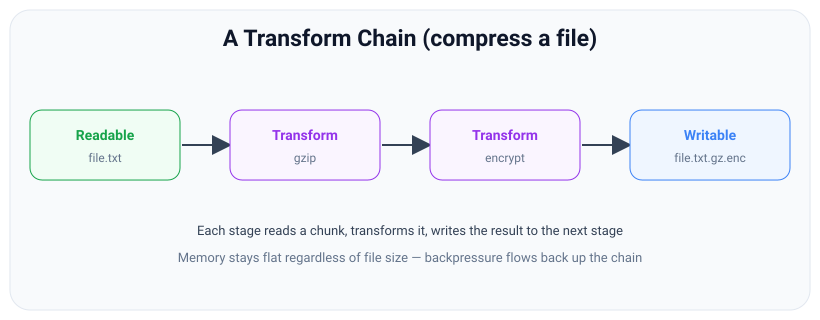
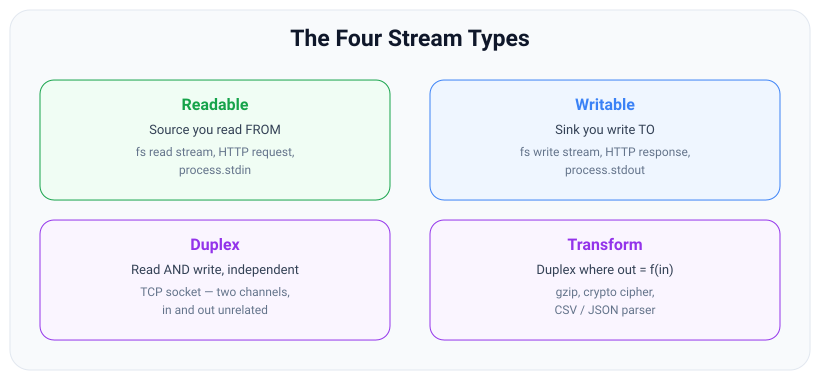

# Transform & Duplex Streams

*10 min read · Updated 24 Jul 2026 Topic 28 of 70 Bookmark Mark done Why it matters Readable and Writable move data · Topic 28 of 70*

**Source:** [https://www.geekyfrontend.in/learn/nodejs-backend-kit/transform-duplex](https://www.geekyfrontend.in/learn/nodejs-backend-kit/transform-duplex)

---

## Why it matters

Readable and Writable move data. Transform and Duplex are how you *do work to data while it moves* — without ever holding the whole thing in memory. Every time you gzip a response, encrypt a file, parse a multi-gigabyte CSV, or hash an upload as it arrives, you are using a Transform stream. They are the workhorses of real Node pipelines, and they are what let you build a processing chain — read → decompress → parse → filter → serialize → write — that runs in constant memory over an input larger than RAM.

Interviewers care about Transform for two reasons. First, it is the natural place to test whether you understand that stream processing is chunk-by-chunk, not record-by-record — the “a line can span two chunks” problem lives here. Second, writing a correct Transform (buffering partial data, flushing the tail, propagating errors) demonstrates real stream fluency in a way that piping two file streams together does not.

## The concept, simply

A **Duplex** stream is both Readable and Writable in one object, but the two sides are *independent* — what you write has no defined relationship to what you read. A TCP socket is the canonical example: you write bytes out to the peer and read bytes in from the peer, and those are two separate conversations that just happen to share a connection object.

A **Transform** is a special Duplex where the two sides *are* related: the readable output is computed from the writable input. You write data in, the stream transforms each chunk, and the result comes out the readable side. Gzip is a Transform: bytes in, smaller bytes out. A cipher is a Transform: plaintext in, ciphertext out. Because a Transform is a Readable, you can pipe from it; because it is a Writable, you can pipe into it — which is exactly what lets you chain many of them into a pipeline.



A Transform reads a chunk, transforms it, and writes the result to the next stage; chaining Transforms builds a constant-memory processing pipeline.

The mental model: a Transform sits in the *middle* of a pipe. Data flows in one end, gets reshaped, flows out the other. Because it participates in the same backpressure protocol as any stream, a slow stage automatically throttles the fast stages before it — the whole chain self-regulates.

## How it works

To build a Transform you implement two methods. `_transform(chunk, encoding, callback)` is called for every chunk written to the stream. Inside it you do your work and emit output by calling `this.push(outputChunk)` zero or more times, then call `callback()` to signal you are ready for the next chunk. You can also pass the transformed value straight to the callback: `callback(null, outputChunk)` is shorthand for one push. Crucially, the number of chunks out does not have to match the number in — you might buffer several input chunks and emit one output, or receive one and emit many.

The second method, `_flush(callback)`, is called **once**, after the last chunk has been written and before the stream ends. This is where you emit anything you were holding back — the final line of a file that had no trailing newline, the last block of a cipher, buffered state that only makes sense at the end. Forgetting `_flush` is the classic source of “my parser drops the last record” bugs.

**Backpressure through a Transform.** A Transform has *two* internal buffers — one on its writable side and one on its readable side, each with its own highWaterMark. When the downstream consumer is slow, the Transform's readable buffer fills, which causes it to stop calling your `_transform` callback promptly, which causes its writable buffer to fill, which makes `write()` return `false` to whatever is feeding it — and so backpressure propagates all the way back up the chain to the original source. You get this for free as long as you honor the callback contract and do not call `push` unboundedly while ignoring its return value.

**Object mode** matters a lot for Transforms. A byte-mode Transform reshapes Buffers; an object-mode Transform can turn bytes into structured records (parse a CSV row into an object) or objects into bytes (serialize a record to a JSON line). A common pattern is a pipeline where the first Transform is `{ writableObjectMode: false, readableObjectMode: true }` — bytes in, objects out — because the two sides of a Duplex can have different modes.

## Code examples

**1. Use the built-in Transforms — gzip a file.** `zlib` ciphers and compressors are all Transform streams; you rarely need to write compression yourself.

javascript

```
import { createReadStream, createWriteStream } from 'node:fs';
import { createGzip } from 'node:zlib';
import { pipeline } from 'node:stream/promises';

await pipeline(
  createReadStream('report.csv'),
  createGzip(),                       // Transform: bytes -> compressed bytes
  createWriteStream('report.csv.gz')
);
console.log('Compressed in constant memory.');
```

**2. A byte-mode Transform: uppercase every chunk.** The simplest possible custom Transform — note the constructor-function form.

javascript

```
import { Transform } from 'node:stream';

const upper = new Transform({
  transform(chunk, _enc, cb) {
    // chunk is a Buffer; reshape and push the result.
    cb(null, chunk.toString('utf8').toUpperCase());
  }
});

process.stdin.pipe(upper).pipe(process.stdout);   // type text, see it uppercased
```

**3. A line splitter — the “chunk boundary” problem solved.** This is the pattern interviewers love: buffer partial input, emit complete lines, flush the tail.

javascript

```
import { Transform } from 'node:stream';

class SplitLines extends Transform {
  #tail = '';
  constructor() { super({ readableObjectMode: true }); }  // emit strings as objects
  _transform(chunk, _enc, cb) {
    const lines = (this.#tail + chunk).split('\n');
    this.#tail = lines.pop();          // keep the possibly-incomplete last piece
    for (const line of lines) this.push(line);
    cb();
  }
  _flush(cb) {
    if (this.#tail) this.push(this.#tail);   // emit the final line (no newline)
    cb();
  }
}

import { createReadStream } from 'node:fs';
import { pipeline } from 'node:stream/promises';
await pipeline(
  createReadStream('access.log'),
  new SplitLines(),
  new Transform({                       // object-mode: count only errors
    objectMode: true,
    transform(line, _e, cb) {
      if (line.includes(' 500 ')) this.push(line + '\n');
      cb();
    }
  }),
  process.stdout
);
```

**4. A full processing pipeline: parse → filter → serialize.** Object-mode Transforms chained end to end, in constant memory over any file size.

javascript

```
import { Transform } from 'node:stream';
import { StringDecoder } from 'node:string_decoder';
import { createReadStream, createWriteStream } from 'node:fs';
import { pipeline } from 'node:stream/promises';

function createCsvParser() {
  const decoder = new StringDecoder('utf8'); // holds back a multi-byte character split across chunks
  let tail = '';                             // incomplete last line, carried into the next chunk
  const toRow = (line) => {
    const [id, name, amount] = line.split(',');
    return { id, name, amount: Number(amount) };
  };
  return new Transform({
    readableObjectMode: true,
    transform(buf, _e, cb) {
      const lines = (tail + decoder.write(buf)).split('\n');
      tail = lines.pop();                    // may be half a row: wait for the next chunk
      for (const line of lines) if (line.trim()) this.push(toRow(line));
      cb();
    },
    flush(cb) {
      const last = tail + decoder.end();     // whatever is left when the input ends
      if (last.trim()) this.push(toRow(last)); // the final row often has no trailing newline
      cb();
    }
  });
}

const parseCsvRow = createCsvParser();

const keepBigSpenders = new Transform({
  objectMode: true,
  transform(row, _e, cb) {
    if (row.amount >= 1000) this.push(row);
    cb();
  }
});

const toJsonl = new Transform({
  writableObjectMode: true,          // objects in, bytes out
  transform(row, _e, cb) { cb(null, JSON.stringify(row) + '\n'); }
});

await pipeline(
  createReadStream('transactions.csv'),
  parseCsvRow,
  keepBigSpenders,
  toJsonl,
  createWriteStream('big-spenders.jsonl')
);
```

How `createCsvParser()` handles the three chunks used in the proof below (`1,Ada,1` · `500\n2,Zo` + first byte of `ë` · the rest):

1. Chunk 1 (`1,Ada,1`) has no newline, so all of it becomes `tail`; nothing is emitted yet.
2. Chunk 2: `StringDecoder` holds back the lone first byte of `ë`; `tail + text` is `1,Ada,1500\n2,Zo`, so the complete row `1,Ada,1500` is emitted and `2,Zo` becomes the new `tail`.
3. Chunk 3: the decoder completes `ë`; `tail + text` is `2,Zoë,2500\n3,Lin,200`, so `2,Zoë,2500` is emitted and `3,Lin,200` is kept as `tail`.
4. The input ends: `flush` emits the last row, `3,Lin,200`, which has no trailing newline.

**Proof — chunks that split a row (and a multi-byte character) in half.** The earlier version of `parseCsvRow` split every chunk on its own, which is exactly the chunk-boundary bug from Example 3. Feeding both versions the same three chunks shows the difference:

javascript

```
import { Readable, Writable } from 'node:stream';
import { pipeline } from 'node:stream/promises';

const csv = Buffer.from('1,Ada,1500\n2,Zoë,2500\n3,Lin,200');
// split mid-row ("1,Ada,1|500") and in the middle of the 2-byte "ë"; last row has no newline
const chunks = [csv.subarray(0, 7), csv.subarray(7, 16), csv.subarray(16)];
const rows = [];
await pipeline(Readable.from(chunks), createCsvParser(),
  new Writable({ objectMode: true, write(r, _e, cb) { rows.push(r); cb(); } }));
console.log(rows);

// Real output with the old per-chunk split (Node v24.19.0):
//   [
//     { id: '1', name: 'Ada', amount: 1 },
//     { id: '500', name: undefined, amount: NaN },
//     { id: '2', name: 'Zo�', amount: NaN },
//     { id: '�', name: '2500', amount: NaN },
//     { id: '3', name: 'Lin', amount: 200 }
//   ]
// Real output with createCsvParser() (Node v24.19.0):
//   [
//     { id: '1', name: 'Ada', amount: 1500 },
//     { id: '2', name: 'Zoë', amount: 2500 },
//     { id: '3', name: 'Lin', amount: 200 }
//   ]
```

> **Why this was wrong:** `buf.toString().split(...)` per chunk assumes a chunk ends on a line break. File and network chunks end wherever the buffer filled up (64 KiB by default), so a row straddling the boundary became two broken rows, and a UTF-8 character split across chunks became `�`. Carry the tail, decode with `StringDecoder`, and emit the last piece in `flush`.

## Common mistakes & gotchas

- **Assuming one input chunk equals one logical record.** A chunk can split a line, a CSV row, or even a multi-byte character. You must buffer partial data across `_transform` calls and reassemble it — that is what the `#tail` field in the splitter does.
- **Forgetting `_flush`.** Anything you were holding at the end — the last line, a final cipher block — is silently lost if you don't emit it in `_flush`. This is the number-one Transform bug.
- **Not calling the `_transform` callback** (or calling it twice). One call per invocation: the stream stalls forever if you skip it, and throws if you call it twice.
- **Doing heavy synchronous CPU work inside `_transform`.** It runs on the event loop; a slow synchronous transform blocks everything. For CPU-bound transforms, offload to a worker thread.
- **Mismatched object modes.** Piping an object-mode Readable into a byte-mode Writable (or vice versa) throws or produces `[object Object]` garbage. Set `readableObjectMode` / `writableObjectMode` deliberately.
- **Treating a Duplex like a Transform.** A plain Duplex's read and write sides are independent; do not assume writing to it produces related output on its readable side.

## Best practices

- **Reach for built-ins first** — `zlib` (gzip/brotli/deflate), `crypto` ciphers and hashes, and libraries like `csv-parse` are battle-tested Transforms. Write your own only for custom logic.
- **Always implement `_flush`** if your Transform buffers any state, and test the “last record has no trailing delimiter” case explicitly.
- **Keep `_transform` non-blocking.** If work is CPU-heavy, push it to a `worker_threads` pool; if it is async I/O, call the callback when the async work completes so backpressure is respected.
- **Choose object modes explicitly per side** using `readableObjectMode` and `writableObjectMode` for parsers (bytes in, objects out) and serializers (objects in, bytes out).
- **Compose small, single-purpose Transforms** (parse, filter, map, serialize) and wire them with `pipeline()` rather than building one giant do-everything stream.

## ⭐ Interview lens

> **Q: What is the difference between a Duplex and a Transform stream?**  
> Both are readable and writable. In a Duplex the two sides are independent (e.g., a TCP socket — incoming and outgoing data are unrelated). A Transform is a Duplex where the readable output is derived from the writable input (e.g., gzip, a cipher, a parser). Transform is effectively Duplex plus the constraint “out = f(in).”

> **Q: What are `_transform` and `_flush` for?**  
> `_transform(chunk, enc, cb)` runs per input chunk: do the work, `push()` output (or pass it to `cb`), then call `cb` to accept the next chunk. `_flush(cb)` runs once at the very end, before `'end'`, and is where you emit any buffered leftover — the final partial line, the last cipher block.

> **Q: You write a newline-delimited parser and it always loses the last line. Why?** (Classic trap.)  
> Two likely causes: you only emit a line when you see a , so a final line without a trailing newline is never emitted — fix by flushing the buffered tail in `_flush`. And you must buffer partial content across chunks, because the last line may straddle a chunk boundary or arrive in the very last chunk.

> **Q: How does backpressure work through a Transform stream?**  
> A Transform has two internal buffers, one per side. When downstream is slow, its readable buffer fills, so it delays calling your `_transform` callback, so its writable buffer fills, so `write()` to it returns `false` — and the pressure propagates back up the whole chain. It works automatically as long as you honor the callback contract.

> **Q: Your CPU-bound Transform makes the whole server unresponsive under load. Why, and how do you fix it?**  
> `_transform` runs on the single event-loop thread; a heavy synchronous computation blocks all other requests. Move the CPU work to a `worker_threads` pool and have `_transform` await the worker's result before calling its callback, so the loop stays free.

> **Q: Can the number of output chunks differ from the number of input chunks in a Transform?**  
> Yes. You can call `push` zero, one, or many times per `_transform` call, and you can buffer several input chunks and emit a single output later (or the reverse). A line splitter and a compressor both change the chunk count.

## Cheat-card

- **Duplex** = readable + writable, sides *independent* (TCP socket).
- **Transform** = Duplex where *out = f(in)* (gzip, cipher, parser). Pipe into it *and* out of it.
- **`_transform(chunk, enc, cb)`**: do work, `push()` or `cb(null, out)`, then call `cb`. Chunks in ≠ chunks out.
- **`_flush(cb)`**: runs once at end — emit buffered tail (last line / final block). Skipping it drops the last record.
- **Chunk ≠ record**: buffer partial data across calls; reassemble logical units yourself.
- **Modes**: set `readableObjectMode` / `writableObjectMode` per side. CPU-heavy work → worker thread.
- **`PassThrough`** = Transform with out = in: a placeholder, a tap, a junction.
- **`Duplex.from(x)`**: async generator function → transform stage; `{ readable, writable }` → Duplex; promise / string / iterable → readable-only; async function → writable-only.
- **`compose(a, b, c)`** → one reusable Duplex (stable since v24.19.0); `pipeline()` runs a chain and returns a promise.
- **Generator stage**: `async function* (source, { signal }) { for await (const c of source) yield f(c); }`. Throw → pipeline rejects; early `return` → resolves and destroys the source; cleanup in `finally`; never yield `null`.

---

## Learn More

- [Stream | Node.js Documentation nodejs.org](https://nodejs.org/api/stream.html)
- [Node.js Streams: Everything you need to know freecodecamp.org](https://www.freecodecamp.org/news/node-js-streams-everything-you-need-to-know-c9141306be93)
- [Learn Node.js Streams in 25 minutes | NodeJS Tutorials for Beginners Dipesh Malvia](https://www.youtube.com/watch?v=EcznOgzOdxI)

---

## Additional topics

*Added 10 Oct 2026 · examples verified on Node v24.19.0*

### `PassThrough`

`stream.PassThrough` is a Transform whose transform step pushes every chunk out unchanged. It has a writable side and a readable side, two buffers and the full backpressure behaviour of a Transform, but it does no work on the data. That makes it useful wherever you need "a stream" before you have the real one: a placeholder you return now and feed later, a tap that observes bytes as they pass, or a junction where several writers write into one readable. Without it you would write `new Transform({ transform(c, e, cb) { cb(null, c); } })` each time.

Where these helpers fit among the four stream types: `PassThrough` is a **Transform** (out = in, the simplest `f`), so what you read is exactly what you wrote. `Duplex.from()` builds a stream of whichever kind its input implies: from an async generator *function* it builds a transform-like Duplex (out is computed from in, just as in a Transform), and from a `{ readable, writable }` pair it builds a true **Duplex** whose two sides are independent, like a socket. From a string, a promise or an iterable it builds a readable-only Duplex, and from an async function a writable-only one.


*Figure: the four stream types and an example of each. Look at: the Duplex box ("Read AND write, independent") next to the Transform box ("Duplex where out = f(in)"); `PassThrough` is a Transform with f = identity, and `Duplex.from({ readable, writable })` is a Duplex.*

How it works:

1. `new PassThrough(options)` takes the same options as a Transform (`objectMode`, `highWaterMark`, and so on).
2. A chunk written to it is passed straight to its readable side.
3. Backpressure works as in any Transform: if nobody reads, its readable buffer fills, then its writable buffer, and `write()` returns `false`.
4. Every `'data'` listener sees every chunk, so a `PassThrough` with a `'data'` listener in the middle of a pipeline is a counter that does not change the data.

**Example — a `PassThrough` as a placeholder and as a byte counter.**

javascript

```
import { PassThrough, Transform } from 'node:stream';
import { pipeline } from 'node:stream/promises';
import { createHash } from 'node:crypto';

// A PassThrough is a Transform whose transform step pushes each chunk unchanged.
console.log('PassThrough is a Transform:', new PassThrough() instanceof Transform);

// Use 1: a tap. Count the bytes that go by without changing them.
let seen = 0;
const meter = new PassThrough();
meter.on('data', (c) => { seen += c.length; });   // every 'data' listener gets every chunk

// Use 2: a placeholder you can hand out now and feed later.
const body = new PassThrough();
setTimeout(() => { body.write('hello '); body.end('world'); }, 10);   // the producer shows up later

const hash = createHash('sha256');            // a Hash object is a Transform too
await pipeline(body, meter, hash);
console.log('bytes that passed the meter:', seen);
console.log('sha256 of what came out:', hash.digest('hex').slice(0, 16) + '…');
console.log('sha256 of "hello world": ', createHash('sha256').update('hello world').digest('hex').slice(0, 16) + '…');

// Real output (Node v24.19.0):
//   PassThrough is a Transform: true
//   bytes that passed the meter: 11
//   sha256 of what came out: b94d27b9934d3e08…
//   sha256 of "hello world":  b94d27b9934d3e08…
```

`body` is created before anything writes to it, so it can be handed to `pipeline()` right away; the producer writes 10 ms later. `meter` counts 11 bytes without changing them, which the matching SHA-256 confirms.

### `Duplex.from()`

`Duplex.from(src)` (added in v16.8.0; `ReadableStream` and `WritableStream` inputs added in v19.5.0 / v18.17.0) turns something that is not a stream into a Node `Duplex`. The v24 docs list these inputs: a `Stream`, a `Blob`, an `ArrayBuffer`, a `string`, an `Iterable` or `AsyncIterable`, an `AsyncGeneratorFunction`, an `AsyncFunction`, a `Promise`, an object `{ readable, writable }`, a `ReadableStream` and a `WritableStream`. You need it when an API wants one stream object but you have a generator, or two separate streams that belong together (the input and output of a child process, say).

How it works:

1. **Async generator function** `async function* (source) { … }`: Node calls it with the writable side as an async iterable `source`; each `yield` is pushed to the readable side. Readable and writable.
2. **`{ readable, writable }`**: writes go to `writable`, reads come from `readable`. Errors and destruction are linked: in a separate run, destroying the Duplex destroyed both inner streams, and an error on the inner readable destroyed the Duplex and the inner writable.
3. **`Promise`**: readable-only; the resolved value is the single chunk (`null` is ignored).
4. **`string`, `ArrayBuffer`, `Blob`, `Iterable`, `AsyncIterable`, `ReadableStream`**: readable-only. An async iterable cannot yield `null`.
5. **Async function** `async function (source) { … }`: writable-only; it consumes `source` and must return `null` or `undefined`.
6. **A `Writable` / `WritableStream`**: writable-only. An existing Node stream is wrapped as is.

**Example — what each kind of input becomes.**

javascript

```
import { Duplex, PassThrough, Writable } from 'node:stream';
import { pipeline } from 'node:stream/promises';

const sides = (d) => `readable=${d.readable} writable=${d.writable}`;

// 1. An async generator function -> a transform-like Duplex (source in, yields out).
const upper = Duplex.from(async function* (source) {
  for await (const chunk of source) yield String(chunk).toUpperCase();
});
console.log('generator fn :', sides(upper));
upper.end('shout');
console.log('  output:', (await upper.toArray()).join(''));

// 2. { readable, writable } -> one Duplex that writes to one stream and reads from another.
const inbox = new PassThrough(), outbox = new PassThrough();
const pair = Duplex.from({ writable: inbox, readable: outbox });
console.log('object pair  :', sides(pair));
inbox.on('data', (c) => outbox.end(`reply to "${c}"`));   // stand-in for a remote peer
pair.write('ping');
console.log('  output:', (await pair.toArray()).join(''));

// 3. A promise -> a readable-only Duplex with one chunk (the resolved value).
const fromPromise = Duplex.from(Promise.resolve('loaded later'));
console.log('promise      :', sides(fromPromise), '| output:', await fromPromise.toArray());

// 4. A string / an async iterable -> readable-only.
console.log('string       :', sides(Duplex.from('abc')), '| output:', await Duplex.from('abc').toArray());
const it = Duplex.from((async function* () { yield 1; yield 2; })());
console.log('async iter   :', sides(it), '| output:', await it.toArray());

// 5. An async function -> writable-only Duplex: it receives the source and consumes it.
const got = [];
const sink = Duplex.from(async function (source) { for await (const c of source) got.push(String(c)); });
console.log('async fn     :', sides(sink));
await pipeline(Duplex.from(['x', 'y']), sink);
console.log('  consumed:', got);

// 6. Web streams (accepted since v19.5.0 / v18.17.0).
console.log('ReadableStream:', sides(Duplex.from(new ReadableStream())));
console.log('WritableStream:', sides(Duplex.from(new WritableStream())));

// Real output (Node v24.19.0):
//   generator fn : readable=true writable=true
//     output: SHOUT
//   object pair  : readable=true writable=true
//     output: reply to "ping"
//   promise      : readable=true writable=false | output: [ 'loaded later' ]
//   string       : readable=true writable=false | output: [ 'abc' ]
//   async iter   : readable=true writable=false | output: [ 1, 2 ]
//   async fn     : readable=false writable=true
//     consumed: [ 'x', 'y' ]
//   ReadableStream: readable=true writable=false
//   WritableStream: readable=false writable=true
```

The `readable=` / `writable=` pairs show the rule: functions that take a `source` give you a writable side, anything that produces values gives you a readable side, and the generator function and the pair give you both. In the pair example, nothing links what is written to what is read; the "peer" does that, exactly as in a socket.

### `stream.compose()`

`stream.compose(...streams)` (added in v16.9.0; marked stable in v24.19.0, before that Stability 1 – Experimental) joins several stages into **one** `Duplex` that writes into the first stage and reads from the last. The stages are connected with `pipeline()` inside. The difference from `pipeline()` is the result: `pipeline(a, b, c)` is a closed circuit from a source to a sink that returns a promise, while `compose(b, c)` is a new stream you can pass around and put inside other pipelines. Stages can be streams, web streams, or async generator functions. `readable.compose(stream)` (added in v19.1.0 / v18.13.0, stable since v24.0.0) is the method form, equal to `compose(readable, stream)`.

How it works:

1. Each argument is turned into a stream the way `Duplex.from()` would (an async generator function becomes a transform stage).
2. The stages are piped into each other with `pipeline()`.
3. The returned `Duplex` forwards your writes to the first stage and its readable side reads from the last stage.
4. If any stage errors, all of them are destroyed, the composed `Duplex` included, and the error reaches whatever pipeline contains it.

**Example — one reusable "CSV in, JSON lines out" stage built from lesson 28's `createCsvParser()`.**

javascript

```
import { compose, Readable, Transform } from 'node:stream';
import { pipeline } from 'node:stream/promises';
import { StringDecoder } from 'node:string_decoder';

// Lesson 28's corrected parser, unchanged: StringDecoder + carried tail + flush.
function createCsvParser() {
  const decoder = new StringDecoder('utf8');
  let tail = '';
  const toRow = (line) => {
    const [id, name, amount] = line.split(',');
    return { id, name, amount: Number(amount) };
  };
  return new Transform({
    readableObjectMode: true,
    transform(buf, _e, cb) {
      const lines = (tail + decoder.write(buf)).split('\n');
      tail = lines.pop();
      for (const line of lines) if (line.trim()) this.push(toRow(line));
      cb();
    },
    flush(cb) {
      const last = tail + decoder.end();
      if (last.trim()) this.push(toRow(last));
      cb();
    },
  });
}

// compose(): several stages -> ONE Duplex. Write CSV bytes in, read JSON lines out.
const csvToBigSpenderJsonl = () => compose(
  createCsvParser(),
  async function* (rows) { for await (const row of rows) if (row.amount >= 1000) yield row; },
  async function* (rows) { for await (const row of rows) yield JSON.stringify(row) + '\n'; },
);

const stage = csvToBigSpenderJsonl();
console.log('compose() returns a', stage.constructor.name, '| readable:', stage.readable, '| writable:', stage.writable);

// Use it like any other stage. The input splits a row and the 2-byte "ë" across chunks.
const csv = Buffer.from('1,Ada,1500\n2,Zoë,2500\n3,Lin,200');
const chunks = [csv.subarray(0, 7), csv.subarray(7, 16), csv.subarray(16)];
let out = '';
await pipeline(Readable.from(chunks), stage, async function (lines) { for await (const l of lines) out += l; });
process.stdout.write(out);

// An error in any inner stage destroys the composed stream and everything around it.
const broken = compose(createCsvParser(), async function* (rows) {
  for await (const row of rows) { if (row.id === '2') throw new Error(`bad row ${row.id}`); yield JSON.stringify(row); }
});
try {
  await pipeline(Readable.from(chunks), broken, async function (s) { for await (const _ of s); });
} catch (err) {
  console.log('pipeline rejected:', err.message, '| composed stream destroyed:', broken.destroyed);
}

// Real output (Node v24.19.0):
//   compose() returns a Duplex | readable: true | writable: true
//   {"id":"1","name":"Ada","amount":1500}
//   {"id":"2","name":"Zoë","amount":2500}
//   pipeline rejected: bad row 2 | composed stream destroyed: true
```

`createCsvParser()` is copied unchanged from Example 4 above (StringDecoder, carried tail, `flush`), so the row split across chunks and the `ë` split across chunks come out whole. The composed stage is then used in a `pipeline()` like any single Transform. When the inner generator throws on row 2, the pipeline rejects with that error and the composed stream reports `destroyed: true`.

### Async generators as `pipeline()` stages

`pipeline()` accepts async generator functions as stages (added in v13.10.0 for the callback form; the promise form in `node:stream/promises` was added in v15.0.0 with this support). A middle stage is `async function* (source, { signal }) { for await (const chunk of source) yield … }`: `source` is an async iterable of the previous stage's chunks, each `yield` passes a chunk on, and `signal` is an `AbortSignal` that aborts when the pipeline fails. It does the same job as a custom Transform, with plain `for await`, `try/finally` and `return` instead of `_transform`, `_flush` and callbacks. Code after the loop runs when the input has ended, so it plays the role of `_flush`.

How it works:

1. `pipeline()` calls your generator with the previous stage as `source` and wraps the generator's output so the next stage can read it.
2. Backpressure is automatic: `yield` does not resume until the next stage has taken the value, and `for await` does not pull from `source` until your loop body is done.
3. **The generator throws:** the pipeline destroys every stream with that error and rejects with it.
4. **The generator returns early** (it stops looping before `source` ends): the iterator over `source` is closed, which destroys the source stream; the next stages are ended normally and the pipeline *resolves*.
5. **A later stage fails:** the pipeline aborts `signal`, destroys the streams, and your generator's `finally` block runs, so put cleanup there.
6. A generator must not yield `null`: that is the end-of-stream marker in Node streams (see the edge case below).

**Example — a normal run, a throw, an early return, and a failure further down.**

javascript

```
import { Readable, Writable } from 'node:stream';
import { pipeline } from 'node:stream/promises';

// A source of 1..10 that reports when it is destroyed, and a sink that reports what it got.
function source() {
  const r = Readable.from([1, 2, 3, 4, 5, 6, 7, 8, 9, 10]);
  r.on('close', () => console.log(`  source closed | destroyed=${r.destroyed} readableEnded=${r.readableEnded}`));
  return r;
}
function sink(failOn) {
  const got = [];
  return new Writable({
    objectMode: true,
    write(n, _e, cb) { if (n === failOn) return cb(new Error(`sink rejected ${n}`)); got.push(n); cb(); },
    final(cb) { console.log('  sink got', got.join(',')); cb(); },
    destroy(err, cb) { if (err) console.log('  sink destroyed with:', err.message); cb(err); },
  });
}

console.log('1. normal: the generator maps every chunk');
await pipeline(source(), async function* (src) {
  for await (const n of src) yield n * 10;
}, sink());

console.log('2. the generator throws');
try {
  await pipeline(source(), async function* (src) {
    for await (const n of src) { if (n === 3) throw new Error('bad input 3'); yield n; }
  }, sink());
} catch (err) { console.log('  pipeline rejected:', err.message); }

console.log('3. the generator returns early (stops after 2 items)');
await pipeline(source(), async function* (src) {
  for await (const n of src) { yield n; if (n === 2) return; }
}, sink());
console.log('  pipeline resolved');

console.log('4. a later stage fails: the generator\'s finally block runs');
try {
  await pipeline(source(), async function* (src, { signal }) {
    try { for await (const n of src) yield n; }
    finally { console.log('  generator finally | signal.aborted =', signal.aborted); }
  }, sink(4));
} catch (err) { console.log('  pipeline rejected:', err.message); }

// Real output (Node v24.19.0):
//   1. normal: the generator maps every chunk
//     source closed | destroyed=true readableEnded=true
//     sink got 10,20,30,40,50,60,70,80,90,100
//   2. the generator throws
//     sink destroyed with: bad input 3
//     source closed | destroyed=true readableEnded=false
//     pipeline rejected: bad input 3
//   3. the generator returns early (stops after 2 items)
//     sink got 1,2
//     source closed | destroyed=true readableEnded=false
//     pipeline resolved
//   4. a later stage fails: the generator's finally block runs
//     sink destroyed with: sink rejected 4
//     generator finally | signal.aborted = true
//     source closed | destroyed=true readableEnded=false
//     pipeline rejected: sink rejected 4
```

Case 1 maps every item and the source ends normally (`readableEnded=true`). In case 2 the throw at item 3 destroys the sink and the source and rejects the pipeline. In case 3 the generator returns after two items: the sink gets `1,2` and its `final()` runs, the source is destroyed without ending, and the pipeline still resolves, so "stop early" is a success, not an error. In case 4 the sink rejects item 4; the generator's `finally` block runs with `signal.aborted === true`.

### Common mistakes & gotchas (additional topics)

- **Using `PassThrough` with nobody reading it.** It is a real Transform with two buffers. In a separate run, an unread `PassThrough` filled 64 KiB on its readable side and 64 KiB on its writable side, then `write()` returned `false`; a writer that waits for `'drain'` then waits forever.
- **Passing a generator *object* where a generator *function* is wanted.** `Duplex.from(gen())` (an async iterable) makes a readable-only stream; `Duplex.from(gen)` (the function) makes a transform stage that receives `source`.
- **Expecting `Duplex.from({ readable, writable })` to connect the two.** It only bundles them. Data written does not appear on the readable side unless something on the other end sends it.
- **Treating `compose()` like `pipeline()`.** `compose()` returns a stream that you still have to write to, read from, or put in a `pipeline()`; awaiting nothing on it means nobody sees its errors. `pipeline()` runs the chain to the end and returns a promise.
- **Assuming an early `return` in a generator stage is reported as an error.** The pipeline resolves; the source is destroyed silently. If stopping early means "incomplete", throw instead.
- **Putting cleanup after the `for await` loop.** That code runs only on normal end. Use `try/finally` so it also runs when a later stage fails.
- **Splitting lines with `chunk.toString().split('\n')` inside a generator.** It has the same chunk-boundary bug as the old `parseCsvRow`. Carry the tail and decode with `StringDecoder` (or `source.setEncoding('utf8')` on a Node stream), as `createCsvParser()` does.

### Edge case worked through: yielding `null` from a generator stage

A lookup stage returns `null` for ids it does not know. In ordinary JavaScript `null` is a normal value, so this looks harmless:

javascript

```
import { Readable, Writable } from 'node:stream';
import { pipeline } from 'node:stream/promises';

// A lookup stage that returns null for "not found" rows.
const lookup = { 1: 'Ada', 3: 'Lin' };
const names = [];
const collect = new Writable({ objectMode: true, write(v, _e, cb) { names.push(v); cb(); } });

try {
  await pipeline(
    Readable.from([1, 2, 3]),
    async function* (ids) { for await (const id of ids) yield lookup[id] ?? null; },
    collect,
  );
  console.log('names:', names);
} catch (err) {
  console.log('rejected:', err.code, '-', err.message, '| got before the error:', names);
}

// Real output (Node v24.19.0):
//   rejected: ERR_STREAM_NULL_VALUES - May not write null values to stream | got before the error: [ 'Ada' ]
```

The first row passes, and the `null` for id 2 fails the whole pipeline with `ERR_STREAM_NULL_VALUES`. In a Node stream, `push(null)` means "end of stream", so a stream cannot carry `null` as data, even in object mode; the docs say the same for `Duplex.from()` and `compose()` ("Cannot yield `null`"). Row 3 is never processed. Skip missing rows (`if (name !== undefined) yield name`) or yield a marker object such as `{ id, name: null }`.

### ⭐ Interview lens (additional topics)

> **Q: “When would you write an async generator stage instead of a Transform class?”**  
> A: For most per-chunk logic. `async function* (source) { for await (const c of source) yield f(c) }` gets backpressure from `yield` and `for await`, errors from `throw`, end-of-input handling from code after the loop, and cleanup from `try/finally`. A Transform class is still the choice when you need different object modes per side, a stream you can export and construct with options, or `_transform`'s control over pushes. *Trap:* an early `return` resolves the pipeline and destroys the source; it is not an error.

> **Q: “What is the difference between `stream.compose()` and `stream.pipeline()`?”**  
> A: Both connect stages and destroy all of them on error. `pipeline()` runs a complete source-to-sink chain and returns a promise (or takes a callback). `compose()` returns a new `Duplex` that writes into the first stage and reads from the last, so a multi-stage chain can be reused as one stage inside other pipelines. `compose()` was marked stable in v24.19.0.
