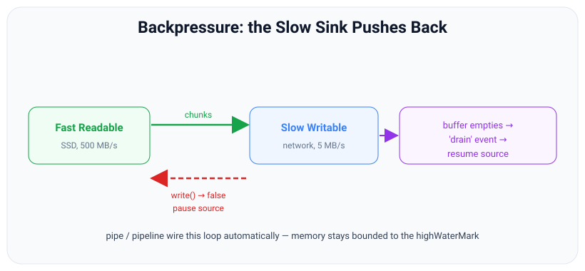
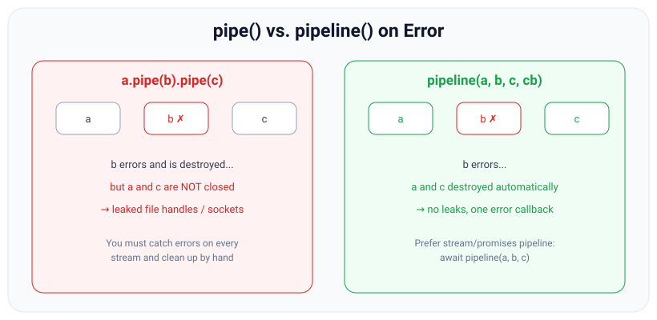

# Backpressure, pipe & pipeline

*10 min read · Updated 24 Jul 2026 Topic 29 of 70 Bookmark Mark done Why it matters Backpressure is the single most important concept in the entire chapter · Topic 29 of 70*

**Source:** [https://www.geekyfrontend.in/learn/nodejs-backend-kit/backpressure-piping](https://www.geekyfrontend.in/learn/nodejs-backend-kit/backpressure-piping)

---

## Why it matters

Backpressure is the single most important concept in the entire chapter, and the one most likely to be the deciding question in a senior Node interview. It is the reason streams stay memory-safe. Get it wrong and your service works flawlessly in testing, then silently accumulates gigabytes of buffered data under real load and gets OOM-killed — the most expensive category of production bug because it only shows up when the source is faster than the sink, which is exactly when traffic is high.

The connective tissue that manages backpressure for you is `pipe()` and its safer successor `pipeline()`. Knowing not just how to wire streams together but *why `pipeline()` exists and what `pipe()` gets wrong* is a hallmark of someone who has debugged real stream failures. This topic ties the whole chapter together: modes, buffers, highWaterMark, and events all exist to serve backpressure.

## The concept, simply

Backpressure is what happens when a fast producer is connected to a slow consumer. Picture pouring water from a wide jug into a narrow funnel. If you pour faster than the funnel drains, water backs up and overflows. Backpressure is the funnel telling the jug “stop pouring until I catch up.” In Node terms: a fast Readable (an SSD at 500 MB/s) feeding a slow Writable (a network socket at 5 MB/s) must be throttled, or the difference — 495 MB every second — piles up in memory.



Backpressure: the slow Writable signals write() false to pause the fast source, then emits drain when its buffer empties so the source resumes — memory stays bounded to the highWaterMark.

The signal is the Writable's `write()` return value. `false` means “my buffer is full, pause.” The all-clear is the `'drain'` event: “my buffer emptied below the highWaterMark, resume.” The whole protocol is: write until you get `false`, pause the source, wait for `'drain'`, resume. When you use `pipe()` or `pipeline()`, Node runs this loop for you automatically — you should almost never write it by hand.

## How it works

**The full signalling loop.** When a Readable is piped to a Writable, each chunk it produces is passed to `dest.write(chunk)`. If that returns `false`, `pipe()` calls `source.pause()`, halting the flow of `'data'` events at the source (which in turn stops the source pulling from its underlying resource once its own buffer fills). The Writable keeps draining its buffer to the underlying resource in the background. When the buffered amount falls below the Writable's `highWaterMark`, it emits `'drain'`, and `pipe()` calls `source.resume()`. The net effect is that total buffered memory across the two streams is bounded to roughly the sum of their highWaterMarks — a few tens of kilobytes — no matter how large the data or how big the speed mismatch.

**Why `pipe()` is not enough.** `pipe()` handles backpressure correctly, but it handles *errors* badly. If a stream in the chain emits `'error'`, `pipe()` does **not** automatically destroy the other streams. Consider `a.pipe(b).pipe(c)`: if `b` errors, `a` and `c` are left open — their file descriptors or sockets leak, and under load those leaks exhaust the process. Worse, an unhandled `'error'` on any of them crashes the process. To use `pipe()` safely you must attach an `'error'` handler to every single stream and manually destroy the others, which is verbose and easy to get wrong.



On error, pipe() leaves the other streams open (leaking descriptors); pipeline() destroys every stream in the chain and funnels the error to a single callback.

**What `pipeline()` fixes.** `stream.pipeline(...streams, callback)` (and the promise form `pipeline` from `node:stream/promises`) wires up backpressure exactly like `pipe()`, but additionally: if any stream errors or closes early, it **destroys all the others** so nothing leaks; it forwards the error to a single callback (or rejects the promise); and it only reports success when the last stream has genuinely finished. It is the correct default for connecting three-plus streams, and even for two. Since Node 15+ the promise version lets you simply `await pipeline(...)` inside a `try/catch`.

**Client disconnects are backpressure too.** When you stream a response and the client hangs up, the Writable (`res`) errors or closes. With `pipeline()`, the source file stream is destroyed automatically, so you stop reading a file nobody is listening to. With bare `pipe()`, that read continues, wasting I/O — another reason to prefer `pipeline()`.

## Code examples

**1. The wrong way — ignoring backpressure.** This is the code that passes tests and OOMs in production.

javascript

```
import { createReadStream, createWriteStream } from 'node:fs';

const src = createReadStream('huge.bin');
const dst = createWriteStream('/dev/slow-disk/out.bin');

// BAD: pushes every chunk into dst regardless of its buffer state.
src.on('data', (chunk) => {
  dst.write(chunk);          // return value ignored — backpressure lost
});
src.on('end', () => dst.end());
// If dst is slower than src, dst's buffer grows without bound → memory blows up.
```

**2. The right way — `pipeline()` from `node:stream/promises`.** Backpressure, error propagation, and cleanup all handled.

javascript

```
import { createReadStream, createWriteStream } from 'node:fs';
import { createGzip } from 'node:zlib';
import { pipeline } from 'node:stream/promises';

try {
  await pipeline(
    createReadStream('huge.bin'),
    createGzip(),
    createWriteStream('huge.bin.gz')
  );
  console.log('Done — memory stayed flat, all streams cleaned up.');
} catch (err) {
  // ANY stream erroring lands here; every stream was already destroyed.
  console.error('Pipeline failed:', err.message);
}
```

**3. Streaming an HTTP response safely, handling client disconnect.**

javascript

```
import { createServer } from 'node:http';
import { createReadStream } from 'node:fs';
import { pipeline } from 'node:stream/promises';

createServer(async (req, res) => {
  try {
    await pipeline(createReadStream('./big.mp4'), res);
  } catch (err) {
    // Client disconnect (ERR_STREAM_PREMATURE_CLOSE) or read error.
    // pipeline already destroyed the file stream — nothing leaks.
    if (!res.headersSent) { res.statusCode = 500; res.end(); }
  }
}).listen(3000);
```

**4. The manual drain loop — what `pipeline()` does for you.** Write this once to understand it, then never again in real code.

javascript

```
import { once } from 'node:events';
import { createReadStream, createWriteStream } from 'node:fs';

async function copyRespectingBackpressure(from, to) {
  const src = createReadStream(from);
  const dst = createWriteStream(to);
  for await (const chunk of src) {          // paused-mode: one chunk at a time
    if (!dst.write(chunk)) {                // buffer full?
      await once(dst, 'drain');             // wait for it to empty
    }
  }
  dst.end();
  await once(dst, 'finish');
}
// pipeline() also handles errors and destroys both streams — this version does not.
```

## Common mistakes & gotchas

- **Ignoring the return value of `write()` in a manual loop.** The archetypal backpressure bug — memory grows unbounded, no error is thrown, and it only manifests when the sink is slower than the source.
- **Using bare `pipe()` and assuming errors are handled.** They are not. A mid-chain error leaves the other streams open and leaking, and an unhandled `'error'` crashes the process.
- **Forgetting to clean up on error even with `pipe()`.** You must attach `'error'` to every stream and destroy the rest by hand — which is precisely why `pipeline()` exists.
- **Mixing `await pipeline()` with the callback form.** Import the promise version from `node:stream/promises` to `await`; the one from `node:stream` takes a callback and returns the last stream, not a promise.
- **Not handling client disconnects** when streaming responses — without `pipeline()`, the source keeps reading a file no one will receive.
- **Cranking the `highWaterMark` way up to “go faster.”** It just raises the memory ceiling and delays backpressure; it does not increase real throughput past the sink's actual rate.

## Best practices

- **Default to `pipeline()`** — specifically the promise version from `node:stream/promises` with `await` inside `try/catch` — for essentially all stream wiring, even two streams.
- **Never ignore the `write()` return value** in any hand-written loop; pause on `false`, resume on `'drain'`.
- **Let backpressure do its job** — don't defeat it by buffering chunks in an array or by raising the highWaterMark to hide a slow sink.
- **Handle errors in one place.** With `pipeline()` that is the catch/callback; avoid scattering `'error'` handlers across a bare `pipe()` chain.
- **For streaming responses, always account for client disconnect** — `pipeline()` tears down the source automatically so you stop doing useless I/O.
- **Reach for `stream/promises` helpers** (`pipeline`, `finished`) rather than manually listening for `'end'`/`'finish'`/`'close'`.

## ⭐ Interview lens

> **Q: What is backpressure and what mechanism implements it?**  
> Backpressure is a slow consumer throttling a fast producer so buffered data stays bounded. The mechanism: `writable.write()` returns `false` when the internal buffer reaches the highWaterMark; the producer pauses and waits for the `'drain'` event before resuming. `pipe()`/`pipeline()` run this loop automatically.

> **Q: Why prefer `pipeline()` over `pipe()`?** (The signature question.)  
> Both handle backpressure, but `pipe()` does not propagate errors or clean up: if one stream errors, the others stay open and leak descriptors, and an unhandled `'error'` crashes the process. `pipeline()` destroys every stream in the chain on any error or early close and reports the error to a single callback or rejected promise. It is safer and less code.

> **Q: In `a.pipe(b).pipe(c)`, `b` throws an error. What happens to `a` and `c`?** (Trap.)  
> They are *not* automatically closed. `a` keeps reading and `c` stays open — leaking their underlying resources — and if `b`'s `'error'` has no listener the process crashes. This is the core reason to use `pipeline(a, b, c)`, which destroys all three.

> **Q: You ignore the boolean from `write()` and just keep writing. What breaks and when?**  
> Nothing throws; the Writable's buffer grows past its highWaterMark without limit. Memory climbs and the process is eventually OOM-killed — but only when the sink is slower than the source, i.e., under real load, not in tests. It is a latent memory leak, not an immediate error.

> **Q: Does raising the `highWaterMark` increase throughput?**  
> Generally no. It raises how much data can buffer before backpressure kicks in — a bigger memory ceiling, not a faster sink. Real throughput is capped by the slowest stage. A larger mark can slightly reduce syscall overhead in some cases, but it mainly trades memory for delayed backpressure.

> **Q: How do you correctly handle a client disconnecting mid-stream while you serve a large file?**  
> Use `await pipeline(fileStream, res)` in a `try/catch`. On disconnect the response Writable closes/errors, `pipeline` rejects (often `ERR_STREAM_PREMATURE_CLOSE`) and automatically destroys the file Readable, so you immediately stop reading a file no one will receive. Bare `pipe()` would keep reading.

## Cheat-card

- **Backpressure** = slow sink throttles fast source so memory stays bounded.
- **Signal**: `write()` → `false` (buffer ≥ highWaterMark) → pause; `'drain'` → resume.
- **`pipe()`**: handles backpressure, *not* errors/cleanup — a mid-chain error leaks the other streams and can crash the process.
- **`pipeline()`**: backpressure *plus* destroys all streams on error and reports to one place. The correct default.
- **Use** `import { pipeline } from 'node:stream/promises'` → `await pipeline(a, b, c)` in `try/catch`.
- **Don't** ignore `write()`'s return, buffer chunks to defeat backpressure, or raise highWaterMark to “go faster.”
- **Cancel**: `await pipeline(a, b, c, { signal })` → `AbortError` (`code 'ABORT_ERR'`), your reason in `err.cause`; streams already ended or finished are not destroyed.
- **Append**: `await pipeline(src, out, { end: false })` (promise form only; added v18.0.0 / v17.2.0 / v16.14.0) or `src.pipe(out, { end: false })`; then `out.end()` and wait for `'finish'`.
- **`end: false` caveats**: resolves before the destination has flushed; middle Transforms are still ended; the destination is not destroyed on error.

---

## Learn More

- [Backpressuring in Streams | Node.js Learn nodejs.org](https://nodejs.org/en/learn/modules/backpressuring-in-streams)
- [Stream | Node.js Documentation nodejs.org](https://nodejs.org/api/stream.html)
- [Node.js Streams EXPLAINED: Backpressure, Buffer Overflow & drain Event Leela Web Dev](https://www.youtube.com/watch?v=scASodUqlbo)

---

## Additional topics

*Added 10 Oct 2026 · examples verified on Node v24.19.0*

### The `signal` option of `pipeline()`: cancelling a running pipeline

The promise form of `pipeline()` (from `node:stream/promises`, added in v15.0.0) takes an options object as its last argument, and `options.signal` is an `AbortSignal`. When the signal aborts, the pipeline destroys its streams with an `AbortError` and the promise rejects. You need it when the reason to stop comes from outside the streams: the user cancels an export, a deadline (`AbortSignal.timeout`) passes, or the server is shutting down. Without it you would keep references to every stream and destroy each one by hand, which is the error-prone work `pipeline()` exists to remove. Lesson [73 — AbortController and AbortSignal](73-abortcontroller-and-abortsignal.md) covers the signal itself and the different error shapes across APIs.

How it works:

1. `pipeline(a, b, c, { signal })` adds an `'abort'` listener to `signal` (with `events.addAbortListener`, per the v24.19.0 source). If the signal is already aborted, the pipeline fails at once.
2. When the signal aborts, `pipeline()` creates Node's `AbortError`: `name: 'AbortError'`, `code: 'ABORT_ERR'`, `message: 'The operation was aborted'`, and `cause: signal.reason`. It is an `Error`, not a `DOMException`.
3. It calls `destroy(abortError)` on every stream that is still active. Per the docs, streams that are already done are left alone: a Readable that has emitted `'end'` or `'close'`, and a Writable that has emitted `'finish'` or `'close'`. A destination passed with `{ end: false }` is also left alone (see the next topic).
4. The promise rejects with the `AbortError`. To tell "cancelled" from "failed", check `signal.aborted` (or `err.name === 'AbortError'` here, since `pipeline` always wraps the reason) and read the reason from `err.cause`.
5. Async generator stages get `{ signal }` as their second argument. It is the pipeline's own internal signal, not the object you passed, but it aborts when yours does (and when any stage fails), so a stage can pass it on to `fetch`, timers or database calls. In a separate run, after `ac.abort()` the generator's `signal.aborted` was `true` and `signal === ac.signal` was `false`.

**Example — abort an endless gzip pipeline after ~100 ms.**

javascript

```
import { Readable, Transform, Writable } from 'node:stream';
import { pipeline } from 'node:stream/promises';
import { createGzip } from 'node:zlib';
import { setTimeout as sleep } from 'node:timers/promises';

// An endless source, a gzip Transform and a slow sink. Abort after ~100 ms.
let produced = 0;
const src = new Readable({ read() { setTimeout(() => this.push(`row ${++produced}\n`), 5); } });
const gzip = createGzip();
let written = 0;
const dst = new Writable({ write(c, _e, cb) { written += c.length; setTimeout(cb, 5); } });

const ac = new AbortController();
setTimeout(() => ac.abort(new Error('user cancelled export')), 100);

try {
  await pipeline(src, gzip, dst, { signal: ac.signal });
} catch (err) {
  console.log('name   :', err.name);
  console.log('code   :', err.code);
  console.log('message:', err.message);
  console.log('cause  :', err.cause?.message);
  console.log('instanceof Error:', err instanceof Error, '| DOMException:', err instanceof DOMException);
}
await sleep(20);
for (const [name, s] of [['src', src], ['gzip', gzip], ['dst', dst]]) {
  console.log(`${name.padEnd(4)} destroyed=${s.destroyed} errored=${s.errored?.name ?? null}`);
}
console.log('rows produced before abort > 0:', produced > 0);

// Real output (Node v24.19.0):
//   name   : AbortError
//   code   : ABORT_ERR
//   message: The operation was aborted
//   cause  : user cancelled export
//   instanceof Error: true | DOMException: false
//   src  destroyed=true errored=AbortError
//   gzip destroyed=true errored=AbortError
//   dst  destroyed=true errored=AbortError
//   rows produced before abort > 0: true
```

All three streams, the source, the Transform in the middle and the sink, end up destroyed with the `AbortError` as `errored`. The reason passed to `abort()` is not the rejection itself; it is in `err.cause`.

**Example — which streams get destroyed: a source that has already ended is left alone.**

javascript

```
import { Readable, Writable } from 'node:stream';
import { pipeline } from 'node:stream/promises';

// The source ends at once (2 small chunks); the sink needs 50 ms per chunk.
const src = Readable.from(['a', 'b']);
const dst = new Writable({ objectMode: true, write(c, _e, cb) { setTimeout(cb, 50); } });
src.on('end', () => console.log("src 'end' (before the abort)"));

const err = await pipeline(src, dst, { signal: AbortSignal.timeout(30) }).catch((e) => e);
console.log('pipeline rejected:', err.name, '| cause:', err.cause.name);
console.log('src errored:', src.errored?.name ?? null, '| dst errored:', dst.errored?.name ?? null);

// Real output (Node v24.19.0):
//   src 'end' (before the abort)
//   pipeline rejected: AbortError | cause: TimeoutError
//   src errored: null | dst errored: AbortError
```

The source emitted `'end'` before the 30 ms deadline, so `pipeline()` did not destroy it with the `AbortError` (`src errored: null`); the sink was still writing and got it. Note that with `AbortSignal.timeout` the rejection is still named `AbortError`; the `TimeoutError` is in `err.cause`.

**Example — a signal that is already aborted.**

javascript

```
import { Readable, Writable } from 'node:stream';
import { pipeline } from 'node:stream/promises';
let reads = 0;
const src = new Readable({ read() { reads++; this.push(null); } });
const dst = new Writable({ write(c, e, cb) { cb(); } });
const err = await pipeline(src, dst, { signal: AbortSignal.abort('too late') }).catch((e) => e);
console.log(err.name, err.code, '| cause:', err.cause, '| _read() calls:', reads, '| destroyed:', src.destroyed, dst.destroyed);

// Real output (Node v24.19.0):
//   AbortError ABORT_ERR | cause: too late | _read() calls: 0 | destroyed: true true
```

The source's `_read()` was never called: no data moved, and both streams were destroyed. The string reason `'too late'` comes back as `err.cause`.

### `{ end: false }`: keeping the destination open

By default, when the source ends, `pipe()` and `pipeline()` call `end()` on the destination. `{ end: false }` turns that off, so the destination stays writable after the source is done. You need this to write several sources into one destination in turn (join log files, write a header, then a body, then a footer), or to pipe into a stream you do not own, such as a long-lived socket. Without it, the first source ends the destination and the second write fails.

- `readable.pipe(destination, { end: false })`: `pipe()` was added in v0.9.4 and takes `end` (default `true`); the v24 docs list no history entry for the option.
- `pipeline(...streams, { end: false })`: the `end` option was added in v18.0.0, v17.2.0 and v16.14.0, **in the promise form only** (`node:stream/promises`). The callback form from `node:stream` has no options parameter at all (see the example below). The docs add: "Transform streams are always ended, even if this value is `false`." Only the last stream is kept open.

How it works:

1. With `{ end: false }`, the pipe still forwards every chunk and still applies backpressure.
2. When the source emits `'end'`, the destination's `end()` is not called; `writableEnded` stays `false`.
3. The promise from `pipeline(…, { end: false })` resolves when the source side is done. It does not wait for the destination to write what it buffered, and it does not wait for `'finish'`, because there is none yet.
4. You call `destination.end()` yourself once, after the last source, and wait for `'finish'` (or `finished(destination)`) to know the data is written.
5. On an error or abort, `pipeline()` destroys the other streams but **not** the destination: in the v24.19.0 source, a last stream with `end: false` is left out of the list of streams to destroy. You end or destroy it yourself in your `catch` (example below).

**Example — append three files into one write stream, with `pipeline` and with `pipe`.**

javascript

```
import { createReadStream, createWriteStream } from 'node:fs';
import { writeFile, readFile, rm } from 'node:fs/promises';
import { pipeline } from 'node:stream/promises';
import { once } from 'node:events';

await writeFile('part1.log', 'jan: 3 errors\n');
await writeFile('part2.log', 'feb: 0 errors\n');
await writeFile('part3.log', 'mar: 7 errors\n');

// 1. pipeline(..., { end: false }): each file is appended; the writable stays open.
const out = createWriteStream('all.log');
for (const part of ['part1.log', 'part2.log', 'part3.log']) {
  await pipeline(createReadStream(part), out, { end: false });
  console.log(`after ${part}: out.writableEnded = ${out.writableEnded}`);
}
out.end('-- end of report --\n');            // we end it ourselves, once
await once(out, 'finish');
process.stdout.write(await readFile('all.log', 'utf8'));

// 2. The same with pipe(dest, { end: false }), one source after another.
const out2 = createWriteStream('all2.log');
for (const part of ['part1.log', 'part2.log']) {
  const src = createReadStream(part);
  src.pipe(out2, { end: false });
  await once(src, 'end');                     // wait for this source before starting the next
}
out2.end();
await once(out2, 'finish');
console.log('pipe version:', JSON.stringify(await readFile('all2.log', 'utf8')));

// 3. Without { end: false }, the first pipeline ends the writable and the second one fails.
const out3 = createWriteStream('all3.log');
await pipeline(createReadStream('part1.log'), out3);
try { await pipeline(createReadStream('part2.log'), out3); }
catch (err) { console.log('second pipeline without end:false ->', err.code); }

for (const f of ['part1.log', 'part2.log', 'part3.log', 'all.log', 'all2.log', 'all3.log']) await rm(f);

// Real output (Node v24.19.0):
//   after part1.log: out.writableEnded = false
//   after part2.log: out.writableEnded = false
//   after part3.log: out.writableEnded = false
//   jan: 3 errors
//   feb: 0 errors
//   mar: 7 errors
//   -- end of report --
//   pipe version: "jan: 3 errors\nfeb: 0 errors\n"
//   second pipeline without end:false -> ERR_STREAM_UNABLE_TO_PIPE
```

Each `pipeline(…, { end: false })` leaves `out.writableEnded === false`, so the next file appends to the same stream, and the final `out.end('-- end of report --\n')` writes a footer and closes it. With `pipe()`, wait for each source's `'end'` before starting the next one, or the files interleave. Without `{ end: false }`, the first pipeline ends `out3`, and the second one rejects with `ERR_STREAM_UNABLE_TO_PIPE`.

**Example — the callback form of `pipeline()` takes no options.**

javascript

```
import { pipeline, Readable, Writable } from 'node:stream';   // the CALLBACK form

const sink = new Writable({ write(c, _e, cb) { cb(); } });
try {
  // The callback form has no options parameter: the object is taken as one more stream.
  pipeline(Readable.from(['a']), sink, { end: false }, () => {});
} catch (err) {
  console.log(err.code, '-', err.message.slice(0, 60) + '…');
}

// Real output (Node v24.19.0):
//   ERR_INVALID_ARG_TYPE - The "body" argument must be of type function or an instance …
```

The object `{ end: false }` is checked as if it were a stream, so the call throws `ERR_INVALID_ARG_TYPE` at once. Use the promise form for `end` and `signal`.

**Example — with `{ end: false }`, a failing pipeline leaves the destination open.**

javascript

```
import { Readable, Writable } from 'node:stream';
import { pipeline } from 'node:stream/promises';

const failing = () => new Readable({ read() { this.destroy(new Error('read failed')); } });
const sink = () => new Writable({ write(c, _e, cb) { cb(); } });

for (const opts of [{}, { end: false }]) {
  const out = sink();
  const err = await pipeline(failing(), out, opts).catch((e) => e);
  console.log(`${JSON.stringify(opts).padEnd(14)} rejected: ${err.message} | destination destroyed: ${out.destroyed}`);
  if (!out.destroyed) out.destroy(err);   // with end:false, cleaning up the destination is your job
}

// Real output (Node v24.19.0):
//   {}             rejected: read failed | destination destroyed: true
//   {"end":false}  rejected: read failed | destination destroyed: false
```

Without the option, the failure destroys the destination as usual. With `{ end: false }`, the promise rejects but `out.destroyed` is still `false`: the file descriptor or socket stays open until you destroy or end it, which the last line of the loop does.

### Common mistakes & gotchas (additional topics)

- **Reading `err.message` to find out why an aborted pipeline stopped.** It is always `'The operation was aborted'`. The reason you passed is in `err.cause`.
- **Expecting `TimeoutError` from `pipeline` with `AbortSignal.timeout`.** The rejection is Node's `AbortError`; the `TimeoutError` `DOMException` is `err.cause`.
- **Passing `{ signal }` or `{ end: false }` to the callback form.** It has no options parameter and throws `ERR_INVALID_ARG_TYPE`. Import `pipeline` from `node:stream/promises`.
- **Treating the resolved promise of `pipeline(…, { end: false })` as "written".** It only means the source is done. Data can still be in the destination's buffer (edge case below). Call `end()` and wait for `'finish'`.
- **Forgetting the final `end()`.** With `{ end: false }` nobody else ends the destination: a file stays open and an HTTP response never completes.
- **Expecting a failed `pipeline(…, { end: false })` to clean up the destination.** It does not destroy the last stream on error or abort. Destroy or end it in your `catch`.
- **Expecting `{ end: false }` to keep a Transform open.** Middle Transforms are always ended; only the last stream is kept open. Start a new Transform for each source.
- **Running two `pipe(dest, { end: false })` calls at the same time.** Both sources write into `dest` as their chunks arrive, so the output interleaves. Run them one after another.

### Edge case worked through: `pipeline(…, { end: false })` resolves before the data is written

The destination below needs 20 ms per chunk. The second part pipes two sources through a gzip Transform into one collector with `{ end: false }`:

javascript

```
import { Readable, Writable } from 'node:stream';
import { pipeline } from 'node:stream/promises';
import { createGzip, gunzipSync } from 'node:zlib';

// A slow sink: each write takes 20 ms.
const saved = [];
const slow = new Writable({ write(c, _e, cb) { setTimeout(() => { saved.push(c); cb(); }, 20); } });

// 1. With { end: false } the promise resolves when the SOURCE is done,
//    not when the destination has written everything.
await pipeline(Readable.from(['a', 'b', 'c'], { objectMode: false }), slow, { end: false });
console.log('resolved: chunks saved so far =', saved.length, '| still buffered =', slow.writableLength, 'bytes');
slow.end();
await new Promise((r) => slow.on('finish', r));
console.log("after end() and 'finish': chunks saved =", saved.length);

// 2. A Transform in the middle is still ended (docs: "Transform streams are always ended").
const parts = [];
const collector = new Writable({ write(c, _e, cb) { parts.push(c); cb(); } });
for (const text of ['one ', 'two']) {
  const gzip = createGzip();
  await pipeline(Readable.from([text]), gzip, collector, { end: false });
  console.log(`gzip for "${text}": writableEnded = ${gzip.writableEnded} | collector open = ${!collector.writableEnded}`);
}
collector.end();
// Two complete gzip members back to back are still one valid gzip file.
console.log('gunzip of both members:', JSON.stringify(gunzipSync(Buffer.concat(parts)).toString()));

// Real output (Node v24.19.0):
//   resolved: chunks saved so far = 0 | still buffered = 3 bytes
//   after end() and 'finish': chunks saved = 3
//   gzip for "one ": writableEnded = true | collector open = true
//   gzip for "two": writableEnded = true | collector open = true
//   gunzip of both members: "one two"
```

When the first `await pipeline(…)` resolves, the sink has saved **none** of the three chunks; all 3 bytes are still in its buffer (`writableLength` 3). Only after `end()` and `'finish'` are all three saved. So with `{ end: false }`, "the pipeline resolved" means "the source is drained", and a process that exits or reads the file at that moment can miss the tail. The second part shows the docs' rule about Transforms: each `gzip` has `writableEnded === true` after its pipeline, while the collector stays open. Because each gzip was ended, each produced a complete gzip member, and two members back to back still form one valid gzip file, so `gunzipSync` returns `"one two"`.

### ⭐ Interview lens (additional topics)

> **Q: “How do you cancel a running `pipeline()`, and what do you get back?”**  
> A: Pass `{ signal }` as the last argument of the promise form. On abort, `pipeline()` destroys every stream that is not already finished (except a destination passed with `{ end: false }`) with Node's `AbortError` (`name 'AbortError'`, `code 'ABORT_ERR'`, an `Error`, not a `DOMException`) and rejects with it; your reason is in `err.cause`. Streams that already emitted `'end'`/`'finish'`/`'close'` are left alone. *Trap:* with `AbortSignal.timeout`, the error is still `AbortError`; `TimeoutError` is the cause.

> **Q: “How do you concatenate several files into one output stream?”**  
> A: Open one write stream, then for each file `await pipeline(createReadStream(file), out, { end: false })` (promise form, `end` option added in v18.0.0 / v17.2.0 / v16.14.0), then `out.end()` and wait for `'finish'`. Each pipeline still handles backpressure and errors. The files must run one after another, or their chunks interleave.
