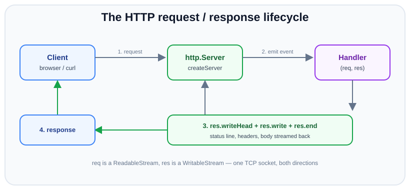
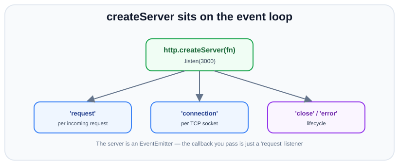

# The http module & createServer

*10 min read · Updated 24 Jul 2026 Topic 30 of 70 Bookmark Mark done Why it matters Every web framework you have ever used in Node · Topic 30 of 70*

**Source:** [https://www.geekyfrontend.in/learn/nodejs-backend-kit/http-module](https://www.geekyfrontend.in/learn/nodejs-backend-kit/http-module)

---

## Why it matters

Every web framework you have ever used in Node — Express, Fastify, Koa, Next.js, NestJS — is, at the bottom, a thin wrapper around one built-in module: `node:http`. When a request lands on your server, it is `http.Server` that accepted the TCP connection, parsed the bytes, and handed your code a `req` and a `res`. Frameworks add routing, middleware, and ergonomics, but they never replace this layer; they sit on top of it.

Understanding the raw module pays off in three concrete ways. First, **debugging**: when a request hangs, a socket leaks, or a response never flushes, the symptoms surface at the `http` layer, and you cannot reason about them if it is a black box. Second, **performance**: keep-alive, header size limits, and streaming all live here, and the defaults matter under load. Third, **interviews**: “build an HTTP server without Express” is one of the most common Node screening questions precisely because it reveals whether you understand the platform or just an abstraction over it.

This topic strips everything away. No `npm install`, no framework — just the module that ships with Node, the `createServer` factory, and the lifecycle of a single request from socket to response.

## The concept, simply

An HTTP server is a long-running process that listens on a TCP port. When a client opens a connection and sends an HTTP request, the server runs a function you supplied, giving it two objects: a *request* (what the client sent) and a *response* (a handle you write the reply into). You never poll or block waiting for requests — Node's event loop calls your function each time one arrives.

Two ideas make this click. The server is an **EventEmitter**: the callback you pass to `createServer` is registered as a listener for the `'request'` event. And `req` / `res` are **streams** — `req` is readable (the incoming body arrives in chunks) and `res` is writable (you push bytes back out). Once you see the request/response pair as “an event carrying two streams,” the rest of the module stops being magic.



The request/response lifecycle: one TCP socket, req is readable, res is writable.

## How it works

`http.createServer([options][, requestListener])` returns an `http.Server` instance. Calling `server.listen(port)` binds a listening socket and, from then on, the OS hands new TCP connections to Node. For each connection Node reads bytes off the socket and feeds them into an internal C++ HTTP parser (llhttp). The parser recognises the request line and headers, and the moment it has a complete header block it constructs an `http.IncomingMessage` (your `req`) and an `http.ServerResponse` (your `res`) and emits `'request'`.

Crucially, the `'request'` event fires **after headers are parsed but before the body is read**. The body may still be arriving. That is why `req` is a readable stream: you subscribe to its `'data'` and `'end'` events (or pipe it) to consume the payload. For a `GET` with no body, `'end'` fires almost immediately.

The `res` object is a writable stream with HTTP semantics layered on. Writing works in three logical phases: (1) the **status line and headers** — set with `res.statusCode`, `res.setHeader()`, or all at once with `res.writeHead()`; (2) the **body** — `res.write(chunk)`, callable many times to stream; (3) **termination** — `res.end([chunk])`, which flushes and closes the response. Headers can only be set before the first byte of body is written; after that they are “sent” and mutating them throws `ERR_HTTP_HEADERS_SENT`.

The server itself emits more than `'request'`. It emits `'connection'` for each new TCP socket, `'close'` when it stops, `'clientError'` when a malformed request cannot be parsed, and `'listening'` once the port is bound. Because it is an EventEmitter, `createServer(fn)` is literally sugar for `new http.Server().on('request', fn)`.



The server is an EventEmitter; your callback is just a 'request' listener.

One more mental model that avoids bugs: the callback runs **once per request**, and there is no global “current request” — every request has its own `req`/`res` closure. State you want to share across requests lives in module scope; state for a single request lives in that invocation.

It also helps to know that one TCP socket can carry **many** requests. Because HTTP/1.1 keep-alive is on by default, after you call `res.end()` Node keeps the connection open and the llhttp parser simply resets to await the next request line on the same socket, emitting `'request'` again with a brand-new `req`/`res` pair. So the `'connection'` event fires once per socket, but `'request'` can fire repeatedly on that same socket. This is why you attach per-request logic in the `'request'` listener and per-connection logic (rate-limiting by IP, socket timeouts) in `'connection'`. The pairing between a request and its response is positional: HTTP/1.1 has no request IDs, so responses must be written back in the exact order the requests arrived, which is precisely the head-of-line constraint that HTTP/2 later removed.

Finally, the server exposes a set of timeouts that are your first line of defence against slow or abusive clients. Node v18+ ships with safe defaults, but you should still set them deliberately for a production service. The table below summarises the ones that matter most:

| Property | Default (v20/22) | What it guards |
| --- | --- | --- |
| `server.headersTimeout` | 60000 ms | Max time to receive the complete header block — stops slow-loris header dribbling. |
| `server.requestTimeout` | 300000 ms | Max time to receive the entire request (headers + body). |
| `server.keepAliveTimeout` | 5000 ms | How long an idle keep-alive socket waits for the next request before closing. |
| `server.timeout` | 0 (off) | Inactivity timeout on the socket once a request is in flight. |
| `server.maxHeadersCount` | 2000 | Caps the number of headers to bound parser memory. |

## Code examples

The smallest complete server. It answers every request with plain text.

javascript

```
const http = require('node:http');

const server = http.createServer((req, res) => {
  res.statusCode = 200;
  res.setHeader('Content-Type', 'text/plain; charset=utf-8');
  res.end('Hello from raw Node
');
});

server.listen(3000, () => {
  console.log('Listening on http://localhost:3000');
});
```

The same server written to show that the callback is just an event listener, plus lifecycle hooks you will use in production (graceful logging, error handling):

javascript

```
const http = require('node:http');

const server = http.createServer();

server.on('request', (req, res) => {
  console.log(req.method, req.url);
  res.writeHead(200, { 'Content-Type': 'text/plain' });
  res.end('ok');
});

server.on('clientError', (err, socket) => {
  // Malformed request line/headers — parser could not build a req.
  socket.end('HTTP/1.1 400 Bad Request\r
\r
');
});

server.on('listening', () => console.log('up'));
server.listen(3000);
```

Streaming a response instead of buffering it — this is where `res` being a writable stream earns its keep. We send a large body in chunks without ever holding it all in memory:

javascript

```
const http = require('node:http');

http.createServer((req, res) => {
  res.writeHead(200, { 'Content-Type': 'text/plain' });
  let n = 0;
  const timer = setInterval(() => {
    res.write(`line ${++n}
`);
    if (n === 5) {
      clearInterval(timer);
      res.end('done
'); // flush + close
    }
  }, 200);

  // If the client disconnects mid-stream, stop working.
  res.on('close', () => clearInterval(timer));
}).listen(3000);
```

Graceful shutdown — a real service must stop accepting new connections but let in-flight requests finish. `server.close()` does exactly that:

javascript

```
const server = http.createServer(handler).listen(3000);

process.on('SIGTERM', () => {
  server.close(() => {
    console.log('drained, exiting');
    process.exit(0);
  });
  // Force-exit if connections don't drain in time.
  setTimeout(() => process.exit(1), 10_000).unref();
});
```

## Common mistakes & gotchas

- **Forgetting `res.end()`.** If you never call `end()`, the response never finishes, the client hangs until timeout, and the socket is held open. Every code path — including error branches — must terminate the response exactly once.
- **Setting headers after the body.** `res.setHeader()` or `writeHead()` after the first `res.write()` throws `ERR_HTTP_HEADERS_SENT`. Decide status and headers first.
- **Assuming the body is available in the callback.** The `'request'` event fires before the body arrives. Reading `req.body` gives `undefined` — there is no such property on the raw object; you must consume the stream.
- **Blocking the event loop.** A synchronous CPU-heavy loop or `fs.readFileSync` inside the handler stalls *every* concurrent request, because one thread services them all.
- **Ignoring backpressure.** `res.write()` returns `false` when the kernel buffer is full; ignoring it while pumping a fast source balloons memory. Use `pipe()` or honour the return value.
- **Leaking the port in tests.** Forgetting `server.close()` keeps the process alive and the port bound, causing `EADDRINUSE` on the next run.

## Best practices

- **Import with the `node:` prefix** (`require('node:http')`) so it is unambiguous that you mean the builtin, not an npm package.
- **Always attach a `'clientError'` handler** and an `'error'` handler on the server — unhandled server errors crash the process.
- **Set explicit timeouts** (`server.requestTimeout`, `server.headersTimeout`, `server.keepAliveTimeout`) to defend against slow-loris style attacks; the defaults are safer in v20 but still worth setting deliberately.
- **Terminate the response in a `finally`-style single exit** so no branch forgets `res.end()`.
- **Implement graceful shutdown** with `server.close()` on `SIGTERM` for zero-downtime deploys.
- **Never trust request input** at this layer — size-limit the body and validate headers before acting on them.

## ⭐ Interview lens

> **Q: What does `http.createServer(fn)` actually do with `fn`?**  
> It constructs an `http.Server` (an EventEmitter) and registers `fn` as a listener for the `'request'` event. It is equivalent to `new http.Server().on('request', fn)`. The function is invoked once per incoming HTTP request with a fresh `req`/`res` pair.

> **Q: When exactly does the request callback fire — before or after the body arrives?**  
> After the request line and headers are parsed, but generally *before* the body is fully received. That is why `req` is a readable stream and you must listen for `'data'`/`'end'` (or pipe it) to get the body. A common trap answer is “when the whole request is in” — wrong.

> **Q: Why can't you call `res.setHeader()` after `res.write()`?**  
> Because `write()` flushes the status line and headers to the socket first; once sent, they are immutable on the wire. Node enforces this by throwing `ERR_HTTP_HEADERS_SENT`. Headers must be finalised before any body byte.

> **Q: Is `req` a stream? What kind?**  
> Yes — `req` (an `IncomingMessage`) is a *readable* stream; `res` (a `ServerResponse`) is a *writable* stream. This is the single most important fact about the module and unlocks streaming uploads/downloads.

> **Q: Trap — if a request handler runs a 2-second synchronous loop, what happens to other clients?**  
> They all wait. Node handles requests on one event-loop thread; a synchronous block freezes the entire process, so every concurrent request is delayed by 2 seconds. The fix is to make the work async or offload it (worker thread / child process).

> **Q: How do you shut a server down without dropping in-flight requests?**  
> Call `server.close(callback)`: it stops accepting new connections and invokes the callback once existing ones drain. Pair it with a forced-exit timeout so a stuck keep-alive connection cannot block shutdown forever.

## Cheat-card

- `const http = require('node:http')` — builtin, no install.
- `http.createServer(fn)` = `new http.Server().on('request', fn)`.
- `server.listen(port[, cb])` binds the port; `'listening'` fires when ready.
- `req` = `IncomingMessage` (readable); `res` = `ServerResponse` (writable).
- Callback fires after headers, before body. Body via `'data'`/`'end'`.
- Order: status + headers → `res.write()` → `res.end()`. End exactly once.
- Headers are immutable after first body byte (`ERR_HTTP_HEADERS_SENT`).
- Graceful stop: `server.close()` on `SIGTERM`.
- One thread services all requests — never block it.
- **Client side:** `http.request`/`http.get` (Writable `ClientRequest`, Readable `IncomingMessage`) or the global `fetch` (bundled undici, `process.versions.undici`); details in lesson 75.
- **Same connection?** Compare `req.socket.remotePort`; back-to-back `fetch` calls can alternate between two sockets.

---

## Learn More

- [HTTP | Node.js Documentation nodejs.org](https://nodejs.org/api/http.html)
- [Introduction to Node.js | Node.js Learn nodejs.org](https://nodejs.org/en/learn/getting-started/introduction-to-nodejs)
- [Overview of HTTP | MDN developer.mozilla.org](https://developer.mozilla.org/en-US/docs/Web/HTTP/Guides/Overview)
- [How to Create a Simple HTTP Server in Node.js | HTTP Module Basics ProgrammingKnowledge](https://www.youtube.com/watch?v=qNDUQ-hLeoE)

---

## Additional topics

*Added 10 Oct 2026 · examples verified on Node v24.19.0*

### The client side: outbound requests

This lesson covers the server half of HTTP. The other half is your process acting as a *client*: it opens a TCP connection to another server, writes a request and reads the response. Node has two built-in clients. `http.request()` / `http.get()` live in this same `node:http` module. They return a `ClientRequest` (a Writable you write the body into) and hand you the response as an `IncomingMessage` (a Readable), the mirror image of the server's `req`/`res`. The global `fetch()` (unflagged in v18.0.0, stable since v21.0.0) is implemented by undici, a separate HTTP client bundled inside Node (`process.versions.undici` is `7.29.0` on v24.19.0), not by `http.request`. Both keep connections alive and reuse them, so the server side sees one `'connection'` and then several `'request'` events on the same socket. Timeouts, retries, streaming, uploads, redirects, proxies and client error codes are covered in [Outbound HTTP: fetch, undici and http.request](75-outbound-http-fetch-undici-and-http-request.md).

How it works:

1. `fetch(url)` hands the request to undici's global `Agent`, which keeps one connection pool per origin (scheme + host + port).
2. With no idle socket in the pool, it opens a new TCP connection. Your server emits `'connection'`, then `'request'`. `req.socket.remotePort` is the client's side of that connection.
3. The server writes headers and `res.end()`s the body. `fetch` resolves as soon as the headers arrive, and `res.text()` resolves when the body is complete.
4. The server's response carries `Connection: keep-alive` and `Keep-Alive: timeout=5` (from `server.keepAliveTimeout`, 5000 ms by default). The client returns the socket to its pool for the next request to the same origin.
5. `server.close()` stops accepting connections and, since v19.0.0, also closes idle keep-alive connections, so a script that serves and calls itself can exit.

**Example — this lesson's server, called by `fetch`.**

javascript

```
const http = require('node:http');

// The smallest server from this lesson, on port 4830
const server = http.createServer((req, res) => {
  console.log(`server: ${req.method} ${req.url} from port ${req.socket.remotePort}`);
  res.statusCode = 200;
  res.setHeader('Content-Type', 'text/plain; charset=utf-8');
  res.end('Hello from raw Node\n');
});

server.listen(4830, async () => {
  // The client side: the built-in fetch (Node 18+), no npm install
  for (const path of ['/first', '/second']) {
    const res = await fetch(`http://localhost:4830${path}`);
    console.log('client:', res.status, res.headers.get('content-type'), '|',
      res.headers.get('connection'), res.headers.get('keep-alive'), '|', JSON.stringify(await res.text()));
  }
  server.close();   // since v19.0.0 this also closes idle keep-alive sockets, so the process exits
});

// Real output (Node v24.19.0):
//   server: GET /first from port 40580
//   client: 200 text/plain; charset=utf-8 | keep-alive timeout=5 | "Hello from raw Node\n"
//   server: GET /second from port 40590
//   client: 200 text/plain; charset=utf-8 | keep-alive timeout=5 | "Hello from raw Node\n"
```

The two requests arrived from two different client ports, so `fetch` opened a second connection even though the first one was kept alive. The edge case below shows why. Client port numbers change on every run.

### Common mistakes & gotchas (additional topics)

- **Expecting `fetch` to reject on a 404 or 500.** It resolves with `res.ok === false`. Only network failures reject, as `TypeError: fetch failed` with the reason in `err.cause.code`.
- **Not reading the response body.** An unread body keeps its connection busy, so the next request to that host waits or opens another socket (lesson 75, Example 16). Read it, or call `res.body.cancel()`.
- **Expecting `http.Agent` settings to limit `fetch`.** They are separate clients with separate pools. With `http.globalAgent.maxSockets = 1`, two concurrent `http.get` calls shared one client port, while two concurrent `fetch` calls arrived on two (checked in a separate run).

### Edge case worked through: back-to-back `fetch` calls open a second connection

You would expect sequential requests (each `await`ed to the end) to use one keep-alive socket. The server's `req.socket.remotePort` shows they do not:

javascript

```
const http = require('node:http');

const seen = new Map();   // client port -> connection number
const server = http.createServer((req, res) => {
  const p = req.socket.remotePort;
  if (!seen.has(p)) seen.set(p, seen.size + 1);
  console.log(`  ${req.url} on connection #${seen.get(p)}`);
  res.end('Hello from raw Node\n');
});

server.listen(4831, async () => {
  const url = 'http://127.0.0.1:4831';
  console.log('back to back (next fetch starts as soon as text() resolves):');
  for (const p of ['/a1', '/a2', '/a3', '/a4']) await (await fetch(url + p)).text();

  console.log('one setImmediate between requests:');
  for (const p of ['/b1', '/b2', '/b3']) {
    await (await fetch(url + p)).text();
    await new Promise((r) => setImmediate(r));
  }
  server.close();
});

// Real output (Node v24.19.0):
//   back to back (next fetch starts as soon as text() resolves):
//     /a1 on connection #1
//     /a2 on connection #2
//     /a3 on connection #1
//     /a4 on connection #2
//   one setImmediate between requests:
//     /b1 on connection #1
//     /b2 on connection #1
//     /b3 on connection #1
```

When `await res.text()` resolves, the body has been delivered, but the client has not yet put the socket back in its pool; that happens a moment later. The next `fetch` starts in between, finds no idle socket and opens connection #2. After that the two sockets alternate. One `setImmediate` turn between requests is enough for the socket to return, and all three `/b` requests reused connection #1. (`undici.request()` from the npm package, 7.30.0, showed the same alternating pattern in a separate run.) It is harmless for a script, but a loop of sequential calls to one upstream holds two sockets where you expected one.

### ⭐ Interview lens (additional topics)

> **Q: “What is the difference between `http.request` and `fetch` in Node?”**  
> A: `http.request` is the core client in `node:http`. It gives you a writable `ClientRequest`, a readable `IncomingMessage` response, and an `http.Agent` for socket reuse, and it has no promise API. `fetch` is the WHATWG Fetch API, implemented by Node's bundled undici: promise-based, web streams for bodies, its own pool. Neither treats a 4xx or 5xx as an error. *Trap:* `fetch` is not a wrapper around `http.request`; they have separate pools and separate error codes.

> **Q: “How can a server tell that two requests came over the same connection?”**  
> A: Compare `req.socket.remotePort` (or keep a `WeakMap` keyed by `req.socket`). Same socket object and port means the same keep-alive connection; `'connection'` fires once per socket, `'request'` once per request.
