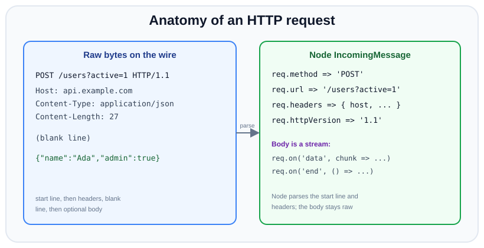

# Parsing requests & writing responses

*9 min read · Updated 24 Jul 2026 Topic 31 of 70 Bookmark Mark done Why it matters The req and res objects are where your server meets the network · Topic 31 of 70*

**Source:** [https://www.geekyfrontend.in/learn/nodejs-backend-kit/request-response](https://www.geekyfrontend.in/learn/nodejs-backend-kit/request-response)

---

## Why it matters

The `req` and `res` objects are where your server meets the network. Everything a client tells you — which resource, which verb, what content type, the auth token, the JSON payload — arrives on `req`. Everything you tell the client back — success or failure, the shape of the data, caching rules, cookies — you encode into `res`. Get these two objects right and your endpoints are correct, cacheable, and secure; get them wrong and you leak memory on large uploads, corrupt UTF-8 text, or silently accept malformed input.

This is also the layer frameworks hide, which means when something misbehaves — a body that never parses, a response that arrives with the wrong charset, a header the browser rejects — the fix lives here. And in interviews, “how do you read a POST body without Express?” separates people who understand streams from people who have only memorised `app.use(express.json())`.

## The concept, simply

An HTTP request has four parts: a **method** (GET, POST…), a **target** (the URL path plus query string), a set of **headers** (key/value metadata), and an optional **body** (the payload). Node parses the first three for you and exposes them synchronously as `req.method`, `req.url`, and `req.headers`. The body it does *not* parse — it hands you a stream, because a body can be gigabytes and Node will not silently buffer that into memory for you.

A response mirrors this: a **status code** (200, 404, 500…), **headers**, and a **body**. You set the status and headers, then write the body. That is the whole contract.



Node parses the start line and headers into properties; the body stays a raw stream.

## How it works

**Method and URL.** `req.method` is the uppercase verb string. `req.url` is only the *path and query* — e.g. `'/users?active=1'` — not the full URL; the host lives in `req.headers.host`. To parse it safely, use the WHATWG `URL` class with a base: `` new URL(req.url, `http://${req.headers.host}`) ``, which gives you `.pathname` and a `.searchParams` object. The legacy `url.parse()` is deprecated and has security footguns.

**Headers.** `req.headers` is a plain object with **lowercased** keys (HTTP header names are case-insensitive, so Node normalises them). Most headers are strings; `set-cookie` is special and is always an array. Duplicate headers other than a few are joined with `', '`. There is also `req.rawHeaders`, a flat array preserving original case and order, if you need the wire form.

**The body.** Because `req` is a readable stream, you assemble the body by collecting chunks. Chunks are `Buffer`s, not strings — concatenate the buffers and decode *once* at the end, otherwise a multi-byte UTF-8 character split across two chunks gets corrupted. You must also **size-limit** the body: an attacker (or a bug) can stream forever, so abort past a threshold. In modern Node you can skip the manual loop entirely with `req.text()` / `req.json()`-style helpers via `node:stream/consumers`, but knowing the manual version is expected.

**Writing the response.** `res.statusCode` defaults to 200. Set it, or pass it to `res.writeHead(status, headers)` which sets status and multiple headers in one call. `res.setHeader(name, value)` sets one header (and can be called repeatedly before the body). The body is written with `res.write()` (0+ times) and finished with `res.end()`. Always send a `Content-Type` — without it browsers guess (“MIME sniffing”), which is both a correctness and a security problem. For text, include the charset: `text/plain; charset=utf-8`.

**Content-Length vs chunked.** If you know the full body size, set `Content-Length` and the response is sent with that length. If you stream with multiple `write()`s and no length, Node uses *chunked transfer-encoding* automatically. Both are valid; you rarely set the encoding by hand.

**Backpressure on the response.** `res.write(chunk)` returns a boolean: `true` means the chunk fit in the kernel/socket buffer, `false` means the buffer is full and the data is being queued in memory. If you are copying from a fast source (a file, a database cursor) to a slow client and you ignore that `false`, Node keeps buffering and memory climbs unbounded. The correct pattern is to stop writing, wait for the writable stream's `'drain'` event, then resume — or simply `pipeline(source, res)` and let Node manage the flow control for you. This is the single most important reason to prefer `pipe`/`pipeline` over a hand-rolled read-and-write loop when relaying a stream to a response.

**What ends a response, and what a 1xx or HEAD changes.** A response is complete when Node has sent everything the framing promises: a full `Content-Length` worth of bytes, or the terminating zero-length chunk for chunked encoding. `res.end()` writes that terminator. Two edge cases surprise people. For a `HEAD` request you must send the exact same headers (including `Content-Length`) as the equivalent `GET`, but no body — so call `res.end()` with no data. And informational `1xx` responses (like `100 Continue` or `103 Early Hints`) are sent with `res.writeProcessing()` / `res.writeEarlyHints()` *before* the final status; they do not count as “the” response and do not lock your headers, so you can still send a normal `200` afterwards.

**Trailers.** Occasionally you need to send a header whose value you only know *after* the body (a checksum, a computed length). HTTP supports *trailers* for exactly this: declare them up front with `res.setHeader('Trailer', 'Content-MD5')` (only valid with chunked encoding), stream the body, then supply the values with `res.addTrailers({ 'Content-MD5': digest })` immediately before `res.end()`. They are rarely needed but come up in streaming and gRPC-over-HTTP contexts.

## Code examples

Reading a JSON body safely, with a size cap and correct decoding:

javascript

```
const http = require('node:http');

const MAX_BODY = 1_000_000; // 1 MB

function readJson(req) {
  return new Promise((resolve, reject) => {
    const chunks = [];
    let size = 0;
    req.on('data', (chunk) => {
      size += chunk.length;
      if (size > MAX_BODY) {
        reject(Object.assign(new Error('Payload too large'), { status: 413 }));
        req.destroy();
        return;
      }
      chunks.push(chunk);
    });
    req.on('end', () => {
      if (chunks.length === 0) return resolve(undefined);
      try {
        resolve(JSON.parse(Buffer.concat(chunks).toString('utf8')));
      } catch {
        reject(Object.assign(new Error('Invalid JSON'), { status: 400 }));
      }
    });
    req.on('error', reject);
  });
}

http.createServer(async (req, res) => {
  if (req.method === 'POST') {
    try {
      const body = await readJson(req);
      res.writeHead(200, { 'Content-Type': 'application/json' });
      res.end(JSON.stringify({ received: body }));
    } catch (err) {
      res.writeHead(err.status || 500, { 'Content-Type': 'application/json' });
      res.end(JSON.stringify({ error: err.message }));
    }
  } else {
    res.writeHead(405, { Allow: 'POST' }).end();
  }
}).listen(3000);
```

The same body read using the modern stream-consumers helper (Node 16.7+), which handles the loop for you:

javascript

```
const { json } = require('node:stream/consumers');

http.createServer(async (req, res) => {
  const body = await json(req); // reads + JSON.parses the stream
  res.setHeader('Content-Type', 'application/json');
  res.end(JSON.stringify({ received: body }));
}).listen(3000);
```

Inspecting the request — method, path, query, and a header — and echoing them back:

javascript

```
http.createServer((req, res) => {
  const url = new URL(req.url, `http://${req.headers.host}`);
  const info = {
    method: req.method,
    path: url.pathname,
    query: Object.fromEntries(url.searchParams),
    userAgent: req.headers['user-agent'] ?? null,
    httpVersion: req.httpVersion,
  };
  res.writeHead(200, { 'Content-Type': 'application/json; charset=utf-8' });
  res.end(JSON.stringify(info, null, 2));
}).listen(3000);
```

Setting several response headers, including a cookie, and choosing an explicit status:

javascript

```
http.createServer((req, res) => {
  res.statusCode = 201;
  res.setHeader('Content-Type', 'application/json');
  res.setHeader('Cache-Control', 'no-store');
  res.setHeader('Set-Cookie', 'sid=abc123; HttpOnly; Path=/; SameSite=Lax');
  res.end(JSON.stringify({ id: 42 }));
}).listen(3000);
```

## Common mistakes & gotchas

- **Treating `req.url` as the full URL.** It is only the path + query. Building a `URL` without a base throws; supply `http://${req.headers.host}`.
- **Decoding each chunk separately.** `chunk.toString()` per chunk corrupts multi-byte characters that straddle a chunk boundary. Concatenate buffers, then decode once.
- **No body size limit.** Buffering an unbounded stream into an array is a denial-of-service vector. Always cap and abort.
- **Assuming header values are strings.** `set-cookie` is always an array; some proxies send repeated headers. Handle both.
- **Omitting `Content-Type`.** Leads to MIME sniffing and broken clients; for JSON always send `application/json`.
- **Wrong status semantics.** Returning `200` with an error body, or `500` for user input errors. Use `4xx` for client faults, `5xx` for server faults.
- **Trusting header case.** Reading `req.headers['Content-Type']` returns `undefined` — keys are lowercased. Use `'content-type'`.

## Best practices

- **Parse URLs with the WHATWG `URL` class**, never the deprecated `url.parse()`.
- **Cap body size** and reject with `413 Payload Too Large` before buffering the rest.
- **Always set an explicit `Content-Type` with charset** for text.
- **Validate `Content-Type` before parsing** — do not `JSON.parse` a body a client claimed was `text/html`.
- **Return the right status code**: `400` invalid, `401` unauth, `404` missing, `405` wrong method (with an `Allow` header), `413` too big, `500` server error.
- **Set security headers** (`X-Content-Type-Options: nosniff`, `Cache-Control`) deliberately rather than relying on defaults.
- **Prefer `node:stream/consumers`** (`json()`, `text()`, `buffer()`) for concise, correct body reading.

## ⭐ Interview lens

> **Q: How do you read a POST body in raw Node?**  
> Listen on the `req` stream: collect `Buffer` chunks in `'data'`, concatenate them in `'end'` with `Buffer.concat`, then decode with `.toString('utf8')` and parse. Enforce a max size and handle `'error'`. Modern shortcut: `await require('node:stream/consumers').json(req)`.

> **Q: Why concatenate buffers instead of building a string chunk by chunk?**  
> A UTF-8 character can span two chunks; calling `toString()` on each chunk decodes a partial byte sequence and produces replacement characters (�). Concatenating the raw buffers first and decoding once preserves the bytes.

> **Q: What is in `req.url` exactly?**  
> Only the request target: the path and query string (e.g. `/search?q=node`). Not the scheme, not the host. The host is in `req.headers.host`. To parse, use `` new URL(req.url, `http://${req.headers.host}`) ``.

> **Q: Trap — why does `req.headers['Content-Type']` come back `undefined`?**  
> Node lowercases all header keys, so the correct access is `req.headers['content-type']`. Header names are case-insensitive on the wire; Node normalises them to lowercase in the parsed object.

> **Q: What's the difference between `writeHead` and `setHeader`?**  
> `setHeader(name, value)` sets one header and can be called repeatedly before the body; the header can still be read back or overwritten. `writeHead(status, headers)` sets the status and a batch of headers and marks them as sent — after it, headers are effectively flushed. You cannot `setHeader` after `writeHead`/first `write`.

> **Q: Which status for “the client used the wrong HTTP method”?**  
> `405 Method Not Allowed`, and you must include an `Allow` header listing the accepted methods. Returning `404` or `400` is a common wrong answer.

## Cheat-card

- `req.method` — uppercase verb; `req.url` — path + query only.
- `req.headers` — lowercased keys; `set-cookie` is an array.
- Body = stream: `'data'` (Buffers) → `Buffer.concat` → `.toString('utf8')`.
- Parse URL: `` new URL(req.url, `http://${req.headers.host}`) ``.
- Shortcut: `stream/consumers` → `json()` / `text()` / `buffer()`.
- Response: set status + headers → `write` → `end`.
- Always send `Content-Type`; cap body size (413).
- Status map: 400 / 401 / 404 / 405+Allow / 413 / 500.
- Urlencoded form: cap the body, decode once, `new URLSearchParams(text)` (`+` → space, `%XX` → bytes).
- Multipart: use busboy 1.6.0 with `limits`; a file stream's `'limit'` + `truncated` means you answer 413.
- ETag: `"x"` strong, `W/"x"` weak; `If-None-Match` compares weakly → 304; `If-Range` compares strongly.
- Range: 206 + `Content-Range: bytes a-b/len`; unsatisfiable → 416 + `bytes */len`; several → `multipart/byteranges`.
- Client IP: walk `X-Forwarded-For` from the right past your own proxies; never the left-most entry; Express `trust proxy` = your proxies, not `true`.

---

## Learn More

- [HTTP messages | MDN developer.mozilla.org](https://developer.mozilla.org/en-US/docs/Web/HTTP/Messages)
- [Overview of HTTP | MDN developer.mozilla.org](https://developer.mozilla.org/en-US/docs/Web/HTTP/Guides/Overview)
- [HTTP | Node.js Documentation nodejs.org](https://nodejs.org/api/http.html)
- [How to Create a Simple HTTP Server in Node.js | HTTP Module Basics ProgrammingKnowledge](https://www.youtube.com/watch?v=qNDUQ-hLeoE)

---

## Additional topics

*Added 10 Oct 2026 · examples verified on Node v24.19.0*

### Parsing urlencoded forms by hand

An HTML form submitted without a file input sends `Content-Type: application/x-www-form-urlencoded` and a body such as `name=Zo%C3%AB+%26+Ada&tag=c`. The body is the same text format as a query string. Pairs are separated by `&`, the key and value by `=`, a space is written as `+`, and any other unsafe byte is written as `%XX` (UTF-8 bytes, one `%XX` per byte). Node does not parse it for you, because `req` is a stream. `URLSearchParams` (global since v10.0.0) does the splitting and decoding once you have the whole body as a string. Without a size cap, a client can keep sending bytes and you keep buffering them.

How it works:

1. Check `Content-Type` first. Compare only the media type before `;`, in lower case, because clients add parameters (`fetch` sends `application/x-www-form-urlencoded;charset=UTF-8`).
2. Collect `Buffer` chunks and count bytes. When the count passes the cap, stop reading and answer `413`.
3. On `'end'`, `Buffer.concat` the chunks and decode once as UTF-8, so a multi-byte character split across chunks stays intact.
4. `new URLSearchParams(text)` turns `+` into a space and `%XX` sequences into characters. `get()` returns the first value for a key and `getAll()` returns every value.

**Example — a urlencoded handler with a 1 KiB cap, fed by `fetch`.**

javascript

```
// urlenc.mjs: parse application/x-www-form-urlencoded by hand, with a size cap.
import http from 'node:http';

const MAX = 1024; // bytes; a real form handler might allow 100 KiB

function readBody(req, max) {
  return new Promise((resolve, reject) => {
    const chunks = [];
    let size = 0;
    req.on('data', (c) => {
      size += c.length;
      if (size > max) {
        reject(Object.assign(new Error('body too large'), { status: 413 }));
        req.pause();                 // stop reading; we answer, then close
        return;
      }
      chunks.push(c);
    });
    req.on('end', () => resolve(Buffer.concat(chunks)));
    req.on('error', reject);
  });
}

const server = http.createServer(async (req, res) => {
  const type = (req.headers['content-type'] ?? '').split(';')[0].trim().toLowerCase();
  if (type !== 'application/x-www-form-urlencoded') {
    res.writeHead(415, { 'Content-Type': 'text/plain; charset=utf-8' }).end('want a urlencoded form\n');
    return;
  }
  try {
    const body = (await readBody(req, MAX)).toString('utf8');  // decode once, after the last chunk
    const form = new URLSearchParams(body);                     // splits on & and =, decodes + and %XX
    const out = { ct: req.headers['content-type'], name: form.get('name'), tags: form.getAll('tag'), raw: body };
    res.writeHead(200, { 'Content-Type': 'application/json' }).end(JSON.stringify(out));
  } catch (err) {
    res.writeHead(err.status ?? 400, { 'Content-Type': 'text/plain; charset=utf-8', Connection: 'close' });
    res.end(err.message + '\n');
  }
});

server.listen(0, async () => {
  const url = `http://127.0.0.1:${server.address().port}/`;
  let r = await fetch(url, { method: 'POST', body: new URLSearchParams([['name', 'Zoë & Ada'], ['tag', 'a+b'], ['tag', 'c']]) });
  console.log(r.status, (await r.text()).trim());
  r = await fetch(url, { method: 'POST', body: new URLSearchParams({ big: 'x'.repeat(5000) }) });
  console.log(r.status, (await r.text()).trim());
  r = await fetch(url, { method: 'POST', body: 'name=x', headers: { 'content-type': 'text/plain' } });
  console.log(r.status, (await r.text()).trim());
  server.close();
});

// Real output (Node v24.19.0):
//   200 {"ct":"application/x-www-form-urlencoded;charset=UTF-8","name":"Zoë & Ada","tags":["a+b","c"],"raw":"name=Zo%C3%AB+%26+Ada&tag=a%2Bb&tag=c"}
//   413 body too large
//   415 want a urlencoded form
```

The value `a+b` arrived as `a%2Bb` and came back as `a+b`. A literal `+` in the body would have been decoded as a space.

### Parsing multipart/form-data by hand, and why that is fragile

A form with a file input sends `multipart/form-data`. The `Content-Type` header carries a `boundary` parameter, and the body is a list of parts separated by lines of `--` + boundary. Each part has its own small header block (`Content-Disposition: form-data; name="…"; filename="…"`, optionally `Content-Type`), a blank line, then the raw bytes of the field or file. The last delimiter is `--` + boundary + `--`. File bytes are sent as-is, so they can contain CR, LF, `--` or any byte value.

How it works:

1. Read the boundary from the `Content-Type` header.
2. Search the raw bytes (a `Buffer`, never a decoded string) for `CRLF--boundary`. The first delimiter has no CRLF before it, so the parser below prepends one.
3. After each delimiter, `--` means the end of the body. Otherwise skip the CRLF, read headers up to the first `CRLF CRLF`, and take the bytes up to the next delimiter as the part's content.
4. Parse `name` and `filename` out of `Content-Disposition`.

**Example — a minimal parser, fed a real body that `fetch` + `FormData` built.** Node's `FormData` and `fetch` come from undici (7.29.0 in Node v24.19.0) and produce a body in the RFC 7578 format that HTML form submissions use: a random boundary, `Content-Disposition` per part and `Content-Type` for file parts. The file here deliberately contains `\r\n--` and a `0xff` byte.

javascript

```
// multipart-hand.mjs: a minimal multipart/form-data parser, fed real bytes from fetch + FormData.
import http from 'node:http';
import { buffer } from 'node:stream/consumers';

// Returns [{ name, filename, type, data: Buffer }]. Buffers the whole body: fine for a demo only.
function parseMultipart(body, contentType) {
  const m = /boundary=([^;]+)/i.exec(contentType);
  if (!m) throw new Error('no boundary');
  const delim = Buffer.from('\r\n--' + m[1]);
  const parts = [];
  // The first delimiter has no leading CRLF, so prepend one to make every delimiter look the same.
  const buf = Buffer.concat([Buffer.from('\r\n'), body]);
  let pos = buf.indexOf(delim);
  while (pos !== -1) {
    const start = pos + delim.length;
    if (buf.subarray(start, start + 2).toString() === '--') break;   // "--boundary--" closes the body
    const headEnd = buf.indexOf('\r\n\r\n', start);
    const next = buf.indexOf(delim, headEnd);
    if (headEnd === -1 || next === -1) throw new Error('truncated body');
    const head = buf.subarray(start + 2, headEnd).toString('latin1');  // skip the CRLF after the boundary
    const disp = /content-disposition:[^\r\n]*/i.exec(head)?.[0] ?? '';
    parts.push({
      name: /\bname="([^"]*)"/.exec(disp)?.[1],
      filename: /\bfilename="([^"]*)"/.exec(disp)?.[1],
      type: /content-type:\s*([^\r\n]*)/i.exec(head)?.[1],
      data: buf.subarray(headEnd + 4, next),                            // raw bytes, not decoded
    });
    pos = next;
  }
  return parts;
}

const server = http.createServer(async (req, res) => {
  const body = await buffer(req);
  console.log('content-type:', req.headers['content-type']);
  console.log('raw body:', JSON.stringify(body.toString('latin1')));
  const parts = parseMultipart(body, req.headers['content-type']);
  for (const p of parts) console.log('part:', p.name, p.filename, p.type, p.data);
  res.end('ok');
});

server.listen(0, async () => {
  const form = new FormData();
  form.append('title', 'Zoë');
  // file content contains CRLF and a "--" so a sloppy split would break
  form.append('doc', new Blob([Buffer.from([0x68, 0x69, 0x0d, 0x0a, 0x2d, 0x2d, 0xff])], { type: 'application/octet-stream' }), 'a b.bin');
  await fetch(`http://127.0.0.1:${server.address().port}/`, { method: 'POST', body: form });
  server.close();
});

// Real output (Node v24.19.0):
//   content-type: multipart/form-data; boundary=----formdata-undici-076583417957
//   raw body: "------formdata-undici-076583417957\r\nContent-Disposition: form-data; name=\"title\"\r\n\r\nZoë\r\n------formdata-undici-076583417957\r\nContent-Disposition: form-data; name=\"doc\"; filename=\"a b.bin\"\r\nContent-Type: application/octet-stream\r\n\r\nhi\r\n--ÿ\r\n------formdata-undici-076583417957--\r\n"
//   part: title undefined undefined <Buffer 5a 6f c3 ab>
//   part: doc a b.bin application/octet-stream <Buffer 68 69 0d 0a 2d 2d ff>
```

The boundary digits change on every run. The parser works for this body, but it is fragile, because it handles only the shape one client happened to produce:

- **It buffers the whole body.** A 2 GB upload means 2 GB of memory. A real parser must stream, and then a delimiter can be split across two chunks, so the search has to carry bytes over from one chunk to the next.
- **The header grammar is wider than the regexes.** The boundary may be quoted (`boundary="a b"`), parameter values may be quoted or bare tokens, and header names are case-insensitive. Some clients send `filename*=UTF-8''…` even though RFC 7578 says senders MUST NOT use it.
- **Escaping differs between clients.** undici writes a `"` in a field name or filename as `%22`, and CR and LF as `%0D` and `%0A` (one run gave `name="x%22y"; filename="a%22b%0Ac.txt"`). Other clients may use backslashes or send raw UTF-8. A regex like `filename="([^"]*)"` gives a different answer for each.
- **Limits are missing.** Nothing caps the number of parts, the header size, or the size of each file, so one request can make the parser do unbounded work.
- **The filename is attacker input.** `../../etc/passwd` is a legal value. Never use it as a path.

### The same upload with busboy

busboy (version 1.6.0, its only dependency is `streamsearch`) is a `Writable` stream parser for `multipart/form-data` and `application/x-www-form-urlencoded`. You pipe `req` into it and it emits a `'field'` event per text field and a `'file'` event per file. Each file arrives as its own `Readable` stream, so a file is never held in memory unless you buffer it yourself. The `multer` upload middleware for Express (2.4.0) depends on `busboy ^1.6.0`.

How it works:

1. `busboy({ headers: req.headers, limits })` reads the boundary from `headers['content-type']`. It throws if the type is missing, unsupported, or has no boundary, so wrap it in `try`.
2. `limits` (from the README): `fieldNameSize` (default 100 bytes), `fieldSize` (default 1 MiB), `fields`, `fileSize`, `files`, `parts` (all default `Infinity`) and `headerPairs` (default 2000).
3. `'file'` gives `(name, stream, info)` where `info` is `{ filename, encoding, mimeType }`. You must consume every file stream (pipe it somewhere, or call `stream.resume()`), or busboy never finishes.
4. When a file passes `fileSize`, the file stream emits `'limit'`, the rest of that file is discarded, and `stream.truncated` is `true`. The request is not rejected for you. You decide to answer `413` and delete what you stored.
5. When a count limit is reached, the parser emits `'filesLimit'`, `'fieldsLimit'` or `'partsLimit'` and skips the extra parts.
6. `'close'` on the parser means every part has been handled.

**Example — `fileSize: 10` and `files: 1`, with one small upload and one large one** (`npm install busboy@1.6.0`).

javascript

```
// bb.mjs: the same upload parsed by busboy 1.6.0, streaming, with limits.
import http from 'node:http';
import busboy from 'busboy';

const server = http.createServer((req, res) => {
  let bb;
  try {
    bb = busboy({ headers: req.headers, limits: { fileSize: 10, files: 1, fields: 5 } });
  } catch (err) {                       // missing/unsupported Content-Type or no boundary
    res.writeHead(400).end(err.message + '\n');
    return;
  }
  const result = { fields: {}, files: [] };
  bb.on('field', (name, value, info) => { result.fields[name] = value; });
  bb.on('file', (name, stream, info) => {
    const file = { name, ...info, bytes: 0 };
    stream.on('data', (c) => { file.bytes += c.length; });          // here you would pipe to disk/S3
    stream.on('limit', () => console.log(`  'limit' event: ${info.filename} hit fileSize`));
    stream.on('close', () => { file.truncated = stream.truncated; result.files.push(file); });
  });
  bb.on('filesLimit', () => console.log("  'filesLimit' event: extra file skipped"));
  bb.on('close', () => {
    const tooBig = result.files.some((f) => f.truncated);
    res.writeHead(tooBig ? 413 : 200, { 'Content-Type': 'application/json' });
    res.end(JSON.stringify(result));
  });
  req.pipe(bb);
});

server.listen(0, async () => {
  const url = `http://127.0.0.1:${server.address().port}/`;
  for (const size of [7, 25]) {
    const form = new FormData();
    form.append('title', 'Zoë');
    form.append('doc', new Blob([Buffer.alloc(size, 0x61)]), `f${size}.txt`);
    form.append('doc2', new Blob(['second']), 'second.txt');     // over files: 1
    const r = await fetch(url, { method: 'POST', body: form });
    console.log(size, '->', r.status, await r.text());
  }
  const r = await fetch(url, { method: 'POST', body: 'x', headers: { 'content-type': 'multipart/form-data' } });
  console.log('no boundary ->', r.status, (await r.text()).trim());
  server.close();
});

// Real output (Node v24.19.0):
//     'filesLimit' event: extra file skipped
//   7 -> 200 {"fields":{"title":"Zoë"},"files":[{"name":"doc","filename":"f7.txt","encoding":"7bit","mimeType":"application/octet-stream","bytes":7,"truncated":false}]}
//     'limit' event: f25.txt hit fileSize
//     'filesLimit' event: extra file skipped
//   25 -> 413 {"fields":{"title":"Zoë"},"files":[{"name":"doc","filename":"f25.txt","encoding":"7bit","mimeType":"application/octet-stream","bytes":10,"truncated":true}]}
//   no boundary -> 400 Multipart: Boundary not found
```

The 25-byte file stopped at 10 bytes, `'limit'` fired, and the handler turned `truncated` into a `413`. The second file field was skipped in both requests because `files` is 1.

### ETags, conditional GET and byte ranges

An **ETag** is an opaque string, in double quotes, that the server sends to name one version of a resource. A client that already has a copy sends it back in `If-None-Match`, and if it still matches the server answers `304 Not Modified` with no body. A **strong** ETag (`"abc"`) promises the bytes are identical, so it is safe for byte ranges. A **weak** ETag (`W/"abc"`) only promises the content is equivalent (for example, the same data with different compression), so it is good for cache validation but not for stitching ranges together. A content hash gives a strong tag. Size plus modification time is cheaper but only weak, since a file rewritten with the same size within the same millisecond keeps its tag.

A **Range** request (`Range: bytes=0-499`) asks for part of the resource. The server answers `206 Partial Content` with `Content-Range: bytes 0-499/1234`, and resumable downloads and video seeking depend on it. RFC 9110 sets the comparison rules: `If-None-Match` uses the **weak** comparison (`W/"x"` matches `"x"`), and `If-Range` uses the **strong** comparison, so a weak tag never matches there.

How it works:

1. Send `ETag` and `Accept-Ranges: bytes` on every response.
2. `If-None-Match` present and matching (weak comparison, `*` matches anything) → `304`, no body.
3. `Range` present: parse `bytes=` specs. `a-b` is inclusive, `a-` runs to the end, `-n` is the last n bytes. A spec whose end is before its start, or any syntax error, means you ignore the header and send `200`.
4. `If-Range` present and not a strong match → ignore `Range`, send the full `200` (the client's partial copy is stale).
5. No spec starts inside the resource → `416 Range Not Satisfiable` with `Content-Range: bytes */<length>`.
6. One range → `206` with `Content-Range` and that slice. Several ranges → `206` with `Content-Type: multipart/byteranges; boundary=…`, where each part has its own `Content-Range`.

**Example — a 26-byte file served with strong and weak ETags, ranges and multiple ranges.** Create `alphabet.txt` with `printf 'abcdefghijklmnopqrstuvwxyz' > alphabet.txt` next to the script. The strong tag is a hash of the bytes, so you get the same value. The weak tag contains the file's mtime, so yours will differ.

javascript

```
// etag-range.mjs: conditional GET (ETag / If-None-Match) and byte ranges (Range / If-Range).
import http from 'node:http';
import { createHash } from 'node:crypto';
import { readFileSync, statSync } from 'node:fs';

const FILE = new URL('./alphabet.txt', import.meta.url);
const data = readFileSync(FILE);                      // 26 bytes: a..z
const st = statSync(FILE);
const strongTag = `"${createHash('sha256').update(data).digest('base64url').slice(0, 16)}"`;
const weakTag = `W/"${st.size.toString(16)}-${Math.floor(st.mtimeMs).toString(16)}"`;

// If-None-Match uses the WEAK comparison: W/"x" and "x" match each other.
const opaque = (tag) => tag.replace(/^W\//, '');
function noneMatch(header, current) {
  if (header.trim() === '*') return true;
  return header.split(',').some((t) => opaque(t.trim()) === opaque(current));
}

// Returns null (ignore the header), 'unsatisfiable', or a list of [start, end] (inclusive).
function parseRange(header, size) {
  const m = /^bytes=(.+)$/.exec(header);
  if (!m) return null;
  const out = [];
  for (const spec of m[1].split(',')) {
    const r = /^\s*(\d*)-(\d*)\s*$/.exec(spec);
    if (!r || (r[1] === '' && r[2] === '')) return null;        // bad syntax: serve the whole thing
    let start, end;
    if (r[1] === '') { start = Math.max(size - Number(r[2]), 0); end = size - 1; }   // bytes=-N: last N
    else { start = Number(r[1]); end = r[2] === '' ? size - 1 : Math.min(Number(r[2]), size - 1); }
    if (r[1] !== '' && r[2] !== '' && Number(r[2]) < start) return null;            // 9-3 is invalid
    if (start < size && !(r[1] === '' && r[2] === '0')) out.push([start, end]);      // drop unsatisfiable ones
  }
  return out.length ? out : 'unsatisfiable';
}

http.createServer((req, res) => {
  const tag = req.url === '/weak' ? weakTag : strongTag;
  res.setHeader('ETag', tag);
  res.setHeader('Accept-Ranges', 'bytes');
  res.setHeader('Cache-Control', 'no-cache');      // cache may store it, but must revalidate

  const inm = req.headers['if-none-match'];
  if (inm !== undefined && noneMatch(inm, tag)) {
    res.writeHead(304).end();                       // no body, same validators
    return;
  }

  let ranges = req.headers.range ? parseRange(req.headers.range, data.length) : null;
  // If-Range needs a STRONG match; a weak tag never matches, so the client gets the full 200.
  const ifRange = req.headers['if-range'];
  if (ranges && ifRange !== undefined && (ifRange.startsWith('W/') || tag.startsWith('W/') || ifRange !== tag)) ranges = null;

  if (ranges === 'unsatisfiable') {
    res.writeHead(416, { 'Content-Range': `bytes */${data.length}`, 'Content-Length': 0 }).end();
    return;
  }
  if (!ranges) {
    res.writeHead(200, { 'Content-Type': 'text/plain; charset=utf-8', 'Content-Length': data.length }).end(data);
    return;
  }
  if (ranges.length === 1) {
    const [s, e] = ranges[0];
    res.writeHead(206, {
      'Content-Type': 'text/plain; charset=utf-8',
      'Content-Range': `bytes ${s}-${e}/${data.length}`,
      'Content-Length': e - s + 1,
    }).end(data.subarray(s, e + 1));
    return;
  }
  // Several ranges: one multipart/byteranges body, each part with its own Content-Range.
  const boundary = 'RANGE_SEP';
  const pieces = ranges.map(([s, e]) => Buffer.concat([
    Buffer.from(`\r\n--${boundary}\r\nContent-Type: text/plain; charset=utf-8\r\nContent-Range: bytes ${s}-${e}/${data.length}\r\n\r\n`),
    data.subarray(s, e + 1),
  ]));
  const body = Buffer.concat([...pieces, Buffer.from(`\r\n--${boundary}--\r\n`)]);
  res.writeHead(206, { 'Content-Type': `multipart/byteranges; boundary=${boundary}`, 'Content-Length': body.length }).end(body);
}).listen(5400, () => console.log('listening on 5400', strongTag, weakTag));

// Real output (Node v24.19.0):
//   listening on 5400 "ccSA35PWri8e-tFE" W/"1a-1a1257d6fcf"
```

Then, from another terminal:

bash

```
$ curl -si http://127.0.0.1:5400/
HTTP/1.1 200 OK
ETag: "ccSA35PWri8e-tFE"
Accept-Ranges: bytes
Cache-Control: no-cache
Content-Type: text/plain; charset=utf-8
Content-Length: 26
Date: Sat, 10 Oct 2026 11:07:44 GMT
Connection: keep-alive
Keep-Alive: timeout=5

abcdefghijklmnopqrstuvwxyz
$ curl -si -H 'If-None-Match: "ccSA35PWri8e-tFE"' http://127.0.0.1:5400/
HTTP/1.1 304 Not Modified
ETag: "ccSA35PWri8e-tFE"
Accept-Ranges: bytes
Cache-Control: no-cache
Date: Sat, 10 Oct 2026 11:07:44 GMT
Connection: keep-alive
Keep-Alive: timeout=5
$ curl -s -o /dev/null -w '%{http_code}\n' -H 'If-None-Match: W/"ccSA35PWri8e-tFE"' http://127.0.0.1:5400/
304
$ curl -s -o /dev/null -w '%{http_code}\n' -H 'If-None-Match: "old", "older"' http://127.0.0.1:5400/
200
$ curl -si -H 'Range: bytes=0-4' http://127.0.0.1:5400/
HTTP/1.1 206 Partial Content
ETag: "ccSA35PWri8e-tFE"
Accept-Ranges: bytes
Cache-Control: no-cache
Content-Type: text/plain; charset=utf-8
Content-Range: bytes 0-4/26
Content-Length: 5
Date: Sat, 10 Oct 2026 11:07:44 GMT
Connection: keep-alive
Keep-Alive: timeout=5

abcde
$ curl -s -w '  %{http_code} %header{content-range}\n' -H 'Range: bytes=-3' http://127.0.0.1:5400/
xyz  206 bytes 23-25/26
$ curl -s -w '  %{http_code} %header{content-range}\n' -H 'Range: bytes=20-' http://127.0.0.1:5400/
uvwxyz  206 bytes 20-25/26
$ curl -si -H 'Range: bytes=100-200' http://127.0.0.1:5400/
HTTP/1.1 416 Range Not Satisfiable
ETag: "ccSA35PWri8e-tFE"
Accept-Ranges: bytes
Cache-Control: no-cache
Content-Range: bytes */26
Content-Length: 0
Date: Sat, 10 Oct 2026 11:07:44 GMT
Connection: keep-alive
Keep-Alive: timeout=5
$ curl -si -H 'Range: bytes=0-1,24-' http://127.0.0.1:5400/
HTTP/1.1 206 Partial Content
ETag: "ccSA35PWri8e-tFE"
Accept-Ranges: bytes
Cache-Control: no-cache
Content-Type: multipart/byteranges; boundary=RANGE_SEP
Content-Length: 197
Date: Sat, 10 Oct 2026 11:07:44 GMT
Connection: keep-alive
Keep-Alive: timeout=5


--RANGE_SEP
Content-Type: text/plain; charset=utf-8
Content-Range: bytes 0-1/26

ab
--RANGE_SEP
Content-Type: text/plain; charset=utf-8
Content-Range: bytes 24-25/26

yz
--RANGE_SEP--
$ curl -s -w '  %{http_code}\n' -H 'Range: bytes=0-4' -H 'If-Range: "stale"' http://127.0.0.1:5400/
abcdefghijklmnopqrstuvwxyz  200
$ curl -s -w '  %{http_code}\n' -H 'Range: bytes=0-4' -H 'If-Range: "ccSA35PWri8e-tFE"' http://127.0.0.1:5400/
abcde  206
$ curl -s -w '  %{http_code}\n' -H 'Range: bytes=0-4' -H 'If-Range: W/"1a-1a1257d6fcf"' http://127.0.0.1:5400/weak
abcdefghijklmnopqrstuvwxyz  200
$ curl -s -o /dev/null -w '%{http_code} %header{etag}\n' -H 'If-None-Match: "1a-1a1257d6fcf"' http://127.0.0.1:5400/weak
304 W/"1a-1a1257d6fcf"
```

`curl -r 0-4 URL` sends the same `Range: bytes=0-4` header. RFC 9110 lets a server ignore or reject many small or overlapping ranges, because they are a denial-of-service pattern. A production server should cap the number of ranges.

### `X-Forwarded-For` and trust boundaries

`req.socket.remoteAddress` is the IP address of the TCP peer: the machine at the other end of this connection. Behind a reverse proxy or load balancer that peer is always the proxy, so proxies add the address they saw to an `X-Forwarded-For` header, giving a comma-separated list such as `client, proxy1`. That header is just text the client can also send. Anyone can send `X-Forwarded-For: 1.2.3.4`, and a proxy that appends (nginx's `$proxy_add_x_forwarded_for` does) keeps the fake value at the left. Code that takes the left-most entry for rate limiting, audit logs or IP allow-lists is trusting the client.

How it works:

1. Build the list of hops: the `X-Forwarded-For` entries in order, then `req.socket.remoteAddress` as the last hop.
2. Know which addresses are your own proxies. That set is configuration, not something you can work out from the request.
3. Walk from the right. Skip each address that belongs to one of your proxies. The first address that is not yours is the client: the last machine that handed the request to infrastructure you control.
4. Everything left of that entry was written by the client or by someone else's proxy and cannot be verified.
5. If the TCP peer is not one of your proxies, the request did not come through them, so ignore the header entirely. Step 3 does this, because the right-most hop is then already untrusted.

**Example — a client on 127.0.0.5, a proxy that connects onward from 127.0.0.3, and an app.** On Linux every address in 127.0.0.0/8 is loopback, so `localAddress` gives each role its own source address in one process.

javascript

```
// xff.mjs: a client, a reverse proxy and an app, each on its own loopback address.
// client 127.0.0.5 -> proxy 127.0.0.1 (connects onward from 127.0.0.3) -> app 127.0.0.1
import http from 'node:http';

const TRUSTED_PROXIES = new Set(['127.0.0.3']);   // addresses of proxies YOU run

function clientIp(req) {
  // Hops in arrival order: whatever the header claims, then the peer we can actually see.
  const hops = (req.headers['x-forwarded-for'] ?? '').split(',').map((s) => s.trim()).filter(Boolean);
  hops.push(req.socket.remoteAddress);
  // Walk from the right. Skip our own proxies; the first address we do not run is the client.
  for (let i = hops.length - 1; i >= 0; i--) {
    if (!TRUSTED_PROXIES.has(hops[i])) return hops[i];
  }
  return hops[0];
}

const app = http.createServer((req, res) => {
  const xff = req.headers['x-forwarded-for'];
  res.end(JSON.stringify({
    remoteAddress: req.socket.remoteAddress,          // the TCP peer: always the last hop
    xff,
    naiveLeftMost: xff?.split(',')[0].trim(),         // what the client typed, if it typed anything
    rightMostUntrusted: clientIp(req),
  }, null, 1));
});

// The proxy appends the address of the peer it sees, like nginx's $proxy_add_x_forwarded_for.
const proxy = http.createServer((req, res) => {
  const prior = req.headers['x-forwarded-for'];
  const seen = req.socket.remoteAddress;
  const headers = { ...req.headers, 'x-forwarded-for': prior ? `${prior}, ${seen}` : seen };
  const up = http.request({ host: '127.0.0.1', port: app.address().port, localAddress: '127.0.0.3',
                            path: req.url, method: req.method, headers }, (r) => {
    res.writeHead(r.statusCode, r.headers);
    r.pipe(res);
  });
  req.pipe(up);
});

function get(port, headers = {}) {
  return new Promise((resolve) => {
    http.get({ host: '127.0.0.1', port, localAddress: '127.0.0.5', headers, agent: false }, async (r) => {
      let s = ''; for await (const c of r) s += c; resolve(s);
    });
  });
}

app.listen(0, '127.0.0.1', () => proxy.listen(0, '127.0.0.1', async () => {
  console.log('1) through the proxy, honest client:\n', await get(proxy.address().port));
  console.log('2) through the proxy, spoofed header:\n', await get(proxy.address().port, { 'X-Forwarded-For': '1.2.3.4' }));
  console.log('3) straight to the app, spoofed header:\n', await get(app.address().port, { 'X-Forwarded-For': '1.2.3.4' }));
  app.close(); proxy.close();
}));

// Real output (Node v24.19.0):
//   1) through the proxy, honest client:
//    {
//    "remoteAddress": "127.0.0.3",
//    "xff": "127.0.0.5",
//    "naiveLeftMost": "127.0.0.5",
//    "rightMostUntrusted": "127.0.0.5"
//   }
//   2) through the proxy, spoofed header:
//    {
//    "remoteAddress": "127.0.0.3",
//    "xff": "1.2.3.4, 127.0.0.5",
//    "naiveLeftMost": "1.2.3.4",
//    "rightMostUntrusted": "127.0.0.5"
//   }
//   3) straight to the app, spoofed header:
//    {
//    "remoteAddress": "127.0.0.5",
//    "xff": "1.2.3.4",
//    "naiveLeftMost": "1.2.3.4",
//    "rightMostUntrusted": "127.0.0.5"
//   }
```

In case 2 the naive answer is the spoofed `1.2.3.4`. The right-most untrusted answer is the real client in all three cases.

**How Express's `trust proxy` relates.** Express computes `req.ip` and `req.ips` with the `proxy-addr` package (2.0.8 under Express 5.2.1) from the same two inputs, `req.socket.remoteAddress` and `X-Forwarded-For`. The `trust proxy` setting is the "which addresses are my proxies" set from step 2. The run below (`npm install express@5.2.1`) sends `X-Forwarded-For: 1.2.3.4, 127.0.0.5` from 127.0.0.3, the proxy's address, under each setting:

javascript

```
// trust.cjs: what Express 5.2.1 puts in req.ip / req.ips for each 'trust proxy' setting.
const http = require('node:http');
const express = require('express');

const settings = [false, true, '127.0.0.3', 1, 'loopback'];
(async () => {
  for (const setting of settings) {
    const app = express();
    app.set('trust proxy', setting);
    app.get('/', (req, res) => res.json({ ip: req.ip, ips: req.ips }));
    const server = app.listen(0, '127.0.0.1');
    await new Promise((r) => server.once('listening', r));
    // Pretend to be the proxy at 127.0.0.3 forwarding a client that spoofed 1.2.3.4
    const body = await new Promise((resolve) => {
      http.get({ host: '127.0.0.1', port: server.address().port, localAddress: '127.0.0.3', agent: false,
                 headers: { 'X-Forwarded-For': '1.2.3.4, 127.0.0.5' } }, async (r) => {
        let s = ''; for await (const c of r) s += c; resolve(s);
      });
    });
    console.log(`trust proxy = ${JSON.stringify(setting).padEnd(11)} -> ${body}`);
    server.close();
  }
})();

// Real output (Node v24.19.0):
//   trust proxy = false       -> {"ip":"127.0.0.3","ips":[]}
//   trust proxy = true        -> {"ip":"1.2.3.4","ips":["1.2.3.4","127.0.0.5"]}
//   trust proxy = "127.0.0.3" -> {"ip":"127.0.0.5","ips":["127.0.0.5"]}
//   trust proxy = 1           -> {"ip":"127.0.0.5","ips":["127.0.0.5"]}
//   trust proxy = "loopback"  -> {"ip":"1.2.3.4","ips":["1.2.3.4","127.0.0.5"]}
```

- `false` (the default) ignores the header, so `req.ip` is the TCP peer.
- `true` trusts every hop, so `req.ip` is the left-most entry, which is the spoofed one.
- An address or subnet (`'127.0.0.3'`) or a hop count (`1`) gives the right-most untrusted answer.
- `'loopback'` trusts `127.0.0.1/8` and `::1/128` (from `proxy-addr`'s source). In this setup the client is on loopback too, so it is trusted and the spoof wins. On a real deployment the client is not on loopback, but the lesson holds: trust exactly your proxies' addresses.

See the Express guide [Express behind proxies](https://expressjs.com/en/guide/behind-proxies.html) for the full list of accepted values.

### Common mistakes & gotchas (additional topics)

- **Comparing `Content-Type` with `===`.** `fetch` sends `application/x-www-form-urlencoded;charset=UTF-8`, and multipart always carries `; boundary=…`. Compare the media type before `;`, lower-cased.
- **Splitting multipart bodies as strings.** Decoding to UTF-8 before finding boundaries corrupts binary files (`0xff` becomes `U+FFFD`). Search the `Buffer`.
- **Treating a busboy `'limit'` as a rejection.** busboy truncates the file and carries on. Check `stream.truncated` and answer `413` yourself, and delete any partial file you wrote.
- **Not consuming a busboy file stream.** If a `'file'` listener ignores the stream, the parser never emits `'close'` and the request hangs.
- **Generating a strong ETag from size and mtime.** Two writes within the timestamp resolution keep the same tag. Mark it `W/` or hash the content.
- **Answering `304` with a body, or forgetting the `ETag` on it.** A `304` has no body and should repeat the validators the `200` would have sent.
- **Sending `416` without `Content-Range: bytes */<length>`.** The client then cannot learn the real size.
- **Taking the left-most `X-Forwarded-For` entry, or setting `trust proxy` to `true`.** Both trust whatever the client typed.

### Edge case worked through: a legal multipart body the hand parser cannot read

RFC 2046 allows a space inside a boundary, and then the `Content-Type` header must quote it. Some clients also send `filename*=UTF-8''…` (RFC 5987 encoding) even though RFC 7578 says not to. Both are inputs a server meets in practice. The regexes from `parseMultipart` above fail on both, and busboy reads both:

javascript

```
// quoted.mjs: a legal body the hand parser gets wrong; busboy gets it right.
import { Readable } from 'node:stream';
import busboy from 'busboy';

// Same regexes as parseMultipart in multipart-hand.mjs
const naiveBoundary = (ct) => /boundary=([^;]+)/i.exec(ct)?.[1];
const naiveFilename = (disp) => /\bfilename="([^"]*)"/.exec(disp)?.[1];

// RFC 2046 allows a space inside a boundary, and then the header must quote it.
// RFC 7578 says senders MUST NOT use filename*=, but some clients still send it.
const ct = 'multipart/form-data; boundary="b0und ary"';
const body =
  '--b0und ary\r\n' +
  'Content-Disposition: form-data; name="doc"; filename*=UTF-8\'\'r%C3%A9sum%C3%A9.txt\r\n' +
  '\r\n' +
  'hello\r\n' +
  '--b0und ary--\r\n';

console.log('naive boundary :', JSON.stringify(naiveBoundary(ct)));   // keeps the quotes
console.log('naive filename :', naiveFilename(body.split('\r\n')[1]));

const bb = busboy({ headers: { 'content-type': ct } });
bb.on('file', (name, stream, info) => {
  stream.resume();
  console.log('busboy file    :', name, info.filename);
});
bb.on('close', () => console.log('busboy done'));
Readable.from([Buffer.from(body)]).pipe(bb);

// Real output (Node v24.19.0):
//   naive boundary : "\"b0und ary\""
//   naive filename : undefined
//   busboy file    : doc résumé.txt
//   busboy done
```

The naive boundary keeps the quotes, so no delimiter would ever match and the parser would find zero parts. The naive filename is `undefined`. busboy strips the quotes and decodes the percent-encoded UTF-8 filename. This is why hand parsing is fine for learning the format, and production code should use a maintained parser with limits.

### ⭐ Interview lens (additional topics)

> **Q: “A client sends `Range: bytes=0-99` with `If-Range: W/"v1"`. What do you return?”**  
> A: The full `200` with the whole resource. `If-Range` uses the strong comparison, and a weak tag never matches under it, so the condition is false and the server must ignore `Range`. The client should not send a weak tag in `If-Range` at all. For `If-None-Match`, by contrast, `W/"v1"` does match `"v1"`, because that header uses the weak comparison. *Trap:* answering `206` because the tag text matches.

> **Q: “How do you get the client IP behind a load balancer?”**  
> A: `req.socket.remoteAddress` is the load balancer, so read `X-Forwarded-For` and walk it from the right, skipping the addresses of proxies you operate. The first address you do not operate is the client. Entries to the left of it are unverified client input. In Express, set `trust proxy` to your proxies' addresses or the hop count rather than `true`, then read `req.ip`. *Trap:* taking the first entry, which any client can set.
