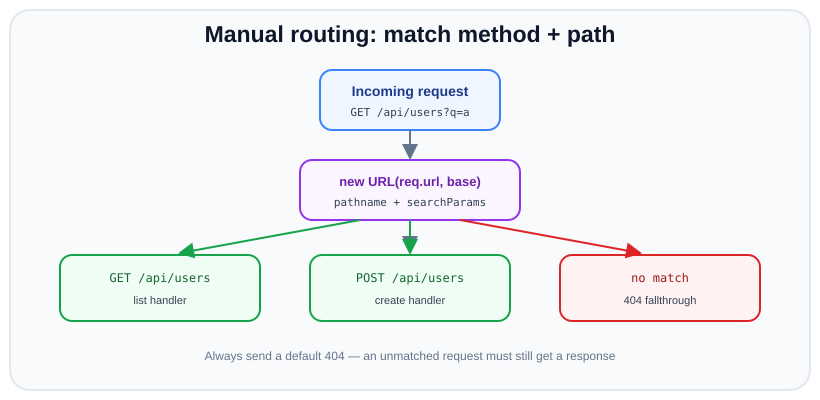

# Manual routing & serving JSON

*10 min read · Updated 24 Jul 2026 Topic 32 of 70 Bookmark Mark done Why it matters A real API answers different requests differently · Topic 32 of 70*

**Source:** [https://www.geekyfrontend.in/learn/nodejs-backend-kit/routing-basics](https://www.geekyfrontend.in/learn/nodejs-backend-kit/routing-basics)

---

## Why it matters

A real API answers *different requests differently*: `GET /users` lists, `POST /users` creates, `GET /users/42` fetches one, and anything else returns 404. That dispatch — deciding which handler runs based on method and path — is **routing**. Frameworks give you `app.get('/users', ...)`, but under the hood they are doing exactly what you will build by hand here: reading `req.method` and the URL pathname and choosing a function.

Writing routing yourself once is worth a dozen framework tutorials. It shows you where path parameters come from, why route order matters, how query strings are parsed, and why a missing default case leaves requests hanging. It is also a staple interview exercise — “implement a tiny router” — because it exercises string handling, HTTP semantics, and clean control flow all at once.

## The concept, simply

Routing is a two-key lookup: **method + path → handler**. You take the incoming `req.method` and the URL's `pathname`, compare them against the routes you know about, and call the matching handler. If nothing matches, you send a `404`. If the path matches but the method does not, you send a `405`. Everything else — parsing the query string, extracting an id from `/users/42`, serving JSON — is detail layered on top of that core decision.



Manual routing matches method plus path; an unmatched request must still get a default 404.

## How it works

**Separating path from query.** `req.url` bundles both (`/users?active=1`). Build a `URL` object — `` const u = new URL(req.url, `http://${req.headers.host}`) `` — and route on `u.pathname` (`/users`), reading filters from `u.searchParams`. Never route on the raw `req.url`, or a query string would break every equality check.

**Static vs dynamic paths.** A static route is a literal string compare: `pathname === '/users'`. A dynamic route has a parameter, like `/users/:id`. Two common techniques: split the pathname on `/` and inspect segments (`parts[1] === 'users' && parts[2]`), or match a `RegExp` with a capture group (`/^\/users\/([^/]+)$/`) and read the captured id. Real routers precompile a set of such patterns.

**Method matters.** The same path serves different verbs. Structure the dispatch so that a matched path checks the method and returns `405` (with an `Allow` header) when the verb is unsupported, rather than falling through to `404` — that distinction is semantically correct and helps clients.

**Query parsing.** `u.searchParams` is a `URLSearchParams` instance: `.get('q')` for a single value, `.getAll('tag')` for repeats, `Object.fromEntries(u.searchParams)` for a plain object (note: that collapses repeated keys to the last). Values are already percent-decoded.

**Serving JSON.** Set `Content-Type: application/json`, then `res.end(JSON.stringify(data))`. A small `sendJson(res, status, data)` helper removes repetition and guarantees every response has the right header and a single `end()`. The key discipline: *every branch must terminate the response exactly once*, and there must be a catch-all 404 so no request escapes unanswered.

**Order and fallthrough.** Routes are evaluated in order; the first match wins. Put specific routes before general ones. After all checks, an explicit `else` sends the 404 — this is the single most common bug when hand-rolling routing: forgetting the default leaves unmatched requests to hang until the client times out.

**Normalising the path before you match.** Two URLs that look the same to a human can be different strings to a naive router. `/Users` and `/users` differ in case; `/users/` has a trailing slash; `/users/%34%32` is a percent-encoded `/users/42`. The `URL` class already percent-decodes `pathname` for you, but it does *not* lower-case or strip trailing slashes — those are policy decisions you make. A common approach is to canonicalise once at the top of the handler: lower-case the pathname if your routes are case-insensitive, and strip a single trailing slash (except for the root `/`) so `/users` and `/users/` hit the same handler. Do this *before* any comparison so every route benefits, and be deliberate about it — some APIs treat a trailing slash as a distinct “collection” resource on purpose.

**Matching strategies at a glance.** The three techniques you will reach for scale differently:

| Strategy | Good for | Cost |
| --- | --- | --- |
| `if`/`else` ladder | A handful of routes; learning | O(n) string compares; unwieldy past ~10 routes. |
| Object/`Map` lookup by `"METHOD path"` | Many *static* routes | O(1) lookup, but cannot express `:param` segments. |
| Compiled `RegExp` list | Dynamic routes with params | O(n) regex tests; what Express/Fastify do under the hood (Fastify uses a radix tree for O(k)). |

Most real frameworks combine these: a fast structure (hash map or radix/trie tree) keyed on static segments, with regex only for the dynamic pieces. Understanding the trade-off is exactly what “how would this scale to 500 routes?” is probing for in an interview.

## Code examples

A compact JSON API with static and dynamic routes, method handling, and a 404 fallback:

javascript

```
const http = require('node:http');

const users = new Map([[1, { id: 1, name: 'Ada' }]]);
let nextId = 2;

function sendJson(res, status, data) {
  const body = JSON.stringify(data);
  res.writeHead(status, {
    'Content-Type': 'application/json; charset=utf-8',
    'Content-Length': Buffer.byteLength(body),
  });
  res.end(body);
}

async function readJson(req) {
  const chunks = [];
  for await (const c of req) chunks.push(c);
  return chunks.length ? JSON.parse(Buffer.concat(chunks).toString('utf8')) : {};
}

const server = http.createServer(async (req, res) => {
  const url = new URL(req.url, `http://${req.headers.host}`);
  const path = url.pathname;

  // GET /users?limit=n  → list
  if (path === '/users' && req.method === 'GET') {
    const limit = Number(url.searchParams.get('limit')) || 100;
    return sendJson(res, 200, [...users.values()].slice(0, limit));
  }

  // POST /users → create
  if (path === '/users' && req.method === 'POST') {
    const body = await readJson(req);
    if (!body.name) return sendJson(res, 400, { error: 'name required' });
    const user = { id: nextId++, name: body.name };
    users.set(user.id, user);
    return sendJson(res, 201, user);
  }

  // GET /users/:id → fetch one
  const match = path.match(/^\/users\/(\d+)$/);
  if (match && req.method === 'GET') {
    const user = users.get(Number(match[1]));
    return user
      ? sendJson(res, 200, user)
      : sendJson(res, 404, { error: 'not found' });
  }

  // Path matched but wrong method → 405
  if (path === '/users') {
    res.writeHead(405, { Allow: 'GET, POST' }).end();
    return;
  }

  // Nothing matched → 404
  sendJson(res, 404, { error: 'route not found' });
});

server.listen(3000);
```

A slightly more scalable pattern — a route table keyed by `METHOD path`, which is closer to how minimal routers work:

javascript

```
const routes = {
  'GET /health': (req, res) => sendJson(res, 200, { ok: true }),
  'GET /users': (req, res, url) =>
    sendJson(res, 200, [...users.values()]),
};

http.createServer((req, res) => {
  const url = new URL(req.url, `http://${req.headers.host}`);
  const key = `${req.method} ${url.pathname}`;
  const handler = routes[key];
  if (handler) return handler(req, res, url);
  sendJson(res, 404, { error: 'not found' });
}).listen(3000);
```

Parsing query parameters, including repeated keys:

javascript

```
// GET /search?q=node&tag=http&tag=tls
const url = new URL(req.url, `http://${req.headers.host}`);
const q = url.searchParams.get('q');        // 'node'
const tags = url.searchParams.getAll('tag'); // ['http', 'tls']
const all = Object.fromEntries(url.searchParams); // { q, tag: 'tls' } — last wins
```

## Common mistakes & gotchas

- **Routing on `req.url` directly.** The query string makes `req.url === '/users'` false for `/users?x=1`. Route on `url.pathname`.
- **No default 404.** Forgetting the catch-all means unmatched requests never get a response and the client hangs.
- **Not distinguishing 404 from 405.** A known path with an unsupported method should be `405` with an `Allow` header, not `404`.
- **Falling through after responding.** Without `return` after `res.end()`, later branches may also write and throw `ERR_HTTP_HEADERS_SENT`.
- **Trailing-slash and case surprises.** `/users` and `/users/` are different strings; decide whether to normalise.
- **Trusting path segments as safe.** Using a path segment as a filename enables path-traversal (`../`); validate/normalise before touching the filesystem.
- **Assuming `Object.fromEntries(searchParams)` keeps duplicates.** It keeps only the last value; use `getAll()` for multi-value params.
- **Comparing against a percent-encoded pathname.** The `URL` class decodes `%2F` and friends in `pathname`, but a literal encoded slash inside a segment can still smuggle a `/` past a naive `split('/')`; validate decoded segments rather than trusting them as one token.
- **Awaiting the body on a route that has none.** Reading the stream on a `GET` just resolves empty, but forgetting to consume (or `req.resume()`) a body on a route that ignores it can, with some clients, hold the keep-alive socket until timeout.

## Best practices

- **Always route on `url.pathname`**, parsed via the `URL` class.
- **Centralise response-sending** in a `sendJson` helper so headers and `end()` are consistent.
- **Return after responding** in every branch to prevent double-writes.
- **Emit `405` with `Allow`** for known paths hit with the wrong verb.
- **Set `Content-Length`** with `Buffer.byteLength(body)` for fixed JSON responses — it avoids chunked encoding overhead.
- **Validate input** before mutating state; reject with `400` and a clear message.
- **Keep a route table** once you have more than a handful of routes; it scales better than an `if/else` ladder.
- **Reach for a framework** (Express/Fastify) once you need middleware, param matching, and nested routers — hand-rolling is for learning and tiny services.

## ⭐ Interview lens

> **Q: Implement a minimal router without a framework.**  
> Parse `req.url` with `new URL(req.url, base)`, then branch on `req.method` and `url.pathname`. Each branch responds and `return`s. End with a default `404`. Show a dynamic route via regex/segment split for `/users/:id`, and a `405` for a known path with the wrong method.

> **Q: Why route on `pathname` and not `req.url`?**  
> Because `req.url` includes the query string, so `req.url === '/users'` fails for `/users?active=1`. `url.pathname` strips the query, giving a stable key to match on.

> **Q: What's the difference between a 404 and a 405?**  
> `404` means the resource/route does not exist at all. `405` means the path exists but the HTTP method is not supported for it — and the response must include an `Allow` header listing the valid methods.

> **Q: How do you extract a path parameter like the `42` in `/users/42`?**  
> Either split `pathname` on `/` and read the segment, or match a regex with a capture group such as `/^\/users\/(\d+)$/` and take `match[1]`. Real routers compile `:param` patterns into exactly this kind of regex.

> **Q: Trap — you respond in one branch but the request still errors with “headers already sent.” Why?**  
> You forgot to `return` after `res.end()`, so control fell through to a later branch that wrote to `res` again. Each responding branch must `return` (or the logic must be mutually exclusive).

> **Q: How do you read a query parameter that can appear multiple times, like `?tag=a&tag=b`?**  
> Use `url.searchParams.getAll('tag')`, which returns `['a','b']`. `get('tag')` returns only the first, and `Object.fromEntries` keeps only the last — both lose data for repeated keys.

## Cheat-card

- Routing = match `req.method` + `url.pathname` → handler.
- `` const url = new URL(req.url, `http://${req.headers.host}`) ``.
- Static: `pathname === '/users'`. Dynamic: regex `/^\/users\/(\d+)$/`.
- Query: `searchParams.get` / `.getAll` / `Object.fromEntries`.
- JSON: `Content-Type: application/json` + `JSON.stringify`.
- `return` after every response; end with a default `404`.
- Known path, wrong verb → `405` + `Allow` header.
- Scale up: route table, then a real framework.
- Static files: extension → type map, `; charset=utf-8` on text, `X-Content-Type-Options: nosniff`, stream with `pipeline`.
- Traversal guard: decode → `path.resolve(root, '.' + p)` → `startsWith(root + path.sep)` → `realpath()` check again; 400 for NUL / bad encoding.
- `new URL` resolves `..` and `%2e%2e` segments but not `..%2f`; test attacks with `curl --path-as-is`.
- `URLPattern`: global since v24.0.0 (in `node:url` since v23.8.0), Stability 1 Experimental; `exec(url).pathname.groups`.

---

## Learn More

- [HTTP | Node.js Documentation nodejs.org](https://nodejs.org/api/http.html)
- [Introduction to Node.js | Node.js Learn nodejs.org](https://nodejs.org/en/learn/getting-started/introduction-to-nodejs)
- [How to Handle Different Routes in Node.js HTTP Module | Build Custom Routing Logic ProgrammingKnowledge](https://www.youtube.com/watch?v=7efjCmL9Bss)

---

## Additional topics

*Added 10 Oct 2026 · examples verified on Node v24.19.0*

### Serving static files with correct MIME types

A static file server maps a URL path to a file under one directory (the web root), and sends that file's bytes with headers that tell the client what they are. The `Content-Type` header is that label. The browser uses it to decide whether to render HTML, run a script, apply a stylesheet or offer a download. If it is missing or wrong, browsers may guess from the bytes ("MIME sniffing"), so a user-uploaded `.txt` file that contains `<script>` could be run as HTML. `X-Content-Type-Options: nosniff` tells the browser not to guess. Per [MDN](https://developer.mozilla.org/en-US/docs/Web/HTTP/Reference/Headers/X-Content-Type-Options), with `nosniff` a browser blocks a script or stylesheet whose declared type is not a JavaScript or CSS type.

How it works:

1. Take the extension with `path.extname()`, lower-case it, and look it up in a small map. Anything unknown is `application/octet-stream`, which a browser downloads instead of rendering.
2. Add `; charset=utf-8` to text types (`text/html`, `text/css`, `text/javascript`, `text/plain`). Without it the browser picks an encoding itself. `application/json` gets no charset: RFC 8259 defines none and says adding one has no effect. `text/javascript` is the registered type for JavaScript (RFC 9239).
3. `stat()` the file for its size, then send `Content-Length`, `Content-Type` and `nosniff`.
4. Stream the file with `pipeline(createReadStream(file), res)` instead of `readFile`. The file is read chunk by chunk with backpressure, and if the client disconnects `pipeline` destroys the read stream so the file descriptor is closed.
5. Choose the status deliberately. **404** means "there is nothing at this URL" (missing files, and dotfiles you do not want to admit exist). **403** means "something is there, and you may not have it": a directory with no `index.html` (no listings), or a path that resolves outside the root. **400** is for requests that are malformed (bad percent-encoding, NUL bytes). **405** with `Allow` is for methods other than `GET` and `HEAD`.

### A safe path-traversal guard

Path traversal is a request whose path climbs out of the web root with `..` segments, so the server reads a file it never meant to publish (`/../.env`, `/../../etc/passwd`). Joining the URL path onto the root with `path.join()` is exactly that bug, because `path.join('/srv/public', '/../secret.txt')` is `/srv/secret.txt`. The guard has to work on the path *after* decoding, because `%2f` decodes to `/` and `%2e` to `.`, and it has to check where the path ends up rather than looking for bad strings.

How it works:

1. Refuse an encoded dot (`%2e`, any case) in the raw request target. RFC 3986 lists `.` as an unreserved character, so it never needs encoding, and an encoded one is almost always an attack.
2. Parse with `new URL(req.url, base)`. The WHATWG parser resolves `.` and `..` segments, including `%2e%2e`, before you see `pathname`.
3. `decodeURIComponent(pathname)`. A malformed sequence throws a `URIError`; answer `400`.
4. Reject a NUL byte (`\0`). `fs` functions throw `ERR_INVALID_ARG_VALUE` for paths with null bytes, and other layers (C libraries, proxies) may truncate at them.
5. `path.resolve(root, '.' + pathname)`. The leading `.` makes `/x` relative, so it resolves under `root` and cannot jump to the filesystem root.
6. Check `file === root || file.startsWith(root + path.sep)`. The separator matters: `/srv/public-old` starts with `/srv/public` (see the edge case below).
7. `realpath()` the file and check the result against the real root too. A symlink inside the root can point anywhere, and steps 5–6 only looked at the name.

**What `new URL` already does.** The parser normalizes some dot segments for you, and leaves others alone:

javascript

```
// url-dots.mjs: what the WHATWG URL parser does to dot segments before your code sees them.
const inputs = [
  '/a/../secret.txt',
  '/../../etc/passwd',
  '/%2e%2e/secret.txt',
  '/.%2E/secret.txt',
  '/..%2fsecret.txt',
  '/%2e%2e%2fsecret.txt',
  '/..\\secret.txt',
  '/a/%2e/b',
  '/file%00.txt',
];
for (const raw of inputs) {
  const { pathname } = new URL(raw, 'http://localhost');
  console.log(raw.padEnd(22), '->', pathname.padEnd(20), '-> decoded', JSON.stringify(decodeURIComponent(pathname)));
}

// Real output (Node v24.19.0):
//   /a/../secret.txt       -> /secret.txt          -> decoded "/secret.txt"
//   /../../etc/passwd      -> /etc/passwd          -> decoded "/etc/passwd"
//   /%2e%2e/secret.txt     -> /secret.txt          -> decoded "/secret.txt"
//   /.%2E/secret.txt       -> /secret.txt          -> decoded "/secret.txt"
//   /..%2fsecret.txt       -> /..%2fsecret.txt     -> decoded "/../secret.txt"
//   /%2e%2e%2fsecret.txt   -> /%2e%2e%2fsecret.txt -> decoded "/../secret.txt"
//   /..\secret.txt         -> /secret.txt          -> decoded "/secret.txt"
//   /a/%2e/b               -> /a/b                 -> decoded "/a/b"
//   /file%00.txt           -> /file%00.txt         -> decoded "/file\u0000.txt"
```

Literal `..`, `%2e%2e` and `.%2E` segments are resolved, and for `http:` URLs a backslash counts as a slash. But `..%2f` and `%2e%2e%2f` are *one* segment to the parser, because the slash inside them is encoded, so they survive parsing and turn into `../` after `decodeURIComponent`. That is why the resolve-and-check steps are still needed after `new URL`.

**Example — the static server with the guard.** Create the files first. The script puts a secret next to the root, a sibling directory whose name starts with the root's name, and a symlink inside the root that points outside it:

bash

```
# setup.sh: a web root, a secret outside it, a sibling directory and a symlink that escapes
mkdir -p site/public/docs site/public-old
echo 'TOP SECRET' > site/secret.txt
echo 'OLD BACKUP CREDENTIALS' > site/public-old/creds.txt
printf '<!doctype html><title>hi</title>\n' > site/public/index.html
echo 'console.log(1)' > site/public/app.js
echo '{"ok":true}' > site/public/data.json
printf '\x89PNG\r\n' > site/public/logo.png
echo 'no index here' > site/public/docs/readme.md
echo 'x' > site/public/.env
ln -s ../secret.txt site/public/link.txt
```

javascript

```
// static.mjs: serve ./site/public with MIME types, nosniff, streaming and a traversal guard.
import http from 'node:http';
import path from 'node:path';
import { createReadStream } from 'node:fs';
import { realpath, stat } from 'node:fs/promises';
import { pipeline } from 'node:stream/promises';

const ROOT = path.resolve('site/public');          // absolute, no trailing slash
const REAL_ROOT = await realpath(ROOT);             // the root itself may be behind a symlink

const TYPES = {
  '.html': 'text/html; charset=utf-8',
  '.css': 'text/css; charset=utf-8',
  '.js': 'text/javascript; charset=utf-8',
  '.json': 'application/json',                       // JSON is always UTF-8; no charset parameter
  '.txt': 'text/plain; charset=utf-8',
  '.svg': 'image/svg+xml',
  '.png': 'image/png',
  '.jpg': 'image/jpeg',
  '.woff2': 'font/woff2',
};

function send(res, status, msg) {
  res.writeHead(status, { 'Content-Type': 'text/plain; charset=utf-8', 'X-Content-Type-Options': 'nosniff' });
  res.end(msg + '\n');
}

const inside = (p, root) => p === root || p.startsWith(root + path.sep);

http.createServer(async (req, res) => {
  if (req.method !== 'GET' && req.method !== 'HEAD') {
    res.writeHead(405, { Allow: 'GET, HEAD' }).end();
    return;
  }
  // 1. An encoded dot has no legitimate use in a path ('.' never needs encoding): refuse it.
  if (/%2e/i.test(req.url)) return send(res, 400, 'encoded dot');
  // 2. Parse. The URL parser already resolves literal and %2e dot segments here.
  let pathname;
  try {
    pathname = decodeURIComponent(new URL(req.url, 'http://localhost').pathname);
  } catch {
    return send(res, 400, 'bad percent-encoding');
  }
  // 3. NUL bytes make fs calls throw (ERR_INVALID_ARG_VALUE); refuse them up front.
  if (pathname.includes('\0')) return send(res, 400, 'NUL byte');
  // 4. Resolve against the root and check the result is still under it.
  //    The '.' makes '/x' relative, so path.resolve cannot jump to the filesystem root.
  const file = path.resolve(ROOT, '.' + pathname);
  if (!inside(file, ROOT)) return send(res, 403, 'outside root');
  if (path.basename(file).startsWith('.')) return send(res, 404, 'not found');   // hide dotfiles

  let real, info;
  try {
    real = await realpath(file);                     // follows symlinks
    info = await stat(real);
  } catch (err) {
    return send(res, err.code === 'ENOENT' || err.code === 'ENOTDIR' ? 404 : 403, 'not found');
  }
  // 5. A symlink inside the root can point anywhere: check the real path too.
  if (!inside(real, REAL_ROOT)) return send(res, 403, 'symlink leaves root');
  if (info.isDirectory()) {
    // Serve index.html if there is one; never list the directory.
    try {
      real = path.join(real, 'index.html');
      info = await stat(real);
    } catch {
      return send(res, 403, 'directory listing denied');
    }
  }

  res.writeHead(200, {
    'Content-Type': TYPES[path.extname(real).toLowerCase()] ?? 'application/octet-stream',
    'Content-Length': info.size,
    'X-Content-Type-Options': 'nosniff',
  });
  if (req.method === 'HEAD') return res.end();
  try {
    await pipeline(createReadStream(real), res);     // backpressure + cleanup on client abort
  } catch (err) {
    if (err.code !== 'ERR_STREAM_PREMATURE_CLOSE') console.error('stream failed:', err.message);
  }
}).listen(5410, () => console.log('serving site/public on http://127.0.0.1:5410'));

// Real output (Node v24.19.0):
//   serving site/public on http://127.0.0.1:5410
```

**Attacking it for real.** curl normalizes `/../` itself before sending unless you pass `--path-as-is`. First, a naive server that does `path.join(ROOT, decodeURIComponent(req.url))`:

javascript

```
// naive.mjs: DO NOT SHIP. Joins the raw request path onto the root with no checks.
import http from 'node:http';
import path from 'node:path';
import { createReadStream } from 'node:fs';
import { pipeline } from 'node:stream/promises';

const ROOT = path.resolve('site/public');
http.createServer(async (req, res) => {
  const file = path.join(ROOT, decodeURIComponent(req.url.split('?')[0]));   // the bug
  try {
    await pipeline(createReadStream(file), res);
  } catch {
    res.statusCode = 404;
    res.end('not found\n');
  }
}).listen(5411, () => console.log('naive server on http://127.0.0.1:5411'));

// Real output (Node v24.19.0):
//   naive server on http://127.0.0.1:5411
```

bash

```
$ curl -sv http://127.0.0.1:5411/../secret.txt 2>&1 | grep '^> GET'
> GET /secret.txt HTTP/1.1
$ curl -sv --path-as-is http://127.0.0.1:5411/../secret.txt 2>&1 | grep '^> GET'
> GET /../secret.txt HTTP/1.1
$ curl -s --path-as-is http://127.0.0.1:5411/../secret.txt
TOP SECRET
$ curl -s --path-as-is http://127.0.0.1:5411/..%2fsecret.txt
TOP SECRET
$ curl -s --path-as-is http://127.0.0.1:5411/link.txt
TOP SECRET
```

All three leak the secret. The same requests, and a few more, against the guarded server on port 5410:

bash

```
$ curl -s --path-as-is -w '%{http_code} ' http://127.0.0.1:5410/../secret.txt
not found
404 
$ curl -s --path-as-is -w '%{http_code} ' http://127.0.0.1:5410/%2e%2e/secret.txt
encoded dot
400 
$ curl -s --path-as-is -w '%{http_code} ' http://127.0.0.1:5410/..%2fsecret.txt
outside root
403 
$ curl -s --path-as-is -w '%{http_code} ' http://127.0.0.1:5410/docs/..%2f..%2fsecret.txt
outside root
403 
$ curl -s --path-as-is -w '%{http_code} ' http://127.0.0.1:5410/link.txt
symlink leaves root
403 
$ curl -s --path-as-is -w '%{http_code} ' http://127.0.0.1:5410/index.html%00.txt
NUL byte
400 
$ curl -s --path-as-is -w '%{http_code} ' http://127.0.0.1:5410/%E0%A4%A
bad percent-encoding
400 
$ curl -s --path-as-is -w '%{http_code} ' http://127.0.0.1:5410/.env
not found
404 
$ curl -s --path-as-is -w '%{http_code} ' http://127.0.0.1:5410/docs/
directory listing denied
403 
$ curl -s --path-as-is -w '%{http_code} ' http://127.0.0.1:5410/nope.txt
not found
404 
$ curl -s -o /dev/null -w '%{http_code} %header{allow}\n' -X POST http://127.0.0.1:5410/
405 GET, HEAD
$ curl -sI http://127.0.0.1:5410/logo.png
HTTP/1.1 200 OK
Content-Type: image/png
Content-Length: 6
X-Content-Type-Options: nosniff
Date: Sat, 10 Oct 2026 11:12:33 GMT
Connection: keep-alive
Keep-Alive: timeout=5
$ curl -s -o /dev/null -w '%{content_type}\n' http://127.0.0.1:5410/app.js
text/javascript; charset=utf-8
$ curl -s -o /dev/null -w '%{content_type}\n' http://127.0.0.1:5410/data.json
application/json
$ curl -s -o /dev/null -w '%{content_type}\n' http://127.0.0.1:5410/docs/readme.md
application/octet-stream
```

`/../secret.txt` got `404`, not `403`: the URL parser turned it into `/secret.txt`, which is a normal path inside the root that does not exist. `..%2f` passed the parser and was stopped by the `startsWith(root + path.sep)` check. The symlink passed the name check and was stopped by the `realpath()` check. On a Windows server `path.resolve` also treats `\` as a separator, so a decoded `%5c` can climb too. Checked with `path.win32` on Linux: `path.win32.resolve('C:\\srv\\public', '.' + '/..\\secret.txt')` returned `C:\srv\secret.txt`, and `startsWith(root + path.win32.sep)` was `false`, so the same check catches it. On Linux `\` is an ordinary filename character, so a decoded `%5c` stays inside the root.

### Routing with `URLPattern`

`URLPattern` is the WHATWG pattern-matching API for URLs. A pattern such as `/users/:id(\\d+)` is compiled to a regular expression per URL component. `exec(url)` returns `null` or an object whose `pathname.groups` holds the named parts (`{ id: '42' }`), and `test(url)` returns a boolean. It replaces the hand-written regexes in the router above with route strings close to Express's syntax.

On Node v24.19.0, per the v24 `url` and `globals` docs: the class was added in v23.8.0 in `node:url`, it has been a global since v24.0.0, and its stability is **1 – Experimental**. `typeof URLPattern` printed `function` and the router below printed no experimental warning. Because it is experimental, its behaviour can change in a minor release, so pin the Node version if you depend on it. [Lesson 72](72-modern-node-features-tour.md) (Example 12) covers the syntax and the `TypeError` you get when a string pattern has no base URL.

How it works:

1. Build each route once, at startup: `new URLPattern({ pathname: '/users/:id(\\d+)' })`. The object form leaves the other components (protocol, host, search, hash) as wildcards, so the query string does not affect the match.
2. Per request, build a full URL (`new URL(req.url, 'http://localhost')`). `exec()` needs an absolute URL or a base URL.
3. Walk the routes in order. The first pattern that matches *and* has the right method wins, and its handler gets `m.pathname.groups`.
4. If some patterns matched the path but none matched the method, answer `405` with an `Allow` header listing those methods. If nothing matched, answer `404`.
5. Matching is case-sensitive by default. The constructor takes `{ ignoreCase: true }` as its options argument if you want `/Users` to match.

**Example — a JSON router on `URLPattern`, with real requests.**

javascript

```
// pattern-router.mjs: a small router on the global URLPattern (experimental, Node v24).
import http from 'node:http';

const users = new Map([[1, { id: 1, name: 'Ada' }]]);

const routes = [];
const route = (method, pathname, handler) =>
  routes.push({ method, pattern: new URLPattern({ pathname }), handler });

route('GET', '/users', () => [200, [...users.values()]]);
route('GET', '/users/:id(\\d+)', ({ id }) =>
  users.has(Number(id)) ? [200, users.get(Number(id))] : [404, { error: 'no such user' }]);
route('DELETE', '/users/:id(\\d+)', ({ id }) => [users.delete(Number(id)) ? 204 : 404, null]);
route('GET', '/files/*', ({ 0: rest }) => [200, { rest }]);       // * is an unnamed group "0"

function sendJson(res, status, data) {
  if (data === null) return res.writeHead(status).end();
  const body = JSON.stringify(data);
  res.writeHead(status, { 'Content-Type': 'application/json', 'Content-Length': Buffer.byteLength(body) });
  res.end(body);
}

const server = http.createServer((req, res) => {
  const url = new URL(req.url, 'http://localhost');   // only the pathname matters to these patterns
  const allowed = [];
  for (const r of routes) {
    const m = r.pattern.exec(url);
    if (!m) continue;
    if (r.method !== req.method) { allowed.push(r.method); continue; }
    const [status, data] = r.handler(m.pathname.groups, url);
    return sendJson(res, status, data);
  }
  if (allowed.length) {
    res.writeHead(405, { Allow: allowed.join(', ') }).end();
    return;
  }
  sendJson(res, 404, { error: 'route not found' });
});

server.listen(0, async () => {
  const base = `http://127.0.0.1:${server.address().port}`;
  for (const [method, p] of [['GET', '/users/1'], ['GET', '/users/abc'], ['GET', '/users/1?x=2'],
                              ['PUT', '/users/1'], ['DELETE', '/users/1'], ['GET', '/users/1'],
                              ['GET', '/files/a/b.txt'], ['GET', '/Users']]) {
    const r = await fetch(base + p, { method });
    console.log(method.padEnd(6), p.padEnd(15), r.status, r.headers.get('allow') ?? '', await r.text());
  }
  server.close();
});

// Real output (Node v24.19.0):
//   GET    /users/1        200  {"id":1,"name":"Ada"}
//   GET    /users/abc      404  {"error":"route not found"}
//   GET    /users/1?x=2    200  {"id":1,"name":"Ada"}
//   PUT    /users/1        405 GET, DELETE
//   DELETE /users/1        204
//   GET    /users/1        404  {"error":"no such user"}
//   GET    /files/a/b.txt  200  {"rest":"a/b.txt"}
//   GET    /Users          404  {"error":"route not found"}
```

`/users/abc` fell through to `404` because `(\\d+)` rejected it. `?x=2` did not matter because the search component is a wildcard. `*` captured `a/b.txt` as group `0`. `/Users` did not match because matching is case-sensitive.

### Common mistakes & gotchas (additional topics)

- **`path.join(root, req.url)`.** It resolves `..` and walks out of the root. The naive server above leaked the secret three different ways.
- **Checking `startsWith(root)` without the separator.** `/srv/public-old/creds.txt` passes it.
- **Checking the name but not the target.** A symlink in the root defeats a name-only check. Compare `realpath()` with the real root, or refuse symlinks entirely.
- **Relying on curl to show the attack.** Without `--path-as-is`, curl rewrites `/../secret.txt` to `/secret.txt` before sending, and the test passes for the wrong reason.
- **Relying on `new URL` alone.** It resolves `..` and `%2e%2e`, but not `..%2f`. Decode, then resolve and check.
- **No `nosniff`, or no charset on text.** The browser then guesses the type or the encoding. Always send both on text responses.
- **Reading whole files with `readFile` per request.** Every concurrent download holds the full file in memory. Stream with `pipeline`.
- **Treating `URLPattern` as stable.** It is experimental on v24. Pin the Node version, or keep a regex fallback.

### Edge case worked through: the sibling directory that shares the root's prefix

`startsWith(root)` looks like a containment check, but it compares strings, not path components. A sibling directory whose name begins with the root's name passes it:

javascript

```
// prefix.mjs: why the check is startsWith(root + path.sep), not startsWith(root).
import path from 'node:path';

const ROOT = '/srv/site/public';
for (const urlPath of ['/..%2fpublic-old%2fcreds.txt', '/..%2fpublic%2findex.html', '/docs%2f..%2findex.html']) {
  const decoded = decodeURIComponent(new URL(urlPath, 'http://localhost').pathname);
  const file = path.resolve(ROOT, '.' + decoded);
  console.log(urlPath);
  console.log('  resolves to             ', file);
  console.log('  startsWith(ROOT)        ', file.startsWith(ROOT));
  console.log('  startsWith(ROOT + sep)  ', file === ROOT || file.startsWith(ROOT + path.sep));
}

// Real output (Node v24.19.0):
//   /..%2fpublic-old%2fcreds.txt
//     resolves to              /srv/site/public-old/creds.txt
//     startsWith(ROOT)         true
//     startsWith(ROOT + sep)   false
//   /..%2fpublic%2findex.html
//     resolves to              /srv/site/public/index.html
//     startsWith(ROOT)         true
//     startsWith(ROOT + sep)   true
//   /docs%2f..%2findex.html
//     resolves to              /srv/site/public/index.html
//     startsWith(ROOT)         true
//     startsWith(ROOT + sep)   true
```

Against the running guarded server, the same request is refused, because it uses `root + path.sep`:

bash

```
$ curl -s --path-as-is -w '%{http_code}\n' http://127.0.0.1:5410/..%2fpublic-old%2fcreds.txt
outside root
403
```

The other two paths are legitimate: they climb out and come back in, and they resolve inside the root. A check that looks for `..` in the string would reject them, while the resolve-and-compare check allows them and still blocks the sibling.

### ⭐ Interview lens (additional topics)

> **Q: “How do you stop path traversal in a static file server?”**  
> A: Decode the path, resolve it against the root with `path.resolve(root, '.' + pathname)`, and require `resolved === root || resolved.startsWith(root + path.sep)`. Then `realpath()` it and check again so a symlink cannot escape. Reject NUL bytes and malformed encoding with `400`. Do not try to strip `../` from the string: encodings such as `..%2f` and `%2e%2e` get past string filters. *Trap:* `startsWith(root)` without the separator lets `/srv/public-old` through.

> **Q: “When do you return 403 and when 404 from a file server?”**  
> A: `404` when there is nothing to serve, and also for things you do not want to admit exist, such as dotfiles. `403` when the request names something real that the client may not have: a directory without an index (no listings), a path or symlink that leads outside the root. Some servers answer `404` for traversal too, so they reveal less. Whichever you choose, use it consistently.
