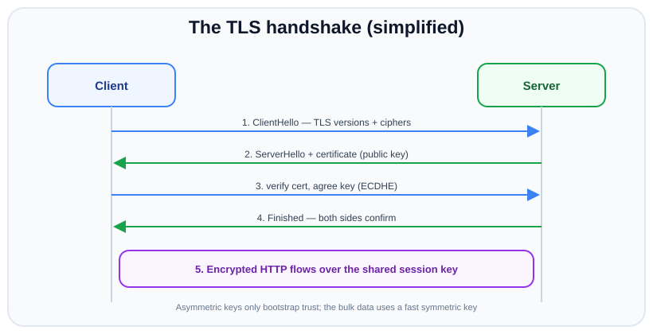

# HTTP vs HTTPS, TLS, HTTP/2 & CORS

*10 min read · Updated 24 Jul 2026 Topic 33 of 70 Bookmark Mark done Why it matters Everything so far assumed a plain · Topic 33 of 70*

**Source:** [https://www.geekyfrontend.in/learn/nodejs-backend-kit/http-vs-https-tls](https://www.geekyfrontend.in/learn/nodejs-backend-kit/http-vs-https-tls)

---

## Why it matters

Everything so far assumed a plain, unencrypted connection. In production that is unacceptable: an unencrypted HTTP request travels in clear text, so anyone on the network path — a coffee-shop router, an ISP, a compromised switch — can read passwords and tokens or silently tamper with responses. **HTTPS** is HTTP wrapped in **TLS**, and it is the default for the entire modern web. Browsers now mark plain HTTP as “Not Secure,” refuse powerful APIs over it, and increasingly auto-upgrade to HTTPS.

As a backend engineer you need to know what TLS actually guarantees (and what it does not), how Node serves HTTPS and HTTP/2, why keep-alive matters for throughput, and how CORS — a browser rule that trips up nearly every developer — interacts with your headers. These topics come up constantly in interviews as “what happens when you type a URL and press enter” and “why is my fetch blocked by CORS.”

## The concept, simply

**HTTP** is the request/response protocol. **HTTPS** is the exact same protocol running *inside* an encrypted TLS tunnel. TLS gives you three things: **confidentiality** (eavesdroppers see only ciphertext), **integrity** (tampering is detected), and **authentication** (a certificate proves you are really talking to `example.com`, not an impostor). The application code barely changes — you still write `req`/`res` — but the bytes on the wire are now encrypted.

The one-time cost is a **handshake** at the start of the connection, where client and server agree on encryption keys. After that, data flows over a fast symmetric cipher. Reusing the connection for many requests (**keep-alive**) amortises that handshake, which is why it matters for performance.



The handshake bootstraps trust with asymmetric keys, then bulk data uses a fast shared symmetric key.

## How it works

**The TLS handshake.** The client sends a *ClientHello* advertising the TLS versions and cipher suites it supports. The server replies with a *ServerHello* choosing a cipher and presenting its **certificate** — a document containing the server's public key, signed by a Certificate Authority (CA) the client trusts. The client verifies the signature chain up to a trusted root, then both sides run a key-agreement algorithm (modern TLS 1.3 uses ephemeral Diffie-Hellman, ECDHE) to derive a shared **session key** without ever transmitting it. From the *Finished* messages onward, all HTTP data is encrypted with that symmetric key. TLS 1.3 (the current standard) trimmed this to a single round-trip and removed legacy insecure ciphers.

**Asymmetric vs symmetric.** A frequent point of confusion: the certificate's public/private key pair (asymmetric, slow) is used only to *authenticate* and to safely agree on keys. The actual request/response bytes are encrypted with a *symmetric* key (fast) derived during the handshake. Asymmetric bootstraps trust; symmetric does the heavy lifting.

**Serving TLS in Node.** Use `node:https` (or `node:http2`) instead of `node:http`. You pass a `key` (private key) and `cert` (certificate) in the options. In real deployments you rarely terminate TLS in Node itself — a reverse proxy or load balancer (Nginx, a cloud LB, Caddy) usually terminates TLS and forwards plain HTTP to your Node process on a private network. Either way the certificate typically comes from Let's Encrypt or a commercial CA.

**Keep-alive.** HTTP/1.1 defaults to persistent connections: after a response, the TCP (and TLS) connection stays open for the next request, avoiding a fresh handshake each time. This is controlled by the `Connection` header and Node's `server.keepAliveTimeout`. Without keep-alive, every request pays a full TCP + TLS setup cost.

**HTTP/2.** Same HTTP semantics (methods, status codes, headers) but a different wire format: binary framing, header compression (HPACK), and **multiplexing** — many concurrent requests interleaved over a single TCP connection, eliminating the head-of-line blocking of HTTP/1.1 where one slow response stalls the queue behind it. It is served in Node via `node:http2` and almost always runs over TLS (`h2` is negotiated during the handshake via ALPN).


HTTP/1.1 serialises requests on the socket; HTTP/2 interleaves independent streams, removing head-of-line blocking.

**CORS.** The Cross-Origin Resource Sharing rules are enforced by the *browser*, not your server. By default a page at `https://app.com` cannot read a `fetch` response from `https://api.other.com` unless the server opts in with `Access-Control-Allow-Origin`. For “non-simple” requests the browser first sends a *preflight* `OPTIONS` request; your server must answer it with the appropriate `Access-Control-Allow-*` headers or the real request is blocked. Crucially, CORS is a browser security policy — `curl` and server-to-server calls ignore it entirely.

**Simple vs preflighted requests.** It is worth being precise about when the browser fires that extra `OPTIONS` round-trip, because it is the part developers get wrong most often. A request is “simple” (no preflight) only if it uses `GET`, `HEAD`, or `POST`; carries no custom headers beyond a short CORS-safelisted set; and, if it has a body, uses one of three content types: `text/plain`, `application/x-www-form-urlencoded`, or `multipart/form-data`. The moment you send `Content-Type: application/json`, add an `Authorization` header, or use `PUT`/`DELETE`/`PATCH`, the request becomes “preflighted” and the browser first sends an `OPTIONS` with `Access-Control-Request-Method` and `Access-Control-Request-Headers`, expecting your server to echo permission back. You can cut the cost of repeated preflights by sending `Access-Control-Max-Age`, which tells the browser how many seconds it may cache the preflight result. And if the request needs cookies, the client must set `credentials: 'include'` *and* your server must reply with both a specific (non-wildcard) origin and `Access-Control-Allow-Credentials: true`.

**SNI, ALPN, and what the handshake negotiates.** Two extensions ride along in the ClientHello and are worth naming. *SNI* (Server Name Indication) is the hostname the client wants, sent in the clear so that a single IP hosting many sites can present the right certificate — it is also why the hostname is one of the few things TLS does not hide. *ALPN* (Application-Layer Protocol Negotiation) is how client and server agree, during the same handshake, on whether to speak HTTP/1.1 or HTTP/2 (`h2`); this is why HTTP/2 in practice needs no extra round-trip and why `allowHTTP1: true` lets one `http2.createSecureServer` serve both kinds of client. TLS 1.3 also enables *session resumption* and *0-RTT*, letting a returning client skip most of the handshake, which further amplifies the keep-alive and connection-reuse benefits described above.

## Code examples

An HTTPS server with a key and certificate (here self-signed for local dev):

javascript

```
const https = require('node:https');
const fs = require('node:fs');

// Generate a dev cert:
//   openssl req -x509 -newkey rsa:2048 -nodes -keyout key.pem -out cert.pem -days 365
const options = {
  key: fs.readFileSync('key.pem'),
  cert: fs.readFileSync('cert.pem'),
};

https.createServer(options, (req, res) => {
  res.writeHead(200, { 'Content-Type': 'text/plain' });
  res.end('Served over TLS
');
}).listen(8443, () => console.log('https://localhost:8443'));
```

Redirecting all plain HTTP traffic to HTTPS — a standard production pattern:

javascript

```
const http = require('node:http');

// Runs on port 80, bounces everyone to https.
http.createServer((req, res) => {
  const host = req.headers.host?.split(':')[0] ?? 'localhost';
  res.writeHead(301, { Location: `https://${host}${req.url}` });
  res.end();
}).listen(80);
```

An HTTP/2 server (over TLS, with HTTP/1.1 fallback via ALPN):

javascript

```
const http2 = require('node:http2');
const fs = require('node:fs');

const server = http2.createSecureServer({
  key: fs.readFileSync('key.pem'),
  cert: fs.readFileSync('cert.pem'),
  allowHTTP1: true, // fall back for older clients
});

server.on('stream', (stream, headers) => {
  // http2 uses pseudo-headers: :method, :path, :authority
  stream.respond({ ':status': 200, 'content-type': 'text/plain' });
  stream.end(`hello over ${headers[':method']} ${headers[':path']}
`);
});

server.listen(8443);
```

Handling CORS, including the preflight `OPTIONS` request:

javascript

```
const http = require('node:http');

const ALLOWED = 'https://app.example.com';

http.createServer((req, res) => {
  res.setHeader('Access-Control-Allow-Origin', ALLOWED);
  res.setHeader('Access-Control-Allow-Methods', 'GET, POST, OPTIONS');
  res.setHeader('Access-Control-Allow-Headers', 'Content-Type, Authorization');

  // Preflight: browser asks permission before the real request.
  if (req.method === 'OPTIONS') {
    res.writeHead(204).end();
    return;
  }

  res.writeHead(200, { 'Content-Type': 'application/json' });
  res.end(JSON.stringify({ ok: true }));
}).listen(3000);
```

## Common mistakes & gotchas

- **Thinking TLS hides everything.** The destination IP, the SNI hostname, and traffic size/timing are still observable; TLS encrypts the HTTP payload, not the fact that you connected.
- **Confusing which key encrypts the data.** The certificate's asymmetric key only authenticates and negotiates; bulk data uses the derived symmetric key.
- **Committing private keys.** A leaked `key.pem` compromises the whole site; keep keys out of source control and images.
- **Expecting the server to “fix” CORS for curl.** CORS is browser-enforced; a blocked `fetch` is not a server error, and `curl` succeeding proves nothing about it.
- **Using `Access-Control-Allow-Origin: *` with credentials.** The wildcard is rejected when `credentials: 'include'` is set; you must echo a specific origin and add `Access-Control-Allow-Credentials: true`.
- **Forgetting the preflight.** Custom headers or non-simple methods trigger an `OPTIONS` preflight; not answering it blocks the real request.
- **Disabling certificate validation** (`rejectUnauthorized: false`) to “make it work,” which silently removes TLS's authentication guarantee.

## Best practices

- **Serve everything over HTTPS** and 301-redirect plain HTTP; add `Strict-Transport-Security` (HSTS) to force it.
- **Use TLS 1.2+ (prefer 1.3)** and let Node's defaults pick strong cipher suites; do not hand-configure weak ones.
- **Terminate TLS at a proxy/load balancer** in production, and get certificates from an automated CA (Let's Encrypt) with auto-renewal.
- **Keep keep-alive on** and tune `keepAliveTimeout` to reuse connections and cut handshake cost.
- **Adopt HTTP/2** for many small concurrent assets to benefit from multiplexing and header compression.
- **Scope CORS narrowly**: an explicit allow-list of origins, only the methods/headers you need, and never `*` alongside credentials.
- **Set security headers** (`HSTS`, `X-Content-Type-Options`) and never disable certificate verification in clients.

## ⭐ Interview lens

> **Q: What does HTTPS add over HTTP, precisely?**  
> It wraps HTTP in TLS, providing confidentiality (encryption), integrity (tamper detection), and authentication (a CA-signed certificate proves the server's identity). The HTTP semantics are unchanged; only the transport is now encrypted and authenticated.

> **Q: Walk through the TLS handshake at a high level.**  
> ClientHello (offered versions/ciphers) → ServerHello + certificate (server's public key) → client verifies the cert chain and both derive a shared session key via ephemeral Diffie-Hellman → Finished messages → encrypted application data flows over the symmetric session key. TLS 1.3 does this in one round-trip.

> **Q: Trap — is the request body encrypted with the server's public key?**  
> No. The public/private (asymmetric) key pair is used only to authenticate the server and to agree on a shared secret. The actual data is encrypted with a fast *symmetric* session key derived during the handshake. Symmetric ciphers are far faster for bulk data.

> **Q: What problem does HTTP/2 multiplexing solve?**  
> HTTP/1.1 head-of-line blocking: on a single connection, request B must wait for A's response. HTTP/2 interleaves multiple independent streams over one TCP connection using binary framing, so responses can arrive out of order and no single slow response stalls the rest. It also compresses headers (HPACK).

> **Q: A browser `fetch` is blocked by CORS but `curl` works. Whose fault, and how do you fix it?**  
> Neither is “broken” — CORS is a browser-enforced policy that `curl` ignores. The fix is on the server: respond with `Access-Control-Allow-Origin` (a specific origin, or `*` for public non-credentialed APIs) and, for non-simple requests, answer the `OPTIONS` preflight with the matching `Allow-Methods`/`Allow-Headers`.

> **Q: Why does keep-alive improve performance, especially over HTTPS?**  
> It reuses one TCP + TLS connection for many requests, so you pay the connection setup and TLS handshake cost once instead of per request. Over HTTPS the handshake is the expensive part, so keep-alive (and connection pooling on the client side) is a major latency win.

## Cheat-card

- HTTPS = HTTP inside TLS → confidentiality + integrity + authentication.
- Handshake: ClientHello → cert → key agreement → encrypted data. TLS 1.3 = 1-RTT.
- Asymmetric keys authenticate + agree; symmetric session key encrypts the data.
- Node: `node:https` / `node:http2` with `{ key, cert }`.
- Keep-alive reuses the connection → skips repeat handshakes.
- HTTP/2: binary framing + HPACK + multiplexing (no head-of-line blocking).
- CORS is browser-enforced; server sends `Access-Control-Allow-*`; answer `OPTIONS` preflight.
- No `*` origin with credentials; never disable cert validation.
- `tls.createServer({ key, cert, minVersion, ALPNProtocols, SNICallback })`; client `tls.connect({ ca, servername })`; inspect `getPeerCertificate()`, `getProtocol()`, `alpnProtocol`.
- mTLS: `ca` + `requestCert: true` + `rejectUnauthorized: true`; lenient mode → check `req.socket.authorized` / `authorizationError` yourself.
- Rotate certs live: `server.setSecureContext({ key, cert })`; new handshakes only; bad PEM throws and keeps the old context.
- HSTS: `max-age=31536000; includeSubDomains` over HTTPS only; `preload` is opt-in and slow to undo.
- Dynamic `Access-Control-Allow-Origin` → always send `Vary: Origin`.
- HTTP/3 = HTTP over QUIC (UDP + TLS 1.3); `node:quic` is documented in v24 but absent from the v24.19.0 release binary, even with `--experimental-quic`.

---

## Learn More

- [HTTPS | Node.js Documentation nodejs.org](https://nodejs.org/api/https.html)
- [TLS (SSL) | Node.js Documentation nodejs.org](https://nodejs.org/api/tls.html)
- [Transport Layer Security (TLS) | MDN developer.mozilla.org](https://developer.mozilla.org/en-US/docs/Glossary/TLS)
- [Evolution of HTTP | MDN developer.mozilla.org](https://developer.mozilla.org/en-US/docs/Web/HTTP/Guides/Evolution_of_HTTP)
- [The TLS Handshake Explained with Example (the Math) Hussein Nasser](https://www.youtube.com/watch?v=64geP_LAZ5U)

---

## Additional topics

*Added 10 Oct 2026 · examples verified on Node v24.19.0*

### The `tls` module in depth

`node:tls` is the layer under `node:https` and `node:http2`. A `tls.Server` is a `net.Server` whose sockets are `tls.TLSSocket`s. Each one wraps a TCP socket, runs the OpenSSL handshake (OpenSSL 3.5.x in Node v24.19.0; `process.versions.openssl` printed `3.5.7`), and then reads and writes plaintext while sending ciphertext. You use it directly for non-HTTP protocols over TLS (databases, message brokers, custom binary protocols), and you use its options and socket methods from `https` too, because `https.createServer` passes the same options through and `req.socket` is a `TLSSocket`.

How it works:

1. `tls.createServer(options, onSecureConnection)` takes the certificate (`key`, `cert`), the policy (`minVersion`, `ALPNProtocols`, `requestCert`, …) and an `SNICallback`. The callback gets a socket after the handshake has finished.
2. The client's ClientHello carries the SNI name and its ALPN list. `SNICallback(servername, cb)` runs during the handshake, *before* the server sends its certificate, so you can pick a different `SecureContext` (built with `tls.createSecureContext()`) per hostname. Calling `cb(null, null)` keeps the default.
3. `minVersion` (default `tls.DEFAULT_MIN_VERSION`, which is `'TLSv1.2'`; added in v11.4.0) refuses older protocol versions with a `protocol_version` alert.
4. ALPN: the server picks the first protocol in its own `ALPNProtocols` list that the client also offered. In a separate run, a client offering `['http/1.1', 'h2']` to this server got `h2`. Since v19.0.0, if the client offers ALPN and nothing overlaps, the handshake fails with a `no_application_protocol` alert.
5. `tls.connect(options)` is the client. `ca` replaces the default trust store for that connection (without `ca`, Node uses its bundled copy of Mozilla's trusted CA list). `servername` sets SNI, and the certificate is also checked against it (`checkServerIdentity`), so a valid certificate for another name fails with `ERR_TLS_CERT_ALTNAME_INVALID`.
6. After `'secureConnect'`, `socket.authorized` says whether the chain verified. `getProtocol()` returns the TLS version, `alpnProtocol` the negotiated protocol, and `getPeerCertificate()` (added in v0.11.4) the peer's certificate as an object (`subject`, `issuer`, `serialNumber`, `subjectaltname`, `valid_to`, `fingerprint256`, …), or an empty object if the peer sent none.
7. A failed handshake does not reach your connection handler. The server emits `'tlsClientError'` and the client's socket emits `'error'`.

**Example — one server, five clients: SNI, ALPN, `minVersion` and a hostname mismatch.** The certificates come from the `pki.sh` script in the next section.

javascript

```
// tls-basics.mjs: tls.createServer + tls.connect, minVersion, ALPN, SNICallback, getPeerCertificate.
import tls from 'node:tls';
import { readFileSync } from 'node:fs';

const pem = (f) => readFileSync(new URL(`./pki/${f}`, import.meta.url));
const adminCtx = tls.createSecureContext({ key: pem('admin.key'), cert: pem('admin.crt') });

const server = tls.createServer({
  key: pem('server.key'),
  cert: pem('server-1001.crt'),             // default certificate
  minVersion: 'TLSv1.3',                    // refuse TLS 1.2 and older
  ALPNProtocols: ['h2', 'http/1.1'],        // in order of preference
  SNICallback(servername, cb) {             // runs during the handshake, before the cert is sent
    cb(null, servername === 'admin.test' ? adminCtx : null);   // null -> default context
  },
}, (socket) => {
  socket.end(`hello ${socket.servername}, you got ${socket.getProtocol()} and ALPN ${socket.alpnProtocol}\n`);
});
server.on('tlsClientError', (err) => console.log('  [server] tlsClientError:', err.code));

function connect(label, opts) {
  return new Promise((resolve) => {
    const s = tls.connect({ host: '127.0.0.1', port: server.address().port, ca: pem('ca.crt'), ...opts }, () => {
      const c = s.getPeerCertificate();
      console.log(`${label}: authorized=${s.authorized} protocol=${s.getProtocol()} alpn=${s.alpnProtocol}`);
      console.log(`  cert CN=${c.subject.CN} serial=${c.serialNumber} issuer=${c.issuer.CN} san="${c.subjectaltname}"`);
    });
    s.setEncoding('utf8');
    s.on('data', (d) => process.stdout.write('  server says: ' + d));
    s.on('error', (err) => { console.log(`${label}: ${err.code} (${err.reason ?? err.message})`); resolve(); });
    s.on('close', resolve);
  });
}

server.listen(0, async () => {
  await connect('1 localhost', { servername: 'localhost', ALPNProtocols: ['http/1.1'] });
  await connect('2 admin.test', { servername: 'admin.test', ALPNProtocols: ['h2'] });
  await connect('3 TLS 1.2 only', { servername: 'localhost', maxVersion: 'TLSv1.2' });
  await connect('4 ALPN spdy', { servername: 'localhost', ALPNProtocols: ['spdy/3'] });
  await connect('5 wrong name', { servername: 'evil.test' });
  server.close();
});

// Real output (Node v24.19.0):
//   1 localhost: authorized=true protocol=TLSv1.3 alpn=http/1.1
//     cert CN=localhost serial=1001 issuer=Kit Test CA san="DNS:localhost, DNS:api.test, IP Address:127.0.0.1"
//     server says: hello localhost, you got TLSv1.3 and ALPN http/1.1
//   2 admin.test: authorized=true protocol=TLSv1.3 alpn=h2
//     cert CN=admin.test serial=2001 issuer=Kit Test CA san="DNS:admin.test"
//     server says: hello admin.test, you got TLSv1.3 and ALPN h2
//     [server] tlsClientError: ERR_SSL_UNSUPPORTED_PROTOCOL
//   3 TLS 1.2 only: ERR_SSL_TLSV1_ALERT_PROTOCOL_VERSION (tlsv1 alert protocol version)
//     [server] tlsClientError: ERR_SSL_NO_APPLICATION_PROTOCOL
//   4 ALPN spdy: ERR_SSL_TLSV1_ALERT_NO_APPLICATION_PROTOCOL (tlsv1 alert no application protocol)
//   5 wrong name: ERR_TLS_CERT_ALTNAME_INVALID (Host: evil.test. is not in the cert's altnames: DNS:localhost, DNS:api.test, IP Address:127.0.0.1)
//     [server] tlsClientError: ECONNRESET
```

Client 2 sent SNI `admin.test` and got the second certificate (serial 2001) from the same port. Client 3 offered only TLS 1.2 and was refused. Client 4's ALPN list had nothing in common with the server's. Client 5's chain was valid but the name did not match, so the *client* aborted, and the server saw only a reset.

### Mutual TLS (client certificates)

In ordinary TLS only the server proves who it is. In **mutual TLS** (mTLS) the server also sends a CertificateRequest during the handshake, and the client answers with its own certificate and a signature made with that certificate's private key. The server verifies the chain against a CA it chose. The client's identity (here the subject `CN=alice`) then comes from the TLS layer, before any HTTP request is read. mTLS is common between services, for device fleets, and for admin endpoints, where shared secrets in headers would otherwise be passed around and leaked.

text

```
client                                                   server (requestCert: true, ca: [Kit Test CA])
  | --- ClientHello ------------------------------------------> |
  | <-- ServerHello, {EncryptedExtensions},                     |
  |     {CertificateRequest}, {Certificate: CN=localhost},      |
  |     {CertificateVerify}, {Finished} ----------------------- |
  |  verify server chain + name                                 |
  | --- {Certificate: CN=alice}, {CertificateVerify}, --------> |
  |     {Finished}                                              |  verify alice's chain against ca
  |                                                             |  rejectUnauthorized: true  -> no cert: alert
  |                                                             |                             bad cert: socket destroyed
  |                                                             |  rejectUnauthorized: false -> socket.authorized
  | <== HTTP request / response (encrypted) ===================> |     and authorizationError for the app
  {…} = encrypted with handshake keys (TLS 1.3)
```

How it works:

1. Create a CA and sign the server certificate and each client certificate with it. Client certificates carry `extendedKeyUsage=clientAuth`.
2. On the server, set `ca` to the CA that client certificates must chain to, and `requestCert: true`.
3. With `rejectUnauthorized: true` (the default, and it only has an effect when `requestCert` is `true`), Node sets OpenSSL's verify mode to `SSL_VERIFY_PEER | SSL_VERIFY_FAIL_IF_NO_PEER_CERT` (`src/crypto/crypto_tls.cc`, `TLSWrap::SetVerifyMode`). A client that sends no certificate fails inside the handshake with a `certificate_required` alert. A client whose certificate does not verify completes the handshake, and Node then destroys the socket from JavaScript (`onServerSocketSecure` in `lib/internal/tls/wrap.js`), so that client sees a connection reset rather than an alert.
4. With `rejectUnauthorized: false`, every handshake completes. The application reads `req.socket.authorized` (`true` only if the chain verified) and `req.socket.authorizationError` (an OpenSSL verify code), and decides itself. This lets you serve a friendly `401`, or allow some routes without a certificate.
5. Authorization is still your job. A verified certificate only proves "signed by this CA". Map `subject`, a SAN or `fingerprint256` to a user or service and check what that identity may do.

**Example — a CA, server certificates, a client certificate, and a client certificate from a CA the server does not trust** (OpenSSL 3.5.5, P-256 keys, files in `./pki`):

bash

```
# pki.sh: a private CA, two server certs, a client cert, and a client cert from a different CA
set -e
mkdir -p pki && cd pki
ec() { openssl genpkey -algorithm EC -pkeyopt ec_paramgen_curve:P-256 -out "$1" 2>/dev/null; }

# 1. The CA: a self-signed certificate allowed to sign others
ec ca.key
openssl req -x509 -new -key ca.key -sha256 -days 30 -subj '/CN=Kit Test CA' \
  -addext 'basicConstraints=critical,CA:TRUE' -addext 'keyUsage=critical,keyCertSign,cRLSign' -out ca.crt

# 2. Server certificates (serial 1001, then 1002 for the reload demo)
ec server.key
openssl req -new -key server.key -subj '/CN=localhost' -out server.csr
for s in 1001 1002; do
  openssl x509 -req -in server.csr -CA ca.crt -CAkey ca.key -set_serial 0x$s -days 30 -sha256 \
    -extfile <(printf 'subjectAltName=DNS:localhost,DNS:api.test,IP:127.0.0.1\nextendedKeyUsage=serverAuth') \
    -out server-$s.crt 2>/dev/null
done

# 3. A second site for the SNI demo
ec admin.key
openssl req -new -key admin.key -subj '/CN=admin.test' -out admin.csr
openssl x509 -req -in admin.csr -CA ca.crt -CAkey ca.key -set_serial 0x2001 -days 30 -sha256 \
  -extfile <(printf 'subjectAltName=DNS:admin.test\nextendedKeyUsage=serverAuth') -out admin.crt 2>/dev/null

# 4. A client certificate for "alice", signed by the same CA
ec alice.key
openssl req -new -key alice.key -subj '/CN=alice/O=Kit Clients' -out alice.csr
openssl x509 -req -in alice.csr -CA ca.crt -CAkey ca.key -set_serial 0x3001 -days 30 -sha256 \
  -extfile <(printf 'extendedKeyUsage=clientAuth') -out alice.crt 2>/dev/null

# 5. "mallory": a client cert from a CA the server does not trust
ec rogue-ca.key
openssl req -x509 -new -key rogue-ca.key -days 30 -subj '/CN=Rogue CA' \
  -addext 'basicConstraints=critical,CA:TRUE' -out rogue-ca.crt
ec mallory.key
openssl req -new -key mallory.key -subj '/CN=mallory' -out mallory.csr
openssl x509 -req -in mallory.csr -CA rogue-ca.crt -CAkey rogue-ca.key -set_serial 0x6666 -days 30 \
  -extfile <(printf 'extendedKeyUsage=clientAuth') -out mallory.crt 2>/dev/null
rm -f *.csr
ls
```

**Example — a strict and a lenient mTLS server.**

javascript

```
// mtls.mjs: two HTTPS servers that ask for client certificates.
//   :5420 strict  — requestCert + rejectUnauthorized: true  (the handshake fails without a valid cert)
//   :5421 lenient — requestCert + rejectUnauthorized: false (the app inspects and decides)
import https from 'node:https';
import { readFileSync } from 'node:fs';

const pem = (f) => readFileSync(new URL(`./pki/${f}`, import.meta.url));
const base = {
  key: pem('server.key'),
  cert: pem('server-1001.crt'),
  ca: pem('ca.crt'),            // the CA that client certificates must chain to
  requestCert: true,            // send CertificateRequest during the handshake
};

function handler(req, res) {
  const s = req.socket;         // a tls.TLSSocket
  const peer = s.getPeerCertificate();
  const who = peer.subject ? `CN=${peer.subject.CN} serial=${peer.serialNumber}` : 'no certificate';
  if (!s.authorized) {
    res.writeHead(401, { 'Content-Type': 'text/plain' });
    return res.end(`rejected: authorized=${s.authorized} authorizationError=${s.authorizationError} (${who})\n`);
  }
  res.writeHead(200, { 'Content-Type': 'text/plain' });
  res.end(`welcome: authorized=${s.authorized} (${who})\n`);
}

const strict = https.createServer({ ...base, rejectUnauthorized: true }, handler);
strict.on('tlsClientError', (err) => console.log('[strict] tlsClientError:', err.code));
strict.listen(5420);

https.createServer({ ...base, rejectUnauthorized: false }, handler).listen(5421, () => console.log('ready'));

// Real output (Node v24.19.0):
//   ready
//   [strict] tlsClientError: ERR_SSL_PEER_DID_NOT_RETURN_A_CERTIFICATE
//   [strict] tlsClientError: ECONNRESET
```

The `ready` line comes from the script. The two `[strict]` lines appeared during the curl runs below.

bash

```
$ curl -sS --cacert pki/ca.crt https://localhost:5420/; echo "exit=$?"
curl: (56) OpenSSL SSL_read: OpenSSL/3.5.5: error:0A00045C:SSL routines::tlsv13 alert certificate required, errno 0
exit=56
$ curl -sS --cacert pki/ca.crt --cert pki/mallory.crt --key pki/mallory.key https://localhost:5420/; echo "exit=$?"
curl: (56) Recv failure: Connection reset by peer
exit=56
$ curl -sS --cacert pki/ca.crt --cert pki/alice.crt --key pki/alice.key https://localhost:5420/
welcome: authorized=true (CN=alice serial=3001)
$ curl -sS --cacert pki/ca.crt https://localhost:5421/
rejected: authorized=false authorizationError=UNABLE_TO_GET_ISSUER_CERT (no certificate)
$ curl -sS --cacert pki/ca.crt --cert pki/mallory.crt --key pki/mallory.key https://localhost:5421/
rejected: authorized=false authorizationError=UNABLE_TO_VERIFY_LEAF_SIGNATURE (CN=mallory serial=6666)
$ curl -sS --cacert pki/ca.crt --cert pki/alice.crt --key pki/alice.key https://localhost:5421/
welcome: authorized=true (CN=alice serial=3001)
```

On the strict port the request without a certificate failed in the handshake (`tlsv13 alert certificate required`; the server logged `ERR_SSL_PEER_DID_NOT_RETURN_A_CERTIFICATE`). The certificate from the rogue CA got a plain connection reset, and the server's `tlsClientError` listener logged `ECONNRESET` for it, not a certificate error. On the lenient port the same two clients reached the handler, which saw `authorized=false` and the reason. With no certificate at all, the reason was `UNABLE_TO_GET_ISSUER_CERT`, which is not very descriptive, so test `getPeerCertificate()` for an empty object if you need to tell "no certificate" apart from "bad certificate".

### Reloading certificates without a restart

Certificates expire, and automated CAs renew them every few weeks or months, so long-running processes need to pick up renewed files. `server.setSecureContext(options)` (added in v11.0.0) builds a new `SecureContext` from the same options `createServer` takes, and replaces the server's default context. Handshakes that start afterwards use it. Connections that are already open keep the certificate they were set up with.

How it works:

1. A renewal hook writes the new files and signals the process (`SIGHUP` here; a file watcher or an admin endpoint also works).
2. The handler reads the files and calls `server.setSecureContext({ key, cert })`. Pass the key and certificate together every time.
3. If the PEM data is invalid, the call throws and the server keeps its previous context. In the v24.19.0 source, `setSecureContext` stores the new `key`/`cert` on the server object and then calls `tls.createSecureContext()`. Only if that succeeds is `_sharedCreds` replaced.
4. New TCP connections get the new certificate. Kept-alive sockets keep the old one until they close.
5. Session resumption hides the certificate. A client that resumes a cached TLS session gets no `Certificate` message, so `getPeerCertificate()` returns an empty object. The new context gets new session-ticket keys unless you pass `ticketKeys`, so sessions issued before a reload do not resume after it.

**Example — before and after a reload, a kept-alive socket, a bad reload, and resumption.**

javascript

```
// reload.mjs: swap the server certificate with server.setSecureContext(), no restart.
import https from 'node:https';
import { readFileSync } from 'node:fs';
import { once } from 'node:events';

const pem = (f) => readFileSync(new URL(`./pki/${f}`, import.meta.url));
let current = 'server-1001.crt';

const server = https.createServer({ key: pem('server.key'), cert: pem(current) }, (req, res) => res.end('ok'));

function reload(file) {
  // Read and validate first: a bad file throws here and the old context stays in place.
  server.setSecureContext({ key: pem('server.key'), cert: pem(file) });
  current = file;
  console.log('reloaded ->', file);
}
process.on('SIGHUP', () => reload('server-1002.crt'));   // e.g. sent by your cert-renewal hook

const agent = new https.Agent({ keepAlive: true, ca: pem('ca.crt') });
function get(label, via = agent) {
  return new Promise((resolve) => {
    https.get({ host: 'localhost', port: server.address().port, agent: via }, (res) => {
      res.resume();
      const s = res.socket;
      console.log(`${label}: serial=${s.getPeerCertificate().serialNumber} reusedSocket=${res.req.reusedSocket} sessionResumed=${s.isSessionReused()}`);
      res.on('end', resolve);
    });
  });
}

server.listen(0, async () => {
  await get('A new connection     ');
  process.kill(process.pid, 'SIGHUP');
  await once(process, 'SIGHUP');
  await get('B kept-alive socket  ');   // same TLS session as A: old certificate
  agent.destroy();                      // drop pooled sockets
  await get('C new connection     ');
  try { server.setSecureContext({ key: pem('server.key'), cert: Buffer.from('garbage') }); }
  catch (err) { console.log('bad reload rejected:', err.code ?? err.message); }
  agent.destroy();
  await get('D after bad reload   ');   // resumes C's TLS session: no certificate is sent
  const noCache = new https.Agent({ ca: pem('ca.crt'), maxCachedSessions: 0 });
  await get('E full handshake     ', noCache);
  agent.destroy();
  server.close();
});

// Real output (Node v24.19.0):
//   A new connection     : serial=1001 reusedSocket=false sessionResumed=false
//   reloaded -> server-1002.crt
//   B kept-alive socket  : serial=1001 reusedSocket=true sessionResumed=false
//   C new connection     : serial=1002 reusedSocket=false sessionResumed=false
//   bad reload rejected: ERR_OSSL_PEM_NO_START_LINE
//   D after bad reload   : serial=undefined reusedSocket=false sessionResumed=true
//   E full handshake     : serial=1002 reusedSocket=false sessionResumed=false
```

A got serial 1001. B reused A's socket, so it still saw 1001 after the reload. C was a new connection and saw 1002. The bad PEM was rejected with `ERR_OSSL_PEM_NO_START_LINE`. D resumed C's session (`sessionResumed=true`), so no certificate was sent. E disabled the agent's session cache (`maxCachedSessions: 0`), did a full handshake, and showed the server was still on 1002.

### HSTS: `Strict-Transport-Security`

HSTS (RFC 6797) is a response header that tells the browser "for the next `max-age` seconds, only ever contact this host over HTTPS". After the browser has seen it once over a valid HTTPS connection, it rewrites any `http://` URL for that host to `https://` before sending anything. It also gives the user no way to click through certificate errors for that host (RFC 6797, section 12.1, "No User Recourse"). Without it, the first plain-HTTP request (a typed hostname, an old bookmark) goes out unencrypted, and an attacker on the network can answer it instead of your redirect.

How it works:

1. `max-age=<seconds>` is how long the browser remembers the rule, restarted on every response that carries the header. `max-age=0` tells it to forget the host, including `includeSubDomains`.
2. `includeSubDomains` applies the rule to every subdomain too. Turn it on only when every subdomain serves valid HTTPS, including internal and legacy ones.
3. `preload` is not part of RFC 6797. It is the opt-in for the browsers' built-in preload list at [hstspreload.org](https://hstspreload.org/). Its stated requirements are `max-age` at least 31536000 (one year), `includeSubDomains`, and `preload`. It recommends ramping up `max-age` in stages, says new entries take months to reach stable Chrome, and warns that removal "tends to be slow and painful". Do not add `preload` by default.
4. Send it only over HTTPS. RFC 6797 says an HSTS host MUST NOT include the header in responses over non-secure transport, and user agents ignore it there. On plain HTTP, send only a `301` to HTTPS.
5. If TLS ends at a proxy, the proxy or the app may add the header, but only on the HTTPS side.

**Example — HSTS on the HTTPS listener, a redirect on the HTTP one, and a dynamic CORS origin** (the CORS part is the next topic).

javascript

```
// hsts-cors.mjs: HSTS on the HTTPS listener only; dynamic CORS origin with Vary: Origin.
import http from 'node:http';
import https from 'node:https';
import { readFileSync } from 'node:fs';

const pem = (f) => readFileSync(new URL(`./pki/${f}`, import.meta.url));
const ALLOWED = new Set(['https://app.example.com', 'https://admin.example.com']);

function app(req, res) {
  // HSTS: only meaningful over HTTPS. One year, all subdomains. Add "preload" only deliberately.
  res.setHeader('Strict-Transport-Security', 'max-age=31536000; includeSubDomains');
  // The response depends on the Origin request header, so say so, whether or not we allow it.
  res.setHeader('Vary', 'Origin');
  const origin = req.headers.origin;
  if (origin && ALLOWED.has(origin)) {
    res.setHeader('Access-Control-Allow-Origin', origin);   // echo one origin, never a list
  }
  res.setHeader('Cache-Control', 'public, max-age=60');
  res.writeHead(200, { 'Content-Type': 'application/json' }).end('{"ok":true}\n');
}

https.createServer({ key: pem('server.key'), cert: pem('server-1001.crt') }, app).listen(5430);

// Plain HTTP: redirect only. No HSTS here: browsers ignore it over HTTP, and it would be a lie.
http.createServer((req, res) => {
  res.writeHead(301, { Location: `https://localhost:5430${req.url}` }).end();
}).listen(5431, () => console.log('https :5430, http :5431'));

// Real output (Node v24.19.0):
//   https :5430, http :5431
```

bash

```
$ curl -si --cacert pki/ca.crt -H 'Origin: https://app.example.com' https://localhost:5430/api
HTTP/1.1 200 OK
Strict-Transport-Security: max-age=31536000; includeSubDomains
Vary: Origin
Access-Control-Allow-Origin: https://app.example.com
Cache-Control: public, max-age=60
Content-Type: application/json
Date: Sat, 10 Oct 2026 11:20:35 GMT
Connection: keep-alive
Keep-Alive: timeout=5
Transfer-Encoding: chunked

{"ok":true}
$ curl -s -D - -o /dev/null --cacert pki/ca.crt -H 'Origin: https://admin.example.com' https://localhost:5430/api | grep -i '^access-control\|^vary'
Vary: Origin
Access-Control-Allow-Origin: https://admin.example.com
$ curl -s -D - -o /dev/null --cacert pki/ca.crt -H 'Origin: https://evil.example' https://localhost:5430/api | grep -i '^access-control\|^vary'
Vary: Origin
$ curl -si http://localhost:5431/api
HTTP/1.1 301 Moved Permanently
Location: https://localhost:5430/api
Date: Sat, 10 Oct 2026 11:20:36 GMT
Connection: keep-alive
Keep-Alive: timeout=5
Transfer-Encoding: chunked
```

The HTTPS responses carry `Strict-Transport-Security`, and the plain-HTTP `301` does not.

### `Vary: Origin` for CORS

`Access-Control-Allow-Origin` can hold `*` or exactly one origin, never a list. To allow several origins, the server reads the request's `Origin` header and echoes it back if it is on the allow-list. The response then depends on a request header, and a shared cache (a CDN, a reverse proxy, the browser's HTTP cache) cannot know that unless you say so. Without `Vary: Origin`, the cache stores the first response (allowing `https://app.example.com`) under the URL and gives it to a request from `https://admin.example.com`. That browser then sees the wrong origin and blocks the response. The Fetch standard says: "If CORS protocol requirements are more complicated than setting `Access-Control-Allow-Origin` to `*` or a static origin, `Vary` is to be used."

How it works:

1. A cache stores a response under its URL. A `Vary` header in the response lists request headers whose values must also match before the stored response may be reused.
2. With `Vary: Origin`, the cache keeps a separate stored response per `Origin` value.
3. Send `Vary: Origin` on every response from that URL, including responses to disallowed origins and to requests with no `Origin`. Otherwise a response without `Access-Control-Allow-Origin` can be cached and served to an allowed origin.
4. If you send a constant `*` or one fixed origin, the response does not depend on `Origin`, and `Vary` is not needed for CORS.

The curl output above shows the origin server doing this: each allowed origin is echoed, `https://evil.example` gets no `Access-Control-Allow-Origin`, and all three carry `Vary: Origin`.

**Example — a toy shared cache that honours `Vary`, in front of the origin, with and without `Vary: Origin`.**

javascript

```
// vary-cache.mjs: a toy shared cache in front of a CORS API, with and without Vary: Origin.
import http from 'node:http';

const ALLOWED = new Set(['https://app.example.com', 'https://admin.example.com']);

function startOrigin(sendVary) {
  return http.createServer((req, res) => {
    const o = req.headers.origin;
    if (sendVary) res.setHeader('Vary', 'Origin');
    if (ALLOWED.has(o)) res.setHeader('Access-Control-Allow-Origin', o);
    res.setHeader('Cache-Control', 'public, max-age=60');
    res.end('{"ok":true}');
  }).listen(0);
}

// The cache keys on the URL, plus the request headers the stored response says it Varies on.
function startCache(originPort) {
  const store = new Map();   // url -> { vary: [names], entries: Map(variantKey -> {headers, body}) }
  const variantKey = (req, names) => names.map((n) => `${n}=${req.headers[n] ?? ''}`).join('&');
  return http.createServer((req, res) => {
    const slot = store.get(req.url);
    const hit = slot?.entries.get(variantKey(req, slot.vary));
    if (hit) {
      res.writeHead(200, { ...hit.headers, 'x-cache': 'HIT' }).end(hit.body);
      return;
    }
    http.get({ port: originPort, path: req.url, headers: req.headers }, async (up) => {
      let body = ''; for await (const c of up) body += c;
      const vary = (up.headers.vary ?? '').toLowerCase().split(',').map((s) => s.trim()).filter(Boolean);
      const s = store.get(req.url) ?? { vary, entries: new Map() };
      s.vary = vary;
      s.entries.set(variantKey(req, vary), { headers: up.headers, body });
      store.set(req.url, s);
      res.writeHead(up.statusCode, { ...up.headers, 'x-cache': 'MISS' }).end(body);
    });
  }).listen(0);
}

for (const sendVary of [false, true]) {
  const origin = startOrigin(sendVary);
  await new Promise((r) => origin.once('listening', r));
  const cache = startCache(origin.address().port);
  await new Promise((r) => cache.once('listening', r));
  console.log(`origin sends Vary: Origin = ${sendVary}`);
  for (const o of ['https://app.example.com', 'https://admin.example.com', 'https://evil.example']) {
    const r = await fetch(`http://127.0.0.1:${cache.address().port}/api`, { headers: { origin: o } });
    await r.text();
    console.log(`  Origin ${o.padEnd(26)} -> ${r.headers.get('x-cache')}  ACAO: ${r.headers.get('access-control-allow-origin')}`);
  }
  origin.close(); cache.close();
}

// Real output (Node v24.19.0):
//   origin sends Vary: Origin = false
//     Origin https://app.example.com    -> MISS  ACAO: https://app.example.com
//     Origin https://admin.example.com  -> HIT  ACAO: https://app.example.com
//     Origin https://evil.example       -> HIT  ACAO: https://app.example.com
//   origin sends Vary: Origin = true
//     Origin https://app.example.com    -> MISS  ACAO: https://app.example.com
//     Origin https://admin.example.com  -> MISS  ACAO: https://admin.example.com
//     Origin https://evil.example       -> MISS  ACAO: null
```

Without `Vary`, the second and third origins were served the first origin's cached response, `ACAO: https://app.example.com`, and a browser at `https://admin.example.com` would block it. With `Vary: Origin`, each origin got its own entry.

### HTTP/3 and QUIC: an overview

**HTTP/3** (RFC 9114) carries HTTP semantics over **QUIC** (RFC 9000) instead of TCP. QUIC is a transport protocol built on UDP datagrams. It does the work TCP does (ordering, retransmission, flow and congestion control) in user space, per stream, and it builds TLS 1.3 into its own handshake (RFC 9001), so transport and crypto setup share round trips. Three mechanisms matter for a backend developer:

1. **Independent streams.** HTTP/2 multiplexes streams over one TCP connection, so one lost TCP packet stalls every stream until it is retransmitted (TCP-level head-of-line blocking, the limit of the HTTP/2 figure above). QUIC recovers losses per stream, so only the stream that lost data waits.
2. **Connection IDs.** A QUIC connection is identified by connection IDs, not by the IP and port pair, so a client that changes network can keep the connection (RFC 9000, section 9, "Connection Migration").
3. **Discovery.** A client cannot know in advance that a host speaks QUIC on UDP. An HTTP/1.1 or HTTP/2 response advertises it with `Alt-Svc`, for example `Alt-Svc: h3=":443"` (RFC 9114, section 3.1.1), and the client may then try QUIC. Header compression is QPACK (RFC 9204) instead of HPACK.

**What Node v24.19.0 actually has.** The v24 docs include a `node:quic` page: added in v23.8.0, Stability "1.0 - Early development", available only under the `node:` scheme, and only when Node is started with `--experimental-quic` (that flag was added in v24.16.0, Stability "1.1 - Active development"). The docs say HTTP/3 is the only built-in application protocol. On this machine's v24.19.0 binary (installed with nvm from the official nodejs.org Linux x64 release; `npx node@24.19.0` gave the same result):

bash

```
$ node -v
v24.19.0
$ node -e "require('node:quic')" 2>&1 | grep '^Error'
Error [ERR_UNKNOWN_BUILTIN_MODULE]: No such built-in module: node:quic
$ node --experimental-quic -e "require('node:quic')" 2>&1 | grep '^Error'
Error [ERR_UNKNOWN_BUILTIN_MODULE]: No such built-in module: node:quic
$ node -p "require('node:module').builtinModules.filter((m) => m.includes('quic'))"
[]
$ node -p "process.config.variables.node_use_quic"
false
$ node -p "JSON.stringify({ ngtcp2: process.versions.ngtcp2, nghttp3: process.versions.nghttp3 })"
{"ngtcp2":"","nghttp3":""}
```

The flag is accepted, but the module does not exist in this binary. `node_use_quic` is set at build time by `./configure --experimental-quic` (in `configure.py` at v24.19.0, `configure_quic` sets `node_use_quic` only when that option is given and SSL is enabled), and it defaults to off. So on this release build there is no QUIC or HTTP/3 server or client in Node core. To serve HTTP/3 with this build, something in front of Node has to terminate QUIC.

> ⚠️ Unverified: whether official v24.x binaries for other platforms (macOS, Windows, ARM) are built with `--experimental-quic`; only the Linux x64 release binary was tested. Also unverified: which reverse proxies, CDNs and browsers support HTTP/3 and in which versions. Check each product's own documentation.

### Common mistakes & gotchas (additional topics)

- **Setting `rejectUnauthorized: false` on the server and forgetting to check `req.socket.authorized`.** Every client then gets in, certificate or not. If you go lenient, the handler must enforce it.
- **Treating "certificate verified" as "authorized".** Any certificate your CA ever signed passes. Map the subject or fingerprint to an identity and check permissions. Use a dedicated CA for client certificates, not a public one.
- **Expecting a TLS alert for a bad client certificate.** With `rejectUnauthorized: true`, Node destroys the socket after the handshake without an alert. curl reported `Connection reset by peer`, and a Node TLS 1.3 client got `'secureConnect'` followed by a bare `'close'`.
- **Restarting to rotate certificates.** `server.setSecureContext()` swaps them in place. Kept-alive connections keep the old certificate until they close.
- **Testing a reload with a session-caching client.** A resumed TLS session sends no certificate, so `getPeerCertificate()` is `{}`. Use a full handshake (`maxCachedSessions: 0`) when you check serials.
- **Sending HSTS over plain HTTP, or adding `preload` casually.** Browsers ignore the header over HTTP. A preload entry is slow to remove, and `includeSubDomains` breaks any subdomain without HTTPS.
- **Echoing `Origin` without `Vary: Origin`.** A shared cache will hand one origin's CORS headers to another. Also, never echo the `Origin` unchecked: with credentials, that allows every site.
- **Assuming `node:quic` exists because it is in the docs.** On the v24.19.0 release binary it does not, even with `--experimental-quic`.

### Edge case worked through: a rejected client certificate that the client never hears about

On the strict port, the missing certificate and the untrusted certificate failed at different layers. With TLS 1.3 that matters on the client too. The client sends its certificate in its last handshake flight, and from its point of view the handshake is complete once that flight is sent, before the server has checked anything. This script connects to a strict server with `tls.connect` and logs every event:

javascript

```
// mtls-edge.mjs: in TLS 1.3 the client's handshake can "succeed" before the server rejects its certificate.
import tls from 'node:tls';
import { readFileSync } from 'node:fs';

const pem = (f) => readFileSync(new URL(`./pki/${f}`, import.meta.url));
const server = tls.createServer({
  key: pem('server.key'), cert: pem('server-1001.crt'), ca: pem('ca.crt'),
  requestCert: true, rejectUnauthorized: true,
}, (socket) => socket.end('hello ' + socket.getPeerCertificate().subject.CN + '\n'));
server.on('tlsClientError', (err) => console.log('  server tlsClientError:', err.code));

function attempt(label, extra) {
  return new Promise((resolve) => {
    const t0 = Date.now();
    const s = tls.connect({ host: '127.0.0.1', port: server.address().port, servername: 'localhost',
                            ca: pem('ca.crt'), ...extra });
    console.log(label);
    s.on('secureConnect', () => console.log(`  client secureConnect (authorized=${s.authorized})`));
    s.on('data', (d) => console.log('  client data:', String(d).trim()));
    s.on('error', (err) => console.log('  client error:', err.code));
    s.on('close', () => { console.log('  client close'); setTimeout(resolve, 50); });
  });
}

server.listen(0, async () => {
  await attempt('alice (trusted CA):', { cert: pem('alice.crt'), key: pem('alice.key') });
  await attempt('no certificate:', {});
  await attempt('mallory (rogue CA):', { cert: pem('mallory.crt'), key: pem('mallory.key') });
  await attempt('mallory over TLS 1.2:', { cert: pem('mallory.crt'), key: pem('mallory.key'), maxVersion: 'TLSv1.2' });
  server.close();
});

// Real output (Node v24.19.0):
//   alice (trusted CA):
//     client secureConnect (authorized=true)
//     client data: hello alice
//     client close
//   no certificate:
//     client secureConnect (authorized=true)
//     server tlsClientError: ERR_SSL_PEER_DID_NOT_RETURN_A_CERTIFICATE
//     client error: ERR_SSL_TLSV13_ALERT_CERTIFICATE_REQUIRED
//     client close
//   mallory (rogue CA):
//     client secureConnect (authorized=true)
//     server tlsClientError: ECONNRESET
//     client close
//   mallory over TLS 1.2:
//     server tlsClientError: ECONNRESET
//     client error: ECONNRESET
//     client close
```

- **No certificate.** `rejectUnauthorized: true` adds `SSL_VERIFY_FAIL_IF_NO_PEER_CERT`, so OpenSSL ends the handshake with a TLS 1.3 `certificate_required` alert. The client's `'secureConnect'` had already fired (`authorized=true` is about the *server's* certificate). The alert arrives afterwards as `ERR_SSL_TLSV13_ALERT_CERTIFICATE_REQUIRED`.
- **Untrusted certificate.** Node's OpenSSL verify callback (`VerifyCallback` in `src/crypto/crypto_tls.cc`) always returns 1, so a bad chain does not end the handshake, and OpenSSL only records the result. Node's `onServerSocketSecure` then reads `verifyError()`, sets `authorizationError`, and calls `this.destroy()`. No alert is sent, so the client got `'secureConnect'` and then just `'close'`, with no `'error'` at all. curl reported the same thing as `Recv failure: Connection reset by peer`.
- **The same client over TLS 1.2** never reached `'secureConnect'`. In TLS 1.2 the client's handshake ends only when the server's Finished message arrives, and the server sends that after it has received the client's certificate. Here the connection was closed first, and both sides logged `ECONNRESET`.
- **Practical result.** A TLS 1.3 client must not treat `'secureConnect'` as "the server accepted me". Wait for the first response. On the server, to log *why* clients are rejected (expired, wrong CA), use `rejectUnauthorized: false` and reject in the handler, as the lenient port in `mtls.mjs` does, where `authorizationError` is available.

### ⭐ Interview lens (additional topics)

> **Q: “How would you require client certificates on a Node HTTPS service, and how do you rotate the server certificate?”**  
> A: Create the server with `ca` set to the client CA, `requestCert: true` and `rejectUnauthorized: true`. Clients without a certificate fail the handshake, and clients with an untrusted one are disconnected. Read the identity from `req.socket.getPeerCertificate()` and authorize it. To rotate, call `server.setSecureContext({ key, cert })` from a reload hook. New handshakes use the new certificate, existing connections keep theirs, and an invalid file throws and leaves the old context in place. *Trap:* with `rejectUnauthorized: false` you must check `req.socket.authorized` yourself.

> **Q: “Your API echoes the request's `Origin` into `Access-Control-Allow-Origin`. What else must the response carry, and why?”**  
> A: `Vary: Origin`, on every response from that URL. The response depends on a request header, so a shared cache must store one copy per `Origin`. Otherwise the copy made for one site is served to another, which then gets a CORS failure, or a response cached without the header breaks allowed origins. Echo only origins on an allow-list.
