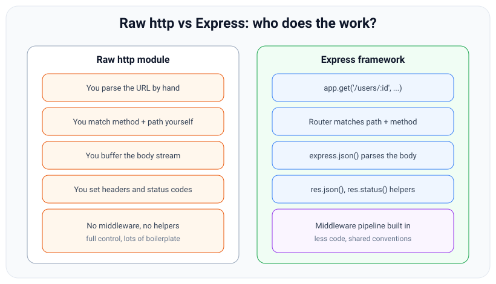
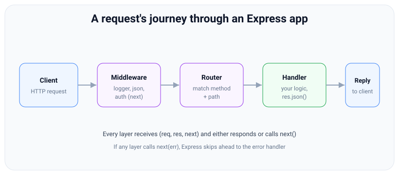

# Express basics: what it is and why a framework

*10 min read · Updated 24 Jul 2026 Topic 34 of 70 Bookmark Mark done Why it matters Express is the framework the Node · Topic 34 of 70*

**Source:** [https://www.geekyfrontend.in/learn/nodejs-backend-kit/express-basics](https://www.geekyfrontend.in/learn/nodejs-backend-kit/express-basics)

---

## Why it matters

Express is the framework the Node.js server world grew up on. For more than a decade it has been the default answer to "how do I build an HTTP API in Node?", and even now — with newer entrants like Fastify, Koa, NestJS and Hono around — a huge share of production Node services either *are* Express apps or are built on tools that copied its shape. NestJS runs on Express by default. Serverless handlers are often thin Express apps. If you interview for a backend Node role, "build me a small Express endpoint" is close to a certainty, and "why Express and not raw `http`?" is the conceptual question hiding right behind it.

Understanding Express well is really about understanding one idea deeply: a web framework is a machine for turning an incoming HTTP request into an outgoing response through an ordered pipeline of small functions. Once that model clicks, routing, middleware, error handling, and the `req`/`res` objects all stop being separate topics you memorise and become one coherent system. This first topic builds that mental model and shows exactly what Express adds on top of Node's built-in server so that everything after it has a foundation.

## The concept, simply

Express is a **minimal, unopinionated web framework for Node.js**. "Minimal" is not marketing: the core does only a few things — it gives you a *router* (match an HTTP method plus a URL path to a function), a *middleware pipeline* (run an ordered list of functions on every request), and a set of *convenience helpers* on the request and response objects (`req.params`, `res.json()`, and friends). Everything else — database access, authentication, validation, templating — you add yourself as libraries. That is what "unopinionated" means: Express hands you a spine and lets you choose the organs.

Compare that to the alternative. Node ships a built-in `http` module that can already run a server. But with raw `http` you personally write the code that inspects `req.method` and `req.url`, splits the path, matches it against your routes, buffers the request body chunk by chunk, parses JSON, sets headers, and stringifies responses. It works, but every app re-implements the same plumbing, and the plumbing is where bugs live. Express is that plumbing, written once, tested by millions of apps.



With raw http you own every step of turning bytes into a response; Express provides the routing, parsing and helpers so you write only your logic.

The mental picture to hold: an Express app is a **stack of functions a request falls through**. Each function gets the request, gets the response, and gets a `next` handle to pass control onward. Some functions do a little work and step aside (logging, parsing, auth checks); one of them finally writes a response. That is the whole framework in one sentence.

## How it works

When you call `express()` you get back an *application object* — conventionally named `app`. That object is itself a request handler function: internally, `app` is compatible with the callback that Node's `http.createServer()` expects. When you call `app.listen(3000)`, Express is essentially doing `http.createServer(app).listen(3000)` for you. So Express does not replace Node's HTTP server — it *is* the request-handler you hand to that server. This is why an Express `req` is still a Node `IncomingMessage` and `res` is still a `ServerResponse` underneath; Express just decorates them with extra methods.

Inside `app` lives a **middleware stack**: an ordered array of entries, each with an optional path pattern, an optional HTTP method, and a handler function. Every time a request arrives, Express walks this array from top to bottom. For each entry it asks: does the request's method and path match this entry? If yes, it calls the handler with `(req, res, next)`. The handler either *responds* (ending the journey) or *calls `next()`* (telling Express to keep walking). If it calls `next(err)` with an argument, Express jumps to the special error-handling handlers instead. That loop — match, run, wait for next — is the engine.



Every layer receives (req, res, next) and either responds or calls next(); an error jumps straight to the error handler.

Route handlers like `app.get('/users', fn)` are just middleware with a method and path attached. There is no separate "route system" bolted onto a "middleware system" — routes *are* middleware that only match a specific method and path. This unification is the single most important thing to internalise about Express, because it explains why order matters, why `next()` behaves the same everywhere, and why a stray middleware registered too late silently never runs.

Express 5 (which reached a stable release in 2024–2025 after years as `5.0-beta`) keeps this exact model. The differences are refinements: it drops some deprecated 4.x method names, updates the underlying path-matching library (so exotic regex-in-path syntax changed), requires a modern Node version, and — most usefully — auto-forwards rejected promises from async handlers to the error pipeline. A few request details also changed and do bite when porting code: `req.body` stays `undefined` when no body parser matched, `req.query` is a read-only getter, and the default query parser is `"simple"`, so `?a[b]=c` is no longer a nested object (see the routing, req/res and validation topics). The mental model does not change between 4 and 5; the examples in this chapter run on both unless noted.

## Code examples

**1. The smallest useful Express app.** Four lines to a running JSON API.

javascript

```
const express = require('express');
const app = express();

app.get('/', (req, res) => {
  res.json({ message: 'Hello from Express' });
});

app.listen(3000, () => console.log('Listening on http://localhost:3000'));
```

**2. The same endpoint with raw `http`** — to feel exactly what Express saves you from.

javascript

```
const http = require('http');

const server = http.createServer((req, res) => {
  if (req.method === 'GET' && req.url === '/') {
    res.writeHead(200, { 'Content-Type': 'application/json' });
    res.end(JSON.stringify({ message: 'Hello from raw http' }));
  } else {
    res.writeHead(404, { 'Content-Type': 'application/json' });
    res.end(JSON.stringify({ error: 'Not Found' }));
  }
});

server.listen(3000);
```

Notice what you had to do by hand: check the method, check the URL, set the status and `Content-Type` header, and stringify the body — and you already need a manual 404 branch. Add a second route with a URL parameter and the raw version balloons; the Express version just gains one line.

**3. A slightly fuller app** showing an application-wide middleware, two routes, and a start-up log.

javascript

```
const express = require('express');
const app = express();

// runs on EVERY request, before any route
app.use(express.json());               // parse JSON bodies into req.body
app.use((req, res, next) => {          // a tiny logger
  console.log(`${req.method} ${req.url}`);
  next();                              // hand control to the next layer
});

app.get('/health', (req, res) => res.json({ ok: true }));

app.post('/echo', (req, res) => {
  res.status(201).json({ youSent: req.body });
});

app.listen(3000);
```

**4. ESM instead of CommonJS.** Modern projects with `"type": "module"` import Express the same way conceptually.

javascript

```
import express from 'express';

const app = express();
app.get('/', (req, res) => res.send('ok'));
app.listen(3000);
```

## Common mistakes & gotchas

- **Thinking Express replaces the `http` module.** It sits on top of it. `req` and `res` are still the Node objects, extended with helpers — which is why you can always drop down to `res.end()` or `req.headers`.
- **Forgetting body parsing.** Out of the box `req.body` is `undefined`. You must register `express.json()` (or `express.urlencoded()`) before routes that read a body. This trips up nearly every beginner exactly once.
- **Registering middleware after the route that needs it.** Express walks top to bottom; a middleware added below a handler never runs for that handler. Order is code order.
- **Confusing "minimal" with "incomplete".** Express omitting a database or auth layer is a design choice, not a gap. Reaching for those as separate packages is the intended workflow.
- **Assuming Express is asynchronous magic.** It is plain Node. If you block the event loop inside a handler (a big synchronous loop, sync crypto), every other request stalls — Express does nothing to save you there.

## Best practices

- **Keep `app` creation and `app.listen()` separate.** Export the configured `app` from one file and call `listen` in another; it makes the app importable in tests (e.g. with `supertest`) without opening a port.
- **Register parsers and shared middleware first**, then routes, then the 404 handler, then the error handler — in that fixed order.
- **Pin your Express major version** in `package.json` and read the migration notes before jumping 4 → 5, chiefly for the path-matching and async-error changes.
- **Reach for Express when you want control and a huge ecosystem;** consider Fastify for raw throughput or NestJS for an opinionated, structured architecture — but know they share this same request-pipeline model.
- **Do not hand-roll what Express or a well-known middleware already provides** (CORS, security headers, compression) — use `cors`, `helmet`, `compression`.

## ⭐ Interview lens

> **Q: "What is Express and what does it actually add over Node's `http` module?"**  
> A: Express is a minimal web framework that layers a routing system, an ordered middleware pipeline, and request/response helper methods on top of Node's built-in HTTP server. It does not replace `http` — `app` is the handler you pass to `http.createServer`. The value is that you stop hand-writing URL matching, body buffering, and header/serialisation plumbing on every project.

> **Q: "Is Express opinionated?"**  
> A: Deliberately not. It gives you routing and middleware and leaves database, auth, validation, and structure to you. That flexibility is its selling point and its cost — small apps are trivial, but large teams often add their own conventions (or pick NestJS) to regain structure.

> **Q: "How does a request flow through an Express app?"**  
> A: Express keeps an ordered stack of middleware and route handlers. On each request it walks the stack top to bottom, running every entry whose method and path match, passing `(req, res, next)`. A handler either responds and ends the chain, or calls `next()` to continue, or `next(err)` to jump to error handlers.

> **Q: "Are routes and middleware different things?"**  
> A: No — that is the trap. A route handler is just middleware that additionally matches a specific HTTP method and path. Internally they live in the same stack, which is why order and `next()` behave identically for both.

> **Q: "What changed in Express 5?"**  
> A: The core model is identical. Express 5 removed deprecated 4.x method names, upgraded the path-to-regexp matcher (so some wildcard/regex path syntax changed), requires newer Node, and — the practical win — automatically forwards rejected promises from async handlers to the error middleware, so you no longer need to wrap every async route in try/catch just to surface errors.

> **Q (trap): "Express handles concurrency for you, right?"**  
> A: No. Express is single-threaded Node like everything else. It handles many requests concurrently only because I/O is async; a CPU-bound or synchronous blocking handler still freezes the whole event loop. Express gives you no thread-level parallelism — that is on you (worker threads, clustering, or offloading).

## Cheat-card

- `const app = express()` → an app object that is also an HTTP request handler.
- `app.listen(port)` ≈ `http.createServer(app).listen(port)`.
- Express = **router** + **middleware pipeline** + **req/res helpers**. Minimal & unopinionated.
- Routes ARE middleware (with a method + path). Same stack, same `next()`.
- `req` = Node `IncomingMessage`, `res` = `ServerResponse`, both extended.
- No body parsing until you add `express.json()` / `express.urlencoded()`.
- Order = code order. Register shared middleware before routes.
- Express 5: same model, auto-forwards async rejections, new path matcher.
- **Settings:** `app.set(name, value)` writes; `app.get(name)` with one argument reads; `app.get(path, fn)` is a route. Full list in lesson 86.
- **Locals:** `app.locals` = one object for the app's lifetime (constants); `res.locals` = per request (user, validated input).

---

## Learn More

- [Hello world example expressjs.com](https://expressjs.com/en/starter/hello-world.html)
- [Express 4.x API Reference expressjs.com](https://expressjs.com/en/4x/api.html)
- [Express JS Crash Course Traversy Media](https://www.youtube.com/watch?v=L72fhGm1tfE)
- [Learn Express JS In 35 Minutes Web Dev Simplified](https://www.youtube.com/watch?v=SccSCuHhOw0)

---

## Additional topics

*Added 10 Oct 2026 · examples verified on Node v24.19.0 and Express 5.3.0 (same output on 4.22.3)*

### App settings and app.locals (summary; full lesson: 86)

Every app object carries a settings table, `app.settings`, which maps names to values. `app.set(name, value)` writes an entry, and `app.get(name)` called with **one** argument reads it back. Called with a path and a handler, `app.get` is the GET route method you already know; Express tells the two apart by the number of arguments. About a dozen names are reserved because Express reads them while handling requests: `trust proxy` (what `req.ip` and `req.protocol` report behind a proxy), `etag`, `query parser` (Express 5 default `'simple'`, Express 4 `'extended'`), `x-powered-by`, `case sensitive routing`, `strict routing`, `json spaces`, `views` and `view engine`. Any other name is just stored. `app.locals` is a separate object that lives as long as the app; `res.render` passes its properties to every template, and `req.app.locals` reaches it from a handler. Data that belongs to one request goes on `res.locals`, never on `app.locals`.

Lesson 86 ([Express App Settings and Locals](86-express-app-settings-and-locals.md)) runs every setting on Express 5 and 4, shows sub-app inheritance, and reproduces the `app.locals` leak with two concurrent requests.

How it works:

1. `express()` creates `app.settings` and fills in the defaults: `x-powered-by` `true`, `etag` `'weak'`, `env` from `NODE_ENV`, `query parser`, `trust proxy` `false`, `views` `<cwd>/views`.
2. `app.set` overwrites an entry, and `app.enable` / `app.disable` are shorthands for `true` / `false`.
3. Express reads each reserved entry while it handles a request. `res.json` reads `json spaces` on every call. The routing settings are read only once, when the first route is added, so put `app.set` calls before your routes.
4. `app.locals` is one object for the whole app, shared by every request.

**Example — `app.set`, both meanings of `app.get`, and `app.locals`.**

javascript

```
// settings-locals.cjs: app.set / app.get (one argument) and app.locals.
const express = require('express');

const app = express();
app.set('json spaces', 2);              // reserved setting: res.json indents with 2 spaces
app.set('title', 'Shop API');           // your own setting: Express only stores it
app.locals.startedAt = '2026-10-10';    // same value for every request

app.get('/about', (req, res) => {       // path + handler: this app.get is the GET route method
  res.json({
    title: req.app.get('title'),        // one argument: this app.get reads a setting
    startedAt: req.app.locals.startedAt,
    jsonSpaces: app.get('json spaces'),
  });
});

app.get('/health');                     // one argument, no handler: a settings READ, not a route

const server = app.listen(0, async () => {
  const base = `http://127.0.0.1:${server.address().port}`;
  const r = await fetch(`${base}/about`);
  console.log(r.status, r.headers.get('x-powered-by'));
  console.log(await r.text());
  console.log('GET /health ->', (await fetch(`${base}/health`)).status);
  console.log('app.get("/health") ->', app.get('/health'));
  server.close();
});

// Real output (Node v24.19.0, Express 5.3.0):
//   200 Express
//   {
//     "title": "Shop API",
//     "startedAt": "2026-10-10",
//     "jsonSpaces": 2
//   }
//   GET /health -> 404
//   app.get("/health") -> undefined
```

### Common mistakes & gotchas (additional topics)

- **Setting routing options after the routes.** `case sensitive routing` and `strict routing` are read when the first route is added; later changes do nothing.
- **Request data on `app.locals`.** It is shared by every request, so concurrent requests overwrite each other's values. Use `res.locals`.
- **Assuming the Express 4 query parser.** On Express 5 `?a[b]=c` gives `{ 'a[b]': 'c' }` unless you `app.set('query parser', 'extended')`.

### Edge case worked through: `app.get` with only a path

`app.get('/health')` in the example has a path and no handler. Express counts one argument and treats it as a settings read: it returns the value stored under the name `'/health'` (`undefined`) and registers nothing. The output shows the result: `GET /health -> 404` and `app.get("/health") -> undefined`. A route needs at least one handler after the path.

### ⭐ Interview lens (additional topics)

> **Q: “What does `app.get('json spaces')` do, given that `app.get` defines routes?”**  
> A: With one argument `app.get` is the settings getter, so it returns the stored value (`2` after `app.set('json spaces', 2)`). With a path and handlers it registers a GET route. *Trap:* a path with no handler is a settings read, so no route is created.

> **Q: “`app.locals` or `res.locals` for the logged-in user?”**  
> A: `res.locals`. It is created for each request and discarded with the response. `app.locals` is one object for the app's lifetime, so a value put there by one request is seen by the next.
