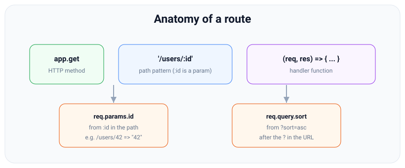
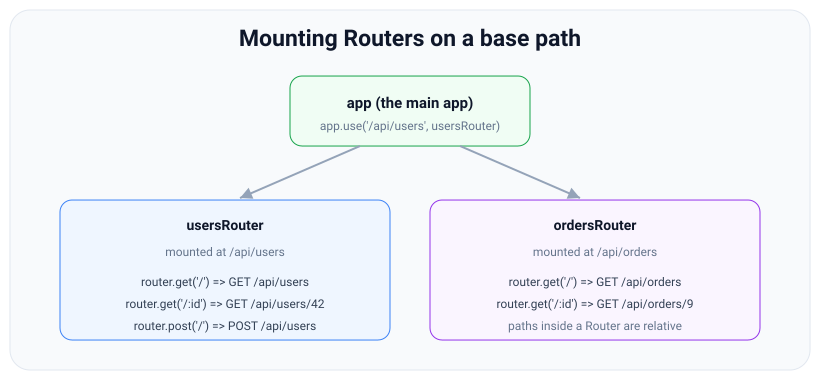

# Routing: params, query, and Routers

*9 min read · Updated 24 Jul 2026 Topic 35 of 70 Bookmark Mark done Why it matters Routing is how a server decides which piece of your code answers a given URL · Topic 35 of 70*

**Source:** [https://www.geekyfrontend.in/learn/nodejs-backend-kit/express-routing](https://www.geekyfrontend.in/learn/nodejs-backend-kit/express-routing)

---

## Why it matters

Routing is how a server decides *which piece of your code answers a given URL*. Every REST API is, at bottom, a routing table: `GET /users` lists users, `POST /users` creates one, `GET /users/:id` fetches one, `DELETE /users/:id` removes it. Get routing right and your API reads like a map of your domain; get it wrong and you end up with a tangle of conflicting paths, parameters that read the wrong value, and a `server.js` that is two thousand lines long. Interviewers lean on routing because it reveals whether you can structure an application, not just make one endpoint respond.

This topic covers the four things you will use constantly: defining routes for HTTP methods, reading dynamic *route parameters* (`:id`), reading the *query string* (`?sort=asc`), and — the part that separates toy apps from real ones — splitting routes into modular **Routers** so a growing codebase stays navigable. Mastering these turns "I can write an endpoint" into "I can architect an API."

## The concept, simply

A route in Express is a triple: an **HTTP method**, a **path pattern**, and one or more **handler functions**. You register one with `app.get(path, handler)`, `app.post(...)`, `app.put`, `app.patch`, `app.delete`, and so on — one method per verb, plus `app.all()` for every method. The path pattern can be a literal string (`'/health'`) or contain named parameters marked with a colon (`'/users/:id'`). When a request matches, Express calls the handler.

Two sources of variable data ride along with a request. **Route parameters** are parts of the path itself: in `/users/:id`, the `:id` segment captures whatever is in that position, so `/users/42` gives you `req.params.id === '42'`. The **query string** is the part after the `?`: in `/users?sort=asc&page=2`, Express parses it into `req.query` as `{ sort: 'asc', page: '2' }`. Params identify *which* resource; query usually *filters, sorts, or paginates* a collection.



A route is method + path + handler; the :id segment lands in req.params, the ?sort part lands in req.query.

As an app grows you do not want every route in one file. A **Router** is a mini, mountable Express app: you create it with `express.Router()`, attach routes to it, and mount it under a base path with `app.use('/api/users', usersRouter)`. Inside the router, paths are written relative to that base, so `router.get('/:id')` answers `GET /api/users/:id`. This is how real projects keep a hundred endpoints organised.

## How it works

Under the hood the router is an ordered list, and Express matches routes **top to bottom, first match wins for that step**. When a request arrives, Express compares its method and path against each route in registration order. The *first* route whose handler responds (without calling `next()`) ends processing. This ordering has a concrete consequence: a more specific route must be registered *before* a more general one that would also match, or the general one shadows it. `/users/new` must come before `/users/:id`, otherwise `:id` greedily captures the string `"new"`.

Path patterns are compiled into regular expressions by a library (`path-to-regexp`). A segment like `:id` becomes a capture group; its matched text is stored under that name in `req.params`. Note two important facts: **route params are always strings** (`'42'`, never `42` — you convert with `Number()` yourself), and they are captured per-segment, so `:id` matches one path segment and stops at the next `/`. Express 5 upgraded this matcher, changing some advanced syntax — notably how optional segments and unnamed wildcards are written — but named `:param` routing is unchanged.

The query string is parsed separately from the path. Express reads everything after the `?`, decodes it, and builds `req.query`. Repeated keys produce arrays (`?tag=a&tag=b` → `{ tag: ['a', 'b'] }`), which is a source of surprises — a value you expect to be a string can arrive as an array if a client sends the key twice. Bracket syntax depends on the version (changed in v5): Express 4 defaults to the `qs`-based `"extended"` parser, so `?a[b]=c` becomes the nested object `{ a: { b: 'c' } }`; Express 5 defaults to the `"simple"` parser (Node's `querystring`), so the same URL gives a flat key `{ 'a[b]': 'c' }`. Opt back in with `app.set('query parser', 'extended')` only if you need nested objects. Everything in `req.query` is also a string (or array/object of strings); there is no type coercion.

javascript

```
app.get('/search', (req, res) => res.json(req.query));
// GET /search?a[b]=c&tag=x&tag=y

// Real output — Express 4.22.3 (default "extended"):
//   {"a":{"b":"c"},"tag":["x","y"]}
// Real output — Express 5.2.1 (default "simple"):
//   {"a[b]":"c","tag":["x","y"]}
// Real output — Express 5.2.1 after app.set('query parser', 'extended'):
//   {"a":{"b":"c"},"tag":["x","y"]}
```



A Router is a mini-app mounted at a base path; routes inside it are written relative to that base and Express joins them.

When you mount a router with `app.use('/api/users', usersRouter)`, Express treats the router itself as one middleware entry keyed to that base path. A request to `/api/users/42` matches the mount, Express strips the base (`/api/users`) and passes the remainder (`/42`) into the router, which then does its own top-to-bottom matching against `/:id`. Routers can be nested and can carry their own middleware (`router.use(...)`), so cross-cutting concerns like "authenticate every admin route" attach cleanly to a subtree instead of the whole app.

## Code examples

**1. Methods, a route param, and a query.**

javascript

```
// GET /users/42?fields=name
app.get('/users/:id', (req, res) => {
  const id = Number(req.params.id);        // '42' (string) -> 42
  const fields = req.query.fields;         // 'name'
  res.json({ id, fields });
});

app.post('/users', (req, res) => {
  res.status(201).json({ created: req.body });
});

app.delete('/users/:id', (req, res) => {
  res.status(204).end();
});
```

**2. Ordering matters — specific before generic.**

javascript

```
// CORRECT: the literal route is registered first
app.get('/users/me', (req, res) => res.json({ self: true }));
app.get('/users/:id', (req, res) => res.json({ id: req.params.id }));

// If reversed, GET /users/me would match /users/:id
// and req.params.id would be the string "me".
```

**3. A Router in its own module** — the real-world pattern.

javascript

```
// routes/users.js
const express = require('express');
const router = express.Router();

// middleware for THIS router only
router.use((req, res, next) => { req.scope = 'users'; next(); });

router.get('/', (req, res) => res.json({ list: [] }));       // GET /api/users
router.get('/:id', (req, res) => res.json({ id: req.params.id })); // GET /api/users/:id
router.post('/', (req, res) => res.status(201).json(req.body));

module.exports = router;
```

javascript

```
// app.js
const express = require('express');
const app = express();
const usersRouter = require('./routes/users');

app.use(express.json());
app.use('/api/users', usersRouter);   // mount the router at a base path
app.listen(3000);
```

**4. Chaining methods on one path with `app.route()`** to avoid repeating the path string.

javascript

```
app.route('/books/:id')
  .get((req, res) => res.json({ read: req.params.id }))
  .put((req, res) => res.json({ updated: req.params.id }))
  .delete((req, res) => res.status(204).end());
```

## Common mistakes & gotchas

- **Registering `:id` before a literal sibling.** `/users/:id` placed above `/users/me` swallows `/users/me` — `req.params.id` becomes `"me"`. Specific routes first.
- **Treating params as numbers.** `req.params.id` is always a string. `req.params.id === 42` is `false`; convert with `Number()` and validate.
- **Assuming a query value is a string.** A duplicated key (`?tag=a&tag=b`) yields an array, and bracket syntax yields objects when the `"extended"` query parser is active (the Express 4 default; opt-in via `app.set('query parser', 'extended')` in Express 5). Defensive code checks the type before using it.
- **Confusing `req.params` with `req.query`.** Params come from the path pattern; query comes from after the `?`. Reaching into the wrong one returns `undefined`.
- **Duplicate route definitions.** Defining the same method+path twice: the first that responds wins, the second is dead code — no error is thrown, so it hides quietly.
- **Porting Express 4 wildcard/regex paths to 5 unchanged.** The matcher changed; unnamed wildcards and optional markers were rewritten. Named `:param` routes are safe, but exotic patterns need review.

## Best practices

- **One Router per resource** (`users`, `orders`, `products`) in its own file under a `routes/` folder, each mounted at `/api/<resource>`.
- **Order routes specific → generic** within a file, and keep the mount base path in `app.use` so the router's internal paths stay short and relative.
- **Validate and coerce params and query at the boundary** (a small middleware or a schema library like `zod`/`joi`) so handlers receive clean, typed data.
- **Use `app.route()` or method chaining** when several verbs share one path, to keep the path defined once.
- **Keep handlers thin** — parse the request, call a service/controller function, send the response. Business logic does not belong inside the route callback.
- **Use `express.Router({ mergeParams: true })`** when a nested router needs params from its parent's mount path.

## ⭐ Interview lens

> **Q: "What is the difference between `req.params` and `req.query`?"**  
> A: `req.params` holds named segments from the path pattern (`/users/:id` → `req.params.id`) and identifies a specific resource. `req.query` holds the parsed query string after the `?` and typically filters, sorts, or paginates. Both arrive as strings — Express does no type coercion.

> **Q: "Why does route order matter?"**  
> A: Express matches top to bottom and the first matching handler that responds wins. A dynamic route like `/users/:id` will also match `/users/me`, so if it is registered first it shadows the literal route. You register specific paths before generic ones.

> **Q: "What is `express.Router()` and why use it?"**  
> A: A Router is a standalone, mountable middleware/route group — a mini Express app. You attach routes and router-level middleware to it and mount it under a base path with `app.use('/api/users', router)`. It keeps large apps modular: one router per resource, each in its own file.

> **Q: "A user hits `GET /users/me` but your handler returns the wrong record. Why?"**  
> A: Almost certainly a route-ordering bug — `/users/:id` was registered before `/users/me`, so `:id` captured the literal string `"me"`. Move the specific route above the dynamic one.

> **Q (trap): "`req.params.id` for `/users/42` — is it the number 42?"**  
> A: No, it is the string `"42"`. Route params (and query values) are always strings; comparing with `=== 42` fails. Convert and validate explicitly.

> **Q: "How would you attach authentication to only the admin routes?"**  
> A: Put those routes in their own Router and register the auth middleware on that router with `router.use(authMiddleware)` (or as the second argument on the mount). It applies to the whole subtree without touching unrelated routes.

## Cheat-card

- Route = **method** + **path** + **handler(s)**: `app.get('/users/:id', fn)`.
- `req.params` = path segments (`:id`); `req.query` = after `?`. Both are **strings**.
- Matching is **top-to-bottom, first responder wins** → specific before generic.
- `express.Router()` = mountable mini-app; `app.use('/base', router)` joins paths.
- Router paths are **relative** to the mount base.
- `app.route('/path')` chains `.get().put().delete()` on one path.
- `mergeParams: true` to read parent params in a nested router.
- Express 5 changed the path matcher — audit wildcard/regex paths on upgrade.
- **Optional parameter (Express 5):** `'/users{/:id}'`. `'/users/:id?'` throws `PathError: Unexpected ?` at startup. More extras in [lesson 93](93-express-routing-extras.md).
- **`mergeParams: true`** goes on the *child* router. It then sees the parent's `:userId`. On a name clash, the child's value wins.

---

## Learn More

- [Routing expressjs.com](https://expressjs.com/en/guide/routing.html)
- [Basic routing expressjs.com](https://expressjs.com/en/starter/basic-routing.html)
- [Node.js Crash Course Tutorial #11 - Express Router & MVC Net Ninja](https://www.youtube.com/watch?v=zW_tZR0Ir3Q)

---

## Additional topics

*Added 10 Oct 2026 · examples verified on Node v24.19.0 and Express 5.3.0 (Express 4.22.3 for comparison; supertest 7.3.1)*

### More routing: lesson 93

This lesson covers the routing you use every day. [Express Routing Extras](93-express-routing-extras.md) (lesson 93) covers the rest:

- `app.param` / `router.param`;
- RegExp routes and arrays of paths;
- the Express 5 path syntax and the exact `PathError` each old Express 4 pattern throws;
- what `req.baseUrl`, `req.path` and `req.originalUrl` contain at each level of nested routers;
- `next('route')` against `next('router')`, and `app.all`.

The two lessons share one rule. A route path is a pattern that path-to-regexp compiles into a regex: version 0.1.13 under Express 4.22.3, and 8.4.2 (through the `router` package 2.2.0) under Express 5.3.0. "Audit wildcard/regex paths on upgrade" means exactly the patterns version 8 rejects.

How it works:

1. `app.get(path, fn)` passes `path` to path-to-regexp when the route is registered, not when a request arrives.
2. Version 8 tokenises the string and throws a `PathError` (a subclass of `TypeError`) on a reserved character it does not expect: `( ) [ ] ? + !` or a `*` without a name.
3. So an Express 4 optional parameter (`:id?`) stops the app at startup. The Express 5 spelling wraps the optional part in braces: `'/users{/:id}'`.

**Example — an optional `:id` in both spellings, on Express 5.**

javascript

```
// optional.cjs: an optional :id, Express 4 spelling vs Express 5 spelling
const express = require('express');
const request = require('supertest');

const app = express();
try {
  app.get('/users/:id?', (req, res) => res.json(req.params));  // Express 4 spelling
} catch (err) {
  console.log(`'/users/:id?' -> ${err.constructor.name}: ${err.message.split(';')[0]}`);
}
app.get('/users{/:id}', (req, res) => res.json(req.params));   // Express 5 spelling

(async () => {
  for (const url of ['/users', '/users/42']) {
    const r = await request(app).get(url);
    console.log(`GET ${url} -> ${r.status} ${r.text}`);
  }
})();

// Real output (Node v24.19.0, Express 5.3.0):
//   '/users/:id?' -> PathError: Unexpected ? at index 10: /users/:id?
//   GET /users -> 200 {}
//   GET /users/42 -> 200 {"id":"42"}
```

When `id` is missing, Express 5 leaves the key out of `req.params` (`{}`). Express 4 kept the key with the value `undefined`.

### Nested routers and `mergeParams`

Each Router builds its own `req.params` from the part of the URL that *it* matched. When a router is mounted at a path with a parameter, as in `app.use('/users/:userId/posts', postsRouter)`, the **parent** captures `userId` while matching the mount path. The child router then replaces `req.params` with its own captures, so by default `req.params.userId` is `undefined` inside the child. `express.Router({ mergeParams: true })` makes the child start from the parent's params and add its own on top. Without it, every nested resource (`/users/:userId/posts/:postId`) loses its parent id.

How it works:

1. `GET /users/7/posts/99` matches the mount layer `/users/:userId/posts`. The parent records `{ userId: '7' }` and strips the prefix, so the child sees `/99`.
2. The child matches its route `/:postId` and captures `{ postId: '99' }`.
3. Without `mergeParams`, `req.params` becomes `{ postId: '99' }`. With `mergeParams: true`, it becomes `{ userId: '7', postId: '99' }`.
4. When the request leaves the child, the parent's `req.params` comes back.

**Example — the same posts router with and without `mergeParams`.**

javascript

```
// merge.cjs: a nested posts router reads the parent's :userId
const express = require('express');
const request = require('supertest');

function postsRouter(options) {
  const posts = express.Router(options);
  posts.get('/:postId', (req, res) => {
    res.json({ userId: req.params.userId ?? null, postId: req.params.postId });
  });
  return posts;
}

const app = express();
app.use('/users/:userId/posts', postsRouter());                       // default
app.use('/v2/users/:userId/posts', postsRouter({ mergeParams: true })); // opt in

(async () => {
  for (const url of ['/users/7/posts/99', '/v2/users/7/posts/99']) {
    const res = await request(app).get(url);
    console.log(url.padEnd(22), res.status, res.text);
  }
})();

// Real output (Node v24.19.0, Express 5.3.0):
//   /users/7/posts/99      200 {"userId":null,"postId":"99"}
//   /v2/users/7/posts/99   200 {"userId":"7","postId":"99"}
```

Express 4.22.3 prints the same two lines.

### Common mistakes & gotchas (additional topics)

- **Setting `mergeParams` on the parent instead of the child.** The option belongs to the router that needs to *read* the parent's params, which is the one you mount.
- **Reusing a parameter name in parent and child.** With `mergeParams: true`, the child's value wins (see the edge case below).
- **Copying `:id?` from Express 4 code into Express 5.** It throws `PathError: Unexpected ? at index 10` at startup. Use `'/users{/:id}'`. The reverse also fails: Express 4 treats `{/:id}` as literal text and answers 404, without any error.

### Edge case worked through: parent and child both call it `:id`

A child router mounted at `/users/:id/posts` with its own route `/:id` and `mergeParams: true` gets two values for one key: `'7'` from the parent and `'99'` from the child. Express merges the parent's params first and then the child's, so the child's capture overwrites the parent's and the user id is lost:

javascript

```
// clash.cjs: parent and child routers both call their parameter :id
const express = require('express');
const request = require('supertest');

const posts = express.Router({ mergeParams: true });
posts.get('/:id', (req, res) => res.json(req.params));

const app = express();
app.use('/users/:id/posts', posts);          // parent :id = user id

request(app).get('/users/7/posts/99').then((r) => console.log(r.status, r.text));

// Real output (Node v24.19.0, Express 5.3.0):
//   200 {"id":"99"}
```

Express 4.22.3 prints the same line. Name nested parameters after their resource (`:userId`, `:postId`) so each key is set by exactly one router.

### ⭐ Interview lens (additional topics)

> **Q: “Inside a router mounted at `/users/:userId/posts`, `req.params.userId` is `undefined`. Why, and what is the fix?”**  
> A: The parent captured `userId` while matching the mount path, but the child router sets `req.params` from its own match only. Create the child with `express.Router({ mergeParams: true })`. Then it starts from the parent's params and adds its own. A name used by both is resolved in favour of the child.
