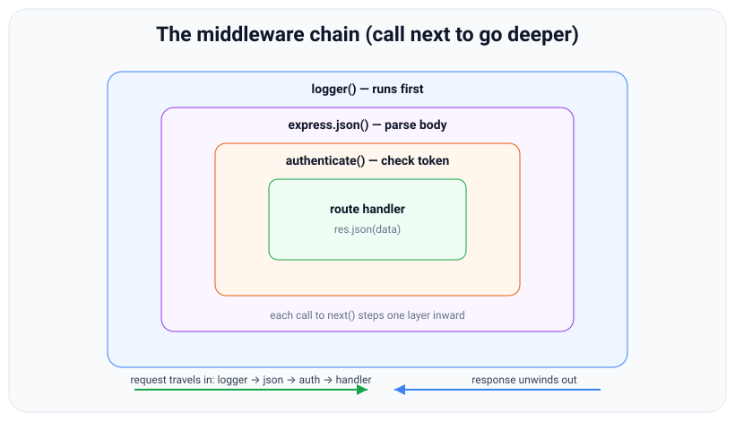
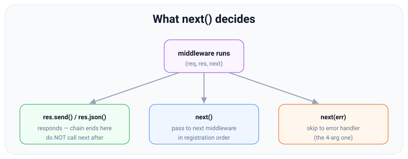

# Middleware: the pipeline, next(), and order

*9 min read · Updated 24 Jul 2026 Topic 36 of 70 Bookmark Mark done Why it matters Middleware is the single most important concept in Express · Topic 36 of 70*

**Source:** [https://www.geekyfrontend.in/learn/nodejs-backend-kit/middleware](https://www.geekyfrontend.in/learn/nodejs-backend-kit/middleware)

---

## Why it matters

Middleware is the single most important concept in Express — more than routing, more than the helpers. Everything Express does is expressed as middleware: parsing bodies, logging, authenticating, setting CORS headers, handling errors, and running your route logic are all just functions in one ordered pipeline. If routing answers "which code runs?", middleware answers "what happens before, during, and after it runs?". Interviewers probe middleware because a candidate who truly understands it understands the whole framework; someone who has only copy-pasted `app.use(cors())` usually stumbles the moment you ask *why* order matters or *what `next()` actually does*.

Practically, middleware is how you avoid repeating yourself. Instead of adding an auth check, a request log, and a body parse to every one of forty handlers, you write each once and register it in the pipeline. This topic explains the pipeline model precisely — the "onion", the role of `next()`, why registration order is behaviour, and the difference between application-level and router-level middleware — so that the error-handling topic that follows (which is also just middleware) feels like a natural extension rather than a new rule.

## The concept, simply

A middleware is **a function with the signature `(req, res, next)`**. Express calls it with the request object, the response object, and a `next` function. Inside, the middleware can do three kinds of thing: *read or modify* `req`/`res` (attach a user, set a header, log a line), *end the request* by sending a response, or *pass control onward* by calling `next()`. A middleware that neither responds nor calls `next()` hangs the request forever — the client just waits. That is the number-one bug beginners create, and it comes straight from not respecting this contract.

You register middleware with `app.use(fn)` to run it on every request, or `app.use('/path', fn)` to scope it to paths starting with `/path`, or as extra arguments on a route (`app.get('/x', authCheck, handler)`) to run it only for that route. Express keeps all of these in one ordered stack, in the order you register them. When a request comes in, it enters the top of the stack and flows down, function by function, each one deciding whether to pass control along.



Middleware nests like an onion: each next() steps one layer inward toward the handler, and the response unwinds back out.

The classic image is an **onion**. The request enters through the outer layers (logger, then body parser, then auth), each calling `next()` to reach the next layer in, until it hits the route handler at the core. The response then travels back out through any code the middleware placed *after* its `next()` call. This "in through the layers, out through the layers" shape is why some middleware can measure request duration: it records a timestamp before `next()` and computes the elapsed time after control returns.

## How it works

Express stores middleware in an ordered array. Processing a request means walking that array with an internal cursor. Express calls the first matching entry; that entry receives a `next` function which, when invoked, advances the cursor and calls the next matching entry — and so on. **Calling `next()` is literally "run the next middleware".** If a middleware never calls `next()` and never responds, the cursor never advances and the request stalls. If it calls `next()` more than once, later middleware may run twice and you can hit "headers already sent" errors when two of them try to respond.



next() is a control decision: respond and stop, call next() to continue, or call next(err) to jump to the error handler.

The `next` function has a special overload: if you call it **with an argument** — `next(err)` — Express treats that as an error and skips every remaining *normal* middleware, jumping straight to the *error-handling* middleware (the ones with four parameters, covered next topic). There is one reserved string, `next('route')`, which skips the rest of the handlers for the *current* route and moves to the next matching route — a niche tool. Everything else you pass to `next` is an error.

Because the stack is ordered and Express walks it linearly, **registration order is behaviour, not style**. Body parsers must be registered before routes that read `req.body`, or the body is unparsed when the handler runs. Auth middleware must come before the protected routes. A logger placed at the very top sees every request; placed at the bottom it sees only requests that fell through everything else. There is no dependency graph or priority system — just position in the array.

Middleware comes in scopes. **Application-level** middleware is registered on `app` (`app.use(fn)`) and applies to the whole app. **Router-level** middleware is registered on a Router (`router.use(fn)`) and applies only to requests that reach that router — ideal for concerns tied to one resource subtree, like admin auth. **Route-level** middleware is passed inline to a single route. **Built-in** middleware ships with Express (`express.json()`, `express.urlencoded()`, `express.static()`). **Third-party** middleware is installed from npm (`cors`, `helmet`, `morgan`, `express-rate-limit`). All of them are the same shape of function in the same kind of stack.

## Code examples

**1. A custom logging middleware** that times the request using the onion shape.

javascript

```
app.use((req, res, next) => {
  const start = Date.now();
  console.log(`-> ${req.method} ${req.url}`);
  res.on('finish', () => {             // runs when the response is sent
    console.log(`<- ${res.statusCode} (${Date.now() - start}ms)`);
  });
  next();                              // must call next, or the request hangs
});
```

**2. Authentication as middleware**, attaching data to `req` for later handlers.

javascript

```
function requireAuth(req, res, next) {
  const token = req.get('Authorization');
  if (!token) {
    return res.status(401).json({ error: 'No token' }); // ends the chain
  }
  req.user = decode(token);            // pass data downstream via req
  next();                              // continue to the handler
}

app.get('/profile', requireAuth, (req, res) => {
  res.json({ user: req.user });        // req.user was set by the middleware
});
```

**3. Application-level vs router-level scope.**

javascript

```
// app-level: every request
app.use(express.json());

// router-level: only requests under /admin
const admin = express.Router();
admin.use(requireAuth);               // guards the whole admin subtree
admin.get('/stats', (req, res) => res.json({ ok: true }));
app.use('/admin', admin);
```

**4. Common third-party stack**, in the order they should run.

javascript

```
const helmet = require('helmet');
const cors = require('cors');
const morgan = require('morgan');

app.use(helmet());                    // security headers first
app.use(cors());                      // CORS headers
app.use(morgan('dev'));               // request logging
app.use(express.json());              // body parsing
// ... routes registered AFTER the shared middleware ...
```

## Common mistakes & gotchas

- **Forgetting `next()`.** A middleware that neither responds nor calls `next()` hangs the request silently — no error, the client just times out. The most common Express bug.
- **Calling `next()` AND responding.** If you `res.send()` and then call `next()`, downstream code may try to respond again → "Cannot set headers after they are sent". Return after responding: `return res.status(401).json(...)`.
- **Wrong order.** Registering `express.json()` after a route means that route sees `req.body === undefined`. Shared middleware goes first.
- **Doing heavy sync work in middleware.** It runs on every matching request; a blocking operation there throttles the whole server.
- **Assuming `app.use('/api', fn)` matches only `/api`.** It matches every path that *starts with* `/api` (`/api/users`, `/api/x/y`), which is usually what you want but occasionally surprises.
- **Mutating `req`/`res` unpredictably.** Attaching data is fine (`req.user`), but overwriting core properties or relying on a property another middleware may not have set leads to brittle chains.

## Best practices

- **Fix a registration order and stick to it:** security headers → CORS → logging → body parsing → app routes → 404 → error handler.
- **Always `return` after sending a response** inside middleware, so control cannot accidentally fall through to `next()`.
- **Scope middleware as narrowly as it needs to be** — route-level for one endpoint, router-level for a subtree, app-level only for truly global concerns.
- **Keep each middleware single-purpose** (log, or parse, or authenticate — not all three), so the pipeline is readable and reusable.
- **Pass data downstream via `req`** (e.g. `req.user`, `req.requestId`) rather than globals; it stays request-scoped and safe under concurrency.
- **Prefer battle-tested third-party middleware** (`helmet`, `cors`, `express-rate-limit`, `morgan`) over hand-rolled versions of the same concern.

## ⭐ Interview lens

> **Q: "What is middleware in Express?"**  
> A: A function of the form `(req, res, next)` that runs during the request pipeline. It can read/modify the request and response, end the request by responding, or pass control to the next function with `next()`. Every part of Express — parsing, auth, logging, even route handlers and error handlers — is middleware.

> **Q: "What does `next()` do, and what happens if I don't call it?"**  
> A: `next()` advances Express to the next matching middleware in the stack. If a middleware neither responds nor calls `next()`, the request hangs indefinitely — Express never moves the cursor forward, so the client just waits and times out.

> **Q: "Why does middleware order matter?"**  
> A: Express walks the middleware stack in registration order, so position *is* behaviour. Body parsers must precede routes that read `req.body`; auth must precede protected routes; a top-level logger sees every request. There is no priority system — only array order.

> **Q: "What is the difference between `next()` and `next(err)`?"**  
> A: `next()` continues to the next normal middleware. `next(err)` — with any argument — signals an error: Express skips all remaining normal middleware and jumps to the error-handling middleware (the four-argument ones). `next('route')` is a special case that skips to the next matching route.

> **Q: "Application-level vs router-level middleware?"**  
> A: App-level is registered on `app` and runs for the whole app; router-level is registered on an `express.Router()` and runs only for requests that reach that router. Router-level is how you guard one resource subtree — e.g. `adminRouter.use(requireAuth)` — without affecting unrelated routes.

> **Q (trap): "You call `res.json(data)` and then `next()` in the same middleware. What happens?"**  
> A: You have already sent the response, so when a downstream handler also tries to write, Express throws "Cannot set headers after they are sent to the client". Always `return` after responding; do not fall through to `next()`.

## Cheat-card

- Middleware = `(req, res, next) => { ... }`. Read/modify, respond, or `next()`.
- No `next()` and no response = **request hangs**. Respond and then don't `next()`.
- `next()` = next middleware; `next(err)` = jump to error handler; `next('route')` = next matching route.
- **Order = behaviour.** Shared middleware before routes.
- Scopes: app (`app.use`), router (`router.use`), route (inline arg), built-in, third-party.
- Onion model: request flows in via `next()`, response unwinds out.
- Pass data downstream on `req` (e.g. `req.user`), never on globals.
- Recommended order: helmet → cors → logger → `express.json()` → routes → 404 → error handler.
- `next('router')` (added in Express 4.15.0) = leave the current router and continue after its mount point; from app-level middleware it ends in Express's final 404.
- `express.static` answers only when the file exists, else `next()`: put it early (after logging, before sessions/auth/body parsers); see lesson 87.

---

## Learn More

- [Using middleware expressjs.com](https://expressjs.com/en/guide/using-middleware.html)
- [Writing middleware for use in Express apps expressjs.com](https://expressjs.com/en/guide/writing-middleware.html)
- [Learn Express Middleware In 14 Minutes Web Dev Simplified](https://www.youtube.com/watch?v=lY6icfhap2o)

---

## Additional topics

*Added 10 Oct 2026 · examples verified on Node v24.19.0 and Express 5.3.0*

### `next('router')`: leaving a whole router

`next('router')` is the second reserved string for `next` (added in Express 4.15.0). It tells the router that is currently running "skip everything else you have", so control returns to the parent stack, right after the `app.use('/panel', router)` line that mounted it. `next('route')` is narrower: it skips only the remaining handlers of the *current route* and lets the same router try its next matching route. Without `next('router')`, a router-level guard that decides "this request is not for me" can only respond (for example `403`) or call `next()`, which runs the router's own remaining middleware and routes. That is wrong when a later part of the app should answer, such as a public version of the same URL.

How it works:

1. The app's stack reaches `app.use('/panel', admin)`, strips `/panel`, and starts walking `admin`'s own stack.
2. A function inside `admin` calls `next('router')`.
3. `admin` stops walking its stack. None of its remaining middleware or routes run, and the URL prefix is restored.
4. The app continues with the next entry after the mount, as if `admin` had called `next()` at its very end.
5. `next('route')` in a route handler skips only that route's remaining handlers. The router then tries the next route that matches the same path.
6. Called in app-level middleware, `next('router')` leaves the app's own router, so nothing else in the app runs and Express's final handler answers `404 Cannot GET …`.

**Example — `next('route')` vs `next('router')`, with the functions that ran.**

javascript

```
// next-router.cjs: next('route') skips to the next matching route; next('router') leaves the whole router.
// npm install express@5 supertest
const express = require('express');
const request = require('supertest');

const app = express();
const trail = [];                                          // which functions ran, per request
const step = (name) => (req, res, next) => { trail.push(name); next(); };

// next('route'): only the rest of THIS route's handlers are skipped
app.get('/users/:id',
  (req, res, next) => { trail.push('route1.check'); if (req.params.id === 'me') return next('route'); next(); },
  (req, res) => { trail.push('route1.byId'); res.json({ handler: 'by id' }); });
app.get('/users/:id', (req, res) => { trail.push('route2'); res.json({ handler: 'second route' }); });

// next('router'): every remaining middleware and route inside this router is skipped
const admin = express.Router();
admin.use((req, res, next) => {
  trail.push('admin.gate');
  if (req.get('X-Role') !== 'admin') return next('router');   // not for us: hand back to the app
  next();
});
admin.use(step('admin.audit'));
admin.get('/stats', (req, res) => { trail.push('admin.stats'); res.json({ from: 'admin router' }); });
app.use('/panel', admin);
app.get('/panel/stats', (req, res) => { trail.push('app.publicStats'); res.json({ from: 'app, after the router' }); });

// next('router') in app-level middleware leaves the app's router: Express's final 404
app.use('/bail', (req, res, next) => { trail.push('app.bail'); next('router'); });
app.use(step('app.after-bail'));

(async () => {
  const cases = [
    ['/users/42', {}], ['/users/me', {}],
    ['/panel/stats', { 'X-Role': 'admin' }], ['/panel/stats', {}],
    ['/bail', {}],
  ];
  for (const [url, headers] of cases) {
    trail.length = 0;
    const res = await request(app).get(url).set(headers);
    const body = res.type === 'application/json' ? JSON.stringify(res.body) : res.text.match(/<pre>(.*)<\/pre>/)?.[1];
    console.log(`GET ${url} ${JSON.stringify(headers)} -> ${res.status} ${body}\n    ran: ${trail.join(' > ')}`);
  }
})();

// Real output (Node v24.19.0, Express 5.3.0, supertest 7.3.1; identical with Express 4.22.3):
//   GET /users/42 {} -> 200 {"handler":"by id"}
//       ran: route1.check > route1.byId
//   GET /users/me {} -> 200 {"handler":"second route"}
//       ran: route1.check > route2
//   GET /panel/stats {"X-Role":"admin"} -> 200 {"from":"admin router"}
//       ran: admin.gate > admin.audit > admin.stats
//   GET /panel/stats {} -> 200 {"from":"app, after the router"}
//       ran: admin.gate > app.publicStats
//   GET /bail {} -> 404 Cannot GET /bail
//       ran: app.bail
```

For `/users/me`, `next('route')` skipped `route1.byId` but the second `/users/:id` route still ran. For `/panel/stats` without the header, `next('router')` skipped `admin.audit` and `admin.stats` and the app's own `/panel/stats` route answered.

### `express.static` in the middleware order

`express.static(root)` is a built-in middleware that answers `GET` and `HEAD` requests whose path names an existing file under `root`, and calls `next()` for everything else: missing files, other methods, directories without an index file. That "answer or step aside" behaviour is the `fallthrough: true` default. Because it is ordinary middleware, its position in the stack decides two things: which middleware runs before a file is served, and which later routes get the requests it did not answer. Lesson 87, [Serving Static Files with express.static](87-express-serving-static-files.md), covers the options, caching, the SPA fallback and the security checks.

How it works:

1. The request walks the stack in registration order, as for any middleware.
2. When it reaches `express.static`, the path (minus any mount prefix) is resolved under the root and checked.
3. If a file is there, the middleware streams it and the request ends. Nothing registered later runs.
4. If not, it calls `next()`, and the request continues to the middleware and routes registered after it.
5. Middleware registered *before* `express.static` runs for every asset request, which is why loggers usually come first and auth, sessions and body parsers usually come after it (unless the files themselves are private).

**Example — `express.static` before and after an auth middleware.**

javascript

```
// static-order.cjs: where express.static sits in the pipeline, and how a miss falls through.
// npm install express@5 supertest; public/style.css must exist: mkdir public; echo 'body{margin:0}' > public/style.css
const path = require('node:path');
const express = require('express');
const request = require('supertest');

const trail = [];
const logger = (req, res, next) => { trail.push('logger'); next(); };
const requireAuth = (req, res, next) => {
  trail.push('auth');
  if (req.get('Authorization') !== 'Bearer t0ken') return res.status(401).json({ error: 'login first' });
  next();
};
const routes = express.Router();
routes.get('/report.css', (req, res) => { trail.push('route /report.css'); res.type('css').send('/* generated */'); });
const notFound = (req, res) => { trail.push('404'); res.status(404).json({ error: 'not found' }); };
const serveStatic = express.static(path.join(__dirname, 'public'));
const staticStep = (req, res, next) => { trail.push('static'); serveStatic(req, res, next); };   // same middleware, logged

// A: static early. Files are answered before auth; misses fall through to auth and the routes.
const early = express();
early.use(logger, staticStep, requireAuth, routes, notFound);

// B: static after auth. Every asset request now needs a token.
const late = express();
late.use(logger, requireAuth, staticStep, routes, notFound);

(async () => {
  for (const [label, app] of [['A static early', early], ['B static late ', late]]) {
    for (const [url, auth] of [['/style.css', false], ['/report.css', true], ['/report.css', false], ['/nope.css', true]]) {
      trail.length = 0;
      const req = request(app).get(url);
      if (auth) req.set('Authorization', 'Bearer t0ken');
      const res = await req;
      console.log(`${label} GET ${url.padEnd(11)} token=${String(auth).padEnd(5)} -> ${res.status}  ran: ${trail.join(' > ')}`);
    }
  }
})();

// Real output (Node v24.19.0, Express 5.3.0, supertest 7.3.1):
//   A static early GET /style.css  token=false -> 200  ran: logger > static
//   A static early GET /report.css token=true  -> 200  ran: logger > static > auth > route /report.css
//   A static early GET /report.css token=false -> 401  ran: logger > static > auth
//   A static early GET /nope.css   token=true  -> 404  ran: logger > static > auth > 404
//   B static late  GET /style.css  token=false -> 401  ran: logger > auth
//   B static late  GET /report.css token=true  -> 200  ran: logger > auth > static > route /report.css
//   B static late  GET /report.css token=false -> 401  ran: logger > auth
//   B static late  GET /nope.css   token=true  -> 404  ran: logger > auth > static > 404
```

In A, `/style.css` exists, so the chain stopped at `static` and auth never ran. `/report.css` is not on disk, so `static` called `next()` and the request fell through to auth and then to the route that generates it. In B the same public stylesheet needs a token, because auth now sits in front of it.

### Common mistakes & gotchas (additional topics)

- **Using `next('router')` where `next('route')` was meant.** `next('router')` skips every remaining route in the router, not just the current one.
- **Calling `next('router')` in app-level middleware.** It leaves the app's router, so no later app middleware runs and the client gets Express's final `404 Cannot GET …` (the `/bail` case above).
- **Misspelling the string.** Only the exact strings `'route'` and `'router'` are special. `next('Router')` is treated as an error, so the error handler receives the string `"Router"` (edge case below).
- **Putting `express.static` after sessions, body parsers or auth.** Every image and script request then pays for them, and public assets can end up behind a login (case B).
- **Expecting `express.static` to answer a miss with 404.** By default it calls `next()`. Your 404 handler, or a route registered later, answers instead.
- **A route that shadows a file, or a file that shadows a route.** Whichever is registered first wins: with static first, a `public/report.css` would stop the `/report.css` route from ever running.

### Edge case worked through: `next('router')` with nothing after the router

The question: a guard in a router calls `next('router')`, but the app has no route after the mount that matches the same URL. Where does the request end up?

1. `admin.gate` calls `next('router')`, and `admin` returns control to the app right after `app.use('/panel', admin)`.
2. The app keeps walking its stack. If nothing later matches `/panel/stats`, the stack runs out.
3. When the app's stack runs out, Express's final handler answers `404` with `Cannot GET /panel/stats`, exactly as for an unknown URL. The `/bail` case in the example shows the same result when `next('router')` is called from app-level middleware: the trail stops at `app.bail` and the response is `404 Cannot GET /bail`.

The run below checks this, next to an explicit `403` and a misspelt string:

javascript

```
// edge.cjs: next('router') from a guard when nothing after the mount matches, vs an explicit 403.
const express = require('express');
const request = require('supertest');

function adminRouter(onRefuse) {
  const admin = express.Router();
  admin.use((req, res, next) => (req.get('X-Role') === 'admin' ? next() : onRefuse(req, res, next)));
  admin.get('/stats', (req, res) => res.json({ ok: true }));
  return admin;
}

const hidden = express();
hidden.use('/panel', adminRouter((req, res, next) => next('router')));   // nothing after the mount
const explicit = express();
explicit.use('/panel', adminRouter((req, res) => res.status(403).json({ error: 'admins only' })));
const typo = express();
typo.use('/panel', adminRouter((req, res, next) => next('Router')));     // not the reserved string
typo.use((err, req, res, next) => res.status(500).json({ error: `next() got ${JSON.stringify(err)}` }));

(async () => {
  for (const [label, app] of [['next(\'router\')', hidden], ['403        ', explicit], ['next(\'Router\')', typo]]) {
    const res = await request(app).get('/panel/stats');
    console.log(label, '->', res.status, res.type === 'application/json' ? JSON.stringify(res.body) : res.text.match(/<pre>(.*)<\/pre>/)?.[1]);
  }
})();

// Real output (Node v24.19.0, Express 5.3.0, supertest 7.3.1):
//   next('router') -> 404 Cannot GET /panel/stats
//   403         -> 403 {"error":"admins only"}
//   next('Router') -> 500 {"error":"next() got \"Router\""}
```

So `next('router')` from a guard looks like "this URL does not exist", not like "access denied". That is useful when you do not want to reveal that an admin route exists. When the client needs to know the request was refused, send a `403` instead.

### ⭐ Interview lens (additional topics)

> **Q: “What is the difference between `next('route')` and `next('router')`?”**  
> A: `next('route')` skips the remaining handlers of the current route, and the same router continues with its next matching route. `next('router')` skips everything left in the current router and returns to the parent stack after the mount point. Use it when a router-level check decides the request belongs to another part of the app. *Trap:* from app-level middleware, `next('router')` exits the app's router and produces Express's final 404.

> **Q: “Where do you put `express.static` and why?”**  
> A: Early, usually right after logging and security headers, and before sessions, body parsers and auth, so asset requests do not pay for them and public files stay public. It only answers when the file exists; otherwise it calls `next()` and later routes still run. Private files go behind auth, often with `res.sendFile` in a route instead.
