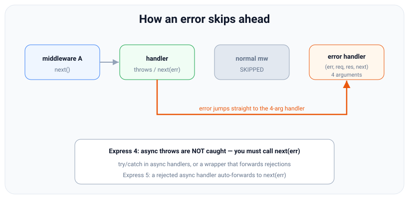

# Error handling: the 4-arg handler and async errors

*10 min read · Updated 24 Jul 2026 Topic 37 of 70 Bookmark Mark done Why it matters How an app handles errors is what separates a demo from a production service · Topic 37 of 70*

**Source:** [https://www.geekyfrontend.in/learn/nodejs-backend-kit/express-error-handling](https://www.geekyfrontend.in/learn/nodejs-backend-kit/express-error-handling)

---

## Why it matters

How an app handles errors is what separates a demo from a production service. Errors are not exceptional — a database is momentarily down, a client sends malformed JSON, a record is missing, a token is expired — these happen constantly. If your Express app leaks stack traces to clients, hangs on a rejected promise, or returns HTML error pages from a JSON API, it will fail review and frustrate every consumer. Interviewers love error handling because it is subtle: Express has a *specific mechanism* (a special four-argument middleware), and Express 4's most notorious footgun — async errors silently not being caught — has burned nearly every Node developer at least once.

This topic covers the whole error story: the special error-handling middleware and why it has four parameters, how errors *propagate* through the pipeline, the crucial difference between synchronous and asynchronous error handling (and how Express 5 fixes it), catching unmatched routes with a 404 handler, and centralising all of it into one place so every error in your app is formatted consistently. Get this right and your API becomes predictable under failure — which is most of what "production-ready" means.

## The concept, simply

Express recognises one special kind of middleware: an **error-handling middleware has four parameters** — `(err, req, res, next)` — instead of three. That extra first parameter, `err`, is how Express identifies it. You do not call these functions directly; Express routes an error to them automatically. The rule is simple: whenever a normal middleware throws (synchronously) or calls `next(err)`, Express stops running normal middleware and looks for the next four-argument handler in the stack, then calls it with the error.

To send an error into that system you have two moves. In synchronous code you can just `throw` — Express wraps route handlers in a try/catch and turns a thrown error into `next(err)` for you. In asynchronous code (a rejected promise, an error inside a callback) you must call `next(err)` yourself in Express 4, because Express 4's try/catch cannot catch an error that happens later, after the function has already returned. Express 5 closes this gap: it awaits async handlers and forwards rejections to `next(err)` automatically.



A thrown or forwarded error skips all remaining normal middleware and jumps straight to the four-argument error handler.

Two more pieces complete the picture. A **404 handler** is a normal middleware placed *after all routes* — if a request reaches it, nothing matched, so it responds with "Not Found". And a **centralized error handler** is a single four-argument middleware placed *last*, after everything, that catches every error the app produces and turns it into one consistent response shape (status + JSON message), logging the details server-side instead of leaking them to the client.

## How it works

Express identifies error middleware purely by **arity — the function's parameter count**. A function declared with four parameters is an error handler; with three (or fewer) it is normal middleware. This has a sharp consequence: you must declare all four parameters, *including `next`*, even if you do not use it, or Express treats the function as normal middleware and never sends errors to it. Omitting the fourth parameter is a classic silent bug — the handler simply never fires.

When an error enters the system (via `throw` in sync code or an explicit `next(err)`), Express advances its cursor past every remaining *normal* middleware and route — they are skipped entirely — and calls the next *error* middleware it finds. Inside that handler you can inspect the error, choose a status code, log it, and respond. If you call `next(err)` again from within an error handler, Express passes it to the *next* error handler down the stack; if there is none, it falls back to Express's built-in default error handler, which sends the status and, in development, the stack trace.

The synchronous-versus-asynchronous distinction is the heart of the topic. In Express 4, a route like `(req, res) => { throw new Error() }` is caught because Express wrapped the call in try/catch. But `async (req, res) => { await thatRejects() }` is *not* caught in Express 4: by the time the promise rejects, the synchronous part of the function has returned and the try/catch has already exited. The rejection becomes an unhandled promise rejection, and what happens next is decided by Node, not Express. By default (since Node 15, `--unhandled-rejections=throw`) an unhandled rejection is raised as an uncaught exception: the error is printed and **the whole process crashes with exit code 1**, dropping this request and every other in-flight request. The request only **hangs** — no response, no crash, the client eventually times out — when something swallows the rejection, such as a `process.on('unhandledRejection')` handler that only logs, an APM agent, or a non-default `--unhandled-rejections` mode. Neither outcome sends the client a proper error response. The fixes are: wrap async handlers in try/catch and call `next(err)`, use a small wrapper that attaches `.catch(next)` to the returned promise, or upgrade to Express 5 where this is handled for you.

The **default error handler** is always present at the very end of the stack, even if you write none. It sets the response status from `err.status`/`err.statusCode` (or 500), and in non-production it includes the stack. Because it runs last, your own centralized handler — placed after all routes but before Express's default takes over — is where you impose your own JSON shape and logging. Order still rules: the 404 middleware and the error handler are the last two things you register, in that order.

## Code examples

**1. Synchronous errors — `throw` just works.**

javascript

```
app.get('/sync', (req, res) => {
  throw new Error('boom');   // Express 4 & 5 catch sync throws automatically
});                          // -> jumps to the error handler below
```

**2. Async errors — the Express 4 trap and the two fixes.**

javascript

```
// BROKEN in Express 4: the rejection is NOT caught — the process crashes
// (or, if something swallows unhandled rejections, the request hangs)
app.get('/bad', async (req, res) => {
  const user = await db.find(req.params.id); // if this rejects...
  res.json(user);                            // ...this never runs, no response
});

// FIX A: try/catch and forward with next(err)
app.get('/good', async (req, res, next) => {
  try {
    const user = await db.find(req.params.id);
    res.json(user);
  } catch (err) {
    next(err);              // hand the error to the error middleware
  }
});
```

**2b. What actually happens — crash vs hang.** The same broken `/bad` route, run three ways:

javascript

```
// server.cjs — node server.cjs <express4|express> [swallow]
const express = require(process.argv[2]);
if (process.argv[3] === 'swallow') {
  // something swallows the rejection (a log-only handler, an APM agent, ...)
  process.on('unhandledRejection', (err) => console.error('swallowed:', err.message));
}
const db = { find: async () => { throw new Error('db down'); } };
const app = express();
app.get('/bad', async (req, res) => {
  const user = await db.find(req.params.id); // rejects
  res.json(user);
});
app.listen(3037, () => console.log('listening'));

// Real results (Node v24.19.0, client: fetch with AbortSignal.timeout(3000)):
//   Express 4.22.3, default Node   → server prints "Error: db down" + stack, exits with code 1;
//                                     client gets a socket error (UND_ERR_SOCKET; curl: "Empty reply from server")
//   Express 4.22.3, 'swallow'      → server prints "swallowed: db down" and keeps running;
//                                     client: TimeoutError after 3 s — the request hangs
//   Express 5.2.1                  → rejection forwarded to the default error handler; client gets HTTP 500
```

> **Why this was wrong:** earlier versions of this topic said the unhandled rejection makes the request "hang, no error logged". That was Node ≤ 14 behaviour (a warning only). Since Node 15 the default `--unhandled-rejections=throw` mode crashes the process, so a hang now means something is swallowing rejections.

**3. A reusable async wrapper** so you never write try/catch in every route.

javascript

```
// wrap an async handler so any rejection goes to next(err)
const asyncHandler = (fn) => (req, res, next) =>
  Promise.resolve(fn(req, res, next)).catch(next);

app.get('/users/:id', asyncHandler(async (req, res) => {
  const user = await db.find(req.params.id);  // rejection -> next(err) automatically
  if (!user) throw new AppError('User not found', 404);
  res.json(user);
}));
// In Express 5 the wrapper is unnecessary — rejections auto-forward.
```

**4. A 404 handler plus a centralized error handler**, registered last.

javascript

```
// custom error type carrying a status code
class AppError extends Error {
  constructor(message, status = 500) { super(message); this.status = status; }
}

// 404: reached only if no route matched (place AFTER all routes)
app.use((req, res, next) => {
  next(new AppError(`Not Found: ${req.method} ${req.originalUrl}`, 404));
});

// centralized error handler: MUST have 4 params, place LAST
app.use((err, req, res, next) => {
  const status = err.status || 500;
  if (status >= 500) console.error(err);        // log server-side only
  res.status(status).json({
    error: { message: status >= 500 ? 'Internal Server Error' : err.message },
  });
});
```

## Common mistakes & gotchas

- **Writing an error handler with three parameters.** Express identifies error middleware by its four-parameter arity; drop `next` and it is treated as normal middleware and never receives errors. Declare all four even if unused.
- **Relying on `throw` inside an async handler on Express 4.** The rejection is not caught and no response is sent. On default Node settings the process crashes (exit code 1); if an `unhandledRejection` handler or agent swallows the rejection, the request hangs instead. Use try/catch + `next(err)`, an `asyncHandler` wrapper, or Express 5.
- **Placing the error handler before the routes.** It must be registered last, after all routes and the 404 handler, or the errors never reach it.
- **Leaking internals to clients.** Returning `err.message` and stack traces for 500s exposes implementation details. Log them server-side; send a generic message for 5xx.
- **Responding twice.** Handling an error and then also calling `next(err)`, or responding in both the handler and the error middleware → "headers already sent". Respond once.
- **Forgetting a 404 handler.** Without one, unmatched routes fall to Express's default, which returns a bare HTML "Cannot GET /x" — jarring for a JSON API.

## Best practices

- **Use one centralized error handler** at the end of the stack that maps errors to a consistent JSON shape and status, and logs 5xx server-side.
- **Create a custom error class** (e.g. `AppError` with a `status`) so handlers can `throw new AppError('...', 404)` and the central handler reads the status.
- **Wrap async handlers** with an `asyncHandler` helper (or use `express-async-errors`, or Express 5) so no rejection ever slips past.
- **Register a 404 handler after all routes**, forwarding a 404 error into the same central handler for one uniform response shape.
- **Distinguish operational from programmer errors** — expected failures (bad input, missing record) get clean 4xx responses; unexpected bugs get a logged 500 and a generic message.
- **Never send stack traces in production;** gate verbose details behind `NODE_ENV !== 'production'`.

## ⭐ Interview lens

> **Q: "How does Express know a middleware is an error handler?"**  
> A: By its arity — it has four parameters, `(err, req, res, next)`, instead of three. Express inspects the function's parameter count. If you write only three, it is treated as normal middleware and never receives errors, even if you name the first parameter `err`.

> **Q: "Why doesn't Express 4 catch errors thrown in an async route handler?"**  
> A: Express 4 wraps handler calls in a synchronous try/catch. An async function returns a promise immediately, so by the time the promise rejects the try/catch has already exited — the rejection escapes as an unhandled rejection and no response is sent (on default Node settings that crashes the process; if something swallows it, the request hangs). You must call `next(err)` yourself, or use a wrapper, or Express 5 which awaits and forwards rejections automatically.

> **Q: "How do you handle async errors cleanly across many routes?"**  
> A: A tiny wrapper: `const asyncHandler = fn => (req, res, next) => Promise.resolve(fn(req,res,next)).catch(next);`. Wrap each async handler with it so any rejection is forwarded to the error middleware. Alternatives are the `express-async-errors` package or upgrading to Express 5.

> **Q: "Where do the 404 handler and the error handler go?"**  
> A: Both go last. The 404 handler is normal middleware after all routes — if a request reaches it, nothing matched. The error handler (four params) goes after that, dead last, so it catches everything, including the 404 you forward into it.

> **Q: "What does `next(err)` do differently from `next()`?"**  
> A: `next()` continues to the next normal middleware. `next(err)` — any argument makes it an error — causes Express to skip all remaining normal middleware and route handlers and jump straight to the next four-argument error handler.

> **Q (trap): "Your async route occasionally hangs with no response and no error logged. Cause?"**  
> A: Classic Express 4 async-error leak: an `await` rejected, nothing caught it, so `next(err)` was never called and no response was sent. On modern Node that would normally crash the process (an unhandled rejection is fatal by default since Node 15), so "hangs with no error logged" also tells you something is swallowing unhandled rejections — a log-only `process.on('unhandledRejection')` handler, an agent, or a non-default `--unhandled-rejections` mode. Fix the route (try/catch or asyncHandler, or move to Express 5) and remove the swallowing handler.

## Cheat-card

- Error handler = **four params** `(err, req, res, next)`. Fewer = normal middleware.
- Sync `throw` is caught automatically (Express 4 & 5).
- Async rejection is **NOT** caught in Express 4 → process crashes by default (Node 15+), or the request hangs if the rejection is swallowed. Use `next(err)`, an `asyncHandler`, or Express 5.
- `asyncHandler`: `fn => (req,res,next) => Promise.resolve(fn(req,res,next)).catch(next)`.
- `next(err)` skips all normal middleware → jumps to error handler.
- Order: routes → **404 handler** → **error handler** (both last).
- Centralize: one handler, consistent JSON shape, log 5xx, no stack traces in prod.
- Custom `AppError` with a `status` field → central handler reads it.
- **`res.headersSent` is true** (streaming started) → don't respond. Call `next(err)`, and the default handler destroys the socket (curl exit 18).
- **Router-level error handler** (`router.use((err, …) => …)`): sees only errors raised inside that router. `next(err)` passes the error up to the app's handler.
- **Default handler:** status from `err.status` → `err.statusCode` (400–599 only) → an error status already on `res` → 500. Copies `err.headers`. Body is `err.stack` unless `env === 'production'`. `err.expose` is ignored. No log when `env === 'test'`.

---

## Learn More

- [Error Handling expressjs.com](https://expressjs.com/en/guide/error-handling.html)
- [Using middleware expressjs.com](https://expressjs.com/en/guide/using-middleware.html)
- [REST API Tutorial (Node, Express & Mongo) #10 - Error Handling Net Ninja](https://www.youtube.com/watch?v=w1V2SdzdQBs)

---

## Additional topics

*Added 10 Oct 2026 · examples verified on Node v24.19.0 and Express 5.3.0 (finalhandler 2.1.1; Express 4.22.3 with finalhandler 1.3.2 for comparison; supertest 7.3.1; curl)*

### Errors after the response has started: `res.headersSent`

`res.headersSent` is a boolean on the response, set by Node's `http.ServerResponse`. It becomes `true` as soon as the status line and headers have been written to the socket. That happens on the first `res.write()`, on `res.flushHeaders()`, or when `res.send()`/`res.json()` starts sending. After that point the status code and headers can no longer change. A streaming route (a CSV export, a large JSON array written row by row, a piped file) can fail halfway, when the client has already received `200 OK` and part of the body. An error handler that then calls `res.status(500).json(…)` cannot turn that into a 500. Node throws `ERR_HTTP_HEADERS_SENT` instead, and your original error is buried under that second one.

The only honest signal left is to **abort the connection**, so the client sees an incomplete response instead of a short body that looks complete. Express's default error handler (finalhandler) already does this. When `res.headersSent` is true, it calls `req.socket.destroy()` instead of writing anything. So the rule is: in your own error handler, check `res.headersSent` first, and if it is true, delegate with `next(err)`.

How it works:

1. The route writes headers and a first chunk, so `res.headersSent` becomes `true`.
2. The route then fails. In Express 5 an `async` handler's rejection is forwarded to `next(err)`. In Express 4 the same `async` code would crash the process instead (see Example 2b above), so there you need try/catch plus `next(err)`.
3. Your error handler sees `res.headersSent === true`, logs, and calls `next(err)`.
4. With no further error handler, Express's default handler runs. It finds `res.headersSent` true and destroys the socket.
5. The response was sent with `Transfer-Encoding: chunked`, so the client never receives the final zero-length chunk and knows the body is incomplete. curl reports `transfer closed with outstanding read data remaining` (exit code 18).

**Example — an error mid-stream, delegated to the default handler.**

javascript

```
// streaming.cjs: an error after the response has started streaming
const express = require('express');
const app = express();

app.get('/report', async (req, res) => {
  res.type('text/plain');
  res.write('row 1\n');                       // headers + first chunk are now on the wire
  await new Promise((r) => setTimeout(r, 50));
  throw new Error('db cursor died at row 2'); // Express 5 forwards this to next(err)
});

app.use((err, req, res, next) => {
  if (res.headersSent) {
    console.error(`headersSent=true, delegating: ${err.message}`);
    return next(err);                         // default handler destroys the socket
  }
  res.status(500).json({ error: 'Internal Server Error' });
});

app.listen(5903, () => console.log('listening on 5903'));
```

bash

```
$ NODE_ENV=production node streaming.cjs &
$ curl -sS -i localhost:5903/report; echo "curl exit: $?"
curl: (18) transfer closed with outstanding read data remaining
HTTP/1.1 200 OK
X-Powered-By: Express
Content-Type: text/plain; charset=utf-8
Date: Sat, 10 Oct 2026 16:24:03 GMT
Connection: keep-alive
Keep-Alive: timeout=5
Transfer-Encoding: chunked

row 1
curl exit: 18
# server output:
listening on 5903
headersSent=true, delegating: db cursor died at row 2
Error: db cursor died at row 2
    at ./l37/streaming.cjs:9:9
…
```

(Paths in the server output shortened to `./…`.) The client got `200 OK` and `row 1`, and then the connection was cut. curl exits with 18, which a script or a retrying client can detect. Here is the same route with an error handler that skips the check:

javascript

```
// streaming-nocheck.cjs: the same route, with an error handler that ignores res.headersSent
const express = require('express');
const app = express();

app.get('/report', async (req, res) => {
  res.type('text/plain');
  res.write('row 1\n');
  await new Promise((r) => setTimeout(r, 50));
  throw new Error('db cursor died at row 2');
});

app.use((err, req, res, next) => {
  res.status(500).json({ error: 'Internal Server Error' }); // headers are already on the wire
});

app.listen(5904, () => console.log('listening on 5904'));
```

bash

```
$ NODE_ENV=production node streaming-nocheck.cjs &
$ curl -sS -i localhost:5904/report; echo "curl exit: $?"
curl: (18) transfer closed with outstanding read data remaining
HTTP/1.1 200 OK
X-Powered-By: Express
Content-Type: text/plain; charset=utf-8
Date: Sat, 10 Oct 2026 16:24:05 GMT
Connection: keep-alive
Keep-Alive: timeout=5
Transfer-Encoding: chunked

row 1
curl exit: 18
# server output:
listening on 5904
Error [ERR_HTTP_HEADERS_SENT]: Cannot set headers after they are sent to the client
    at ServerResponse.setHeader (node:_http_outgoing:682:11)
    at ServerResponse.header (./node_modules/express/lib/response.js:685:10)
…
```

The client sees the same result, because the `ERR_HTTP_HEADERS_SENT` thrown inside the error handler also ends up in the default handler, which destroys the socket. But the log now shows only `Cannot set headers after they are sent`, and `db cursor died at row 2` never appears. The `res.headersSent` check is what keeps the real error in your logs.

### Router-level error handlers

An error handler registered on a Router with `router.use((err, req, res, next) => …)` is a layer inside that router. It only runs for errors raised **while the request is inside that router**, and only for layers registered before it. Use it to give one sub-API its own error format (for example validation errors as `{ apiError }`) and pass everything else up with `next(err)`. Errors raised before the request reaches the router never enter it: Express skips the router's mount layer because it is not an error handler.

How it works:

1. The app-level middleware calls `next(err)`. Express now looks only for 4-argument layers, so it skips the `app.use('/api', api)` layer and the router's own handler never runs.
2. A route inside `api` throws. Express looks for the next 4-argument layer inside `api` and finds the router's error handler.
3. The router-level handler responds (the error is handled) or calls `next(err)`. `next(err)` leaves the router, and Express continues with the app-level error handler.

**Example — what each error handler receives.**

javascript

```
// router-errors.cjs: an error handler scoped to one router
const express = require('express');
const request = require('supertest');

const api = express.Router();
api.get('/validation', () => { throw Object.assign(new Error('email is required'), { status: 422 }); });
api.get('/crash', () => { throw new Error('null deref in api'); });
api.use((err, req, res, next) => {             // router-level error handler
  if (err.status === 422) return res.status(422).json({ apiError: err.message });
  next(err);                                   // not ours: pass it up
});

const app = express();
app.use((req, res, next) => (req.query.fail ? next(new Error('auth middleware broke')) : next()));
app.use('/api', api);
app.get('/page', () => { throw Object.assign(new Error('page validation'), { status: 422 }); });
app.use((err, req, res, next) => {             // app-level error handler
  res.status(err.status ?? 500).json({ appError: err.message });
});

(async () => {
  for (const u of ['/api/validation', '/api/crash', '/api/validation?fail=1', '/page']) {
    const r = await request(app).get(u);
    console.log(u.padEnd(24), r.status, r.text);
  }
})();

// Real output (Node v24.19.0, Express 5.3.0):
//   /api/validation          422 {"apiError":"email is required"}
//   /api/crash               500 {"appError":"null deref in api"}
//   /api/validation?fail=1   500 {"appError":"auth middleware broke"}
//   /page                    422 {"appError":"page validation"}
```

Express 4.22.3 prints the same four lines. `/api/crash` shows the hand-off with `next(err)`. `/api/validation?fail=1` shows that an error raised before the router went straight to the app-level handler, even though the URL is under `/api`. `/page` shows that a 422 outside the router is never formatted by the router's handler.

### Delegating to Express's default error handler

If no error middleware responds (there is none, or the last one calls `next(err)`), Express hands the error to its built-in final handler, the `finalhandler` package. It builds the response like this:

1. **Status:** `err.status` if it is a number from 400 to 599. Otherwise `err.statusCode`, under the same rule. Otherwise the status already set on `res`, if that is a number from 400 to 599. Otherwise `500`.
2. **Headers:** if the status came from the error, it copies `err.headers` (an object) onto the response. It always sets `Content-Security-Policy: default-src 'none'`, `X-Content-Type-Options: nosniff` and `Content-Type: text/html; charset=utf-8`.
3. **Body:** a small HTML page with one `<pre>`. When the app's `env` setting (from `NODE_ENV`, default `development`) is not `production`, the `<pre>` holds `err.stack`. In `production` it holds only the standard status text (`Not Found`, `Internal Server Error`). `err.expose` is not consulted.
4. **Logging:** Express prints the error to stderr with `console.error`, except when `env` is `test`.
5. **Headers already sent:** it writes nothing and destroys the socket (the first topic above).

**Example — the same errors under three `NODE_ENV` values.**

javascript

```
// default-handler.cjs: what Express's built-in error handler sends. NODE_ENV=<env> node default-handler.cjs
const express = require('express');
const request = require('supertest');

const app = express();
const fail = (props) => () => { throw Object.assign(new Error('db password is hunter2'), props); };
app.get('/plain', fail({}));
app.get('/status', fail({ status: 404 }));
app.get('/statusCode', fail({ statusCode: 429, headers: { 'Retry-After': '30' } }));
app.get('/expose', fail({ status: 502, expose: true }));
// no error middleware: every error reaches the default handler

(async () => {
  console.log(`NODE_ENV=${process.env.NODE_ENV ?? '(unset)'} -> app.get('env') = ${app.get('env')}`);
  for (const url of ['/plain', '/status', '/statusCode', '/expose']) {
    const r = await request(app).get(url);
    const body = r.text.match(/<pre>([\s\S]*?)<\/pre>/)[1].split('<br>')[0].replace(/&nbsp;/g, ' ');
    const extra = r.headers['retry-after'] ? ` Retry-After: ${r.headers['retry-after']}` : '';
    console.log(`${url.padEnd(11)} ${r.status}${extra} <pre>${body}</pre>`);
  }
})();

// Real output (NODE_ENV=development; stderr: 4 stack traces):
//   NODE_ENV=development -> app.get('env') = development
//   /plain      500 <pre>Error: db password is hunter2</pre>
//   /status     404 <pre>Error: db password is hunter2</pre>
//   /statusCode 429 Retry-After: 30 <pre>Error: db password is hunter2</pre>
//   /expose     502 <pre>Error: db password is hunter2</pre>
// Real output (NODE_ENV=production; stderr: 4 stack traces):
//   NODE_ENV=production -> app.get('env') = production
//   /plain      500 <pre>Internal Server Error</pre>
//   /status     404 <pre>Not Found</pre>
//   /statusCode 429 Retry-After: 30 <pre>Too Many Requests</pre>
//   /expose     502 <pre>Bad Gateway</pre>
// Real output (NODE_ENV=test; stderr: nothing):
//   NODE_ENV=test -> app.get('env') = test
//   /plain      500 <pre>Error: db password is hunter2</pre>
//   /status     404 <pre>Error: db password is hunter2</pre>
//   /statusCode 429 Retry-After: 30 <pre>Error: db password is hunter2</pre>
//   /expose     502 <pre>Error: db password is hunter2</pre>
```

The script prints only the first line of each `<pre>`. In development and test, the full stack follows. `expose: true` made no difference: the production body for `/expose` is still just `Bad Gateway`, and the development body is the stack, as for every other error. `test` is the surprising row. It sends the stack like development but logs nothing, which keeps test output quiet. With `NODE_ENV` unset, `app.get('env')` is `development`, so a server started without `NODE_ENV=production` sends stack traces to clients. Express 4.22.3 (finalhandler 1.3.2) gave the same status codes and bodies. The full responses, with headers, from a one-route server:

javascript

```
// dh-server.cjs: NODE_ENV=<env> node dh-server.cjs   (port 5905)
const express = require('express');
const app = express();
app.get('/boom', () => { throw Object.assign(new Error('no such user'), { status: 404 }); });
app.listen(5905, () => console.log(`env=${app.get('env')} listening on 5905`));
```

bash

```
$ NODE_ENV=production node dh-server.cjs &
$ curl -si localhost:5905/boom
HTTP/1.1 404 Not Found
X-Powered-By: Express
Content-Security-Policy: default-src 'none'
X-Content-Type-Options: nosniff
Content-Type: text/html; charset=utf-8
Content-Length: 136
Date: Sat, 10 Oct 2026 16:23:38 GMT
Connection: keep-alive
Keep-Alive: timeout=5

<!DOCTYPE html>
<html lang="en">
<head>
<meta charset="utf-8">
<title>Error</title>
</head>
<body>
<pre>Not Found</pre>
</body>
</html>

$ NODE_ENV=development node dh-server.cjs &
$ curl -si localhost:5905/boom
HTTP/1.1 404 Not Found
X-Powered-By: Express
Content-Security-Policy: default-src 'none'
X-Content-Type-Options: nosniff
Content-Type: text/html; charset=utf-8
Content-Length: 2472
Date: Sat, 10 Oct 2026 16:23:41 GMT
Connection: keep-alive
Keep-Alive: timeout=5

<!DOCTYPE html>
<html lang="en">
<head>
<meta charset="utf-8">
<title>Error</title>
</head>
<body>
<pre>Error: no such user<br> &nbsp; &nbsp;at ./l37/dh-server.cjs:4:46<br> &nbsp; &nbsp;at Layer.handleRequest (./node_modules/router/lib/layer.js:152:17)<br> &nbsp; &nbsp;at next (./node_modules/router/lib/route.js:157:13)<br> &nbsp; &nbsp;at Route.dispatch (./node_modules/router/lib/route.js:117:3)<br> &nbsp; &nbsp;at handle (./node_modules/router/index.js:435:11)<br> &nbsp; &nbsp;at Layer.handleRequest (./node_modules/router/lib/layer.js:152:17)<br> &nbsp; &nbsp;at ./node_modules/router/index.js:295:15<br> &nbsp; &nbsp;at processParams (./node_modules/router/index.js:582:12)<br> &nbsp; &nbsp;at next (./node_modules/router/index.js:291:5)<br> &nbsp; &nbsp;at router.handle (./node_modules/router/index.js:186:3)</pre>
</body>
</html>
```

(Paths in the development body shortened to `./…`. The `Content-Length` is that of the unshortened body.) The production response leaks nothing but the status text. The development response contains your file layout. Use the default handler as a last resort behind your own JSON error handler, and always run production with `NODE_ENV=production`.

### Common mistakes & gotchas (additional topics)

- **Responding from an error handler after streaming started.** `res.status(500).json()` throws `ERR_HTTP_HEADERS_SENT`, and the original error vanishes from the logs. Check `res.headersSent` and call `next(err)`.
- **Ending a broken stream with `res.end()`.** The client gets a clean end of a chunked body and treats a truncated export as complete. Let the default handler destroy the socket (or call `res.destroy()` yourself).
- **Expecting a router's error handler to catch errors from earlier app-level middleware.** Those errors skip the whole router.
- **Expecting `err.expose` to control the default handler.** finalhandler ignores it. Only `env === 'production'` hides the message. If you want `expose`-style behaviour (the `http-errors` convention), implement it in your own handler.
- **Setting `err.status = '404'` (a string) or `302`.** The default handler only accepts numbers from 400 to 599 and falls back to 500 (see the edge case below).

### Edge case worked through: which status the default handler picks

With no status on the error, finalhandler falls back to the status already set on `res`, but only if that status is itself an error status:

javascript

```
// status-pick.cjs (run with NODE_ENV=production): which status does the default error handler send?
const express = require('express');
const request = require('supertest');
const app = express();
const fail = (props, preset) => (req, res) => {
  if (preset) res.status(preset);                     // status set on res before the throw
  throw Object.assign(new Error('x'), props);
};
app.get('/a', fail({ status: 404 }));
app.get('/b', fail({ statusCode: 503 }));
app.get('/c', fail({ status: 404, statusCode: 503 }));
app.get('/d', fail({ status: '404' }));                // a string, not a number
app.get('/e', fail({ status: 302 }));                  // outside 400–599
app.get('/f', fail({}, 409));                          // no status on err, 409 on res
app.get('/g', fail({}, 201));                          // no status on err, 201 on res
(async () => {
  for (const p of ['a', 'b', 'c', 'd', 'e', 'f', 'g']) {
    const r = await request(app).get('/' + p);
    console.log(`/${p} -> ${r.status} ${r.text.match(/<pre>(.*)<\/pre>/)[1]}`);
  }
})();

// Real output (Node v24.19.0, Express 5.3.0, NODE_ENV=production):
//   /a -> 404 Not Found
//   /b -> 503 Service Unavailable
//   /c -> 404 Not Found
//   /d -> 500 Internal Server Error
//   /e -> 500 Internal Server Error
//   /f -> 409 Conflict
//   /g -> 500 Internal Server Error
```

Read it row by row. `err.status` beats `err.statusCode` (`/c`). A string status is ignored (`/d`). A 3xx on the error is ignored (`/e`). With no usable status on the error, a 409 already set on `res` is kept (`/f`), but a 201 is replaced by 500 (`/g`). Express 4.22.3 gives the same seven results. In your own handler, write the same rule out explicitly instead of trusting `err.status` blindly.

### ⭐ Interview lens (additional topics)

> **Q: “An error happens halfway through streaming a CSV. What should the error handler do?”**  
> A: The status and headers are already on the wire (`res.headersSent === true`), so it cannot send a 500. Log the error and call `next(err)`. Express's default handler then destroys the socket, so the client sees an incomplete chunked response (curl: exit 18) instead of a short file that looks complete. Calling `res.status(500).json()` there only throws `ERR_HTTP_HEADERS_SENT` and hides the real error.

> **Q: “What does Express send if no error middleware handles an error?”**  
> A: finalhandler picks the status from `err.status`, then `err.statusCode` (numbers from 400 to 599 only), then an error status already on `res`, else 500. It copies `err.headers` and sends an HTML page whose `<pre>` holds `err.stack`, unless the app's `env` is `production`, in which case it holds just the status text. `err.expose` is ignored. It logs to stderr unless `env` is `test`. *Trap:* with `NODE_ENV` unset, `env` is `development`, so stack traces go to clients.
