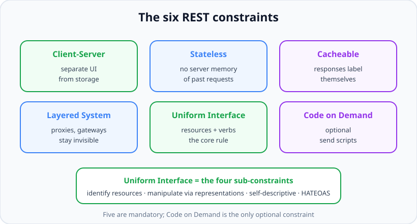
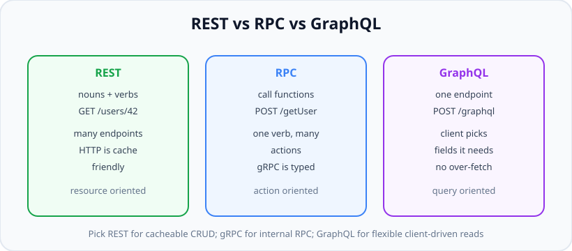

# REST Principles: Constraints, Resources & Statelessness

*12 min read · Updated 24 Jul 2026 Topic 39 of 70 Bookmark Mark done Why it matters Almost every backend job description asks you to · Topic 39 of 70*

**Source:** [https://www.geekyfrontend.in/learn/nodejs-backend-kit/rest-principles](https://www.geekyfrontend.in/learn/nodejs-backend-kit/rest-principles)

---

## Why it matters

Almost every backend job description asks you to "build and consume REST APIs," and almost every system-design interview eventually reaches the words "expose an endpoint." REST is the default vocabulary of the web: it is how browsers talk to servers, how mobile apps talk to backends, and how microservices talk to each other. If you understand REST deeply, you can design an interface that a stranger can use without reading your source code — and that is the entire point of an API.

But REST is also one of the most *misunderstood* topics in interviews. Most developers think "REST" means "JSON over HTTP with some URLs." That is not REST; that is just HTTP. REST is a specific **architectural style** defined by Roy Fielding in his year-2000 dissertation, and it is a set of **constraints** that, when you accept them, buy you real properties: scalability, cacheability, and the ability to evolve a server and its clients independently. Interviewers probe this gap constantly. The candidate who can name the constraints and explain *what each one buys you* stands out immediately from the one who just says "REST is stateless, I think."

Getting REST right early also saves you from expensive rewrites. A stateful API that stores per-user data in server memory cannot be load-balanced across many machines. An API that ignores the uniform interface forces every client to be hand-coded against your quirks. These are not academic concerns — they are the difference between an API that scales to millions of users and one that falls over at ten thousand.

## The concept, simply

REST stands for **REpresentational State Transfer**. Unpack the name and the whole idea falls out: a client transfers *representations* (usually JSON or HTML documents) of *resource state* back and forth with a server. A **resource** is any thing worth naming — a user, an order, a photo, a collection of comments. The resource itself lives on the server; what crosses the wire is a *representation* of it at a moment in time.

REST is defined by six constraints. Five are mandatory and one is optional. Accepting them is what makes an API "RESTful."

- **Client–Server:** separate the user interface from data storage. They evolve independently.
- **Stateless:** each request carries everything the server needs. The server keeps no memory of previous requests.
- **Cacheable:** responses must declare whether they can be cached, so clients and intermediaries can reuse them.
- **Uniform Interface:** the one big idea — resources are identified by URIs, manipulated through representations, messages are self-descriptive, and hypermedia drives state (HATEOAS).
- **Layered System:** a client cannot tell whether it is talking to the real server or a proxy, gateway, or cache in between.
- **Code on Demand (optional):** the server may ship executable code (e.g. JavaScript) to extend the client.



The six REST constraints. Five are mandatory; only Code on Demand is optional, and Uniform Interface is the one that most APIs get wrong.

The mental shortcut: **REST is about nouns, not verbs**. You do not have a `/getUser` function and a `/deleteUser` function. You have one noun — `/users/42` — and you use HTTP *verbs* (GET, DELETE) to act on it. The URL names the thing; the method names the action.

## How it works (deep)

Let us take the constraints that carry the most interview weight and go deeper.

**Statelessness** is the constraint people quote but rarely explain correctly. It means the *server* stores no client *session context* between requests. Every request must contain all information needed to understand and process it — typically an auth token, not a server-side session pointer. This does *not* mean the application has no state; your database is full of state. It means the *conversation* is stateless. Why does this matter? Because if request N does not depend on the server remembering request N−1, then any of your ten identical servers can handle it. You can add servers behind a load balancer freely, restart one without losing sessions, and route each request anywhere. Statelessness is what makes horizontal scaling trivial.

The classic confusion: "But I use JWTs / cookies for auth — isn't that state?" No. The *token* is state that lives on the *client* and is sent with every request. The server validates it fresh each time and forgets it. Contrast that with an old-style server-side session where the cookie is just an ID pointing at memory *on the server* — that version is stateful and does not scale without sticky sessions or a shared session store.

**The Uniform Interface** is the constraint that actually makes REST feel like REST, and it has four sub-parts. (1) *Identification of resources*: each resource has a stable URI, e.g. `/orders/9`. (2) *Manipulation through representations*: the client never edits the resource directly; it sends a representation (a JSON body) describing the desired new state. (3) *Self-descriptive messages*: each message carries enough metadata — the method, `Content-Type`, status code — to be understood on its own. (4) *HATEOAS* (Hypermedia As The Engine Of Application State): responses include links telling the client what it can do next, so the client discovers actions rather than hard-coding URLs.

**HATEOAS** is the most theoretical and least implemented part of REST, and interviewers love it because knowing it signals depth. The idea: instead of a client memorizing that "to pay an order, POST to `/orders/9/pay`," the order response itself contains a link like `{ "rel": "pay", "href": "/orders/9/pay" }`. The client follows links the way a human follows hyperlinks on a web page — the server can move or rename endpoints and the client keeps working. In practice, very few JSON APIs are fully HATEOAS-driven (it adds complexity clients rarely exploit), but you should be able to explain it, because Fielding considered it the part *without which an API is not truly REST*. Be honest in interviews: "Full HATEOAS is rare in real JSON APIs; most teams ship 'REST-ish' APIs and that's a pragmatic, accepted trade-off."

**Cacheability** and the **layered system** work together. Because responses are self-descriptive and can be labeled cacheable (via `Cache-Control`, `ETag`, `Last-Modified`), a proxy sitting between client and server can serve a cached copy without the origin ever seeing the request. The client cannot tell — and does not need to — whether it hit the origin or a CDN edge. That invisibility is the layered-system constraint, and it is why CDNs and reverse proxies can accelerate a well-designed REST API for free.

## Code examples

A minimal resource-oriented Express router. Notice the URL names a noun and the HTTP method carries the intent — there is no verb in the path.

javascript

```
const express = require('express');
const router = express.Router();

// Resource: the "users" collection and its members
router.get('/users', listUsers);        // read the collection
router.post('/users', createUser);       // create a member
router.get('/users/:id', getUser);       // read one member
router.put('/users/:id', replaceUser);   // replace one member
router.delete('/users/:id', deleteUser); // remove one member

module.exports = router;
```

Statelessness in practice: the server reads the identity from the token on *every* request and holds nothing between calls. No `req.session`, no in-memory user map.

javascript

```
const jwt = require('jsonwebtoken');

// Auth middleware — stateless: the token IS the context
function authenticate(req, res, next) {
  const header = req.headers.authorization || '';
  const token = header.startsWith('Bearer ') ? header.slice(7) : null;
  if (!token) return res.status(401).json({ error: 'Missing token' });

  try {
    // Verified fresh each request; server keeps no memory of it afterwards
    req.user = jwt.verify(token, process.env.JWT_SECRET);
    next();
  } catch {
    res.status(401).json({ error: 'Invalid token' });
  }
}
```

A HATEOAS-flavored response — the resource tells the client what it can do next, instead of the client hard-coding paths.

javascript

```
function getOrder(req, res) {
  const order = { id: 9, status: 'pending', total: 4200 };

  res.json({
    ...order,
    _links: {
      self:   { href: `/orders/${order.id}` },
      pay:    { href: `/orders/${order.id}/pay`,    method: 'POST' },
      cancel: { href: `/orders/${order.id}/cancel`, method: 'POST' },
    },
  });
}
```

And a self-descriptive, cacheable response using an `ETag` so a proxy or the browser can revalidate cheaply:

javascript

```
function getProduct(req, res) {
  const product = { id: 7, name: 'Keyboard', version: 3 };
  const etag = `"prod-${product.id}-v${product.version}"`;

  res.set('Cache-Control', 'public, max-age=60');
  res.set('ETag', etag);

  if (req.headers['if-none-match'] === etag) {
    return res.status(304).end(); // Not Modified — client reuses its copy
  }
  res.json(product);
}
```

## Common mistakes & gotchas

- **Putting verbs in URLs:** `/getUser`, `/createOrder`, `/api/deleteUser?id=3`. The method already carries the verb; the path is a noun. Verbs in paths are the #1 sign of an RPC-shaped API wearing a REST costume.
- **Confusing "stateless" with "no database."** Statelessness is about *per-client session* state on the server, not about persistence. Your DB is fine.
- **Server-side sessions in memory:** storing login state in a module-level object breaks the moment you run two instances — requests hit the wrong server. This is a statelessness violation, not a "bug."
- **Pluralization chaos:** mixing `/user/42` and `/orders/9`. Pick plural collection nouns and stay consistent.
- **Claiming full REST while hard-coding every URL client-side:** that is fine and common, but do not call it HATEOAS. Know the difference so you can answer honestly.
- **Nesting resources infinitely:** `/users/1/orders/9/items/3/reviews/2` is unusable. Nest one level for ownership, then link.

## Best practices

- Model **nouns as resources** and use HTTP methods as the verbs; keep paths free of action words.
- Use **plural collection names** (`/users`, `/orders`) consistently, and identify members by ID (`/users/42`).
- Keep the server **stateless**: carry auth in a token, and if you need shared session data, put it in Redis or the DB — never in process memory.
- **Declare cacheability** explicitly with `Cache-Control` and `ETag`; a self-descriptive response is a scalable one.
- **Nest shallowly.** One level of nesting to express ownership; beyond that, return links or use query filters.
- Be pragmatic about HATEOAS: add `_links` where they genuinely help clients discover actions, but do not over-engineer.
- Pick REST when your resources map cleanly to CRUD and you want HTTP caching; reach for gRPC or GraphQL when the fit is poor (see below).

## REST vs RPC vs GraphQL

Interviewers often ask you to compare REST with its alternatives, because the comparison reveals whether you understand *why* REST is shaped the way it is.



REST names resources, RPC names actions, GraphQL lets the client shape the response. Each optimizes for a different pain.

**RPC** (Remote Procedure Call, e.g. gRPC) is *action-oriented*: you call remote functions like `getUser(42)` or `chargeCard(...)`, usually POSTing to a single endpoint per procedure. It is great for internal service-to-service traffic where you control both ends, want a typed contract (Protobuf), and do not care about HTTP caching. **GraphQL** exposes one endpoint and lets the client ask for exactly the fields it needs, solving REST's over-fetching (getting more data than you use) and under-fetching (needing several round-trips). Its cost: HTTP caching and simple status-code semantics are harder because everything is a POST that returns 200. **REST** sits in the middle: resource-oriented, cache-friendly, universally tooled, and dead simple to consume with `curl` or a browser. A strong interview answer: "REST for public, cacheable, CRUD-shaped resources; gRPC for high-throughput internal RPC; GraphQL when many clients need flexible, differently-shaped reads from one graph."

## ⭐ Interview lens

> **Q: What does "stateless" really mean in REST, and why do we want it?**  
> It means the server keeps no client session context between requests — every request carries everything needed to process it (typically an auth token). The trap is thinking it means "no database"; application state in the DB is fine. We want it because it enables horizontal scaling: any server can handle any request, so you can load-balance freely and restart instances without losing sessions.

> **Q: Name the REST constraints. Which is optional?**  
> Client–Server, Stateless, Cacheable, Uniform Interface, Layered System, and Code on Demand. Code on Demand is the only optional one. Bonus points for naming the four sub-constraints of the Uniform Interface, especially HATEOAS.

> **Q: What is HATEOAS and do real APIs use it?**  
> Hypermedia As The Engine Of Application State: responses include links telling the client what it can do next, so it discovers actions instead of hard-coding URLs. Honestly, full HATEOAS is rare in JSON APIs; most ship "REST-ish" APIs with hard-coded routes. The trap is claiming your API is HATEOAS when it just returns data — interviewers respect the honest, nuanced answer.

> **Q: Is a JWT-based auth API stateful?**  
> No. The token is state held by the *client* and sent each request; the server validates it fresh and forgets it. That is stateless. A server-side session where the cookie is an ID pointing at server memory *is* stateful — that's the distinction they're testing.

> **Q: How do you decide between REST and GraphQL?**  
> REST when resources map cleanly to CRUD and you want HTTP caching and simple tooling. GraphQL when many diverse clients need to fetch differently-shaped data and REST forces over- or under-fetching. Trap: saying "GraphQL is just better" — it trades away easy caching and clear status semantics.

> **Q: Why is `POST /users/deleteAll` not RESTful?**  
> It puts a verb in the URL and uses POST for a destructive bulk action instead of modeling resources. The RESTful shape is `DELETE` on specific resources; a bulk operation is better expressed as an operation resource or a filtered `DELETE`, not an RPC-style verb path.

## Cheat-card

- **REST** = REpresentational State Transfer; an architectural *style*, not "JSON over HTTP."
- **6 constraints:** Client–Server, Stateless, Cacheable, Uniform Interface, Layered System, Code-on-Demand (optional).
- **Resources are nouns**; HTTP methods are the verbs. No verbs in paths.
- **Stateless** = no server-side session between requests ≠ no database.
- **Uniform Interface** sub-parts: identify resources, manipulate via representations, self-descriptive messages, HATEOAS.
- **HATEOAS** = responses link to next actions; rare in real JSON APIs — be honest.
- **REST vs RPC vs GraphQL:** nouns vs actions vs client-shaped queries.
- Use **plural collection names**, shallow nesting, and explicit cache headers.
- **Built-in ETag:** `res.send`/`res.json` add `W/"<len hex>-<sha1 prefix>"` unless you set `ETag` first; `app.set('etag', 'strong' | false | fn)` changes it (lesson 86).
- **304 only for** GET/HEAD (QUERY too in Express 5.3.0) with a 2xx status and a matching `If-None-Match`; Express strips the body and `Content-*` headers.
- **`req.fresh`** = weak compare, lists and `*`; `false` on request `Cache-Control: no-cache` or when the response has no `ETag`/`Last-Modified` yet.

---

## Learn More

- [REST - MDN Web Docs Glossary developer.mozilla.org](https://developer.mozilla.org/en-US/docs/Glossary/REST)
- [An overview of HTTP developer.mozilla.org](https://developer.mozilla.org/en-US/docs/Web/HTTP/Guides/Overview)
- [Web API Design Best Practices - Azure Architecture Center learn.microsoft.com](https://learn.microsoft.com/en-us/azure/architecture/best-practices/api-design)
- [REST API concepts and examples WebConcepts](https://www.youtube.com/watch?v=7YcW25PHnAA)
- [APIs for Beginners - How to use an API (Full Course / Tutorial) freeCodeCamp.org](https://www.youtube.com/watch?v=WXsD0ZgxjRw)

---

## Additional topics

*Added 12 Oct 2026 · examples verified on Node v24.19.0 and Express 5.3.0 (etag 1.8.1, fresh 2.0.0), supertest 7.3.1, curl 8.18.0*

### Express's built-in ETag, `req.fresh` and a real 304

The last code example above builds an ETag by hand and compares it with `If-None-Match` itself. Express already does most of this for you. Every body sent through `res.send` (and so `res.json`) gets an `ETag` header unless you set one first. When the request carries a matching `If-None-Match`, Express turns the response into `304 Not Modified` and drops the body. The client keeps its cached copy, and the server skips sending the bytes. It does not skip the work: by the time `res.json` runs, your handler has already loaded the data and built the body. The `etag` setting controls the tag: `'weak'` (default), `'strong'`, `false`, or your own function. Lesson 86 covers the setting itself ([Express app settings and locals](86-express-app-settings-and-locals.md#how-it-works)); this section follows one request through it.

How it works:

1. Your handler calls `res.json(obj)`. Express serialises it, then calls `res.send` with the string.
2. `res.send` reads the compiled `etag fn` setting. If the response has no `ETag` yet and the body has a length, Express converts it to a Buffer and calls the function. The default weak tag is `W/"<byte length in hex>-<first 27 chars of the base64 SHA-1 of the body>"`. The `etag` package computes it (empty bodies get a fixed tag).
3. It sets the header. The method and status are not checked here, so POST responses and 404s get an ETag too.
4. It reads `req.fresh`. That getter returns `false` unless the method is GET or HEAD (or QUERY, added in Express 5.3.0), and the status is 2xx or 304. Otherwise it asks the `fresh` package. `fresh` returns `false` when the request has `Cache-Control: no-cache`. It returns `true` when an `If-None-Match` entry equals the response ETag under the weak comparison (the `W/` prefix is ignored). It also returns `true` for `*`, and handles comma-separated lists. A `Last-Modified` response header is checked against `If-Modified-Since` only when there is no `If-None-Match`.
5. If fresh, the status becomes 304. On 204 and 304 Express removes `Content-Type`, `Content-Length` and `Transfer-Encoding` and sends an empty body: a 304 "cannot contain content" (RFC 9110 section 15.4.5).
6. `res.end`, `res.write` streams and `res.sendFile` do not go through this path. `res.sendFile` and `express.static` use the `send` package, which has its own `etag` option.

**Example — the default weak ETag, a 304 with no body, and `req.fresh` before the expensive work.**

javascript

```
// etag-server.cjs: Express's built-in ETag, req.fresh and a real 304.
const express = require('express');
const crypto = require('node:crypto');

const app = express(); // 'etag' setting defaults to 'weak'
const product = { id: 7, name: 'Keyboard', version: 3 };

// 1. Plain res.json: Express hashes the body and adds a weak ETag.
app.get('/products/7', (req, res) => {
  res.set('Cache-Control', 'no-cache'); // cache it, but revalidate every time
  res.json(product);
});

// 2. Same body from POST and from a 404: they get an ETag too, but never a 304.
app.post('/products/7', (req, res) => res.json(product));
app.get('/missing', (req, res) => res.status(404).json(product));

// 3. req.fresh before doing the expensive work: set a cheap validator first.
app.get('/reports/1', (req, res) => {
  res.set('ETag', `"report-1-v${product.version}"`);
  console.log(`GET /reports/1  If-None-Match=${req.get('If-None-Match') ?? '(none)'}  req.fresh=${req.fresh}`);
  if (req.fresh) return res.status(304).end(); // skip building the report
  res.json({ report: 1, rows: 3 });            // ETag already set, so Express keeps ours
});

// Recompute the default weak tag by hand to show what it contains.
const body = Buffer.from(JSON.stringify(product));
const hash = crypto.createHash('sha1').update(body).digest('base64').slice(0, 27);
console.log(`by hand: W/"${body.length.toString(16)}-${hash}"`);

app.listen(6701, () => console.log('listening on 6701'));

// Real output (Node v24.19.0, Express 5.3.0), server console after the curl session below:
//   by hand: W/"26-+GyA9lnaTi2EzHo6sG46htTRQx0"
//   listening on 6701
//   GET /reports/1  If-None-Match=(none)  req.fresh=false
//   GET /reports/1  If-None-Match="report-1-v3"  req.fresh=true
```

Run `node etag-server.cjs`, then in a second terminal:

bash

```
$ curl -i http://127.0.0.1:6701/products/7
HTTP/1.1 200 OK
X-Powered-By: Express
Cache-Control: no-cache
Content-Type: application/json; charset=utf-8
Content-Length: 38
ETag: W/"26-+GyA9lnaTi2EzHo6sG46htTRQx0"
Date: Mon, 12 Oct 2026 14:19:46 GMT
Connection: keep-alive
Keep-Alive: timeout=5

{"id":7,"name":"Keyboard","version":3}

$ curl -i http://127.0.0.1:6701/products/7 -H 'If-None-Match: W/"26-+GyA9lnaTi2EzHo6sG46htTRQx0"'
HTTP/1.1 304 Not Modified
X-Powered-By: Express
Cache-Control: no-cache
ETag: W/"26-+GyA9lnaTi2EzHo6sG46htTRQx0"
Date: Mon, 12 Oct 2026 14:19:46 GMT
Connection: keep-alive
Keep-Alive: timeout=5

$ curl -s http://127.0.0.1:6701/products/7 -H 'If-None-Match: W/"26-+GyA9lnaTi2EzHo6sG46htTRQx0"' | wc -c
0
$ curl -s -o /dev/null -w '%{http_code} %header{etag}\n' -X POST http://127.0.0.1:6701/products/7 -H 'If-None-Match: W/"26-+GyA9lnaTi2EzHo6sG46htTRQx0"'
200 W/"26-+GyA9lnaTi2EzHo6sG46htTRQx0"
$ curl -s -o /dev/null -w '%{http_code} %header{etag}\n' http://127.0.0.1:6701/missing -H 'If-None-Match: W/"26-+GyA9lnaTi2EzHo6sG46htTRQx0"'
404 W/"26-+GyA9lnaTi2EzHo6sG46htTRQx0"
$ curl -s -o /dev/null -w '%{http_code}\n' http://127.0.0.1:6701/products/7 -H 'If-None-Match: W/"26-+GyA9lnaTi2EzHo6sG46htTRQx0"' -H 'Cache-Control: no-cache'
200
$ curl -s -o /dev/null -w '%{http_code}\n' http://127.0.0.1:6701/reports/1
200
$ curl -s -o /dev/null -w '%{http_code}\n' http://127.0.0.1:6701/reports/1 -H 'If-None-Match: "report-1-v3"'
304
```

What the transcript shows:

- `26` is the body length in hex (38 bytes, matching `Content-Length: 38`), and the hash matches the one computed by hand.
- The 304 has the same `ETag` and `Cache-Control` but no `Content-Type` or `Content-Length`, and `wc -c` counts 0 body bytes.
- POST and the 404 carry the identical tag but answer 200 and 404: `req.fresh` is `false` for them.
- `Cache-Control: no-cache` on the request (a browser hard reload sends it) forces a full 200.
- `/reports/1` sets its own strong ETag from a version number before doing any work. `req.fresh` is only meaningful after the response has an `ETag` (or `Last-Modified`), so set the validator first and read `req.fresh` second.

How this relates to the manual `getProduct` example above: it sets its own `ETag`, so Express keeps it and does not hash the body (step 2 only runs when no `ETag` is set). Its `===` check is a shortcut that skips `res.json` on an exact match. When the check misses, `res.json` still runs `req.fresh` and can still answer 304, as the edge case below shows.

### Common mistakes & gotchas (additional topics)

- **Reading `req.fresh` before setting a validator.** It compares against the response's `ETag`/`Last-Modified`. With neither set, it is always `false`, even when the client sent a correct `If-None-Match`.
- **Expecting the default ETag to save database work.** It is computed from the finished body, so the handler has already run. To skip the work, derive a tag from something cheap (a version or `updated_at` column) and check `req.fresh` first, like `/reports/1`.
- **Testing a 304 with Node's `fetch` and a hand-set `If-None-Match`.** Under the Fetch standard, a request with the default cache mode that carries a conditional header is switched to `no-store`. `fetch` then adds `Cache-Control: no-cache` (and `Pragma: no-cache`), so Express answers 200. Use curl or supertest, or pass `cache: 'no-cache'`, which sends `Cache-Control: max-age=0` instead:

javascript

```
// fetch-gotcha.cjs: testing a conditional GET with Node's built-in fetch.
const express = require('express');

const app = express();
app.get('/p', (req, res) => {
  console.log(`  server saw Cache-Control: ${req.get('Cache-Control') ?? '(none)'}`);
  res.json({ id: 7 });
});

const server = app.listen(6704, async () => {
  const url = 'http://127.0.0.1:6704/p';
  const etag = (await fetch(url)).headers.get('etag');
  for (const cache of ['default', 'no-cache']) {
    console.log(`fetch cache: '${cache}', If-None-Match: ${etag}`);
    const r = await fetch(url, { cache, headers: { 'If-None-Match': etag } });
    console.log(`  -> ${r.status}`);
  }
  server.close();
});

// Real output (Node v24.19.0, Express 5.3.0):
//     server saw Cache-Control: (none)
//   fetch cache: 'default', If-None-Match: W/"8-eE+TghVu0lqfC5QQKmjMzwJAx2U"
//     server saw Cache-Control: no-cache
//     -> 200
//   fetch cache: 'no-cache', If-None-Match: W/"8-eE+TghVu0lqfC5QQKmjMzwJAx2U"
//     server saw Cache-Control: max-age=0
//     -> 304
```

- **Assuming `app.set('etag', false)` turns off 304s.** It only stops Express generating tags. A route that sets its own `ETag` still gets 304s from `res.send`.

### Edge case worked through: the manual `===` check versus `req.fresh`

The lesson's `getProduct` compares the raw header string with its tag. Clients do not always echo the exact string: a cache may send a weak form (`W/"prod-7-v3"`), or a list of several tags it holds. The script below runs the lesson function unchanged (plus one counter line) next to a `req.fresh` version. It counts how often each one reaches its body-building path.

javascript

```
// manual-vs-fresh.cjs: the lesson's getProduct (string ===) next to the same route using req.fresh.
const express = require('express');
const request = require('supertest');

const built = { manual: 0, fresh: 0 };
function getProduct(req, res) {                 // copied from the Code examples above
  const product = { id: 7, name: 'Keyboard', version: 3 };
  const etag = `"prod-${product.id}-v${product.version}"`;
  res.set('Cache-Control', 'public, max-age=60');
  res.set('ETag', etag);
  if (req.headers['if-none-match'] === etag) {
    return res.status(304).end();
  }
  built.manual++;                               // added: count how often the body path runs
  res.json(product);
}

function getProductFresh(req, res) {            // same, but let Express compare
  const product = { id: 7, name: 'Keyboard', version: 3 };
  res.set('Cache-Control', 'public, max-age=60');
  res.set('ETag', `"prod-${product.id}-v${product.version}"`);
  if (req.fresh) return res.status(304).end();
  built.fresh++;
  res.json(product);
}

const app = express();
app.get('/manual', getProduct);
app.get('/fresh', getProductFresh);

(async () => {
  for (const inm of ['"prod-7-v3"', 'W/"prod-7-v3"', '"prod-7-v2", "prod-7-v3"', '"prod-7-v2"']) {
    const a = await request(app).get('/manual').set('If-None-Match', inm);
    const b = await request(app).get('/fresh').set('If-None-Match', inm);
    console.log(`If-None-Match: ${inm.padEnd(26)} manual === -> ${a.status} (body path runs: ${built.manual})   req.fresh -> ${b.status} (body path runs: ${built.fresh})`);
    built.manual = built.fresh = 0;
  }
})();

// Real output (Node v24.19.0, Express 5.3.0, supertest 7.3.1):
//   If-None-Match: "prod-7-v3"                manual === -> 304 (body path runs: 0)   req.fresh -> 304 (body path runs: 0)
//   If-None-Match: W/"prod-7-v3"              manual === -> 304 (body path runs: 1)   req.fresh -> 304 (body path runs: 0)
//   If-None-Match: "prod-7-v2", "prod-7-v3"   manual === -> 304 (body path runs: 1)   req.fresh -> 304 (body path runs: 0)
//   If-None-Match: "prod-7-v2"                manual === -> 200 (body path runs: 1)   req.fresh -> 200 (body path runs: 1)
```

All four status codes agree. The manual version is not wrong for the client: when `===` misses, `res.json` evaluates `req.fresh` and still sends 304. The difference is the work done. For the weak form and the list, the manual route runs the body path anyway, because `===` cannot see that `W/"prod-7-v3"` and `"prod-7-v2", "prod-7-v3"` both match. With a real database behind it, that is a query you hoped to skip. `req.fresh` applies the weak comparison and list handling from RFC 9110 section 13.1.2, so use it instead of string equality.

### ⭐ Interview lens (additional topics)

> **Q: “Does Express support conditional GET out of the box? What does a 304 cost the server?”**  
> A: Yes. `res.send`/`res.json` adds a weak ETag (`W/"<len hex>-<sha1 prefix>"`), and if the request's `If-None-Match` matches, it sends 304 with no body. This applies only to GET/HEAD (and QUERY in Express 5.3.0) with a 2xx status. It saves bandwidth, not CPU: the tag is a hash of the finished body, so the handler has already run. To skip the work, set an ETag from a version column and return early when `req.fresh` is true. *Trap:* saying POST or 404 responses never get an ETag. They do get one; they just never become 304.

> **Q: “Why does my 304 test pass with curl but fail with `fetch`?”**  
> A: `fetch` with the default cache mode treats a hand-written `If-None-Match` as a sign you are managing the cache yourself. It switches to `no-store` and adds `Cache-Control: no-cache`, and `fresh` then refuses to return 304. Use `cache: 'no-cache'`, curl, or supertest.
