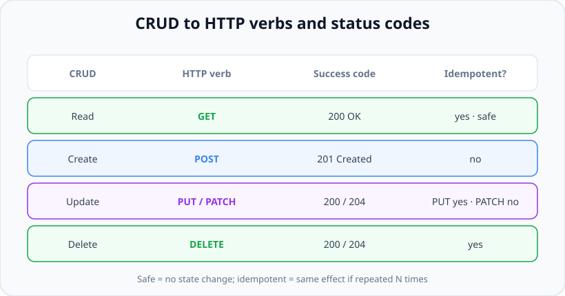
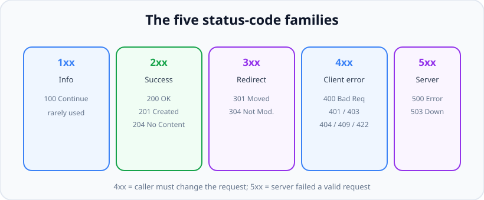

# CRUD, HTTP Verbs, Status Codes & Idempotency

*11 min read · Updated 24 Jul 2026 Topic 40 of 70 Bookmark Mark done Why it matters The difference between an API that feels professional and one that feels amateur is almost entirely in the details of this topic · Topic 40 of 70*

**Source:** [https://www.geekyfrontend.in/learn/nodejs-backend-kit/crud-status-codes](https://www.geekyfrontend.in/learn/nodejs-backend-kit/crud-status-codes)

---

## Why it matters

The difference between an API that feels professional and one that feels amateur is almost entirely in the details of this topic: choosing the right HTTP method, returning the right status code, and understanding idempotency. These are not pedantic niceties. A wrong status code silently breaks clients: a browser will happily *cache* a response you returned as 200 when it should have been an error, a monitoring dashboard counting "5xx" will miss your outage because you returned 200 with `{"error": true}`, and a payment client that retries a non-idempotent request can charge a customer twice.

Interviewers lean on this topic heavily because it is a fast, reliable filter. "What status code do you return when a user tries to create a resource that already exists?" separates people who have shipped real APIs from people who have only followed tutorials. "Is PUT idempotent? Is POST? Why?" is one of the most common backend questions in existence, and getting it right — with the *reasoning*, not just the answer — signals seniority. Idempotency in particular is the backbone of reliable distributed systems: networks fail, clients retry, and only idempotent operations survive retries without corruption.

Master this and you will write APIs that integrate cleanly with HTTP's built-in machinery — caching, conditional requests, retries, load balancers — instead of fighting it.

## The concept, simply

CRUD — Create, Read, Update, Delete — is the set of four operations most resources support. HTTP gives you methods that map naturally onto them, and each operation has a conventional *success* status code.



Each CRUD operation maps to an HTTP verb with a conventional success code. Note which verbs are safe and which are idempotent.

- **Create** → `POST /users` → **201 Created** (plus a `Location` header pointing at the new resource).
- **Read** → `GET /users/42` → **200 OK** (or 404 if it doesn't exist).
- **Update** → `PUT /users/42` (full replace) or `PATCH /users/42` (partial) → **200 OK** with the body, or **204 No Content** if you return nothing.
- **Delete** → `DELETE /users/42` → **204 No Content** (or 200 with a body).

Two properties classify these verbs. A method is **safe** if it does not change server state — GET is safe. A method is **idempotent** if making the same call once or many times leaves the server in the same final state. GET, PUT, and DELETE are idempotent; POST is not. That single distinction drives an enormous amount of correct API design.

## How it works (deep)

**Idempotency, precisely.** Idempotent means *the effect on server state* of N identical requests equals the effect of one. It is *not* about the response being byte-identical. Consider `DELETE /users/42`: the first call deletes the user and returns 204; the second call finds nothing to delete and returns 404. The *responses differ*, but the *server state is identical* after either the first or the second call — user 42 is gone. That still counts as idempotent. This nuance trips up almost everyone; interviewers specifically probe it.

**Why POST is not idempotent.** `POST /orders` means "create a new order." Send it twice and you get two orders. The server assigns a new identity each time, so repeating the call changes state each time. That is exactly why forms warn "do not click submit twice" and why retrying a failed POST is dangerous — you cannot know whether the first one actually succeeded before the network dropped.

**Why PUT is idempotent but POST is not, even though both "write."** PUT means "make the resource at this URL equal to this representation." `PUT /users/42` with a body sets user 42 to that exact state; do it ten times and user 42 still holds that same state. The client chooses the URL/identity, so repetition converges. POST lets the *server* choose the identity, so repetition diverges. This is the crux.

**PATCH is usually not idempotent.** `PATCH` applies a partial change. `{ "op": "increment", "field": "views" }` is clearly not idempotent — each call adds one. Even a "set field X to Y" PATCH is only idempotent by convention, and JSON Patch operations like "add to array" are not. Treat PATCH as non-idempotent unless you have specifically designed it to be.

**Idempotency keys.** Since POST is not idempotent but networks retry, robust APIs (Stripe is the canonical example) accept an `Idempotency-Key` header. The client generates a unique key per logical operation; the server stores "I already processed key K and here is the result." A retry with the same key returns the stored result instead of creating a second order or charge. This turns an unsafe POST into a safely-retriable one — a favorite senior-level design question.

**Choosing the right status code** matters as much as the verb.



The five families. 4xx means the caller must fix the request; 5xx means the server failed a valid request. Never blur the two.

The families: **2xx** success, **3xx** redirection/caching, **4xx** client error, **5xx** server error. The single most important line is between 4xx and 5xx: *4xx is the caller's fault* (bad input, missing auth), *5xx is your fault* (an exception, a downstream failure). Getting this wrong wrecks monitoring and on-call. The high-value 4xx codes to know cold: **400** malformed request, **401** not authenticated, **403** authenticated but not allowed, **404** not found, **409** conflict (e.g. duplicate/edit collision), **422** well-formed but semantically invalid (validation failed), **429** too many requests. On the success side: **200** OK, **201** Created, **204** No Content, **304** Not Modified.

**401 vs 403** is a classic trap. 401 = "I don't know who you are" (no or bad credentials) — log in. 403 = "I know who you are and you still can't do this" — logging in again won't help. **400 vs 422** is another: 400 for a request that is syntactically broken (unparseable JSON), 422 for one that parses fine but fails business validation (email already taken, age negative). And **409 Conflict** is the right code when the request collides with current state — creating a user whose email already exists, or editing a record someone else changed.

## Code examples

A full CRUD controller with correct verbs and status codes. Note `201` plus `Location` on create, and `204` on delete.

javascript

```
const express = require('express');
const router = express.Router();

// CREATE — 201 + Location header, body is the new resource
router.post('/users', async (req, res) => {
  const user = await User.create(req.body);
  res.status(201)
     .location(`/users/${user.id}`)
     .json(user);
});

// READ one — 200 or 404
router.get('/users/:id', async (req, res) => {
  const user = await User.findById(req.params.id);
  if (!user) return res.status(404).json({ error: 'User not found' });
  res.status(200).json(user);
});

// REPLACE — PUT is idempotent: set the resource to this exact state
router.put('/users/:id', async (req, res) => {
  const user = await User.replace(req.params.id, req.body);
  if (!user) return res.status(404).json({ error: 'User not found' });
  res.status(200).json(user);
});

// DELETE — idempotent; 204 with empty body
router.delete('/users/:id', async (req, res) => {
  await User.remove(req.params.id); // no-op if already gone
  res.status(204).end();
});

module.exports = router;
```

Returning the right 4xx for the right reason — distinguishing 401, 403, 409, and 422:

javascript

```
router.post('/orders', authenticate, async (req, res) => {
  // 403: authenticated but not permitted
  if (!req.user.canOrder) {
    return res.status(403).json({ error: 'Not allowed to place orders' });
  }
  // 422: well-formed but semantically invalid
  if (req.body.quantity <= 0) {
    return res.status(422).json({ error: 'Quantity must be positive' });
  }
  // 409: conflicts with current state
  const existing = await Order.findByIdempotencyRef(req.body.ref);
  if (existing) {
    return res.status(409).json({ error: 'Order already exists', id: existing.id });
  }
  const order = await Order.create(req.body);
  res.status(201).location(`/orders/${order.id}`).json(order);
});
```

Making an unsafe POST safely retriable with an idempotency key — the pattern Stripe uses:

javascript

```
router.post('/charges', async (req, res) => {
  const key = req.headers['idempotency-key'];
  if (!key) return res.status(400).json({ error: 'Idempotency-Key required' });

  // Already processed this key? Return the SAME result — no double charge.
  const prior = await IdempotencyStore.get(key);
  if (prior) return res.status(prior.status).json(prior.body);

  const charge = await paymentGateway.charge(req.body);
  const result = { status: 201, body: charge };

  await IdempotencyStore.save(key, result); // persist keyed on the client's key
  res.status(result.status).json(result.body);
});
```

A PATCH that is deliberately *non-idempotent* — incrementing a counter — to make the property concrete:

javascript

```
// Each call adds 1: calling it 3 times != calling it once. NOT idempotent.
router.patch('/posts/:id/views', async (req, res) => {
  const post = await Post.increment(req.params.id, 'views', 1);
  res.status(200).json({ views: post.views });
});
```

## Common mistakes & gotchas

- **Returning 200 for everything**, including errors, with an `{ "error": ... }` body. This breaks HTTP-aware clients, caches, and monitoring. Use real status codes.
- **Confusing 401 and 403:** 401 = not authenticated (who are you?); 403 = authenticated but forbidden (you can't do this). Logging in fixes 401, never 403.
- **Using 400 for validation failures** when 422 is more precise: 400 = unparseable; 422 = parsed but invalid.
- **Thinking "idempotent" means "same response."** It means same *server state*. DELETE returning 404 on the second call is still idempotent.
- **Retrying POST blindly:** without an idempotency key, a retried create can duplicate orders/charges.
- **Using PUT for partial updates:** PUT replaces the whole resource, so omitted fields get wiped. Use PATCH for partial changes.
- **201 without a `Location` header:** clients can't discover where the new resource lives.
- **Using GET with side effects:** GET must be safe; prefetchers and crawlers will trigger those side effects.

## Best practices

- Map CRUD to verbs faithfully: POST create, GET read, PUT/PATCH update, DELETE delete.
- Return **201 + Location** on create, **204** when there's genuinely no body to return, and **200** when you return the resource.
- Keep the **4xx/5xx boundary honest** — it is the contract your monitoring and on-call rely on.
- Prefer **422** for validation errors, **409** for state conflicts, and distinguish **401** from **403** precisely.
- Make writes **retry-safe**: PUT/DELETE are naturally idempotent; wrap POST create/charge flows with an `Idempotency-Key`.
- Keep GET **safe** — never mutate state on a GET.
- Return a consistent, machine-readable error body alongside the status code (covered in the versioning topic).

## ⭐ Interview lens

> **Q: Is PUT idempotent? Is POST? Why?**  
> PUT is idempotent: it sets the resource at a client-chosen URL to an exact state, so repeating converges. POST is not: it creates a new resource with a server-chosen identity each time, so repeating diverges (two orders). The reasoning — who chooses the identity — is what they want, not just the yes/no.

> **Q: DELETE returns 204 the first time and 404 the second. Is it still idempotent?**  
> Yes. Idempotency is about final *server state*, not identical responses. After either call, the resource is gone — same state. The differing status codes are fine. This is the classic trap.

> **Q: 401 vs 403?**  
> 401 = not authenticated ("I don't know who you are") — provide/refresh credentials. 403 = authenticated but not authorized ("I know you, you still can't") — re-auth won't help. Returning 403 when you mean 401 misleads clients into not retrying login.

> **Q: Which status code for "email already registered" on signup?**  
> 409 Conflict — the request conflicts with current server state. Some teams use 422 (validation). Either is defensible if consistent; 200 or 400 are not. Explaining the 409-vs-422 nuance scores well.

> **Q: How do you make a "create payment" endpoint safe to retry?**  
> Accept an `Idempotency-Key` header. Store the result keyed by that key; a retry with the same key returns the stored result instead of charging again. This makes a non-idempotent POST effectively idempotent — the Stripe pattern.

> **Q: Why not just return 200 with `{ "success": false }` for errors?**  
> Because HTTP status codes are the machine-readable contract for caches, load balancers, retry logic, and monitoring. A 200 error is invisible to all of them — your dashboards show green during an outage, and clients cache failures. Use the status line; put detail in the body.

## Cheat-card

- **Create** POST → 201 + Location · **Read** GET → 200/404 · **Update** PUT/PATCH → 200/204 · **Delete** DELETE → 204.
- **Safe:** GET (no state change). **Idempotent:** GET, PUT, DELETE. **Not idempotent:** POST, (usually) PATCH.
- Idempotent = same *server state* after N calls, not same response.
- **401** = who are you? · **403** = you can't · **404** = not here · **409** = conflict · **422** = invalid · **429** = rate limited.
- **4xx** = caller's fault · **5xx** = server's fault. Keep the line honest.
- Retry-safe POST = `Idempotency-Key` header + server-side result store.
- PUT replaces the whole resource; PATCH changes part of it.
- **HEAD/OPTIONS are automatic:** HEAD runs the GET handler and drops the body; OPTIONS replies `Allow: GET, HEAD`. A wrong method gets **404**, not 405.
- **405 = `app.route(p).get(…).all(h)`** with an `Allow` header (required by RFC 9110); answer OPTIONS inside `.all()`.
- **415** wrong `Content-Type` (`req.is`) · **428** `If-Match` missing (RFC 6585) · **412** `If-Match` stale; strong ETag compare only.

---

## Learn More

- [HTTP response status codes developer.mozilla.org](https://developer.mozilla.org/en-US/docs/Web/HTTP/Reference/Status)
- [HTTP request methods developer.mozilla.org](https://developer.mozilla.org/en-US/docs/Web/HTTP/Reference/Methods)
- [Learn HTTP Status Codes In 10 Minutes Web Dev Simplified](https://www.youtube.com/watch?v=wJa5CTIFj7U)

---

## Additional topics

*Added 12 Oct 2026 · examples verified on Node v24.19.0 and Express 5.3.0 (router 2.2.0), supertest 7.3.1, curl 8.18.0*

### HEAD, OPTIONS, 405 + `Allow`, 415, and `If-Match` (412 / 428)

The verbs above cover CRUD. Clients also send methods that ask about a resource instead of changing it. **HEAD** is a GET that returns only the headers, for example to check size or ETag without downloading. **OPTIONS** asks which methods the resource supports; the answer goes in the `Allow` header. Express answers both for you on any route that has a GET.

When a method is not supported, HTTP has a code for it: **405 Method Not Allowed**, which "MUST generate an Allow header field" (RFC 9110 section 15.5.6). Express does not send it. A wrong method falls through every route and reaches the final handler, which answers **404**. You add 405 yourself.

Three more codes guard writes:

- **415 Unsupported Media Type:** the body is in a format the endpoint does not accept.
- **412 Precondition Failed:** the client sent `If-Match: "<etag it last read>"` and the resource has changed since. This is optimistic concurrency. Nobody holds a lock; a writer with a stale copy is refused instead of silently overwriting the other client's change (the "lost update").
- **428 Precondition Required** (RFC 6585 section 3): the server requires the request to be conditional, and the client sent no `If-Match` at all. Without it, a client that never sends `If-Match` bypasses the whole check.

How it works:

1. **HEAD:** Express's router treats a HEAD request as GET when the route has no `.head()` handler. Your GET handler runs in full (database work included). `res.send` sets `Content-Length` and `ETag` as usual, then calls `res.end()` without the body.
2. **OPTIONS:** if no route handles OPTIONS for the path, the router collects the methods of every route that matches the path (adding HEAD wherever GET exists). It replies `200` with `Allow: GET, HEAD` and the same list as a `text/plain` body.
3. **Wrong method:** no route matches, so Express's final handler sends `404` with the HTML page `Cannot DELETE /plain`.
4. **405:** `app.route(path).get(…).put(…).all(handler)` puts the catch-all after the real methods on the same route. Anything that reaches `.all()` gets `405` and `Allow`. Because `.all()` matches every method, the route now "handles" OPTIONS too. The automatic OPTIONS reply no longer happens, so answer OPTIONS inside `.all()`.
5. **415:** `req.is('application/json')` checks the request `Content-Type` (it returns `null` when there is no body).
6. **`If-Match`:** the server sends a strong ETag derived from a version number. On PUT it checks, in order: 415 → 428 if `If-Match` is missing → 412 if no listed tag equals the current one. Then it writes and bumps the version. RFC 9110 section 13.1.1 requires the **strong** comparison for `If-Match`, so a weak `W/"…"` tag never passes, unlike `If-None-Match`.

**Example — automatic HEAD and OPTIONS, default 404, then 405, 415, 428 and 412.**

javascript

```
// verbs-server.cjs: automatic HEAD/OPTIONS, default 404 vs 405 + Allow, 415, and If-Match (412 / 428).
const express = require('express');

const app = express();
app.use(express.json());

// --- A plain route: Express answers HEAD and OPTIONS for it by itself.
app.get('/plain', (req, res) => {
  console.log(`GET handler ran for ${req.method} /plain`); // HEAD runs this handler too
  res.json({ hello: 'world' });
});

// --- One document with a version number; the ETag is derived from the version.
const doc = { id: 1, title: 'Draft', version: 1 };
const tagOf = (d) => `"v${d.version}"`;            // strong ETag: no W/ prefix

// RFC 9110 13.1.1: If-Match uses the STRONG comparison, so W/"..." never matches.
function ifMatchPasses(header, currentTag) {
  if (header.trim() === '*') return true;          // "any current version"
  return header.split(',').map((t) => t.trim()).includes(currentTag);
}

const ALLOW = 'GET, HEAD, PUT, OPTIONS';

app.route('/docs/1')
  .get((req, res) => {
    res.set('ETag', tagOf(doc));
    res.json(doc);                                 // Express also handles HEAD via this handler
  })
  .put((req, res) => {
    if (!req.is('application/json')) {             // 415: we only accept JSON bodies
      return res.status(415).json({ error: 'Send application/json' });
    }
    const ifMatch = req.get('If-Match');
    if (!ifMatch) {                                // 428 (RFC 6585 section 3): we require a precondition
      return res.status(428).json({ error: 'Send If-Match with the ETag you last read' });
    }
    if (!ifMatchPasses(ifMatch, tagOf(doc))) {     // 412: somebody changed it since you read it
      return res.status(412).set('ETag', tagOf(doc)).json({ error: 'Stale ETag', current: tagOf(doc) });
    }
    doc.title = String(req.body?.title ?? doc.title);
    doc.version += 1;
    res.set('ETag', tagOf(doc)).json(doc);
  })
  .all((req, res) => {                             // every other method on this path
    if (req.method === 'OPTIONS') {                // .all() also catches OPTIONS, so answer it here
      return res.set('Allow', ALLOW).status(204).end();
    }
    res.set('Allow', ALLOW).status(405).json({ error: `${req.method} not allowed` });
  });

app.listen(6702, () => console.log('listening on 6702'));

// Real output (Node v24.19.0, Express 5.3.0), server console after the curl session below:
//   listening on 6702
//   GET handler ran for HEAD /plain
```

Run `node verbs-server.cjs`, then:

bash

```
$ curl -I http://127.0.0.1:6702/plain
HTTP/1.1 200 OK
X-Powered-By: Express
Content-Type: application/json; charset=utf-8
Content-Length: 17
ETag: W/"11-IkjuL6CqqtmReFMfkkvwC0sKj04"
Date: Mon, 12 Oct 2026 14:21:21 GMT
Connection: keep-alive
Keep-Alive: timeout=5

$ curl -i -X OPTIONS http://127.0.0.1:6702/plain
HTTP/1.1 200 OK
X-Powered-By: Express
Allow: GET, HEAD
Content-Length: 9
Content-Type: text/plain
X-Content-Type-Options: nosniff
Date: Mon, 12 Oct 2026 14:21:21 GMT
Connection: keep-alive
Keep-Alive: timeout=5

GET, HEAD
$ curl -i -X DELETE http://127.0.0.1:6702/plain
HTTP/1.1 404 Not Found
X-Powered-By: Express
Content-Security-Policy: default-src 'none'
X-Content-Type-Options: nosniff
Content-Type: text/html; charset=utf-8
Content-Length: 147
…
<pre>Cannot DELETE /plain</pre>
…
$ curl -i -X DELETE http://127.0.0.1:6702/docs/1
HTTP/1.1 405 Method Not Allowed
X-Powered-By: Express
Allow: GET, HEAD, PUT, OPTIONS
Content-Type: application/json; charset=utf-8
…
{"error":"DELETE not allowed"}
$ curl -i -X OPTIONS http://127.0.0.1:6702/docs/1
HTTP/1.1 204 No Content
X-Powered-By: Express
Allow: GET, HEAD, PUT, OPTIONS
…
$ curl -I http://127.0.0.1:6702/docs/1
HTTP/1.1 200 OK
X-Powered-By: Express
ETag: "v1"
Content-Type: application/json; charset=utf-8
Content-Length: 36
…
$ curl -i -X PUT http://127.0.0.1:6702/docs/1 -H 'Content-Type: text/plain' -d 'hi'
HTTP/1.1 415 Unsupported Media Type
…
{"error":"Send application/json"}
$ curl -i -X PUT http://127.0.0.1:6702/docs/1 -H 'Content-Type: application/json' -d '{"title":"A"}'
HTTP/1.1 428 Precondition Required
…
{"error":"Send If-Match with the ETag you last read"}
```

The HEAD reply has the same `Content-Length: 17` and `ETag` a GET would have, with no body, and the server log shows the GET handler ran. The automatic OPTIONS reply is a 200 with a text body; our own one on `/docs/1` is a 204 with only the header. Both are valid.

**Example — two clients racing to save the same document.** Alice and Bob both read version 1 and then both PUT at the same moment. Start a fresh `verbs-server.cjs` (so the document is back at version 1), then run:

javascript

```
// race.cjs: two clients read the same version, then both try to save it.
// Start verbs-server.cjs first (fresh process, so the document is at version 1).
const URL = 'http://127.0.0.1:6702/docs/1';

async function read(who) {
  const r = await fetch(URL);
  const etag = r.headers.get('etag');
  console.log(`${who.padEnd(5)} GET                -> ${r.status} ETag ${etag}  ${JSON.stringify(await r.json())}`);
  return etag;
}

async function save(who, etag, title) {
  const r = await fetch(URL, {
    method: 'PUT',
    headers: { 'Content-Type': 'application/json', 'If-Match': etag },
    body: JSON.stringify({ title }),
  });
  console.log(`${who.padEnd(5)} PUT If-Match ${etag.padEnd(6)} -> ${r.status} ETag ${r.headers.get('etag')}  ${await r.text()}`);
  return r.status;
}

(async () => {
  const [a, b] = await Promise.all([read('Alice'), read('Bob')]); // both hold "v1"
  const [sa] = await Promise.all([save('Alice', a, 'Alice title'), save('Bob', b, 'Bob title')]); // one wins
  const loser = sa === 412 ? 'Alice' : 'Bob';
  const fresh = await read(loser);                                // the loser re-reads ...
  await save(loser, fresh, `${loser} title (merged)`);            // ... merges and retries
  await save('Eve', 'W/"v3"', 'weak tag');                        // a weak tag never passes If-Match
})();

// Real output (Node v24.19.0, Express 5.3.0):
//   Alice GET                -> 200 ETag "v1"  {"id":1,"title":"Draft","version":1}
//   Bob   GET                -> 200 ETag "v1"  {"id":1,"title":"Draft","version":1}
//   Alice PUT If-Match "v1"   -> 200 ETag "v2"  {"id":1,"title":"Alice title","version":2}
//   Bob   PUT If-Match "v1"   -> 412 ETag "v2"  {"error":"Stale ETag","current":"\"v2\""}
//   Bob   GET                -> 200 ETag "v2"  {"id":1,"title":"Alice title","version":2}
//   Bob   PUT If-Match "v2"   -> 200 ETag "v3"  {"id":1,"title":"Bob title (merged)","version":3}
//   Eve   PUT If-Match W/"v3" -> 412 ETag "v3"  {"error":"Stale ETag","current":"\"v3\""}
```

Exactly one of the two simultaneous PUTs gets 200; the other gets 412 and the current ETag. Without `If-Match`, both would get 200 and Alice's title would be silently lost. Which client wins depends on which request reaches the server first. In one of five runs Bob won instead (`Bob PUT If-Match "v1" -> 200`, `Alice PUT If-Match "v1" -> 412`), so the script picks the loser from the status code instead of assuming it.

### Common mistakes & gotchas (additional topics)

- **Expecting Express to send 405.** It sends 404 for a known path with the wrong method. Add `.all()` at the end of `app.route()` and always include `Allow`.
- **Putting `.all()` first on the route.** Route handlers run in order, so `.all()` before `.get()` answers 405 to GET as well. It also swallows OPTIONS, so handle OPTIONS inside it.
- **Assuming HEAD is cheap.** Without a `.head()` handler, Express runs your GET handler in full and only drops the body.
- **Comparing `If-Match` weakly.** `If-None-Match` (caching) uses the weak comparison; `If-Match` (writes) must use the strong one. Express has no helper for `If-Match`; `req.fresh` only covers `If-None-Match`/`If-Modified-Since`.
- **Check-then-write across processes.** The example is safe because Node runs the check and the write in one synchronous step in one process. With a database and several app instances, the check and the update must be one atomic operation, for example an `UPDATE … WHERE id = $1 AND version = $2` that reports 0 rows when the version moved.

### Edge case worked through: why one of two simultaneous PUTs must fail

Both clients send `If-Match: "v1"`. The server handles one request completely before it starts the next: it checks the tag, writes, and bumps the version to 2. When the second request is checked, the current tag is `"v2"`, `ifMatchPasses('"v1"', '"v2"')` is `false`, and it gets 412 with `ETag: "v2"`. The loser then has what it needs to recover: GET the new version, merge its change, and retry with `If-Match: "v2"`, which succeeds and produces `"v3"`. Eve's `W/"v3"` names the current version, but in weak form, and the strong comparison rejects it. A weak tag only says two representations are equivalent, which is not enough to prove the client is editing the exact current state.

### ⭐ Interview lens (additional topics)

> **Q: “How do you stop two users from overwriting each other's edits without locking?”**  
> A: Optimistic concurrency with ETags. GET returns a strong `ETag` derived from a version. PUT/PATCH must send `If-Match` with that tag; if the resource changed, the server answers 412 and the client re-reads, merges and retries. Make `If-Match` mandatory with 428 (RFC 6585), or clients that omit it bypass the check. In the database, do the comparison inside the `UPDATE`'s `WHERE` clause so it is atomic. *Trap:* using a weak ETag or `req.fresh` for this. `If-Match` needs the strong comparison.

> **Q: “Does Express return 405 for an unsupported method?”**  
> A: No. It answers 404 `Cannot DELETE /path`, because no route matched. It does answer OPTIONS automatically (`Allow: GET, HEAD`) and HEAD via the GET handler. For 405, add `.all()` after the method handlers in `app.route()` and set `Allow`, which RFC 9110 requires on a 405.
