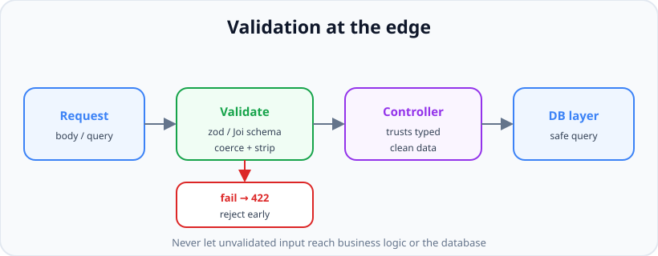
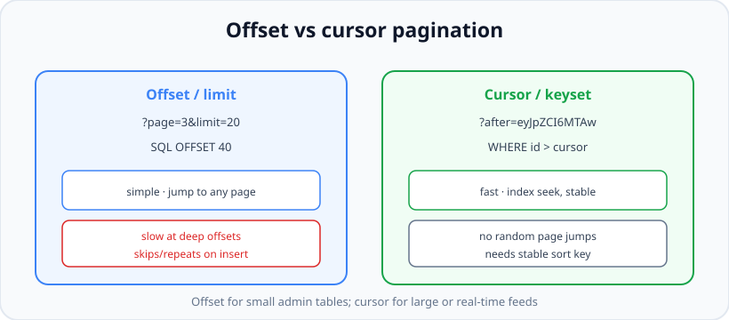

# Validation, Pagination, Filtering & Sorting

*10 min read · Updated 24 Jul 2026 Topic 41 of 70 Bookmark Mark done Why it matters Every input to your API is a potential attack · Topic 41 of 70*

**Source:** [https://www.geekyfrontend.in/learn/nodejs-backend-kit/validation-pagination](https://www.geekyfrontend.in/learn/nodejs-backend-kit/validation-pagination)

---

## Why it matters

Every input to your API is a potential attack, a potential crash, and a potential data-corruption bug. "Never trust the client" is the first law of backend engineering, and **validation** is how you enforce it. An endpoint that reads `req.body.age` and stores it without checking will happily accept `"age": "banana"`, `"age": -5`, or a 10-megabyte string designed to exhaust your memory. Validation at the edge is what turns a fragile endpoint into a robust one, and it is the single highest-leverage habit separating hobby code from production code.

**Pagination** is equally load-bearing but for a different reason: scale. An endpoint that returns *all* users works fine with 100 rows and takes your database down with 10 million. `GET /users` without pagination is one of the most common causes of production incidents, because it passes every test on a small dev database and detonates in production. Interviewers ask "how would you paginate this?" precisely because the naive answer (offset/limit) has a subtle scaling flaw that only shows up at volume, and knowing the cursor-based alternative signals real experience.

Filtering and sorting round out the read story: real clients need `?status=active&sort=-createdAt`, and doing this cleanly — without opening a SQL-injection hole or letting clients sort by an unindexed column — is a craft worth knowing.

## The concept, simply

**Validation** means checking, at the boundary of your system, that incoming data has the right shape, types, and constraints *before* any business logic touches it. You declare a *schema* — "email must be a valid email, age must be an integer 0–150, role must be one of admin/user" — and a validation library checks the request against it, rejecting bad input with a clear error.



Validate at the edge. Clean, typed data reaches your controller; invalid input is rejected early with 422.

Three libraries dominate the Node ecosystem: **Joi** (mature, chainable, framework-agnostic), **Zod** (TypeScript-first, infers static types from the schema — currently the most popular in new code), and **express-validator** (middleware built around express and the validator.js rules). They differ in ergonomics but share the idea: define the schema once, validate against it, get typed and coerced data out.

**Pagination** means returning results in bounded chunks instead of all at once. There are two families: *offset-based* (`?page=3&limit=20`) and *cursor-based* (`?after=<opaque-cursor>`). **Filtering** narrows results by field values (`?status=active`); **sorting** orders them (`?sort=-createdAt` for newest first).

## How it works (deep)

**Validation as a gate.** The correct architecture is a validation *middleware* that runs before the controller. It parses the request against the schema; on success it stores the *coerced, stripped* value (unknown keys removed, `"25"` turned into `25`) in `res.locals.validated` — not back onto `req`, because in Express 5 `req.query` is a getter and cannot be reassigned (changed in v5); on failure it short-circuits with a 422 and a list of what was wrong. The controller then trusts its input completely — no defensive `if (typeof x !== 'number')` scattered through business logic. This separation is the whole win: validation lives in one declarative place, not smeared across every handler.

A subtle but important point: **validate query and params too, not just the body**. `?limit=999999` or `?limit=abc` must be caught. A common bug is validating the JSON body carefully while blindly trusting `req.query.limit`, then passing it straight to the database as a `LIMIT`. Always coerce and clamp pagination params.

**Offset pagination** is the intuitive one: `LIMIT 20 OFFSET 40` skips 40 rows and returns the next 20. It lets clients jump to any page and is trivial to implement. It has two real flaws at scale.



Offset is simple but slows down and drifts at scale; cursor pagination is fast and stable but can't jump to arbitrary pages.

Flaw one: *performance*. `OFFSET 1000000` forces the database to walk and discard a million rows before returning your twenty — it gets linearly slower the deeper you page. Flaw two: *drift*. If a new row is inserted while a user pages through results, the offsets shift, so they can see a row twice or skip one entirely. For a stable, high-volume feed this is unacceptable.

**Cursor (keyset) pagination** fixes both. Instead of "skip N rows," you say "give me rows *after* this specific point," where the point is encoded in an opaque cursor (often a base64 of the last row's sort key + id). The query becomes `WHERE (created_at, id) < (:cursor_ts, :cursor_id) ORDER BY created_at DESC, id DESC LIMIT 20`. Because it uses an index seek rather than a scan-and-discard, it stays fast no matter how deep you go, and because it anchors to a real row rather than a numeric offset, inserts don't cause skips or repeats. The trade-off: you cannot jump to "page 47" — only forward/backward from where you are. That is fine for infinite-scroll feeds and the reason Twitter, Slack, and the GitHub API all use cursors.

**Filtering and sorting safely.** The danger is letting arbitrary client strings reach your query. Never interpolate `req.query.sort` into raw SQL — that is an injection hole. Instead, maintain an *allow-list*: map the client's `?sort=-createdAt` to a known column and direction, and reject anything not on the list. Same for filters — validate field names against a whitelist and use parameterized queries or your ORM's query builder for the values. Also restrict sorting to *indexed* columns; letting a client sort a ten-million-row table by an unindexed field is a self-inflicted denial of service.

## Code examples

A reusable Zod validation middleware — declare the schema once, get clean data or a 422.

javascript

```
const { z } = require('zod');

// Generic middleware: validate a chosen part of the request
function validate(schema, source = 'body') {
  return (req, res, next) => {
    const result = schema.safeParse(req[source]);
    if (!result.success) {
      return res.status(422).json({
        error: 'Validation failed',
        details: result.error.issues.map(i => ({
          field: i.path.join('.'),
          message: i.message,
        })),
      });
    }
    // coerced + stripped — controller trusts this. Don't write it back to req[source]:
    // in Express 5 req.query is a getter, so the assignment throws (ESM/strict) or is ignored.
    res.locals.validated = { ...res.locals.validated, [source]: result.data };
    next();
  };
}

const createUserSchema = z.object({
  email: z.string().email(),
  age: z.coerce.number().int().min(0).max(150),
  role: z.enum(['admin', 'user']).default('user'),
}).strict(); // reject unknown keys

router.post('/users', validate(createUserSchema), createUser); // createUser reads res.locals.validated.body
```

Validating and clamping pagination query params so a client can never demand a million rows:

javascript

```
const pageQuerySchema = z.object({
  page:  z.coerce.number().int().min(1).default(1),
  limit: z.coerce.number().int().min(1).max(100).default(20), // hard ceiling
  sort:  z.string().optional(),
  status: z.enum(['active', 'inactive']).optional(),
});

router.get('/users', validate(pageQuerySchema, 'query'), listUsers);

// Real output, GET /users with no query string (Express 5.2.1, Zod 4.6.5, Node v24.19.0):
//   old `req[source] = result.data`, CommonJS → 200 {"skip":null,"typeofPage":"undefined"}  (assignment silently ignored)
//   old `req[source] = result.data`, ESM      → 500 "Cannot set property query of #<IncomingMessage> which has only a getter"
//   res.locals.validated                      → 200 {"page":1,"limit":20,"skip":0,"typeofPage":"number"}
```

> **Why this was wrong:** the earlier version wrote the parsed data back with `req[source] = result.data`. That worked for `req.query` in Express 4, but Express 5 defines `req.query` as a getter, so the defaults and coercion were lost (or the request crashed in strict-mode code).

Offset pagination with a metadata envelope so clients know how to navigate:

javascript

```
async function listUsers(req, res) {
  const { page, limit, status } = res.locals.validated.query; // numbers, defaults applied
  const filter = status ? { status } : {};

  const [items, total] = await Promise.all([
    User.find(filter).skip((page - 1) * limit).limit(limit),
    User.countDocuments(filter),
  ]);

  res.json({
    data: items,
    pagination: {
      page, limit, total,
      totalPages: Math.ceil(total / limit),
      hasNext: page * limit < total,
    },
  });
}
```

Cursor pagination with safe, allow-listed sorting — the version you reach for at scale:

javascript

```
// Allow-list maps client tokens to real, indexed columns + direction
const SORTABLE = { createdAt: 'created_at', name: 'name' };

async function feed(req, res) {
  const limit = Math.min(Number(req.query.limit) || 20, 100);
  const cursor = req.query.after
    ? JSON.parse(Buffer.from(req.query.after, 'base64').toString())
    : null;

  // Keyset: fetch rows strictly "after" the cursor's (createdAt, id)
  const rows = await Post.findAfter(cursor, limit + 1); // +1 to detect more
  const hasMore = rows.length > limit;
  const page = rows.slice(0, limit);

  const last = page[page.length - 1];
  const nextCursor = hasMore
    ? Buffer.from(JSON.stringify({ createdAt: last.createdAt, id: last.id })).toString('base64')
    : null;

  res.json({ data: page, nextCursor });
}
```

## Common mistakes & gotchas

- **Only validating the body:** query and path params are input too. `?limit=99999999` and `/users/'; DROP TABLE` must be checked.
- **No upper bound on `limit`:** a client sending `?limit=1000000` can exhaust memory and stall the DB. Always clamp with a hard max.
- **Deep offset pagination:** `OFFSET 500000` is slow and drifts under concurrent inserts. Use cursors for large/real-time datasets.
- **Interpolating sort/filter fields into SQL:** a direct injection vulnerability. Allow-list field names; parameterize values.
- **Sorting on unindexed columns:** lets a client trigger full-table sorts — effectively a DoS.
- **Trusting client-coerced types:** `req.query.limit` is a *string*; `"20" - 1` works but `"20" + 1` is `"201"`. Coerce explicitly.
- **Leaking internal error detail:** return which fields failed, not stack traces or DB messages.
- **Validating in the controller by hand:** scatters rules and drifts. Centralize in schema middleware.

## Best practices

- Validate **every** input surface — body, query, params — with a declarative schema (Zod/Joi/express-validator) in middleware, before the controller.
- **Coerce and strip**: turn strings into the right types and remove unknown keys so the controller trusts its input.
- Return **422** with a structured list of field-level errors, never a stack trace.
- **Clamp pagination**: default and maximum `limit`, minimum `page`/positive cursor.
- Prefer **cursor pagination** for large or frequently-changing datasets; offset is fine for small, stable admin tables.
- **Allow-list** sortable and filterable fields, map them to indexed columns, and parameterize all values.
- Return a **consistent envelope** (`{ data, pagination }` or `{ data, nextCursor }`) so clients paginate uniformly.

## ⭐ Interview lens

> **Q: Where should validation happen, and why there?**  
> At the edge, in middleware before the controller, so invalid input never reaches business logic or the database. Centralizing it in a schema keeps rules in one declarative place and lets the controller trust coerced, stripped data. Validating inside handlers scatters and drifts.

> **Q: Offset vs cursor pagination — when and why?**  
> Offset (`page/limit`) is simple and allows jumping to any page but slows down at deep offsets (scan-and-discard) and drifts when rows are inserted mid-scroll. Cursor/keyset anchors to the last row's sort key, uses an index seek so it stays fast at any depth, and doesn't skip/repeat under inserts — but can't jump to arbitrary pages. Use cursors for large or real-time feeds.

> **Q: A client sends `?sort=passwordHash`. What's the risk and the fix?**  
> If you interpolate it into a query you get injection and you may expose or sort by sensitive/unindexed columns. Fix: an allow-list mapping client tokens to known indexed columns and directions, rejecting anything else, with parameterized queries for values.

> **Q: Which status code for a validation failure — 400 or 422?**  
> 422 Unprocessable Entity is more precise: the request parsed fine but failed semantic rules. 400 is for syntactically broken requests (unparseable JSON). Either is defensible if consistent, but 422 shows you know the distinction.

> **Q: Why cap `limit`, and what happens if you don't?**  
> Without a ceiling, a client can request millions of rows, exhausting server memory and stalling the DB — a trivial DoS. Always clamp with a sane default (e.g. 20) and hard max (e.g. 100).

> **Q: Zod vs Joi vs express-validator?**  
> All validate at the edge. Zod is TypeScript-first and infers static types from the schema (great for TS codebases). Joi is mature and framework-agnostic with a rich chainable API. express-validator integrates as express middleware around validator.js. Pick by ecosystem fit; the pattern — schema in middleware, 422 on failure — is identical.

## Cheat-card

- **Never trust the client.** Validate body + query + params with a schema in middleware, before the controller.
- **Coerce, strip, clamp:** types fixed, unknown keys removed, `limit` bounded.
- Validation fail → **422** with field-level details (no stack traces).
- **Offset** = `page/limit`: simple, jumps pages, but slow + drifts at scale.
- **Cursor/keyset** = "rows after X": fast at any depth, stable under inserts, no random jumps.
- **Allow-list** sort/filter fields → indexed columns; parameterize values (no SQL injection).
- Return a consistent envelope: `{ data, pagination }` or `{ data, nextCursor }`.
- Libraries: **Zod** (TS-first), **Joi** (mature), **express-validator** (middleware).
- **Same endpoint, three libraries:** Zod `safeParse` / Joi `validate(…, { abortEarly: false, stripUnknown: true })` / express-validator chains + `validationResult` + `matchedData`; all store into `res.locals.validated.query`.
- **express-validator on Express 5:** `.toInt()` etc. on `query` update `matchedData()` but not `req.query` (a re-parsing getter); the write-back is lost without an error. Body/params sanitizers still write back.
- **Repeated keys** (`?page=1&page=2`) arrive as arrays; guard with `.not().isArray().bail()` in express-validator.

---

## Learn More

- [express-validator - Getting Started express-validator.github.io](https://express-validator.github.io/docs/)
- [cursor.skip() - MongoDB Manual (Pagination) www.mongodb.com](https://www.mongodb.com/docs/manual/reference/method/cursor.skip/)
- [Mongoose Queries (limit, skip, sort) mongoosejs.com](https://mongoosejs.com/docs/queries.html)
- [Create A Paginated API With Node.js - Complete Tutorial Web Dev Simplified](https://www.youtube.com/watch?v=ZX3qt0UWifc)

---

## Additional topics

*Added 12 Oct 2026 · examples verified on Node v24.19.0 and Express 5.3.0 (Express 4.22.3 for one comparison run), Zod 4.6.5, Joi 18.2.9, express-validator 7.3.2, supertest 7.3.1*

### The same endpoint in Zod, Joi and express-validator

The Code examples above validate `GET /users` query parameters with Zod. Here the same endpoint is written with Joi and with express-validator, and the same inputs go through all three. All three versions follow the Express 5 rule from the "Validation as a gate" paragraph: the validated, coerced data goes to `res.locals.validated.query`, and nothing is written back to `req.query`.

The libraries differ in where the clean data comes from:

- **Zod:** `schema.safeParse(input)` returns `{ success, data | error }`. `z.coerce.number()` runs `Number(value)` before the checks. Unknown keys are dropped by default (`.strict()` rejects them instead).
- **Joi:** `schema.validate(input, options)` returns `{ value, error }`. `Joi.number()` converts numeric strings by default (`convert: true`). Unknown keys are an **error** by default (`"role" is not allowed`), so pass `stripUnknown: true` to match Zod. Pass `abortEarly: false` to get every failing field, not just the first.
- **express-validator:** each `query('page')…` call is a middleware *chain*. It records validators and sanitizers (`.default()`, `.toInt()`) and runs them on its own copy of each field. `validationResult(req)` returns the errors and `matchedData(req)` returns the sanitized values of the fields the chains declared. The chains also try to write the sanitized value back into `req.query`. On Express 5 that write is lost, as the second example shows.

How it works:

1. The Zod and Joi middlewares read `req.query` once, validate, and either answer 422 or store the result in `res.locals.validated.query`.
2. The express-validator version is an array: the four chains, then one middleware that calls `validationResult(req)`. On success it stores `matchedData(req, { locations: ['query'] })`.
3. The controller `listUsers` is shared. It reads only `res.locals.validated.query`, and also prints what `req.query.page` still holds.

**Example — Zod, Joi and express-validator on identical inputs.**

javascript

```
// three-validators.cjs: the lesson's GET /users query validation in Zod, Joi and express-validator.
// All three put the result in res.locals.validated.query and never write to req.query.
const express = require('express');
const request = require('supertest');
const { z } = require('zod');
const Joi = require('joi');
const { query, validationResult, matchedData } = require('express-validator');

// The same 422 body for all three libraries.
const fail = (res, details) => res.status(422).json({ error: 'Validation failed', details });
const store = (res, data) => { res.locals.validated = { ...res.locals.validated, query: data }; };

// --- Zod (the schema from the Code examples above)
const pageQuerySchema = z.object({
  page:  z.coerce.number().int().min(1).default(1),
  limit: z.coerce.number().int().min(1).max(100).default(20),
  sort:  z.string().optional(),
  status: z.enum(['active', 'inactive']).optional(),
});
const zodQuery = (schema) => (req, res, next) => {
  const r = schema.safeParse(req.query);
  if (!r.success) return fail(res, r.error.issues.map((i) => ({ field: i.path.join('.'), message: i.message })));
  store(res, r.data);
  next();
};

// --- Joi: Joi.number() converts "2" to 2 by default (convert: true)
const pageQueryJoi = Joi.object({
  page:  Joi.number().integer().min(1).default(1),
  limit: Joi.number().integer().min(1).max(100).default(20),
  sort:  Joi.string(),
  status: Joi.string().valid('active', 'inactive'),
});
const joiQuery = (schema) => (req, res, next) => {
  // abortEarly:false -> report every field; stripUnknown -> drop extra keys like Zod does
  const { error, value } = schema.validate(req.query, { abortEarly: false, stripUnknown: true });
  if (error) return fail(res, error.details.map((d) => ({ field: d.path.join('.'), message: d.message })));
  store(res, value);
  next();
};

// --- express-validator: a list of chains, then one middleware that reads the result
const pageQueryChains = [
  query('page').default(1).isInt({ min: 1 }).withMessage('page must be an integer >= 1').toInt(),
  query('limit').default(20).isInt({ min: 1, max: 100 }).withMessage('limit must be an integer 1-100').toInt(),
  query('sort').optional().isString(),
  query('status').optional().isIn(['active', 'inactive']).withMessage('status must be active or inactive'),
];
const evQuery = (chains) => [...chains, (req, res, next) => {
  const result = validationResult(req);
  if (!result.isEmpty()) return fail(res, result.array().map((e) => ({ field: e.path, message: e.msg })));
  store(res, matchedData(req, { locations: ['query'] })); // only the fields the chains validated
  next();
}];

// The controller is identical for all three.
function listUsers(req, res) {
  const { page, limit } = res.locals.validated.query;
  res.json({ ...res.locals.validated.query, skip: (page - 1) * limit, typeofPage: typeof page,
             reqQueryPage: req.query.page ?? null }); // what req.query still holds
}

const app = express();
app.get('/zod/users', zodQuery(pageQuerySchema), listUsers);
app.get('/joi/users', joiQuery(pageQueryJoi), listUsers);
app.get('/ev/users',  evQuery(pageQueryChains), listUsers);

const inputs = ['', '?page=2&limit=50&status=active&role=admin', '?limit=500', '?page=abc&status=deleted',
                '?page=', '?limit=1e1', '?page=1&page=2'];
(async () => {
  for (const qs of inputs) {
    console.log(`GET /users${qs || ' (no query)'}`);
    for (const lib of ['zod', 'joi', 'ev']) {
      const r = await request(app).get(`/${lib}/users${qs}`);
      console.log(`  ${lib.padEnd(3)} ${r.status} ${r.text}`);
    }
  }
})();

// Real output (Node v24.19.0, Express 5.3.0, Zod 4.6.5, Joi 18.2.9, express-validator 7.3.2):
//   GET /users (no query)
//     zod 200 {"page":1,"limit":20,"skip":0,"typeofPage":"number","reqQueryPage":null}
//     joi 200 {"page":1,"limit":20,"skip":0,"typeofPage":"number","reqQueryPage":null}
//     ev  200 {"page":1,"limit":20,"skip":0,"typeofPage":"number","reqQueryPage":null}
//   GET /users?page=2&limit=50&status=active&role=admin
//     zod 200 {"page":2,"limit":50,"status":"active","skip":50,"typeofPage":"number","reqQueryPage":"2"}
//     joi 200 {"page":2,"limit":50,"status":"active","skip":50,"typeofPage":"number","reqQueryPage":"2"}
//     ev  200 {"page":2,"limit":50,"status":"active","skip":50,"typeofPage":"number","reqQueryPage":"2"}
//   GET /users?limit=500
//     zod 422 {"error":"Validation failed","details":[{"field":"limit","message":"Too big: expected number to be <=100"}]}
//     joi 422 {"error":"Validation failed","details":[{"field":"limit","message":"\"limit\" must be less than or equal to 100"}]}
//     ev  422 {"error":"Validation failed","details":[{"field":"limit","message":"limit must be an integer 1-100"}]}
//   GET /users?page=abc&status=deleted
//     zod 422 {"error":"Validation failed","details":[{"field":"page","message":"Invalid input: expected number, received NaN"},{"field":"status","message":"Invalid option: expected one of \"active\"|\"inactive\""}]}
//     joi 422 {"error":"Validation failed","details":[{"field":"page","message":"\"page\" must be a number"},{"field":"status","message":"\"status\" must be one of [active, inactive]"}]}
//     ev  422 {"error":"Validation failed","details":[{"field":"page","message":"page must be an integer >= 1"},{"field":"status","message":"status must be active or inactive"}]}
//   GET /users?page=
//     zod 422 {"error":"Validation failed","details":[{"field":"page","message":"Too small: expected number to be >=1"}]}
//     joi 422 {"error":"Validation failed","details":[{"field":"page","message":"\"page\" must be a number"}]}
//     ev  200 {"page":1,"limit":20,"skip":0,"typeofPage":"number","reqQueryPage":""}
//   GET /users?limit=1e1
//     zod 200 {"page":1,"limit":10,"skip":0,"typeofPage":"number","reqQueryPage":null}
//     joi 200 {"limit":10,"page":1,"skip":0,"typeofPage":"number","reqQueryPage":null}
//     ev  422 {"error":"Validation failed","details":[{"field":"limit","message":"limit must be an integer 1-100"}]}
//   GET /users?page=1&page=2
//     zod 422 {"error":"Validation failed","details":[{"field":"page","message":"Invalid input: expected number, received NaN"}]}
//     joi 422 {"error":"Validation failed","details":[{"field":"page","message":"\"page\" must be a number"}]}
//     ev  200 {"page":[1,2],"limit":20,"skip":null,"typeofPage":"object","reqQueryPage":["1","2"]}
```

Reading the table:

- **No query, and normal input:** all three produce the same numbers (`page` and `limit` as numbers, defaults applied, `role` dropped). `reqQueryPage` is still the string `"2"` in every case: `req.query` keeps raw strings, and only `res.locals.validated.query` holds numbers.
- **`?limit=500`, `?page=abc&status=deleted`:** all three answer 422 with every failing field. Only the messages differ (the express-validator ones come from `.withMessage()`).
- **`?page=` (empty):** Zod coerces `""` to `0` (Too small) and Joi refuses an empty string as a number. express-validator's `.default(1)` replaces "an empty string, `null`, `undefined`, or `NaN`" (its docs), so it accepts the request as page 1.
- **`?limit=1e1`:** `Number('1e1')` is `10`, so Zod and Joi accept it. express-validator's `isInt` checks the string's characters and rejects it.
- **`?page=1&page=2`:** Express 5's simple query parser turns a repeated key into an array (lesson 35). Zod and Joi reject an array where a number is expected. express-validator runs standard validators and sanitizers on each array item, so the request passes with `page: [1, 2]` and `skip` becomes `NaN`, which JSON prints as `null`. The edge case below fixes it.

### express-validator sanitizers and the read-only `req.query` in Express 5

In Express 5, `req.query` is a getter on the request prototype: each read parses the URL's query string again and returns a **new** object (changed in v5; Express 4 parsed once and stored the object). express-validator 7 writes sanitized values back with lodash `_.set(req[location], path, value)`. For `query`, `req[location]` is a fresh, temporary object, so the write succeeds without an error and is then discarded. The value inside express-validator's own context is correct, and `matchedData()` returns it.

How it works:

1. The chain reads `req.query.page` (`'2'`) into its context.
2. `isInt` passes and `.toInt()` sets the context value to `2`.
3. It compares that with `req.query.page`, sees a difference and runs `_.set(req.query, 'page', 2)`. On Express 5 this sets `page` on the temporary object returned by that one read.
4. The next `req.query` read parses the URL again and returns `{ page: '2' }`.
5. `matchedData(req)` builds its result from the context, so it holds `2`.

**Example — does `.toInt()` change `req.query` on Express 5?**

javascript

```
// toint-writeback.cjs: does express-validator's .toInt() change req.query on Express 5?
const express = require('express');
const request = require('supertest');
const { query, matchedData } = require('express-validator');

const app = express();
app.get('/users',
  (req, res, next) => { res.locals.before = req.query; next(); },
  query('page').isInt({ min: 1 }).toInt(),   // sanitizer: '2' -> 2, then tries _.set(req.query, 'page', 2)
  (req, res) => res.json({
    express: require('express/package.json').version,
    sameObjectEachRead: req.query === req.query,
    before: res.locals.before,
    reqQueryAfter: req.query,
    typeofReqQueryPage: typeof req.query.page,
    matchedData: matchedData(req),
  }));

request(app).get('/users?page=2').then((r) => console.log(r.status, r.text));

// Real output (Node v24.19.0, Express 5.3.0, express-validator 7.3.2):
//   200 {"express":"5.3.0","sameObjectEachRead":false,"before":{"page":"2"},"reqQueryAfter":{"page":"2"},"typeofReqQueryPage":"string","matchedData":{"page":2}}
```

Observed result: `.toInt()` does not throw and does not report anything. It works inside express-validator (`matchedData` has the number), but its write to `req.query` is silently lost. `req.query` returns a different object on every read (`sameObjectEachRead: false`) and still holds the string `"2"`. Running the same file on Express 4.22.3 prints `{"express":"4.22.3","sameObjectEachRead":true,"before":{"page":2},"reqQueryAfter":{"page":2},"typeofReqQueryPage":"number","matchedData":{"page":2}}`. There, the cached object really was mutated, including the `before` reference taken earlier. Code that relied on `req.query.page` being a number after `.toInt()` therefore breaks when moving to Express 5 without any error. Read `matchedData(req)` instead, as the shared example does. Sanitizers on `body` and `params` are not affected: `req.body` and `req.params` are ordinary properties in Express 5.

### Common mistakes & gotchas (additional topics)

- **Reading `req.query` after express-validator sanitizers on Express 5.** The values are still the original strings. Use `matchedData(req)`.
- **Joi rejecting harmless extra keys.** Joi forbids unknown keys by default. Pass `stripUnknown: true` (or `.unknown(true)` on the schema) if you want Zod's strip behaviour.
- **`abortEarly` left at its default.** Joi stops at the first error, so clients fix one field per round trip. Pass `abortEarly: false`.
- **express-validator `.default()` swallowing empty values.** `?page=` becomes the default, while Zod and Joi reject it. Decide which behaviour you want and keep it the same across endpoints.
- **Different "integer" rules.** Zod/Joi coerce with `Number()` (accepting `1e1`, ` 2 `); express-validator's `isInt` checks the text. Pick one library per API so the same input gets the same answer.

### Edge case worked through: a repeated query key with express-validator

With Express 5's default `"simple"` query parser, `?page=1&page=2` yields `page: ['1', '2']`. express-validator validates and sanitizes each array element, so `isInt().toInt()` succeeds and hands the controller an array. Guard single-value fields with `.not().isArray()` and `.bail()`, so later validators do not run once that check fails:

javascript

```
// ev-repeated.cjs: ?page=1&page=2 through express-validator, without and with a "single value" guard.
const express = require('express');
const request = require('supertest');
const { query, validationResult, matchedData } = require('express-validator');

const loose = query('page').default(1).isInt({ min: 1 }).toInt();
const strict = query('page').not().isArray().withMessage('page must appear once').bail()
  .default(1).isInt({ min: 1 }).withMessage('page must be an integer >= 1').toInt();

const report = (req, res) => {
  const errors = validationResult(req).array().map((e) => e.msg);
  res.status(errors.length ? 422 : 200).json(errors.length ? { errors } : matchedData(req));
};

const app = express();
app.get('/loose', loose, report);
app.get('/strict', strict, report);

(async () => {
  for (const qs of ['?page=1&page=2', '?page=3', '']) {
    for (const path of ['/loose', '/strict']) {
      const r = await request(app).get(path + qs);
      console.log(`${(path + qs).padEnd(22)} ${r.status} ${r.text}`);
    }
  }
})();

// Real output (Node v24.19.0, Express 5.3.0, express-validator 7.3.2):
//   /loose?page=1&page=2   200 {"page":[1,2]}
//   /strict?page=1&page=2  422 {"errors":["page must appear once"]}
//   /loose?page=3          200 {"page":3}
//   /strict?page=3         200 {"page":3}
//   /loose                 200 {"page":1}
//   /strict                200 {"page":1}
```

The guard turns the array into a 422 and leaves single values and the default unchanged. Zod and Joi need no guard, because an array is not a number to them (the `?page=1&page=2` row of the first example).

### ⭐ Interview lens (additional topics)

> **Q: “You move an app that uses express-validator's `.toInt()` from Express 4 to Express 5. What breaks?”**  
> A: Nothing throws, but `req.query` values stay strings. Express 5's `req.query` is a getter that re-parses the URL on every read, so express-validator's write-back lands on a throwaway object. The sanitized values are still available from `matchedData(req)`, so controllers should read that (or a copy stored in `res.locals`) instead of `req.query`. Body and params sanitizers still write back, because those are plain properties. *Trap:* "it throws 'Cannot set property query'". That only happens when code assigns `req.query = …` itself in strict mode.

> **Q: “Zod, Joi or express-validator — do they accept the same inputs?”**  
> A: Not exactly. In these runs `?page=` was rejected by Zod and Joi but defaulted to 1 by express-validator, and `?limit=1e1` was accepted by Zod and Joi but rejected by express-validator. A repeated key passed express-validator as an array. The pattern (schema in middleware, 422, clean data in `res.locals`) is the same; the edge semantics are not, so pick one per API and test the edges.
