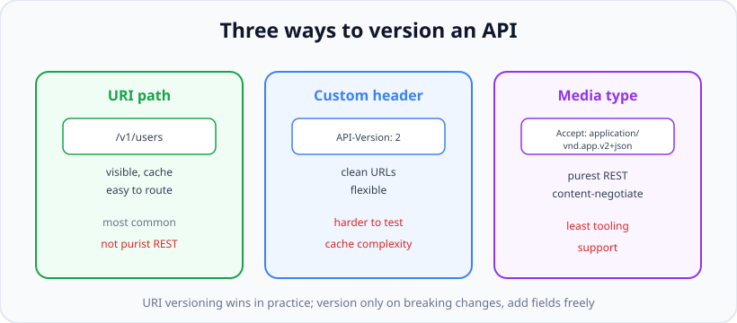

# API Versioning, Error Shape, Rate Limiting & Docs

*11 min read · Updated 24 Jul 2026 Topic 42 of 70 Bookmark Mark done Why it matters The moment your API has a single external consumer you cannot control · Topic 42 of 70*

**Source:** [https://www.geekyfrontend.in/learn/nodejs-backend-kit/api-versioning](https://www.geekyfrontend.in/learn/nodejs-backend-kit/api-versioning)

---

## Why it matters

The moment your API has a single external consumer you cannot control, you have lost the freedom to change it freely. Rename a field, tighten a validation rule, or change a response shape, and somewhere a mobile app in a user's pocket — running a build from six months ago — breaks. **Versioning** is the discipline that lets a server evolve while old clients keep working. Interviewers ask about it because it reveals whether you have maintained a real API over time or only built greenfield toys.

The other three topics here — error shape, rate limiting, and documentation — are the difference between an API developers *enjoy* using and one they curse. A **consistent error shape** means every client can write one error handler instead of guessing which of five formats today's endpoint uses. **Rate limiting** protects you from abuse, runaway clients, and cost blowups — and is a near-guaranteed system-design question ("how would you stop one user from hammering this endpoint?"). And **documentation**, specifically OpenAPI, is what makes an API discoverable and testable without reading your source; "have you used OpenAPI/Swagger?" is a common screening question because it signals you've worked on APIs meant for others.

Together these four turn a working endpoint into a *product*: stable, safe, self-describing, and pleasant to integrate against.

## The concept, simply

**Versioning** lets multiple contract versions coexist so a breaking change ships as "v2" without forcing every client to upgrade at once. There are three mainstream strategies.



Three ways to version. URI-path versioning wins in practice for its visibility and simple routing.

- **URI path:** `/v1/users` vs `/v2/users`. Visible, cache-friendly, trivial to route. The most common choice.
- **Custom header:** `API-Version: 2`. Keeps URLs clean but is invisible and harder to test in a browser.
- **Media type (content negotiation):** `Accept: application/vnd.myapp.v2+json`. The most "RESTful," the least tooled and understood.

A **breaking change** is one that could break an existing client: removing/renaming a field, changing a type, adding a required input, or changing status-code semantics. *Additive* changes — adding an optional field or a new endpoint — are backward-compatible and do *not* need a new version. The golden rule: version only on breaking changes; add fields freely.

A **consistent error shape** is a single JSON structure every error returns — e.g. `{ error: { code, message, details } }` — so clients parse errors uniformly. **Rate limiting** caps how many requests a client may make in a window, returning **429 Too Many Requests** when exceeded. **OpenAPI** (formerly Swagger) is a machine-readable YAML/JSON spec describing your endpoints, from which docs, client SDKs, and test tools are generated.

## How it works (deep)

**Versioning strategy trade-offs.** URI-path versioning wins in practice despite purists objecting that `/v1/` means the "same" resource has two URIs (technically un-RESTful). It wins because it is *visible* (you can see the version in logs and browsers), *routable* (mount `v1Router` and `v2Router` separately), and *cacheable* (different URLs cache independently). Header and media-type versioning keep URLs "pure" but pay for it in tooling: you cannot paste a versioned URL into a browser, CDNs need to vary on the header, and debugging is harder. A senior answer names URI-path as the pragmatic default while acknowledging the REST-purity critique.

The deeper skill is *minimizing* versions. Each live version is maintenance forever. So: design responses to be extensible from day one (return objects, not bare arrays, so you can add fields), treat new fields as additive, and only cut a new version for genuinely breaking changes. When you do, run old and new side by side, announce a *deprecation* timeline (often via a `Deprecation` / `Sunset` header), and give clients months to migrate.

**Error shape.** The failure mode to avoid is every endpoint inventing its own error format — one returns `{ error: "..." }`, another `{ message: "..." }`, a third a bare string. Standardize on one envelope with a *machine-readable* `code` (so clients branch on `code === 'EMAIL_TAKEN'` rather than string-matching human text), a human `message`, and optional `details` for field-level validation errors. Centralize it in a single Express **error-handling middleware** (the four-argument `(err, req, res, next)` signature) so no handler formats errors ad hoc, and so you can map error *types* to status codes in one place. Critically, never leak stack traces or raw DB errors to clients — log those server-side, return a clean generic message for 5xx.

**Rate limiting algorithms.** The common ones: *fixed window* (count requests per clock minute — simple but allows bursts at window edges, up to 2× the limit across a boundary); *sliding window* (smooths that edge burst); *token bucket* (a bucket refills at a steady rate and each request spends a token — allows controlled bursts, the most popular); and *leaky bucket* (processes at a fixed rate, smoothing output). For a single Node process an in-memory counter works, but the moment you run multiple instances you need a *shared store* — typically Redis — because each instance otherwise keeps its own count and the real limit becomes N× your intended value. Always return **429** plus `Retry-After` and the `RateLimit-*` headers so well-behaved clients back off.

**OpenAPI.** The spec is a contract written in YAML/JSON describing paths, methods, request/response schemas, and auth. Its value is that it is machine-readable: Swagger UI renders interactive docs from it, code generators produce typed client SDKs and server stubs, and contract-testing tools verify your implementation matches the spec. You can hand-write it or generate it from code annotations. The interview-relevant point is *why* it matters: a single source of truth that keeps docs, clients, and tests in sync, so the documentation cannot silently drift from the real API.

## Code examples

URI-path versioning by mounting separate routers — v1 and v2 evolve independently.

javascript

```
const express = require('express');
const app = express();

const v1 = require('./routes/v1');
const v2 = require('./routes/v2');

// Signal deprecation so clients know to migrate.
// Register it BEFORE the v1 router: middleware runs in registration order, and
// once the v1 router has sent a response nothing registered after it runs.
app.use('/v1', (req, res, next) => {
  res.set('Deprecation', 'true');
  res.set('Sunset', 'Wed, 31 Dec 2026 23:59:59 GMT');
  next();
});

app.use('/v1', v1); // legacy clients keep working
app.use('/v2', v2); // new shape, breaking changes live here

// Real output (Express 5.2.1, Node v24.19.0):
//   deprecation middleware AFTER app.use('/v1', v1):  GET /v1/users 200  Deprecation: null  Sunset: null
//   deprecation middleware BEFORE app.use('/v1', v1): GET /v1/users 200  Deprecation: true  Sunset: Wed, 31 Dec 2026 23:59:59 GMT
//   GET /v2/users 200  Deprecation: null
```


*Figure: what each middleware outcome does to the chain. Look at: the res.send() / res.json() branch — a router that responds ends the chain, so a middleware registered after it never runs.*

> **Why this was wrong:** the earlier version registered the deprecation middleware after `app.use('/v1', v1)`. The v1 router answered every request first, so the headers were never sent.

A single, consistent error shape via centralized error-handling middleware — note the four arguments and the 4xx/5xx split:

javascript

```
// Throw typed errors anywhere in the app
class ApiError extends Error {
  constructor(status, code, message, details) {
    super(message);
    this.status = status; this.code = code; this.details = details;
  }
}

// One place formats EVERY error (must have 4 args to be an error handler)
function errorHandler(err, req, res, next) {
  const status = err.status || 500;
  // Never leak internals on 5xx
  const body = status >= 500
    ? { error: { code: 'INTERNAL', message: 'Something went wrong' } }
    : { error: { code: err.code, message: err.message, details: err.details } };

  if (status >= 500) console.error(err); // log real cause server-side
  res.status(status).json(body);
}

app.use(errorHandler); // mounted LAST, after all routes
```

Rate limiting with a Redis-backed store so the limit is correct across many instances:

javascript

```
const { rateLimit, ipKeyGenerator } = require('express-rate-limit');
const { RedisStore } = require('rate-limit-redis');
const redis = require('./redisClient');

const limiter = rateLimit({
  windowMs: 60 * 1000,          // 1-minute window
  limit: 100,                   // 100 requests per key per window (named `max` before v7)
  standardHeaders: true,        // RateLimit-* headers
  legacyHeaders: false,
  store: new RedisStore({ sendCommand: (...args) => redis.call(...args) }),
  keyGenerator: (req) => req.user?.id || ipKeyGenerator(req.ip), // per user, fallback per IP (v8: IPv6-safe helper)
  handler: (req, res) => {
    res.set('Retry-After', '60');
    res.status(429).json({ error: { code: 'RATE_LIMITED', message: 'Too many requests' } });
  },
});

app.use('/api', limiter);

// Real output (express-rate-limit 8.7.1, rate-limit-redis 6.0.1, ioredis 6.0.0, Redis 8.0.5):
//   GET /api/ping #1 200  RateLimit-Limit: 100  RateLimit-Remaining: 99
//   GET /api/ping #2 200  RateLimit-Limit: 100  RateLimit-Remaining: 98
//   redis keys: [ 'rl:127.0.0.1' ]
// With the old `keyGenerator: (req) => req.user?.id || req.ip`, v8 logs
//   ValidationError: Custom keyGenerator appears to use request IP without calling the
//   ipKeyGenerator helper function for IPv6 addresses. ... code: 'ERR_ERL_KEY_GEN_IPV6'
```

A minimal OpenAPI fragment documenting one endpoint, plus serving interactive docs with Swagger UI:

javascript

```
// openapi.yaml (excerpt)
// paths:
//   /v2/users/{id}:
//     get:
//       summary: Get a user by id
//       parameters:
//         - name: id
//           in: path
//           required: true
//           schema: { type: string }
//       responses:
//         '200': { description: OK }
//         '404': { description: Not found }

const swaggerUi = require('swagger-ui-express');
const YAML = require('yamljs');
const spec = YAML.load('./openapi.yaml');

app.use('/docs', swaggerUi.serve, swaggerUi.setup(spec)); // interactive docs
```

## Common mistakes & gotchas

- **Versioning for additive changes:** adding an optional field doesn't need v2. Over-versioning multiplies maintenance for nothing.
- **Never deprecating old versions:** without a sunset date, v1 lives forever. Announce timelines and use `Deprecation`/`Sunset` headers.
- **Inconsistent error shapes:** different formats per endpoint force clients to write N error handlers. Standardize one envelope.
- **Leaking stack traces / DB errors** to clients on 5xx: an information-disclosure risk. Log server-side, return a generic message.
- **Error middleware with three args:** Express only treats a middleware as an error handler if it has *four* parameters. Drop `next` and errors silently bypass it.
- **In-memory rate limiting across multiple instances:** each process counts separately, so the real limit becomes N× intended. Use Redis.
- **Rate limiting by IP only:** corporate NAT/mobile networks share IPs; prefer per-user (with IP fallback) where you have identity.
- **Docs that drift from code:** hand-maintained docs rot. Generate from or contract-test against the OpenAPI spec.
- **Returning a bare array** as the top-level response: you can't later add pagination/metadata without breaking clients. Wrap in an object.

## Best practices

- Default to **URI-path versioning** (`/v1`, `/v2`); version only on **breaking** changes, add fields freely.
- Design responses as **extensible objects** (never bare arrays) so additive changes stay backward-compatible.
- Publish a **deprecation policy**: overlap versions, send `Deprecation`/`Sunset` headers, give clients months.
- Standardize **one error envelope** with a machine-readable `code`, human `message`, and optional `details`; format it in one central error-handling middleware.
- On 5xx, **log the real cause, return a generic message** — never leak internals.
- **Rate-limit** with a shared store (Redis) across instances, key by user then IP, and return **429** + `Retry-After` + `RateLimit-*` headers.
- Maintain an **OpenAPI** spec as the single source of truth; serve Swagger UI and generate clients/tests from it so docs can't drift.

## ⭐ Interview lens

> **Q: Which API versioning strategy would you choose and why?**  
> URI-path (`/v1`) in practice: visible in logs/browsers, trivial to route (mount separate routers), and cacheable per-URL. Purists note it's technically un-RESTful (same resource, two URIs) and prefer media-type versioning — but that's poorly tooled. Naming the trade-off, not just the choice, is what scores.

> **Q: What counts as a breaking change requiring a new version?**  
> Removing/renaming a field, changing a field's type, adding a required request param, or changing status-code semantics. Adding an *optional* field or a new endpoint is additive and backward-compatible — no new version needed. Version only on breaking changes.

> **Q: How would you rate-limit an endpoint across a horizontally-scaled service?**  
> A shared counter in Redis (token bucket or sliding window), keyed by user id (IP fallback), returning 429 with `Retry-After`. The trap is in-memory counters: with N instances each keeps its own count, so the effective limit becomes N× the intended value.

> **Q: Why must your Express error handler take four arguments?**  
> Express identifies error-handling middleware by arity — only a function with exactly `(err, req, res, next)` is treated as one. Write three params and Express treats it as normal middleware, so thrown errors skip it and fall through to the default handler.

> **Q: What does a good error response look like?**  
> A single consistent envelope: a machine-readable `code` (clients branch on it, not on message text), a human `message`, and optional `details` for validation. Formatted in one central middleware; on 5xx it hides internals and logs the real cause server-side. Consistency lets clients write one handler.

> **Q: What is OpenAPI and why use it?**  
> A machine-readable spec (YAML/JSON) describing paths, schemas, and auth. From it you generate interactive docs (Swagger UI), typed client SDKs, and contract tests — one source of truth so docs can't drift from the implementation. Saying "Swagger" and OpenAPI are the same lineage (Swagger was renamed OpenAPI) shows familiarity.

> **Q: Fixed window vs token bucket — what's the difference?**  
> Fixed window counts per clock interval; it's simple but permits a burst of up to 2× the limit straddling a boundary. Token bucket refills tokens at a steady rate and each request spends one, allowing controlled bursts up to the bucket size while enforcing an average rate — smoother, and the common production choice.

## Cheat-card

- **Version on breaking changes only**; add optional fields freely. Default: URI-path `/v1`, `/v2`.
- **Breaking** = remove/rename field, change type, new required input, changed status semantics.
- Deprecate with overlap + `Deprecation`/`Sunset` headers and a migration window.
- **One error envelope:** `{ error: { code, message, details } }`; central 4-arg middleware; hide internals on 5xx.
- Express error handler needs **4 args** `(err, req, res, next)` or it's skipped.
- **Rate limit:** Redis-shared across instances, key by user/IP, return **429** + `Retry-After`. Token bucket = smooth bursts.
- **OpenAPI/Swagger:** one spec → docs + SDKs + contract tests; keeps docs from drifting.
- Return **objects, not bare arrays**, so responses stay extensible.
- **RFC 9457 Problem Details:** `application/problem+json` with `type` (default `about:blank`), `title`, `status` (advisory), `detail`, `instance`, plus extension members; set `res.type()` before `res.json()`.
- **Behind a proxy:** `app.set('trust proxy', 1)` (or the proxy subnet) so `req.ip` is the client; unset = everyone shares the proxy's bucket; `true` = client-chosen IP via `X-Forwarded-For` (lesson 86).
- **Custom `keyGenerator`** skips express-rate-limit's `ERR_ERL_UNEXPECTED_X_FORWARDED_FOR` / `ERR_ERL_PERMISSIVE_TRUST_PROXY` checks; test the proxy setup yourself.

---

## Learn More

- [Web API Design Best Practices (API Versioning) - Azure Architecture Center learn.microsoft.com](https://learn.microsoft.com/en-us/azure/architecture/best-practices/api-design)
- [Microsoft Azure REST API Guidelines - API Versioning github.com](https://github.com/microsoft/api-guidelines/blob/vNext/azure/Guidelines.md)
- [API Versioning Explained | Lightboard Series MuleSoft Videos](https://www.youtube.com/watch?v=_WWr_eFRDeM)

---

## Additional topics

*Added 12 Oct 2026 · examples verified on Node v24.19.0 and Express 5.3.0, express-rate-limit 8.7.1 (in-memory store), supertest 7.3.1*

### RFC 9457 Problem Details (`application/problem+json`)

The error envelope above (`{ error: { code, message, details } }`) is a house format: every client has to learn it. **Problem Details** (RFC 9457, which obsoletes RFC 7807) is the standard version of the same idea. An error response is a JSON object with media type `application/problem+json` and five defined members:

- `type`: a URI naming the kind of problem. Clients branch on it, the way they would branch on a `code`.
- `title`: a short human summary of that type.
- `status`: the HTTP status code, repeated in the body. RFC 9457 calls it "only advisory", so the real status line still has to be correct.
- `detail`: an explanation of this occurrence.
- `instance`: a URI reference for this occurrence.

Any other top-level member is an **extension member** (for example `errors` for field-level validation, or your own `code`). Clients "MUST ignore any such extensions" they do not recognise, so adding one is not a breaking change. When `type` is omitted, it defaults to `about:blank`, meaning "this problem has no meaning beyond the HTTP status code". In that case the `title` SHOULD be the standard reason phrase (`Not Found`).

How it works:

1. Route code throws (or `next()`s) a `ProblemError` that carries `status`, `type`, `title`, `detail` and any extension members. Async handlers can just throw: Express 5 forwards rejected promises to the error handler.
2. A catch-all middleware after the routes turns "no route matched" into a 404 `ProblemError`, so 404s use the same format instead of Express's HTML page.
3. The single four-argument error handler builds the object. Errors that are not `ProblemError`s become `about:blank`, with the title taken from `http.STATUS_CODES`. A body-parser error keeps its own `status` (400 for broken JSON). 5xx responses get no `detail`, so internals stay in the server log.
4. `req.accepts(['application/problem+json', 'application/json'])` picks the media type. A client whose `Accept` lists only `application/json` gets the same body labelled `application/json`. Everyone else, including `Accept: */*`, gets `application/problem+json`. RFC 9457 itself allows sending `application/problem+json` even when the client did not list it ("as is allowed by HTTP"), so this step is a courtesy to strict JSON-only clients, not a requirement.
5. `res.type(...)` is set before `res.json(...)`. `res.json` only fills in `Content-Type` when it is empty, so the problem type survives, with `; charset=utf-8` added.

**Example — one Express 5 error handler mapping validation, bad JSON, 404 and 500 to problem details.**

javascript

```
// problem.cjs: RFC 9457 Problem Details from one Express 5 error handler.
const express = require('express');
const { STATUS_CODES } = require('node:http');

// A typed error that already knows its problem fields.
class ProblemError extends Error {
  constructor(status, { type = 'about:blank', title, detail, ...extensions } = {}) {
    super(detail ?? title);
    Object.assign(this, { status, type, title, detail, extensions });
  }
}

const app = express();
app.use(express.json());

app.post('/orders', (req, res) => {
  const { quantity } = req.body ?? {};
  if (!Number.isInteger(quantity) || quantity < 1) {
    throw new ProblemError(422, {
      type: 'https://api.example.com/problems/validation-error',
      title: 'Your request is not valid',
      detail: 'One or more fields failed validation.',
      errors: [{ pointer: '#/quantity', detail: 'must be a positive integer' }], // extension member
    });
  }
  res.status(201).json({ id: 1, quantity });
});

app.get('/boom', async () => { throw new Error('db password=hunter2 rejected'); }); // Express 5 forwards it

// Unmatched routes become a 404 problem instead of Express's HTML page.
app.use((req, res, next) => next(new ProblemError(404, { detail: `No route for ${req.method} ${req.path}` })));

// The only place that formats errors.
app.use((err, req, res, next) => {
  let status = err.status ?? err.statusCode ?? 500;
  if (status < 400 || status > 599) status = 500;
  const known = err instanceof ProblemError;
  const problem = {
    type: known ? err.type : 'about:blank',                 // about:blank = "nothing beyond the status code"
    title: (known && err.title) || STATUS_CODES[status],    // with about:blank, title = the status phrase
    status,
    detail: status >= 500 ? undefined : (err.detail ?? err.message), // never leak 5xx internals
    instance: req.originalUrl,
    ...(known ? err.extensions : {}),                       // extension members sit at the top level
  };
  if (status >= 500) console.error('logged server-side:', err.message);

  // Content negotiation: a client that accepts only application/json still gets JSON.
  const type = req.accepts(['application/problem+json', 'application/json']) || 'application/problem+json';
  res.status(status).type(type).json(problem);
});

const server = app.listen(6720, async () => {
  const url = 'http://127.0.0.1:6720';
  const show = async (label, path, init = {}) => {
    const r = await fetch(url + path, init);
    console.log(`${label}\n  ${r.status} ${r.headers.get('content-type')}\n  ${await r.text()}`);
  };
  const json = { 'Content-Type': 'application/json' };
  await show('POST /orders {"quantity":0}', '/orders', { method: 'POST', headers: json, body: '{"quantity":0}' });
  await show('POST /orders broken JSON', '/orders', { method: 'POST', headers: json, body: '{"quantity":' });
  await show('GET /nope', '/nope');
  await show('GET /boom', '/boom');
  await show('GET /nope  Accept: application/json', '/nope', { headers: { Accept: 'application/json' } });
  server.close();
});

// Real output (Node v24.19.0, Express 5.3.0):
//   POST /orders {"quantity":0}
//     422 application/problem+json; charset=utf-8
//     {"type":"https://api.example.com/problems/validation-error","title":"Your request is not valid","status":422,"detail":"One or more fields failed validation.","instance":"/orders","errors":[{"pointer":"#/quantity","detail":"must be a positive integer"}]}
//   POST /orders broken JSON
//     400 application/problem+json; charset=utf-8
//     {"type":"about:blank","title":"Bad Request","status":400,"detail":"Unexpected end of JSON input","instance":"/orders"}
//   GET /nope
//     404 application/problem+json; charset=utf-8
//     {"type":"about:blank","title":"Not Found","status":404,"detail":"No route for GET /nope","instance":"/nope"}
//   logged server-side: db password=hunter2 rejected
//   GET /boom
//     500 application/problem+json; charset=utf-8
//     {"type":"about:blank","title":"Internal Server Error","status":500,"instance":"/boom"}
//   GET /nope  Accept: application/json
//     404 application/json; charset=utf-8
//     {"type":"about:blank","title":"Not Found","status":404,"detail":"No route for GET /nope","instance":"/nope"}
```

The 500 body has no `detail` and does not mention the password; the message only reaches the server log. The validation problem uses a real `type` URI (`https://api.example.com/problems/validation-error` stands in for a page you would publish that describes the problem type) and an `errors` extension member using JSON Pointers, the shape RFC 9457 uses in its own example. `instance` is the request path here; many APIs use a per-request ID URI instead so support staff can find the log line.

### `trust proxy` so the rate limiter sees real client IPs

Behind a reverse proxy or load balancer, every TCP connection to your app comes from the proxy. Express's `req.ip` is the socket's address unless the `trust proxy` setting tells it which `X-Forwarded-For` entries to believe. The rate limiter keys on `req.ip` (here through `ipKeyGenerator(req.ip)`, as in the corrected example above). With the setting left at `false`, all clients therefore share **one** bucket: the proxy's. Set it to `true` and Express believes the left-most `X-Forwarded-For` entry, which the client wrote itself. Anyone can then pick a new IP per request and never be limited. Lesson 86 explains every accepted value ([Express app settings and locals](86-express-app-settings-and-locals.md#how-it-works)).

How it works:

1. The proxy receives a connection from the client (`127.0.0.2`). It appends that address to whatever `X-Forwarded-For` the client sent and forwards the request to the app.
2. The app sees the socket address `127.0.0.1` (the proxy) and `X-Forwarded-For: [forged, …,] 127.0.0.2`.
3. `trust proxy` unset (`false`): `req.ip` = socket = `127.0.0.1` for everyone.
4. `trust proxy` `1`: trust one hop. Express walks the list from the right and takes the first address after one trusted hop: the entry the proxy appended, the real client.
5. `trust proxy` `true`: trust every hop, so `req.ip` is the left-most entry. For a client that sent its own header, that is the forged value.

Linux routes the whole `127.0.0.0/8` range to the loopback interface. The clients below bind `127.0.0.2`, `.3` and `.4` as their source address, so the proxy sees three different real IPs without any extra machines.

**Example — a real local proxy in front of a rate-limited app, with `trust proxy` unset, `1` and `true`.**

javascript

```
// proxy.cjs: a tiny reverse proxy on :6711 that forwards to the app on :6710
// and appends the caller's address to X-Forwarded-For, the way nginx's
// $proxy_add_x_forwarded_for does.
const http = require('node:http');

http.createServer((req, res) => {
  const prior = req.headers['x-forwarded-for'];            // whatever the client sent (may be forged)
  const peer = req.socket.remoteAddress;                    // the address the proxy really saw
  const upstream = http.request({
    host: '127.0.0.1', port: 6710, method: req.method, path: req.url,
    headers: { ...req.headers, 'x-forwarded-for': prior ? `${prior}, ${peer}` : peer },
  }, (up) => { res.writeHead(up.statusCode, up.headers); up.pipe(res); });
  upstream.on('error', () => { res.writeHead(502); res.end(); });
  req.pipe(upstream);
}).listen(6711, '127.0.0.1', () => console.log('proxy :6711 -> app :6710'));
```

javascript

```
// app.cjs: the rate-limited API behind the proxy. TRUST_PROXY = unset | 1 | true
const express = require('express');
const { rateLimit, ipKeyGenerator } = require('express-rate-limit');

const app = express();
const trust = process.env.TRUST_PROXY;
if (trust !== undefined) app.set('trust proxy', trust === 'true' ? true : Number(trust));

app.use('/api', rateLimit({
  windowMs: 60 * 1000,
  limit: 3,                                         // small, so the demo hits 429 quickly
  standardHeaders: true,
  legacyHeaders: false,
  keyGenerator: (req) => req.user?.id || ipKeyGenerator(req.ip), // same key rule as the lesson
}));
app.get('/api/ping', (req, res) => res.json({ ip: req.ip }));

app.listen(6710, '127.0.0.1', () => console.log(`app :6710 trust proxy = ${app.get('trust proxy')}`));
```

javascript

```
// clients.cjs: three "machines" call the proxy. Linux routes all of 127.0.0.0/8 to
// loopback, so binding localAddress gives each client its own real source IP.
const http = require('node:http');

function call(localAddress, forged) {
  return new Promise((resolve, reject) => {
    const headers = forged ? { 'X-Forwarded-For': forged } : {};
    http.get({ host: '127.0.0.1', port: 6711, path: '/api/ping', localAddress, headers }, (res) => {
      let body = '';
      res.on('data', (c) => (body += c));
      res.on('end', () => resolve(`${res.statusCode} remaining=${res.headers['ratelimit-remaining']} ${body}`));
    }).on('error', reject);
  });
}

(async () => {
  for (let i = 1; i <= 4; i++) console.log(`alice   127.0.0.2 #${i}:`, await call('127.0.0.2'));
  console.log(`bob     127.0.0.3 #1:`, await call('127.0.0.3'));
  for (let i = 1; i <= 4; i++) {
    const fake = `203.0.113.${i}`;                  // mallory forges a new X-Forwarded-For each time
    console.log(`mallory 127.0.0.4 #${i} (XFF ${fake}):`, await call('127.0.0.4', fake));
  }
})();
```

bash

```
#!/bin/bash
# run-demo.sh: proxy + app + clients, once per trust proxy value. Prints each command, then its output.
node proxy.cjs & PROXY_PID=$!; sleep 0.5
for mode in unset 1 true; do
  echo "=== TRUST_PROXY=$mode"
  if [ "$mode" = unset ]; then node app.cjs & APP_PID=$!
  else TRUST_PROXY=$mode node app.cjs & APP_PID=$!; fi
  sleep 0.7
  node clients.cjs
  kill $APP_PID; wait $APP_PID 2>/dev/null
done
kill $PROXY_PID
```

bash

```
$ bash run-demo.sh
proxy :6711 -> app :6710
=== TRUST_PROXY=unset
app :6710 trust proxy = false
alice   127.0.0.2 #1: 200 remaining=2 {"ip":"127.0.0.1"}
alice   127.0.0.2 #2: 200 remaining=1 {"ip":"127.0.0.1"}
alice   127.0.0.2 #3: 200 remaining=0 {"ip":"127.0.0.1"}
alice   127.0.0.2 #4: 429 remaining=0 Too many requests, please try again later.
bob     127.0.0.3 #1: 429 remaining=0 Too many requests, please try again later.
mallory 127.0.0.4 #1 (XFF 203.0.113.1): 429 remaining=0 Too many requests, please try again later.
mallory 127.0.0.4 #2 (XFF 203.0.113.2): 429 remaining=0 Too many requests, please try again later.
mallory 127.0.0.4 #3 (XFF 203.0.113.3): 429 remaining=0 Too many requests, please try again later.
mallory 127.0.0.4 #4 (XFF 203.0.113.4): 429 remaining=0 Too many requests, please try again later.
=== TRUST_PROXY=1
app :6710 trust proxy = 1
alice   127.0.0.2 #1: 200 remaining=2 {"ip":"127.0.0.2"}
alice   127.0.0.2 #2: 200 remaining=1 {"ip":"127.0.0.2"}
alice   127.0.0.2 #3: 200 remaining=0 {"ip":"127.0.0.2"}
alice   127.0.0.2 #4: 429 remaining=0 Too many requests, please try again later.
bob     127.0.0.3 #1: 200 remaining=2 {"ip":"127.0.0.3"}
mallory 127.0.0.4 #1 (XFF 203.0.113.1): 200 remaining=2 {"ip":"127.0.0.4"}
mallory 127.0.0.4 #2 (XFF 203.0.113.2): 200 remaining=1 {"ip":"127.0.0.4"}
mallory 127.0.0.4 #3 (XFF 203.0.113.3): 200 remaining=0 {"ip":"127.0.0.4"}
mallory 127.0.0.4 #4 (XFF 203.0.113.4): 429 remaining=0 Too many requests, please try again later.
=== TRUST_PROXY=true
app :6710 trust proxy = true
alice   127.0.0.2 #1: 200 remaining=2 {"ip":"127.0.0.2"}
alice   127.0.0.2 #2: 200 remaining=1 {"ip":"127.0.0.2"}
alice   127.0.0.2 #3: 200 remaining=0 {"ip":"127.0.0.2"}
alice   127.0.0.2 #4: 429 remaining=0 Too many requests, please try again later.
bob     127.0.0.3 #1: 200 remaining=2 {"ip":"127.0.0.3"}
mallory 127.0.0.4 #1 (XFF 203.0.113.1): 200 remaining=2 {"ip":"203.0.113.1"}
mallory 127.0.0.4 #2 (XFF 203.0.113.2): 200 remaining=2 {"ip":"203.0.113.2"}
mallory 127.0.0.4 #3 (XFF 203.0.113.3): 200 remaining=2 {"ip":"203.0.113.3"}
mallory 127.0.0.4 #4 (XFF 203.0.113.4): 200 remaining=2 {"ip":"203.0.113.4"}
```

What the three runs show (limit 3 per minute):

- **Unset:** `req.ip` is `127.0.0.1` for all three machines. Alice uses up the shared bucket, and Bob and Mallory get 429 on their first request, before they have sent anything themselves.
- **`1`:** each machine has its own bucket. Alice is limited after 3; Bob is untouched. Mallory's forged `X-Forwarded-For` is ignored (`ip` stays `127.0.0.4`), and she is limited after 3 as well.
- **`true`:** Alice and Bob still look right, because they sent no header of their own. Mallory's four requests get four different `req.ip` values taken from her forged header, `remaining` never drops below 2, and she is never limited.

### Common mistakes & gotchas (additional topics)

- **`trust proxy: true` "to make it work".** It does make `req.ip` look right for honest clients, which is why it slips through review. It also lets any client choose its own IP. Use the hop count (`1` for one proxy) or the proxy's address or subnet.
- **A custom `keyGenerator` turns off express-rate-limit's proxy checks.** The library's default key generator runs the `trustProxy` and `xForwardedForHeader` validations. The lesson's custom `(req) => req.user?.id || ipKeyGenerator(req.ip)` replaces it, so a misconfiguration logs nothing:

javascript

```
// checks.cjs: express-rate-limit's built-in trust-proxy checks, default vs custom keyGenerator.
const express = require('express');
const request = require('supertest');
const { rateLimit, ipKeyGenerator } = require('express-rate-limit');

async function probe(label, trust, custom) {
  const app = express();
  if (trust !== undefined) app.set('trust proxy', trust);
  app.use(rateLimit({
    windowMs: 60 * 1000, limit: 3, standardHeaders: true, legacyHeaders: false,
    ...(custom ? { keyGenerator: (req) => req.user?.id || ipKeyGenerator(req.ip) } : {}),
  }));
  app.get('/', (req, res) => res.send('ok'));
  const logged = [];
  const orig = console.error;
  console.error = (e) => logged.push(e?.code ?? String(e)); // the library logs ValidationErrors with console.error
  const r = await request(app).get('/').set('X-Forwarded-For', '203.0.113.9');
  console.error = orig;
  console.log(`${label.padEnd(44)} ${r.status}  logged: ${logged.join(', ') || '(nothing)'}`);
}

(async () => {
  await probe('trust proxy unset, default keyGenerator', undefined, false);
  await probe('trust proxy true,  default keyGenerator', true, false);
  await probe('trust proxy 1,     default keyGenerator', 1, false);
  await probe('trust proxy unset, custom keyGenerator', undefined, true);
  await probe('trust proxy true,  custom keyGenerator', true, true);
})();

// Real output (Node v24.19.0, Express 5.3.0, express-rate-limit 8.7.1):
//   trust proxy unset, default keyGenerator      200  logged: ERR_ERL_UNEXPECTED_X_FORWARDED_FOR
//   trust proxy true,  default keyGenerator      200  logged: ERR_ERL_PERMISSIVE_TRUST_PROXY
//   trust proxy 1,     default keyGenerator      200  logged: (nothing)
//   trust proxy unset, custom keyGenerator       200  logged: (nothing)
//   trust proxy true,  custom keyGenerator       200  logged: (nothing)
```

With a custom key generator, test the topology yourself, like the proxy demo above. The error codes are listed on the express-rate-limit wiki ([Error Codes](https://github.com/express-rate-limit/express-rate-limit/wiki/Error-Codes)).
- **Sending `title` that changes per request.** `title` describes the problem *type*; put occurrence details in `detail` or in extension members.
- **Returning `status` in the body but a different status line.** Clients and proxies act on the status line; the body copy is advisory.

### Edge case worked through: `trust proxy: 1` when the proxy can be bypassed

A hop count only says "the last N addresses are mine". Express cannot tell whether the last hop really was your proxy. If a client reaches the app port directly, the socket address is the client itself, and with `1` Express trusts it as the hop and takes the address to its left, the one the client wrote:

javascript

```
// bypass.cjs: trust proxy = 1, but the client talks to the app directly (no proxy in between).
const express = require('express');
const request = require('supertest');

const app = express();
app.set('trust proxy', 1);
app.get('/', (req, res) => res.json({ ip: req.ip, ips: req.ips }));

(async () => {
  for (const xff of [null, '198.51.100.7']) {
    const r = await request(app).get('/').set(xff ? { 'X-Forwarded-For': xff } : {});
    console.log(`X-Forwarded-For: ${xff ?? '(none)'}`.padEnd(32), r.text);
  }
})();

// Real output (Node v24.19.0, Express 5.3.0, supertest 7.3.1):
//   X-Forwarded-For: (none)          {"ip":"127.0.0.1","ips":[]}
//   X-Forwarded-For: 198.51.100.7    {"ip":"198.51.100.7","ips":["198.51.100.7"]}
```

That is why `app.cjs` listens on `127.0.0.1` only, so nothing outside the machine can skip the proxy. In production, use a private network or firewall rule, or give `trust proxy` the proxy's actual address or subnet (for example `'10.0.0.0/8'` or `'loopback'`). Then a direct connection from any other address is not trusted at all.

### ⭐ Interview lens (additional topics)

> **Q: “What is RFC 9457 and what does `about:blank` mean?”**  
> A: The standard JSON error format, `application/problem+json`, with `type`, `title`, `status`, `detail` and `instance`, plus any extension members, which clients must ignore if they do not know them. `type` is the machine-readable key. Omitting it means `about:blank`: "nothing beyond the HTTP status", with the reason phrase as the `title`. Generate it in one Express error handler, hide `detail` on 5xx, and keep the status line correct, since the body's `status` is advisory.

> **Q: “Your rate limiter blocks everyone at once after a deploy behind a load balancer. Why, and what is the fix?”**  
> A: `trust proxy` is `false`, so `req.ip` is the balancer's address and every user shares one bucket. Set `app.set('trust proxy', 1)` (or the balancer's subnet) so Express takes the client address the balancer appended to `X-Forwarded-For`. Never use `true`: then `req.ip` is the left-most entry, which the client controls, and an attacker rotates it to dodge the limit. Also make sure the app is only reachable through the balancer.
