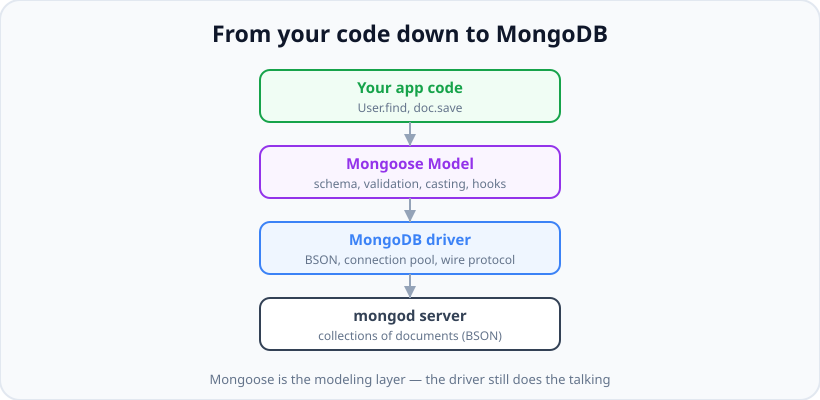

# MongoDB &amp; Mongoose

*10 min read · Updated 24 Jul 2026 Topic 43 of 70 Bookmark Mark done Why it matters Almost every Node · Topic 43 of 70*

**Source:** [https://www.geekyfrontend.in/learn/nodejs-backend-kit/mongodb-mongoose](https://www.geekyfrontend.in/learn/nodejs-backend-kit/mongodb-mongoose)

---

## Why it matters

Almost every Node.js service you will ever write needs to remember things between requests: users, orders, sessions, posts. That memory lives in a database, and for a huge slice of the Node ecosystem that database is **MongoDB**. MongoDB is a *document database* — instead of rows and columns it stores JSON-like documents, which map naturally onto the objects you already pass around in JavaScript. There is no impedance mismatch between a `user` object in your code and a `user` document in the database; they look almost identical.

**Mongoose** is the library that sits between your Node code and MongoDB. It gives you schemas (so your "schema-less" database actually has enforced structure), type casting, validation, middleware hooks, and a fluent query API. Understanding how these two pieces relate — where MongoDB ends and Mongoose begins — is the single most important mental model in this whole chapter, and it is a question interviewers love because it separates people who copy tutorials from people who understand their stack.

If you cannot confidently model data, run CRUD, and explain why `findByIdAndUpdate` skips your validators, you will struggle in both real backends and interviews. This topic builds that foundation.

## The concept, simply

MongoDB organises data into **databases → collections → documents**. A collection is loosely like a SQL table, and a document is loosely like a row — except a document is a flexible BSON object (Binary JSON) that can nest arrays and sub-objects to any depth. Two documents in the same collection do not have to have the same fields. That flexibility is the whole selling point, and also the whole footgun.

Mongoose adds a disciplined layer on top. You declare a **Schema** (the shape and rules), compile it into a **Model** (a constructor bound to one collection), and then create **documents** (instances of that model). The model is your gateway for every query; the document is a single record with methods like `.save()`.



Mongoose is a modeling layer on top of the official driver — it validates and casts, but the driver still speaks to the server.

The key insight the diagram encodes: **Mongoose is not the database**. It is a convenience and safety layer. Underneath, the official `mongodb` driver serialises your data to BSON, manages the connection pool, and sends it over the wire. When Mongoose behaves surprisingly (a validator not running, a field silently dropped), the answer is almost always "because at that moment Mongoose handed off to the raw driver".

## How it works (deep)

Let us trace a full round trip. When your process starts you call `mongoose.connect(uri)`. Mongoose opens a **connection pool** (by default up to 100 sockets) to `mongod` and buffers any queries you fire before the connection is ready — this is why `User.find()` at module load time does not immediately crash. Once connected, queries flush from the buffer.

A **Schema** is a plain description: field names, their types (`String`, `Number`, `Date`, `ObjectId`, `Buffer`, arrays, nested objects), and rules (`required`, `unique`, `default`, `min`, `enum`, custom `validate`). Compiling it with `mongoose.model('User', schema)` produces a **Model**. The string `'User'` is pluralised and lower-cased to derive the collection name `users` — a detail that trips people up when the collection "doesn't exist".

When you build a query like `User.find({ age: { $gt: 18 } })`, Mongoose does **not** execute immediately. It returns a **Query** object — a thenable builder. Execution happens when you `await` it, call `.then()`, or call `.exec()`. Before sending, Mongoose *casts* your filter values to the schema types (so the string `"18"` becomes the number `18`), which is a subtle safety net the raw driver does not give you.

On the way back, BSON documents are hydrated into full Mongoose documents with getters, virtuals, and instance methods — unless you called `.lean()`, which returns plain JS objects and skips hydration entirely. `.lean()` is dramatically faster and lighter for read-only endpoints because it avoids constructing the document wrapper for every result.

Two families of write operations exist, and the split is the source of the most common Mongoose bug. **Document-based writes** (`new User(...).save()`, `doc.save()`) run the full pipeline: casting, validators, `pre('save')` hooks. **Query-based writes** (`updateOne`, `updateMany`, `findOneAndUpdate`, `findByIdAndUpdate`) go closer to the driver: by default they **skip validators and skip the `save` middleware**. You must pass `{ runValidators: true }` to get validation, and even then `save` hooks never fire — only `update` hooks do. Interviewers probe this constantly.

## Code examples

Defining a schema, compiling a model, and doing full CRUD:

javascript

```
const mongoose = require('mongoose');

const userSchema = new mongoose.Schema({
  name:  { type: String, required: true, trim: true },
  email: { type: String, required: true, unique: true, lowercase: true },
  age:   { type: Number, min: 0, max: 130 },
  role:  { type: String, enum: ['user', 'admin'], default: 'user' },
  createdAt: { type: Date, default: Date.now }
});

const User = mongoose.model('User', userSchema); // collection: "users"

async function main() {
  await mongoose.connect(process.env.MONGO_URI);

  // CREATE
  const ada = await User.create({ name: 'Ada', email: 'ada@x.com', age: 36 });

  // READ
  const adults = await User.find({ age: { $gte: 18 } })
    .select('name email')     // projection
    .sort({ name: 1 })
    .limit(20)
    .lean();                  // plain objects, faster

  // UPDATE (query-based: pass runValidators!)
  await User.updateOne(
    { _id: ada._id },
    { $set: { age: 37 } },
    { runValidators: true }
  );

  // DELETE
  await User.findByIdAndDelete(ada._id);
}
```

The document-based path, which is what you want when you need hooks and full validation:

javascript

```
const doc = new User({ name: 'Lin', email: 'LIN@X.COM' });
// schema lowercases email -> "lin@x.com" during validation
doc.age = 29;
await doc.save();        // runs validators + pre('save') hooks

// pre-save hook example: hash a password before writing
userSchema.pre('save', async function () {
  if (!this.isModified('password')) return; // only when changed
  this.password = await hash(this.password);
});
```

The `Query` object is lazy — a frequent gotcha worth seeing directly:

javascript

```
const q = User.find({ role: 'admin' }); // NOT executed yet
q.where('age').gt(21);                  // still building
const admins = await q;                 // executes here (awaited)

// Same query, explicit execution:
User.find({ role: 'admin' }).exec()
  .then(docs => console.log(docs.length))
  .catch(err => console.error(err));
```

Reading a single record and handling "not found" cleanly:

javascript

```
const user = await User.findById(id);
if (!user) {
  // findById returns null (not an error) when nothing matches
  throw new Error('User not found');
}
```

## Common mistakes & gotchas

- **Expecting `updateOne` / `findByIdAndUpdate` to validate.** By default they do not run validators or `pre('save')` hooks. Pass `{ runValidators: true }`, and remember hooks still will not fire — use `save()` when you need them.
- **Thinking `findByIdAndUpdate` returns the updated document.** By default it returns the document *before* the change. Pass `{ new: true }` to get the updated version back.
- **Treating a query as already-resolved data.** `const u = User.findOne(...)` without `await` gives you a Query object, not a user. `u.name` is `undefined`, not an error.
- **Relying on `unique: true` as validation.** It is not a validator — it is an *index* instruction. Duplicates throw a driver error (code `11000`) at write time, not a nice validation error, and only if the index actually built.
- **Forgetting `.lean()` on hot read paths.** Hydrating thousands of full documents per request wastes CPU and memory when you only serialise them to JSON anyway.
- **Calling `connect()` on every request.** In serverless especially, this exhausts connections. Connect once and reuse; cache the connection across invocations.
- **Assuming the collection name.** `model('Person')` writes to `people`, not `Persons`. Override with the third argument if you need a specific name.

## Best practices

- Connect **once** at startup (or with a cached promise in serverless) and let Mongoose manage the pool; never open a connection per query.
- Prefer `.lean()` for read-only endpoints that just return JSON; keep full documents for paths that mutate and save.
- Always pass `{ new: true, runValidators: true }` to `findByIdAndUpdate` when you want the updated doc validated — make it a team habit.
- Define indexes in the schema (`schema.index(...)`) and understand they build in the background; in production, build them deliberately rather than relying on `autoIndex`.
- Catch the duplicate-key error (`err.code === 11000`) explicitly and translate it into a friendly 409 response.
- Keep business rules in schema validators and `pre`/`post` hooks so they cannot be bypassed by a forgetful controller.
- Use `select: false` on sensitive fields (password hashes) so they are never returned unless explicitly requested.

## ⭐ Interview lens

> **Q: What is the difference between MongoDB and Mongoose?**  
> MongoDB is the database and its official driver; Mongoose is an ODM (Object Data Modeling) library layered on the driver. Mongoose adds schemas, type casting, validation, middleware, virtuals, and a query builder. MongoDB itself is schema-flexible — Mongoose is what enforces structure from your Node app. The trap: candidates say Mongoose "is" the database. It is not; the driver still does the wire communication.

> **Q: Why does my validator not run on `findByIdAndUpdate`?**  
> Because query-based updates bypass the document pipeline by default. Validators and `save` hooks only run on document methods like `save()`. You must pass `{ runValidators: true }`, and even then `pre('save')` hooks will not fire — only `pre('findOneAndUpdate')`-style update hooks do.

> **Q: What does `.lean()` do and when would you use it?**  
> It returns plain JavaScript objects instead of full Mongoose documents, skipping hydration (getters, virtuals, instance methods, change tracking). Use it on read-only endpoints for a large performance and memory win. Do not use it when you need to call `.save()` or rely on virtuals.

> **Q: When is a Mongoose query actually executed?**  
> Not at build time. `User.find(...)` returns a lazy Query (a thenable). Execution happens when you `await` it, call `.then()`, or call `.exec()`. This laziness lets you chain `.where()`, `.sort()`, `.limit()` before the round trip.

> **Q: Is `unique: true` a validator?**  
> No — it is a shortcut for creating a unique index. It does not produce a Mongoose validation error; a duplicate insert throws a MongoServerError with code 11000 at the driver level, and only enforces once the index has finished building. For a friendly error you catch code 11000 yourself.

> **Q: How do you avoid connection exhaustion in a serverless function?**  
> Cache the connection (or the connect promise) on the module/global scope so warm invocations reuse it instead of opening a new pool each time. Keep `maxPoolSize` small per instance, and never call `mongoose.connect()` inside the request handler.

## Cheat-card

- **Hierarchy:** database → collection → document (BSON).
- **Mongoose trio:** Schema (shape) → Model (bound to collection) → Document (instance).
- **Collection name:** `model('User')` → `users` (pluralised, lower-cased).
- **Queries are lazy** until `await` / `.then()` / `.exec()`.
- **save()** = full pipeline (validators + hooks). **updateOne / findByIdAndUpdate** = skip both by default.
- **Updated doc back:** `{ new: true }`. **Validate on update:** `{ runValidators: true }`.
- **Read-only speed:** `.lean()`. **Duplicate error:** code `11000`.
- **`timestamps: true`:** Mongoose sets `createdAt`/`updatedAt` on `save()` and on query updates (`$set updatedAt`, `$setOnInsert createdAt`); `{ timestamps: false }` skips it per query.
- **Virtuals:** not stored; getter/setter via `schema.virtual()`; populate virtual `{ ref, localField, foreignField, count? }`; `toJSON: { virtuals: true }` and `toObject` are configured separately; `.lean()` has no virtuals.
- **Discriminators:** `Base.discriminator('Name', schema)` → one collection, `discriminatorKey` (default `__t`) written on save and added to every child-model query.
- **One error mapper:** `CastError` → 400, `ValidationError` → 422 (a cast on `create()` lands inside it), `err.code === 11000` → 409 (`MongoServerError` or `MongoBulkWriteError`); `await Model.init()` before testing duplicates.
- **NoSQL injection:** `{ "password": { "$ne": null } }` in a JSON body bypasses `findOne({ email, password })`; `sanitizeFilter` wraps `$`-objects in `$eq`; `mongoose.trusted()` for operators your code builds.
- **Mongoose 9 (9.11.1 used here):** `pre` hooks get no `next()` (v9.0); `returnDocument: 'after'` replaces `{ new: true }` (deprecated in v9.2.0).

---

## Learn More

- [Getting Started with Mongoose mongoosejs.com](https://mongoosejs.com/docs/index.html)
- [Mongoose Schemas Guide mongoosejs.com](https://mongoosejs.com/docs/guide.html)
- [Mongoose Validation mongoosejs.com](https://mongoosejs.com/docs/validation.html)
- [Mongoose Crash Course - Beginner Through Advanced Web Dev Simplified](https://www.youtube.com/watch?v=DZBGEVgL2eE)
- [MongoDB Tutorial #1 - Introduction to MongoDB Net Ninja](https://www.youtube.com/watch?v=9OPP_1eAENg)


---

## Additional topics

*Added 12 Oct 2026 · examples verified on Node v24.19.0 and Mongoose 9.11.1 (bundles the `mongodb` driver 7.7.0), Express 5.3.0, supertest 7.3.1, MongoDB 8.2.6 run locally via mongodb-memory-server's downloaded mongod binary (no Docker)*

**Which Mongoose.** On 12 Oct 2026 `npm view mongoose dist-tags` reports `latest: 9.11.1` (released 2026-10-07), `8x: 8.24.5` and `next: 9.0.0-rc1`. 9.0.0 was released on 2025-11-21, and 9.11.1 is a regular, non-prerelease version, so 9.x is the stable line and the examples use 9.11.1. Two Mongoose 9 changes affect code written for 8.x. `pre` middleware no longer receives `next()`, so use `async function` hooks (changed in v9.0). And `{ new: true }` on `findOneAndUpdate()` still works but prints a deprecation warning; `returnDocument: 'after'` replaces it (changed in v9.2.0). Install with `npm install mongoose@9.11.1 express@5.3.0` and `npm install -D supertest@7.3.1`. Each example below is a standalone ES module run with `MONGO_URL=mongodb://127.0.0.1:<port>/<db> node file.mjs`.

### The `timestamps` schema option
`timestamps: true` makes Mongoose manage two `Date` fields, `createdAt` and `updatedAt`. Without it, every write path has to remember to set them, and query-based updates (`updateOne`, `findOneAndUpdate`), which skip `save` hooks, are where people forget.

How it works:

1. On `save()` of a new document, Mongoose sets both fields to the same `Date`.
2. On `save()` of an existing modified document, it sets `updatedAt`.
3. On query updates (`updateOne`, `updateMany`, `findOneAndUpdate`, `replaceOne`), it adds `$set: { updatedAt }` and `$setOnInsert: { createdAt }` to the update it sends.
4. `{ timestamps: false }` as a query option skips step 3 for that one call.
5. `timestamps: { createdAt: 'created_at', updatedAt: false }` renames a field or turns it off.

**Example — both fields, a query update, an opt-out, and a renamed field.**

javascript

```
// timestamps.mjs — createdAt/updatedAt managed by Mongoose
import mongoose from 'mongoose';
import { setTimeout as sleep } from 'node:timers/promises';

await mongoose.connect(process.env.MONGO_URL ?? 'mongodb://127.0.0.1:6301/l43_timestamps');
await mongoose.connection.dropDatabase();

const Post = mongoose.model('Post', new mongoose.Schema({ title: String }, { timestamps: true }));
const Event = mongoose.model('Event', new mongoose.Schema({ kind: String },
  { timestamps: { createdAt: 'created_at', updatedAt: false } }));     // rename one, disable the other

const p = await Post.create({ title: 'Hello' });
console.log('created:', p.createdAt.toISOString(), '| updated:', p.updatedAt.toISOString());
await sleep(20);
await Post.updateOne({ _id: p._id }, { $set: { title: 'Hello again' } });         // query update: updatedAt bumped too
const after = await Post.findById(p._id).lean();
console.log('after updateOne, updatedAt moved:', after.updatedAt > after.createdAt);
await Post.updateOne({ _id: p._id }, { $set: { title: 'quiet' } }, { timestamps: false }); // opt out per query
console.log('with timestamps:false, updatedAt unchanged:',
  (await Post.findById(p._id).lean()).updatedAt.getTime() === after.updatedAt.getTime());

const e = await Event.create({ kind: 'login' });
console.log('Event keys:', Object.keys(e.toObject()));
await mongoose.disconnect();

// Real output (Node v24.19.0, Mongoose 9.11.1, MongoDB 8.2.6):
//   created: 2026-10-12T14:32:01.326Z | updated: 2026-10-12T14:32:01.326Z
//   after updateOne, updatedAt moved: true
//   with timestamps:false, updatedAt unchanged: true
//   Event keys: [ 'kind', '_id', 'created_at', '__v' ]
```

The ISO times are from one run and change on every run. The three `true`/key lines repeat.

### Virtuals: getters, setters, populate virtuals, and `toJSON`/`toObject`
A virtual is a property defined on the schema that is **not stored** in MongoDB. A getter computes it from stored fields. A setter takes a value and writes stored fields from it. A *populate virtual* is a relationship resolved at query time: the parent stores nothing, and Mongoose runs a second query on the child collection by `foreignField`. Virtuals keep derived values and reverse relationships out of the database, so they cannot drift from the fields they come from.

How it works:

1. `schema.virtual('fullName').get(fn).set(fn)` defines the property on the model's prototype. `this` is the document.
2. `new Author({ fullName: 'Ada King Lovelace' })` calls the setter, which writes `first` and `last`. Only those two fields are saved.
3. `schema.virtual('posts', { ref, localField, foreignField })` declares the reverse relation. `.populate('posts')` runs `Post.find({ authorId: { $in: [ids] } })` and attaches the results. With `count: true`, it attaches a number instead.
4. `toJSON()`, which `res.json()` and `JSON.stringify` use, and `toObject()` leave out virtuals unless the schema sets `toJSON: { virtuals: true }` or `toObject: { virtuals: true }`. The two options are separate, so `console.log(doc.toObject())` can disagree with what the API returns.
5. `.lean()` returns plain objects with no prototype, so virtuals are `undefined`. The separate `mongoose-lean-virtuals` plugin targets that case (not tested here).

**Example — getter, setter, populate virtual with `count`, and the two serialisers.**

javascript

```
// virtuals.mjs — computed properties, a setter that splits input, and a populate virtual
import mongoose from 'mongoose';

await mongoose.connect(process.env.MONGO_URL ?? 'mongodb://127.0.0.1:6301/l43_virtuals');
await mongoose.connection.dropDatabase();

const authorSchema = new mongoose.Schema({ first: String, last: String }, {
  toJSON: { virtuals: true },          // include virtuals in res.json() / JSON.stringify
  // toObject left at the default: virtuals are NOT included
});
authorSchema.virtual('fullName')
  .get(function () { return `${this.first} ${this.last}`; })
  .set(function (v) { const [first, ...rest] = v.split(' '); this.first = first; this.last = rest.join(' '); });
// Populate virtual: posts are not stored on the author; they are found by posts.authorId at query time
authorSchema.virtual('posts', { ref: 'Post', localField: '_id', foreignField: 'authorId' });
authorSchema.virtual('postCount', { ref: 'Post', localField: '_id', foreignField: 'authorId', count: true });

const Author = mongoose.model('Author', authorSchema);
const Post = mongoose.model('Post', new mongoose.Schema({ title: String, authorId: mongoose.Schema.Types.ObjectId }));

const ada = new Author({ fullName: 'Ada King Lovelace' });     // the setter runs
await ada.save();
await Post.create([{ title: 'Notes on the Engine', authorId: ada._id }, { title: 'Bernoulli numbers', authorId: ada._id }]);

console.log('stored fields:', await Author.collection.findOne({}, { projection: { _id: 0 } }));
const a = await Author.findById(ada._id).populate({ path: 'posts', select: 'title -_id', options: { sort: { title: 1 } } }).populate('postCount');
console.log('getter:', a.fullName, '| postCount:', a.postCount, '| posts:', a.posts.map(p => p.title));
console.log('toJSON keys:  ', Object.keys(a.toJSON()));
console.log('toObject keys:', Object.keys(a.toObject()));
const lean = await Author.findById(ada._id).lean();
console.log('lean fullName:', lean.fullName);
await mongoose.disconnect();

// Real output (Node v24.19.0, Mongoose 9.11.1, MongoDB 8.2.6):
//   stored fields: { first: 'Ada', last: 'King Lovelace', __v: 0 }
//   getter: Ada King Lovelace | postCount: 2 | posts: [ 'Bernoulli numbers', 'Notes on the Engine' ]
//   toJSON keys:   [
//     '_id',       'first',
//     'last',      '__v',
//     'fullName',  'posts',
//     'postCount', 'id'
//   ]
//   toObject keys: [ '_id', 'first', 'last', '__v' ]
//   lean fullName: undefined
```

The stored document has no `fullName`, `posts` or `postCount`. `toJSON` includes all three, plus the default `id` virtual (the string form of `_id`). `toObject` includes none of them, because only `toJSON` was configured.

### Discriminators
A discriminator is Mongoose's built-in form of the *polymorphic pattern* ([lesson 98](98-mongodb-schema-patterns.md)). Several models with different schemas share one collection, and a *discriminator key* field records which model each document belongs to. Without it, you either create one collection per type, and then cannot query "all events" in one query, or one loose schema that cannot validate type-specific fields.

How it works:

1. The base model, `Event`, owns the collection and the shared fields. `discriminatorKey: 'kind'` names the type field (the default is `__t`).
2. `Event.discriminator('Purchase', schema)` returns a new model whose schema is the base merged with `schema`.
3. Saving a `Purchase` writes `kind: 'Purchase'` and runs the Purchase validators.
4. Every query through `Purchase` gets `kind: 'Purchase'` added to its filter. Queries through `Event` return all kinds, and each document is hydrated as its own model.

**Example — two discriminators on `events`, what is stored, and the filter Mongoose adds.**

javascript

```
// discriminators.mjs — several schemas, one collection, a type key Mongoose manages
import mongoose from 'mongoose';

await mongoose.connect(process.env.MONGO_URL ?? 'mongodb://127.0.0.1:6301/l43_discriminators');
await mongoose.connection.dropDatabase();

const eventSchema = new mongoose.Schema({ at: { type: Date, default: () => new Date('2026-10-12T09:00:00Z') } },
  { discriminatorKey: 'kind' });
const Event = mongoose.model('Event', eventSchema);                          // collection: events
const Click = Event.discriminator('Click', new mongoose.Schema({ url: { type: String, required: true } }));
const Purchase = Event.discriminator('Purchase', new mongoose.Schema({ amount: { type: Number, min: 0, required: true } }));

await Click.create({ url: '/pricing' });
await Purchase.create({ amount: 49 });
await Event.create({});                                                      // a plain base event

console.log('raw collection:', await mongoose.connection.db.collection('events')
  .find({}, { projection: { _id: 0, at: 0, __v: 0 } }).toArray());
console.log('Event.find():   ', (await Event.find().sort({ _id: 1 })).map(d => `${d.constructor.modelName}:${d.kind ?? '-'}`));
console.log('Purchase.find():', await Purchase.find({}, { _id: 0, amount: 1, kind: 1 }).lean());
console.log('filter added:   ', Purchase.find({ amount: { $gt: 10 } }).getFilter());
try { await Purchase.create({ amount: -1 }); } catch (e) { console.log('child validators:', e.name, '-', e.errors.amount.message); }
await mongoose.disconnect();

// Real output (Node v24.19.0, Mongoose 9.11.1, MongoDB 8.2.6):
//   raw collection: [
//     { kind: 'Click', url: '/pricing' },
//     { kind: 'Purchase', amount: 49 },
//     {}
//   ]
//   Event.find():    [ 'Click:Click', 'Purchase:Purchase', 'Event:-' ]
//   Purchase.find(): [ { kind: 'Purchase', amount: 49 } ]
//   filter added:    { kind: 'Purchase', amount: { '$gt': 10 } }
//   child validators: ValidationError - Path `amount` (-1) is less than minimum allowed value (0).
```

The base event has no `kind` field at all. `Event.find()` still returns it, hydrated as `Event`. If you need "type-specific uniqueness", such as `url` unique among clicks only, use a partial index filtered on `kind` ([lesson 99](99-mongodb-indexes-in-depth.md)).

### Mapping `CastError`, `ValidationError` and duplicate key 11000 in one Express 5 middleware
Mongoose and the driver report bad input as three different errors. A value that cannot be cast in a *query* or *update* is a `mongoose.Error.CastError` (`findById('abc')`). A document that fails its schema rules on `save()`/`create()` is a `mongoose.Error.ValidationError`, with one entry per path in `err.errors`. A unique index violation comes from the server as an error with `code === 11000` and the conflicting `keyValue`. Unmapped, all three become 500s, and clients cannot tell "your id is malformed" from "the database is down".

How it works:

1. Route handlers are `async` and do not catch. Express 5 forwards a rejected promise to the error middleware (Express 4 does not; see [lesson 37](37-error-handling-the-4-arg-handler-and-async-errors.md)).
2. `.orFail()` turns "no document" into a `DocumentNotFoundError`, so the 404 also goes through the error path.
3. The mapper is a four-argument middleware registered after the routes. It checks `instanceof` for the two Mongoose classes and `err.code === 11000` for the duplicate. It answers with the lesson-42/95 error shape `{ error: { code, message, details } }`.
4. Anything else is passed on with `next(err)` to the last-resort handler, which returns a generic 500 (or the 404).

**Example — the mapper and real responses through supertest.**

javascript

```
// errors.mjs — one Express 5 middleware that maps Mongoose/driver errors to HTTP responses
import express from 'express';
import mongoose from 'mongoose';
import request from 'supertest';

await mongoose.connect(process.env.MONGO_URL ?? 'mongodb://127.0.0.1:6301/l43_errors');
await mongoose.connection.dropDatabase();
const User = mongoose.model('User', new mongoose.Schema({
  email: { type: String, required: true, unique: true, lowercase: true },
  age: { type: Number, min: 0 },
}));
await User.init();   // wait until the unique index exists, or the duplicate test can race the build

function mongooseErrorMapper(err, req, res, next) {
  if (res.headersSent) return next(err);
  if (err instanceof mongoose.Error.CastError) {                     // e.g. findById('abc')
    return res.status(400).json({ error: { code: 'INVALID_ID', message: `Invalid ${err.path}`, details: { value: err.value } } });
  }
  if (err instanceof mongoose.Error.ValidationError) {               // schema validators, incl. casts inside a document
    const details = Object.fromEntries(Object.entries(err.errors).map(([path, e]) => [path, { kind: e.kind, message: e.message }]));
    return res.status(422).json({ error: { code: 'VALIDATION_FAILED', message: 'Validation failed', details } });
  }
  if (err?.code === 11000) {                                         // MongoServerError from a unique index
    return res.status(409).json({ error: { code: 'DUPLICATE', message: 'Already exists', details: err.keyValue } });
  }
  return next(err);
}

const app = express();
app.use(express.json());
app.get('/users/:id', async (req, res) => {
  const user = await User.findById(req.params.id).orFail();          // Express 5 forwards the rejection
  res.json(user);
});
app.post('/users', async (req, res) => {
  res.status(201).json(await User.create(req.body ?? {}));
});
app.use(mongooseErrorMapper);
app.use((err, req, res, next) => {                                    // last resort
  const status = err instanceof mongoose.Error.DocumentNotFoundError ? 404 : 500;
  res.status(status).json({ error: { code: status === 404 ? 'NOT_FOUND' : 'INTERNAL', message: status === 404 ? 'Not found' : 'Internal error' } });
});

const show = (label, r) => console.log(label.padEnd(26), r.status, JSON.stringify(r.body));
const ok = await request(app).post('/users').send({ email: 'Ada@Example.com', age: 36 });
console.log('POST valid'.padEnd(26), ok.status, ok.body.email);
show('POST duplicate email', await request(app).post('/users').send({ email: 'ada@example.com' }));
show('POST missing + negative', await request(app).post('/users').send({ age: -1 }));
show('POST age not a number', await request(app).post('/users').send({ email: 'lin@example.com', age: 'old' }));
show('GET bad id', await request(app).get('/users/abc'));
show('GET unknown id', await request(app).get(`/users/${new mongoose.Types.ObjectId()}`));
await mongoose.disconnect();

// Real output (Node v24.19.0, Mongoose 9.11.1, Express 5.3.0, supertest 7.3.1, MongoDB 8.2.6):
//   POST valid                 201 ada@example.com
//   POST duplicate email       409 {"error":{"code":"DUPLICATE","message":"Already exists","details":{"email":"ada@example.com"}}}
//   POST missing + negative    422 {"error":{"code":"VALIDATION_FAILED","message":"Validation failed","details":{"email":{"kind":"required","message":"Path `email` is required."},"age":{"kind":"min","message":"Path `age` (-1) is less than minimum allowed value (0)."}}}}
//   POST age not a number      422 {"error":{"code":"VALIDATION_FAILED","message":"Validation failed","details":{"age":{"kind":"Number","message":"Cast to Number failed for value \"old\" (type string) at path \"age\" for model \"User\""}}}}
//   GET bad id                 400 {"error":{"code":"INVALID_ID","message":"Invalid _id","details":{"value":"abc"}}}
//   GET unknown id             404 {"error":{"code":"NOT_FOUND","message":"Not found"}}
```

`User.init()` waits until the unique index on `email` exists. Without it, the duplicate request can arrive before the index build finishes, and the second insert succeeds. Note the fourth line: `age: 'old'` on `create()` is reported as a `ValidationError` whose entry has `kind: 'Number'`, not as a top-level `CastError` (see the edge case below).

### `sanitizeFilter` and NoSQL injection
**Query selector injection** happens when a request value that should be a string arrives as an object, such as `{ "$ne": null }` in a JSON body, and the code places it straight into a filter. `findOne({ email, password })` then means "this email, password not null", which matches any account with that email. `mongoose.set('sanitizeFilter', true)` (global), or the query option `sanitizeFilter: true`, wraps every nested object whose key starts with `$` in `$eq`. The value is then compared literally instead of being run as an operator. `mongoose.trusted(obj)` marks an operator object that your own code built, so it is left alone.

How it works:

1. `express.json()` parses `{"password":{"$ne":null}}` into a real object. In Express 5 the default `"simple"` query parser does *not* build objects from `?password[$ne]=`, but JSON bodies always can ([lesson 35](35-routing-params-query-and-routers.md)).
2. Without sanitising, Mongoose casts `{ $ne: null }` as a valid operator for a `String` path and sends it to the server, which returns the admin.
3. With `sanitizeFilter`, the filter becomes `{ password: { $eq: { $ne: null } } }`. On a `String` path Mongoose then cannot cast an object to a string, so the query throws a `CastError`, which the mapper turns into a 400. On a `Mixed` path it would simply match nothing.
4. With the global setting on, an operator that your code writes itself, such as `{ $in: [...] }`, also throws, until you wrap it in `mongoose.trusted()`.

**Example — the bypass, then the same request blocked.**

javascript

```
// sanitize.mjs — a { "$ne": null } login bypass, then the same request with sanitizeFilter
import express from 'express';
import mongoose from 'mongoose';
import request from 'supertest';

await mongoose.connect(process.env.MONGO_URL ?? 'mongodb://127.0.0.1:6301/l43_sanitize');
await mongoose.connection.dropDatabase();
// Plain-text password only to keep the demo short; store hashes in real code (lesson 51)
const User = mongoose.model('User', new mongoose.Schema({ email: String, password: String, role: String }));
await User.create([{ email: 'admin@example.com', password: 'S3cret!', role: 'admin' },
                   { email: 'lin@example.com', password: 'hunter2', role: 'user' }]);

function buildApp({ sanitize }) {
  const app = express();
  app.use(express.json());
  app.post('/login', async (req, res) => {
    const { email, password } = req.body ?? {};
    let q = User.findOne({ email, password });          // VULNERABLE: values go into the filter as-is
    if (sanitize) q = q.setOptions({ sanitizeFilter: true });
    const user = await q;
    if (!user) return res.status(401).json({ error: { code: 'BAD_CREDENTIALS' } });
    res.json({ loggedInAs: user.email, role: user.role });
  });
  app.use((err, req, res, next) => {                     // the CastError branch of the error mapper
    if (err instanceof mongoose.Error.CastError) return res.status(400).json({ error: { code: 'BAD_INPUT', path: err.path } });
    next(err);
  });
  return app;
}
const attack = { email: 'admin@example.com', password: { $ne: null } };
const show = (label, r) => console.log(label.padEnd(30), r.status, JSON.stringify(r.body));
show('no sanitize, real password', await request(buildApp({ sanitize: false })).post('/login').send({ email: 'lin@example.com', password: 'hunter2' }));
show('no sanitize, $ne attack', await request(buildApp({ sanitize: false })).post('/login').send(attack));
show('sanitizeFilter, $ne attack', await request(buildApp({ sanitize: true })).post('/login').send(attack));
show('sanitizeFilter, real password', await request(buildApp({ sanitize: true })).post('/login').send({ email: 'lin@example.com', password: 'hunter2' }));

// What sanitizeFilter does to the filter, and how trusted() opts a known-safe operator back in
console.log(mongoose.sanitizeFilter({ email: 'a@b.c', password: { $ne: null } }));
mongoose.set('sanitizeFilter', true);                    // global: every query from now on
console.log('trusted $in matched:', await User.countDocuments({ role: mongoose.trusted({ $in: ['admin', 'user'] }) }));
try { await User.countDocuments({ role: { $in: ['admin', 'user'] } }); }
catch (e) { console.log('untrusted $in:', e.name, '-', e.message); }
await mongoose.disconnect();

// Real output (Node v24.19.0, Mongoose 9.11.1, Express 5.3.0, supertest 7.3.1, MongoDB 8.2.6):
//   no sanitize, real password     200 {"loggedInAs":"lin@example.com","role":"user"}
//   no sanitize, $ne attack        200 {"loggedInAs":"admin@example.com","role":"admin"}
//   sanitizeFilter, $ne attack     400 {"error":{"code":"BAD_INPUT","path":"password"}}
//   sanitizeFilter, real password  200 {"loggedInAs":"lin@example.com","role":"user"}
//   { email: 'a@b.c', password: { '$eq': { '$ne': null } } }
//   trusted $in matched: 2
//   untrusted $in: CastError - Cast to string failed for value "{ '$in': [ 'admin', 'user' ] }" (type Object) at path "role" for model "User"
```

The second line is the bypass: the attacker knew only the admin's email and got `role: admin`. `sanitizeFilter` is a backstop, not validation. Also validate that `email` and `password` are strings ([lesson 41](41-validation-pagination-filtering-sorting.md)), and compare a password hash outside the query ([lesson 51](51-password-hashing.md)), so the password never goes into a filter at all.

### Common mistakes & gotchas (additional topics)
- **Expecting virtuals in `console.log(doc.toObject())` or in `.lean()` results.** `toObject` and `toJSON` are configured separately, and lean objects have no virtuals.
- **Populating a virtual without `ref`/`localField`/`foreignField`, or with `localField` and `foreignField` swapped.** You get an empty array, not an error.
- **Calling `next()` in a `pre` hook on Mongoose 9.** The parameter is gone (changed in v9.0). Write `async function () {}` and throw to abort.
- **Using `{ new: true }` on Mongoose ≥ 9.2.** It still works but logs a deprecation warning. Use `returnDocument: 'after'`.
- **Checking `err.name === 'MongoServerError'` for duplicates.** `insertMany` reports duplicates as `MongoBulkWriteError`. Check `err.code === 11000`.
- **Echoing `keyValue` for every unique index.** It contains the conflicting value from the request. That is fine for an email the user just typed, but think before you echo, for example, an external account id.
- **Mapping every `CastError` to "invalid id".** Casts on any path raise it. Use `err.path` in the message.
- **Turning on global `sanitizeFilter` without auditing your own operators.** Every `{ $in }` or `{ $gte }` that you build from code throws a `CastError` until it is wrapped in `mongoose.trusted()`.
- **Relying on `sanitizeFilter` alone.** The Mongoose docs describe it as sanitising *query filters*. Aggregation pipelines and update documents built from request input are not filters. Validate types at the edge.

### Edge case worked through: one bad value, three error classes
The same mistake, a non-number `age` or a duplicate email, reaches the error mapper as a different class depending on which API carried it. A mapper that only checks one class sends the others to the 500 branch.

javascript

```
// edge.mjs — the same bad input reaches the error mapper as three different error classes
import mongoose from 'mongoose';

await mongoose.connect(process.env.MONGO_URL ?? 'mongodb://127.0.0.1:6301/l43_edge');
await mongoose.connection.dropDatabase();
const User = mongoose.model('User', new mongoose.Schema({ email: { type: String, unique: true }, age: Number }));
await User.init();
await User.create({ email: 'ada@example.com', age: 36 });

const describe = (e) => `${e.constructor.name} | name=${e.name} | code=${e.code ?? '-'} | instanceof CastError=${e instanceof mongoose.Error.CastError}`;
const attempts = {
  'find  { age: "old" }':        () => User.find({ age: 'old' }),                    // query cast
  'create { age: "old" }':       () => User.create({ email: 'x@example.com', age: 'old' }), // document cast
  'updateOne $set age "old"':    () => User.updateOne({}, { $set: { age: 'old' } }),  // update cast
  'insertMany duplicate':        () => User.insertMany([{ email: 'lin@example.com' }, { email: 'ada@example.com' }]),
  'updateOne to duplicate':      () => User.updateOne({ email: 'lin@example.com' }, { $set: { email: 'ada@example.com' } }),
};
for (const [label, run] of Object.entries(attempts)) {
  try { await run(); console.log(label.padEnd(26), 'ok'); }
  catch (e) { console.log(label.padEnd(26), describe(e)); }
}
await mongoose.disconnect();

// Real output (Node v24.19.0, Mongoose 9.11.1, MongoDB 8.2.6):
//   find  { age: "old" }       CastError | name=CastError | code=- | instanceof CastError=true
//   create { age: "old" }      ValidationError | name=ValidationError | code=- | instanceof CastError=false
//   updateOne $set age "old"   CastError | name=CastError | code=- | instanceof CastError=true
//   insertMany duplicate       MongoBulkWriteError | name=MongoBulkWriteError | code=11000 | instanceof CastError=false
//   updateOne to duplicate     MongoServerError | name=MongoServerError | code=11000 | instanceof CastError=false
```

How each case arrives:

- **A query filter (`find`) or an update (`updateOne $set`)** fails with a top-level `CastError`.
- **A document (`create`)** wraps the cast failure in a `ValidationError`. The cast error sits inside it at `err.errors.age`.
- **`insertMany`** reports a duplicate as `MongoBulkWriteError` with `code: 11000`. With the default ordered insert, `lin@example.com` was written before the duplicate stopped the batch, which is why the next update then collides with `ada@example.com`.
- **`updateOne` that changes `email`** reports a duplicate as `MongoServerError` with `code: 11000`.

The mapper in the example above therefore checks `instanceof ValidationError`, `instanceof CastError` and `code === 11000`, never the error's `name`.

### ⭐ Interview lens (additional topics)
> **Q: “How would someone log in as admin without the password, and how do you stop it?”**  
> A: If the handler does `User.findOne({ email, password })` with values from a JSON body, sending `"password": { "$ne": null }` turns the filter into "this email and any password", which matches. To stop it, check that inputs are strings at the edge, compare a password hash in code instead of in the query, and turn on `sanitizeFilter`, which wraps `$`-objects in `$eq`. On a `String` path that then fails the cast, and the mapper returns a 400. Wrap your own operators in `mongoose.trusted()`.

> **Q: “What is the difference between a `CastError` and a `ValidationError` in Mongoose?”**  
> A: A `CastError` is a value that cannot be converted to the schema type in a query or update filter, such as `findById('abc')`. A `ValidationError` is a document failing its rules on save or create, with one entry per path. A cast failure during `create()` shows up *inside* the `ValidationError`. Duplicates are neither: they are server errors with code 11000, from a unique index. An error middleware should map all three to 400/422/409 by class and code.
