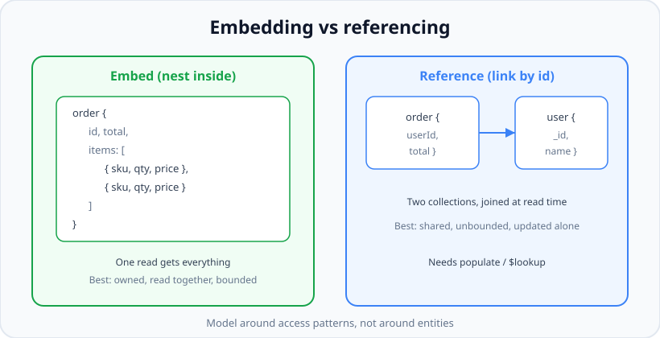
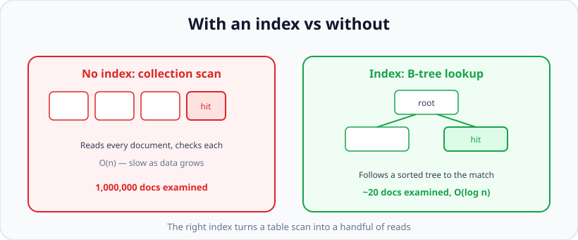

# Schema Design &amp; Data Modeling

*9 min read · Updated 24 Jul 2026 Topic 44 of 70 Bookmark Mark done Why it matters You can learn every query operator in an afternoon · Topic 44 of 70*

**Source:** [https://www.geekyfrontend.in/learn/nodejs-backend-kit/schema-design](https://www.geekyfrontend.in/learn/nodejs-backend-kit/schema-design)

---

## Why it matters

You can learn every query operator in an afternoon, but **data modeling** is the skill that decides whether your app is fast or falls over at scale. The shape of your documents determines how many round trips a page load costs, how big your working set is, whether writes contend, and whether a "simple" feature request later becomes a migration nightmare. In MongoDB there is a famous saying: *data that is accessed together should be stored together*. Getting that right is worth more than any index.

This is also where SQL habits actively hurt you. Relational modeling teaches you to normalise everything — split data into many tables and join. Document modeling often rewards the opposite: **embed** related data so one read returns a whole screen's worth. Knowing when to embed and when to reference, and being able to justify the tradeoff out loud, is a senior-level signal in interviews and the difference between a snappy API and a slow one in production.

## The concept, simply

You have exactly two tools for relating data in MongoDB: **embedding** (nest the related data inside the parent document) and **referencing** (store an `ObjectId` that points to a document in another collection, then fetch it separately). Everything in schema design is choosing between these two, per relationship, based on how the data is read and written.



Embed when data is owned, read together, and bounded; reference when it is shared, large, or updated on its own.

The rule of thumb: **embed for "contains" / one-to-few relationships that are read together** (an order and its line items, a blog post and its tags), and **reference for "relates to" / one-to-many or many-to-many relationships where the child is large, shared, or unbounded** (a user and their thousands of orders, products shared across many carts).

## How it works (deep)

Embedding is fast to read because a single document fetch (`findOne`) returns the parent and all its nested data in one round trip — no join, no second query. The cost is that the parent document grows, and MongoDB imposes a hard **16 MB limit per document**. If a nested array can grow without bound (comments on a viral post, events in an append-only log), embedding will eventually blow the limit and every update rewrites the whole large document. This is the classic *unbounded array* anti-pattern.

Referencing keeps documents small and lets children grow independently, but reading now costs a second lookup. You resolve references either with Mongoose's `populate()` (which issues extra queries under the hood) or the aggregation `$lookup` stage (a server-side join). Both add latency and load. The tradeoff is fundamentally: **embedding optimises reads at the cost of write amplification and size; referencing optimises writes and flexibility at the cost of read-time joins.**

**Indexes** are the other half of design. An index is a sorted B-tree of a field's values that lets MongoDB jump straight to matching documents instead of scanning the whole collection.



Without an index a query is O(n) — it examines every document; with the right index it is O(log n).

Every collection has a default unique index on `_id`. You add others for fields you filter or sort on. The critical concept for interviews is the **ESR rule** for compound indexes: order the fields *Equality, then Sort, then Range*. A compound index on `{ status: 1, createdAt: -1 }` serves a query that filters `status` by equality and sorts by `createdAt` without a separate in-memory sort. Indexes are not free: they consume RAM and disk, and they slow writes because every insert/update must also update every affected index. Over-indexing is as real a problem as under-indexing.

MongoDB modeling deliberately accepts controlled **denormalization** — storing the same value in two places (e.g. copying an author's display name onto each post) to avoid a join on read. The price is that when the source changes you must update the copies, so you only denormalize fields that rarely change and are read constantly.

## Code examples

Embedding — line items live inside the order because they are owned by it and always read with it:

javascript

```
const orderSchema = new mongoose.Schema({
  userId: { type: mongoose.Schema.Types.ObjectId, ref: 'User', index: true },
  total:  Number,
  status: { type: String, enum: ['pending', 'paid', 'shipped'], index: true },
  items: [{                       // embedded sub-documents
    sku:   String,
    name:  String,
    qty:   { type: Number, min: 1 },
    price: Number
  }],
  createdAt: { type: Date, default: Date.now }
});

// One read returns the order AND all its items:
const order = await Order.findById(id); // order.items is right there
```

Referencing — a user has many orders, an unbounded relationship, so we link by id and resolve on demand:

javascript

```
const userSchema = new mongoose.Schema({
  name:  String,
  email: { type: String, unique: true }
  // NOTE: we do NOT embed orders here - they are unbounded
});

// Resolve the reference with populate (extra query under the hood):
const enriched = await Order.findById(id)
  .populate('userId', 'name email') // fetch only these user fields
  .lean();

// Or a server-side join with aggregation:
const rows = await Order.aggregate([
  { $match: { status: 'paid' } },
  { $lookup: {
      from: 'users', localField: 'userId',
      foreignField: '_id', as: 'user'
  }},
  { $unwind: '$user' }
]);
```

Compound index following the ESR rule (Equality → Sort → Range):

javascript

```
// Query: find paid orders, newest first, above a price floor
// Order.find({ status: 'paid', total: { $gt: 50 } }).sort({ createdAt: -1 })
orderSchema.index({ status: 1, createdAt: -1, total: 1 });
//                  ^equality   ^sort          ^range

// Verify the index is actually used:
const plan = await Order.find({ status: 'paid' })
  .sort({ createdAt: -1 })
  .explain('executionStats');
// Look for stage IXSCAN (good) vs COLLSCAN (bad)
```

Controlled denormalization — copy a rarely-changing field to skip a join:

javascript

```
const postSchema = new mongoose.Schema({
  title: String,
  body:  String,
  author: {                    // denormalized snapshot
    _id:  mongoose.Schema.Types.ObjectId,
    name: String               // duplicated from the users collection
  }
});
// Feed page renders author name with zero joins.
// Trade-off: if a user renames, you must update their posts.
```

## Common mistakes & gotchas

- **Unbounded embedded arrays.** Embedding comments/events/logs that grow forever eventually hits the 16 MB document cap and makes every update rewrite a huge document. Reference or bucket instead.
- **Modeling like SQL.** Blindly normalising every entity into its own collection produces join-heavy read paths that a document store handles poorly. Model around access patterns, not entities.
- **Over-indexing.** Every index costs RAM and slows writes. Ten indexes on a write-heavy collection can cripple throughput. Index what you actually query.
- **Wrong compound-index order.** An index on `{ createdAt: -1, status: 1 }` will not efficiently serve an equality filter on `status`. Follow ESR: Equality, Sort, Range.
- **Forgetting the sort still uses memory.** If a query sorts on an unindexed field, MongoDB does an in-memory sort and aborts if it exceeds the sort memory limit. Index sort fields.
- **Denormalizing volatile data.** Copying a value that changes often means constant fan-out updates and drift. Only denormalize stable, read-hot fields.
- **N+1 with populate.** Populating inside a loop over many parents fires a query per parent. Batch with a single `$in` query or `$lookup`.

## Best practices

- Start from your **access patterns** ("what does the app read on this screen?") and design documents to answer them in as few reads as possible.
- Embed one-to-few, owned, read-together data; reference one-to-many, shared, or unbounded data.
- Apply the **ESR rule** to compound indexes and confirm with `explain('executionStats')` that you get an `IXSCAN`, not a `COLLSCAN`.
- Cap growth: if an embedded array could ever be large, switch to referencing or the *bucket pattern* (fixed-size chunks per document).
- Add a unique index for natural keys (email) and let it enforce integrity at the storage layer.
- Denormalize deliberately and document which field is the source of truth so updates stay consistent.
- Index foreign-key-style reference fields (`userId`) so joins and lookups are fast.

## ⭐ Interview lens

> **Q: Embedding vs referencing — how do you decide?**  
> Decide per relationship from read/write patterns. Embed when the child is owned by the parent, read together with it, and bounded in size (order + line items). Reference when the child is shared across parents, updated independently, or can grow without bound (user + their orders). The one-liner interviewers want: "data accessed together is stored together, unless it grows without bound."

> **Q: What is the document size limit and why does it matter for design?**  
> 16 MB per BSON document. It matters because it caps how much you can embed — an unbounded embedded array (comments, logs) will eventually exceed it, and long before that, every update rewrites the entire large document. This is why unbounded arrays are an anti-pattern and you reference or bucket instead.

> **Q: Explain the ESR rule for compound indexes.**  
> Order index fields as Equality, then Sort, then Range. Equality fields narrow the scan to a contiguous range, the sort field then returns results already ordered (no in-memory sort), and range fields come last. Getting the order wrong forces a collection scan or an expensive in-memory sort even though an index "exists".

> **Q: Is denormalization good or bad in MongoDB?**  
> It is a deliberate tool, not a sin. Document databases embrace controlled denormalization to make reads cheap — you duplicate stable, frequently-read fields to avoid joins. The cost is update fan-out and potential drift, so you only do it for values that rarely change. The mistake is denormalizing volatile data.

> **Q: What are the downsides of adding many indexes?**  
> Each index consumes RAM (ideally the working set fits in memory) and disk, and every write must update every affected index, so write throughput drops. Over-indexing a write-heavy collection is a real performance bug. Index for the queries you actually run and drop unused ones.

> **Q: How would you model a one-to-many like a user and their orders?**  
> Reference: store `userId` on each order rather than embedding orders in the user, because orders are unbounded and updated on their own. Index `userId` so "orders for this user" is fast, and resolve the user with a single batched lookup when you need it — not populate-in-a-loop.

## Cheat-card

- **Two tools:** embed (nest) vs reference (ObjectId + populate/$lookup).
- **Embed:** owned, read-together, bounded, one-to-few.
- **Reference:** shared, unbounded, updated-alone, one-to-many / many-to-many.
- **Hard limit:** 16 MB per document → never embed unbounded arrays.
- **Compound index order:** ESR — Equality, Sort, Range.
- **Verify:** `explain()` → want `IXSCAN`, not `COLLSCAN`.
- **Denormalize** stable, read-hot fields only; index reference keys.
- **Next:** 97 aggregation pipeline · 98 schema patterns · 99 indexes in depth · 100 sharding.
- **Prefix rule, measured:** `{ status: 1, createdAt: -1 }` serves "paid, newest 20" with 20 keys examined, but "newest 20 of any status" is still `SORT<-COLLSCAN` over 50,000 docs.

---

## Learn More

- [Data Modeling in MongoDB www.mongodb.com](https://www.mongodb.com/docs/manual/data-modeling/)
- [Data Model Design (Embedding vs Referencing) www.mongodb.com](https://www.mongodb.com/docs/manual/core/data-model-design/)
- [Mongoose Schemas Guide mongoosejs.com](https://mongoosejs.com/docs/guide.html)
- [MongoDB Data Modeling and Schema Fundamentals | From Relational to Document Model MongoDB](https://www.youtube.com/watch?v=hmGz79ae2AY)
- [A Complete Methodology of Data Modeling for MongoDB MongoDB](https://www.youtube.com/watch?v=DUCvYbcgGsQ)


---

## Additional topics

*Added 12 Oct 2026 · examples verified on Node v24.19.0 and the `mongodb` driver 7.7.0, MongoDB 8.2.6 run locally via mongodb-memory-server's downloaded mongod binary (no Docker)*

### Where to go next: lessons 97–100
This lesson stops at "embed or reference, then add an index". Four later lessons take each part further. Once a design is in place, three questions come up. How do I compute things across many documents without loading them into Node? Which shape fits data that is neither "owned and bounded" nor "shared and unbounded"? Is the index actually used, and what does it cost? A fourth comes later: what happens when one server is no longer enough? Each question has its own lesson:

- **[Lesson 97 — MongoDB Aggregation Pipeline](97-mongodb-aggregation-pipeline.md).** The pipeline of stages (`$match`, `$group`, `$lookup`, `$unwind`, `$project` and the rest) that computes on the server. The `$lookup` here is one stage of it.
- **[Lesson 98 — MongoDB Schema Patterns](98-mongodb-schema-patterns.md).** The named patterns between embedding and referencing: bucket, subset, computed, extended reference, outlier, polymorphic, and tree structures. Each one comes with a document shape, the query it makes cheap and the cost, measured. The bucket pattern mentioned in this lesson's best practices is worked through there, with real document counts and index sizes.
- **[Lesson 99 — MongoDB Indexes in Depth](99-mongodb-indexes-in-depth.md).** TTL, partial, sparse, unique-among-active, text, wildcard and hashed indexes. It also has the ESR rule measured with `explain('executionStats')` on 200,000 documents, and what index builds lock in MongoDB 8.x.
- **[Lesson 100 — MongoDB Sharding](100-mongodb-sharding.md).** Splitting one collection across several servers by a shard key. The shard key is the schema decision that is hardest to change later.

How the four connect to this lesson:

1. You choose a document shape here (embed or reference).
2. Reads that span many documents become pipelines (97).
3. Shapes that strain the two baselines become patterns (98).
4. Every hot query gets an index you have checked with `explain` (99).
5. When the data or write rate outgrows one replica set, the shard key (100) has to fit the same access patterns.

**Example — the questions those lessons answer, on this lesson's own `orders` shape.** The script uses 50,000 orders shaped like the embedding example above. It runs a server-side aggregation (the subject of lesson 97) and the "paid, newest first" query from the ESR example, before and after its index (the subject of lesson 99). The last line is the edge case below.

javascript

```
// motivate.mjs — lesson 44's orders, 50,000 of them: one aggregation and one explain
import { MongoClient } from 'mongodb';

const client = new MongoClient(process.env.MONGO_URL ?? 'mongodb://127.0.0.1:6301/');
const db = client.db('l44_motivate');
await db.dropDatabase();
const orders = db.collection('orders');
const STATUSES = ['pending', 'paid', 'shipped'];
await orders.insertMany(Array.from({ length: 50_000 }, (_, i) => ({
  userId: i % 1000, status: STATUSES[i % 3], total: (i * 37) % 500,
  items: [{ sku: `S${i % 50}`, qty: 1 + (i % 3), price: (i * 37) % 500 }],
  createdAt: new Date(Date.UTC(2026, 0, 1) + i * 60_000),
})));

// Lesson 97: an aggregation pipeline answers "revenue and order count per status" on the server
console.log(await orders.aggregate([
  { $group: { _id: '$status', orders: { $sum: 1 }, revenue: { $sum: '$total' } } },
  { $sort: { revenue: -1 } },
]).toArray());

// Lesson 99: the "paid, newest first" query from lesson 44, before and after its index
const plan = async (filter = { status: 'paid' }) => {
  const e = await orders.find(filter).sort({ createdAt: -1 }).limit(20).explain('executionStats');
  const stages = [...JSON.stringify(e.queryPlanner.winningPlan).matchAll(/"stage":"(\w+)"/g)].map(m => m[1]);
  return `${stages.join('<-')} keys=${e.executionStats.totalKeysExamined} docs=${e.executionStats.totalDocsExamined}`;
};
console.log('no index:          ', await plan());
await orders.createIndex({ status: 1, createdAt: -1 });
console.log('{status, createdAt}:', await plan());
// Edge case: the same index, but the query does not constrain status
console.log('any status, newest:', await plan({}));
await client.close();

// Real output (Node v24.19.0, mongodb 7.7.0, MongoDB 8.2.6):
//   [
//     { _id: 'pending', orders: 16667, revenue: 4161321 },
//     { _id: 'paid', orders: 16667, revenue: 4158500 },
//     { _id: 'shipped', orders: 16666, revenue: 4155179 }
//   ]
//   no index:           SORT<-COLLSCAN keys=0 docs=50000
//   {status, createdAt}: LIMIT<-FETCH<-IXSCAN keys=20 docs=20
//   any status, newest: SORT<-COLLSCAN keys=0 docs=50000
```

The aggregation returns three small summary documents instead of shipping 50,000 orders to Node. Without an index, the 20-row page reads all 50,000 documents and sorts them in memory (the `SORT` stage). With `{ status: 1, createdAt: -1 }` it examines 20 keys and 20 documents, and the `SORT` stage is gone. Lesson 99 shows the range field added to this index, and what goes wrong if it is put in the wrong position.

### Common mistakes & gotchas (additional topics)
- **Treating `IXSCAN` in `explain` as the finish line.** In the output above, the indexed plan is good because keys examined (20) equals documents returned (20) and there is no `SORT` stage. Lesson 99 has a case with an `IXSCAN` that still examines 36,000 keys for 20 results.
- **Aggregating in Node instead of on the server.** `find()` followed by a JavaScript `reduce` ships every document over the network. A `$group` ships only the result.
- **Choosing a shard key after the schema is fixed.** The shard key comes from the same access patterns as the schema, so decide both together (lesson 100).

### Edge case worked through: an index that exists but cannot help
The `orders` index `{ status: 1, createdAt: -1 }` from the example does nothing for a query on `createdAt` alone, such as "the 20 newest orders of any status". In that query `status` is not constrained, so the server cannot seek into the index. The keys are sorted by `createdAt` only *within* each status. The last line of the example's output shows the result: `SORT<-COLLSCAN` over all 50,000 documents, even though the index exists. Lesson 99 (Example 2, "prefix rule") shows the same thing for a range filter. The fix is either a separate `{ createdAt: -1 }` index or a query that also states the `status` values it wants.

### ⭐ Interview lens (additional topics)
> **Q: “You have an embedded-vs-referenced design. What do you check before you call it done?”**  
> A: Run each hot query with `explain('executionStats')` on realistic data volume. Keys and documents examined should be close to the number returned, with no in-memory `SORT` on paged queries. Check that reports run as aggregation pipelines on the server. Check the patterns for anything unbounded or join-heavy (bucket, subset, extended reference). And for a collection that will outgrow one server, check that the likely shard key matches the main query's equality field.
