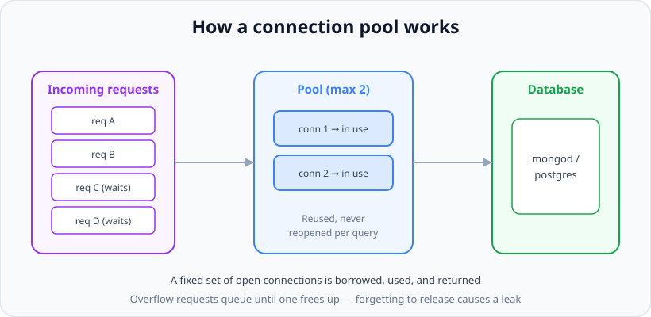

# Connection Pooling

*10 min read · Updated 24 Jul 2026 Topic 46 of 70 Bookmark Mark done Why it matters Opening a database connection is expensive · Topic 46 of 70*

**Source:** [https://www.geekyfrontend.in/learn/nodejs-backend-kit/connection-pooling](https://www.geekyfrontend.in/learn/nodejs-backend-kit/connection-pooling)

---

## Why it matters

Opening a database connection is expensive. It means a TCP handshake, often a TLS negotiation, and an authentication exchange — frequently 20–100 ms of round trips before you can run a single query. If your Node server opened a fresh connection for every incoming HTTP request, two disasters would follow: latency would balloon (every request pays the setup tax), and under load you would open thousands of connections and hit the database's hard connection limit, at which point new requests are refused and the whole system falls over. **Connection pooling** is the answer, and it is one of the highest-leverage performance topics in backend engineering.

It is also a favourite interview area because it reveals whether you understand what actually happens between your process and the database. "Why do you need a pool?", "what happens when the pool is exhausted?", and "how do connection leaks occur?" are questions that quickly separate people who have run production systems from those who have not. And leaks — borrowing a connection and never returning it — are among the most common real-world outages, so this knowledge is directly practical.

## The concept, simply

A **connection pool** is a fixed-size set of already-open, authenticated database connections that your app keeps alive and reuses. When a request needs to run a query, it *borrows* (acquires) a connection from the pool, uses it, and *returns* (releases) it — the connection stays open for the next borrower. Nobody pays the setup cost per query; they pay it once, at startup, for the whole pool.



A pool lends a fixed set of open connections; borrowers return them for reuse, and extra requests queue until one frees.

If every connection is currently in use, additional requests **queue** and wait until one is returned (or time out). This is the crucial behaviour: the pool intentionally caps concurrency at the database, protecting it from overload, and turning "too many requests" into "some requests wait a little" instead of "the database dies".

## How it works (deep)

A pool is configured with a maximum size (`max` in `pg`, `maxPoolSize` in the MongoDB driver / Mongoose). At startup or on first use, it opens connections up to that cap. Each connection has a **lifecycle**: created → idle (in the pool, ready) → acquired (borrowed by a request) → released back to idle → eventually closed if it sits idle past `idleTimeoutMillis` or errors out. Good pools also validate connections and transparently replace dead ones (e.g. after a database restart or network blip).

When a request calls `pool.query()`, the pool hands over an idle connection, or if none is free and the pool is below `max`, opens a new one, or if at `max`, puts the request in a **wait queue**. A `connectionTimeoutMillis` bounds how long a request waits before failing rather than hanging forever. This queue-with-timeout is what keeps a traffic spike from becoming an unbounded pile-up.

Sizing the pool is a real skill. Bigger is *not* better. Each connection consumes memory and a backend process/thread on the database server, and Postgres in particular handles a modest number of active connections best — a common guideline is a pool in the low tens per app instance, not hundreds. The total connections across all your app instances must stay under the database's `max_connections`. If you run 10 instances each with a pool of 20, that is 200 connections; the database must be sized for that. This multiplication is why people reach for external poolers like **PgBouncer** in front of Postgres.

The most dangerous failure mode is a **connection leak**. This happens when you manually check out a client (for a transaction, say) and forget to release it — typically because an error was thrown between `connect()` and `release()` and there was no `finally` block. That connection is now borrowed forever. Do it a few times and the pool is fully "in use" with nothing actually running; every new request queues and eventually times out. The symptom — the app hangs on all database calls while the database itself looks idle — is a classic production incident. The cure is always releasing in a `finally`, or using the auto-managed `pool.query()` which never leaks. Note that `pool.query()` acquires and releases for you; you only manage a client manually when you need several statements on the *same* connection, such as a transaction.

## Code examples

A properly configured Postgres pool, and the safe auto-managed query path:

javascript

```
const { Pool } = require('pg');

const pool = new Pool({
  max: 20,                       // cap connections per instance
  idleTimeoutMillis: 30000,      // close a connection idle 30s
  connectionTimeoutMillis: 5000  // fail a waiting request after 5s
});

// pool.query() acquires AND releases automatically - cannot leak.
async function getOrders(userId) {
  const { rows } = await pool.query(
    'SELECT * FROM orders WHERE user_id = $1', [userId]
  );
  return rows;
}
```

Manual checkout for a multi-statement transaction — the `finally` is non-negotiable:

javascript

```
async function transfer(fromId, toId, amount) {
  const client = await pool.connect();   // borrow ONE connection
  try {
    await client.query('BEGIN');
    await client.query('UPDATE accounts SET balance = balance - $1 WHERE id = $2', [amount, fromId]);
    await client.query('UPDATE accounts SET balance = balance + $1 WHERE id = $2', [amount, toId]);
    await client.query('COMMIT');
  } catch (err) {
    await client.query('ROLLBACK');
    throw err;
  } finally {
    client.release();   // ALWAYS return it - this prevents the leak
  }
}
```

The leak, shown explicitly so you recognise it in code review:

javascript

```
// BUG: if the query throws, release() never runs -> connection leaked
async function leaky(id) {
  const client = await pool.connect();
  const res = await client.query('SELECT * FROM users WHERE id = $1', [id]);
  client.release();   // unreachable when the query above throws!
  return res.rows[0];
}
// Fix: wrap in try/finally, or just use pool.query() which self-manages.
```

Mongoose/MongoDB pooling — the pool is built in; you tune its size:

javascript

```
await mongoose.connect(process.env.MONGO_URI, {
  maxPoolSize: 20,   // default is 100; size per instance deliberately
  minPoolSize: 2,    // keep a couple warm
  maxIdleTimeMS: 30000
});
// The driver manages borrow/return for every query internally -
// there is no manual release for ordinary queries, so no leak risk.
// Connect ONCE at startup and reuse this connection everywhere.
```

## Common mistakes & gotchas

- **Opening a connection per request.** Pays the handshake tax every time and exhausts the database's connection limit under load. Use a pool created once at startup.
- **Leaking manual clients.** Forgetting `client.release()` — especially when an error skips past it — permanently borrows a connection. Always release in a `finally`.
- **Oversizing the pool.** A pool of 500 does not make things faster; it overwhelms the database and can lower throughput. Size in the low tens per instance and multiply by instance count against `max_connections`.
- **Ignoring instance multiplication.** 10 app instances × a pool of 50 = 500 connections. Teams forget to account for horizontal scaling and blow past the DB limit.
- **Creating a new pool per request/module reload.** Especially in serverless, this spawns pools that never drain. Cache the pool/connection across invocations.
- **No acquire timeout.** Without `connectionTimeoutMillis`, a request waits forever on an exhausted pool, turning a leak into an indefinite hang instead of a clear error.
- **Holding a connection during slow non-DB work.** Borrowing a client, then doing a slow HTTP call before releasing, starves the pool. Do external work outside the checkout.

## Best practices

- Create **one** pool (or one Mongoose connection) at process startup and share it everywhere; never per request.
- Prefer the auto-managing call (`pool.query()`) and only check out a client manually for transactions — then release in `finally`.
- Set an explicit `max`/`maxPoolSize`, `idleTimeoutMillis`, and an acquire timeout so exhaustion fails fast instead of hanging.
- Size the pool from the database's limit and your instance count, not by guessing bigger; consider PgBouncer for Postgres at scale.
- In serverless, cache the connection/pool on global scope so warm invocations reuse it, and keep per-instance pools small.
- Monitor pool metrics (in-use vs idle, wait-queue length, acquire timeouts) — a climbing wait queue is the early warning of a leak or undersized pool.
- Do slow, non-database work outside the borrowed-connection window to maximise connection reuse.

## ⭐ Interview lens

> **Q: Why do we need connection pooling at all?**  
> Because opening a DB connection is expensive (TCP + TLS + auth, tens of ms) and the database caps how many connections it accepts. A pool opens a fixed set once and reuses them, so queries avoid per-request setup cost and total connections stay bounded. Without it you both add latency to every request and risk exhausting the database's connection limit under load.

> **Q: What happens when the pool is exhausted?**  
> New requests do not open unlimited connections — they queue and wait for one to be released. With an acquire timeout configured, a request that waits too long fails with a clear error instead of hanging forever. This is a feature: the pool caps concurrency at the database and converts overload into brief waits rather than a database crash.

> **Q: What is a connection leak and how does it happen?**  
> Borrowing a connection and never returning it. It typically happens when you manually check out a client for a transaction and an error is thrown before `release()`, with no `finally` block. Each leak permanently removes a connection from the pool; enough leaks and every query hangs while the database itself looks idle. The fix is releasing in `finally`, or using self-managing `pool.query()`.

> **Q: Is a bigger pool always better?**  
> No. Each connection costs memory and a backend process on the DB, and databases (Postgres especially) perform best with a moderate number of active connections. An oversized pool can reduce throughput and exhaust the server's `max_connections`, particularly once you multiply by many app instances. Size in the low tens per instance and use an external pooler like PgBouncer when you need many clients.

> **Q: Walk through a connection's lifecycle in the pool.**  
> Created (handshake + auth) → idle in the pool → acquired by a request → released back to idle after the query/transaction → closed if idle past the idle timeout or on error, then replaced. A healthy pool validates and transparently replaces dead connections after a DB restart or network blip.

> **Q: How should pooling change in a serverless environment?**  
> Each function instance is short-lived and there can be many concurrent instances, so a naive pool-per-invocation explodes connection count. Cache the connection/pool on global scope so warm invocations reuse it, keep per-instance pool size very small, and front the database with a pooler (PgBouncer, or a serverless driver) to multiplex many instances onto few real connections.

## Cheat-card

- **Why:** connections are expensive (TCP+TLS+auth) and capped → reuse them.
- **Borrow → use → release;** extra requests queue, then time out.
- **Config:** `max`/`maxPoolSize`, `idleTimeoutMillis`, acquire timeout.
- **Leak = forgot release;** always `client.release()` in `finally`.
- **pool.query()** self-manages (no leak); manual checkout only for transactions.
- **Size:** low tens per instance; watch instances × pool vs DB `max_connections`.
- **Serverless:** cache the pool globally, keep it tiny, consider PgBouncer.
- **`pool.on('error')`:** an idle client killed by the server (57P01) is emitted on the pool; with no listener the process crashes (exit 1). Log it; the pool has already removed the client.
- **Checked-out client errors** go to the client, not the pool: add `client.on('error')` when you hold one across other `await`s; `release(true)` destroys a broken client.
- **Counters:** `totalCount` (all clients), `idleCount` (connected, not checked out), `waitingCount` (queued at `max`); in use = total − idle.
- **`pool.end()`:** call once, after the HTTP server has closed; later queries reject, queued ones never settle, a second `end()` rejects.

---

## Learn More

- [Connection Pooling — node-postgres node-postgres.com](https://node-postgres.com/features/pooling)
- [Connection Pool — Sequelize sequelize.org](https://sequelize.org/docs/v6/other-topics/connection-pool/)
- [Connection pool (Wikipedia) en.wikipedia.org](https://en.wikipedia.org/wiki/Connection_pool)
- [Connection Pooling in PostgresSQL with NodeJS (Performance Numbers) Hussein Nasser](https://www.youtube.com/watch?v=GTeCtIoV2Tw)

---

## Additional topics

*Added 12 Oct 2026 · examples verified on Node v24.19.0, pg 8.23.1 (its pool is pg-pool 3.14.0) and PostgreSQL 18.4 run locally via the embedded-postgres npm package (no Docker)*

### `pool.on('error')`: errors from idle clients

An idle client in a `pg` pool still holds an open TCP connection to a live PostgreSQL backend process. That backend can end the connection at any moment: a DBA runs `pg_terminate_backend()`, the server restarts or fails over, an idle-session timeout fires, or a proxy drops the socket. When that happens, PostgreSQL sends a `FATAL` error message (SQLSTATE `57P01`, "terminating connection due to administrator command" for a terminated backend) and closes the socket. No query is running, so there is no promise to reject. `pg-pool` re-emits the error as an `'error'` event on the **pool**. A `Pool` is an `EventEmitter`, and an `'error'` event with no listener is thrown (see [EventEmitter](20-eventemitter.md)). So without `pool.on('error', …)`, one killed idle connection crashes the whole process, even though the application was doing nothing with it.

How it works:

1. While a client sits idle, the pool listens for `'error'` on it (pg-pool's internal `idleListener`).
2. When that client errors, the pool sets `err.client`, removes the client from the pool (so `totalCount` drops), and calls `pool.emit('error', err, client)`.
3. With a listener, your handler receives the error and the dead client. The node-postgres docs say the client "will be automatically terminated and removed from the pool, it is only passed to the error handler in case you want to inspect it". Log it; do not call `release()` on it.
4. Without a listener, `EventEmitter` throws the error from inside a socket callback. Nothing can catch it there, so it becomes an uncaught exception and the process exits with code 1.
5. The next `pool.query()` opens a fresh connection, so the pool recovers by itself once the process survives step 4.

**Example — kill an idle client's backend from a second connection.**

javascript

```
// idle-error.cjs: kill an idle pooled connection from outside and see what the pool does.
// Run: node idle-error.cjs          (no 'error' listener)
//      node idle-error.cjs --listen (with pool.on('error'))
const { Pool, Client } = require('pg');

const pool = new Pool({ connectionString: process.env.DATABASE_URL, max: 2 });

if (process.argv.includes('--listen')) {
  pool.on('error', (err, client) => {
    // The client is already removed from the pool; just log it. Do NOT release it.
    console.log('pool error (idle client):', err.code, err.message);
  });
}

async function main() {
  // pool.query() borrows a client, runs, and puts it back: it is now idle.
  const { rows } = await pool.query('SELECT pg_backend_pid() AS pid');
  const pid = rows[0].pid;
  console.log('idle client backend pid:', pid, '| total', pool.totalCount, 'idle', pool.idleCount);

  // A second, separate connection (an admin, a failover, a DBA) kills that backend.
  const admin = new Client({ connectionString: process.env.DATABASE_URL });
  await admin.connect();
  await admin.query('SELECT pg_terminate_backend($1)', [pid]);
  await admin.end();

  await new Promise((r) => setTimeout(r, 200));       // let the socket close arrive
  console.log('after kill: total', pool.totalCount, 'idle', pool.idleCount);
  const again = await pool.query('SELECT pg_backend_pid() AS pid');
  console.log('next query works on a new backend:', again.rows[0].pid !== pid);
  await pool.end();
}
main();

// Real output (Node v24.19.0, pg 8.23.1, PostgreSQL 18.4), `node idle-error.cjs`, then `echo $?` printed 1:
//   idle client backend pid: 3356675 | total 1 idle 1
//   node:events:487
//         throw er; // Unhandled 'error' event
//         ^
//
//   error: terminating connection due to administrator command
//       at parseErrorMessage (…/node_modules/pg-protocol/dist/parser.js:306:11)
//       …
//   Emitted 'error' event on BoundPool instance at:
//       at Client.idleListener (…/node_modules/pg-pool/index.js:62:10)
//       …
//     severity: 'FATAL',
//     code: '57P01',
//     …
//
// Real output, `node idle-error.cjs --listen` (exit code 0):
//   idle client backend pid: 3269971 | total 1 idle 1
//   pool error (idle client): 57P01 terminating connection due to administrator command
//   after kill: total 0 idle 0
//   next query works on a new backend: true
```

The crash happened on the line after `idle client backend pid`, so `after kill` was never printed. The backend PIDs differ between runs.

### Pool statistics: `totalCount`, `idleCount`, `waitingCount`

The pool exposes three read-only counters, documented in the [node-postgres Pool API](https://node-postgres.com/apis/pool). `totalCount` is the number of clients that exist (idle plus checked out). `idleCount` is the number of clients in the pool that are connected but not checked out. `waitingCount` is the number of requests queued for a client because all clients are checked out and the pool is at `max`. The number of clients checked out right now is `totalCount - idleCount`. Without these counters, an exhausted pool looks the same as a slow database: requests just take longer.

How it works:

1. A request first takes an idle client if there is one.
2. Otherwise, if `totalCount < max`, the pool opens a new client (it counts in `totalCount` while it is still connecting).
3. Otherwise the request joins the wait queue (`waitingCount` goes up). Each released client is handed straight to the oldest waiter.
4. A client becomes idle only when it is released and nobody is waiting. After `idleTimeoutMillis` (default 10000 ms) the pool closes an idle client and `totalCount` drops.

**Example — 8 concurrent queries against `max: 3`, sampled every 250 ms.**

javascript

```
// stats.cjs: 8 concurrent queries against a pool of max 3; sample the counters.
const { Pool } = require('pg');
const pool = new Pool({ connectionString: process.env.DATABASE_URL, max: 3 });
pool.on('error', (err) => console.error('idle client error:', err.message));

const t0 = Date.now();
const sample = (label) =>
  console.log(`${String(Date.now() - t0).padStart(4)} ms ${label.padEnd(13)}` +
    ` total=${pool.totalCount} idle=${pool.idleCount} waiting=${pool.waitingCount}`);

async function main() {
  sample('start');
  const jobs = Array.from({ length: 8 }, (_, i) =>
    pool.query('SELECT pg_sleep(0.3), $1::int AS n', [i]));
  sample('8 submitted');
  const timer = setInterval(() => sample('tick'), 250);
  await Promise.all(jobs);
  clearInterval(timer);
  sample('all done');
  await pool.end();
  sample('after end');
}
main();

// Real output (Node v24.19.0, pg 8.23.1, PostgreSQL 18.4); the ms values vary by a few ms between runs:
//      0 ms start         total=0 idle=0 waiting=0
//      7 ms 8 submitted   total=3 idle=0 waiting=5
//    258 ms tick          total=3 idle=0 waiting=5
//    508 ms tick          total=3 idle=0 waiting=2
//    759 ms tick          total=3 idle=1 waiting=0
//    925 ms all done      total=3 idle=3 waiting=0
//    926 ms after end     total=0 idle=0 waiting=0
```

The 8 queries ran in waves of 3, 3 and 2, so the batch took about three times one query (3 × 300 ms). `total` never went above `max`. A `waitingCount` that stays above zero under normal traffic means the pool is too small, a client is leaking, or queries are slow. Export the three numbers to your metrics system on a timer.

### Shutting down: `pool.end()`

`pool.end()` closes every client and stops the pool's timers, so the process can exit. A script that never calls it stays alive until the idle clients time out (10 seconds by default). A server that skips it on shutdown leaves the database to notice dropped connections on its own. `end()` changes the pool's state for good, and the queries around it behave differently depending on when they were submitted.

How it works (pg-pool 3.14.0):

1. `end()` sets `pool.ending = true` and returns a promise.
2. Idle clients are closed at once. Checked-out clients are closed when they are released, so queries already running finish normally.
3. The promise resolves when `totalCount` reaches 0.
4. A `pool.query()` or `pool.connect()` after `end()` rejects with `Cannot use a pool after calling end on the pool`.
5. A second `end()` rejects with `Called end on pool more than once`.
6. Requests that were **waiting in the queue** when `end()` was called are never served and never rejected. Their promises stay pending forever.

**Example — running, queued and late queries around `pool.end()`, and a double `end()`.**

javascript

```
// end.cjs: what pool.end() does to running, queued and later queries.
const { Pool } = require('pg');
const pool = new Pool({ connectionString: process.env.DATABASE_URL, max: 2 });
pool.on('error', (err) => console.error('idle client error:', err.message));

const state = {};
const run = (n) => {
  state[n] = 'pending';
  return pool.query('SELECT pg_sleep(0.2), $1::int AS n', [n])
    .then(() => { state[n] = 'ok'; }, (e) => { state[n] = 'rejected: ' + e.message; });
};

process.on('exit', (code) => console.log('process exit', code, state));

async function main() {
  [1, 2, 3, 4].forEach(run);                        // 2 running, 2 waiting in the queue
  await new Promise((r) => setTimeout(r, 20));
  console.log('before end: total', pool.totalCount, 'waiting', pool.waitingCount);
  pool.end().then(() => console.log('pool.end() resolved; total', pool.totalCount));
  await run(5);                                     // submitted after end()
  await pool.end().catch((e) => console.log('second end():', e.message));
}
main();

// Real output (Node v24.19.0, pg 8.23.1, PostgreSQL 18.4):
//   before end: total 2 waiting 2
//   second end(): Called end on pool more than once
//   pool.end() resolved; total 0
//   process exit 0 {
//     '1': 'ok',
//     '2': 'ok',
//     '3': 'pending',
//     '4': 'pending',
//     '5': 'rejected: Cannot use a pool after calling end on the pool'
//   }
```

Queries 3 and 4 were queued behind a full pool. They never ran and never failed: the process simply exited with them pending. So call `end()` only after the code that submits queries has stopped and finished. In a server, that means after the HTTP server has closed.

**Example — SIGTERM: close the HTTP server, then end the pool.**

On `SIGTERM` (what Kubernetes and `docker stop` send first), the handler stops accepting connections with `server.close()`. Its callback runs once in-flight requests have finished (since v19.0.0, `server.close()` also closes idle keep-alive connections). Only then does it call `pool.end()`. A flag stops a second signal from calling `end()` twice, and an unref'd timer forces an exit if something hangs. Lesson [66 — Graceful shutdown & monitoring](66-graceful-shutdown-monitoring.md) covers the rest of the shutdown sequence.

javascript

```
// shutdown.cjs: on SIGTERM, stop taking requests, let in-flight ones finish, then end the pool.
const http = require('node:http');
const { Pool } = require('pg');

const pool = new Pool({ connectionString: process.env.DATABASE_URL, max: 5 });
pool.on('error', (err) => console.error('idle client error:', err.message));

const server = http.createServer(async (req, res) => {
  try {
    const { rows } = await pool.query('SELECT pg_sleep(1), now() AS at');
    res.end(JSON.stringify({ at: rows[0].at }) + '\n');
  } catch (err) {
    res.statusCode = 503;
    res.end(err.message + '\n');
  }
});
server.listen(6810, () => console.log('listening on 6810'));

let shuttingDown = false;
process.on('SIGTERM', () => {
  if (shuttingDown) return;                 // a second signal must not call end() twice
  shuttingDown = true;
  console.log('SIGTERM: closing server; in-pool total', pool.totalCount, 'idle', pool.idleCount);
  server.close(async () => {                // runs once in-flight requests have finished
    console.log('server closed; ending pool');
    await pool.end();                       // closes every client; resolves when all are gone
    console.log('pool ended; exiting');
    process.exit(0);
  });
  setTimeout(() => { console.error('shutdown timed out'); process.exit(1); }, 10_000).unref();
});

```

bash

```
$ cat run-shutdown.sh
node shutdown.cjs & PID=$!
sleep 0.5
curl -s localhost:6810/ & CURL=$!
sleep 0.2
kill -TERM $PID
wait $CURL; wait $PID; echo "server exit code: $?"
$ bash run-shutdown.sh
listening on 6810
SIGTERM: closing server; in-pool total 1 idle 0
{"at":"2026-10-12T14:12:18.546Z"}
server closed; ending pool
pool ended; exiting
server exit code: 0
```

The request that was in flight when the signal arrived still got its response, and the process exited with code 0.

### Common mistakes & gotchas (additional topics)

- **No `pool.on('error')`.** One killed idle connection (a failover, a DBA, an idle timeout on a proxy) crashes the process with an unhandled `'error'` event. Add the listener next to `new Pool()`.
- **Releasing the client passed to the `'error'` handler.** It is already removed and terminated; the handler is for logging only.
- **Thinking the pool listener covers checked-out clients.** While you hold a client from `pool.connect()`, the pool's listener is detached from it. An error between your queries is emitted on the client itself (see the edge case below).
- **Calling `pool.end()` while requests are still queued.** Queued requests are neither served nor rejected. Stop the work first, then end the pool.
- **Ending the pool twice.** A second `end()` rejects with `Called end on pool more than once`; a repeated `SIGTERM`, or a `SIGINT` followed by a `SIGTERM`, can trigger it. Guard the handler with a flag.
- **Reading `waitingCount` once.** It is a snapshot. Sample it on a timer and alert on how long it stays above zero.

### Edge case worked through: a checked-out client dies between queries

During a transaction you hold a client from `pool.connect()` and may `await` something else between queries, such as an HTTP call. If the backend is killed at that moment, no query is running and the pool is not listening (pg-pool removes its idle listener when it hands the client out). The error is emitted on the **client**, and without a listener on it the process crashes, even with `pool.on('error')` in place. A query that is running when the backend dies is different: its promise rejects (case A below).

javascript

```
// checked-out.cjs: the backend dies while YOU hold the client (pool.on('error') is set).
const { Pool, Client } = require('pg');
const pool = new Pool({ connectionString: process.env.DATABASE_URL, max: 2 });
pool.on('error', (err) => console.log('pool error:', err.message));

async function kill(pid) {
  const admin = new Client({ connectionString: process.env.DATABASE_URL });
  await admin.connect();
  await admin.query('SELECT pg_terminate_backend($1)', [pid]);
  await admin.end();
}

async function main() {
  // Case A: killed in the middle of a query run through pool.query().
  const pidA = (await pool.query('SELECT pg_backend_pid() AS pid')).rows[0].pid;
  const slow = pool.query('SELECT pg_sleep(5)');
  setTimeout(() => kill(pidA), 100);
  await slow.catch((err) => console.log('A: pool.query rejected:', err.code, err.message));

  // Case B: killed while a checked-out client sits between queries.
  const client = await pool.connect();
  if (process.argv.includes('--client-listener')) {
    client.on('error', (err) => console.log('B: client error listener:', err.message));
  }
  const pidB = (await client.query('SELECT pg_backend_pid() AS pid')).rows[0].pid;
  await kill(pidB);                                // e.g. while you await an HTTP call
  await new Promise((r) => setTimeout(r, 200));
  await client.query('SELECT 1').catch((err) => console.log('B: next query:', err.message));
  client.release(true);                            // true = destroy, do not reuse
  console.log('B: survived, total', pool.totalCount);
  await pool.end();
}
main();

// Real output (Node v24.19.0, pg 8.23.1, PostgreSQL 18.4), `node checked-out.cjs` (exit code 1):
//   A: pool.query rejected: 57P01 terminating connection due to administrator command
//   node:events:487
//         throw er; // Unhandled 'error' event
//         ^
//
//   error: terminating connection due to administrator command
//       …
//   Emitted 'error' event on Client instance at:
//       at Client._handleErrorEvent (…/node_modules/pg/lib/client.js:422:10)
//       …
//
// Real output, `node checked-out.cjs --client-listener` (exit code 0):
//   A: pool.query rejected: 57P01 terminating connection due to administrator command
//   B: client error listener: terminating connection due to administrator command
//   B: client error listener: Connection terminated unexpectedly
//   B: next query: Client has encountered a connection error and is not queryable
//   B: survived, total 0
```

If you hold clients across `await`s, attach a `client.on('error', …)` handler right after `pool.connect()`. Remove it with `client.off()` before `release()`, or listeners pile up on a reused client. When the client has failed, release it with `release(true)` (or `release(err)`), which destroys it instead of returning a broken connection to the pool.

### ⭐ Interview lens (additional topics)

> **Q: “Our Node API crashed at 3 a.m. while traffic was near zero. The log shows `terminating connection due to administrator command` and `Unhandled 'error' event`. What happened?”**  
> A: The database (or a failover, or a DBA) terminated idle backends. Each idle `pg` client got a `FATAL 57P01` error with no query running, so pg-pool removed the client and emitted `'error'` on the pool. There was no `pool.on('error')` listener, so `EventEmitter` threw it as an uncaught exception and the process exited with code 1. Fix: add a pool `'error'` listener that logs. The pool replaces the client on the next query. Add `client.on('error')` too wherever a checked-out client is held across other `await`s. *Trap:* wrapping `pool.query()` in try/catch does not help, because no query was running.

> **Q: “How do you shut down a service that uses a pg pool?”**  
> A: On SIGTERM, set a flag so the handler runs once, then `server.close()` to stop accepting connections. In its callback, once in-flight requests are done, `await pool.end()`, which closes every client and resolves when `totalCount` is 0, then exit. Keep a forced-exit timer as a backstop. Do not call `end()` first: queries submitted after it reject with `Cannot use a pool after calling end on the pool`, requests already queued are never resolved, and a second `end()` rejects.
