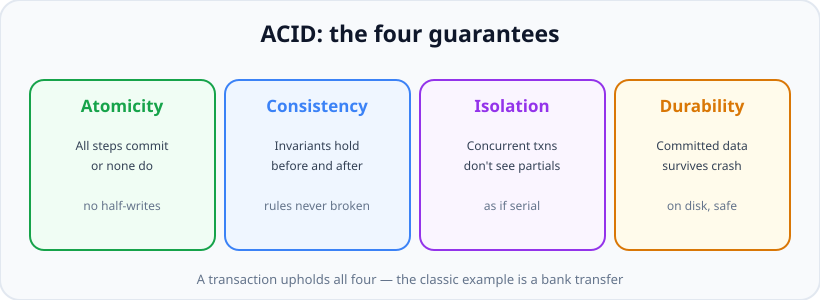
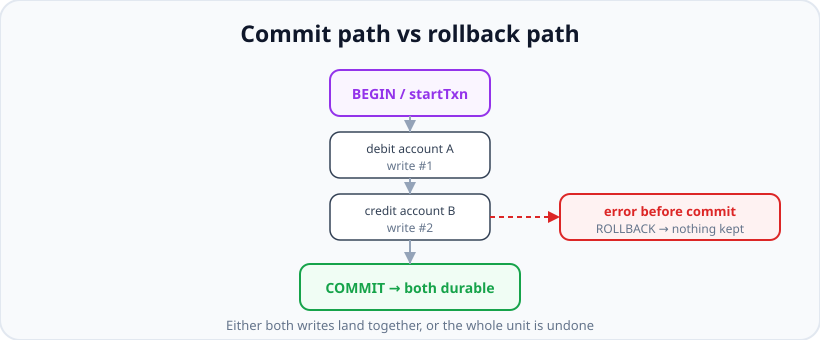

# Transactions &amp; ACID

*10 min read · Updated 24 Jul 2026 Topic 47 of 70 Bookmark Mark done Why it matters Some operations must happen all · Topic 47 of 70*

**Source:** [https://www.geekyfrontend.in/learn/nodejs-backend-kit/transactions](https://www.geekyfrontend.in/learn/nodejs-backend-kit/transactions)

---

## Why it matters

Some operations must happen all-or-nothing. Transfer money between two accounts: debit one, credit the other. If the process crashes after the debit but before the credit, money has vanished into thin air and your users (and regulators) will not forgive you. Place an order: decrement inventory, create the order, charge the card — if any step fails, none should stick. The mechanism that makes "all-or-nothing" real is a **transaction**, and the guarantees it provides are summarised by the acronym **ACID**. This is bedrock backend knowledge and one of the most reliably asked interview topics, because getting it wrong causes the most damaging class of bugs: silent data corruption.

What makes this topic sharp for interviews is the modern twist: transactions are not just a SQL thing anymore. MongoDB has supported **multi-document ACID transactions** since 4.0 (via sessions), so "does NoSQL have transactions?" is a live question with a nuanced answer. Knowing when you actually need a transaction — and, just as importantly, when a good document model means you do not — is what distinguishes solid engineers.

## The concept, simply

A **transaction** groups several database operations into a single unit that either *fully commits* or *fully rolls back*. You mark a beginning, do your writes, and then either `COMMIT` (make them all permanent together) or, if anything goes wrong, `ROLLBACK` (undo everything as if none of it happened). The database guarantees no in-between state is ever visible or persisted.



ACID is the four-part promise a transaction upholds: all-or-nothing, valid state, isolated from other transactions, and durable once committed.

**ACID** names the four guarantees. *Atomicity*: all steps or none. *Consistency*: the database moves from one valid state to another, never breaking its rules. *Isolation*: concurrent transactions do not see each other's half-finished work. *Durability*: once committed, the data survives a crash or power loss.

## How it works (deep)

Under the hood, a relational database implements atomicity and durability with a **write-ahead log (WAL)**: changes are recorded to a durable log before being applied, so on crash recovery the database can replay committed transactions and discard uncommitted ones. A `COMMIT` is not acknowledged until the log is safely on disk — that is durability. A `ROLLBACK` (or a crash) discards the pending changes — that is atomicity.



Either both writes commit together, or an error before commit triggers a rollback that undoes everything.

**Isolation** is the subtle one, because letting transactions run concurrently invites anomalies: a *dirty read* (seeing another transaction's uncommitted change), a *non-repeatable read* (a row changes value between two reads in the same transaction), and a *phantom read* (new rows appear matching your `WHERE` between reads). SQL defines **isolation levels** — Read Uncommitted, Read Committed, Repeatable Read, Serializable — that trade performance for stronger guarantees, each ruling out more anomalies. Most databases default to Read Committed (Postgres) or Repeatable Read (MySQL InnoDB); Serializable is the strictest, behaving as if transactions ran one at a time. Naming an anomaly and the level that prevents it is a strong interview answer.

In **MongoDB**, a single-document write is *already atomic* — an update to one document, including its nested arrays and sub-documents, either fully applies or not at all. This is a big deal: if you model well and keep data that changes together in one document, **you often do not need a multi-document transaction at all**. When you genuinely must update several documents atomically (money moving between two separate account documents), Mongo provides multi-document transactions through a **session**: you `startSession()`, `startTransaction()`, do your writes passing the session, then `commitTransaction()` or `abortTransaction()`. These require a replica set or sharded cluster (not a standalone `mongod`), and they carry more overhead than single-document writes, so you reach for them deliberately.

**When do you actually need a transaction?** When a single logical operation spans multiple rows/documents and a partial result would be invalid or unsafe: financial transfers, inventory-plus-order, anything with an invariant across records ("total debits equal total credits"). When it is a single-document or single-row change, the database already gives you atomicity for free. Over-using transactions adds locking and contention; under-using them corrupts data. Knowing the line is the skill.

## Code examples

A SQL transaction in node-postgres — the canonical money transfer:

javascript

```
async function transfer(fromId, toId, amount) {
  const client = await pool.connect();
  try {
    await client.query('BEGIN');

    const { rows } = await client.query(
      'SELECT balance FROM accounts WHERE id = $1 FOR UPDATE', [fromId]
    );                                   // FOR UPDATE locks the row
    if (rows[0].balance < amount) throw new Error('Insufficient funds');

    await client.query('UPDATE accounts SET balance = balance - $1 WHERE id = $2', [amount, fromId]);
    await client.query('UPDATE accounts SET balance = balance + $1 WHERE id = $2', [amount, toId]);

    await client.query('COMMIT');        // both updates land together
  } catch (err) {
    await client.query('ROLLBACK');      // any failure undoes everything
    throw err;
  } finally {
    client.release();
  }
}
```

The same all-or-nothing guarantee in MongoDB via a session:

javascript

```
async function transfer(fromId, toId, amount) {
  const session = await mongoose.startSession();
  try {
    session.startTransaction();

    const from = await Account.findById(fromId).session(session);
    if (from.balance < amount) throw new Error('Insufficient funds');

    await Account.updateOne({ _id: fromId }, { $inc: { balance: -amount } }, { session });
    await Account.updateOne({ _id: toId },   { $inc: { balance:  amount } }, { session });

    await session.commitTransaction();   // atomic across both documents
  } catch (err) {
    await session.abortTransaction();    // rollback
    throw err;
  } finally {
    session.endSession();                // always end the session
  }
}
// Requires a replica set / cluster - transactions do not work on standalone mongod.
```

Often you do *not* need a transaction — single-document atomicity is enough:

javascript

```
// Atomic decrement guarded by a condition, in ONE document operation.
// No transaction needed: the whole update applies or it does not.
const res = await Inventory.updateOne(
  { _id: productId, stock: { $gte: qty } }, // only if enough stock
  { $inc: { stock: -qty } }
);
if (res.modifiedCount === 0) throw new Error('Out of stock');
// This also avoids a race: the condition and the decrement are one atomic step.
```

Postgres offers the same conditional-atomic trick without an explicit transaction for a single statement:

sql

```
-- Single-statement atomicity: the WHERE guard and the update are one unit.
UPDATE inventory
SET stock = stock - 3
WHERE id = 42 AND stock >= 3;
-- rowCount = 0 means the guard failed (not enough stock); no partial write possible.
```

## Common mistakes & gotchas

- **Assuming multiple separate writes are atomic.** Two back-to-back `updateOne`/`UPDATE` calls without a transaction can partially fail, leaving inconsistent data. Wrap them or model them into one document/row.
- **Forgetting to pass the session/transaction handle.** In Mongo, a write without `{ session }` runs *outside* the transaction and is not rolled back. In pg, running on `pool` instead of the checked-out `client` escapes the BEGIN.
- **Running Mongo transactions on a standalone server.** Multi-document transactions require a replica set or sharded cluster; on a standalone `mongod` they error.
- **Check-then-act race conditions.** Reading a balance, then updating in a separate step, lets two concurrent requests both pass the check. Use a single conditional update or lock the row with `SELECT ... FOR UPDATE`.
- **Long-running transactions.** Holding a transaction open across slow work (HTTP calls, user think-time) holds locks and starves the database. Keep transactions short.
- **Not handling transient/write-conflict errors.** Under Serializable/high contention, transactions can be aborted by the database and must be *retried*. Not retrying surfaces spurious failures.
- **Using a transaction when one document/row would do.** Adds locking and overhead for no benefit; single-document/row writes are already atomic.

## Best practices

- Reach for a transaction only when a single logical operation spans multiple rows/documents with an invariant between them; otherwise rely on built-in single-record atomicity.
- Keep transactions **short** — acquire, write, commit — and never do slow external I/O while one is open.
- Always pass the session/client to every operation inside the transaction, and clean up in `finally` (`release()` / `endSession()`).
- Prefer a single conditional atomic update (`$inc` with a guard, `UPDATE ... WHERE`) over read-then-write to avoid races cheaply.
- For genuine contention, lock explicitly (`SELECT ... FOR UPDATE`) or pick the right isolation level, and implement **retry** on transient conflicts.
- Choose the isolation level consciously: stronger levels prevent more anomalies at the cost of throughput.
- In MongoDB, model so that data changing together lives together — the best transaction is the one you did not need.

## ⭐ Interview lens

> **Q: What does ACID stand for, concretely?**  
> Atomicity (all operations commit or none do), Consistency (the DB moves between valid states honouring its constraints), Isolation (concurrent transactions do not see each other's uncommitted work), Durability (once committed, data survives crashes). The bank-transfer example ties them together: the debit and credit are atomic, the "sum stays constant" invariant is consistency, other transactions do not see a half-done transfer (isolation), and once committed it is on disk forever (durability).

> **Q: Does MongoDB support transactions?**  
> Yes — single-document writes have always been atomic, and since 4.0 MongoDB supports multi-document ACID transactions via sessions (4.2 extended them to sharded clusters). The nuanced point: they require a replica set/cluster and carry overhead, and good document modeling often removes the need for them because related data lives in one atomically-updated document.

> **Q: What are isolation levels and what anomalies do they prevent?**  
> They control how much concurrent transactions are shielded from each other. Read Uncommitted allows dirty reads; Read Committed prevents dirty reads; Repeatable Read also prevents non-repeatable reads; Serializable prevents phantom reads too and behaves as if transactions ran sequentially. Higher levels cost throughput. Naming an anomaly (dirty/non-repeatable/phantom read) and the level that stops it is the strong answer.

> **Q: When do you actually need a transaction?**  
> When one logical operation spans multiple rows/documents and a partial result would be invalid — money transfers, order-plus-inventory, any cross-record invariant. When the change touches a single row/document, the database already guarantees atomicity, so a transaction is unnecessary overhead. The skill is recognising which case you are in.

> **Q: How do you avoid a race condition like overselling inventory?**  
> Do not read-then-write in two steps — that lets two requests both pass the check. Use a single atomic conditional update: in Mongo `updateOne({ _id, stock: { $gte: qty } }, { $inc: { stock: -qty } })`, in SQL `UPDATE ... SET stock = stock - $1 WHERE id = $2 AND stock >= $1`, or lock the row with `SELECT ... FOR UPDATE` inside a transaction. The guard and the mutation must be one atomic operation.

> **Q: Why keep transactions short, and what is a write conflict?**  
> An open transaction holds locks (or an MVCC snapshot) and blocks other work, so long transactions cause contention, lock waits, and blocked connections. Under high contention or Serializable isolation, the database may abort a transaction with a write-conflict/serialization error rather than allow an inconsistency — the correct response is to catch it and retry the whole transaction, which is why transaction code is often wrapped in a bounded retry loop.

## Cheat-card

- **Transaction:** group of writes that all commit or all rollback.
- **ACID:** Atomicity, Consistency, Isolation, Durability.
- **SQL:** `BEGIN` → writes on the checked-out client → `COMMIT`/`ROLLBACK`.
- **Mongo:** `startSession` → `startTransaction` → pass `{ session }` → commit/abort; needs a replica set.
- **Single doc/row writes are already atomic** — often no transaction needed.
- **Avoid races** with one conditional atomic update or `SELECT ... FOR UPDATE`.
- **Isolation levels** trade throughput for fewer anomalies; retry on write conflicts; keep transactions short.
- **`withTransaction()`:** commits, aborts on throw, reruns the callback on `TransientTransactionError` (e.g. `WriteConflict`, code 112); keep side effects out and always rethrow.
- **Mongoose `__v`:** by default guards only positional array edits; `optimisticConcurrency: true` makes a stale `save()` throw `VersionError`; query updates must add `$inc: { __v: 1 }`.
- **Deadlock:** rows locked in opposite order → cycle → after `deadlock_timeout` (1s) one transaction gets 40P01; fix with one lock order plus a bounded retry on 40P01/40001.
- **Savepoints:** after an error the transaction is aborted (25P02) and `COMMIT` answers `ROLLBACK`; `SAVEPOINT` / `ROLLBACK TO SAVEPOINT` / `RELEASE` keeps the earlier work.
- **DB work queue:** claim with `FOR UPDATE SKIP LOCKED` plus a lease and commit, work outside the transaction, mark done only as the claim's owner (lesson 70's pattern).

---

## Learn More

- [Transactions (PostgreSQL Tutorial, Section 3.4) www.postgresql.org](https://www.postgresql.org/docs/current/tutorial-transactions.html)
- [START TRANSACTION, COMMIT, and ROLLBACK Statements (MySQL 8.0) dev.mysql.com](https://dev.mysql.com/doc/refman/8.0/en/commit.html)
- [ACID (Wikipedia) en.wikipedia.org](https://en.wikipedia.org/wiki/ACID)
- [Transactions — MongoDB Manual www.mongodb.com](https://www.mongodb.com/docs/manual/core/transactions/)
- [Relational Database ACID Transactions (Explained by Example) Hussein Nasser](https://www.youtube.com/watch?v=pomxJOFVcQs)

---

## Additional topics

*Added 12 Oct 2026 · examples verified on Node v24.19.0, mongodb 7.7.0, Mongoose 9.11.1 (bundles mongodb 7.7.0), pg 8.23.1, MongoDB 8.2.6 run locally via mongodb-memory-server's downloaded mongod binary (no Docker, 1-node replica set) and PostgreSQL 18.4 run locally via the embedded-postgres npm package (no Docker)*

### MongoDB `withTransaction()`: commit, abort and automatic retry

The Mongo example above uses the driver's *core* API: you call `startTransaction()`, `commitTransaction()` and `abortTransaction()` yourself, and nothing retries. `session.withTransaction(fn)` is the *callback* API. It starts the transaction, runs your async callback, commits if the callback resolves, aborts if it throws, and **runs the whole callback again** when an error carries the `TransientTransactionError` label. That label means "this attempt failed, but the same transaction may succeed if you start it over". The most common cause is a write conflict. MongoDB transactions read from a snapshot, and writing a document that another transaction changed and committed after that snapshot is refused with `WriteConflict` (code 112). The MongoDB manual describes the callback API in [Handle Transactions in Applications](https://www.mongodb.com/docs/manual/core/transactions-in-applications/), and Mongoose's [transactions guide](https://mongoosejs.com/docs/transactions.html) recommends `session.withTransaction()` or Mongoose's `Connection#transaction()` over manual calls.

How it works (as implemented in mongodb 7.7.0, `lib/sessions.js`):

1. Start the transaction and call `fn(session)`. Every operation inside must be passed `{ session }` and awaited one after another; the driver docs call `Promise.all` inside a transaction undefined behaviour.
2. If `fn` throws a `MongoError` labelled `TransientTransactionError`, abort and go back to step 1. Before each new attempt the driver sleeps a random backoff of up to 5 ms × 1.5^attempt, capped at 500 ms.
3. If `fn` throws anything else (your own `Error`, a validation error), abort and rethrow it to the caller.
4. If `fn` resolves, commit. A commit error labelled `UnknownTransactionCommitResult` retries the commit only. A commit error labelled `TransientTransactionError` restarts from step 1.
5. Stop retrying after 120 seconds in total (or `timeoutMS`, if set) and throw the last error.
6. On success, return whatever `fn` returned.

**Example — a real write conflict between two sessions, then a non-transient abort.**

javascript

```
// mongo-retry.mjs: provoke a real write conflict and watch withTransaction() retry.
import { MongoClient } from 'mongodb';

const client = new MongoClient(process.env.MONGO_URL);
const other = new MongoClient(process.env.MONGO_URL);       // a second app instance
await Promise.all([client.connect(), other.connect()]);
const accounts = client.db('bank').collection('accounts');
await accounts.deleteMany({});
await accounts.insertMany([{ _id: 'alice', balance: 100 }, { _id: 'bob', balance: 0 }]);

let attempt = 0;
const session = client.startSession();
try {
  const result = await session.withTransaction(async (s) => {
    attempt += 1;
    // The first read pins this transaction's snapshot.
    const alice = await accounts.findOne({ _id: 'alice' }, { session: s });
    console.log(`attempt ${attempt}: read alice.balance = ${alice.balance}`);

    if (attempt === 1) {
      // Session B (another app instance) changes alice in its own transaction
      // AFTER our snapshot was taken, and commits.
      const sessionB = other.startSession();
      await sessionB.withTransaction((sb) => other.db('bank').collection('accounts')
        .updateOne({ _id: 'alice' }, { $inc: { balance: -30 } }, { session: sb }));
      await sessionB.endSession();
      console.log('attempt 1: session B committed alice -30');
    }
    try {
      await accounts.updateOne({ _id: 'alice' }, { $inc: { balance: -50 } }, { session: s });
      await accounts.updateOne({ _id: 'bob' }, { $inc: { balance: 50 } }, { session: s });
    } catch (err) {
      console.log(`attempt ${attempt}: ${err.codeName} (code ${err.code}) labels=${JSON.stringify(err.errorLabels)}`);
      throw err;                      // rethrow so withTransaction can see the label and retry
    }
    return 'transferred 50';
  });
  console.log('withTransaction returned:', result, 'after', attempt, 'attempts');
} finally {
  await session.endSession();
}
console.log(await accounts.find().sort({ _id: 1 }).toArray());

// A non-transient error: the callback throws, withTransaction aborts and rethrows.
const s2 = client.startSession();
try {
  await s2.withTransaction(async (s) => {
    await accounts.updateOne({ _id: 'alice' }, { $inc: { balance: -1000 } }, { session: s });
    const a = await accounts.findOne({ _id: 'alice' }, { session: s });
    if (a.balance < 0) throw new Error(`insufficient funds (would be ${a.balance})`);
  });
} catch (err) {
  console.log('withTransaction threw:', err.message);
} finally {
  await s2.endSession();
}
console.log('after abort:', await accounts.findOne({ _id: 'alice' }));
await Promise.all([client.close(), other.close()]);

// Real output (Node v24.19.0, mongodb 7.7.0, MongoDB 8.2.6 1-node replica set):
//   attempt 1: read alice.balance = 100
//   attempt 1: session B committed alice -30
//   attempt 1: WriteConflict (code 112) labels=["TransientTransactionError"]
//   attempt 2: read alice.balance = 70
//   withTransaction returned: transferred 50 after 2 attempts
//   [ { _id: 'alice', balance: 20 }, { _id: 'bob', balance: 50 } ]
//   withTransaction threw: insufficient funds (would be -980)
//   after abort: { _id: 'alice', balance: 20 }
```

Attempt 2 re-read the balance (70, not 100), so the retry worked on current data. The final state includes both B's −30 and the transfer. The second transaction's `$inc` of −1000 was rolled back when the callback threw. Because the callback can run more than once, keep side effects such as emails, HTTP calls or counters outside it.

### Optimistic locking in Mongoose: `__v` and `optimisticConcurrency`

Optimistic locking detects lost updates without holding locks. Each document carries a version number. A save says "update this document only if its version is still the one I loaded", and if zero documents match, the save fails instead of overwriting someone else's change. Mongoose adds a version key (`versionKey`, default `__v`) to every schema, but [its guide](https://mongoosejs.com/docs/guide.html#versionKey) warns that the default "is not a full optimistic concurrency solution" because it "only operates on arrays". The schema option [`optimisticConcurrency: true`](https://mongoosejs.com/docs/guide.html#optimisticConcurrency) (added in Mongoose 5.10.0) makes every `save()` check and increment the version.

How it works (Mongoose 9.11.1; the `sent:` lines below log the `updateOne` that each `save()` sends):

1. `findById()` loads the document with its `__v`.
2. **Default:** a `save()` that changes only scalar fields sends `updateOne({ _id }, { $set })` with no version filter and does not touch `__v`, so the last writer wins silently. A `save()` that reorders an array (`pull`, `splice` and similar) increments `__v`. A `save()` that edits an array element by position adds `__v: <loaded version>` to the filter, so it fails if the array was reordered in the meantime.
3. **`optimisticConcurrency: true`:** every `save()` filters on `{ _id, __v: <loaded> }` and increments `__v`.
4. When the filter matches nothing, `save()` rejects with a `VersionError` naming the id, the stale version and the modified paths. The usual recovery is to reload the document, re-apply the change and save again, or to return HTTP 409 to the client.
5. Only `save()` takes part. `updateOne()`, `findOneAndUpdate()` and other query-level updates neither check nor bump `__v` unless you add `$inc: { __v: 1 }` yourself (cases 4 and 5 below).

**Example — five lost-update races: A writes first, then B saves a stale copy.**

javascript

```
// occ.mjs: what __v protects by default, and what optimisticConcurrency: true adds.
import mongoose from 'mongoose';

await mongoose.connect(process.env.MONGO_URL, { dbName: 'occ' });
// Print the filter and update of every updateOne() that save() (or our code) sends.
mongoose.set('debug', (coll, method, filter, update) => {
  if (method === 'updateOne') console.log('    sent:', JSON.stringify(filter), JSON.stringify(update));
});
const fields = { title: String, tags: [String] };
const Plain = mongoose.model('Plain', new mongoose.Schema(fields));
const Strict = mongoose.model('Strict', new mongoose.Schema(fields, { optimisticConcurrency: true }));
const _id = new mongoose.Types.ObjectId('000000000000000000000001');

// Two requests load the same document; A writes first, then B saves its stale copy.
async function race(Model, label, writeA, editB) {
  await Model.deleteMany({});
  await Model.create({ _id, title: 'v0', tags: ['a', 'b', 'c'] });
  const a = await Model.findById(_id);
  const b = await Model.findById(_id);
  await writeA(a);
  editB(b);
  try { await b.save(); console.log(`${label}: stale save succeeded`); }
  catch (err) { console.log(`${label}: ${err.name}: ${err.message}`); }
  const doc = await Model.findById(_id).lean();
  console.log(`  stored: title=${doc.title} tags=${JSON.stringify(doc.tags)} __v=${doc.__v}`);
}

await race(Plain, '1 default, scalar field',
  (a) => { a.title = 'from A'; return a.save(); }, (b) => { b.title = 'from B'; });
await race(Plain, '2 default, array edit by position',
  (a) => { a.tags.pull('a'); return a.save(); }, (b) => { b.tags.set(1, 'B!'); });
await race(Strict, '3 optimisticConcurrency, scalar field',
  (a) => { a.title = 'from A'; return a.save(); }, (b) => { b.title = 'from B'; });
await race(Strict, '4 optimisticConcurrency, A uses updateOne',
  () => Strict.updateOne({ _id }, { $set: { title: 'from A' } }), (b) => { b.title = 'from B'; });
await race(Strict, '5 same, updateOne also bumps __v',
  () => Strict.updateOne({ _id }, { $set: { title: 'from A' }, $inc: { __v: 1 } }), (b) => { b.title = 'from B'; });
await mongoose.disconnect();

// Real output (Node v24.19.0, Mongoose 9.11.1, MongoDB 8.2.6 1-node replica set):
//       sent: {"_id":"000000000000000000000001"} {"$set":{"title":"from A"}}
//       sent: {"_id":"000000000000000000000001"} {"$set":{"title":"from B"}}
//   1 default, scalar field: stale save succeeded
//     stored: title=from B tags=["a","b","c"] __v=0
//       sent: {"_id":"000000000000000000000001"} {"$pullAll":{"tags":["a"]},"$inc":{"__v":1}}
//       sent: {"_id":"000000000000000000000001","__v":0} {"$set":{"tags.1":"B!"}}
//   2 default, array edit by position: VersionError: No matching document found for id "000000000000000000000001" version 0 modifiedPaths "tags, tags.1"
//     stored: title=v0 tags=["b","c"] __v=1
//       sent: {"_id":"000000000000000000000001","__v":0} {"$set":{"title":"from A"},"$inc":{"__v":1}}
//       sent: {"_id":"000000000000000000000001","__v":0} {"$set":{"title":"from B"},"$inc":{"__v":1}}
//   3 optimisticConcurrency, scalar field: VersionError: No matching document found for id "000000000000000000000001" version 0 modifiedPaths "title"
//     stored: title=from A tags=["a","b","c"] __v=1
//       sent: {"_id":"000000000000000000000001"} {"$set":{"title":"from A"}}
//       sent: {"_id":"000000000000000000000001","__v":0} {"$set":{"title":"from B"},"$inc":{"__v":1}}
//   4 optimisticConcurrency, A uses updateOne: stale save succeeded
//     stored: title=from B tags=["a","b","c"] __v=1
//       sent: {"_id":"000000000000000000000001"} {"$inc":{"__v":1},"$set":{"title":"from A"}}
//       sent: {"_id":"000000000000000000000001","__v":0} {"$set":{"title":"from B"},"$inc":{"__v":1}}
//   5 same, updateOne also bumps __v: VersionError: No matching document found for id "000000000000000000000001" version 0 modifiedPaths "title"
//     stored: title=from A tags=["a","b","c"] __v=1
```

Case 1 is the lost update that the default versioning does not catch: A's title is gone and `__v` never moved. In case 4, A's `updateOne()` left `__v` at 0, so B's stale `save()` matched and overwrote it (B's save then bumped `__v` to 1). If one code path uses `optimisticConcurrency`, every other writer to that collection must also bump `__v`.

### Deadlocks in PostgreSQL: cause, detection, lock ordering and retry

A deadlock is a cycle of waits: transaction A holds a lock that B needs, while B holds a lock that A needs, so neither can ever continue. In application code it usually comes from two transactions updating the same rows **in opposite order**, as in a transfer 1 → 2 running at the same moment as a transfer 2 → 1. An `UPDATE` takes a row lock that lasts until `COMMIT` or `ROLLBACK`. PostgreSQL does not prevent deadlocks. It [detects them](https://www.postgresql.org/docs/current/explicit-locking.html#LOCKING-DEADLOCKS) and aborts one of the transactions with SQLSTATE `40P01` (`deadlock_detected`), and "exactly which transaction will be aborted is difficult to predict and should not be relied upon".

How it works:

1. A transaction that has to wait for a lock first just sleeps.
2. After waiting [`deadlock_timeout`](https://www.postgresql.org/docs/current/runtime-config-locks.html) (default `1s`), that backend runs the deadlock check, which looks for a cycle in the wait graph. The check is relatively expensive, which is why it is not run on every wait.
3. If it finds a cycle, it cancels one transaction with `ERROR: deadlock detected`. The DETAIL lists each process, the lock it waits for and the process that blocks it. The full queries go to the server log, as the HINT says.
4. The cancelled transaction is now aborted: its client must `ROLLBACK`. The other transaction gets its lock and continues. So a deadlock always costs at least `deadlock_timeout` of waiting.
5. **Fix 1, prevention:** make every transaction take its locks in one global order, for example `SELECT … WHERE id = ANY($1) ORDER BY id FOR UPDATE` before changing anything. Two transfers then queue on the lower id instead of forming a cycle.
6. **Fix 2, recovery:** retry the whole transaction on `40P01`, and on `40001` (`serialization_failure`, raised under Repeatable Read and Serializable). The PostgreSQL docs on [serialization failure handling](https://www.postgresql.org/docs/current/mvcc-serialization-failure-handling.html) say applications using those levels must be prepared to retry, and that "it may also be advisable to retry deadlock failures". Bound the number of attempts and add a backoff.

Text diagram of the run below (a proposed SVG is listed in the report):

text

```
time     tx-A: transfer 1 -> 2                tx-B: transfer 2 -> 1
   3 ms  UPDATE id = 1   lock row 1           UPDATE id = 2   lock row 2
 104 ms  UPDATE id = 2   WAIT (B has row 2)   UPDATE id = 1   WAIT (A has row 1)
                         A waits for B  <---------------->  B waits for A   = cycle
1104 ms  one waiter's deadlock_timeout (1s) expires; it runs the check, finds the cycle,
         and its own transaction is cancelled: ERROR 40P01 deadlock detected
1106 ms  the other transaction gets the lock and COMMITs; the cancelled one must ROLLBACK
```

**Example — provoke a real deadlock and print the server's error.**

javascript

```
// deadlock.cjs: two transactions lock the same two rows in opposite order.
const { Client } = require('pg');
const url = process.env.DATABASE_URL;
const sleep = (ms) => new Promise((r) => setTimeout(r, ms));

async function main() {
  const setup = new Client({ connectionString: url });
  await setup.connect();
  await setup.query(`DROP TABLE IF EXISTS accounts;
    CREATE TABLE accounts (id int PRIMARY KEY, balance int NOT NULL);
    INSERT INTO accounts VALUES (1, 100), (2, 100);`);
  console.log('deadlock_timeout =', (await setup.query('SHOW deadlock_timeout')).rows[0].deadlock_timeout);

  const a = new Client({ connectionString: url, application_name: 'tx-A' });
  const b = new Client({ connectionString: url, application_name: 'tx-B' });
  await Promise.all([a.connect(), b.connect()]);
  const t0 = Date.now();
  const log = (msg) => console.log(`${String(Date.now() - t0).padStart(5)} ms ${msg}`);

  // A: transfer 1 -> 2 (locks row 1, then row 2)
  const txA = (async () => {
    await a.query('BEGIN');
    await a.query('UPDATE accounts SET balance = balance - 10 WHERE id = 1'); log('A locked row 1');
    await sleep(100);
    log('A wants row 2');
    await a.query('UPDATE accounts SET balance = balance + 10 WHERE id = 2'); log('A locked row 2');
    await a.query('COMMIT'); log('A committed');
  })();
  // B: transfer 2 -> 1 (locks row 2, then row 1): the opposite order
  const txB = (async () => {
    await b.query('BEGIN');
    await b.query('UPDATE accounts SET balance = balance - 10 WHERE id = 2'); log('B locked row 2');
    await sleep(100);
    log('B wants row 1');
    await b.query('UPDATE accounts SET balance = balance + 10 WHERE id = 1'); log('B locked row 1');
    await b.query('COMMIT'); log('B committed');
  })();

  const results = await Promise.allSettled([txA, txB]);
  for (const [name, r, c] of [['A', results[0], a], ['B', results[1], b]]) {
    if (r.status === 'rejected') {
      const e = r.reason;
      log(`${name} failed: ERROR: ${e.message}`);
      console.log(`  SQLSTATE: ${e.code}\n  DETAIL: ${e.detail.replace(/\n/g, '\n          ')}\n  HINT: ${e.hint}\n  CONTEXT: ${e.where}`);
      await c.query('ROLLBACK');
    }
  }
  console.log((await setup.query('SELECT * FROM accounts ORDER BY id')).rows);
  await Promise.all([a.end(), b.end(), setup.end()]);
}
main();

// Real output (Node v24.19.0, pg 8.23.1, PostgreSQL 18.4); in this run A was cancelled, in others B was:
//   deadlock_timeout = 1s
//       3 ms A locked row 1
//       3 ms B locked row 2
//     104 ms A wants row 2
//     104 ms B wants row 1
//    1106 ms B locked row 1
//    1109 ms B committed
//    1109 ms A failed: ERROR: deadlock detected
//     SQLSTATE: 40P01
//     DETAIL: Process 3380331 waits for ShareLock on transaction 5008; blocked by process 3380332.
//             Process 3380332 waits for ShareLock on transaction 5007; blocked by process 3380331.
//     HINT: See server log for query details.
//     CONTEXT: while updating tuple (0,2) in relation "accounts"
//   [ { id: 1, balance: 110 }, { id: 2, balance: 90 } ]
```

`ShareLock on transaction N` is how a row lock wait looks: a backend that wants a locked row waits for the transaction holding it to end. Only B's transfer of 10 stuck (row 1 went 100 → 110). A's work was rolled back, and without a retry it is simply lost.

**Example — the same race with a bounded retry, then with lock ordering.**

javascript

```
// tx-retry.cjs: lock ordering prevents the deadlock; a bounded retry handles what is left.
const { Pool } = require('pg');
const pool = new Pool({ connectionString: process.env.DATABASE_URL, max: 4 });
pool.on('error', (err) => console.error('idle client error:', err.message));
const sleep = (ms) => new Promise((r) => setTimeout(r, ms));
const RETRYABLE = new Set(['40P01', '40001']);   // deadlock_detected, serialization_failure

async function withTransaction(fn, { attempts = 3, label = 'tx' } = {}) {
  for (let attempt = 1; ; attempt++) {
    const client = await pool.connect();
    try {
      await client.query('BEGIN');
      const result = await fn(client);
      await client.query('COMMIT');
      return result;
    } catch (err) {
      await client.query('ROLLBACK').catch(() => {});
      if (!RETRYABLE.has(err.code) || attempt === attempts) throw err;
      const backoff = 20 * 2 ** (attempt - 1) + Math.floor(Math.random() * 20);
      console.log(`  ${label}: attempt ${attempt} failed with ${err.code}; retrying in ${backoff} ms`);
      await sleep(backoff);
    } finally {
      client.release();
    }
  }
}

// Unsafe: locks rows in the order the caller passes them.
async function transferUnordered(c, from, to, amount) {
  await c.query('UPDATE accounts SET balance = balance - $1 WHERE id = $2', [amount, from]);
  await sleep(100);                              // widen the window so the race is certain
  await c.query('UPDATE accounts SET balance = balance + $1 WHERE id = $2', [amount, to]);
}

// Safe: lock both rows in one global order (ascending id) before changing either.
async function transferOrdered(c, from, to, amount) {
  await c.query('SELECT id FROM accounts WHERE id = ANY($1) ORDER BY id FOR UPDATE', [[from, to]]);
  await sleep(100);
  await c.query('UPDATE accounts SET balance = balance - $1 WHERE id = $2', [amount, from]);
  await c.query('UPDATE accounts SET balance = balance + $1 WHERE id = $2', [amount, to]);
}

async function scenario(name, transfer) {
  await pool.query(`DROP TABLE IF EXISTS accounts;
    CREATE TABLE accounts (id int PRIMARY KEY, balance int NOT NULL);
    INSERT INTO accounts VALUES (1, 100), (2, 100);`);
  console.log(name);
  const t0 = Date.now();
  const results = await Promise.allSettled([
    withTransaction((c) => transfer(c, 1, 2, 10), { label: 'A 1->2' }),
    withTransaction((c) => transfer(c, 2, 1, 30), { label: 'B 2->1' }),
  ]);
  console.log('  results:', results.map((r) => r.status === 'fulfilled' ? 'committed' : r.reason.code).join(', '),
    `in ${Date.now() - t0} ms`);
  console.log('  balances:', (await pool.query('SELECT id, balance FROM accounts ORDER BY id')).rows);
}

async function main() {
  await scenario('opposite order + retry:', transferUnordered);
  await scenario('lock ordering:', transferOrdered);
  await pool.end();
}
main();

// Real output (Node v24.19.0, pg 8.23.1, PostgreSQL 18.4); the backoff has random jitter,
// and which transfer is cancelled varies between runs:
//   opposite order + retry:
//     A 1->2: attempt 1 failed with 40P01; retrying in 34 ms
//     results: committed, committed in 1249 ms
//     balances: [ { id: 1, balance: 120 }, { id: 2, balance: 80 } ]
//   lock ordering:
//     results: committed, committed in 211 ms
//     balances: [ { id: 1, balance: 120 }, { id: 2, balance: 80 } ]
```

Both versions end with the correct balances (1: 100 − 10 + 30 = 120). The retry version paid the 1 s `deadlock_timeout` plus a rerun. With lock ordering, B simply waited for A's lock on row 1, so the pair took about two 100 ms transactions back to back (wall time of one run of the script on this machine). Use both: ordering to avoid deadlocks, the retry for the ones you did not foresee and for `40001`.

### Savepoints: recovering from an error inside a transaction

In PostgreSQL, any error inside a transaction block puts the whole transaction into the *aborted* state. Every later statement fails with SQLSTATE `25P02`, "current transaction is aborted, commands ignored until end of transaction block", and a `COMMIT` is answered with `ROLLBACK`, so the work done before the error is lost as well. A [`SAVEPOINT`](https://www.postgresql.org/docs/current/sql-savepoint.html) marks a point inside the transaction. `ROLLBACK TO SAVEPOINT name` undoes only what happened after that mark and clears the aborted state. `RELEASE SAVEPOINT name` drops the mark and keeps its changes. Use savepoints when one step may fail and the transaction should carry on, such as importing rows and skipping the bad ones, or "insert, and on unique violation do something else".

How it works:

1. `BEGIN`, then do some work (insert Lin).
2. `SAVEPOINT import_row` before the risky statement.
3. The risky statement fails (unique violation, `23505`). The transaction is now aborted.
4. `ROLLBACK TO SAVEPOINT import_row` undoes the failed part and returns the transaction to normal. Lin's insert is still pending.
5. Continue, `RELEASE` the savepoint, and `COMMIT`: everything except the failed statement is saved.

**Example — the same failing insert, without and with a savepoint.**

javascript

```
// savepoint.cjs: one failed statement poisons a transaction, unless a savepoint isolates it.
const { Client } = require('pg');

async function main() {
  const c = new Client({ connectionString: process.env.DATABASE_URL });
  await c.connect();
  const run = async (sql, params = []) => {
    const shown = params.length ? `${sql.split(' (')[0]} ${params[0]}` : sql;
    try {
      const r = await c.query(sql, params);
      console.log(`  ok    ${shown.padEnd(35)} -> ${r.command}`);
    } catch (e) {
      console.log(`  ERROR ${shown.padEnd(35)} -> ${e.code} ${e.message}`);
    }
  };
  const insert = (email, name) =>
    run('INSERT INTO users (email, name) VALUES ($1, $2)', [email, name]);
  const reset = () => c.query(`DROP TABLE IF EXISTS users;
    CREATE TABLE users (id serial PRIMARY KEY, email text UNIQUE NOT NULL, name text NOT NULL);
    INSERT INTO users (email, name) VALUES ('ada@example.com', 'Ada');`);
  const emails = async () => (await c.query('SELECT email FROM users ORDER BY id')).rows.map((r) => r.email);

  console.log('without a savepoint:');
  await reset();
  await run('BEGIN');
  await insert('lin@example.com', 'Lin');
  await insert('ada@example.com', 'Ada again');     // unique violation
  await insert('grace@example.com', 'Grace');       // refused: the transaction is aborted
  await run('COMMIT');                              // the server answers ROLLBACK: Lin is lost too
  console.log('  rows:', await emails());

  console.log('with a savepoint:');
  await reset();
  await run('BEGIN');
  await insert('lin@example.com', 'Lin');
  await run('SAVEPOINT import_row');
  await insert('ada@example.com', 'Ada again');     // fails...
  await run('ROLLBACK TO SAVEPOINT import_row');    // ...undo only what came after the savepoint
  await insert('grace@example.com', 'Grace');
  await run('RELEASE SAVEPOINT import_row');        // drop the savepoint; its changes stay
  await run('COMMIT');
  console.log('  rows:', await emails());
  await c.end();
}
main();

// Real output (Node v24.19.0, pg 8.23.1, PostgreSQL 18.4):
//   without a savepoint:
//     ok    BEGIN                               -> BEGIN
//     ok    INSERT INTO users lin@example.com   -> INSERT
//     ERROR INSERT INTO users ada@example.com   -> 23505 duplicate key value violates unique constraint "users_email_key"
//     ERROR INSERT INTO users grace@example.com -> 25P02 current transaction is aborted, commands ignored until end of transaction block
//     ok    COMMIT                              -> ROLLBACK
//     rows: [ 'ada@example.com' ]
//   with a savepoint:
//     ok    BEGIN                               -> BEGIN
//     ok    INSERT INTO users lin@example.com   -> INSERT
//     ok    SAVEPOINT import_row                -> SAVEPOINT
//     ERROR INSERT INTO users ada@example.com   -> 23505 duplicate key value violates unique constraint "users_email_key"
//     ok    ROLLBACK TO SAVEPOINT import_row    -> ROLLBACK
//     ok    INSERT INTO users grace@example.com -> INSERT
//     ok    RELEASE SAVEPOINT import_row        -> RELEASE
//     ok    COMMIT                              -> COMMIT
//     rows: [ 'ada@example.com', 'lin@example.com', 'grace@example.com' ]
```

Note that `COMMIT` on an aborted transaction does **not** raise an error in node-postgres. The promise resolves and `result.command` is `'ROLLBACK'`. Code that only checks "did COMMIT throw?" will report success for a transaction that saved nothing. Each savepoint costs some work on the server, so set one around the step that may fail rather than before every statement.

### `SELECT … FOR UPDATE SKIP LOCKED` as a work-queue primitive

A table can serve as a job queue when several workers each need to take a *different* job. A plain `SELECT … FOR UPDATE LIMIT 1` makes every worker try to lock the same first row, so they wait for each other. [`SKIP LOCKED`](https://www.postgresql.org/docs/current/sql-select.html#SQL-FOR-UPDATE-SHARE) (added in PostgreSQL 9.5) tells the lock step to skip rows another transaction has locked and take the next one. The docs note that this "provides an inconsistent view of the data, so this is not suitable for general purpose work, but can be used to avoid lock contention with multiple consumers accessing a queue-like table".

Use it the same way as the idempotent consumer in [lesson 70 — Message queues & async jobs](70-message-queues-async-jobs.md): **claim → work → done, with a lease**. The claim is one short statement that marks the row `processing`, records which attempt owns it (`claimed_by`) and when (`claimed_at`), and commits at once. The work runs outside any transaction, so no row lock or connection is held while it runs. Only the owner of the claim may mark the job `done`. A row left in `processing` by a crashed worker becomes claimable again once its lease has expired.

How it works:

1. Each worker runs the claim `UPDATE jobs SET status = 'processing', … WHERE id = (SELECT id … WHERE status = 'queued' OR <lease expired> ORDER BY id FOR UPDATE SKIP LOCKED LIMIT 1) RETURNING …`.
2. If two workers run it at the same instant, the second finds the first one's row locked, skips it and locks the next row. No one waits, and no row is returned twice.
3. When the claim commits, the row is `processing`, so the `WHERE` no longer matches it for later claims (until its lease expires).
4. The worker does the job, then runs `UPDATE … SET status = 'done' WHERE id = $1 AND claimed_by = $2 AND status = 'processing'`. If a slow worker's lease expired and someone else took over, this matches nothing and the slow worker knows it lost the job.
5. An empty claim result means nothing is claimable right now. A real worker sleeps or waits for `LISTEN/NOTIFY` and tries again; the demo just stops.

Text diagram (a proposed SVG is listed in the report):

text

```
jobs   1 queued   2 queued   3 queued   4 processing(crashed, 6 min ago)   … 8 processing(live, 10 s ago)

w1  claim: lock 1 ─────────────── commit → 1 processing(w1) → work → done
w2  claim: 1 locked → SKIP → lock 2 ── commit → 2 processing(w2) → work → done
w3  claim: 1, 2 locked → SKIP → lock 3 ─ commit → 3 processing(w3) → work → done
w1  next claim: 1-3 no longer match → 4 matches (lease expired) → attempt 2
…   8 is never claimed: its lease is still valid
```

**Example — 3 concurrent workers, 8 jobs, one abandoned claim and one live claim.**

javascript

```
// skip-locked.cjs: 3 workers share one jobs table: claim -> work -> done, with a lease.
const { randomUUID } = require('node:crypto');
const { Pool } = require('pg');
const pool = new Pool({ connectionString: process.env.DATABASE_URL, max: 5 });
pool.on('error', (err) => console.error('idle client error:', err.message));
const sleep = (ms) => new Promise((r) => setTimeout(r, ms));
const LEASE = '5 minutes';   // longer than any job may take; older 'processing' rows count as abandoned

// 1. Claim: one short statement. SKIP LOCKED makes a claimer pass over a row that
//    another claimer has locked at this instant instead of waiting for it.
const CLAIM = `
  UPDATE jobs SET status = 'processing', claimed_by = $1, claimed_at = now(), attempts = attempts + 1
  WHERE id = (
    SELECT id FROM jobs
    WHERE status = 'queued'
       OR (status = 'processing' AND claimed_at < now() - $2::interval)
    ORDER BY id
    FOR UPDATE SKIP LOCKED
    LIMIT 1)
  RETURNING id, payload, attempts`;

async function worker(name, log, claimed) {
  for (;;) {
    const claimId = `${name}:${randomUUID()}`;          // which attempt owns the claim
    const { rows } = await pool.query(CLAIM, [claimId, LEASE]);
    if (rows.length === 0) return;                    // nothing claimable right now
    const job = rows[0];
    claimed.push(job.id);
    log.push(`${name} claimed job ${job.id} (${job.payload}, attempt ${job.attempts})`);
    await sleep(30);                                  // 2. Work, outside any transaction.
    // 3. Done: only the attempt that owns the claim may mark it.
    const done = await pool.query(
      `UPDATE jobs SET status = 'done' WHERE id = $1 AND claimed_by = $2 AND status = 'processing'`,
      [job.id, claimId]);
    if (done.rowCount === 0) log.push(`${name} lost job ${job.id} to another worker`);
  }
}

async function main() {
  await pool.query(`DROP TABLE IF EXISTS jobs;
    CREATE TABLE jobs (
      id         int PRIMARY KEY,
      payload    text NOT NULL,
      status     text NOT NULL DEFAULT 'queued' CHECK (status IN ('queued', 'processing', 'done')),
      claimed_by text,
      claimed_at timestamptz,
      attempts   int NOT NULL DEFAULT 0);
    INSERT INTO jobs (id, payload) SELECT g, 'email #' || g FROM generate_series(1, 8) g;
    -- job 4: claimed 6 minutes ago by a worker that crashed (lease expired)
    UPDATE jobs SET status = 'processing', claimed_by = 'crashed:1', claimed_at = now() - interval '6 minutes',
                    attempts = 1 WHERE id = 4;
    -- job 8: claimed 10 seconds ago by a live worker elsewhere (lease still valid)
    UPDATE jobs SET status = 'processing', claimed_by = 'w-other:1', claimed_at = now() - interval '10 seconds',
                    attempts = 1 WHERE id = 8;`);
  const log = [], claimed = [];
  await Promise.all(['w1', 'w2', 'w3'].map((w) => worker(w, log, claimed)));
  for (const line of log) console.log(line);
  console.log('claims:', claimed.length, '| distinct jobs:', new Set(claimed).size);
  const { rows } = await pool.query(`SELECT id, status, split_part(claimed_by, ':', 1) AS worker, attempts
                                     FROM jobs ORDER BY id`);
  console.table(rows);
  await pool.end();
}
main();

// Real output (Node v24.19.0, pg 8.23.1, PostgreSQL 18.4); which worker gets which job varies between runs:
//   w1 claimed job 1 (email #1, attempt 1)
//   w2 claimed job 2 (email #2, attempt 1)
//   w3 claimed job 3 (email #3, attempt 1)
//   w1 claimed job 4 (email #4, attempt 2)
//   w2 claimed job 5 (email #5, attempt 1)
//   w3 claimed job 6 (email #6, attempt 1)
//   w1 claimed job 7 (email #7, attempt 1)
//   claims: 7 | distinct jobs: 7
//   ┌─────────┬────┬──────────────┬───────────┬──────────┐
//   │ (index) │ id │ status       │ worker    │ attempts │
//   ├─────────┼────┼──────────────┼───────────┼──────────┤
//   │ 0       │ 1  │ 'done'       │ 'w1'      │ 1        │
//   │ 1       │ 2  │ 'done'       │ 'w2'      │ 1        │
//   │ 2       │ 3  │ 'done'       │ 'w3'      │ 1        │
//   │ 3       │ 4  │ 'done'       │ 'w1'      │ 2        │
//   │ 4       │ 5  │ 'done'       │ 'w2'      │ 1        │
//   │ 5       │ 6  │ 'done'       │ 'w3'      │ 1        │
//   │ 6       │ 7  │ 'done'       │ 'w1'      │ 1        │
//   │ 7       │ 8  │ 'processing' │ 'w-other' │ 1        │
//   └─────────┴────┴──────────────┴───────────┴──────────┘
```

Every claimable job was claimed exactly once (7 claims, 7 distinct ids). Job 4 was taken over from the crashed worker as attempt 2, and job 8 was left alone because its lease was still valid. As a stress check, the same script run separately with 2000 jobs, 5 workers and no sleep gave `claims: 1999 | distinct jobs: 1999`. Like lesson 70, this is at-least-once: a worker that dies after the work but before `done` will have its job run again after the lease, so the work itself must be idempotent.

### Common mistakes & gotchas (additional topics)

- **Side effects inside a `withTransaction()` callback.** The callback reruns on every transient error (attempt 2 above), so an email sent inside it can go out twice. Do side effects after the transaction commits, or through an outbox.
- **Catching an error inside the callback and not rethrowing it.** The driver then cannot tell whether the transaction was aborted. Its own docs warn that it may then retry indefinitely. Catch only to log, then rethrow.
- **Trusting `__v` by default.** Mongoose's default versioning only guards positional array edits; scalar fields are last-writer-wins (case 1). Turn on `optimisticConcurrency` for documents that are edited concurrently.
- **Mixing `save()` with `updateOne()` under `optimisticConcurrency`.** Query updates do not bump `__v`, so a stale `save()` still wins (case 4). Add `$inc: { __v: 1 }` to those updates.
- **Retrying a deadlock with the same connection still in the aborted transaction.** `ROLLBACK` first, then restart the *whole* transaction from `BEGIN`; re-running only the failed statement fails with `25P02`.
- **Unbounded retries.** A retry loop without a limit and a backoff turns a persistent conflict into a hot loop. Cap the attempts (3–5) and rethrow the last error.
- **Treating `COMMIT` without an error as success.** After an error, `COMMIT` resolves with `command === 'ROLLBACK'`. Track errors in the transaction or check the command tag.
- **Holding the row lock for the whole job in a queue.** Locking with `FOR UPDATE` inside a long transaction while the job runs ties up one connection per running job and, without `SKIP LOCKED`, serializes the workers (edge case below). Claim and commit first, then work.
- **Using `SKIP LOCKED` for ordinary reads.** It returns an inconsistent view on purpose; use it only to hand out queue items.

### Edge case worked through: a queue that holds the lock while working, with and without `SKIP LOCKED`

A common first version of a database queue keeps the transaction open for the whole job: `BEGIN`, `SELECT … FOR UPDATE LIMIT 1`, do the work, mark it done, `COMMIT`. It looks like it should run three jobs in parallel with three workers. Without `SKIP LOCKED` it does not, because all three workers pick the same first row and two of them wait on its lock. In PostgreSQL's default Read Committed level, a waiter re-checks the row once the lock is released. The row is now `done`, so the waiter moves on to the next row instead of returning it. Nothing is processed twice, but the jobs run one at a time.

javascript

```
// hold-lock.cjs: workers that keep the row lock for the whole job (BEGIN ... COMMIT).
const { Pool } = require('pg');
const pool = new Pool({ connectionString: process.env.DATABASE_URL, max: 5 });
pool.on('error', (err) => console.error('idle client error:', err.message));
const sleep = (ms) => new Promise((r) => setTimeout(r, ms));

async function worker(name, lockClause, log) {
  const c = await pool.connect();
  try {
    for (;;) {
      await c.query('BEGIN');
      const { rows } = await c.query(
        `SELECT id FROM jobs WHERE status = 'queued' ORDER BY id LIMIT 1 ${lockClause}`);
      if (rows.length === 0) { await c.query('COMMIT'); log.push(`${name}: empty result, stops`); return; }
      log.push(`${name}: job ${rows[0].id}`);
      await sleep(30);                                        // the work, lock held
      await c.query(`UPDATE jobs SET status = 'done' WHERE id = $1`, [rows[0].id]);
      await c.query('COMMIT');
    }
  } finally { c.release(); }
}

async function run(lockClause) {
  await pool.query(`DROP TABLE IF EXISTS jobs;
    CREATE TABLE jobs (id int PRIMARY KEY, status text NOT NULL DEFAULT 'queued');
    INSERT INTO jobs (id) SELECT generate_series(1, 6);`);
  const log = [];
  const t0 = Date.now();
  await Promise.all(['w1', 'w2', 'w3'].map((w) => worker(w, lockClause, log)));
  const left = (await pool.query(`SELECT count(*)::int AS n FROM jobs WHERE status = 'queued'`)).rows[0].n;
  console.log(`${lockClause}: ${Date.now() - t0} ms, still queued: ${left}`);
  for (const line of log) console.log('  ' + line);
}

async function main() {
  await run('FOR UPDATE SKIP LOCKED');
  await run('FOR UPDATE');
  await pool.end();
}
main();

// Real output (Node v24.19.0, pg 8.23.1, PostgreSQL 18.4); the ms values and worker order vary between runs:
//   FOR UPDATE SKIP LOCKED: 84 ms, still queued: 0
//     w1: job 1
//     w2: job 2
//     w3: job 3
//     w1: job 4
//     w2: job 5
//     w3: job 6
//     w1: empty result, stops
//     w2: empty result, stops
//     w3: empty result, stops
//   FOR UPDATE: 195 ms, still queued: 0
//     w1: job 1
//     w2: job 2
//     w3: job 3
//     w2: job 4
//     w1: job 5
//     w2: job 6
//     w2: empty result, stops
//     w3: empty result, stops
//     w1: empty result, stops
```

Six 30 ms jobs took 84 ms with `SKIP LOCKED` (two rounds of three jobs, plus overhead) and 195 ms without it (one job at a time). These are wall times of single runs of the script on this machine; two runs gave the same pattern (82/198 ms and 83/210 ms in earlier runs). The output also hides a second problem: with the lock held during the work, each running job keeps one pooled connection checked out. That is why the main example claims and commits first and works afterwards.

### ⭐ Interview lens (additional topics)

> **Q: “Two transfers between the same pair of accounts run at the same moment and one fails with `deadlock detected`. Why, and what do you change?”**  
> A: Each transaction updated its *from* row first, so A locked row 1 and B locked row 2. Then each waited for the other's row, which is a cycle. After `deadlock_timeout` (1 s by default), PostgreSQL's deadlock check cancelled one of them with SQLSTATE 40P01; which one is not predictable. Fix the cause by locking rows in one global order (`SELECT … WHERE id = ANY($1) ORDER BY id FOR UPDATE` first), so the second transfer just waits. Also wrap transactions in a bounded retry on 40P01 and 40001 that rolls back and reruns the whole transaction. *Trap:* raising `deadlock_timeout` does not prevent deadlocks; it only delays detecting them.

> **Q: “How would you build a job queue on PostgreSQL so that several workers never process the same job?”**  
> A: Claim with one short statement: `UPDATE jobs SET status = 'processing', claimed_by = $token, claimed_at = now() WHERE id = (SELECT id FROM jobs WHERE status = 'queued' OR (status = 'processing' AND claimed_at < now() - lease) ORDER BY id FOR UPDATE SKIP LOCKED LIMIT 1) RETURNING *`. `SKIP LOCKED` lets concurrent claimers take different rows without waiting. Do the work outside any transaction, then mark it done with `WHERE id = $1 AND claimed_by = $token`. The lease lets another worker take over from a crashed one, which makes delivery at-least-once, so the job must be idempotent. *Trap:* holding a `FOR UPDATE` transaction open during the work ties up a connection per job and, without `SKIP LOCKED`, serializes the workers.
