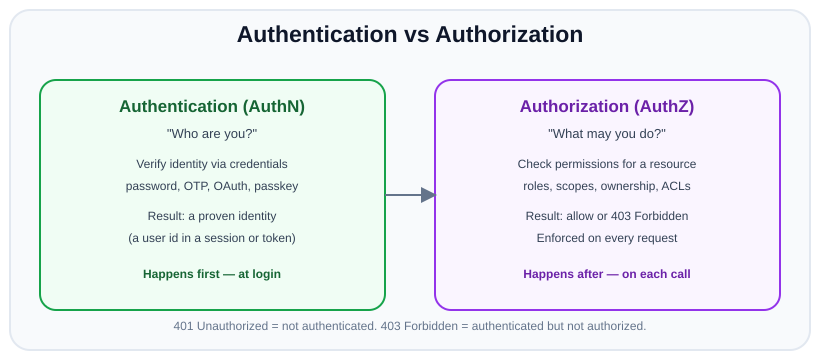
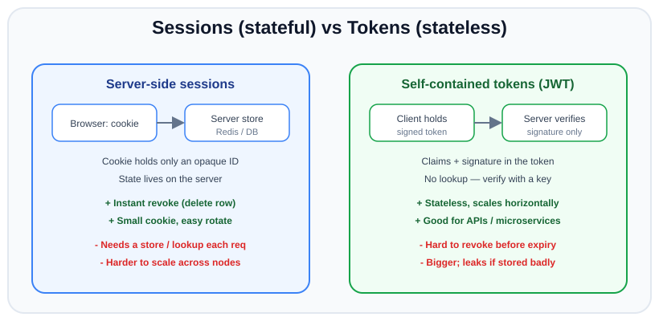

# Authentication Basics

*11 min read · Updated 24 Jul 2026 Topic 48 of 70 Bookmark Mark done Why it matters Almost every backend you will ever write has to answer two questions on every request · Topic 48 of 70*

**Source:** [https://www.geekyfrontend.in/learn/nodejs-backend-kit/authentication-basics](https://www.geekyfrontend.in/learn/nodejs-backend-kit/authentication-basics)

---

## Why it matters

Almost every backend you will ever write has to answer two questions on every request: *who is this?* and *are they allowed to do this?* Get the first one wrong and strangers walk in as your users. Get the second wrong and a logged-in user reads someone else's bank statement. Authentication and authorization are the load-bearing walls of an application — everything else (business logic, payments, data) sits on top of them, and a crack here compromises the whole building.

This topic is also where a huge share of real-world breaches originate. "Broken access control" and "identification and authentication failures" both sit near the top of the OWASP Top 10 year after year. And in interviews, auth is a favourite because it forces you to reason about state, trust boundaries, and trade-offs rather than recite syntax. A candidate who can crisply explain the difference between authentication and authorization, and when to use sessions versus tokens, signals real backend maturity.

The goal of this topic is to build the vocabulary and mental model that the rest of the chapter depends on. Once you can name the pieces precisely — credential, identity, session, token, claim, scope — the specific tools (JWT, express-session, bcrypt, helmet) become easy to slot into place.

## The concept, simply

**Authentication (authN)** answers "who are you?". The user presents a *credential* — a password, a one-time code, a Google login, a passkey — and the server verifies it against something it trusts. The output of successful authentication is a *proven identity*: "this request belongs to user 42".

**Authorization (authZ)** answers "what are you allowed to do?". Given a proven identity, the server checks whether that user may perform this specific action on this specific resource — read this document, delete that order, access the admin panel. The output is a yes/no decision.

The two are sequential and distinct: you authenticate *once* (at login) and authorize *every time* (on each protected request). Confusing them is the classic beginner mistake — for example checking "is the user logged in?" and assuming that means "the user may edit this post", when they may only edit posts they own.



AuthN proves identity at login; authZ checks permissions on every request. 401 means not authenticated, 403 means authenticated but forbidden.

A useful HTTP mnemonic: `401 Unauthorized` actually means *unauthenticated* ("I don't know who you are — log in"), while `403 Forbidden` means *authenticated but not authorized* ("I know who you are, and you may not do this"). The status code names are historically confusing, but the distinction they encode is exactly authN vs authZ.

## How it works

Every authentication scheme boils down to three phases. First, **identification**: the user claims an identity (a username or email). Second, **verification**: they prove it by presenting a credential the server can check — something they know (password), have (a phone receiving an OTP, a hardware key), or are (biometric). Third, **session establishment**: because HTTP is stateless, the server issues a portable proof of the successful login so the user does not re-enter their password on every click.

That third phase is where the two dominant architectures diverge, and understanding the split is the heart of this topic:

**Stateful sessions.** The server generates a random, unguessable *session id*, stores the real session data (user id, roles, cart) in a server-side store (memory, Redis, a database), and sends only the opaque id to the browser inside a cookie. On each subsequent request the browser returns the cookie, the server looks up the id in the store, and re-hydrates who the user is. The token the client holds is meaningless on its own — it is just a pointer.

**Stateless tokens.** The server packages the identity and its claims into a self-contained, cryptographically *signed* token (typically a JWT) and hands the whole thing to the client. On each request the client sends the token back, and the server verifies the signature with a secret or public key. Nothing is stored server-side; the token itself is the proof. The server trusts it because tampering would break the signature.



Sessions keep state on the server behind an opaque cookie id and revoke instantly; tokens carry signed claims and scale statelessly but are hard to revoke early.

The trade-off is fundamentally about *where the state lives* and therefore *who controls revocation*. With sessions, the server is the single source of truth: to log a user out or ban them, you delete one row and the next request fails instantly. With tokens, the proof lives on the client and is valid until it expires, so revoking a token before its expiry requires extra machinery (a denylist, or short-lived access tokens plus refresh tokens — covered in the JWT topic). Sessions cost a store lookup per request and are slightly harder to scale horizontally; tokens are trivially horizontal but pay for it in revocation complexity and token size.

A third pattern worth naming is **federated / delegated auth** — OAuth 2.0 and OpenID Connect. Instead of your app verifying a password, it delegates identity to a provider (Google, GitHub, an enterprise SSO). The provider authenticates the user and hands your app a token asserting "this is user X". You never see the password. OIDC layers an identity token on top of OAuth's authorization framework. This is why "Sign in with Google" exists, and it is increasingly the default for consumer and enterprise apps because it removes password handling from your responsibility.

## Code examples

A minimal login route that verifies a credential and establishes a session. Note that we never store or compare plaintext passwords — hashing is covered in its own topic, but the shape of the flow is what matters here.

javascript

```
const express = require('express');
const bcrypt = require('bcrypt');
const app = express();
app.use(express.json());

app.post('/login', async (req, res) => {
  const { email, password } = req.body ?? {}; // Express 5: req.body is undefined when no JSON body was sent

  // 1. Identification: find the claimed user
  const user = await User.findOne({ email });

  // 2. Verification: compare credential against stored hash.
  //    Always run the compare even if user is missing, to avoid
  //    leaking which emails exist via response timing.
  const hash = user ? user.passwordHash : '$2b$12$invalidinvalidinvalidinvalidinv';
  const ok = await bcrypt.compare(password, hash);

  if (!user || !ok) {
    return res.status(401).json({ error: 'Invalid credentials' });
  }

  // 3. Session establishment (stateful example)
  req.session.userId = user.id;
  req.session.role = user.role;
  res.json({ ok: true });
});
```

Authorization middleware is separate from authentication. Here `requireAuth` only checks identity; `requireRole` checks permission. Keeping them as distinct middlewares is what stops the "logged in therefore allowed" bug.

javascript

```
function requireAuth(req, res, next) {
  if (!req.session.userId) {
    return res.status(401).json({ error: 'Not authenticated' });
  }
  next();
}

function requireRole(role) {
  return (req, res, next) => {
    if (req.session.role !== role) {
      return res.status(403).json({ error: 'Forbidden' });
    }
    next();
  };
}

// authN first, then authZ
app.get('/admin/stats', requireAuth, requireRole('admin'), (req, res) => {
  res.json({ users: 1234 });
});
```

Ownership checks are the subtlest form of authorization and cannot be a static role check — they depend on the specific resource. This is the pattern that prevents IDOR (insecure direct object reference), where user A guesses user B's order id.

javascript

```
app.get('/orders/:id', requireAuth, async (req, res) => {
  const order = await Order.findById(req.params.id);
  if (!order) return res.status(404).json({ error: 'Not found' });

  // AuthZ: the user must OWN this resource (or be admin).
  // Never trust the id in the URL to belong to the caller.
  if (order.userId !== req.session.userId && req.session.role !== 'admin') {
    return res.status(403).json({ error: 'Forbidden' });
  }
  res.json(order);
});
```

## Common mistakes & gotchas

- **Treating "logged in" as "allowed".** Authentication does not imply authorization. Every protected resource needs its own permission check, and ownership-based resources need per-object checks, not just a role check.
- **Trusting client-supplied identity.** A field like `userId` in the request body or a hidden form input is attacker-controlled. Identity must come from the verified session or a verified token, never from the request payload.
- **Leaking which accounts exist.** Returning "no such user" vs "wrong password", or responding faster when the email is unknown, lets attackers enumerate valid emails. Use one generic message and constant-ish work for both cases.
- **Rolling your own crypto or session ids.** Home-grown token formats and `Math.random()` session ids are almost always breakable. Use vetted libraries and a CSPRNG (`crypto.randomBytes`).
- **Confusing 401 and 403.** Sending 401 when the user is authenticated but forbidden, or 403 when they simply need to log in, confuses clients and sometimes leaks information about resource existence.
- **Doing authorization only on the frontend.** Hiding an admin button in the UI is UX, not security. Every check must be enforced server-side because the client is fully under the attacker's control.

## Best practices

- **Separate authN and authZ into distinct layers.** One middleware proves identity; another (or the handler) checks permission. This keeps the two concerns testable and prevents accidental conflation.
- **Centralize the access rule.** Put "who can do what" in one place (a policy function, a middleware factory) rather than scattering ad-hoc `if` checks that drift out of sync.
- **Prefer proven building blocks.** Passport strategies, express-session, jsonwebtoken, and OAuth/OIDC providers exist so you do not reinvent security-critical code.
- **Choose sessions vs tokens deliberately.** Server-rendered app or a single backend? Sessions are simpler and revocable. Public API, mobile client, or many services? Tokens (short-lived) fit better. Decide based on revocation needs and topology, not fashion.
- **Fail closed.** If a check cannot be evaluated (store down, token unparseable), deny access rather than default to allow.
- **Log auth events.** Record logins, failures, and permission denials so you can detect brute force and abuse — without logging the credentials themselves.

## ⭐ Interview lens

> **Q: What is the difference between authentication and authorization?**  
> Authentication verifies *who* a user is by checking a credential; its output is a proven identity. Authorization decides *what* that identity may do on a given resource; its output is allow/deny. You authenticate once at login and authorize on every protected request. The HTTP codes encode the split: 401 = unauthenticated, 403 = authenticated-but-forbidden.

> **Q: Sessions or tokens — how do you choose? (trap)**  
> The trap is answering "tokens, because stateless is modern". The real answer is a trade-off: sessions keep state server-side, so revocation is instant and cookies stay tiny, at the cost of a per-request store lookup and stickier scaling. Tokens are self-contained and scale trivially across services, but are hard to revoke before expiry and can leak more if mishandled. For a monolith or server-rendered app, sessions are often simpler and safer; for public/multi-service APIs, short-lived tokens plus refresh tokens fit better.

> **Q: A user reports they can view another user's invoice by changing the id in the URL. What went wrong?**  
> Broken access control — specifically an IDOR. The endpoint authenticated the user but did not authorize *this* user against *this* resource. The fix is an ownership check: load the invoice, confirm its owner matches the session identity (or the caller is admin), else return 403/404. Never assume the id in the URL belongs to the caller.

> **Q: Why is 401 called "Unauthorized" if it means unauthenticated?**  
> Historical naming in the HTTP spec. Semantically, 401 means "you have not proven who you are — authenticate", and it typically comes with a `WWW-Authenticate` header. 403 is the true authorization failure: identity is known but the action is not permitted. Interviewers ask this to see if you understand the concepts beneath the confusing labels.

> **Q: What does OAuth 2.0 actually give you, and is it authentication?**  
> OAuth 2.0 is an *authorization* framework for delegated access — it lets your app obtain a token to act on a resource on the user's behalf. It is not, by itself, authentication. OpenID Connect (OIDC) is the thin identity layer on top of OAuth that adds an ID token asserting who the user is. "Sign in with Google" is OIDC. Conflating raw OAuth with authentication is a classic mistake.

> **Q: Why is client-side authorization insufficient?**  
> Because the client is fully controlled by the user/attacker — they can edit JavaScript, replay requests with curl, and remove any UI gate. Frontend checks are UX (don't show buttons that will fail); the authoritative decision must be enforced on the server for every request.

## Cheat-card

- **AuthN** = who are you (verify credential → proven identity), once at login.
- **AuthZ** = what may you do (check permission on resource), every request.
- **401** = unauthenticated (log in). **403** = authenticated but forbidden.
- **Sessions**: state on server, opaque cookie id, instant revoke, per-req lookup.
- **Tokens (JWT)**: signed claims on client, stateless/scalable, hard to revoke early.
- **OAuth** = delegated authorization; **OIDC** = identity layer on top (real login).
- Identity comes from the verified session/token — **never** from the request body.
- Ownership checks (IDOR defense) must be per-object, not just per-role.

---

## Learn More

- [Authentication Cheat Sheet — OWASP cheatsheetseries.owasp.org](https://cheatsheetseries.owasp.org/cheatsheets/Authentication_Cheat_Sheet.html)
- [Authorization Cheat Sheet — OWASP cheatsheetseries.owasp.org](https://cheatsheetseries.owasp.org/cheatsheets/Authorization_Cheat_Sheet.html)
- [HTTP authentication — MDN developer.mozilla.org](https://developer.mozilla.org/en-US/docs/Web/HTTP/Guides/Authentication)
- [Auth0 in 100 Seconds // And beyond with a Next.js Authentication Tutorial Fireship](https://www.youtube.com/watch?v=yufqeJLP1rI)
