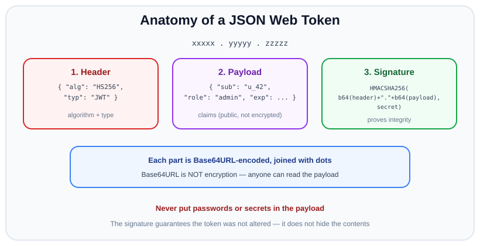
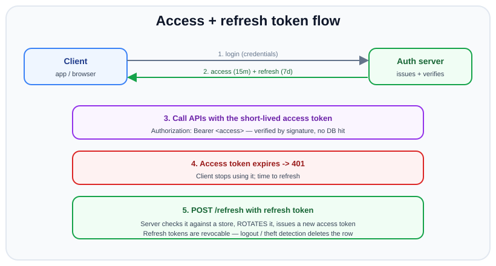

# JSON Web Tokens (JWT)

*12 min read · Updated 24 Jul 2026 Topic 49 of 70 Bookmark Mark done Why it matters JWTs are everywhere in modern backends · Topic 49 of 70*

**Source:** [https://www.geekyfrontend.in/learn/nodejs-backend-kit/jwt](https://www.geekyfrontend.in/learn/nodejs-backend-kit/jwt)

---

## Why it matters

JWTs are everywhere in modern backends: API gateways, mobile app auth, microservice-to-microservice calls, single sign-on. If you build APIs, you will issue, verify, and debug JWTs, and interviewers know it — "explain how a JWT works" and "how do refresh tokens fit in?" are near-guaranteed questions for any backend or full-stack role.

They matter beyond checkbox familiarity because JWTs are deceptively easy to *use* and dangerously easy to *misuse*. The library call is one line, so people ship them without understanding that the payload is readable by anyone, that `none`-algorithm attacks exist, that a token cannot be un-issued, or that storing it in `localStorage` exposes it to XSS. A large fraction of token-related breaches come from these exact misunderstandings. Knowing what a JWT guarantees (integrity) and what it does not (confidentiality, revocability) is what separates someone who "uses JWT" from someone who can secure a system with them.

This topic covers the structure, the verify flow in detail, where to store tokens, the access + refresh token pattern that makes stateless auth practical, and the well-known pitfalls interviewers probe.

## The concept, simply

A JWT is a **signed, self-contained** statement. Instead of the server storing "user 42 is logged in" and handing the client a lookup id, the server writes the fact directly into a token, signs it so it cannot be tampered with, and gives the whole thing to the client. When the client sends it back, the server re-checks the signature and trusts the contents — no database lookup required.

A JWT has three parts, joined by dots: `header.payload.signature`. Each part is Base64URL-encoded JSON (except the signature, which is bytes).



Header names the algorithm, payload carries claims like sub and exp, and the signature is an HMAC or RSA signature over the first two parts. Base64URL is encoding, not encryption.

The single most important thing to internalize: **Base64URL is encoding, not encryption.** Anyone who holds the token can decode and read the payload — paste it into jwt.io and it's all there. The signature does not hide the contents; it only proves they were not altered and were issued by someone holding the secret. Therefore: never put secrets, passwords, or sensitive PII in a JWT payload.

## How it works

**The three parts.** The *header* is JSON like `{"alg":"HS256","typ":"JWT"}` — it names the signing algorithm. The *payload* holds *claims*: standard registered claims like `sub` (subject/user id), `iat` (issued-at), `exp` (expiry), `iss` (issuer), `aud` (audience), plus any custom claims you add (`role`, `plan`). The *signature* is computed over the encoded header and payload.

**Signing.** For the common HMAC family (`HS256`), the signature is `HMAC-SHA256(base64url(header) + "." + base64url(payload), secret)`. The same secret both signs and verifies (symmetric). For the RSA/ECDSA families (`RS256`, `ES256`), a *private* key signs and the corresponding *public* key verifies (asymmetric) — this lets many services verify tokens without being able to mint them, which is ideal for distributed systems and third-party verifiers.

**The verify flow, step by step.** This is the part interviewers love to hear in detail:

1. Split the token on dots into header, payload, signature.
2. Base64URL-decode the header and read `alg`. Critically, the verifier must *enforce an expected algorithm* — it must not blindly trust the token's own `alg` field (see the alg-confusion pitfall).
3. Recompute the signature over `header.payload` using the server's key and the expected algorithm.
4. Compare the recomputed signature to the token's signature using a **constant-time** comparison. If they differ, reject — the token was tampered with or signed by the wrong key.
5. Only after the signature passes, validate the claims: is `exp` in the future? Is `nbf` (not-before) satisfied? Do `iss` and `aud` match what this service expects?
6. If everything passes, the payload is trusted and the request proceeds as that user.

Notice the ordering: *signature first, claims second*. If you read the payload before verifying the signature you are trusting attacker-controlled data. Good libraries enforce this ordering for you, which is exactly why you should not hand-roll verification.

**Where to store the token on the client.** Two mainstream options, each with a distinct threat model. `localStorage` is convenient and works for cross-domain APIs, but it is readable by any JavaScript on the page — so a single XSS flaw leaks every user's token. An `HttpOnly` cookie is invisible to JavaScript (mitigating XSS token theft) but is automatically attached to requests, which opens CSRF risk unless you add `SameSite` and/or CSRF tokens. The modern default for web apps is an `HttpOnly`, `Secure`, `SameSite` cookie; pure token-in-header suits native mobile clients where there is no cookie jar or CSRF surface.

**The revocation problem and refresh tokens.** Because a JWT is valid until `exp` and the server keeps no per-token state, you cannot instantly revoke one. The standard resolution is a two-token system: a short-lived *access token* (minutes) that is used on every API call and simply expires, and a long-lived *refresh token* (days/weeks) that is stored server-side (or in a store you control) and used only to mint new access tokens. Logging out or detecting theft deletes the refresh token, so the user is locked out within one short access-token lifetime.



Login returns a short access token and a long refresh token; API calls use the access token until it expires, then the refresh token is exchanged (and rotated) for a new one. Refresh tokens are revocable server-side.

**Refresh token rotation** hardens this further: every refresh issues a *new* refresh token and invalidates the old one. If a stolen refresh token is used after the legitimate client already rotated it, the server sees a reused (already-invalidated) token and can revoke the entire token family — turning theft into a detectable event.

## Code examples

Issuing an access token on login with the `jsonwebtoken` library. Keep the payload minimal and always set an expiry.

javascript

```
const jwt = require('jsonwebtoken');
const ACCESS_SECRET = process.env.ACCESS_SECRET; // long random string from env

function issueAccessToken(user) {
  return jwt.sign(
    { sub: user.id, role: user.role },   // claims — no secrets, no PII
    ACCESS_SECRET,
    { algorithm: 'HS256', expiresIn: '15m', issuer: 'api.myapp.com' }
  );
}

app.post('/login', async (req, res) => {
  const user = await authenticate(req.body); // verifies password hash
  if (!user) return res.status(401).json({ error: 'Invalid credentials' });
  res.json({ accessToken: issueAccessToken(user) });
});
```

Verifying the token in middleware. Note the explicit `algorithms` allow-list and issuer check — these close the alg-confusion and audience pitfalls. `jwt.verify` throws on an invalid signature or expired token, so it goes in a try/catch.

javascript

```
function requireJwt(req, res, next) {
  const header = req.headers.authorization || '';
  const token = header.startsWith('Bearer ') ? header.slice(7) : null;
  if (!token) return res.status(401).json({ error: 'Missing token' });

  try {
    const payload = jwt.verify(token, ACCESS_SECRET, {
      algorithms: ['HS256'],        // pin the algorithm — never trust token's alg
      issuer: 'api.myapp.com',      // reject tokens minted for another service
    });
    req.user = { id: payload.sub, role: payload.role };
    next();
  } catch (err) {
    // TokenExpiredError vs JsonWebTokenError — both mean "reject"
    return res.status(401).json({ error: 'Invalid or expired token' });
  }
}
```

The refresh endpoint. The refresh token is stored server-side so it can be revoked and rotated; presenting a valid one mints a fresh access token.

javascript

```
app.post('/refresh', async (req, res) => {
  const token = req.cookies.refreshToken; // HttpOnly cookie
  if (!token) return res.status(401).json({ error: 'No refresh token' });

  // Look it up in our store — this is what makes it revocable
  const stored = await RefreshToken.findOne({ token, revoked: false });
  if (!stored || stored.expiresAt < new Date()) {
    return res.status(401).json({ error: 'Invalid refresh token' });
  }

  // Rotate: invalidate the old one, issue a new pair
  stored.revoked = true;
  await stored.save();
  const user = await User.findById(stored.userId);
  const newRefresh = await RefreshToken.create({
    userId: user.id, token: crypto.randomBytes(40).toString('hex'),
    expiresAt: new Date(Date.now() + 7 * 864e5),
  });
  res
    .cookie('refreshToken', newRefresh.token, { httpOnly: true, secure: true, sameSite: 'strict' })
    .json({ accessToken: issueAccessToken(user) });
});
```

A denylist for the rare case where you must kill an *access* token before it expires (e.g. account compromise). Because access tokens are short-lived, the denylist stays small and entries expire quickly.

javascript

```
// On logout / compromise, store the token's jti until its exp passes.
async function isRevoked(jti) {
  return Boolean(await redis.get('revoked:' + jti));
}
// In requireJwt, after verify: if (await isRevoked(payload.jti)) reject.
```

## Common mistakes & gotchas

- **Putting secrets or PII in the payload.** The payload is only Base64URL-encoded, not encrypted. Passwords, card numbers, and sensitive data are readable by anyone holding the token.
- **Trusting the token's own `alg` header.** The classic attacks are (a) `alg: "none"`, where a token claims to need no signature, and (b) RS256→HS256 confusion, where an attacker signs with the *public* key as if it were an HMAC secret. Always pass an explicit `algorithms` allow-list to `verify`.
- **No expiry, or absurdly long expiry.** A token without `exp` (or valid for months) is a permanent credential that cannot be revoked. Keep access tokens to minutes.
- **Assuming you can revoke a JWT.** A stateless token is valid until it expires. If you need instant logout/ban, you need short lifetimes plus a refresh/denylist mechanism — the token alone cannot do it.
- **Storing tokens in `localStorage` without weighing XSS.** Any script on the page can read it. Prefer `HttpOnly` cookies for browser apps, and treat any XSS as a full token compromise.
- **Weak or committed signing secrets.** A short or source-controlled HMAC secret lets attackers forge tokens. Use a long random secret from the environment/secret manager, and rotate it.
- **Skipping `iss`/`aud` checks in multi-service setups.** Without them, a token minted for service A may be replayed against service B.

## Best practices

- **Short-lived access + revocable refresh.** Access tokens in minutes, refresh tokens server-side and rotated on each use, with reuse detection to catch theft.
- **Always pin the algorithm.** Pass `algorithms: ['HS256']` (or your chosen alg) to `verify` so a forged `alg` cannot downgrade the check.
- **Always set and check `exp`, plus `iss` and `aud` when relevant.** Reject expired, wrong-issuer, and wrong-audience tokens.
- **Keep the payload lean.** Only the id, role/scopes, and standard claims — no secrets, no large blobs (tokens ride on every request).
- **Store browser tokens in `HttpOnly`, `Secure`, `SameSite` cookies** and pair with CSRF defenses; use header-based tokens for native mobile.
- **Prefer asymmetric signing (RS256/ES256) across services** so verifiers hold only the public key and cannot mint tokens.
- **Use a maintained library** (`jsonwebtoken`, `jose`) and never hand-roll signing or verification.

## ⭐ Interview lens

> **Q: Walk me through how a server verifies a JWT.**  
> Split into header/payload/signature; read the expected algorithm (pinned by the server, not blindly from the token); recompute the signature over `header.payload` with the server's key; compare in constant time; if it matches, validate claims — `exp` not passed, `nbf` satisfied, `iss`/`aud` as expected. Signature is checked *before* trusting any claim.

> **Q: Is a JWT encrypted? Can I store the user's role in it? (trap)**  
> It is signed, not encrypted — the payload is Base64URL and fully readable, so never store secrets or sensitive PII. Storing a non-sensitive role/scope is fine and normal; that's what claims are for. The trap is thinking the signature hides the contents; it only guarantees integrity and authenticity.

> **Q: How do you log a user out or revoke a JWT immediately?**  
> You can't revoke a pure stateless JWT before it expires — that's its fundamental limitation. The practical answer: keep access tokens short-lived (minutes) and back them with a server-side refresh token you can delete, and optionally a short-lived denylist keyed by `jti` for emergency revocation of in-flight access tokens. Deleting the refresh token locks the user out within one access-token lifetime.

> **Q: What is the `alg: none` / algorithm-confusion attack?**  
> `alg: none` is a token claiming no signature is needed; a naive verifier that trusts the header accepts it unsigned. Algorithm confusion is signing an `HS256` token using the server's *public* RSA key as the HMAC secret when the server expected `RS256`. Both are defeated by pinning an explicit `algorithms` allow-list at verify time and never deriving the algorithm from the token.

> **Q: Access token vs refresh token — why have both?**  
> The access token is used on every request and is stateless, so it must be short-lived to limit the damage if leaked. The refresh token is used rarely (only to mint access tokens), can be stored securely and server-side, and is therefore revocable. Together they give you the scalability of stateless verification plus the control of revocation. Rotation on each refresh adds theft detection.

> **Q: localStorage vs cookie for the token?**  
> `localStorage` is XSS-exposed (any script reads it) but immune to CSRF and easy cross-domain — okay for native/mobile or when you fully control XSS. `HttpOnly` cookies are hidden from JavaScript (XSS-resistant) but auto-sent, so they need `SameSite` and/or CSRF tokens. For browser web apps the recommended default is an `HttpOnly`, `Secure`, `SameSite` cookie.

## Cheat-card

- **Structure**: `header.payload.signature`, each Base64URL JSON; signature = HMAC/RSA over first two parts.
- **Base64URL ≠ encryption** — payload is public. No secrets/PII inside.
- **Verify order**: signature (constant-time, pinned alg) → then claims (`exp`, `nbf`, `iss`, `aud`).
- **HS256** = symmetric (one secret). **RS256/ES256** = private signs, public verifies.
- **Can't revoke** a stateless JWT early → short access token + revocable/rotated refresh token.
- **Pitfalls**: `alg:none`, RS256→HS256 confusion, no `exp`, weak/committed secret.
- **Browser storage**: HttpOnly+Secure+SameSite cookie (+CSRF). Mobile: header token.
- Always pass `algorithms: [...]` to `verify`; use a maintained lib.

---

## Learn More

- [Introduction to JSON Web Tokens jwt.io](https://jwt.io/introduction)
- [JSON Web Token Cheat Sheet — OWASP cheatsheetseries.owasp.org](https://cheatsheetseries.owasp.org/cheatsheets/JSON_Web_Token_Cheat_Sheet.html)
- [RFC 7519: JSON Web Token (JWT) datatracker.ietf.org](https://datatracker.ietf.org/doc/html/rfc7519)
- [JWT Authentication Tutorial - Node.js Web Dev Simplified](https://www.youtube.com/watch?v=mbsmsi7l3r4)
