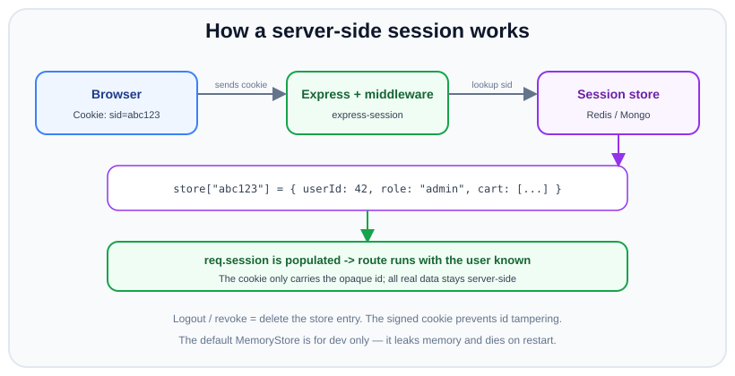

# Sessions & Cookies

*11 min read · Updated 24 Jul 2026 Topic 50 of 70 Bookmark Mark done Why it matters Cookies are the oldest and still the most widely used way to keep a user logged in across the stateless HTTP protocol · Topic 50 of 70*

**Source:** [https://www.geekyfrontend.in/learn/nodejs-backend-kit/sessions-cookies](https://www.geekyfrontend.in/learn/nodejs-backend-kit/sessions-cookies)

---

## Why it matters

Cookies are the oldest and still the most widely used way to keep a user logged in across the stateless HTTP protocol. Every server-rendered app, most admin panels, and a large share of APIs rely on cookie-backed sessions. If you have ever wondered how a website "remembers" you after login without asking for your password on every page, the answer is almost always a session cookie.

Sessions and cookies matter for security precisely because they carry the user's logged-in state. A stolen or forgeable session cookie is a complete account takeover — no password needed. That is why the cookie *flags* (`HttpOnly`, `Secure`, `SameSite`) are among the highest-leverage security controls you can set, and why interviewers ask about them constantly. They are one line of configuration that either closes or opens entire attack classes (XSS token theft, CSRF, cookie interception).

This topic covers what a cookie actually is at the HTTP level, how server-side sessions work with a store, how `express-session` wires it together, and — most importantly — exactly what each cookie flag does and why the secure defaults are what they are.

## The concept, simply

A **cookie** is a small key/value string the server asks the browser to store and send back on every subsequent request to that site. The server sets it with a `Set-Cookie` response header; the browser returns it in the `Cookie` request header automatically. That automatic round-trip is what makes cookies useful for sessions — and also what makes them vulnerable to CSRF.

A **session** is server-side state associated with one user across requests. The dominant pattern is: store the real data (user id, roles, cart) on the server, and put only a random, unguessable *session id* in the cookie. The cookie is a claim ticket; the server holds the actual belongings.



The browser sends an opaque session id in a cookie; express-session looks it up in Redis or Mongo, rehydrates req.session, and the route runs knowing the user. Real data never leaves the server.

The key insight: the cookie holds a *pointer*, not the data. This keeps the cookie tiny, keeps sensitive data off the client, and — crucially — makes logout instant, because the server can simply delete the session from its store and the id becomes worthless.

## How it works

**The cookie lifecycle.** On login the server responds with `Set-Cookie: connect.sid=s%3Aabc123...; HttpOnly; Secure; SameSite=Lax; Path=/; Max-Age=86400`. The browser stores it and, on every future request to the same site, sends `Cookie: connect.sid=s%3Aabc123...`. The attributes after the value are directives to the browser, not sent back to the server — they govern *when* and *how* the browser is willing to send the cookie.

**The session store.** The session id in the cookie is looked up in a store to find the actual session data. The store is pluggable: the default in-memory store is convenient but only for development (it leaks memory, is wiped on restart, and cannot be shared across multiple server instances). Production uses Redis, MongoDB, or a SQL table so sessions survive restarts and are shared across a horizontally scaled cluster. This is the operational cost of stateful sessions — you need a shared store — and the reason some teams reach for stateless JWTs instead.

**Signing vs storing.** There are two flavours. In the *server-side session* model (the common one), the cookie holds only a random id and all data lives in the store; the id is HMAC-*signed* so the server can detect tampering. In the *client-side / cookie-session* model, the entire session payload is serialized into the cookie itself and signed (and possibly encrypted). The latter avoids a store but bloats the cookie, exposes data to the client, and — like a JWT — becomes hard to revoke. The signature in both cases prevents a user from editing their own cookie to, say, escalate their role.

**The cookie flags — the security core.** Each flag defends a specific attack:

- **`HttpOnly`** — the cookie is invisible to JavaScript (`document.cookie` cannot read it). This means an XSS payload cannot steal the session cookie. Every session/auth cookie should be `HttpOnly`.
- **`Secure`** — the browser only sends the cookie over HTTPS. Without it, a cookie can leak in plaintext over an insecure network. Mandatory in production.
- **`SameSite`** — controls whether the cookie is sent on cross-site requests, the primary CSRF defense. `Strict` never sends it cross-site (safest, but breaks inbound links that expect you logged in); `Lax` (the modern browser default) sends it on top-level GET navigations but not on cross-site POSTs/subresource requests — a good balance; `None` sends it always but *requires* `Secure` and is only for legitimate cross-site use (e.g. third-party embeds).
- **`Domain` / `Path`** — scope which hosts and URL paths receive the cookie. Keep them as narrow as possible; a cookie scoped to a parent domain is shared with every subdomain.
- **`Max-Age` / `Expires`** — control lifetime. No expiry means a session cookie that dies when the browser closes; an explicit value makes it persistent. Shorter is safer.

**Session fixation.** A subtle attack: if the server keeps the same session id before and after login, an attacker who plants a known id in the victim's browser (via a link) can wait for the victim to log in and then use that same id — now authenticated. The defense is to *regenerate* the session id at the moment of privilege change (login), which `req.session.regenerate()` does. This is a favourite interview follow-up.

## Code examples

Configuring `express-session` with a Redis store and hardened cookie flags. These options are the difference between a toy setup and a production-safe one.

javascript

```
const session = require('express-session');
const { RedisStore } = require('connect-redis');
const { createClient } = require('redis');

const redisClient = createClient({ url: process.env.REDIS_URL });
redisClient.connect();

app.set('trust proxy', 1); // trust the reverse proxy so Secure cookies work behind it

app.use(session({
  store: new RedisStore({ client: redisClient }), // NOT the default MemoryStore
  secret: process.env.SESSION_SECRET,             // signs the session id cookie
  name: 'sid',                                    // don't advertise the framework
  resave: false,                                  // don't rewrite unchanged sessions
  saveUninitialized: false,                       // don't create sessions for anon visitors
  cookie: {
    httpOnly: true,        // JS can't read it -> XSS can't steal it
    secure: true,          // HTTPS only
    sameSite: 'lax',       // CSRF defense for top-level navigation
    maxAge: 1000 * 60 * 60 * 8, // 8 hours
  },
}));
```

Login writes to the session, and — critically — regenerates the id first to prevent session fixation.

javascript

```
app.post('/login', async (req, res, next) => {
  const user = await authenticate(req.body);
  if (!user) return res.status(401).json({ error: 'Invalid credentials' });

  // Regenerate the session id on privilege change to defeat fixation
  req.session.regenerate((err) => {
    if (err) return next(err);
    req.session.userId = user.id;
    req.session.role = user.role;
    req.session.save((err2) => {   // ensure it's persisted before responding
      if (err2) return next(err2);
      res.json({ ok: true });
    });
  });
});
```

Reading the session in protected routes, and logging out by destroying the server-side session (not just clearing the cookie).

javascript

```
function requireAuth(req, res, next) {
  if (!req.session.userId) return res.status(401).json({ error: 'Not authenticated' });
  next();
}

app.post('/logout', (req, res) => {
  req.session.destroy((err) => {          // deletes the record from the store
    res.clearCookie('sid');               // and drop the cookie client-side
    res.json({ ok: true });
  });
});
```

Setting a raw cookie without the session library, to see the flags directly — for example a non-sensitive preference cookie.

javascript

```
app.get('/set-theme', (req, res) => {
  res.cookie('theme', 'dark', {
    httpOnly: false,      // this one is fine for JS to read; it's not a credential
    secure: true,
    sameSite: 'lax',
    maxAge: 1000 * 60 * 60 * 24 * 365,
    path: '/',
  });
  res.json({ ok: true });
});
```

## Common mistakes & gotchas

- **Shipping the default MemoryStore to production.** It leaks memory, resets on every restart (logging everyone out), and is not shared across instances, so sessions break the moment you scale beyond one process. Always configure a real store.
- **Forgetting `HttpOnly` on the session cookie.** Without it, any XSS reads `document.cookie` and steals the session — full account takeover. Auth cookies must be `HttpOnly`.
- **Missing `Secure` (or misconfigured proxy).** The cookie can traverse HTTP in plaintext. Behind a load balancer you also need `app.set('trust proxy', 1)` or the framework thinks the connection is insecure and drops the `Secure` cookie.
- **No `SameSite`, leaving CSRF wide open.** Relying on the browser default is fragile across clients; set it explicitly (`Lax` for most apps).
- **Not regenerating the session id at login.** Opens session fixation. Call `req.session.regenerate()` on any privilege change.
- **Clearing the cookie but not destroying the session.** If you only `clearCookie`, the server-side record lives on; a copied cookie still works. Logout must `destroy()` the store record.
- **Overly broad `Domain`.** Scoping a session cookie to `.example.com` shares it with every subdomain, including less-trusted ones.

## Best practices

- **Set the trinity of flags on every auth cookie:** `HttpOnly`, `Secure`, and an explicit `SameSite` (Lax or Strict).
- **Use a production session store** (Redis is the common choice) so sessions survive restarts and scale across instances.
- **Regenerate the session id on login** and destroy it fully on logout.
- **Keep the cookie to just the id**; store real data server-side. Rename the cookie so it doesn't advertise the framework, and set `saveUninitialized: false` so you don't mint sessions for anonymous visitors.
- **Set sensible lifetimes and consider idle/absolute timeouts** — a shorter session window limits the value of a stolen cookie.
- **Behind a proxy, set `trust proxy`** so `Secure` cookies and correct client IPs work.
- **Pair cookie sessions with CSRF protection** (SameSite plus a token for state-changing requests) since cookies are auto-sent.

## ⭐ Interview lens

> **Q: What do HttpOnly, Secure, and SameSite each protect against?**  
> `HttpOnly` stops JavaScript (hence XSS) from reading the cookie — defends against session theft via XSS. `Secure` restricts the cookie to HTTPS — defends against plaintext interception. `SameSite` controls cross-site sending — the primary defense against CSRF. They address three different attack classes, which is why you set all three on an auth cookie.

> **Q: Why not store the session data directly in the cookie? (trap)**  
> You can (signed cookie-session), but it has real downsides: the cookie grows and rides on every request; the data is exposed to (though not editable by) the client; and it becomes hard to revoke because the state lives on the client, not the server. The server-side model keeps the cookie tiny (just an id), keeps data private, and makes logout instant by deleting the store record. The trap is assuming "cookie = where the data lives"; normally the cookie is just a pointer.

> **Q: What is session fixation and how do you prevent it?**  
> An attacker fixes a known session id in the victim's browser before login; if the server keeps that same id after authentication, the attacker now shares an authenticated session. Prevent it by regenerating the session id at the moment of privilege elevation (`req.session.regenerate()` on login), so the pre-login id becomes useless.

> **Q: Why is the default express-session MemoryStore unsafe for production?**  
> It stores sessions in the Node process's memory: it leaks (never fully frees old sessions), it is wiped on restart or crash (logging everyone out), and it is not shared, so with more than one instance a user's session exists on only one server and breaks under load balancing. Production needs an external store like Redis.

> **Q: SameSite=Strict vs Lax vs None — when do you use each?**  
> `Strict` never sends the cookie cross-site — most secure, but a user following a link from another site arrives logged-out, which can hurt UX. `Lax` (the modern default) sends it on top-level GET navigations but not cross-site POSTs or subresource loads — the usual sweet spot. `None` sends it on all cross-site requests and is required for legitimate third-party contexts, but must be paired with `Secure`.

> **Q: A user logs out but their old cookie still works. Why?**  
> Almost certainly logout only cleared the cookie client-side without destroying the server-side session. Because the real state lives in the store, a copy of the cookie still resolves to a valid session. Logout must call `req.session.destroy()` to remove the store record (and then clear the cookie).

## Cheat-card

- **Cookie**: server sets via `Set-Cookie`, browser auto-returns via `Cookie` header.
- **Session**: opaque id in cookie → real data in server store (Redis in prod, not MemoryStore).
- **HttpOnly** → blocks XSS cookie theft. **Secure** → HTTPS only. **SameSite** → CSRF defense.
- **SameSite**: Strict (no cross-site), Lax (top-level GET, default), None (all, needs Secure).
- **Fixation** → regenerate session id on login (`req.session.regenerate()`).
- **Logout** → `req.session.destroy()`, not just `clearCookie`.
- Behind a proxy: `app.set('trust proxy', 1)` for Secure cookies to stick.
- `saveUninitialized:false`, rename cookie, keep it to the id only.

---

## Learn More

- [Using HTTP cookies — MDN developer.mozilla.org](https://developer.mozilla.org/en-US/docs/Web/HTTP/Guides/Cookies)
- [Session Management Cheat Sheet — OWASP cheatsheetseries.owasp.org](https://cheatsheetseries.owasp.org/cheatsheets/Session_Management_Cheat_Sheet.html)
- [Set-Cookie header — MDN developer.mozilla.org](https://developer.mozilla.org/en-US/docs/Web/HTTP/Reference/Headers/Set-Cookie)
- [Session vs Token Authentication in 100 Seconds Fireship](https://www.youtube.com/watch?v=UBUNrFtufWo)
