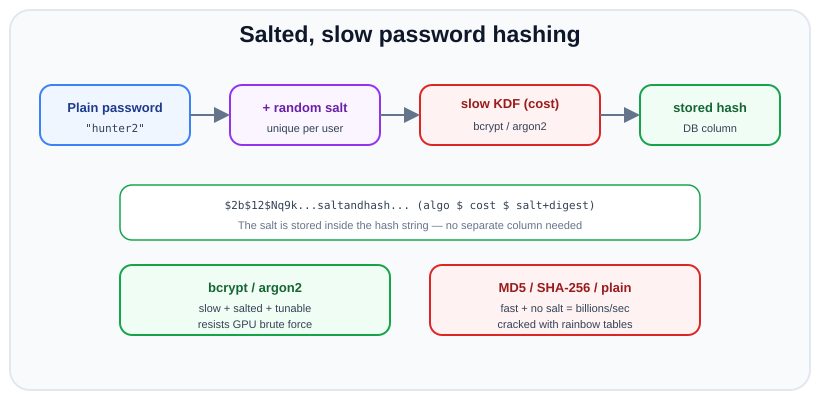

# Password Hashing

*12 min read · Updated 24 Jul 2026 Topic 51 of 70 Bookmark Mark done Why it matters Storing passwords is one of the few pieces of code where a single wrong decision can harm millions of people · Topic 51 of 70*

**Source:** [https://www.geekyfrontend.in/learn/nodejs-backend-kit/password-hashing](https://www.geekyfrontend.in/learn/nodejs-backend-kit/password-hashing)

---

## Why it matters

Storing passwords is one of the few pieces of code where a single wrong decision can harm millions of people. Data breaches are routine; the question is not whether your database might leak, but what an attacker can do when it does. If you stored passwords as plaintext, the answer is "log in as every user, everywhere" — because people reuse passwords across sites. If you hashed them correctly, the answer is "spend years and fail". Password storage is the clearest example of designing for the assumption that the perimeter *will* be breached.

It is also a frequent interview topic because it exposes whether a candidate understands the difference between a general-purpose hash (fast, for integrity) and a password hash (deliberately slow, for resistance to guessing), plus salting, timing attacks, and cost tuning. These are conceptual, not syntactic — you cannot bluff them. "Why not just SHA-256 the password?" is a question that instantly separates people who have thought about security from those who have not.

This topic covers why plaintext and fast hashes are unacceptable, how salting defeats precomputation, how bcrypt and argon2 make guessing expensive, and how timing-safe comparison prevents a subtler leak.

## The concept, simply

You should never be able to recover a user's password from what you store — not even you, the operator. So you do not store the password; you store a **one-way hash** of it. At login you hash the submitted password the same way and compare. A hash is one-way: easy to compute forwards, infeasible to reverse.

But a plain hash is not enough, for two reasons. First, identical passwords produce identical hashes, so an attacker can precompute hashes of common passwords (a *rainbow table*) and match them in bulk. The fix is a **salt**: a unique random value mixed into each password before hashing, so the same password yields a different hash for every user, and precomputed tables become useless. Second, general-purpose hashes like SHA-256 are *fast* — modern GPUs compute billions per second — so an attacker can brute-force guesses quickly. The fix is a **slow, tunable** hash: a password KDF (key derivation function) like bcrypt or argon2 that is deliberately expensive to compute.



A password plus a unique salt is fed through a slow, cost-tuned KDF (bcrypt/argon2) to produce the stored hash. Fast unsalted hashes like MD5 or SHA-256 fall to rainbow tables and GPU brute force.

Put together: **salted + slow**. Salting kills precomputation; slowness kills mass guessing. bcrypt and argon2 do both, and they embed the salt and cost parameters right inside the output string so you do not manage them separately.

## How it works

**Why plaintext is indefensible.** If the database leaks, every credential is instantly usable — and because users reuse passwords, your breach becomes a breach of their email, bank, and everything else. There is no scenario where storing plaintext (or reversible/encrypted-with-a-key passwords) is acceptable for authentication.

**Why fast hashes (MD5, SHA-1, SHA-256) fail.** These are designed to be fast for verifying file integrity. That speed is a liability for passwords: an attacker with the hash dump runs a wordlist or brute force at billions of guesses per second on commodity GPUs. Unsalted, they also fall to rainbow tables — giant precomputed hash→password lookups. SHA-256 is a fine hash; it is simply the wrong *tool* for passwords because it is not slow and has no salting built in.

**How salting defeats precomputation.** A salt is a random value (16 bytes is typical) generated per user and stored alongside the hash. The KDF hashes `salt + password`. Because every user's salt differs, two users with password "hunter2" get completely different stored hashes — so an attacker cannot recognise shared passwords, and any rainbow table would have to be rebuilt per salt, which is infeasible. The salt is not secret; it can be public. Its job is uniqueness, not secrecy. (A *pepper* — a secret value added on top, stored separately from the DB — is an optional extra layer.)

**How bcrypt works.** bcrypt is a password hashing function built on the Blowfish cipher with a tunable *cost factor* (also called work factor or rounds). The cost is logarithmic: cost 12 means 2^12 = 4096 iterations of key setup. Each increment *doubles* the work, so as hardware gets faster you simply raise the cost to keep hashing expensive for attackers while it stays a fraction of a second for your one legitimate login. bcrypt also generates and embeds the salt automatically. Its output string encodes everything: `$2b$12$<22-char salt><31-char hash>` — the algorithm, the cost, the salt, and the digest, all in one field. That is why you store a single column and never a separate salt.

**How argon2 improves on it.** argon2 (specifically argon2id) won the 2015 Password Hashing Competition and is the current recommendation for new systems. Beyond being slow (time cost), it is *memory-hard*: it requires a configurable amount of RAM to compute, which specifically defeats attackers using GPUs and ASICs that have massive parallel compute but limited memory per core. Its parameters are time cost, memory cost, and parallelism. bcrypt remains perfectly acceptable and battle-tested; argon2id is preferred for new designs where the memory-hardness matters. (scrypt is a third memory-hard option; PBKDF2 is an older, non-memory-hard KDF still used where FIPS compliance is required.)

**Timing attacks and constant-time comparison.** When you verify a password, the KDF's own `compare` function does a timing-safe comparison of the digests. This matters because a naive byte-by-byte string comparison returns faster when the first differing byte is early, leaking information about how much of a guess is correct. bcrypt's `compare` and argon2's `verify` are constant-time, so they do not leak. The same principle applies anywhere you compare secrets (tokens, HMAC signatures): use `crypto.timingSafeEqual`, never `===`. A related timing leak is at the *account* level — responding faster when the email doesn't exist reveals which emails are registered; the mitigation is to always run a hash comparison (against a dummy hash if the user is missing) so the response time is uniform.

## Code examples

Hashing a password on registration with bcrypt. You pass a cost factor; the library generates the salt and embeds it in the output.

javascript

```
const bcrypt = require('bcrypt');
const COST = 12; // work factor — tune so one hash takes ~200-300ms on your hardware

app.post('/register', async (req, res) => {
  const { email, password } = req.body ?? {}; // Express 5: req.body is undefined when no JSON body was sent
  if (password.length < 8) return res.status(400).json({ error: 'Too short' });

  // Salt is generated automatically and stored inside the hash string
  const passwordHash = await bcrypt.hash(password, COST);

  await User.create({ email, passwordHash });
  res.status(201).json({ ok: true });
});
```

Verifying at login with `bcrypt.compare`, which extracts the salt and cost from the stored hash and does a timing-safe comparison. Note the anti-enumeration trick of always comparing.

javascript

```
// A fixed dummy hash so we do equal work whether or not the user exists
const DUMMY = '$2b$12$C6UzMDM.H6dfI/f/IKcEeOjHVQz.iC1p1w1z8m3M0nJ0oQ8qKx8Iu';

app.post('/login', async (req, res) => {
  const { email, password } = req.body ?? {};
  const user = await User.findOne({ email });

  // Always run compare (against DUMMY if no user) to keep timing uniform
  const ok = await bcrypt.compare(password, user ? user.passwordHash : DUMMY);

  if (!user || !ok) {
    return res.status(401).json({ error: 'Invalid credentials' }); // one generic message
  }
  req.session.regenerate((err) => {
    if (err) return res.status(500).json({ error: 'Server error' });
    req.session.userId = user.id;
    res.json({ ok: true });
  });
});
```

argon2id for a new system — the recommended modern default, with explicit memory/time parameters.

javascript

```
const argon2 = require('argon2');

async function hashPassword(password) {
  return argon2.hash(password, {
    type: argon2.argon2id,
    memoryCost: 19456,  // ~19 MiB — memory-hardness defeats GPU/ASIC attackers
    timeCost: 2,        // iterations
    parallelism: 1,
  });
}

async function verifyPassword(hash, password) {
  return argon2.verify(hash, password); // timing-safe; reads params from the hash
}
```

Constant-time comparison for other secrets (e.g. an API key or HMAC), showing the general principle behind why `compare` is timing-safe.

javascript

```
const crypto = require('crypto');

function safeEqual(a, b) {
  const bufA = Buffer.from(a);
  const bufB = Buffer.from(b);
  // Length must match first; timingSafeEqual throws on unequal lengths
  if (bufA.length !== bufB.length) return false;
  return crypto.timingSafeEqual(bufA, bufB); // does NOT short-circuit on first diff
}
```

Upgrading cost/algorithm transparently on login — because the stored hash records its own parameters, you can detect outdated hashes and re-hash with stronger settings the next time the user authenticates.

javascript

```
async function loginAndMaybeUpgrade(user, password) {
  const ok = await bcrypt.compare(password, user.passwordHash);
  if (!ok) return false;

  // If the stored cost is below our current target, re-hash now (we have the plaintext)
  const currentCost = Number(user.passwordHash.split('$')[2]);
  if (currentCost < COST) {
    user.passwordHash = await bcrypt.hash(password, COST);
    await user.save();
  }
  return true;
}
```

## Common mistakes & gotchas

- **Storing plaintext or reversible (encrypted) passwords.** Any scheme where you can recover the original is a full compromise on breach. Passwords must be one-way hashed.
- **Using a fast/general hash (MD5, SHA-1, SHA-256) for passwords.** Fast means brute-forceable at billions/sec; unsalted means rainbow-table-able. Wrong tool entirely — use bcrypt/argon2/scrypt.
- **Reusing one global salt, or no salt.** A shared or missing salt lets precomputation and cross-user matching succeed. Salts must be unique per user (bcrypt/argon2 do this for you).
- **Comparing hashes with `===`.** Naive comparison leaks timing. Use the library's `compare`/`verify` or `crypto.timingSafeEqual`.
- **Cost factor too low (or never revisited).** A cost tuned for 2013 hardware is cheap to crack today. Pick a cost that takes a few hundred milliseconds now and raise it over time.
- **Leaking account existence via timing or messages.** Skipping the hash when the user is missing makes "no such user" faster to detect. Always compare against a dummy hash and return one generic error.
- **bcrypt's 72-byte input limit.** bcrypt silently truncates input beyond 72 bytes, which matters for very long passwords or pre-hashing schemes — a known gotcha; argon2 has no such limit.
- **Hashing on the client and sending the hash.** That just makes the hash *be* the password. Hash server-side over TLS.

## Best practices

- **Use argon2id for new systems, bcrypt where already established** — both are salted, slow, and vetted. Avoid MD5/SHA for passwords entirely.
- **Let the library handle the salt** (unique per user, embedded in the output). Never invent your own salting scheme.
- **Tune the cost to your hardware** so a single hash takes roughly 200-300ms, and increase it as hardware improves; re-hash on login to upgrade legacy hashes.
- **Always use timing-safe comparison** — the library's `compare`/`verify`, and `crypto.timingSafeEqual` for other secrets.
- **Prevent account enumeration**: uniform response for unknown-user and wrong-password, and always run a hash comparison.
- **Hash server-side over HTTPS**; enforce a sensible minimum length and check against breached-password lists rather than complex composition rules.
- **Consider a pepper** (a secret added on top, stored outside the DB) for defense in depth, and rate-limit login attempts to slow online guessing.

## ⭐ Interview lens

> **Q: Why not just hash passwords with SHA-256? (trap)**  
> Two reasons. SHA-256 is *fast* — attackers compute billions of guesses per second on GPUs — whereas password storage needs a deliberately *slow*, tunable function so guessing is expensive. And SHA-256 has no salting, so identical passwords hash identically and fall to precomputed rainbow tables. Password KDFs like bcrypt and argon2 are slow, salted, and cost-tunable. SHA-256 isn't "broken"; it's the wrong tool for this job.

> **Q: What is a salt and what problem does it solve?**  
> A salt is a unique random value mixed into each password before hashing. It ensures two users with the same password get different stored hashes, which (a) defeats precomputed rainbow tables — an attacker would have to rebuild them per salt — and (b) hides the fact that users share a password. The salt is not secret; its purpose is uniqueness, and bcrypt/argon2 generate and embed it automatically.

> **Q: What does the bcrypt cost factor do, and how do you pick it?**  
> It sets the work: cost N means 2^N iterations, so each increment doubles the time. You pick the highest cost your servers can tolerate for a single login — commonly targeting ~200-300ms — which stays trivial for one real user but multiplies the attacker's brute-force cost enormously. Because it's tunable, you raise it as hardware improves.

> **Q: bcrypt vs argon2 — which and why?**  
> Both are salted, slow, and battle-tested. bcrypt is older, extremely well-vetted, and fine to keep. argon2id (the PHC winner) is the modern recommendation for new systems because it's additionally *memory-hard* — it forces attackers to spend RAM, neutralising the parallel-compute advantage of GPUs and ASICs. Also note bcrypt truncates input at 72 bytes; argon2 has no such limit.

> **Q: What is a timing attack in the context of password/token comparison?**  
> A naive comparison (`===` / byte-by-byte) returns as soon as it finds a mismatched byte, so the response time reveals how many leading bytes were correct — enough to reconstruct a secret over many attempts. Constant-time comparison (bcrypt's `compare`, `crypto.timingSafeEqual`) always examines the full value, leaking no positional information.

> **Q: Where do you store the salt, and should it be encrypted?**  
> The salt is stored right alongside the hash — in fact bcrypt/argon2 embed it inside the single hash string. It does not need to be secret or encrypted because its only role is to be unique per user and defeat precomputation. If you want an additional secret component, that's a *pepper*, stored separately from the database (e.g. in a secret manager), not the salt.

## Cheat-card

- **Never** store plaintext or reversible passwords; hash one-way.
- **Not** MD5/SHA (fast + unsalted → GPU brute force + rainbow tables).
- **Salted + slow**: salt kills precomputation, slowness kills mass guessing.
- **bcrypt**: cost factor 2^N, embeds salt; output `$2b$12$salt+hash`; 72-byte input cap.
- **argon2id**: modern default, memory-hard (defeats GPU/ASIC); tune memory+time.
- Salt = unique, public, per-user. **Pepper** = optional secret stored outside DB.
- **Timing-safe compare**: `bcrypt.compare`/`argon2.verify`, `crypto.timingSafeEqual`.
- Tune cost to ~200-300ms, raise over time, re-hash on login; block user enumeration.

---

## Learn More

- [Password Storage Cheat Sheet cheatsheetseries.owasp.org](https://cheatsheetseries.owasp.org/cheatsheets/Password_Storage_Cheat_Sheet.html)
- [bcrypt for Node.js (node.bcrypt.js) github.com](https://github.com/kelektiv/node.bcrypt.js)
- [Crypto — scrypt & pbkdf2 (Node.js API) nodejs.org](https://nodejs.org/api/crypto.html)
- [Node Password Hashing with bcrypt WittCode](https://www.youtube.com/watch?v=esa_t_-PJ6A)
