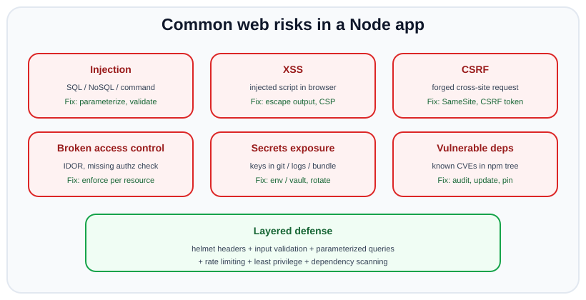
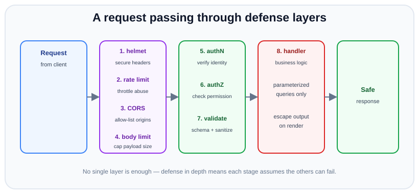

# Web Security & OWASP

*13 min read · Updated 24 Jul 2026 Topic 52 of 70 Bookmark Mark done Why it matters Authentication and password hashing protect the front door · Topic 52 of 70*

**Source:** [https://www.geekyfrontend.in/learn/nodejs-backend-kit/web-security-owasp](https://www.geekyfrontend.in/learn/nodejs-backend-kit/web-security-owasp)

---

## Why it matters

Authentication and password hashing protect the front door, but a real application has dozens of other surfaces an attacker can push on: the query it runs, the HTML it renders, the requests it accepts from other sites, the dependencies it pulls from npm, the secrets it ships. Web security is the discipline of hardening all of them together. The OWASP Top 10 is the industry's shared checklist of the risks that actually cause breaches, and knowing it is effectively table stakes for a backend engineer.

For Node specifically, several of these risks have a distinctive flavour: NoSQL (MongoDB) injection via unvalidated objects, prototype pollution through unsafe merges, and a very large dependency tree where a single transitive package can introduce a vulnerability. Interviewers ask about OWASP not to hear you recite ten items, but to see whether you can look at a route and spot the injection, the missing escape, the absent authorization, or the leaked secret — and then name the concrete Express-level mitigation.

This topic surveys the highest-frequency risks (injection, XSS, CSRF, broken access control, secrets, vulnerable dependencies) and the practical defenses in a Node/Express app: parameterized queries, output escaping and CSP, SameSite/CSRF tokens, helmet, rate limiting, input validation, and secret management. The theme throughout is **defense in depth** — no single control is sufficient.

## The concept, simply

Almost every web vulnerability is a variation of one root cause: **untrusted input crossing a trust boundary without being neutralized**. User input becomes part of a database query (injection), part of an HTML page (XSS), part of a shell command (command injection), or part of an object you merge into your config (prototype pollution). The defense is always to treat data as data — parameterize, escape, validate, and separate it from code or commands.

CSRF is slightly different: it abuses the browser's automatic sending of cookies to make a logged-in user perform actions they didn't intend. And a second class of problems is about *configuration and hygiene* rather than input: leaked secrets, missing security headers, unpatched dependencies, and absent rate limiting.



Injection, XSS, CSRF, broken access control, secrets exposure and vulnerable dependencies are recurring Node risks; each has a concrete mitigation, and real security layers them together.

The practical mindset is **defense in depth**: assume any one layer can fail and stack independent controls so an attacker must defeat all of them. A request should pass through secure headers, rate limiting, authentication, authorization, and input validation before it ever touches your business logic — and the business logic itself should still use parameterized queries and escape its output.



Layered middleware — secure headers, rate limiting, CORS, authN/authZ, input validation — filters a request before it reaches the handler, which still parameterizes queries and escapes output. Each layer assumes the others may fail.

## How it works

**Injection (SQL, NoSQL, command).** Injection happens when input is concatenated into a query or command so that the attacker's data is interpreted as code. In SQL, `"SELECT * FROM users WHERE email = '" + input + "'"` lets input like `' OR '1'='1` change the query's meaning. The fix is *parameterized queries / prepared statements*, where the driver sends the query structure and the values separately, so values can never become code. In MongoDB, the analogue is passing a user-supplied *object* straight into a query: `{ email: req.body.email }` where `email` is actually `{ "$ne": null }` becomes an operator injection. The fix is to validate types (coerce to string) and cast/sanitize input. Command injection (`child_process.exec` with user input) is defeated by avoiding the shell — use `execFile`/`spawn` with an argument array so input is never parsed by a shell.

**XSS (cross-site scripting).** XSS is injection into the HTML/JS context: attacker-supplied text is rendered into a page and executed as script in other users' browsers, letting it steal cookies (unless `HttpOnly`), tokens, or perform actions as the victim. *Stored* XSS persists the payload (e.g. a comment); *reflected* XSS bounces it back from a request; *DOM-based* XSS happens entirely client-side. The defenses are: *escape output* for the context it lands in (template engines that auto-escape, or explicit HTML-entity encoding), never build DOM with `innerHTML` from untrusted data, sanitize any HTML you must allow (DOMPurify), and set a **Content-Security-Policy** header that restricts which scripts can run — a strong second line so that even an injected script is blocked from executing.

**CSRF (cross-site request forgery).** Because browsers automatically attach cookies to requests, a malicious site can cause the victim's browser to send a state-changing request to your app (e.g. a hidden form that POSTs to `/transfer`) using the victim's session cookie. The server sees a validly-authenticated request and performs the action. Defenses: `SameSite` cookies (Lax/Strict) so the cookie isn't sent on cross-site POSTs; a **CSRF token** — an unpredictable value the server issues and requires echoed back in a header/field that a cross-site attacker cannot read; and checking `Origin`/`Referer`. Note CSRF primarily affects cookie-based auth; a token sent in an `Authorization` header (not auto-attached by the browser) is inherently less exposed.

**Security headers via helmet.** `helmet` is Express middleware that sets a bundle of protective HTTP response headers: `Content-Security-Policy`, `Strict-Transport-Security` (force HTTPS), `X-Content-Type-Options: nosniff` (stop MIME sniffing), `X-Frame-Options`/frame-ancestors (clickjacking), `Referrer-Policy`, and it removes the `X-Powered-By: Express` fingerprint. One line raises your baseline substantially, though CSP usually needs tuning for your app's real script sources.

**Rate limiting.** Limiting how many requests an IP/user can make in a window protects against brute-force login attempts, credential stuffing, scraping, and denial-of-service. In Node, `express-rate-limit` (backed by Redis for multi-instance deployments) caps requests; stricter limits go on sensitive endpoints like login and password reset. Rate limiting is also a key mitigation for the online-guessing side of the password topic.

**Secrets management.** API keys, DB passwords, and signing secrets must never be hard-coded or committed to git — a leaked secret in a public repo is scraped within minutes. Load secrets from environment variables (via a secret manager in production: AWS Secrets Manager, Vault, etc.), keep `.env` out of version control (`.gitignore`), never send them to the client bundle, rotate them regularly, and treat any exposure as a rotate-now incident. Front-end code is fully visible, so anything shipped to the browser is not a secret.

**Vulnerable and outdated dependencies.** A Node app's real attack surface includes its entire `node_modules` tree, most of which you didn't write. Known CVEs in dependencies are a top-10 risk. Defenses: `npm audit` (and fixing/upgrading), automated tools like Dependabot/Snyk, pinning versions with a committed lockfile, minimizing dependencies, and reviewing new packages before adding them (supply-chain attacks ship malware in popular-looking packages).

## Code examples

Parameterized queries defeat SQL injection; NoSQL needs type validation to defeat operator injection.

javascript

```
// SQL — VULNERABLE: input becomes part of the query
db.query(`SELECT * FROM users WHERE email = '${req.body.email}'`);

// SQL — SAFE: driver sends structure and values separately
db.query('SELECT * FROM users WHERE email = $1', [req.body.email]);

// MongoDB — VULNERABLE: an object like { $ne: null } injects an operator
await User.findOne({ email: req.body.email, password: req.body.password });

// MongoDB — SAFE: coerce to the expected type so operators can't sneak in
await User.findOne({ email: String(req.body.email) }); // then verify hash separately
```

A hardened Express app: helmet for headers, a global and a strict login rate limiter, body-size limits, and CORS restricted to an allow-list.

javascript

```
const express = require('express');
const helmet = require('helmet');
const rateLimit = require('express-rate-limit');
const cors = require('cors');
const app = express();

app.use(helmet());                         // secure headers + removes X-Powered-By
app.use(express.json({ limit: '10kb' }));  // cap body size to blunt DoS
app.use(cors({ origin: ['https://myapp.com'], credentials: true })); // allow-list only

// Global limiter
app.use(rateLimit({ windowMs: 15 * 60 * 1000, limit: 300 })); // `limit` (was `max` before express-rate-limit v7)

// Strict limiter on auth endpoints to stop brute force / credential stuffing
const loginLimiter = rateLimit({ windowMs: 15 * 60 * 1000, limit: 5 });
app.post('/login', loginLimiter, handleLogin);
```

Escaping output prevents XSS; a Content-Security-Policy is the backstop. Auto-escaping template engines handle most of this, but explicit encoding shows the principle.

javascript

```
// Auto-escaping via a template engine (EJS/Pug/Handlebars escape by default):
// res.render('profile', { name: user.name });  // {{name}} is HTML-escaped

// If you must build HTML manually, escape untrusted text:
function escapeHtml(s) {
  return String(s)
    .replace(/&/g, '&amp;').replace(/</g, '&lt;').replace(/>/g, '&gt;')
    .replace(/"/g, '&quot;').replace(/'/g, '&#39;');
}

// Backstop: a CSP header so even an injected script won't run inline
app.use(helmet.contentSecurityPolicy({
  directives: { defaultSrc: ["'self'"], scriptSrc: ["'self'"], objectSrc: ["'none'"] },
}));
```

Input validation with a schema library (zod/joi) is a single choke point that neutralizes malformed and malicious input before it reaches your logic.

javascript

```
const { z } = require('zod');

const RegisterSchema = z.object({
  email: z.string().email().max(254),
  password: z.string().min(8).max(200),
  age: z.number().int().min(13).max(120).optional(),
});

app.post('/register', (req, res) => {
  const parsed = RegisterSchema.safeParse(req.body);
  if (!parsed.success) return res.status(400).json({ error: 'Invalid input' });
  // parsed.data is now typed, trimmed of unknown keys, and correctly typed
  createUser(parsed.data);
  res.status(201).json({ ok: true });
});
```

Command injection is avoided by never invoking a shell with user input — pass arguments as an array to `execFile`/`spawn`.

javascript

```
const { execFile } = require('child_process');

// VULNERABLE: exec runs a shell, so input like "; rm -rf /" is interpreted
// exec(`convert ${req.body.file} out.png`);

// SAFE: no shell; the filename is a single, un-parsed argument
execFile('convert', [req.body.file, 'out.png'], (err, stdout) => { /* ... */ });
```

## Common mistakes & gotchas

- **String-building queries.** Any query assembled by concatenating input is an injection waiting to happen. Always parameterize (SQL) and type-validate (NoSQL).
- **Passing raw request objects into Mongo queries.** `{ field: req.body.field }` where the value is an object enables operator injection (`$ne`, `$gt`). Coerce to the expected primitive.
- **Rendering untrusted data as HTML.** Using `innerHTML`, disabling template escaping, or dangerouslySetInnerHTML with user content is XSS. Escape, or sanitize with DOMPurify.
- **Assuming an API is CSRF-immune.** Any cookie-authenticated state-changing endpoint is exposed. Set `SameSite` and use CSRF tokens for cookie-based flows.
- **Committing secrets.** API keys in the repo, in the client bundle, or logged in plaintext. Once pushed, treat them as leaked and rotate — deleting the commit is not enough.
- **Trusting client-side validation.** It's UX only; attackers bypass it with curl. Validate on the server, always.
- **Ignoring `npm audit`.** Unpatched transitive dependencies are a top breach vector; a vulnerability you didn't write is still yours to fix.
- **Verbose error responses.** Leaking stack traces, SQL errors, or library versions helps attackers map your system. Return generic errors; log details server-side.
- **No rate limiting on auth.** Unlimited login attempts enable brute force and credential stuffing regardless of how well you hash.

## Best practices

- **Parameterize every query and validate every input** at a single choke point (zod/joi), coercing types so operator/HTML/command injection is structurally impossible.
- **Escape output by context and add a Content-Security-Policy** so XSS is defended twice — at render and at execution.
- **Default to `SameSite` cookies plus CSRF tokens** for any cookie-authenticated, state-changing endpoint.
- **Add `helmet` and a body-size limit** as a baseline on every app, and tune CSP to your real script sources.
- **Rate-limit globally and more strictly on auth endpoints**, backed by a shared store when running multiple instances.
- **Keep secrets in the environment / a secret manager**, never in git or the client bundle; rotate regularly and on any suspected exposure.
- **Run `npm audit` and automated dependency scanning**, commit a lockfile, and minimize/vet dependencies.
- **Apply least privilege everywhere** (DB users, tokens, service accounts), return generic errors, run over HTTPS, and log security events for detection.

## ⭐ Interview lens

> **Q: How do you prevent SQL/NoSQL injection in Node?**  
> For SQL, use parameterized queries / prepared statements so the driver transmits the query structure and the values separately — user data can never be parsed as SQL. For MongoDB, the analogous risk is passing a user-supplied *object* that contains operators like `$ne`; prevent it by validating and coercing inputs to their expected primitive types (and by using schema validation). The underlying rule is: never let untrusted input become part of the query's structure.

> **Q: XSS vs CSRF — what's the difference? (trap)**  
> They're often confused. XSS is injecting *script into your page* that runs in victims' browsers — an input/output-encoding problem, defended by escaping output and CSP. CSRF is tricking a victim's browser into *sending an authenticated request* to your app from another site — a problem of cookies being auto-attached, defended by SameSite cookies and CSRF tokens. XSS is about what runs on your page; CSRF is about forged requests to your server. Note that XSS can defeat many CSRF defenses, so fixing XSS is foundational.

> **Q: What does helmet actually do, and is it enough on its own?**  
> helmet sets protective HTTP response headers — CSP, HSTS, X-Content-Type-Options nosniff, frame protections, Referrer-Policy — and removes the X-Powered-By fingerprint. It raises your baseline in one line, but it's not sufficient alone: it doesn't parameterize queries, validate input, authorize requests, or rate-limit. It's one layer in defense in depth, and its CSP typically needs tuning to your app.

> **Q: Why is a fast password hash relevant to OWASP, and how does rate limiting relate?**  
> Weak hashing (identification/authentication failures) is itself a Top 10 category, and it interacts with rate limiting: strong hashing raises the cost of *offline* guessing after a DB leak, while rate limiting (and account lockout) raises the cost of *online* guessing against your live login. You need both — one protects the stolen hashes, the other protects the live endpoint.

> **Q: A secret key was committed to a public repo. What do you do?**  
> Treat it as compromised immediately — bots scrape public repos within minutes, so it's likely already harvested. Rotate/revoke the secret now; removing the commit or force-pushing is not enough because it lives in history and clones. Then audit for misuse, move the secret to a secret manager/env var, add it to `.gitignore`, and consider secret-scanning in CI to prevent recurrence.

> **Q: What is defense in depth, concretely, for an Express endpoint?**  
> Layering independent controls so no single failure is fatal: helmet for headers, rate limiting, CORS allow-list and body-size caps, then authentication, then authorization (including ownership checks), then input validation — and the handler still uses parameterized queries and escapes output. Each layer assumes the others might fail, so an attacker has to beat all of them.

## Cheat-card

- **Root cause**: untrusted input crossing a boundary as code — parameterize, escape, validate.
- **Injection**: SQL → prepared statements; NoSQL → type-coerce (block `$ne`/`$gt`); command → `execFile`/`spawn`, no shell.
- **XSS**: escape output by context + CSP; sanitize HTML (DOMPurify); never `innerHTML` untrusted data.
- **CSRF**: SameSite cookies + CSRF token; affects cookie auth, not header-token auth.
- **helmet**: CSP, HSTS, nosniff, frame protection, removes X-Powered-By — baseline, not complete.
- **Rate limit** globally + strict on login (brute force / credential stuffing).
- **Secrets**: env/secret manager, never git or client bundle; leaked = rotate now.
- **Deps**: `npm audit` + Dependabot/Snyk + lockfile. Validate server-side. Defense in depth.

---

## Learn More

- [OWASP Top Ten Web Application Security Risks owasp.org](https://owasp.org/www-project-top-ten/)
- [OWASP Cheat Sheet Series cheatsheetseries.owasp.org](https://cheatsheetseries.owasp.org/)
- [Web security (MDN) developer.mozilla.org](https://developer.mozilla.org/en-US/docs/Web/Security)
- [OWASP API Security Top 10 Course – Secure Your Web Apps freeCodeCamp.org](https://www.youtube.com/watch?v=YYe0FdfdgDU)
