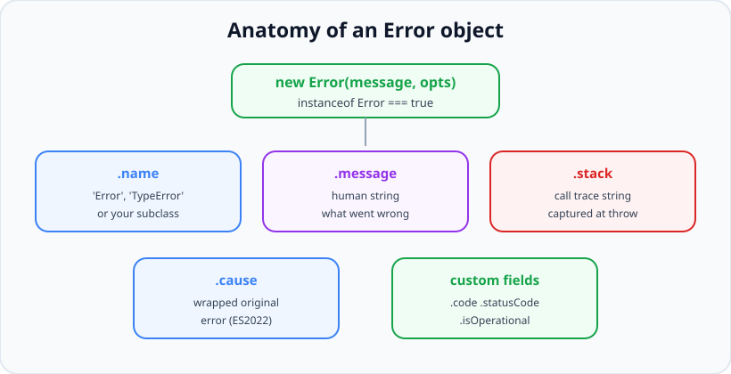
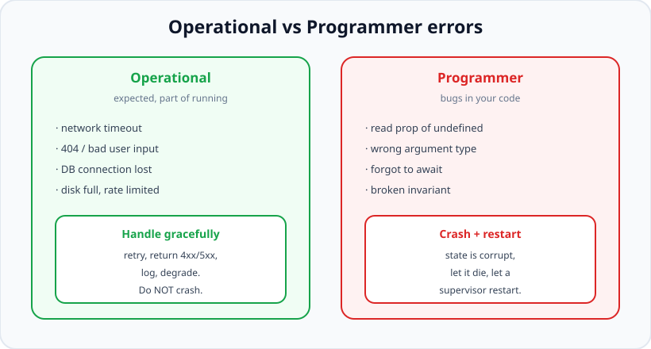

# Error Handling Patterns

*11 min read · Updated 24 Jul 2026 Topic 53 of 70 Bookmark Mark done Why it matters Every non · Topic 53 of 70*

**Source:** [https://www.geekyfrontend.in/learn/nodejs-backend-kit/error-handling-patterns](https://www.geekyfrontend.in/learn/nodejs-backend-kit/error-handling-patterns)

---

## Why it matters

Every non-trivial backend spends most of its life dealing with things that go wrong: a database that times out, a payment gateway that returns a 502, a user who posts garbage JSON, a downstream service that is briefly unreachable. The code that runs on the happy path is usually the small, easy part. The code that decides *what happens when the happy path breaks* is what separates a service that stays up and reports useful diagnostics from one that leaks memory, hangs sockets, and pages an on-call engineer at 3 a.m. with a stack trace that points nowhere.

Node makes this harder than a synchronous language because errors travel through several different channels — `throw`, rejected promises, the error-first callback convention, and `'error'` events on `EventEmitter`s — and each channel is caught in a different way. An error thrown inside an async callback will *not* be caught by a surrounding `try/catch` that has already returned. Interviewers lean on this topic precisely because it is where confident-sounding candidates fall apart: they know `try/catch` exists but cannot say why it silently misses the exact errors that matter most in production.

## The concept, simply

An **error** in Node is normally an instance of the built-in `Error` class. It carries three important properties: `name` (a category like `'TypeError'`), `message` (a human-readable description), and `stack` (a string snapshot of the call stack captured at the moment the `Error` was *constructed*, not when it was thrown). Since ES2022 it can also carry a `cause`, letting you wrap a low-level error in a higher-level one without losing the original.



An Error is a plain object with well-known fields. Subclassing it lets you attach machine-readable data like a code or an HTTP status without abandoning stack traces.

The single most important mental model is the split between two *kinds* of error. **Operational errors** are expected runtime conditions in a correct program: a network timeout, a 404, invalid user input, a full disk. They are not bugs — they are the normal texture of a system talking to an unreliable world, and you handle them: retry, return a 4xx, degrade gracefully. **Programmer errors** are bugs: reading a property of `undefined`, passing the wrong type, forgetting to `await`. You do not "handle" a bug — you fix it, and until you do, the safest response is to let the process crash and restart with clean state.



The operational-vs-programmer distinction drives every handling decision: recover from the first, crash on the second.

## How it works

Errors reach your code through four channels, and mixing them up is the root of most Node error bugs.

**1. Synchronous `throw`.** A thrown error unwinds the stack until it hits the nearest enclosing `try/catch`. This works cleanly only while you are still on the same synchronous call stack. The moment execution is handed back to the event loop — a `setTimeout`, an I/O callback, a `.then()` continuation — that original `try/catch` has already returned and can no longer catch anything.

**2. Rejected promises.** An `async` function that throws returns a rejected promise. You catch it with `try/catch` *inside another* `async` function using `await`, or with `.catch()` on the promise. Crucially, `await` re-synchronises the async error back onto your current stack, which is exactly why `try/catch` around `await` works when `try/catch` around a bare callback does not.

**3. Error-first callbacks.** The classic Node convention: `callback(err, result)`. The first argument is an `Error` or `null`. There is no language mechanism forcing you to check `err` — it is pure discipline, which is why callbacks are so error-prone and why promises largely replaced them.

**4. `'error'` events.** Streams, sockets, servers and other `EventEmitter`s report failure by emitting an `'error'` event. This one has teeth: if an `EventEmitter` emits `'error'` and there is *no listener*, Node throws it as an uncaught exception and the process dies. Forgetting `stream.on('error', ...)` is a leading cause of surprise crashes.

Because the four channels don't compose, the winning strategy is to **funnel everything into promises and a single error boundary**. In async/await code every failure — thrown, rejected, or a callback error you've promisified — becomes a rejection you can catch in one place. In an HTTP server that place is typically a central error-handling middleware; the route handlers just `throw` and trust the boundary to translate the error into a status code and a log line.

## Code examples

A custom error class that stays a real `Error` (keeps its stack) while adding machine-readable fields. Extending `Error` and setting `this.name` is the canonical pattern:

javascript

```
class AppError extends Error {
  constructor(message, { statusCode = 500, code = 'INTERNAL', cause } = {}) {
    super(message, { cause });        // ES2022: preserves the original error
    this.name = this.constructor.name; // 'AppError' instead of generic 'Error'
    this.statusCode = statusCode;
    this.code = code;
    this.isOperational = true;         // this is an expected error, not a bug
    Error.captureStackTrace(this, this.constructor); // trim ctor from the stack
  }
}

class NotFoundError extends AppError {
  constructor(resource) {
    super(resource + ' not found', { statusCode: 404, code: 'NOT_FOUND' });
  }
}

const err = new NotFoundError('User');
console.log(err instanceof Error, err.statusCode, err.code); // true 404 NOT_FOUND
```

Why `try/catch` misses an async error, and the two ways to fix it. This is the single most-tested idea in the whole topic:

javascript

```
// BROKEN: the throw happens on a LATER tick, after try/catch returned.
try {
  setTimeout(() => {
    throw new Error('boom'); // uncaught — crashes the process
  }, 10);
} catch (e) {
  console.log('never runs'); // the stack here is long gone
}

// FIX A: promisify, then await so the error re-enters this stack.
const delay = (ms) => new Promise((res) => setTimeout(res, ms));
async function run() {
  try {
    await delay(10);
    throw new Error('boom');
  } catch (e) {
    console.log('caught:', e.message); // 'caught: boom'
  }
}
run();
```

Wrapping a low-level error with `cause` so the caller gets a meaningful message without losing the root failure — a pattern interviewers love because it shows you value diagnosability:

javascript

```
import { readFile } from 'node:fs/promises';

async function loadConfig(path) {
  try {
    return JSON.parse(await readFile(path, 'utf8'));
  } catch (cause) {
    // Add context; keep the original error reachable via err.cause
    throw new AppError('Failed to load config at ' + path, {
      code: 'CONFIG_LOAD', cause,
    });
  }
}

try {
  await loadConfig('/nope.json');
} catch (e) {
  console.log(e.message);       // Failed to load config at /nope.json
  console.log(e.cause.code);    // 'ENOENT' — the underlying fs error survives
}
```

A central Express error boundary. Route handlers stay clean; every error lands here and is classified operational vs unknown:

javascript

```
// Route: just throw. No local error plumbing. This relies on Express 5, which forwards
// async rejections to the error boundary; on Express 4 wrap the handler with an
// asyncHandler (see the Express error-handling topic) or the process crashes.
app.get('/users/:id', async (req, res) => {
  const user = await db.users.find(req.params.id);
  if (!user) throw new NotFoundError('User');
  res.json(user);
});

// Central boundary — the LAST middleware, with 4 args.
app.use((err, req, res, next) => {
  const operational = err.isOperational === true;
  req.log.error({ err, requestId: req.id }, 'request failed');
  res.status(operational ? err.statusCode : 500).json({
    code: operational ? err.code : 'INTERNAL',
    message: operational ? err.message : 'Something went wrong',
  });
  // Unknown (non-operational) errors mean our state may be corrupt.
  // Log, respond, and let a crash policy decide whether to exit.
});
```

## Common mistakes & gotchas

- **Expecting `try/catch` to catch async errors.** It only catches synchronous throws on the current stack and rejections you `await`. A bare `throw` inside `setTimeout`, an event callback, or an un-awaited promise escapes it entirely.
- **Throwing non-Error values.** `throw 'oops'` or `throw { code: 1 }` gives you no stack trace and breaks any code doing `err instanceof Error`. Always throw a real `Error`.
- **Swallowing errors.** An empty `catch {}`, or `.catch(() => {})`, turns a failure into silent wrong behaviour. If you catch, either handle it meaningfully or re-throw.
- **Forgetting the `'error'` listener on streams/emitters.** No listener means an emitted `'error'` becomes an uncaught exception that kills the process.
- **Subclassing `Error` without setting `name`.** Logs then say `Error` for every custom type, and `captureStackTrace` is skipped, leaving the constructor noise in the trace.
- **Losing the original error when re-wrapping.** Building a new error message but dropping the root cause destroys the trail. Use the `cause` option.
- **Treating every error as operational.** Catching a genuine bug (a `TypeError` from your own code) and returning a friendly 400 hides corruption and lets a poisoned process keep serving.
- **Returning inside a promise `.catch()` instead of re-throwing** when you meant to propagate — the chain then resolves as success with `undefined`.

## Best practices

- **Always throw `Error` (or a subclass), never a string or plain object.** Stack traces and `instanceof` checks depend on it.
- **Model your domain with a small error hierarchy** (e.g. `ValidationError`, `NotFoundError`, `AuthError`) carrying `statusCode`, `code`, and `isOperational`.
- **Classify operational vs programmer errors explicitly** and let the classification drive whether you recover or crash.
- **Prefer async/await with a single error boundary** over scattered per-call handling. One place translates errors to responses and logs.
- **Use `cause` to chain context** as an error bubbles up through layers, so the final log shows the whole story.
- **Promisify legacy callback APIs** (or use the `node:util` `promisify`) so every failure arrives as a rejection you can funnel.
- **Attach an `'error'` handler to every stream, socket and server** the moment you create it.
- **Never expose internal messages or stacks to clients.** Return a generic message plus a code; log the detail server-side keyed by a request id.

## ⭐ Interview lens

> **Q: "Why doesn't `try/catch` catch an error thrown inside a `setTimeout` callback?"**  
> A: Because the callback runs on a later tick of the event loop, long after the synchronous `try` block has finished executing and returned. `try/catch` only guards the synchronous call stack it wraps; when the timer fires there is no active `try` frame on the stack to catch the throw, so it propagates as an uncaught exception. `await` works because it re-synchronises the rejection back onto the current stack.

> **Q: "What is the difference between an operational error and a programmer error?"**  
> A: An operational error is an expected runtime failure in a correct program — a timeout, a 404, bad input — and you handle it (retry, return a status, degrade). A programmer error is a bug — a `TypeError`, a forgotten `await`, a broken invariant. You don't handle bugs; you fix them, and until then the process may be in a corrupt state, so the safe move is to crash and restart. Conflating the two — catching a bug and pretending you recovered — is how you keep serving from a poisoned process.

> **Q (trap): "So you should always use `process.on('uncaughtException')` to keep the server from crashing?"**  
> A: No — that's the trap. `uncaughtException` is a last-resort hook for logging and a graceful shutdown, not a way to resume normal operation. By the time it fires, an unknown error has already escaped every boundary and your state may be inconsistent. Swallowing it and continuing risks leaked connections, corrupted data and hard-to-debug behaviour. Log, flush, and exit so a supervisor restarts clean.

> **Q: "What does the `cause` option do and why use it?"**  
> A: `new Error(msg, { cause })` (ES2022) attaches the original error as `err.cause`. It lets you throw a higher-level, meaningful error at each layer while preserving the root failure, so a log at the top shows both the business-level message and the low-level `ENOENT` or connection reset that started it — without manual string concatenation that loses the stack.

> **Q: "Why is throwing a string bad?"**  
> A: A string has no `stack`, no `name`, no `message` property, and fails every `err instanceof Error` check that middleware and libraries rely on. You lose the trace that tells you where it happened and break any code that inspects the error. Always throw an `Error` instance.

> **Q: "How do you handle errors from an EventEmitter or stream?"**  
> A: Subscribe to its `'error'` event immediately: `stream.on('error', handler)`. Unlike promises, an emitter doesn't buffer errors — if it emits `'error'` with no listener, Node re-throws it as an uncaught exception and the process dies. For streams, `pipeline()` from `node:stream` is preferable because it propagates and cleans up errors across the whole chain automatically.

## Cheat-card

- **Four error channels:** `throw` (sync), rejected promise (`await`/`.catch`), error-first callback, `'error'` event.
- **try/catch** catches sync throws + awaited rejections only — never bare async callbacks.
- **Operational** = expected, handle it. **Programmer** = bug, crash & restart.
- **Custom error:** `extends Error`, set `this.name`, add `code`/`statusCode`/`isOperational`, call `Error.captureStackTrace`.
- **Chain context** with `new Error(msg, { cause })`.
- **Always throw real `Error`s**; never swallow; always add an `'error'` listener to emitters.
- **One central error boundary** translates errors to responses + logs.

---

## Learn More

- [Errors (Node.js API) nodejs.org](https://nodejs.org/api/errors.html)
- [try...catch — JavaScript (MDN) developer.mozilla.org](https://developer.mozilla.org/en-US/docs/Web/JavaScript/Reference/Statements/try...catch)
- [Error Handling in NodeJS (Complete Guide) | Node Tutorial Nikita Dev](https://www.youtube.com/watch?v=mGPj-pCGS2c)
