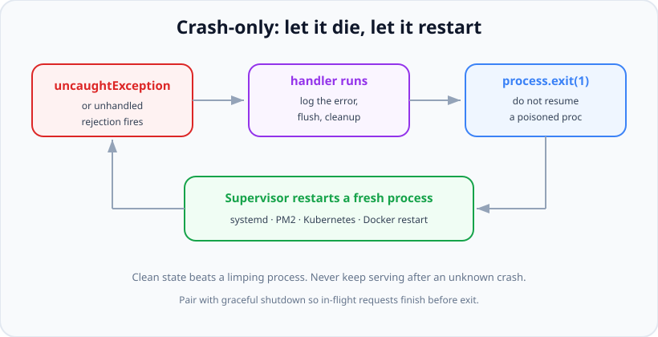

# Uncaught Exceptions & Unhandled Rejections

*11 min read · Updated 24 Jul 2026 Topic 54 of 70 Bookmark Mark done Why it matters No matter how disciplined your error handling is · Topic 54 of 70*

**Source:** [https://www.geekyfrontend.in/learn/nodejs-backend-kit/uncaught-unhandled](https://www.geekyfrontend.in/learn/nodejs-backend-kit/uncaught-unhandled)

---

## Why it matters

No matter how disciplined your error handling is, some error will eventually escape every boundary. A library throws asynchronously in a code path you never tested; a promise rejects and nobody awaited it; a timer callback blows up. Node has to do *something* when that happens, and the something it does — plus the something *you* configure it to do — decides whether your service degrades gracefully or corrupts data, hangs sockets, and slowly rots until it needs a manual kick.

This is one of the highest-signal interview topics for backend Node roles because it exposes a philosophy, not just an API. The naive instinct — "catch the uncaught exception and keep running so we never go down" — is exactly backwards and is the single most common production anti-pattern in the Node ecosystem. Understanding *why* the correct answer is usually "let it crash" tells an interviewer you've operated real services and internalised how process state, the event loop, and supervisors interact.

## The concept, simply

There are two global "last resort" events. **`uncaughtException`** fires when a synchronous throw (or an async throw with no surrounding async handler) propagates all the way up with nothing to catch it. **`unhandledRejection`** fires when a promise rejects and no `.catch()` or `try/catch await` is ever attached to it. Both are signals that an error slipped past all your intended handling.

The **crash-only** philosophy says: when an *unknown* error has escaped, the process is in an undefined state and you cannot trust it to keep serving correctly. So the honourable thing is to log the error, run a short, bounded cleanup, and exit — then let an external supervisor start a fresh process with clean memory. A restart takes milliseconds; a subtly corrupted long-lived process can take down data integrity for hours.



Crash-only design: the global handler is for logging and graceful shutdown, not recovery. A supervisor provides resilience by replacing the dead process.

## How it works

When an exception reaches the top of the stack with no handler, Node emits `'uncaughtException'` on the `process` object. If *you* have registered a listener, Node calls it and then — critically — **does not exit on its own**. It assumes you took responsibility, and it keeps the event loop running. This is the source of the danger: if your listener just logs and returns, the process limps on in whatever broken state caused the crash. If you register *no* listener, Node prints the stack to stderr and exits with code 1, which is actually the safer default.

Since Node 15, an **unhandled promise rejection terminates the process by default** (exit code 1), just like an uncaught exception — a deliberate change from older versions that merely warned. You can still register a `'unhandledRejection'` listener to log detail before exiting. A subtle companion event, `'rejectionHandled'`, fires if a rejection that was reported as "unhandled" later gets a handler attached — useful for reasoning about promises that are awaited far from where they're created, but rarely used directly.

Why can't you safely resume? Because the throw unwound the stack at an arbitrary point. A function might have acquired a lock, opened a transaction, or half-mutated a shared data structure and then thrown before restoring the invariant. There is no general way to know what was left in a broken state. V8's own guidance and the Node docs are explicit: after an `uncaughtException`, the correct action is to shut down. Treat the handler as a place to *flush logs and close resources*, on a timeout, then `process.exit(1)`.

Resilience therefore comes from **outside** the process. A supervisor — `systemd`, PM2, Docker's restart policy, or a Kubernetes liveness probe replacing a pod — restarts the service. Combined with running multiple instances behind a load balancer (or the `cluster` module / a process manager), one crash drops at most a few in-flight requests while healthy instances keep serving. This is the same "let it crash" model Erlang/OTP made famous.

One more piece ties it together: **graceful shutdown**. Beyond crashes, a healthy deploy sends `SIGTERM` to ask the process to stop. A well-behaved server listens for `SIGTERM`/`SIGINT`, stops accepting new connections, lets in-flight requests finish within a timeout, closes the DB pool, and exits 0. The same cleanup routine your signal handler runs is often the one your last-resort exception handler should run too.

## Code examples

The correct last-resort handlers: log, attempt a bounded cleanup, then exit. Note the safety timer so a hung cleanup can't wedge the process forever:

javascript

```
import process from 'node:process';

let shuttingDown = false;

function crash(origin, err) {
  if (shuttingDown) return; // avoid re-entrancy if cleanup itself throws
  shuttingDown = true;
  // Use a raw, synchronous-ish log path; the async logger may be broken.
  console.error('FATAL', origin, err);

  // Give logs/metrics a moment to flush, but never hang forever.
  const timer = setTimeout(() => process.exit(1), 3000);
  timer.unref(); // don't keep the loop alive just for this timer

  closeServerAndDb()
    .catch(() => {})
    .finally(() => process.exit(1));
}

process.on('uncaughtException', (err) => crash('uncaughtException', err));
process.on('unhandledRejection', (reason) => crash('unhandledRejection', reason));
```

The anti-pattern to recognise and reject in review — swallowing the exception to "stay up":

javascript

```
// ❌ NEVER DO THIS. The process keeps running in an unknown, possibly
// corrupt state. Locks may be held, transactions half-open, memory leaked.
process.on('uncaughtException', (err) => {
  console.error('ignoring', err); // and then... nothing. Loop keeps going.
});

// Subtle failure: a request handler threw mid-transaction. The connection
// is never released back to the pool. After enough of these, the pool is
// exhausted and EVERY request hangs — with no obvious crash to point at.
```

Graceful shutdown on `SIGTERM` — the planned counterpart to a crash. Stop taking work, drain, close, exit clean:

javascript

```
import http from 'node:http';

const server = http.createServer(app);
server.listen(3000);

async function shutdown(signal) {
  console.log('received ' + signal + ', draining...');
  server.close(async () => {          // stop accepting new connections
    try {
      await db.pool.end();            // close DB connections
    } finally {
      process.exit(0);                 // clean, intentional exit
    }
  });
  // Hard cap: if draining stalls, force-exit so the orchestrator moves on.
  setTimeout(() => process.exit(1), 10_000).unref();
}

process.on('SIGTERM', () => shutdown('SIGTERM'));
process.on('SIGINT', () => shutdown('SIGINT'));
```

Demonstrating that an un-awaited rejection is fatal by default in modern Node, and how a single missing `await` causes it:

javascript

```
async function chargeCard() {
  throw new Error('gateway down');
}

// ❌ No await, no .catch — the returned promise rejects with nobody watching.
function handlePayment() {
  chargeCard(); // fire-and-forget: becomes an unhandledRejection
}
handlePayment();
// Node >= 15 prints the rejection and exits with code 1.

// ✅ Fix: await it inside a try/catch, or attach .catch explicitly.
async function handlePaymentFixed() {
  try { await chargeCard(); }
  catch (e) { /* operational: retry or surface a 502 */ }
}
```

## Common mistakes & gotchas

- **Registering an `uncaughtException` handler that doesn't exit.** This is the cardinal sin — it disables Node's safe default crash and lets a corrupt process keep serving.
- **Assuming unhandled rejections only warn.** Since Node 15 they terminate the process by default. Code that "worked" on Node 12 by ignoring rejections now crashes.
- **Fire-and-forget async calls.** Calling an `async` function without `await` or `.catch()` creates a floating promise; any rejection becomes unhandled. Common with logging, metrics, and "background" work.
- **Doing heavy async work in the last-resort handler.** The event loop and libraries may be in a bad state; keep cleanup minimal and always guard it with a force-exit timer.
- **No supervisor.** Crash-only design only works if something restarts you. A bare `node server.js` with no PM2/systemd/orchestrator just stays down after the first crash.
- **Confusing graceful shutdown with crash handling.** `SIGTERM` is a planned, clean stop (exit 0); an uncaught exception is an emergency (exit 1). They share cleanup code but mean different things.
- **Forgetting `.unref()` on the safety timer,** so the timer itself keeps the process alive past the point you wanted it dead.
- **Logging asynchronously and exiting immediately,** so the final fatal log never flushes before the process is gone.

## Best practices

- **Let it crash.** Treat `uncaughtException`/`unhandledRejection` as signals to log, flush, and exit 1 — never to resume normal operation.
- **Run under a supervisor** (systemd, PM2, Kubernetes, Docker restart policy) and run multiple instances so a single crash is invisible to users.
- **Bound your cleanup with a force-exit timer** using `setTimeout(...).unref()` so a hung shutdown can't strand the process.
- **Implement graceful shutdown on `SIGTERM`/`SIGINT`:** stop accepting connections, drain in-flight work, close pools, exit 0.
- **Never leave floating promises.** Always `await` or `.catch()`. Enable the ESLint `no-floating-promises` rule to catch them at build time.
- **Keep the fatal logger simple and prefer a sync write** (or a logger with a flush hook) so the last message actually reaches disk/stdout.
- **Expose a health/liveness endpoint** so orchestrators can detect a wedged (but not crashed) process and restart it.
- **Test the restart path,** not just the happy path — verify the supervisor actually brings the service back.

## ⭐ Interview lens

> **Q: "You have an `uncaughtException` handler so your server never goes down. Is that good?"**  
> A: No — it's the classic anti-pattern. Registering a handler disables Node's safe default of crashing, and if the handler just logs and returns, the process keeps running in an undefined state: locks may be held, transactions half-open, connections leaked. The correct use of the handler is to log the error, run a bounded cleanup, and `process.exit(1)`, then rely on a supervisor to restart a clean process. Resilience comes from restarting, not from resuming.

> **Q: "What happens to an unhandled promise rejection in modern Node?"**  
> A: Since Node 15 the default is to terminate the process with exit code 1, the same as an uncaught exception. Older versions only printed a warning. So a floating promise — an `async` call made without `await` or `.catch()` — that rejects will now crash the service. You can register a `process.on('unhandledRejection')` listener to log detail first, but you should still exit.

> **Q (trap): "Why not just catch the error and keep the request alive?"**  
> A: For a *known, operational* error you should — that belongs in normal try/catch. But if it reached `uncaughtException`, it's an *unknown* error that escaped every intended boundary, which means you don't know what state it left behind. The stack unwound at an arbitrary point; a shared structure may be half-mutated. Continuing risks silent data corruption that's far worse than a fast restart.

> **Q: "What's the difference between `SIGTERM` handling and an uncaught-exception handler?"**  
> A: `SIGTERM` is a planned, graceful shutdown — the orchestrator asks the process to stop, so you drain in-flight requests, close resources, and exit 0. An uncaught exception is an emergency — an error escaped everything, so you do a minimal cleanup and exit 1. They often share a cleanup routine, but one is a clean intentional stop and the other is a controlled crash.

> **Q: "Why is `.unref()` used on the force-exit timer?"**  
> A: A pending `setTimeout` normally keeps the event loop — and thus the process — alive until it fires. `unref()` tells Node "don't stay alive just for this timer." That way, if cleanup finishes quickly the process can exit immediately, but if cleanup hangs the timer still fires as a backstop to force the exit. It's a safety net that never delays a clean shutdown.

> **Q: "How do you make crash-only design actually resilient to users?"**  
> A: Run more than one instance behind a load balancer (via the cluster module, a process manager, or multiple pods) and put every instance under a supervisor that restarts on exit. When one process crashes, it drops at most its in-flight requests; the load balancer routes new traffic to healthy instances while the supervisor replaces the dead one in milliseconds. The user never notices.

## Cheat-card

- **`uncaughtException`** = sync/async throw reached the top with no catch.
- **`unhandledRejection`** = promise rejected, no handler. **Node ≥15 exits by default.**
- **Golden rule:** handlers are for log + flush + `exit(1)`, never to resume.
- **Resilience is external:** supervisor (systemd/PM2/K8s) + multiple instances.
- **Graceful shutdown:** on `SIGTERM` stop accepting → drain → close pools → exit 0.
- **Bound cleanup** with `setTimeout(...).unref()` force-exit.
- **No floating promises** — always `await`/`.catch`; lint with `no-floating-promises`.

---

## Learn More

- [Process — 'uncaughtException' & 'unhandledRejection' events (Node.js API) nodejs.org](https://nodejs.org/api/process.html)
- [Errors (Node.js API) nodejs.org](https://nodejs.org/api/errors.html)
