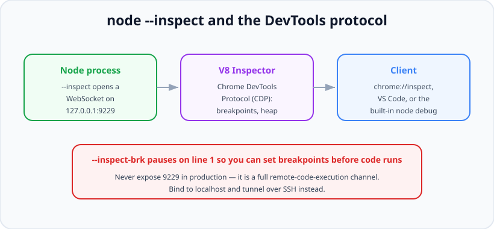

# Debugging Node.js

*11 min read · Updated 24 Jul 2026 Topic 55 of 70 Bookmark Mark done Why it matters Debugging is where most engineering time actually goes · Topic 55 of 70*

**Source:** [https://www.geekyfrontend.in/learn/nodejs-backend-kit/debugging-nodejs](https://www.geekyfrontend.in/learn/nodejs-backend-kit/debugging-nodejs)

---

## Why it matters

Debugging is where most engineering time actually goes, yet it's the skill people most often try to fake with a scatter of `console.log` calls. That works for a trivial bug, but it collapses the moment the problem is a race between two async operations, a memory leak that only shows after an hour of traffic, a CPU spike with no obvious cause, or a crash you can reproduce only in production. A developer who can attach a real debugger, set a conditional breakpoint, inspect the live call stack, and capture a heap snapshot solves in minutes what a `console.log` archaeologist solves in a day.

Interviewers ask about debugging to separate people who understand the runtime from people who only know their framework. Knowing *how* `node --inspect` connects to Chrome DevTools, what a core dump contains, and why an async stack trace looks the way it does demonstrates that you understand Node's execution model — the same understanding that lets you reason about the event loop, memory, and performance. It's a proxy for depth.

## The concept, simply

Node has a built-in debugger powered by V8's **Inspector**. When you start a process with `node --inspect app.js`, V8 opens a WebSocket endpoint (default `127.0.0.1:9229`) speaking the **Chrome DevTools Protocol (CDP)**. Any CDP client — Chrome's `chrome://inspect` page, VS Code's debugger, or the terminal `node inspect` client — connects to that endpoint and can set breakpoints, step through code, read variables, evaluate expressions in the paused context, profile the CPU, and take heap snapshots.



node --inspect exposes the V8 Inspector over a WebSocket. Any Chrome DevTools Protocol client attaches to it — never expose that port publicly.

The key variant is **`--inspect-brk`**, which pauses execution on the very first line and waits for a debugger to attach before running anything. That's how you debug code that crashes or misbehaves during startup — with plain `--inspect` the interesting code may run before you've connected. The two are otherwise identical.

## How it works

Under the hood, V8 exposes the Inspector as an in-process agent. The `--inspect` flag activates it and binds the WebSocket; a client performs a handshake, then exchanges JSON CDP messages like `Debugger.setBreakpointByUrl`, `Debugger.paused`, `Runtime.evaluate`, and `HeapProfiler.takeHeapSnapshot`. Because the protocol is the same one Chrome uses for front-end JavaScript, the DevTools UI you already know works unchanged against a Node backend. You can also trigger the inspector on a *running* process by sending it `SIGUSR1` (`kill -USR1 <pid>`), which is invaluable when a live process misbehaves and you didn't start it with the flag.

The `debugger;` statement is a source-level breakpoint: when the Inspector is attached and execution hits that line, V8 pauses there exactly as if you'd clicked to set a breakpoint. With no debugger attached it's a no-op, so it's safe-ish in dev but should never ship to production. Once paused, you get the full toolkit: the **call stack** (including async frames, since modern V8 stitches async continuations into the trace), **scope** (local, closure, global variables), **watch expressions**, and a live REPL that evaluates in the paused frame's scope.

Beyond stepping, the Inspector drives two profilers that matter for hard bugs. The **CPU profiler** samples the stack to show where wall-clock or CPU time goes — the go-to for "an endpoint is slow" or "the event loop is blocked." The **heap profiler** takes **heap snapshots**: full graphs of every live object and what retains it. Taking two snapshots minutes apart and comparing them ("what grew?") is *the* technique for finding memory leaks — a leak is almost always objects that should have been collected but are still reachable from something like a module-level array, a cache without eviction, or a listener never removed.

A **core dump** is the heavier artifact: a snapshot of the process's entire memory at the instant it crashed, written to disk by the OS (enable with `ulimit -c unlimited`) or by tools like `llnode` / `node-report`. Post-mortem debuggers load the dump and let you inspect the stack and heap of a process that is already dead — the only way to diagnose a crash you can't reproduce interactively. Node's built-in **diagnostic report** (`--report-on-fatalerror`, or `process.report`) is a lighter, JSON alternative capturing the stack, resource usage, libuv handles, and environment at the moment of failure.

## Code examples

Starting a debug session. `--inspect-brk` is what you want for startup bugs because it waits for you before running a line:

bash

```
# Attach at will; code runs immediately.
node --inspect app.js

# Pause on line 1 and wait for a debugger to attach (debug startup code).
node --inspect-brk app.js

# Open chrome://inspect in Chrome, click "inspect", or in VS Code use a
# launch config. Then set breakpoints in the DevTools Sources panel.

# Trigger the inspector on an ALREADY-running process (didn't use --inspect):
kill -USR1 $(pgrep -f 'node app.js')
```

The `debugger;` statement plus conditional logic — pause only on the interesting case instead of drowning in output:

javascript

```
function processOrder(order) {
  // Pauses here ONLY when the Inspector is attached AND this branch runs.
  if (order.total < 0) {
    debugger; // inspect 'order' live: full object, call stack, scope
  }
  return charge(order);
}

// Prefer a conditional breakpoint in DevTools (right-click the gutter) over
// editing source: e.g. break on line 42 only when order.id === 'abc'.
```

Capturing a diagnostic report programmatically — a portable, dependency-free post-mortem artifact you can attach to a bug ticket:

javascript

```
import process from 'node:process';

// Configure at startup: auto-write a JSON report on a fatal error or signal.
process.report.reportOnFatalError = true;
process.report.reportOnSignal = true;
process.report.directory = './reports';

// Or capture one on demand when something looks wrong:
function snapshotOnAnomaly(reason) {
  const file = process.report.writeReport();
  console.error('wrote diagnostic report:', file, 'reason:', reason);
  // The report contains: JS + native stack, heap/resource usage, libuv
  // handles (open sockets/timers), env vars, and Node/OS versions.
}
```

Finding a memory leak by comparing heap growth. The code below deliberately leaks so the technique is concrete:

javascript

```
const cache = []; // module-level: never garbage-collected

app.get('/leak', (req, res) => {
  // ❌ Grows forever — nothing ever removes entries. Classic leak.
  cache.push(Buffer.alloc(1024 * 100, 'x'));
  res.end('ok');
});

// Diagnose: run with --inspect, open DevTools > Memory. Take a heap snapshot,
// hit /leak many times, take a SECOND snapshot, then use the "Comparison"
// view. The retained Buffers under 'cache' light up as the delta. The fix is
// an eviction policy (LRU, TTL) or not caching at module scope at all.

// Quick numeric signal without DevTools:
setInterval(() => {
  const { heapUsed } = process.memoryUsage();
  console.log('heapUsed MB:', (heapUsed / 1048576).toFixed(1));
}, 5000).unref();
```

## Common mistakes & gotchas

- **Exposing the inspector port in production.** Port 9229 is a full remote-code-execution channel — anyone who can reach it can run arbitrary code in your process. Bind to localhost and tunnel over SSH; never `--inspect=0.0.0.0` on a public host.
- **Using `--inspect` when you need `--inspect-brk`.** For startup or crash-on-boot bugs, plain `--inspect` lets the code run before you attach, so you miss the moment.
- **Shipping `debugger;` statements.** With an inspector attached in some environments they halt the process; at best they're dead code. Lint them out of production builds.
- **Reaching for `console.log` on async races.** Logging changes timing and can mask or move the race; a breakpoint that pauses everything is often clearer.
- **Debugging a leak with one heap snapshot.** A single snapshot shows what's live, not what's *growing*. You need two (or three) snapshots and the comparison view to see the delta.
- **Forgetting to enable core dumps** (`ulimit -c unlimited`) before a crash you want to post-mortem — after the crash it's too late.
- **Confusing a CPU-bound hang with a leak.** A blocked event loop and a growing heap are different problems needing different profilers; check `memoryUsage()` and event-loop lag before assuming.
- **Assuming async stack traces are complete.** They're much better in modern V8 but can still be truncated across certain boundaries; the `--stack-trace-limit` flag and `Error.stackTraceLimit` control depth.

## Best practices

- **Learn one real debugger well** — VS Code's built-in Node debugger or Chrome DevTools — and make it your default over `console.log`.
- **Use conditional and logpoint breakpoints** so you pause only on the case that matters instead of stepping through thousands of iterations.
- **Keep the inspector bound to localhost** and reach remote processes via an SSH tunnel; never expose 9229 publicly.
- **Enable diagnostic reports** (`reportOnFatalError`/`reportOnSignal`) in production so crashes leave a portable artifact automatically.
- **Diagnose leaks with paired heap snapshots** and the comparison view; look for objects retained by module-level state, caches, or un-removed listeners.
- **Profile CPU with the sampling profiler** (DevTools Performance tab or `--cpu-prof`) before micro-optimising — measure where time actually goes.
- **Send `SIGUSR1` to attach to a live process** you didn't start with `--inspect`, rather than restarting and losing the state.
- **Capture core dumps for unreproducible crashes** and inspect them post-mortem with `llnode` or the diagnostic report.

## ⭐ Interview lens

> **Q: "How does `node --inspect` actually work?"**  
> A: The flag turns on V8's Inspector agent, which opens a WebSocket (default `127.0.0.1:9229`) speaking the Chrome DevTools Protocol. Any CDP client — Chrome's `chrome://inspect`, VS Code, or the terminal `node inspect` — attaches to that socket and exchanges JSON messages to set breakpoints, read scope, evaluate expressions, and take CPU/heap profiles. Because it's the same protocol Chrome uses for front-end JS, the familiar DevTools UI drives a Node backend unchanged.

> **Q: "What's the difference between `--inspect` and `--inspect-brk`?"**  
> A: Both open the inspector, but `--inspect-brk` pauses on the first line and waits for a debugger to attach before executing anything. Use it to debug startup code or a crash-on-boot — with plain `--inspect`, that code may run before you've connected, so you'd miss it.

> **Q (trap): "Can you leave `--inspect` on in production so you can debug live?"**  
> A: You shouldn't. The inspector port is effectively a remote-code-execution backdoor — anyone who can reach 9229 can execute arbitrary code in your process. If you must debug live, bind to localhost only and reach it through an SSH tunnel, or send `SIGUSR1` to a running process to enable the inspector on demand, then disable it again. Never bind it to a public interface.

> **Q: "A Node service's memory keeps climbing until it OOMs. How do you find the leak?"**  
> A: Attach with `--inspect` and open DevTools Memory. Take a heap snapshot, drive the workload that leaks, take a second snapshot, and use the comparison view to see which objects *grew* and, via the retainers, what's keeping them alive. Leaks are almost always still-reachable objects — a module-level array or cache that never evicts, a closure capturing large data, or an event listener that's never removed. One snapshot only shows what's live; the delta between two shows what's leaking.

> **Q: "What is a core dump and when would you use one?"**  
> A: A core dump is a full snapshot of a process's memory written when it crashes (enabled with `ulimit -c unlimited`). You load it into a post-mortem debugger like `llnode` to inspect the stack and heap of a process that's already dead. It's the tool for crashes you can't reproduce interactively — production-only or intermittent failures. Node's diagnostic report is a lighter JSON alternative capturing the stack, resource usage, and libuv handles at the moment of failure.

> **Q: "The event loop seems blocked and requests hang, but memory is flat. What do you do?"**  
> A: That's a CPU/blocking problem, not a leak, so I reach for the CPU profiler (DevTools Performance tab or `--cpu-prof`) rather than heap snapshots. I'd look for a synchronous hot path — a big JSON parse, a sync crypto or fs call, a regex catastrophe, or a tight loop — that's monopolising the single thread. Measuring event-loop lag confirms the diagnosis, and the fix is usually to offload the work to a worker thread or make it async.

## Cheat-card

- **`node --inspect`** → V8 Inspector WebSocket on `127.0.0.1:9229`, speaks Chrome DevTools Protocol.
- **`--inspect-brk`** pauses on line 1 for startup/crash-on-boot bugs.
- **`debugger;`** = source breakpoint when a debugger is attached; no-op otherwise.
- **`kill -USR1 <pid>`** enables the inspector on a running process.
- **Leak?** Two heap snapshots + comparison view → find what grew & its retainers.
- **Slow/blocked?** CPU profiler (`--cpu-prof`) → find the synchronous hot path.
- **Crash you can't reproduce?** Core dump (`ulimit -c unlimited`) or diagnostic report.
- **Security:** never expose 9229 publicly — it's remote code execution.

---

## Learn More

- [Debugging Node.js nodejs.org](https://nodejs.org/en/learn/getting-started/debugging)
- [Debugger (Node.js API) nodejs.org](https://nodejs.org/api/debugger.html)
- [Getting started with Node.js debugging in VS Code Visual Studio Code](https://www.youtube.com/watch?v=2oFKNL7vYV8)
