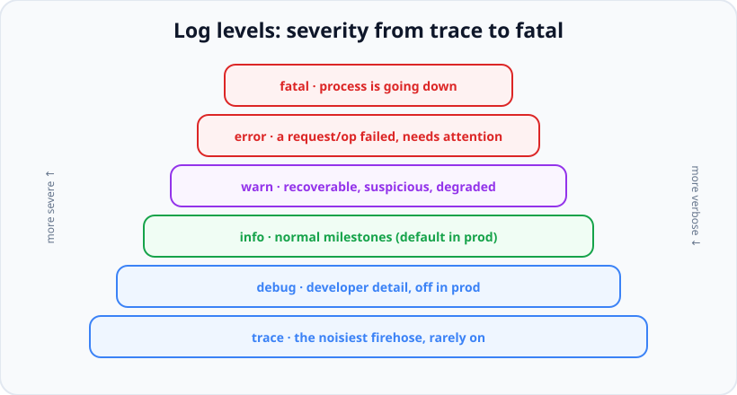
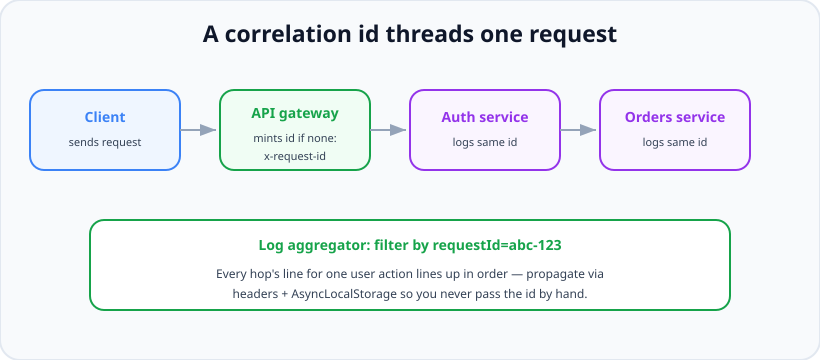

# Logging

*11 min read · Updated 24 Jul 2026 Topic 56 of 70 Bookmark Mark done Why it matters Logs are the primary way you understand a running system that you cannot attach a debugger to · Topic 56 of 70*

**Source:** [https://www.geekyfrontend.in/learn/nodejs-backend-kit/logging](https://www.geekyfrontend.in/learn/nodejs-backend-kit/logging)

---

## Why it matters

Logs are the primary way you understand a running system that you cannot attach a debugger to — which, in production, is almost always. When a customer reports "my payment failed at 2:14 pm," you can't step through their request; you can only search the record your system left behind. Good logs turn that into a two-minute lookup. Bad logs — unstructured, inconsistent, missing the request id, drowning in noise or leaking secrets — turn it into an afternoon of grep and guesswork, or a support ticket you simply cannot answer.

Logging is also a topic where junior and senior answers diverge sharply, so interviewers use it as a maturity signal. A junior says "use `console.log`." A senior talks about *structured* JSON logs, log *levels*, *correlation ids* that stitch one request across services, the performance cost of logging on the hot path, and — the one that really lands — a clear policy on what must **never** be logged: passwords, tokens, full card numbers, personal data. Getting that last part wrong is a security and compliance incident, not just a bug.

## The concept, simply

**Structured logging** means emitting each log entry as machine-readable data — almost always a JSON object — instead of a free-form English sentence. Rather than `console.log('user 42 bought kit 7')`, you emit `{ level: 'info', msg: 'purchase', userId: 42, kitId: 7, requestId: 'abc' }`. The difference is enormous: a log platform (Datadog, Loki, CloudWatch, the ELK stack) can index those fields and let you query `userId=42 AND level=error` across billions of lines in seconds. Free-text logs can only be grepped, which doesn't scale and can't be aggregated into dashboards or alerts.

**Log levels** rank entries by severity — commonly `trace`, `debug`, `info`, `warn`, `error`, `fatal`. You set a threshold (usually `info` in production, `debug` in dev) and everything below it is suppressed, so you can dial verbosity without editing code. This is how you keep production logs affordable and readable while still being able to crank up detail when hunting a bug.



Log levels let one threshold control verbosity. Production usually sits at info; drop to debug/trace only while investigating.

A **correlation id** (a.k.a. request id or trace id) is a unique token attached to every log line produced while handling a single request, propagated across every service the request touches. It's what lets you reconstruct the full story of one user action from thousands of interleaved lines emitted by many concurrent requests and processes.



A correlation id threads one request across services. Filtering the aggregator by that id reconstructs the entire journey in order.

## How it works

In Node the two dominant structured loggers are **pino** and **winston**. Pino is built for speed: it serialises to JSON with minimal overhead and, crucially, offloads the expensive work — formatting, pretty-printing, shipping to a destination — to a separate *transport* process so the main thread isn't blocked writing logs. This matters because logging sits on your request hot path; a slow synchronous logger can throttle throughput. Winston is more feature-rich and flexible (many transports, custom formats) at some performance cost. Both emit JSON, both support levels, and both let you attach structured fields.

The mechanism that makes correlation ids ergonomic is the **child logger** plus **`AsyncLocalStorage`**. At the start of each request you read or mint a request id (typically from an incoming `x-request-id` header, or generate a UUID), then create a child logger bound to that id: `req.log = log.child({ requestId })`. Every line that child emits automatically includes the id — you never pass it manually. `AsyncLocalStorage` (from `node:async_hooks`) goes further: it keeps a per-request context alive across every `await` and callback in that request's async chain, so even code deep in a service layer, with no access to `req`, can grab the current request id from the ambient store. That's the modern replacement for threading a context object through every function signature.

Levels work by numeric comparison: each level has a value (pino uses `trace`=10 … `fatal`=60), the logger has a threshold, and a call is dropped cheaply if its level is below the threshold. Because the check happens before serialisation, disabled log calls are nearly free — but only if you don't do expensive work to *build* the log object before calling. Passing an object and letting the logger serialise lazily is faster than pre-formatting a string.

Finally, logs need somewhere to go. The **twelve-factor** guidance — which almost all container/cloud deploys follow — is that your app should just write logs to **stdout/stderr** as a stream and let the platform (Docker, Kubernetes, systemd) capture and route them to an aggregator. The app shouldn't manage log files, rotation, or shipping itself; that's the environment's job. This keeps the app stateless and portable.

## Code examples

A pino logger with a per-request child bound to a correlation id — the everyday backbone of production logging:

javascript

```
import pino from 'pino';
import { randomUUID } from 'node:crypto';

const log = pino({
  level: process.env.LOG_LEVEL ?? 'info',
  // Redact secrets so they never reach disk (see below).
  redact: ['req.headers.authorization', '*.password', '*.token'],
});

app.use((req, res, next) => {
  const requestId = req.headers['x-request-id'] ?? randomUUID();
  req.log = log.child({ requestId, method: req.method, path: req.path });
  res.setHeader('x-request-id', requestId); // echo it back to the client
  req.log.info('request started');
  res.on('finish', () => req.log.info({ status: res.statusCode }, 'request done'));
  next();
});

// Deep in a handler — every line carries requestId automatically:
// req.log.warn({ retries: 2 }, 'payment gateway slow');
```

Propagating request context with `AsyncLocalStorage` so code that never sees `req` can still log the correlation id:

javascript

```
import { AsyncLocalStorage } from 'node:async_hooks';

const als = new AsyncLocalStorage();

app.use((req, res, next) => {
  const requestId = req.headers['x-request-id'] ?? randomUUID();
  // Everything downstream in this request's async chain shares this store.
  als.run({ requestId }, () => next());
});

// A logger that auto-injects the ambient requestId — no plumbing needed.
function ctxLog(level, obj, msg) {
  const store = als.getStore();
  log[level]({ ...obj, requestId: store?.requestId }, msg);
}

// Called from any service layer, across awaits, with zero context passed in:
async function chargeCard(amount) {
  ctxLog('info', { amount }, 'charging card'); // still tagged with requestId
}
```

Using levels meaningfully and logging an error *object* so the stack is preserved as a structured field, not stringified:

javascript

```
req.log.debug({ query }, 'running db query');      // dev detail, off in prod
req.log.info({ userId }, 'user logged in');          // normal milestone
req.log.warn({ latencyMs: 1400 }, 'slow upstream');  // suspicious, recovered

try {
  await charge(order);
} catch (err) {
  // Pass the Error under a key the logger serialises specially (err/stack).
  req.log.error({ err, orderId: order.id }, 'charge failed');
  // ❌ Don't do: req.log.error('charge failed: ' + err) — loses the stack
  //    and turns structured data into an un-queryable string.
}
```

Redaction — the difference between a log and a data breach. Never let secrets or PII reach the log sink:

javascript

```
const log = pino({
  redact: {
    paths: [
      'password', '*.password',
      'req.headers.authorization',
      'req.headers.cookie',
      'creditCard', 'ssn', 'user.email',
    ],
    censor: '[REDACTED]',
  },
});

// Even if a handler naively logs the whole request body, the sensitive
// fields are replaced before serialisation:
log.info({ password: 'hunter2', user: { email: 'a@b.com' } }, 'signup');
// => {"level":30,...,"password":"[REDACTED]","user":{"email":"[REDACTED]"}}
```

## Common mistakes & gotchas

- **Logging secrets or PII.** Passwords, tokens, session cookies, full card numbers, emails, and other personal data must never hit the logs — it's a security and compliance breach. Redact at the logger level so a careless log call can't leak them.
- **Unstructured string logs.** `log.info('user ' + id + ' did ' + action)` can't be queried by field. Emit objects: `log.info({ userId: id, action }, 'user action')`.
- **Stringifying errors.** `log.error('failed: ' + err)` throws away the stack. Pass the Error object under an `err` key so the logger serialises name, message, and stack.
- **One level for everything.** Logging every detail at `info` makes production unreadable and expensive; logging nothing until `error` leaves you blind. Use the whole ladder deliberately.
- **Logging on the hot path synchronously.** A slow, blocking logger throttles request throughput. Use an async/transport-based logger like pino and avoid pretty-printing in production.
- **Writing to files inside the app.** Managing log files and rotation couples the app to its host. Write to stdout and let the platform handle capture, rotation, and shipping.
- **No correlation id.** Without a request id threaded through, you can't separate one user's request from thousands of interleaved lines across services.
- **Over-logging (noise).** Logging inside tight loops or on every trivial branch buries the signal and inflates cost. Log decisions and boundaries, not every line executed.

## Best practices

- **Log structured JSON** with a fast logger (pino) so entries are queryable and aggregatable, not just greppable.
- **Use log levels deliberately:** `info` for milestones, `warn` for recoverable oddities, `error` for failed operations, `fatal` before the process dies; keep prod at `info` and lower the threshold to debug only while investigating.
- **Attach a correlation id to every request** via a child logger, and propagate it across services through headers and `AsyncLocalStorage`.
- **Log Error objects, not strings,** so stack traces survive as structured fields.
- **Redact secrets and PII at the logger level** with an explicit allow/deny policy — never rely on individual call sites to remember.
- **Write to stdout/stderr** and let the platform route logs (twelve-factor); keep the app stateless.
- **Include useful context** on each line — user id, route, status, duration — but log *events* and boundaries, not every statement.
- **Standardise a shared logger config** across services so fields, levels, and redaction are consistent and dashboards work everywhere.

## ⭐ Interview lens

> **Q: "What is structured logging and why prefer it over `console.log`?"**  
> A: Structured logging emits each entry as machine-readable data — a JSON object with named fields — instead of a free-form sentence. That lets a log platform index and query by field (`userId=42 AND level=error`) across billions of lines, build dashboards, and fire alerts. Free-text logs can only be grepped, which doesn't aggregate or scale. `console.log` is unstructured, has no levels, and writes synchronously, so it's fine for a script but wrong for a service.

> **Q: "What is a correlation id and how do you propagate it in Node?"**  
> A: It's a unique token attached to every log line for one request and carried across every service the request touches, so you can reconstruct that request's full journey from interleaved logs. In Node you read or mint it (often from an `x-request-id` header), bind a child logger to it, and pass it downstream via request headers between services and via `AsyncLocalStorage` within a service — so even deep code with no access to the request object can log the current id without threading a context parameter through every function.

> **Q (trap): "Should you log the request body so you can debug issues?"**  
> A: Not blindly. Request bodies routinely contain passwords, tokens, card numbers, and personal data, and logging them is a security and compliance breach. You configure redaction at the logger so sensitive fields are censored before serialisation, and you log only the specific, safe fields you actually need. The default posture is deny — never log a whole body or headers verbatim.

> **Q: "Why is pino considered fast, and why does logger speed matter?"**  
> A: Logging sits on the request hot path, and Node is single-threaded, so a slow synchronous logger directly caps throughput. Pino minimises work on the main thread — it serialises straight to JSON and offloads formatting, pretty-printing, and shipping to a separate transport process. It also checks the level before doing any serialisation, so disabled log calls are nearly free. Winston is more flexible but does more work inline, which costs latency under load.

> **Q: "How should you log an error — what's the difference between passing the Error and the message?"**  
> A: Pass the Error object as a field (e.g. `log.error({ err }, 'charge failed')`). The logger has a special serializer that captures `name`, `message`, and the full `stack` as structured data you can later search and read. Concatenating the error into a string (`'failed: ' + err`) collapses it to `[object Error]` or a message with no stack, destroying the most useful debugging information and making the line un-queryable.

> **Q: "Where should a containerised Node app send its logs?"**  
> A: To stdout/stderr as a stream, per the twelve-factor app methodology. The application shouldn't manage log files, rotation, or shipping — that couples it to its host and adds state. The platform (Docker, Kubernetes, systemd) captures the streams and routes them to an aggregator like Loki, CloudWatch, or the ELK stack. This keeps the app stateless, portable, and easy to scale horizontally.

## Cheat-card

- **Structured JSON logs** → queryable by field; beats greppable free text.
- **Levels:** trace/debug (dev) · info (prod default) · warn · error · fatal.
- **pino** = fast, transport-offloaded, prod default; **winston** = flexible, heavier.
- **Correlation id:** child logger + `x-request-id` header + `AsyncLocalStorage`.
- **Log Error objects** under an `err` key — keep the stack.
- **Never log** passwords, tokens, cookies, card numbers, PII — redact at the logger.
- **Write to stdout**; let the platform ship & rotate (twelve-factor).

---

## Learn More

- [Pino — Super fast, all natural JSON logger for Node.js getpino.io](https://getpino.io/)
- [winston — A logger for just about everything github.com](https://github.com/winstonjs/winston)
- [The BEST Way to Log in Node.js - Winston Better Stack](https://www.youtube.com/watch?v=He7Dc6DuxdI)
- [Node.js Logging Like a Pro: Centralized Logs Using Pino Transport, Loki & Grafana Code with Jay](https://www.youtube.com/watch?v=d1VRuGpJd10)
