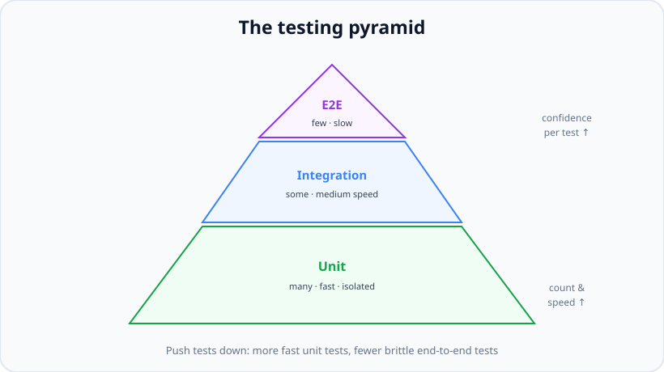
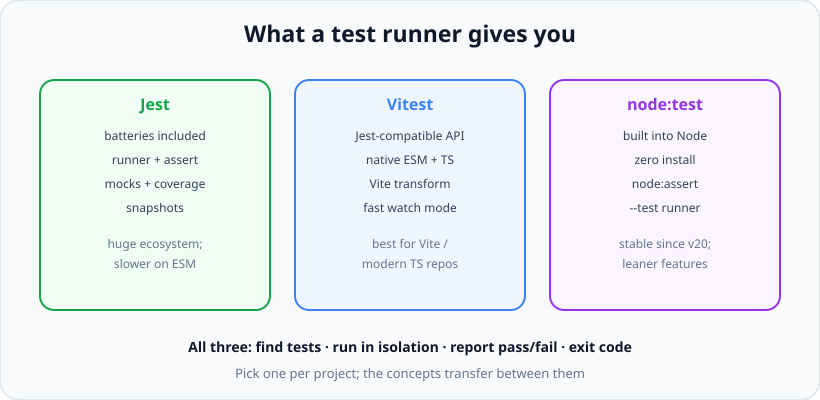

# Testing Fundamentals

*12 min read · Updated 24 Jul 2026 Topic 57 of 70 Bookmark Mark done Why it matters Tests are the only thing that lets a codebase grow without slowing down · Topic 57 of 70*

**Source:** [https://www.geekyfrontend.in/learn/nodejs-backend-kit/testing-fundamentals](https://www.geekyfrontend.in/learn/nodejs-backend-kit/testing-fundamentals)

---

## Why it matters

Tests are the only thing that lets a codebase grow without slowing down. Every backend you will ever work on faces the same quiet crisis: it starts small and easy to change, and then, feature by feature, it becomes something no one dares to touch. Automated tests are the mechanism that keeps a system changeable. They are an **executable specification** — a description of what the code is supposed to do that the machine re-checks on every commit — and a **regression net** that catches the day your innocent one-line fix silently breaks a login flow written two years ago.

For a Node.js backend the stakes are concrete. Your code touches money, auth tokens, other people's data, and third-party APIs. A bug is not a wrong pixel; it is a double-charged customer or a leaked record. Manual testing — clicking through Postman before each deploy — does not scale past a handful of endpoints and cannot be run a thousand times a day in CI. Tests turn "I think this still works" into "the machine just proved it in nine seconds."

In interviews, testing is where seniority shows. Juniors say "yeah, we write tests." Seniors talk about the *shape* of their test suite — how much is unit versus integration, what they mock and why, how they keep the suite fast and non-flaky, and how they decide what is even worth testing. This topic gives you the vocabulary and the mental map. The three topics after it go deep on writing each layer.

## The concept, simply

A test is just a small program that runs your real code with known inputs and **asserts** that the output matches what you expect. If the assertion holds, the test passes; if it throws, the test fails. That is the entire idea. Everything else — runners, mocks, coverage — is tooling built around that core loop.

Tests come in layers, and the classic way to picture the mix is the **testing pyramid**. At the bottom sit many small, fast *unit tests* that check one function in isolation. In the middle, fewer *integration tests* check that several pieces work together — a route, its middleware, and the database. At the top, a handful of slow *end-to-end (e2e) tests* drive the whole system the way a real user would. The pyramid shape is a recommendation: lots of cheap tests at the base, very few expensive ones at the peak.



Favour many fast unit tests at the base and only a few slow end-to-end tests at the tip.

Why the shape? Because the layers trade **speed and precision** against **realism and confidence**. A unit test runs in a millisecond and, when it fails, points at exactly one function — but it proves nothing about how the pieces fit together. An e2e test exercises the real system and gives you enormous confidence — but it is slow, needs a running database and network, and when it goes red you get "something in the checkout flow broke" with no arrow pointing at the culprit. You want most of your failures to be precise and cheap, so you weight the suite toward the bottom.

## How it works

Let's define the three layers precisely, because the boundaries are the exact thing interviewers push on.

**Unit tests** exercise one "unit" — usually a single function or class — with all of its collaborators replaced by test doubles. A unit test for a `calculateTax()` function passes in a cart and checks the number that comes back. No database, no HTTP, no clock, no file system. Because there is nothing external, it is deterministic and fast, and it can run thousands of times per second. The trade-off: a passing unit test tells you the function is internally correct, not that it is wired into anything.

**Integration tests** exercise several real units together across a boundary. The canonical backend integration test fires a real HTTP request at your Express app, lets it flow through routing, middleware, the controller, and a *real* (test) database, then asserts on the response and the resulting DB state. Nothing is mocked except perhaps the outside world (a payment provider). These catch the bugs unit tests structurally cannot: a wrong route path, a middleware ordering mistake, a schema mismatch, a bad SQL query. They are slower because real I/O is involved.

**End-to-end tests** drive the fully deployed system — often through the actual UI or a public API — with every dependency real. For a backend-only service, "e2e" often means hitting a running instance over the network with its real database and downstream services. They give the most confidence and are the most expensive and the most flaky, because every real dependency is another thing that can be slow or down. Hence: very few of them, reserved for critical happy paths (sign up, log in, pay).

Running any of these needs a **test runner**: a program that discovers your test files, executes each test in isolation, catches assertion failures, and reports a summary plus a process exit code (0 = all passed, non-zero = something failed) that CI reads. Modern Node has three mainstream choices.



Jest, Vitest, and node:test differ in packaging but all discover, isolate, run, and report tests.

**Jest** is the long-standing default in the Node/React world. It is "batteries included": runner, assertion library (`expect`), mocking, coverage, and snapshot testing all ship together, and it runs test files in parallel across worker processes. Its historical weak spot is native ES modules and TypeScript, which need transform configuration. **Vitest** is a newer runner with a near-identical API to Jest but built on Vite's transform pipeline, so it handles ESM and TypeScript natively and has a very fast watch mode — the natural choice in Vite/modern-TS projects. **node:test** is the runner built into Node itself (stable since Node 20): `import { test } from 'node:test'`, assert with `node:assert`, run with `node --test`. Zero dependencies, but leaner on features like rich mocking and snapshots. The key interview point: the *concepts* — describe/it, arrange-act-assert, mocks, coverage — are identical across all three; only the imports change.

## Code examples

The anatomy of a test file in Jest. `describe` groups related tests; `it` (alias `test`) is one case; `expect(...).matcher(...)` is the assertion.

javascript

```
// sum.js — the code under test
function sum(a, b) {
  return a + b;
}
module.exports = { sum };
```

javascript

```
// sum.test.js — Jest discovers *.test.js automatically
const { sum } = require('./sum');

describe('sum()', () => {
  it('adds two positive numbers', () => {
    expect(sum(2, 3)).toBe(5);        // strict equality (===)
  });

  it('handles negatives', () => {
    expect(sum(-4, 1)).toBe(-3);
  });
});
```

The same test with the two other runners, to show the concepts transfer and only the imports move:

javascript

```
// node:test — built in, no install, run with: node --test
import { test } from 'node:test';
import assert from 'node:assert/strict';
import { sum } from './sum.js';

test('adds two positive numbers', () => {
  assert.equal(sum(2, 3), 5);
});

// Vitest — near-identical to Jest, run with: vitest
import { describe, it, expect } from 'vitest';
import { sum } from './sum.js';

describe('sum()', () => {
  it('adds two positive numbers', () => {
    expect(sum(2, 3)).toBe(5);
  });
});
```

Wiring the runner into the project so CI and teammates run it the same way. This is the `package.json` that turns `npm test` into a gate:

javascript

```
{
  "scripts": {
    "test": "jest",
    "test:watch": "jest --watch",
    "test:coverage": "jest --coverage",
    "test:ci": "jest --ci --runInBand"
  }
}
// CI runs `npm run test:ci`; a non-zero exit code fails the build
// and blocks the merge. That exit code is the whole point.
```

Choosing what layer a test belongs to is a judgement call. A quick heuristic in code comments:

javascript

```
// Pure logic, no I/O?            -> UNIT (mock nothing, it is already isolated)
// Route + middleware + real DB?  -> INTEGRATION (supertest + test database)
// Whole system over the network? -> E2E (few, critical paths only)
//
// Rule of thumb split for a typical backend: ~70% unit, ~20% integration,
// ~10% e2e. Adjust to where YOUR bugs actually come from.
```

## Common mistakes & gotchas

- **Chasing a coverage number instead of confidence.** "100% coverage" only means every line executed during the suite — not that any behaviour was actually asserted. You can hit 100% with tests that assert nothing. Coverage finds untested code; it never proves code is correct.
- **Inverting the pyramid (the "ice-cream cone").** A suite that is mostly slow e2e tests with few unit tests is the classic anti-pattern: it takes twenty minutes to run, fails intermittently, and never tells you *where* the bug is. Teams end up ignoring it.
- **Testing implementation instead of behaviour.** Asserting that a private helper was called, or snapshotting internal state, makes tests break on every refactor even when behaviour is unchanged. Test the observable output, not the mechanism.
- **Confusing "no tests failed" with "the feature works."** If you only test the happy path, a green suite is a false comfort. Untested branches are just as broken as failing ones — they are simply silent.
- **Slow tests treated as normal.** A unit test that talks to a real database is not a unit test; it is a slow integration test wearing the wrong label, and it drags the whole feedback loop down.
- **Shared mutable state between tests.** Tests that pass alone but fail when run together (or in a different order) almost always share a module-level variable, a global, or a database row nobody reset.

## Best practices

- **Weight toward the base of the pyramid.** Many fast, isolated unit tests; enough integration tests to prove the wiring; a thin layer of e2e for the flows you cannot afford to break.
- **Make tests deterministic.** No real time, randomness, network, or ordering assumptions. The same inputs must give the same result on every machine, every run.
- **One behaviour per test.** A focused test names one expectation, so a failure reads like a sentence: "sum handles negatives — failed."
- **Keep the suite fast.** Sub-second unit runs mean developers actually run them before pushing. Speed is a feature; a slow suite gets skipped.
- **Wire tests into CI as a hard gate.** A merge must be blocked on red. Tests that do not gate anything decay into decoration.
- **Pick one runner per project and standardise the scripts.** Consistency (`npm test` means the same thing for everyone) matters more than which runner you chose.

## ⭐ Interview lens

> **Q: "What is the testing pyramid and why that shape?"**  
> A: A guideline for the mix of tests: many fast, isolated unit tests at the base, fewer integration tests in the middle, and a few slow end-to-end tests at the tip. The shape balances speed and precision (bottom) against realism and confidence (top). You want most failures to be cheap and to point at exactly one function, so you weight the suite toward unit tests. The inverted version — mostly e2e — is slow, flaky, and vague, and teams stop trusting it.

> **Q: "Unit vs integration vs e2e — draw the line."**  
> A: A unit test exercises one function with all collaborators replaced by doubles: no I/O, deterministic, milliseconds. An integration test exercises several real units across a boundary — a route through middleware into a real test database — and catches wiring bugs. An e2e test drives the whole running system with every dependency real. Confidence rises and speed falls as you go up. The trap: calling a test that hits a real DB a "unit test" — it isn't.

> **Q: "Does 100% coverage mean the code is well tested?"**  
> A: No. Coverage measures which lines *executed* during the suite, not whether anything was asserted about them. You can reach 100% with tests that assert nothing, and you can have superb tests at 80%. Coverage is a tool to *find* untested code, especially uncovered branches; it is not a proof of correctness. Chasing the number is a classic anti-pattern.

> **Q: "Jest, Vitest, or node:test — how do you choose?"**  
> A: Jest is the batteries-included default with a huge ecosystem, historically weaker on native ESM/TS. Vitest has a near-identical API but native ESM/TS via Vite and a fast watch mode — great for modern TS or Vite projects. node:test ships in Node itself with zero dependencies, ideal when you want no extra deps, though leaner on mocking and snapshots. The concepts are identical across all three; I'd pick based on the repo's module system and existing tooling, not dogma.

> **Q: "Why bother writing tests at all — isn't it slower?"**  
> A: Slower to write the first line, faster over the life of the code. Tests are an executable spec and a regression net: they let you change and refactor without fear, they document intended behaviour, and they catch breakage in seconds instead of in production. On a backend touching money and auth, that is not optional. The cost is front-loaded; the payback is every subsequent change.

> **Q: "What makes a good test, in one sentence?"**  
> A: It checks one observable behaviour, is deterministic and fast, fails clearly when that behaviour breaks, and does not break when you refactor internals that don't change behaviour. If a test only breaks when the implementation changes but the behaviour didn't, it's testing the wrong thing.

## Cheat-card

- **Test =** run real code with known input, `assert` the output; pass or throw.
- **Pyramid:** many unit (fast, isolated) → some integration (real wiring) → few e2e (whole system).
- **Unit:** one function, doubles for collaborators, no I/O, ms.
- **Integration:** route + middleware + real test DB (supertest).
- **E2E:** full system, all real, few & critical paths only.
- **Runners:** Jest (batteries-included), Vitest (ESM/TS-native), node:test (built in).
- **Runner does:** discover · isolate · run · report · exit code for CI.
- **Coverage ≠ correctness** — it shows lines ran, not that behaviour is right.
- **Good test:** one behaviour, deterministic, fast, refactor-proof.

---

## Learn More

- [React Testing Library — intro testing-library.com](https://testing-library.com/docs/react-testing-library/intro)
- [Jest — official docs jestjs.io](https://jestjs.io)
- [Unit, integration & e2e tests YouTube](https://www.youtube.com/watch?v=r9HdJ8P6GQI)
- [When to unit, e2e & integration test YouTube](https://www.youtube.com/watch?v=isI1c0eGSZ0)
- [Static, unit, integration & e2e explained YouTube](https://www.youtube.com/watch?v=TLccnKIMggA)
