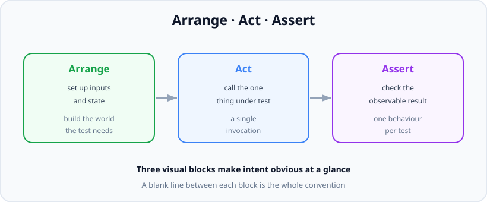

# Unit Testing

*11 min read · Updated 24 Jul 2026 Topic 58 of 70 Bookmark Mark done Why it matters Unit tests are the workhorses of any healthy suite · Topic 58 of 70*

**Source:** [https://www.geekyfrontend.in/learn/nodejs-backend-kit/unit-testing](https://www.geekyfrontend.in/learn/nodejs-backend-kit/unit-testing)

---

## Why it matters

Unit tests are the workhorses of any healthy suite — the wide green base of the pyramid. They are the tests you run hundreds of times a day, the ones that finish before you've taken your hand off the keyboard, and the ones that, when they go red, tell you *exactly* which function you just broke. A backend with strong unit coverage is a backend you can refactor at speed, because you have a fast, precise alarm that trips the instant behaviour changes.

The reason unit tests earn their keep is **localisation of failure**. When an integration test fails you get "the orders endpoint returned 500"; you then go spelunking. When a unit test fails you get "calculateDiscount() returns 0 for a 10% coupon" — the bug and its address in one line. Multiply that across a day of edits and the difference is enormous. Fast, precise feedback is the whole reason the base of the pyramid is wide.

Unit testing also has a second, sneakier payoff: it is a **design pressure**. Code that is hard to unit-test is almost always badly factored — it does too much, reaches for globals, or hard-wires its dependencies. When you feel that pain, the test is telling you the design is wrong. Learning to write testable code is, in large part, learning to write well-decoupled code. In interviews, "how would you make this testable?" is really "do you understand dependency injection and pure functions?"

## The concept, simply

A unit test takes one unit of code — a function or a class method — feeds it known inputs, and checks the output, with every external collaborator (database, network, clock, file system) replaced or absent. Because nothing external is involved, the test is **deterministic** (same input, same result, every time) and **fast** (no I/O to wait on).

The universal skeleton is **Arrange–Act–Assert** (AAA). *Arrange*: set up the inputs and any state the unit needs. *Act*: call the one thing under test — a single invocation. *Assert*: check the observable result. Three visual blocks, separated by blank lines, so anyone reading the test sees intent at a glance.



Every unit test is Arrange then Act then Assert — set up, do the one thing, check the result.

The **assertion** is the heart of the test. It states, in code, what you expect: `expect(result).toBe(5)`. If reality disagrees, the assertion throws and the runner marks the test failed. Choosing the right assertion matters — `toBe` for primitives (strict `===`), `toEqual` for deep structural equality of objects and arrays, `toThrow` for expected errors. A test with no assertion is not a test; it only proves the code didn't crash.

## How it works

The runner discovers your test files, and for each `it()` it executes the callback inside a try/catch. If the callback returns without throwing, the test passes. If any assertion inside it throws (which is what a failed `expect` does), the runner records the failure, the message, and where it happened, then moves on to the next test. Tests are isolated — the failure of one does not stop the others — and Jest runs separate test *files* in parallel worker processes for speed, which is exactly why tests must not share mutable global state.

**What counts as "a unit" is a judgement call, and interviewers probe it.** The pragmatic definition is "a unit of behaviour you'd want to verify independently" — often a function, sometimes a small cluster of functions that only make sense together. Purists insist a unit is exactly one function with every collaborator mocked; pragmatists let a few pure helpers ride along rather than mock them. The useful line is the *boundary*: the moment your code would reach for I/O — a DB call, an HTTP request, the clock, the file system — that is where a unit test stops and you either inject a fake or split the logic out.

Which leads to the central skill: **writing testable code**. Three techniques do most of the work.

**1. Prefer pure functions.** A pure function's output depends only on its inputs and it causes no side effects. Pure functions are trivially testable — pass input, assert output, no setup at all. The art is separating the pure decision-making ("what discount applies?") from the impure effects ("save the order to the DB"). Push logic into pure functions and keep the impure shell thin.

**2. Inject dependencies instead of importing them.** If a function creates its own database client inside itself, a test cannot replace it. If the function *receives* the client as a parameter (or via a constructor), the test hands it a fake. This is dependency injection, and it is the single biggest lever for testability.

**3. Isolate the non-deterministic.** Anything that varies run-to-run — `Date.now()`, `Math.random()`, `process.env` — should come in through a parameter or a small wrapper you can control, so the test can pin it to a fixed value.

## Code examples

A pure function and its unit tests, in clean AAA form. Notice the blank lines splitting the three phases and the one-behaviour-per-test discipline:

javascript

```
// discount.js
function calculateDiscount(price, coupon) {
  if (price <= 0) throw new Error('price must be positive');
  if (!coupon) return price;
  if (coupon.type === 'percent') {
    return price - (price * coupon.value) / 100;
  }
  return Math.max(0, price - coupon.value);
}
module.exports = { calculateDiscount };
```

javascript

```
// discount.test.js
const { calculateDiscount } = require('./discount');

describe('calculateDiscount()', () => {
  it('applies a percentage coupon', () => {
    // Arrange
    const price = 200;
    const coupon = { type: 'percent', value: 10 };

    // Act
    const result = calculateDiscount(price, coupon);

    // Assert
    expect(result).toBe(180);
  });

  it('never returns a negative price for a large flat coupon', () => {
    const result = calculateDiscount(50, { type: 'flat', value: 80 });
    expect(result).toBe(0);
  });

  it('returns the full price when there is no coupon', () => {
    expect(calculateDiscount(99, null)).toBe(99);
  });

  it('throws on a non-positive price', () => {
    // note: pass a FUNCTION to toThrow, or the throw escapes the assertion
    expect(() => calculateDiscount(0, null)).toThrow('price must be positive');
  });
});
```

Untestable versus testable, side by side. The first function reaches for the clock and a hard-wired dependency; the second receives them, so a test can control both:

javascript

```
// HARD to unit-test: hidden clock + self-created dependency
const db = require('./db');
async function createTrialUser(email) {
  const expiresAt = new Date(Date.now() + 7 * 864e5); // real clock
  return db.users.insert({ email, expiresAt });        // real DB
}

// EASY to unit-test: dependencies injected
function makeTrialUser({ now }) {
  return function build(email) {
    const expiresAt = new Date(now + 7 * 864e5);
    return { email, expiresAt }; // pure: returns data, no I/O
  };
}
```

javascript

```
// makeTrialUser.test.js — a fixed clock makes the result deterministic
const { makeTrialUser } = require('./trial');

it('sets a 7-day expiry from the injected clock', () => {
  const now = new Date('2026-01-01T00:00:00Z').getTime();
  const build = makeTrialUser({ now });

  const user = build('a@b.com');

  expect(user.expiresAt.toISOString()).toBe('2026-01-08T00:00:00.000Z');
});
```

Choosing the right matcher matters — `toBe` compares by identity, so it fails on two distinct-but-equal objects:

javascript

```
const a = { id: 1, tags: ['x'] };

expect(a).toBe({ id: 1, tags: ['x'] });   // FAILS: different references
expect(a).toEqual({ id: 1, tags: ['x'] }); // PASSES: deep structural equality
expect(a.id).toBe(1);                       // OK: primitives compare by value
```

## Common mistakes & gotchas

- **Forgetting to `return` or `await` an async assertion.** If the test function is `async` and you don't await the promise, the test finishes and passes *before* the assertion runs. A rejected promise then surfaces later as an unhandled rejection, not a red test. Always `await` (or return) async expectations.
- **Passing a value instead of a function to `toThrow`.** `expect(fn()).toThrow()` calls `fn` immediately, so the error escapes before `expect` can catch it. It must be `expect(() => fn()).toThrow()`.
- **`toBe` on objects/arrays.** `toBe` is `Object.is` (reference identity); use `toEqual` for deep equality. This is the single most common matcher bug.
- **Tests with no real assertion.** A test that only calls the function and never asserts passes as long as nothing throws — it proves almost nothing but inflates coverage and confidence.
- **Over-mocking until you test the mocks.** If you mock everything the unit touches, the test just verifies your mocks return what you told them to. Mock at boundaries, not inside your own logic.
- **Non-deterministic inputs leaking in.** Using the real `Date.now()` or `Math.random()` makes a test that passes today fail at a date boundary or one run in a thousand — the seed of flakiness.
- **One test asserting five unrelated things.** When it fails you can't tell which expectation broke, and the first failing assertion hides the rest.

## Best practices

- **Follow Arrange–Act–Assert, visibly.** Blank lines between the three blocks make intent obvious and keep tests uniform.
- **One behaviour per test, named as a sentence.** "returns the full price when there is no coupon" reads like a spec and points straight at the failure.
- **Push logic into pure functions.** The more of your system that is pure, the more of it is testable with zero setup.
- **Inject dependencies (DB, clock, randomness, config).** A unit that receives its collaborators can be tested with fakes; one that creates them cannot.
- **Test behaviour, not implementation.** Assert on return values and observable effects, not on which private helper got called — so refactors don't turn tests red for no reason.
- **Cover edge cases and error paths, not just the happy path.** Zero, empty, negative, boundary, and thrown-error cases are where real bugs live.
- **Keep each test independent.** No test should depend on another running first or on leftover state; each arranges its own world.

## ⭐ Interview lens

> **Q: "What exactly is a 'unit', and what do you mock in a unit test?"**  
> A: A unit is the smallest piece of behaviour worth verifying on its own — usually a function or method. In a unit test you replace anything that crosses a boundary: the database, network calls, the clock, the file system, randomness. What you do *not* mock is your own pure logic. The tell of a good unit test is that it's deterministic and runs in milliseconds because nothing external is involved.

> **Q: "What is Arrange-Act-Assert?"**  
> A: The three-phase structure of a test. Arrange sets up inputs and state; Act invokes the single thing under test; Assert checks the observable result. Keeping them as distinct blocks makes tests readable and enforces the discipline of one action and one clear expectation per test. If you find yourself with two Act phases, that's usually two tests.

> **Q: "This function is hard to test — how would you fix it?"**  
> A: Ask why it's hard. Usually it creates its own dependencies or reaches for the clock/randomness internally. I'd apply dependency injection — pass the DB client, the current time, the config in as parameters — and split the pure decision logic out from the side effects. Once the logic is pure and the collaborators are injectable, the test becomes trivial: pass fakes, assert the output. Hard-to-test almost always means poorly-decoupled.

> **Q: "toBe vs toEqual?"**  
> A: `toBe` is identity comparison (`Object.is`, essentially `===`) — right for primitives and for asserting two references are the same object. `toEqual` does a deep, recursive structural comparison — right for objects and arrays where you care about contents, not identity. Using `toBe` on two equal-but-distinct objects is a classic false failure.

> **Q: "How do you test a function that uses the current date or a random value?"**  
> A: Remove the non-determinism from inside the function. Inject the clock or the random source as a parameter, or wrap it behind a small dependency you can control, then pin it to a fixed value in the test. Alternatively use the runner's fake timers (`jest.useFakeTimers()` / `vi.setSystemTime()`) to freeze time. The goal is that the same test gives the same result on every machine and every run.

> **Q: "A test passes but the code is buggy — how?"**  
> A: Most often the test has no meaningful assertion, or it's async and the assertion runs after the test already resolved (missing await), or it asserts on a mock rather than real behaviour. Green means 'no assertion threw', which is not the same as 'the behaviour is correct'. That's why I review that every test actually asserts on the observable output and that async tests are properly awaited.

## Cheat-card

- **Unit test =** one function, known input, assert output, no I/O.
- **AAA:** Arrange (set up) → Act (call once) → Assert (check result).
- **Matchers:** `toBe` (===/identity) · `toEqual` (deep) · `toThrow` (wrap in a fn!).
- **Testable code =** pure functions + injected dependencies + controlled time/randomness.
- **async:** `await` the assertion or the test passes before it runs.
- **toThrow:** pass `() => fn()`, never `fn()`.
- **Test behaviour**, not private implementation → refactor-proof.
- **One behaviour per test**, named as a sentence; cover edges + errors.
- **Hard to test = badly decoupled** → inject, don't import.

---

## Learn More

- [Node.js Test Runner (node:test) nodejs.org](https://nodejs.org/api/test.html)
- [Discovering Node.js's test runner nodejs.org](https://nodejs.org/en/learn/test-runner/introduction)
- [Jest: Getting Started jestjs.io](https://jestjs.io/docs/getting-started)
- [Jest Crash Course - Unit Testing in JavaScript Traversy Media](https://www.youtube.com/watch?v=7r4xVDI2vho)
