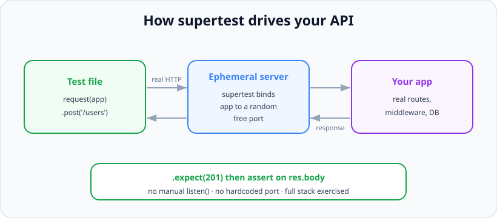

# Integration Testing

*13 min read · Updated 24 Jul 2026 Topic 59 of 70 Bookmark Mark done Why it matters Unit tests can all be green while your API is completely broken · Topic 59 of 70*

**Source:** [https://www.geekyfrontend.in/learn/nodejs-backend-kit/integration-testing](https://www.geekyfrontend.in/learn/nodejs-backend-kit/integration-testing)

---

## Why it matters

Unit tests can all be green while your API is completely broken. That is not a paradox — it is the structural limitation of unit tests, and it is exactly the gap integration tests fill. A unit test proves `createUser()` returns the right object; it says nothing about whether the route is registered at the right path, whether the auth middleware runs before the handler, whether the request body is parsed, whether the validation rejects garbage, or whether the record actually lands in the database with the right shape. Those are **wiring** questions, and wiring is where a huge share of real backend bugs live.

For a Node backend the highest-value integration test is the **HTTP-level API test**: fire a real request at your Express app and assert on the real response and the resulting database state. One such test exercises routing, body parsing, middleware order, the controller, the model, and the database in a single pass — the whole vertical slice a user's request actually travels. When it's green you know the endpoint genuinely works, not just that its pieces work in isolation.

In interviews this is where you prove you understand a request's full lifecycle and can reason about test *infrastructure* — test databases, setup and teardown, isolation between tests. "How do you test an Express endpoint?" is a standard question, and the strong answer names **supertest**, a real test database, and a clean lifecycle. Getting the infrastructure right is the difference between a suite that's trustworthy and one that's flaky.

## The concept, simply

An integration test exercises several real components together across a boundary, mocking only the genuinely external world (a payment gateway, an email provider). The canonical backend version sends an HTTP request into your app and checks two things: the **response** (status code, body, headers) and the **side effects** (what changed in the database).

The tool that makes this ergonomic is **supertest**. You hand it your Express `app` object — not a URL — and it spins up the server on an ephemeral random port, sends a real HTTP request, and gives you a fluent API to assert on the response. Because it binds the app itself, you never hardcode a port, never manually call `app.listen()` in the test, and never collide with a port already in use.



supertest binds your Express app to a random port, sends a real request through the full stack, and returns the response to assert on.

The other half of integration testing is the **test database**. You do *not* point tests at production, and you should not mock the database (that would defeat the purpose — you want to catch real schema and query bugs). Instead you run against a real database dedicated to testing — an in-memory MongoDB, a disposable Docker Postgres, or a separate test schema — and you reset it around each test so tests don't contaminate one another.

## How it works

Structuring the app for testability is step zero. The classic mistake is calling `app.listen()` in the same file that defines the app, so importing it for a test starts a real server on a real port. The fix is to **separate app creation from server start**: one module exports the configured `app`; a thin entry file imports it and calls `listen()`. Tests import the app; production imports the entry file. supertest takes the app and manages the port itself.

Next comes the **lifecycle**, driven by the runner's hooks. Jest gives you `beforeAll`, `afterAll`, `beforeEach`, and `afterEach`. The standard shape:

- `beforeAll` — connect to the test database once (expensive; do it a single time for the file).
- `beforeEach` — put the database in a known clean state (clear collections/tables, optionally seed fixtures) so every test starts from the same baseline.
- `afterEach` — optionally clean up; often folded into the next `beforeEach` instead.
- `afterAll` — disconnect and shut everything down so the process exits and no open handle leaks.

The reason clean state belongs in `beforeEach` (not `afterEach`) is robustness: if a test crashes mid-way, its mess is cleaned by the *next* test's setup rather than being left behind by a skipped teardown. And it belongs at `beforeEach` granularity — not once per file — because tests run in an order you should not rely on, and any shared row is a source of order-dependent flakiness.

**Isolation strategy** is the deep design decision. Three common approaches, from simplest to strongest: (1) *truncate between tests* — delete all rows in `beforeEach`; simple and the most common. (2) *transaction rollback* — wrap each test in a DB transaction and roll it back afterward, so nothing is ever committed; very fast on SQL databases but fiddly with connection pooling. (3) *fresh database per worker* — because runners parallelise across worker processes, two workers hitting the same test DB will corrupt each other; giving each worker its own database (or schema) keeps parallel runs isolated. Interviewers love the parallelism angle: "your integration tests pass alone but fail in CI" is very often two workers sharing one database.

For the database itself, popular choices are `mongodb-memory-server` (spins up a real, in-memory MongoDB per test run — no external service, fully isolated), a Dockerised Postgres/MySQL via Testcontainers, or a dedicated test schema on a local instance. In-memory and containerised options win because they are disposable and reproducible: every run starts from nothing, so there is no "works on my machine because my local DB has old data" drift.

## Code examples

First, the split that makes the app importable. `app.js` builds and exports the app with no `listen()`; `server.js` starts it:

javascript

```
// app.js — no listen() here, so tests can import the app cleanly
const express = require('express');
const usersRouter = require('./routes/users');

function createApp() {
  const app = express();
  app.use(express.json());
  app.use('/users', usersRouter);
  return app;
}
module.exports = { createApp };

// server.js — the only place that binds a port (production entry point)
const { createApp } = require('./app');
createApp().listen(3000, () => console.log('listening on 3000'));
```

The integration test itself, with a real in-memory MongoDB and a clean-per-test lifecycle. Note it asserts on both the HTTP response *and* the database state:

javascript

```
// users.integration.test.js
const request = require('supertest');
const mongoose = require('mongoose');
const { MongoMemoryServer } = require('mongodb-memory-server');
const { createApp } = require('./app');
const User = require('./models/User');

let mongod;
const app = createApp();

beforeAll(async () => {
  mongod = await MongoMemoryServer.create();       // real Mongo, in memory
  await mongoose.connect(mongod.getUri());
});

afterAll(async () => {
  await mongoose.disconnect();                       // close the connection
  await mongod.stop();                               // free the handle so Jest exits
});

beforeEach(async () => {
  await User.deleteMany({});                          // clean slate every test
});

describe('POST /users', () => {
  it('creates a user and returns 201 with the new record', async () => {
    // Act — supertest sends a real HTTP request through the whole stack
    const res = await request(app)
      .post('/users')
      .send({ email: 'a@b.com', name: 'Ann' })
      .expect(201);

    // Assert on the response
    expect(res.body).toMatchObject({ email: 'a@b.com', name: 'Ann' });
    expect(res.body.id).toBeDefined();

    // Assert on the side effect — the row really landed in the DB
    const inDb = await User.findOne({ email: 'a@b.com' });
    expect(inDb).not.toBeNull();
  });

  it('rejects an invalid body with 400', async () => {
    const res = await request(app)
      .post('/users')
      .send({ name: 'no email' })
      .expect(400);

    expect(res.body.error).toMatch(/email/i);
    expect(await User.countDocuments()).toBe(0);     // nothing was written
  });
});
```

Testing an authenticated route: supertest chains header calls just like a real client, so you attach a token exactly as the app expects it:

javascript

```
it('returns the current user for a valid token', async () => {
  const token = signTestToken({ userId: 'u1' });      // helper that mints a JWT

  const res = await request(app)
    .get('/users/me')
    .set('Authorization', `Bearer ${token}`)
    .expect(200);

  expect(res.body.id).toBe('u1');
});

it('rejects a missing token with 401', async () => {
  await request(app).get('/users/me').expect(401);
});
```

Mocking only the genuinely external boundary — the payment provider — while everything else stays real. You test *your* code's reaction to the gateway, not the gateway itself:

javascript

```
jest.mock('./services/payments'); // auto-mock the external gateway module
const payments = require('./services/payments');

it('marks the order paid when the gateway succeeds', async () => {
  payments.charge.mockResolvedValue({ id: 'ch_1', status: 'succeeded' });

  const res = await request(app)
    .post('/orders')
    .send({ item: 'book', amount: 500 })
    .expect(201);

  expect(res.body.status).toBe('paid');
  expect(payments.charge).toHaveBeenCalledWith(
    expect.objectContaining({ amount: 500 })
  );
});
```

## Common mistakes & gotchas

- **Calling `app.listen()` in the file you import for tests.** It starts a real server and often throws `EADDRINUSE` when a second test file imports it. Separate app creation from server start; hand supertest the app, not a URL.
- **Sharing one test database across parallel workers.** Jest and Vitest run files in parallel processes; if they all write the same DB, they corrupt each other and you get tests that pass alone but fail in CI. Give each worker its own database/schema, or run integration tests serially (`--runInBand`).
- **Cleaning state in `afterEach` instead of `beforeEach`.** If a test crashes, its `afterEach` may not run and the mess leaks into the next test. Reset in `beforeEach` so every test guarantees its own clean start.
- **Forgetting to close connections in `afterAll`.** An open DB connection or server handle keeps the Node process alive; Jest then warns "did not exit" or hangs. Disconnect and stop everything you started.
- **Tests that depend on execution order.** Relying on a record a previous test created makes the suite fragile — reorder or parallelise it and it breaks. Each test must arrange its own data.
- **Mocking the database.** Then you're not integration-testing anything — you've built a slow unit test that can't catch schema or query bugs. Use a real (disposable) test DB.
- **Pointing tests at a shared dev or (worse) production database.** Tests must own a disposable database they can wipe freely; never run destructive setup against data you care about.
- **Missing `await` on the supertest call.** supertest returns a thenable; without `await` the assertions in `.expect()` may not be observed and failures slip through as unhandled rejections.

## Best practices

- **Export the app, start the server separately.** One module returns the configured app; a thin entry file calls `listen()`. Tests and supertest use the app object.
- **Use a real, disposable test database.** In-memory Mongo or a Dockerised Postgres via Testcontainers — reproducible, isolated, wiped every run.
- **Reset state in `beforeEach`; open/close once in `beforeAll`/`afterAll`.** Clean slate per test, expensive connect/disconnect once per file.
- **Isolate parallel workers.** A database (or schema) per worker, or run integration tests serially. Never let two workers share writable state.
- **Assert both the response and the side effect.** Check the status/body *and* that the database actually changed (or didn't, on the error path).
- **Mock only the true external boundary.** Stub the payment gateway or email service; keep your routes, middleware, and DB real so the wiring is genuinely exercised.
- **Test the unhappy paths too.** 400 on bad input, 401 without a token, 404 for a missing resource, and confirm nothing was written when it shouldn't have been.

## ⭐ Interview lens

> **Q: "How do you test an Express API endpoint?"**  
> A: With supertest against a real test database. I structure the app so `createApp()` returns the configured app without calling `listen()`, then in the test I do `request(app).post('/users').send(body).expect(201)`. supertest binds the app to an ephemeral port and sends a real HTTP request through routing, middleware, and the controller. I assert on the response *and* query the DB to confirm the side effect. The database is a disposable test instance reset in `beforeEach`.

> **Q: "Why hand supertest the app object instead of a running URL?"**  
> A: So the test owns the server lifecycle. supertest starts the app on a random free port for the duration of the request and tears it down after — no hardcoded port, no `EADDRINUSE` clashes, no manual `listen()`/close dance, and it works even if the app is never separately started. It also means the test hits your real app in-process rather than depending on an externally running server.

> **Q: "Where do you put database setup and cleanup, and why there?"**  
> A: Connect once in `beforeAll` and disconnect in `afterAll` — connecting is expensive and should happen once per file. Reset the data in `beforeEach`, not `afterEach`, so that if a test crashes mid-way its mess is cleaned by the next test's setup rather than left behind by a skipped teardown. That gives every test a guaranteed clean slate regardless of what happened before it.

> **Q: "Your integration tests pass locally but fail in CI. First hypothesis?"**  
> A: Parallel workers sharing one test database. Jest and Vitest run test files in separate processes; if each connects to the same DB they overwrite each other's rows and you get order-dependent, environment-dependent failures. The fix is a database or schema per worker, or forcing integration tests to run serially with `--runInBand`. Open handles not being closed in `afterAll` is a close second.

> **Q: "Should you mock the database in an integration test?"**  
> A: No — that defeats the purpose. The whole point is to catch real schema mismatches, bad queries, and migration issues, which a mock can't surface. I use a real but disposable database (in-memory Mongo, Dockerised Postgres) that's wiped around each test. I only mock genuinely external services like a payment gateway, where I want to control the response and not hit a real third party in CI.

> **Q: "What does an integration test catch that a unit test can't?"**  
> A: Everything about how the pieces connect: a wrong route path, middleware in the wrong order, body-parsing not configured, a validation rule that doesn't fire, a schema that doesn't match what the code writes, auth that lets the wrong request through. Unit tests verify each function in isolation; the integration test verifies the vertical slice a real request travels — which is where a large share of production bugs actually originate.

## Cheat-card

- **Integration test =** real request → real routes/middleware/DB → assert response + side effect.
- **supertest:** `request(app)` (pass the app, not a URL) → ephemeral port, real HTTP.
- **Split app from server:** export `createApp()`; `listen()` only in the entry file.
- **Lifecycle:** connect in `beforeAll` · clean in `beforeEach` · disconnect in `afterAll`.
- **Clean in beforeEach** (survives a crashed test), not afterEach.
- **Test DB:** real but disposable (mongodb-memory-server, Dockerised Postgres) — never mock the DB, never use prod.
- **Parallel workers** → DB/schema per worker or `--runInBand`; shared DB = CI flakiness.
- **Mock only** the true external boundary (payments, email).
- **Assert response AND DB state**; test 400/401/404 paths too.

---

## Learn More

- [SuperTest - HTTP assertions for Node.js servers github.com](https://github.com/ladjs/supertest)
- [Node.js Test Runner (node:test) nodejs.org](https://nodejs.org/api/test.html)
- [Jest: Getting Started jestjs.io](https://jestjs.io/docs/getting-started)
- [Supertest express tutorial | Node REST API testing Jan Goebel](https://www.youtube.com/watch?v=T2sYitv2OAY)
