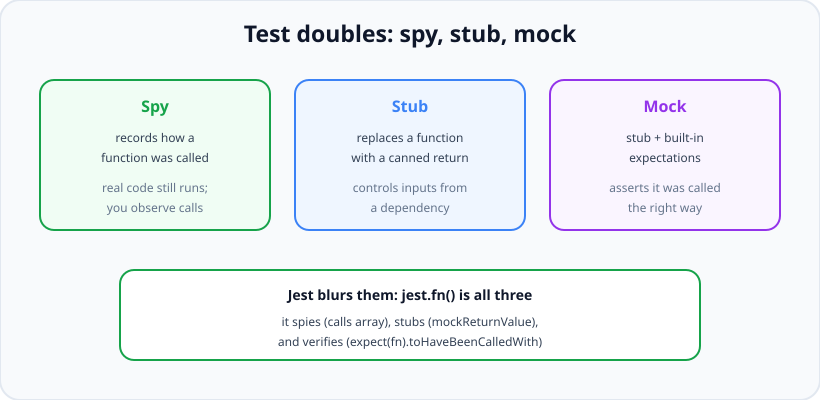
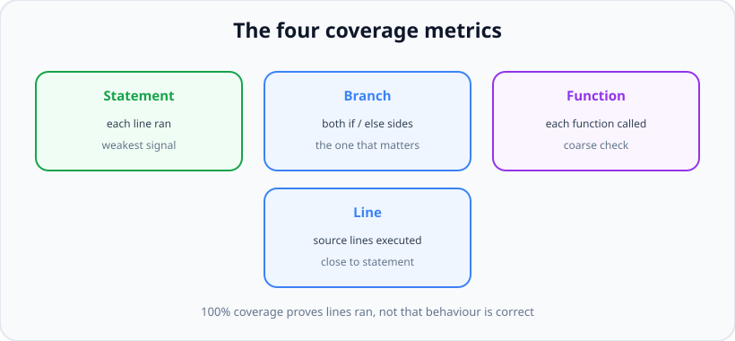

# Mocking &amp; Coverage

*13 min read · Updated 24 Jul 2026 Topic 60 of 70 Bookmark Mark done Why it matters Real code has dependencies you cannot or should not call for real in a test · Topic 60 of 70*

**Source:** [https://www.geekyfrontend.in/learn/nodejs-backend-kit/mocking-coverage](https://www.geekyfrontend.in/learn/nodejs-backend-kit/mocking-coverage)

---

## Why it matters

Real code has dependencies you cannot or should not call for real in a test: a payment API that charges money, an email service that spams inboxes, a clock that makes results change by the day, a database call you want to keep out of a pure unit test. **Test doubles** — the family of spies, stubs, and mocks — are how you cut those dependencies out and take control of them, so a test can run fast, offline, deterministically, and can simulate conditions (a network timeout, a 500 from the gateway) that are hard to trigger for real.

**Coverage**, meanwhile, is how you find the code your tests *forgot*. It is a map of which lines and branches ran during the suite, and its highest use is spotting the untested error path nobody thought about. But coverage is also the single most misunderstood metric in testing, and interviewers use it as a maturity test: a junior treats "100%" as the goal; a senior knows it measures execution, not correctness, and reasons about it accordingly.

Finally, **flaky tests** — tests that pass and fail without any code change — are the thing that quietly destroys a suite's value. Once a suite fails randomly, people start re-running until green and then stop trusting red altogether, which defeats the entire point of having tests. Knowing the common causes of flakiness (real time, shared state, ordering, unawaited async) and how to kill them is core senior-engineer knowledge.

## The concept, simply

A **test double** is any stand-in for a real dependency. The three you must be able to distinguish: a **spy** records how a function was called (arguments, call count) while optionally letting the real thing still run — it's about *observing*. A **stub** replaces a function with a canned return value so you can control what a dependency *gives back* — it's about *controlling inputs*. A **mock** is a stub with built-in expectations about how it should be called — it both controls inputs and *verifies* the interaction.



Spies observe calls, stubs control return values, mocks add expectations — and Jest's jest.fn() does all three.

Here's the practical catch that trips people up: **Jest deliberately blurs these lines.** A single `jest.fn()` is simultaneously a spy (it records every call in `.mock.calls`), a stub (you set its return with `mockReturnValue`), and a mock (you verify it with `expect(fn).toHaveBeenCalledWith(...)`). So in Jest you rarely say "make me a stub"; you make a mock function and use whichever facet you need. In interviews you should still be able to define the three precisely — the vocabulary comes from the wider testing literature (and libraries like Sinon that keep them separate).

**Coverage** counts, as your tests run, which parts of the code executed. It reports four numbers: *statement*, *branch*, *function*, and *line* coverage. Branch coverage is the one that matters most, because it asks whether *both* sides of every `if` ran — the untested `else` is where bugs hide.



The four coverage metrics — branch coverage, checking both sides of every decision, is the one that matters most.

## How it works

**Creating doubles in Jest.** `jest.fn()` makes a standalone mock function. `jest.spyOn(obj, 'method')` wraps an existing method so you can observe (and optionally override) it while keeping the ability to restore the original. `jest.mock('./module')` replaces an *entire module* with auto-generated mock functions — this is how you neutralise a whole dependency like a payments client or the `fs` module. The distinction interviewers probe: `spyOn` by default calls through to the real implementation unless you add `.mockReturnValue()`, whereas `jest.mock` replaces the module wholesale.

**Module mocking is hoisted.** Jest lifts `jest.mock()` calls to the top of the file, above the imports, so the mock is in place before the module under test `require`s its dependency. This is why `jest.mock('./payments')` works even though you wrote it after the import line — and why it can feel like magic until you know it's happening. (In Vitest the equivalent is `vi.mock()`, also hoisted; in ESM you sometimes need `vi.hoisted()` for values referenced inside the factory.)

**Mocking time.** Real timers and `Date.now()` make tests slow (waiting for a real `setTimeout`) and non-deterministic (results change with the date). Fake timers solve both: `jest.useFakeTimers()` replaces the timer functions and the clock with controllable versions, then `jest.advanceTimersByTime(1000)` fast-forwards a second instantly and `jest.setSystemTime(date)` pins "now". A test for a function that fires after a 30-minute delay runs in microseconds. Always restore real timers afterward (`jest.useRealTimers()`) so you don't leak the fake into other tests.

**How coverage is measured.** The runner *instruments* your code — it rewrites it to increment counters whenever a statement, branch, or function executes — runs the suite, and tallies the counters. Jest does this with `--coverage` (built on Istanbul); Vitest via `--coverage` (v8 or Istanbul); node:test via `--experimental-test-coverage`. The report shows percentages per file and lists the exact uncovered lines. You can set **thresholds** in config (e.g. fail the build under 80% branch coverage) to stop coverage silently eroding — a floor, not a target.

**Why 100% is a trap.** Coverage only proves a line *ran*, not that its behaviour was *asserted*. A test that calls a function and checks nothing still marks every line it touched as covered. So 100% coverage with weak assertions is worse than 80% with strong ones: it manufactures false confidence. Use coverage to *find* gaps (especially uncovered branches), never as proof of quality.

**Flaky tests and their causes.** A flaky test is non-deterministic. The usual culprits: (1) real time/timeouts — use fake timers; (2) shared state between tests — reset in `beforeEach`; (3) test-order dependence — make each test self-contained; (4) unawaited async — a floating promise resolves after the test ends; (5) real network/external services — mock them; (6) time-zone or locale assumptions. The cure is always the same principle: remove the source of non-determinism and control it explicitly.

## Code examples

The three faces of `jest.fn()` — spy, stub, and verification — in one place:

javascript

```
const fn = jest.fn();          // a mock function

fn.mockReturnValue(42);        // STUB: control what it returns
const out = fn('a', 'b');

expect(out).toBe(42);
expect(fn).toHaveBeenCalledTimes(1);            // SPY: it recorded the call
expect(fn).toHaveBeenCalledWith('a', 'b');      // MOCK: verify the interaction
expect(fn.mock.calls[0]).toEqual(['a', 'b']);   // raw record of arguments
```

Mocking a whole module so the code under test never touches the real service. Here we test that our code reacts correctly to a gateway *failure* — a condition that's hard to trigger for real:

javascript

```
// jest.mock is hoisted above the imports, so the mock is ready first
jest.mock('./services/payments');
const payments = require('./services/payments');
const { placeOrder } = require('./orders');

describe('placeOrder()', () => {
  afterEach(() => jest.clearAllMocks()); // reset call history between tests

  it('returns a friendly error when the gateway declines', async () => {
    // STUB: force the dependency to reject
    payments.charge.mockRejectedValue(new Error('card_declined'));

    const result = await placeOrder({ item: 'book', amount: 500 });

    expect(result).toEqual({ ok: false, reason: 'payment_failed' });
    // MOCK: verify we called the gateway with the right amount
    expect(payments.charge).toHaveBeenCalledWith(
      expect.objectContaining({ amount: 500 })
    );
  });
});
```

`spyOn` to observe a real method, and to restore it afterward so nothing leaks:

javascript

```
it('logs a warning on a retry', () => {
  const warn = jest.spyOn(console, 'warn').mockImplementation(() => {});

  retryOnce(() => { throw new Error('boom'); });

  expect(warn).toHaveBeenCalledWith(expect.stringContaining('retrying'));
  warn.mockRestore(); // put the real console.warn back
});
```

Mocking time with fake timers — a debounce that fires after 300ms is tested in microseconds:

javascript

```
it('calls the handler once after the debounce window', () => {
  jest.useFakeTimers();
  const handler = jest.fn();
  const debounced = debounce(handler, 300);

  debounced();
  debounced();                       // called twice in quick succession
  expect(handler).not.toHaveBeenCalled();

  jest.advanceTimersByTime(300);     // fast-forward, no real waiting
  expect(handler).toHaveBeenCalledTimes(1);

  jest.useRealTimers();              // always restore
});

// Pinning "now" for a date-dependent function:
it('stamps the fixed current time', () => {
  jest.useFakeTimers().setSystemTime(new Date('2026-01-01T00:00:00Z'));
  expect(makeTimestamp()).toBe('2026-01-01T00:00:00.000Z');
  jest.useRealTimers();
});
```

Enforcing a coverage floor in `jest.config.js` so coverage can't silently rot — a gate, not a vanity number:

javascript

```
// jest.config.js
module.exports = {
  collectCoverage: true,
  coverageThreshold: {
    global: { branches: 80, functions: 85, lines: 85, statements: 85 },
  },
};
// Run: jest --coverage  ->  build FAILS if branch coverage drops below 80%.
// Note: branches is set lower on purpose — it is the hardest and most useful.
```

## Common mistakes & gotchas

- **Not resetting mocks between tests.** A `jest.fn()`'s call history and stubbed return values persist across tests in a file, so one test sees another's setup. Use `clearAllMocks`/`resetAllMocks` in `beforeEach` (or set `clearMocks: true` in config).
- **Forgetting to restore `spyOn` or fake timers.** A spy left on `console.warn`, or fake timers never switched back, leaks into later tests and causes bewildering, order-dependent failures. Always `mockRestore()` / `useRealTimers()`.
- **Over-mocking.** Mock so much that the test only exercises your mocks and never the real logic. Then the test passes no matter what the real code does. Mock at boundaries; keep your own logic real.
- **Treating 100% coverage as "well tested".** Coverage counts execution, not assertions. High coverage with weak assertions is false confidence; it's a discovery tool, not a quality proof.
- **Ignoring branch coverage.** Statement/line coverage can look great while an entire `else` or error path never ran. Branch coverage is the number that reveals the untested decision.
- **Re-running flaky tests until green.** Retrying a flaky test hides a real non-determinism (shared state, real time, unawaited async) that will eventually bite in production. Fix the cause; don't paper over it with retries.
- **Mocking what you're testing.** If you mock the very function under test (or its core logic), the test proves nothing. Mock its *collaborators*, not the subject.
- **Mock drift.** A hand-written mock that no longer matches the real dependency's signature lets tests pass while production breaks. Prefer auto-mocks or typed mocks, and keep them honest.

## Best practices

- **Reset mocks between tests.** `clearMocks: true` in config, or `jest.clearAllMocks()` in `beforeEach`, so each test starts clean.
- **Always restore spies and fake timers.** `mockRestore()` and `useRealTimers()` keep a double from leaking into unrelated tests.
- **Mock at the boundary, not inside your logic.** Replace the network, the clock, the payment gateway; leave your own decision-making real so the test actually exercises it.
- **Use fake timers for anything time-dependent.** Debounces, retries with backoff, TTLs — fast and deterministic instead of slow and flaky.
- **Read coverage by branch, and use it to find gaps.** Look at the uncovered-lines report to spot the error path you forgot; don't chase a headline percentage.
- **Set a coverage *floor* in CI, not a 100% target.** A threshold stops erosion; an obsession with 100% breeds assertion-free tests.
- **Treat every flaky test as a bug.** Quarantine it, find the non-determinism (time, order, shared state, async), and fix the root cause rather than retrying.

## ⭐ Interview lens

> **Q: "Difference between a mock, a stub, and a spy?"**  
> A: A spy observes — it records how a function was called while the real implementation may still run. A stub replaces a function with a canned return so you control what a dependency gives back. A mock is a stub plus expectations — it also verifies the function was called the right way. In Jest the distinction blurs because `jest.fn()` is all three at once: it records calls (spy), returns what you set (stub), and can be asserted against (mock). Libraries like Sinon keep them separate.

> **Q: "Does 100% coverage mean your code is well tested?"**  
> A: No — this is the classic trap. Coverage only measures which lines executed during the run, not whether anything was asserted about them. You can hit 100% with tests that assert nothing. It's a tool to *find* untested code, and branch coverage in particular reveals untested decision paths, but it's never a proof of correctness. I use it as a floor in CI to prevent erosion, not as a goal to max out.

> **Q: "How do you test code that depends on the current time or a timer?"**  
> A: Fake timers. `jest.useFakeTimers()` replaces the real timers and clock, then `advanceTimersByTime()` fast-forwards without real waiting and `setSystemTime()` pins 'now'. So a function that fires after 30 minutes tests in microseconds and deterministically. The alternatives are injecting the clock as a dependency. Either way I always restore real timers afterward so the fake doesn't leak into other tests.

> **Q: "A test fails maybe one run in twenty. How do you approach it?"**  
> A: I treat flakiness as a real bug, never as noise to retry away. The cause is almost always non-determinism: real time or timeouts, shared state between tests, order dependence, or an unawaited promise resolving after the test ends. I reproduce it (run repeatedly, randomise order), isolate which of those it is, and remove the source — fake the clock, reset state in `beforeEach`, make the test self-contained, await the async. A flaky suite erodes trust in every red, so it's worth fixing properly.

> **Q: "What is the risk of over-mocking?"**  
> A: You end up testing your mocks instead of your code. If everything a function touches is stubbed, the test passes regardless of what the real logic does, and it also breaks on every refactor because it's coupled to internal call shapes. Worse, mocks can drift from the real dependency's behaviour, so tests stay green while production breaks. The discipline is to mock only at true boundaries — network, clock, third-party services — and keep your own logic real.

> **Q: "Which coverage metric matters most and why?"**  
> A: Branch coverage. Statement and line coverage can be high while an entire `else` branch or error path never executed — and untested branches are exactly where bugs hide. Branch coverage asks whether both outcomes of every decision ran, so it surfaces the missing negative case, the unhandled error, the skipped guard clause. That's the number I read first in a coverage report.

> **Q: "How does jest.mock() work when it's written below the import?"**  
> A: Jest hoists `jest.mock()` calls to the top of the module, above the imports, during transformation. So by the time the module under test requires its dependency, the mock is already in place. That's why it works despite appearing after the import line — and it's also why the mock factory can't reference variables declared later in the file unless you use the hoist-aware helpers.

## Cheat-card

- **Spy** = observe calls · **Stub** = canned return · **Mock** = stub + verify.
- **jest.fn()** is all three; `spyOn` wraps a real method; `jest.mock()` replaces a whole module (hoisted).
- **Reset between tests:** `clearMocks` / `jest.clearAllMocks()`; restore spies with `mockRestore()`.
- **Fake time:** `useFakeTimers()` + `advanceTimersByTime()` / `setSystemTime()`; always `useRealTimers()` after.
- **Coverage = 4 metrics:** statement, branch, function, line. **Branch matters most.**
- **Coverage ≠ correctness** — it proves lines ran, not asserted. Use it as a floor, not a target.
- **Mock at boundaries** (network, clock, 3rd-party); keep your own logic real.
- **Flaky causes:** real time · shared state · order · unawaited async · real network. Fix the cause, don't retry.

---

## Learn More

- [Jest: Mock Functions jestjs.io](https://jestjs.io/docs/mock-functions)
- [Jest: Configuring code coverage (collectCoverage, coverageThreshold) jestjs.io](https://jestjs.io/docs/configuration)
- [Node.js test runner: mocking & code coverage nodejs.org](https://nodejs.org/api/test.html)
- [Testing with Jest - Mock Function Piotr N](https://www.youtube.com/watch?v=sVX6LNiNAeA)
