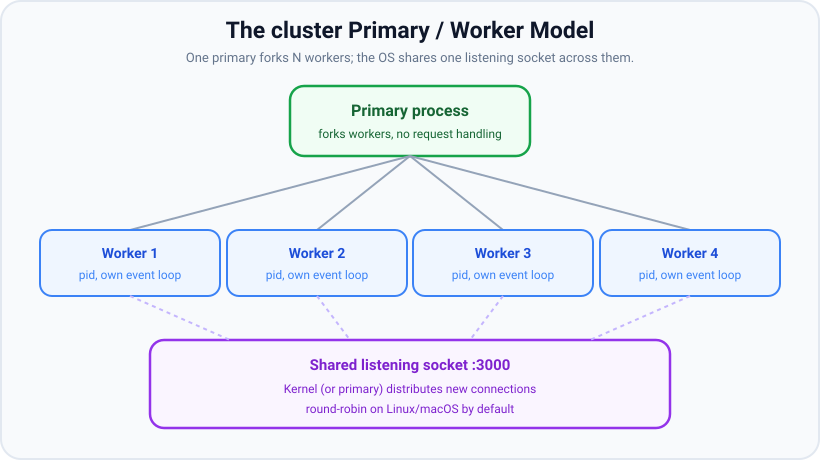
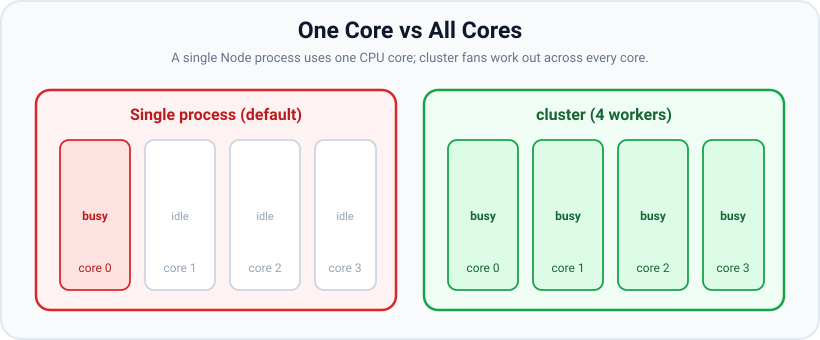

# The cluster module

*11 min read · Updated 24 Jul 2026 Topic 61 of 70 Bookmark Mark done Why it matters Node · Topic 61 of 70*

**Source:** [https://www.geekyfrontend.in/learn/nodejs-backend-kit/cluster-module](https://www.geekyfrontend.in/learn/nodejs-backend-kit/cluster-module)

---

## Why it matters

Node.js runs your JavaScript on a **single thread**. That is the defining fact of the runtime, and it has a blunt consequence: a plain Node process uses exactly *one* CPU core, no matter how many the machine has. Rent an 8-core server, run `node server.js`, and seven cores sit idle while one does all the work. Under real traffic that single core saturates, the event loop backs up, and latency climbs — while `htop` shows the box is 88% idle. This is one of the most common "why is production slow?" surprises for engineers new to Node.

The **cluster** module is Node's built-in answer. It lets you fork the process into one *worker* per core, all sharing the same server port, so incoming connections are spread across every core. For a typical I/O-bound web service, moving from one process to N workers is close to an **N× throughput** increase for zero application-code changes. In interviews, "how do you make Node use all the cores?" is a near-guaranteed question, and cluster (or a process manager that wraps it, like PM2) is the canonical answer. Knowing how it works — and its limits — separates people who have run Node in production from people who have only read about it.

## The concept, simply

Cluster follows a **primary / worker** model (older docs and APIs say "master/worker"; the modern term is primary). One *primary* process starts first. Its only job is to **fork worker processes** and supervise them — it does not handle requests itself. Each worker is a full, independent Node process with its own memory, its own V8 heap, and its own event loop. The workers are where your actual app runs.

The clever part is the shared port. Normally two processes cannot both `listen` on port 3000 — you would get `EADDRINUSE`. Under cluster, the workers do not each open their own socket. The primary opens the listening socket once and hands it down, so all workers accept connections from the *same* socket. The operating system (or the primary, depending on platform) then distributes new connections among them.



The primary forks one worker per core; all workers accept from a single shared listening socket, and connections are distributed among them.

The mental model to lock in: **cluster is horizontal scaling *inside a single machine***. It is the same idea as running many replicas behind a load balancer, except the "load balancer" is the kernel and the "replicas" are sibling processes sharing a port. Because each worker is a separate process, they share *nothing* in memory — no shared variables, no shared in-process cache, no shared counters. That isolation is both the safety (one worker crashing doesn't take the others down) and the main constraint (any shared state must live outside the process, e.g. in Redis).



A lone process pins one core; cluster spreads workers so every core does useful work.

## How it works

When you run a cluster program, the same file executes in both the primary and every worker — the code uses `cluster.isPrimary` (aliased `cluster.isMaster` in older code) to branch. In the primary branch you call `cluster.fork()` once per core; in the worker branch you start your normal HTTP server. Under the hood `fork()` uses `child_process.fork()`, so each worker is a genuine OS process with an IPC channel back to the primary.

**Connection distribution** has two strategies. On Linux and macOS the default is `SCHED_RR` (round-robin): the primary accepts connections and hands each one to the next worker in turn, which spreads load evenly. On Windows the default is `SCHED_NONE`: the primary passes the listening socket to all workers and lets the OS decide, which can be uneven because the kernel tends to favour whichever worker is ready first. You can force round-robin everywhere by setting `cluster.schedulingPolicy = cluster.SCHED_RR` before forking. Round-robin distributes *connections*, not requests — with HTTP keep-alive, one connection can carry many requests, so a long-lived connection stays pinned to one worker.

Workers communicate with the primary only through **message passing** over IPC (`worker.send()` / `process.on('message')`). Messages are serialized (structured-clone by default), so you cannot pass a live object or a shared buffer through this channel and expect shared memory — each side gets a copy. This is exactly why cluster is *not* a tool for sharing CPU-heavy data structures; it is a tool for accepting more concurrent connections.

**Resilience** is a first-class feature. The primary receives an `'exit'` event when a worker dies. The standard pattern is to fork a replacement immediately, so a crash (an uncaught exception, an OOM kill) degrades throughput for milliseconds instead of taking the service down. This also enables **zero-downtime reloads**: on a deploy signal, fork new workers, wait for them to come up, then gracefully retire the old ones one at a time — the port never stops listening.

One subtlety: the right number of workers is usually the number of *logical* cores, which you read from `os.availableParallelism()` (added in Node 19.4; prefer it over the older `os.cpus().length` because it respects cgroup/container CPU limits). In a container capped at 2 CPUs, spawning 16 workers just creates scheduler thrash and memory bloat — each worker carries its own V8 heap.

## Code examples

The canonical cluster setup: primary forks one worker per available core and respawns on death; workers run an ordinary HTTP server.

javascript

```
// server.js
import cluster from 'node:cluster';
import http from 'node:http';
import { availableParallelism } from 'node:os';
import process from 'node:process';

if (cluster.isPrimary) {
  const cpus = availableParallelism();          // respects container limits
  console.log(`Primary ${process.pid} forking ${cpus} workers`);

  for (let i = 0; i < cpus; i++) cluster.fork();

  cluster.on('exit', (worker, code, signal) => {
    console.warn(`Worker ${worker.process.pid} died (${signal || code}); respawning`);
    cluster.fork();                             // keep the pool full
  });
} else {
  // Each worker is a full Node process with its own event loop.
  http.createServer((req, res) => {
    res.end(`Handled by worker ${process.pid}
`);
  }).listen(3000);

  console.log(`Worker ${process.pid} listening on :3000`);
}
```

Primary and workers can talk over IPC. Here the primary keeps a global request tally by collecting counts the workers report — the kind of aggregation you cannot do with a shared variable.

javascript

```
// Aggregating per-worker metrics in the primary
if (cluster.isPrimary) {
  let total = 0;
  for (let i = 0; i < availableParallelism(); i++) {
    const worker = cluster.fork();
    worker.on('message', (msg) => {
      if (msg.type === 'hit') {
        total++;
        if (total % 1000 === 0) console.log('total requests:', total);
      }
    });
  }
} else {
  http.createServer((req, res) => {
    process.send({ type: 'hit' });              // report up to the primary
    res.end('ok');
  }).listen(3000);
}
```

Graceful, zero-downtime worker reloading — retire workers one at a time so the port always has capacity behind it.

javascript

```
// Rolling restart of workers without dropping the port
async function reload() {
  const workers = Object.values(cluster.workers);
  for (const worker of workers) {
    await new Promise((resolve) => {
      const replacement = cluster.fork();
      replacement.once('listening', () => {
        worker.disconnect();                    // stop new conns to old worker
        worker.once('exit', resolve);           // wait until it drains + exits
      });
    });
  }
}
process.on('SIGUSR2', reload);                  // trigger on a deploy signal
```

## Common mistakes & gotchas

- **Assuming shared memory.** Workers are separate processes. An in-memory cache, rate-limit counter, or session map in one worker is invisible to the others. Round-robin means consecutive requests from the same user can land on different workers — so a login stored in worker A's RAM looks logged-out on worker B. Put shared state in Redis/DB or a sticky session layer.
- **Thinking cluster fixes CPU-bound code.** Cluster multiplies your capacity for *concurrent I/O*. If a *single* request does heavy synchronous computation, it still blocks its worker's one thread; cluster just means fewer requests are affected at once. For per-request CPU work, reach for worker\_threads instead.
- **Forking too many workers.** More workers than cores causes context-switch thrash and multiplies memory (each worker = a full V8 heap). In containers, `os.cpus().length` reports host cores, not your CPU limit — use `availableParallelism()`.
- **WebSockets / sticky sessions.** Round-robin distributes the initial connection, but stateful protocols (Socket.IO with in-memory adapters, long polling) assume a client stays on one worker. Without sticky routing and a shared adapter (e.g. the Redis adapter), messages get lost across workers.
- **No respawn logic.** Forgetting the `'exit'` handler means every crashed worker permanently reduces capacity until the whole service is restarted.
- **Sharing a DB connection object across the fork.** Connections are per-process; each worker must open its own pool. You cannot inherit a live socket handle as a usable client.

## Best practices

- **Prefer a process manager in production.** PM2 (`pm2 start app.js -i max`) or the container orchestrator's replicas wrap cluster's fork/respawn/reload logic so you don't hand-roll it. Many teams run one process per container and let Kubernetes do the horizontal scaling instead of clustering inside the container.
- **Keep workers stateless.** Externalize sessions, caches, counters, and locks to Redis or the database. Stateless workers can be killed and respawned freely.
- **Size workers to available parallelism** via `availableParallelism()`, and leave headroom for the primary and OS.
- **Implement graceful shutdown per worker** — on `disconnect`/`SIGTERM`, stop accepting, drain in-flight requests, then exit (see the graceful-shutdown topic).
- **Log the worker pid** in every log line so you can trace which worker served a request.
- **Don't cluster CPU-bound single requests** — profile first; if one request pins a core, offload to worker\_threads or a queue.

## ⭐ Interview lens

> **Q: Why does a Node process only use one CPU core, and how does cluster change that?**  
> A: Your JavaScript runs on a single main thread (libuv has a thread pool for some I/O, but *your* code is single-threaded). One process therefore pins one core. Cluster forks one worker process per core, each with its own event loop, all sharing one listening socket, so connections spread across every core — roughly N× throughput for I/O-bound work.

> **Q: Do cluster workers share memory?**  
> A: No. They are independent OS processes with separate heaps. They communicate only via IPC message passing, and messages are serialized copies. Any shared state must live outside the process, e.g. Redis. (Trap: interviewers wait for candidates to suggest a shared in-memory cache across workers — it doesn't exist.)

> **Q: How are incoming connections distributed to workers?**  
> A: Default is round-robin (`SCHED_RR`) on Linux/macOS — the primary accepts and hands each connection to the next worker. Windows defaults to letting the OS decide (`SCHED_NONE`), which can be uneven. Note it distributes *connections*, not requests, so keep-alive pins many requests to one worker.

> **Q: Does cluster help with a CPU-bound endpoint?**  
> A: Only indirectly. Each worker is still single-threaded, so a heavy synchronous request blocks its worker. Cluster reduces how many requests are affected at once but doesn't speed up the computation. For genuinely CPU-heavy work per request, use worker\_threads or a job queue. (Common trap.)

> **Q: cluster vs running multiple containers behind a load balancer — when each?**  
> A: Same idea at different layers. Cluster maximizes a single machine's cores cheaply, in-process. Multiple containers/replicas add cross-machine scaling, isolation, and independent rolling deploys. Many modern setups run one Node process per small container and let the orchestrator scale horizontally — simpler ops, no in-process supervisor to maintain.

> **Q: How do you achieve zero-downtime reloads with cluster?**  
> A: On a reload signal, fork new workers, wait for each to emit `listening`, then `disconnect()` old workers one at a time so they finish in-flight requests before exiting. The shared listening socket stays open the whole time, so the port never drops.

## Cheat-card

- Node app code is **single-threaded** → one process = one core. Cluster = one worker process per core.
- **Primary** forks + supervises (no request handling); **workers** run your server, share one listening socket.
- Branch on `cluster.isPrimary`; scale to `os.availableParallelism()` (container-aware).
- Distribution: **round-robin** (Linux/macOS default), by connection not request.
- **No shared memory** — IPC copies only; externalize state to Redis/DB.
- Respawn on `'exit'`; graceful reload = fork new, `disconnect()` old one-by-one.
- Great for I/O concurrency; **not** a fix for CPU-bound single requests (→ worker\_threads).
- In production, usually let PM2 (`-i max`) or the orchestrator manage it.
- **nginx upstream keepalive (1.28 and older):** `keepalive 16;` in the `upstream` block plus `proxy_http_version 1.1;` and `proxy_set_header Connection "";`, or every request opens a new connection (measured: 300 for 300 requests, 10–17 with keepalive). Default since 1.29.7.
- **Node behind a proxy:** `server.keepAliveTimeout` (default 5000 ms, +1000 ms `keepAliveTimeoutBuffer`) must be longer than the proxy's idle timeout (nginx upstream `keepalive_timeout` 60 s).
- **Stickiness in open-source nginx:** `ip_hash` (first three IPv4 octets, so a whole /24 shares an instance) or `hash $cookie_sid consistent`. `sticky` was NGINX Plus only before 1.29.6; 1.28.3 says `unknown directive "sticky"`.
- **Forwarded headers:** `X-Forwarded-For $proxy_add_x_forwarded_for`, `X-Forwarded-Proto $scheme`; in Express trust only the proxy (`app.set('trust proxy', '127.0.0.1')`), see lesson 86.
- **nginx without root:** `apt-get download nginx nginx-common`, `dpkg -x` each `.deb`, then `nginx -p <dir>/ -c nginx.conf` with your own `pid`, `error_log` and `*_temp_path`.

---

## Learn More

- [Node.js Cluster module nodejs.org](https://nodejs.org/api/cluster.html)
- [Node.js Worker Threads (cluster vs threads) nodejs.org](https://nodejs.org/api/worker_threads.html)
- [Scaling your Node.js app using the "cluster" module Software Developer Diaries](https://www.youtube.com/watch?v=6lHvks6R6cI)

---

## Additional topics

*Added 12 Oct 2026 · examples verified on Node v24.19.0, Express 5.3.0 and nginx 1.28.3 (Ubuntu package `1.28.3-2ubuntu1.11`, extracted with `dpkg -x` and run as a normal user)*

### nginx as a reverse proxy and load balancer for several Node instances

**What it is.** cluster spreads connections across processes that share one listening socket on one machine. When the instances are separate processes on separate ports (PM2 in fork mode, containers, other machines), something has to accept the client's connection and choose an instance. That is a **reverse proxy**. In nginx, an `upstream` block names a group of servers, and `proxy_pass http://<group>` sends each request to one server chosen by the group's balancing method.

**Why it exists.** Without a proxy, clients would need to know every instance's address, a dead instance would keep getting traffic, and every Node process would need its own TLS certificate. With nginx in front, clients see one address; nginx terminates TLS, spreads requests, retries another server when a connection fails, and keeps a pool of open connections to the instances.

There is no figure for this topology in the kit yet; this is the setup the examples below run:

text

```
                 client (connects from 127.0.0.2)
                          │  HTTP :7420  or  HTTPS :7424 (TLS ends at nginx)
                          ▼
            ┌───────────────────────────────┐
            │ nginx 1.28.3, 1 worker        │  upstream node_rr { 3 servers; keepalive 16; }
            │ adds X-Forwarded-For / -Proto │  method: round-robin | ip_hash | hash $cookie_sid
            └───────────────────────────────┘
              │ cached keep-alive HTTP/1.1 connections (reused across requests)
     ┌────────┼─────────────────┐
     ▼        ▼                 ▼
 node app.js  node app.js   node app.js     each: own pid, own memory, own event loop
 :7421        :7422         :7423           shared state lives in Redis or the database
```

How it works:

1. The client connects to nginx and sends a request. For HTTPS, nginx does the TLS handshake and talks plain HTTP to Node.
2. nginx picks a server from the `upstream` group. The default method is weighted round-robin. `ip_hash` hashes the client address; `hash <key> [consistent]` hashes any key, such as a cookie.
3. nginx looks in the worker's cache of idle connections to that server. If there is one, it reuses it; otherwise it opens a new TCP connection. The cache exists only if the upstream has a `keepalive N` directive and the proxied request uses HTTP/1.1 without `Connection: close`. On nginx before 1.29.7 that means `proxy_http_version 1.1` and `proxy_set_header Connection ""` (nginx 1.28 sends HTTP/1.0 and `Connection: close` by default).
4. nginx rewrites the request headers it is told to: `Host`, `X-Forwarded-For` (`$proxy_add_x_forwarded_for` appends the client address to whatever the client sent), `X-Forwarded-Proto` (`$scheme`).
5. If connecting or reading the response header fails, `proxy_next_upstream` (default `error timeout`) passes the request to the next server.
6. After the response, the upstream connection goes back to the cache. At most `N` idle connections per worker are kept (the least recently used are closed). An idle one is closed after the upstream `keepalive_timeout` (default 60 s), or earlier if Node closes it.

**Version notes, checked against nginx.org on 12 Oct 2026.** The nginx docs and changelog say:

- **Upstream keepalive defaults (changed in 1.29.7).** "now the "keepalive" directive in the "upstream" block is enabled by default" (default `keepalive 32 local`), and the proxy module now "supports keepalive by default; the default value for "proxy_http_version" is "1.1"". 1.29.7 is a mainline release; the stable 1.30 branch includes it. On 1.28 and older you still write the three lines shown below.
- **`sticky` (added to open-source nginx in 1.29.6).** The `sticky cookie | route | learn` directive was NGINX Plus only. The docs now say "Prior to version 1.29.6, this directive was available only as part of our commercial subscription", and the 1.30 changelog lists "session affinity support; the "sticky" directive". So on nginx **1.28 and older** (the Ubuntu 26.04 package is 1.28.3), open-source nginx has no `sticky`, and you use `ip_hash` or `hash $cookie_…` instead. Example 5 shows 1.28.3 rejecting it.

> ⚠️ Unverified: `sticky` on nginx 1.29.6+/1.30 and the new keepalive defaults on 1.29.7+. Only 1.28.3 was run here; those statements come from the nginx.org docs and changelog.

**Example 1 — get nginx without root.** `apt-get download` fetches the `.deb` files without installing them, and `dpkg -x` unpacks one into any directory. Only `nginx` and `nginx-common` were needed; the shared libraries it links (`libpcre2-8`, `libssl`, `libcrypto`, `libz`, `libcrypt`, `libzstd`) were already on the system, so `ldd` reported none missing.

bash

```
$ cd ~/.cache/nodekit-repair-tools/pass7/b5/debs2
$ apt-get download nginx nginx-common
Get:1 http://archive.ubuntu.com/ubuntu resolute-updates/main amd64 nginx amd64 1.28.3-2ubuntu1.11 [617 kB]
Get:2 http://archive.ubuntu.com/ubuntu resolute-updates/main amd64 nginx-common all 1.28.3-2ubuntu1.11 [37.9 kB]
Fetched 655 kB in 10s (67.2 kB/s)
$ for f in *.deb; do dpkg -x "$f" ~/.cache/nodekit-repair-tools/pass7/b5/root2; done
$ NGINX=~/.cache/nodekit-repair-tools/pass7/b5/root2/usr/sbin/nginx
$ $NGINX -v
nginx version: nginx/1.28.3 (Ubuntu)
$ ldd $NGINX | grep -c 'not found'
0
$ $NGINX -V 2>&1 | tr ' ' '\n' | grep -E 'conf-path|pid-path|error-log|temp-path'
--conf-path=/etc/nginx/nginx.conf
--error-log-path=stderr
--pid-path=/run/nginx.pid
--http-client-body-temp-path=/var/lib/nginx/body
--http-fastcgi-temp-path=/var/lib/nginx/fastcgi
--http-proxy-temp-path=/var/lib/nginx/proxy
--http-scgi-temp-path=/var/lib/nginx/scgi
--http-uwsgi-temp-path=/var/lib/nginx/uwsgi
```

The compiled-in paths point at `/etc`, `/run` and `/var/lib`, which a normal user cannot write. The config below overrides each one (`pid`, `error_log`, the five `*_temp_path` directives), and `-p <dir>/` makes relative paths in the config resolve against your own directory.

**Example 2 — the configuration: four upstream groups, one HTTP server and one HTTPS server.** This file was validated with `nginx -t` **and** run; all the outputs below come from it. `cert.pem`/`key.pem` are a throwaway self-signed pair made with `openssl req -x509 -newkey rsa:2048 -nodes -keyout key.pem -out cert.pem -days 2 -subj /CN=localhost` (OpenSSL 3.5.5).

nginx

```
# nginx.conf — nginx 1.28.3, run as a normal user: nginx -p <this directory>/ -c nginx.conf
worker_processes 1;
pid logs/nginx.pid;
error_log logs/error.log notice;
events { worker_connections 1024; }

http {
    # temp paths under the prefix (the Ubuntu build defaults to /var/lib/nginx)
    client_body_temp_path tmp/body;
    proxy_temp_path       tmp/proxy;
    fastcgi_temp_path     tmp/fastcgi;
    uwsgi_temp_path       tmp/uwsgi;
    scgi_temp_path        tmp/scgi;
    access_log logs/access.log;

    upstream node_rr {                 # default method: weighted round-robin
        server 127.0.0.1:7421;
        server 127.0.0.1:7422;
        server 127.0.0.1:7423;
        keepalive 16;                  # max idle upstream connections cached per worker
    }

    upstream node_nokeep {             # same servers, no keepalive directive
        server 127.0.0.1:7421;
        server 127.0.0.1:7422;
        server 127.0.0.1:7423;
    }

    upstream node_iphash {
        ip_hash;                       # key = first 3 octets of the client IPv4 address
        server 127.0.0.1:7421;
        server 127.0.0.1:7422;
        server 127.0.0.1:7423;
        keepalive 16;
    }

    upstream node_cookie {
        hash $cookie_sid consistent;   # key = the "sid" cookie (ketama consistent hashing)
        server 127.0.0.1:7421;
        server 127.0.0.1:7422;
        server 127.0.0.1:7423;
        keepalive 16;
    }

    # proxy settings in the http block are inherited by both servers below
    proxy_http_version 1.1;                       # needed for upstream keepalive (default only since 1.29.7)
    proxy_set_header Connection "";               # do not send "Connection: close" upstream
    proxy_set_header Host $host;
    proxy_set_header X-Forwarded-For $proxy_add_x_forwarded_for;
    proxy_set_header X-Forwarded-Proto $scheme;   # "https" on the TLS server

    server {
        listen 127.0.0.1:7420;
        location /rr/     { proxy_pass http://node_rr/; }
        location /nokeep/ { proxy_pass http://node_nokeep/; }
        location /iphash/ { proxy_pass http://node_iphash/; }
        location /cookie/ { proxy_pass http://node_cookie/; }
    }

    server {
        listen 127.0.0.1:7424 ssl;                # TLS ends here; nginx talks plain HTTP to Node
        ssl_certificate     cert.pem;             # self-signed, for the demo only
        ssl_certificate_key key.pem;
        location /rr/ { proxy_pass http://node_rr/; }
    }
}
```

bash

```
$ $NGINX -p "$PWD/nginx/" -c nginx.conf -t
nginx: the configuration file /home/anish.r/.cache/nodekit-repair-tools/pass7/b5/proj/l61/nginx/nginx.conf syntax is ok
nginx: configuration file /home/anish.r/.cache/nodekit-repair-tools/pass7/b5/proj/l61/nginx/nginx.conf test is successful
```

`proxy_set_header` lines are inherited from the `http` block only by levels that define **no** `proxy_set_header` of their own (nginx docs: "if and only if there are no proxy_set_header directives defined on the current level"). That is why they sit in `http` and none of the `location` blocks sets a header.

**Example 3 — one Node instance (`app.js`).** Each response carries the instance's pid and port, so you can see where nginx sent it. The `connection` event counts every TCP connection the instance accepts.

javascript

```
// app.js — one Node instance behind nginx. Start three: PORT=7421 node app.js, 7422, 7423
import express from 'express';

const app = express();
app.set('trust proxy', '127.0.0.1'); // trust X-Forwarded-* only when the socket peer is nginx (127.0.0.1)

let connections = 0;                  // TCP connections this instance has accepted
let requests = 0;

app.get('/', (req, res) => {
  requests++;
  res.json({
    pid: process.pid,
    port: Number(process.env.PORT),
    ip: req.ip,                        // from X-Forwarded-For because the proxy is trusted
    protocol: req.protocol,            // from X-Forwarded-Proto
    xff: req.get('x-forwarded-for') ?? null,
  });
});

app.get('/stats', (req, res) => res.json({ pid: process.pid, connections, requests }));

const server = app.listen(Number(process.env.PORT), '127.0.0.1', (err) => {
  if (err) throw err;                 // Express 5 passes listen errors (EADDRINUSE…) here
  console.log(`pid ${process.pid} listening on 127.0.0.1:${process.env.PORT}`);
});
server.on('connection', () => { connections++; });
// Node's default keepAliveTimeout is 5 s. nginx keeps idle upstream connections for 60 s
// (keepalive_timeout in the upstream block), so set Node's higher, e.g. KEEPALIVE_MS=65000.
if (process.env.KEEPALIVE_MS) server.keepAliveTimeout = Number(process.env.KEEPALIVE_MS);
```

The client that drives the examples connects from different loopback addresses (Linux routes all of `127.0.0.0/8` to `lo`, so `localAddress: '127.0.0.2'` works without setup) and reads `/stats` from each instance directly:

javascript

```
// client.js — drives nginx on :7420 and reads each instance's counters directly
import http from 'node:http';
import https from 'node:https';
import { execFileSync } from 'node:child_process';

const agent = new http.Agent({ keepAlive: true, maxSockets: 10 }); // client -> nginx

function get(path, { port = 7420, localAddress, headers } = {}) {
  return new Promise((resolve, reject) => {
    http.get({ host: '127.0.0.1', port, path, localAddress, headers,
               agent: localAddress ? false : agent }, (res) => {
      let body = '';
      res.on('data', (c) => (body += c));
      res.on('end', () => resolve(JSON.parse(body)));
    }).on('error', reject);
  });
}
// a fresh connection per /stats call (agent: false), so each call adds exactly 1 to the counter
const stats = () => Promise.all([7421, 7422, 7423].map((port) =>
  get('/stats', { port, localAddress: '127.0.0.1' })));
const sleep = (ms) => new Promise((r) => setTimeout(r, ms));
const upstreamSockets = () => execFileSync('ss', ['-Htn', 'state', 'established',
  '( dport >= :7421 and dport <= :7423 )']).toString().trim().split('\n').filter(Boolean).length;

async function burst(path, n, concurrency) {
  let next = 0;
  const seen = {};
  await Promise.all(Array.from({ length: concurrency }, async () => {
    while (next++ < n) { const r = await get(path); seen[r.port] = (seen[r.port] ?? 0) + 1; }
  }));
  return seen;
}

const mode = process.argv[2];

if (mode === 'rr') {
  for (let i = 0; i < 6; i++) {
    // the client connects from 127.0.0.2 and sends a forged X-Forwarded-For
    const r = await get('/rr/', { localAddress: '127.0.0.2', headers: { 'X-Forwarded-For': '203.0.113.9' } });
    console.log(`req ${i + 1} -> pid ${r.pid} port ${r.port} ip ${r.ip} protocol ${r.protocol} xff "${r.xff}"`);
  }
}

if (mode === 'keepalive') {
  for (const path of ['/nokeep/', '/rr/']) {
    const before = await stats();
    const seen = await burst(path, 300, 10);
    const after = await stats();
    // the second /stats call opens 1 direct connection per instance; subtract it
    const opened = after.map((a, i) => a.connections - before[i].connections - 1);
    console.log(`${path.padEnd(9)} 300 requests -> per port ${JSON.stringify(seen)}`);
    console.log(`          new upstream TCP connections: ${opened.join(' + ')} = ` +
      `${opened.reduce((x, y) => x + y)}; established nginx->node sockets: ${upstreamSockets()}`);
  }
  await sleep(7000);
  console.log(`after 7 s idle, established nginx->node sockets: ${upstreamSockets()}`);
}

if (mode === 'iphash') {
  for (const localAddress of ['127.0.0.1', '127.0.0.2', '127.0.0.77', '127.0.1.1', '127.0.2.1', '127.0.3.1']) {
    const ports = [];
    for (let i = 0; i < 4; i++) ports.push((await get('/iphash/', { localAddress })).port);
    console.log(`client ${localAddress.padEnd(10)} -> ports ${ports.join(' ')}`);
  }
}

if (mode === 'cookie') {
  for (const sid of ['alice', 'bob', 'carol', 'dave', 'erin']) {
    const ports = [];
    for (let i = 0; i < 4; i++) ports.push((await get('/cookie/', { headers: { Cookie: `sid=${sid}` } })).port);
    console.log(`sid=${sid.padEnd(6)} -> ports ${ports.join(' ')}`);
  }
}

if (mode === 'https') {
  // TLS to nginx on :7424 (self-signed cert, so verification is off for this demo only)
  const r = await new Promise((resolve, reject) => {
    https.get({ host: '127.0.0.1', port: 7424, path: '/rr/', localAddress: '127.0.0.2',
                rejectUnauthorized: false }, (res) => {
      let body = '';
      res.on('data', (c) => (body += c));
      res.on('end', () => resolve(JSON.parse(body)));
    }).on('error', reject);
  });
  console.log(`https -> pid ${r.pid} port ${r.port} ip ${r.ip} protocol ${r.protocol} xff "${r.xff}"`);
}

agent.destroy();
```

Run it (three instances, then nginx, then the client; stop nginx with `-s stop` and the instances with `kill`):

bash

```
$ cd ~/.cache/nodekit-repair-tools/pass7/b5/proj/l61
$ PORT=7421 node app.js & PORT=7422 node app.js & PORT=7423 node app.js &
$ $NGINX -p "$PWD/nginx/" -c nginx.conf
$ node client.js rr
req 1 -> pid 1695918 port 7421 ip 127.0.0.2 protocol http xff "203.0.113.9, 127.0.0.2"
req 2 -> pid 1695919 port 7422 ip 127.0.0.2 protocol http xff "203.0.113.9, 127.0.0.2"
req 3 -> pid 1695921 port 7423 ip 127.0.0.2 protocol http xff "203.0.113.9, 127.0.0.2"
req 4 -> pid 1695918 port 7421 ip 127.0.0.2 protocol http xff "203.0.113.9, 127.0.0.2"
req 5 -> pid 1695919 port 7422 ip 127.0.0.2 protocol http xff "203.0.113.9, 127.0.0.2"
req 6 -> pid 1695921 port 7423 ip 127.0.0.2 protocol http xff "203.0.113.9, 127.0.0.2"
```

Round-robin sent requests 1–6 to ports 7421, 7422, 7423, 7421, 7422, 7423 (three different pids). The forged `X-Forwarded-For: 203.0.113.9` did not change `req.ip`: nginx appended the real client address, and Express trusted only the hop from nginx (next topic).

**Example 4 — upstream keepalive: count the connections.** The same 300 requests (10 at a time) go through `/nokeep/` (no `keepalive` directive) and `/rr/` (`keepalive 16`). Each instance's `connection` counter shows how many TCP connections nginx opened, and `ss` counts the established nginx→Node sockets. First with Node's default `keepAliveTimeout`, then with `KEEPALIVE_MS=65000`; nginx and the instances were restarted before each run.

bash

```
$ node client.js keepalive
/nokeep/  300 requests -> per port {"7421":100,"7422":100,"7423":100}
          new upstream TCP connections: 100 + 100 + 100 = 300; established nginx->node sockets: 0
/rr/      300 requests -> per port {"7421":100,"7422":100,"7423":100}
          new upstream TCP connections: 4 + 3 + 4 = 11; established nginx->node sockets: 11
after 7 s idle, established nginx->node sockets: 0
```

bash

```
$ KEEPALIVE_MS=65000   # passed to the three app.js processes for this run
$ node client.js keepalive
/nokeep/  300 requests -> per port {"7421":100,"7422":100,"7423":100}
          new upstream TCP connections: 100 + 100 + 100 = 300; established nginx->node sockets: 0
/rr/      300 requests -> per port {"7421":100,"7422":100,"7423":100}
          new upstream TCP connections: 5 + 8 + 4 = 17; established nginx->node sockets: 16
after 7 s idle, established nginx->node sockets: 16
```

- **Without `keepalive`, every request opened a new TCP connection** to an instance: 300 for 300 requests. With `keepalive 16`, nginx opened 11 and 17 connections in these two runs (between 10 and 17 across seven runs) and reused them for all the other requests. At most 16 idle ones stay cached per worker, which is why the second run ended with 16 open sockets.
- **Node closed the idle connections first.** Node's `server.keepAliveTimeout` is 5000 ms by default, plus `keepAliveTimeoutBuffer` 1000 ms (added in v24.6.0), so after 7 s idle the cached connections were gone and the next burst had to open new ones. With `keepAliveTimeout` set to 65 s, longer than nginx's upstream `keepalive_timeout` of 60 s, they were still open.

> ⚠️ Unverified: the request failures this mismatch can cause (nginx picking a cached connection at the moment Node closes it). The race was not reproduced here; the run above only shows the connections being closed.

**Example 5 — stickiness: `ip_hash`, `hash $cookie_sid`, and `sticky` on 1.28.**

bash

```
$ node client.js iphash
client 127.0.0.1  -> ports 7423 7423 7423 7423
client 127.0.0.2  -> ports 7423 7423 7423 7423
client 127.0.0.77 -> ports 7423 7423 7423 7423
client 127.0.1.1  -> ports 7421 7421 7421 7421
client 127.0.2.1  -> ports 7422 7422 7422 7422
client 127.0.3.1  -> ports 7423 7423 7423 7423
```

Each client address always reached the same instance. But `127.0.0.1`, `127.0.0.2` and `127.0.0.77` all landed on 7423, because `ip_hash` uses only "the first three octets of the client IPv4 address" (nginx docs). See the edge case below.

bash

```
$ node client.js cookie
sid=alice  -> ports 7421 7421 7421 7421
sid=bob    -> ports 7423 7423 7423 7423
sid=carol  -> ports 7422 7422 7422 7422
sid=dave   -> ports 7421 7421 7421 7421
sid=erin   -> ports 7421 7421 7421 7421
```

`hash $cookie_sid consistent` pins each session id to one instance. The mapping is a hash, not a balance: three of the five ids landed on 7421. `consistent` (ketama) means that adding or removing a server remaps only a few keys; plain `hash` "may result in remapping most of the keys" (nginx docs).

A request with no `sid` cookie is not pinned. In this run (nginx 1.28.3) such requests were spread across all three instances, so a client becomes sticky only once it has the cookie; set it on the first response.

javascript

```
// nocookie.mjs — requests to /cookie/ with no sid cookie, from 6 client addresses
import http from 'node:http';
const out = [];
for (const la of ['127.0.0.1', '127.0.1.1', '127.0.2.1', '127.0.3.1', '127.0.4.1', '127.0.5.1']) {
  out.push(await new Promise((r) => http.get({ host: '127.0.0.1', port: 7420, path: '/cookie/', localAddress: la, agent: false },
    (res) => { let b = ''; res.on('data', (c) => (b += c)); res.on('end', () => r(JSON.parse(b).port)); })));
}
console.log('no sid cookie, 6 client addresses ->', out.join(' '));
```

bash

```
$ node nocookie.mjs
no sid cookie, 6 client addresses -> 7421 7422 7423 7421 7422 7423
```

The `sticky` directive from the NGINX Plus (and 1.29.6+) docs on 1.28.3. `sticky.conf` is `nginx.conf` with the `hash $cookie_sid consistent;` line replaced by `sticky cookie srv_id expires=1h;` (the docs' example):

bash

```
$ $NGINX -p "$PWD/nginx/" -c sticky.conf -t; echo "exit $?"
2026/10/12 23:00:08 [emerg] 1692554#1692554: unknown directive "sticky" in /home/anish.r/.cache/nodekit-repair-tools/pass7/b5/proj/l61/nginx/sticky.conf:38
nginx: configuration file /home/anish.r/.cache/nodekit-repair-tools/pass7/b5/proj/l61/nginx/sticky.conf test failed
exit 1
```

### X-Forwarded-For, X-Forwarded-Proto and Express `trust proxy`

**What it is.** Behind a proxy, the TCP peer of every request is the proxy, so `req.socket.remoteAddress` is nginx's address and the connection is plain HTTP even when the client used HTTPS. The proxy reports the original values in headers: `X-Forwarded-For` (a list; each proxy appends the address it received the request from) and `X-Forwarded-Proto` (`http` or `https`). Express ignores both until `trust proxy` says which peers may set them. Lesson 86 covers every value `trust proxy` accepts and how `proxy-addr` walks the list: [Express App Settings and Locals](86-express-app-settings-and-locals.md).

How it works:

1. nginx sets `X-Forwarded-For: <what the client sent>, <client address>` (`$proxy_add_x_forwarded_for`) and `X-Forwarded-Proto: $scheme`.
2. Express starts at the socket address (127.0.0.1, nginx). It is trusted (`'127.0.0.1'`), so Express reads the header.
3. It walks `X-Forwarded-For` from the right. `127.0.0.2` is not trusted, so it stops there: `req.ip` is `127.0.0.2`. The forged `203.0.113.9` further left is ignored.
4. Because the socket peer is trusted, `req.protocol` comes from `X-Forwarded-Proto`.

**Example — the same instance over HTTP and HTTPS.** Output of `node client.js rr` (Example 3) and `node client.js https`:

bash

```
$ node client.js https
https -> pid 1695918 port 7421 ip 127.0.0.2 protocol https xff "127.0.0.2"
```

Over the TLS server on :7424, `req.protocol` is `https` although Node itself only spoke HTTP to nginx. That is what makes `req.secure`, secure cookies and `https://` redirect URLs work behind the proxy. The client sent no `X-Forwarded-For` this time, so the header holds only the address nginx saw.

An earlier run of this setup used `app.set('trust proxy', 'loopback')` with the client on 127.0.0.1. Every hop in the chain was then a loopback address, so every hop was trusted, and the output was `ip 203.0.113.9`: the forged value. An IP-keyed rate limiter would then trust whatever the client wrote. Trust only the proxy's own address, or the number of hops you control (lesson 86 lists the options).

### Common mistakes & gotchas (additional topics)

- **No upstream keepalive on nginx ≤ 1.29.6.** Without `keepalive N` plus `proxy_http_version 1.1` and `proxy_set_header Connection ""`, nginx opens a new connection per request: 300 connections for 300 requests in Example 4, against 10–17 with keepalive.
- **Node's keep-alive timeout shorter than nginx's.** Node closes idle sockets after 5 s (+1 s buffer), nginx keeps them for 60 s. Set `server.keepAliveTimeout` above the proxy's idle timeout (65 s here). The same applies to cloud load balancers; check their idle timeout.
- **A `proxy_set_header` in a `location`.** It replaces *all* the `proxy_set_header` lines inherited from `server`/`http`, so `Connection ""` and the `X-Forwarded-*` headers silently disappear for that location. Repeat the full set, or keep all of them at one level.
- **`ip_hash` behind NAT or another proxy.** It keys on the /24 of the address nginx sees. All clients of one office, one carrier NAT or one CDN edge land on one instance (Example 5). If nginx itself sits behind a load balancer, every request comes from that balancer's address unless you configure nginx's `real_ip` module.
- **Copying `sticky` from current docs onto 1.28.** `unknown directive "sticky"` and the config fails to load. Use `hash $cookie_…` or `ip_hash` there.
- **`trust proxy` set to `true` or `'loopback'` on an instance that clients can reach directly or through a proxy that appends.** `req.ip` becomes whatever the client wrote in `X-Forwarded-For`.
- **Sticky sessions instead of shared state.** Stickiness breaks when an instance dies or a server is added (keys move). Keep sessions in Redis or the database; use stickiness only where the protocol needs it (Socket.IO long polling, for example).

### Edge case worked through: `ip_hash` sends a whole /24 to one instance

In Example 5 six client addresses were tried:

text

```
client address   hashed part   instance
127.0.0.1        127.0.0       7423
127.0.0.2        127.0.0       7423
127.0.0.77       127.0.0       7423
127.0.1.1        127.0.1       7421
127.0.2.1        127.0.2       7422
127.0.3.1        127.0.3       7423
```

1. nginx takes the first three octets of the IPv4 address (for IPv6 it uses the whole address).
2. It hashes those three bytes and picks a server from the result.
3. So every address in `127.0.0.0/24` gets the same server, however many different clients that is.

In production this means a company of 2,000 users behind one NAT address, or all traffic arriving from a few CDN or load-balancer addresses, goes to one instance while the others sit idle. `hash $cookie_sid consistent` (or `hash $remote_addr consistent`, which uses the full address) spreads such clients out, because the key differs per client.

### ⭐ Interview lens (additional topics)

> **Q: “You put nginx in front of three Node instances and see a new TCP connection to Node for every request. Why, and how do you fix it?”**  
> A: On nginx before 1.29.7, upstream connections are not cached unless the `upstream` block has `keepalive N` and the proxied request is HTTP/1.1 without `Connection: close`, which means `proxy_http_version 1.1` and `proxy_set_header Connection ""`. Add those three lines. Then make Node's `server.keepAliveTimeout` longer than nginx's upstream `keepalive_timeout` (60 s by default), or Node closes the idle connections after about 6 s and nginx has to reopen them. Measured here: 300 connections for 300 requests without keepalive, 10–17 with it. *Trap:* a `proxy_set_header` in a `location` drops the inherited `Connection ""`.

> **Q: “How do you get sticky sessions with open-source nginx?”**  
> A: On 1.28 and older there is no `sticky` directive (it was NGINX Plus only until 1.29.6), so use `ip_hash` or `hash $cookie_<name> consistent`. `ip_hash` keys on the first three octets of the IPv4 address, so whole subnets and NATs share one instance. A cookie hash with `consistent` spreads clients and moves few keys when servers change. Better still, keep session state in Redis so any instance can serve any request.
