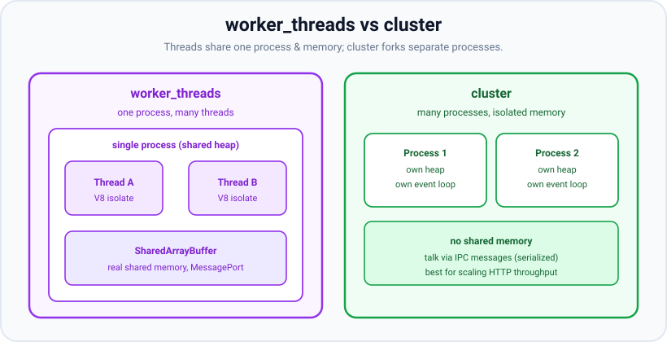
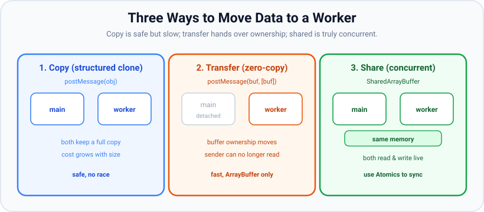

# Worker threads

*10 min read · Updated 24 Jul 2026 Topic 62 of 70 Bookmark Mark done Why it matters Node · Topic 62 of 70*

**Source:** [https://www.geekyfrontend.in/learn/nodejs-backend-kit/worker-threads](https://www.geekyfrontend.in/learn/nodejs-backend-kit/worker-threads)

---

## Why it matters

Node's event loop is fast at one thing above all: juggling *waiting*. Reading files, calling databases, awaiting HTTP — none of that occupies the CPU, so a single thread can shepherd thousands of concurrent I/O operations. But the moment a request needs to *compute* — hash a password, resize an image, parse a 20 MB CSV, run a regex over huge input, do cryptography or ML inference — that work runs **on the main thread**, and while it runs the event loop is frozen. Every other in-flight request stalls until the computation finishes. This is the infamous "blocking the event loop," and it is the number-one way a Node service goes from snappy to unresponsive under real workloads.

The **worker\_threads** module (stable since Node 12) is the correct tool for this. It lets you run JavaScript on *additional* threads inside the same process, so CPU-heavy work happens off the main thread and the event loop stays free to serve requests. In interviews, "how do you handle CPU-intensive work in Node without blocking?" is a staple, and the crisp answer — worker\_threads for CPU-bound work, and here's when it beats cluster — is exactly what distinguishes a senior answer from "just use async/await" (which does nothing for CPU-bound code).

## The concept, simply

A worker thread is a **separate JavaScript execution context running on its own OS thread, inside the same process**. Each worker gets its own V8 *isolate*: its own event loop, its own micro/macro task queues, and — crucially — its own heap. So by default, two threads do *not* share variables; each has its own copy of everything. This makes worker\_threads safe by default: you don't get the classic multithreaded data races on ordinary objects, because ordinary objects aren't shared.

Threads talk to each other by **passing messages** through a `MessagePort` (`worker.postMessage()` / `parentPort.on('message')`). By default a message is *copied* using the structured clone algorithm. If copying a big payload is too expensive, you have two escape hatches: **transfer** an `ArrayBuffer` (hand over ownership with zero copy — the sender loses access), or use a **SharedArrayBuffer**, which is genuinely shared memory both threads can read and write live (coordinated with `Atomics`).



worker\_threads live in one process and can share memory; cluster spawns separate processes that share nothing but a port.

The key distinction from cluster: **cluster is many processes for I/O throughput; worker\_threads is many threads for CPU work.** Cluster answers "serve more simultaneous connections across cores." Worker\_threads answers "do this heavy calculation without freezing the request handler." They are complementary, not competitors — a big service might cluster for concurrency *and* use worker\_threads (or a pool of them) for the occasional CPU-bound job.

## How it works

You create a worker with `new Worker(filename, { workerData })`. Node spins up a new thread, creates a fresh V8 isolate on it, and runs the given file from scratch — modules are *not* shared, so the worker re-imports what it needs. The `workerData` value is structured-cloned into the worker at start-up as its initial input. From then on, the two sides exchange messages over the port.

**Data movement** has three modes, and understanding their cost is the whole game:



Copy is safe but scales with payload size; transfer hands over an ArrayBuffer with zero copy; SharedArrayBuffer is real shared memory coordinated with Atomics.

- **Copy (default):** `postMessage(obj)` deep-clones the object. Simple and safe, but the cost grows with size — cloning hundreds of MB defeats the purpose.
- **Transfer (zero-copy):** `postMessage(buf, [buf.buffer])` moves an `ArrayBuffer`'s ownership to the other thread without copying bytes. The sender's buffer becomes *detached* (unusable). Ideal for handing a large binary payload one-way.
- **Share (concurrent):** a `SharedArrayBuffer` is mapped into both threads' memory. Both can read and write it simultaneously — which means you now *do* have real concurrency and must coordinate with `Atomics` (atomic loads/stores, `Atomics.wait`/`notify`) to avoid races.

**Cost of creation matters.** Spinning up a worker is not free — a new thread plus a new V8 isolate costs single-digit-to-tens of milliseconds and a few MB of memory. Creating one worker per request under load will bury you. The production pattern is a **worker pool**: a fixed set of long-lived workers that pull jobs from a queue, so you pay start-up once and reuse. Node 12.11+ ships `node:worker_threads` primitives, and libraries like `piscina` provide a battle-tested pool; you can also hand-roll one.

Note that some of Node's own async APIs already offload to libuv's thread pool without any worker\_threads involvement — `crypto.pbkdf2`, `zlib`, `fs`, `crypto.randomBytes`. If a heavy operation has an async built-in variant, prefer it; worker\_threads is for *your* JavaScript computation that has no such offload.

## Code examples

Offload a CPU-bound calculation so the main thread's event loop stays responsive.

javascript

```
// main.js
import { Worker } from 'node:worker_threads';

function runHeavyJob(input) {
  return new Promise((resolve, reject) => {
    const worker = new Worker('./heavy.js', { workerData: input });
    worker.once('message', resolve);
    worker.once('error', reject);
    worker.once('exit', (code) => {
      if (code !== 0) reject(new Error(`Worker stopped with code ${code}`));
    });
  });
}

// The event loop keeps serving requests while this runs on another thread.
const result = await runHeavyJob({ n: 45 });
console.log('fib:', result);
```

javascript

```
// heavy.js — runs on its own thread with its own heap
import { workerData, parentPort } from 'node:worker_threads';

function fib(n) { return n < 2 ? n : fib(n - 1) + fib(n - 2); }

const answer = fib(workerData.n);   // blocks THIS thread only
parentPort.postMessage(answer);     // send the result back, then exit
```

A minimal reusable worker **pool** — the pattern you actually ship. Fixed workers, a task queue, one worker per job at a time.

javascript

```
// pool.js — tiny fixed-size worker pool that survives crashing workers
import { Worker } from 'node:worker_threads';
import { availableParallelism } from 'node:os';

export class Pool {
  #file;
  #workers = new Set();
  #idle = [];
  #queue = [];
  #inFlight = new Map();   // worker -> { data, resolve, reject }
  #closed = false;
  constructor(file, size = availableParallelism()) {
    this.#file = file;
    for (let i = 0; i < size; i++) this.#spawn();
  }
  #spawn() {
    const worker = new Worker(this.#file);
    this.#workers.add(worker);
    worker.on('message', (result) => {
      const task = this.#inFlight.get(worker);
      this.#inFlight.delete(worker);
      this.#idle.push(worker);               // healthy: back to the idle list
      task?.resolve(result);
      this.#pump();
    });
    worker.on('error', (err) => {            // uncaught exception in the worker; 'exit' follows
      this.#inFlight.get(worker)?.reject(err);
      this.#inFlight.delete(worker);
    });
    worker.on('exit', (code) => {            // crash, process.exit() or terminate()
      this.#inFlight.get(worker)?.reject(new Error(`Worker stopped with code ${code}`));
      this.#inFlight.delete(worker);
      this.#workers.delete(worker);
      this.#idle = this.#idle.filter((w) => w !== worker);  // never hand out a dead worker
      if (!this.#closed) { this.#spawn(); this.#pump(); }    // replace it, keep the queue moving
    });
    this.#idle.push(worker);
  }
  run(data) {
    return new Promise((resolve, reject) => {
      this.#queue.push({ data, resolve, reject });
      this.#pump();
    });
  }
  #pump() {
    while (this.#queue.length && this.#idle.length) {
      const worker = this.#idle.pop();
      const task = this.#queue.shift();
      this.#inFlight.set(worker, task);
      worker.postMessage(task.data);
    }
  }
  async close() {
    this.#closed = true;
    await Promise.all([...this.#workers].map((w) => w.terminate()));
  }
}
```

What the pool does when a worker dies in the middle of a task:

1. `run()` queues the job; `#pump()` hands it to an idle worker and records it in `#inFlight`.
2. If the worker throws, `'error'` fires and the in-flight task is rejected with that error. (A worker that calls `process.exit()` or is terminated skips this step.)
3. `'exit'` fires: a task still in flight is rejected with the exit code, and the worker is removed from `#workers` and `#idle`, so it is never handed another job.
4. Unless the pool is closing, a replacement worker is spawned and `#pump()` runs, so the queued jobs keep moving.

The worker file the pool runs — long-lived, one job per message:

javascript

```
// task.js — pool worker: long-lived, handles one job per message
import { parentPort } from 'node:worker_threads';
parentPort.on('message', (job) => {
  const end = Date.now() + 50; while (Date.now() < end);   // ~50 ms of CPU work
  if (job.crash === 'throw') throw new Error('boom in worker'); // uncaught error mid-task
  if (job.crash === 'exit') process.exit(1);                 // worker killed mid-task
  parentPort.postMessage(job.n * 2);
});
```

A test that kills workers mid-task (one calls `process.exit(1)`, one throws) and checks that every other job still completes:

javascript

```
// pool.test.js — kill workers mid-task and check the queue keeps moving
import { Pool } from './pool.js';
const pool = new Pool(new URL('./task.js', import.meta.url), 2);
const jobs = [{ n: 1 }, { n: 2, crash: 'exit' }, { n: 3 }, { n: 4, crash: 'throw' }, { n: 5 }, { n: 6 }, { n: 7 }];
const withTimeout = (p) => Promise.race([p, new Promise((_, rej) => setTimeout(() => rej(new Error('still pending after 2 s')), 2000))]);
const results = await Promise.allSettled(jobs.map((j) => withTimeout(pool.run(j))));
results.forEach((r, i) => console.log(`job ${jobs[i].n}${jobs[i].crash ? ` (${jobs[i].crash})` : ''}:`.padEnd(15), r.status === 'fulfilled' ? r.value : `rejected — ${r.reason.message}`));
await pool.close();
process.exit(0);

// Real output (Node v24.19.0):
//   job 1:          2
//   job 2 (exit):   rejected — Worker stopped with code 1
//   job 3:          6
//   job 4 (throw):  rejected — boom in worker
//   job 5:          10
//   job 6:          12
//   job 7:          14
//
// Same test against the earlier version of this pool:
//   job 2 (exit):   rejected — still pending after 2 s     (exit never handled: task hangs forever)
//   job 4 (throw):  rejected — boom in worker
//   job 5, 6, 7:    rejected — still pending after 2 s     (dead worker was put back in the idle list)
```

> **Why this was wrong:** the earlier pool pushed a worker back into the idle list even after its `'error'` event — but a worker that throws an uncaught error is dead, so every job later handed to it waited forever. It also never listened for `'exit'`, so a worker that called `process.exit()` (or was terminated) left its task pending, and the `'message'` listener of a failed task was never removed. A pool must reject the in-flight task, drop or replace the dead worker, and keep pumping the queue.

Real shared memory with `SharedArrayBuffer` and `Atomics` — multiple threads incrementing one counter safely.

javascript

```
// Shared counter across threads (no copy, no message per update)
import { Worker, isMainThread, workerData } from 'node:worker_threads';

if (isMainThread) {
  const shared = new SharedArrayBuffer(4);       // 4 bytes = one Int32
  const view = new Int32Array(shared);
  for (let i = 0; i < 4; i++) new Worker(new URL(import.meta.url), { workerData: shared });
  setTimeout(() => console.log('total:', Atomics.load(view, 0)), 500);
} else {
  const view = new Int32Array(workerData);
  for (let i = 0; i < 100000; i++) Atomics.add(view, 0, 1);  // atomic += 1
}
```

## Common mistakes & gotchas

- **Creating a worker per request.** Thread + isolate startup is expensive; under load this melts down. Use a fixed pool and reuse workers.
- **Expecting shared variables by default.** Threads have separate heaps. A module-level variable in the worker is not the same object as in main. Only `SharedArrayBuffer` is truly shared; everything else is copied or transferred.
- **Using a transferred buffer after transfer.** After `postMessage(buf, [buf.buffer])`, the sender's buffer is detached — reading it throws or yields empty. Transfer is a hand-off, not a share.
- **Reaching for worker\_threads for I/O.** I/O is already non-blocking on the main thread. Threading it adds overhead for no gain. Worker\_threads is for *CPU*-bound JS. Use cluster (or just async I/O) for concurrency.
- **Forgetting to terminate workers.** Leaked workers keep threads and memory alive and can prevent the process from exiting. Call `worker.terminate()` when done (pools should reuse, but bound the pool and clean up on shutdown).
- **Ignoring the `'error'` and non-zero `'exit'` events.** An uncaught throw inside a worker surfaces as an `'error'` event, not a rejected promise, unless you wire it up. Unhandled, it can crash the worker silently.
- **Races on SharedArrayBuffer without Atomics.** Plain reads/writes to shared memory across threads are not safe. Use `Atomics` for correctness and for the wait/notify handshake.

## Best practices

- **Pool, don't spawn per task.** Use `piscina` or a small fixed pool sized to `availableParallelism()`; queue work onto idle workers.
- **Move only what you must.** Send inputs, return outputs — don't ship huge objects back and forth. Transfer ArrayBuffers for large binary data; share via SharedArrayBuffer only when threads genuinely need live concurrent access.
- **Prefer built-in async offloads first.** `zlib`, `crypto.pbkdf2`, async `fs` already use libuv's pool. Reach for worker\_threads only for your own CPU-bound JavaScript.
- **Keep workers pure and stateless** where possible — input in, result out — so they're easy to pool and restart.
- **Always handle `error`/`exit`** and set timeouts so a stuck job doesn't leak a worker.
- **Measure before threading.** If the op has an async built-in or the payload is tiny, the overhead of a worker can exceed the benefit.

## ⭐ Interview lens

> **Q: worker\_threads vs cluster — what's the real difference and when do you use each?**  
> A: cluster forks separate *processes* sharing a port to scale I/O concurrency across cores; they share no memory. worker\_threads spawns *threads* inside one process to run CPU-bound JavaScript off the main thread, and they can share memory via SharedArrayBuffer. Rule of thumb: many concurrent requests → cluster; heavy computation per request → worker\_threads.

> **Q: Does async/await help with CPU-bound work?**  
> A: No. async/await only helps with *waiting* (I/O). A synchronous computation still runs to completion on the current thread and blocks the event loop regardless of async syntax. You need worker\_threads (or a queue/external service) to get it off the main thread. (Very common trap.)

> **Q: How do you share data with a worker without copying it?**  
> A: Two ways. Transfer an ArrayBuffer with the transfer list — zero-copy ownership hand-off, sender's buffer detaches. Or use a SharedArrayBuffer for genuinely shared memory both threads read/write live, coordinated with Atomics. The default `postMessage` copies via structured clone.

> **Q: Why is creating a worker per request a bad idea?**  
> A: Each worker needs a new OS thread and a new V8 isolate — milliseconds of startup and megabytes of memory. Per-request creation collapses under load. Use a fixed-size worker pool that reuses long-lived workers pulling from a job queue.

> **Q: Do worker threads share the same event loop as the main thread?**  
> A: No. Each worker has its own event loop, its own microtask/macrotask queues, and its own heap. Blocking one thread does not block another's loop — that isolation is the whole point.

> **Q: You need to hash passwords under heavy signup load. worker\_threads or something else?**  
> A: Prefer the built-in async offload first — `crypto.pbkdf2`/`scrypt` already run on libuv's thread pool, off the main thread, no worker\_threads needed. Reach for worker\_threads only for CPU-bound JS that has no async built-in. (Good senior answer names the async built-in.)

## Cheat-card

- **worker\_threads = threads in one process** for CPU-bound JS; each has its own loop + heap.
- Default message = **structured-clone copy**; transfer an `ArrayBuffer` = zero-copy; `SharedArrayBuffer` = real shared memory + `Atomics`.
- **cluster** = processes for I/O concurrency; **worker\_threads** = threads for computation. Complementary.
- async/await does **nothing** for CPU-bound code — only worker\_threads/queue gets it off the main thread.
- Never spawn per request → use a **fixed pool** (piscina) sized to `availableParallelism()`.
- Prefer built-in async offloads (`zlib`, `crypto.pbkdf2`, async `fs`) before threading.
- Handle `error`/`exit`; terminate/clean up workers on shutdown.
- **`resourceLimits`** (added in v13.2.0): `maxOldGenerationSizeMb`, `maxYoungGenerationSizeMb`, `codeRangeSizeMb`, `stackSizeMb` (default 4); JS heap and stack only, not `Buffer`/`ArrayBuffer` memory.
- **Worker OOM:** the worker is terminated, `'error'` has `code: 'ERR_WORKER_OUT_OF_MEMORY'`, `'exit'` gets code 1, and the main thread survives; the pool rejects the job and respawns.

---

## Learn More

- [Node.js Worker Threads (worker_threads) nodejs.org](https://nodejs.org/api/worker_threads.html)
- [Node.js Cluster module (process-level vs thread-level) nodejs.org](https://nodejs.org/api/cluster.html)
- [Multithreading in Node.js with Worker Threads Explained logicBase Labs](https://www.youtube.com/watch?v=JTl6tQ4bqYA)

---

## Additional topics

*Added 12 Oct 2026 · examples verified on Node v24.19.0 (no npm packages)*

### `resourceLimits`: capping a worker's JS engine

Every worker has its own V8 isolate, and by default that isolate may grow its heap as far as V8's own default limits allow. One runaway job (an accidental infinite `push`, a huge `JSON.parse`) can then eat memory that the main thread and the other workers need. The `resourceLimits` option of `new Worker(file, options)` (added in v13.2.0 / v12.16.0) sets limits on that one isolate. The v24 docs list four keys, all numbers:

- **`maxOldGenerationSizeMb`**: the maximum size of the main heap, in MB. The command-line flag `--max-old-space-size` overrides it.
- **`maxYoungGenerationSizeMb`**: the maximum size of a heap space for recently created objects. `--max-semi-space-size` overrides it.
- **`codeRangeSizeMb`**: the size of a pre-allocated memory range used for generated code.
- **`stackSizeMb`**: the default maximum stack size for the thread. **Default:** `4`. The docs warn that small values may make the worker unusable.

When a worker reaches one of these limits, Node terminates **that worker**, not the process. The docs add two limits of their own: the limits "only affect the JS engine, and no external data, including no `ArrayBuffer`s", and "the process may still abort if it encounters a global out-of-memory situation". Inside the worker, `require('node:worker_threads').resourceLimits` shows the values in force (on the main thread it is an empty object). From the parent, `worker.resourceLimits` shows the same values, and an empty object once the worker has stopped.

How it works:

1. The parent passes `resourceLimits` to `new Worker()`. V8 creates the worker's isolate with those heap and stack sizes.
2. The worker allocates. When its old generation is full and garbage collection cannot free enough, V8 reports a heap out-of-memory condition for that isolate only.
3. Node stops the worker thread and emits `'error'` on the `Worker` object in the parent. The error's `code` is `ERR_WORKER_OUT_OF_MEMORY` ("The `Worker` instance terminated because it reached its memory limit", in the errors docs).
4. `'exit'` follows with exit code `1`, as for any terminated worker.
5. The main thread's heap was never involved, so the parent keeps running and can start a new worker.

A stack overflow is different: exceeding `stackSizeMb` throws an ordinary `RangeError` inside the worker, which the worker can catch. Only an uncaught one ends the worker (through the normal `'error'` path).

**Example — a worker hits its 32 MB heap limit; the main thread survives.**

javascript

```
// oom.mjs: a worker with a 32 MB old-generation limit allocates until it runs out.
import { Worker } from 'node:worker_threads';

const code = `
  const { resourceLimits } = require('node:worker_threads');
  console.log('worker limits:', JSON.stringify(resourceLimits));
  const keep = [];
  for (;;) keep.push(new Array(1e5).fill({ n: keep.length }));  // grows the JS heap forever
`;

const worker = new Worker(code, {
  eval: true,
  resourceLimits: { maxOldGenerationSizeMb: 32, maxYoungGenerationSizeMb: 8 },
});
worker.on('error', (err) => console.log('main got error:', err.code, '-', err.message));
worker.on('exit', (code) => {
  console.log('main got exit code:', code);
  console.log('main is still running, heap used MB:',
    Math.round(process.memoryUsage().heapUsed / 1e6));
});

// Real output (Node v24.19.0), `node oom.mjs`, then `echo $?` printed 0:
//   worker limits: {"maxYoungGenerationSizeMb":8,"maxOldGenerationSizeMb":32,"codeRangeSizeMb":0,"stackSizeMb":4}
//   main got error: ERR_WORKER_OUT_OF_MEMORY - Worker terminated due to reaching memory limit: JS heap out of memory
//   main got exit code: 1
//   main is still running, heap used MB: 5
```

The keys you did not set show their defaults as Node reports them: `stackSizeMb` 4, and `codeRangeSizeMb` 0, which leaves the code range size to V8.

**Example — `stackSizeMb` changes how deep a worker can recurse.**

javascript

```
// stack.mjs: how deep can a worker recurse with stackSizeMb 1 vs the default 4?
import { Worker } from 'node:worker_threads';

const code = `
  const { parentPort } = require('node:worker_threads');
  let depth = 0;
  function dive() { depth++; dive(); }
  try { dive(); } catch (e) { parentPort.postMessage(e.constructor.name + ' at depth ' + depth); }
`;
for (const stackSizeMb of [1, 4]) {
  const w = new Worker(code, { eval: true, resourceLimits: { stackSizeMb } });
  w.on('message', (m) => console.log(`stackSizeMb ${stackSizeMb}: ${m}`));
  await new Promise((r) => w.once('exit', r));
}

// Real output (Node v24.19.0), the same on two runs:
//   stackSizeMb 1: RangeError at depth 10348
//   stackSizeMb 4: RangeError at depth 49669
```

The depths depend on the function's frame size and the Node version; the point is that the overflow is a catchable `RangeError`, not a terminated worker.

### Handling out-of-memory in the worker pool

The corrected `Pool` earlier in this lesson already does the right thing when a worker dies, whatever the cause: `'error'` rejects the task in flight, `'exit'` removes the dead worker from `#workers` and `#idle`, spawns a replacement and pumps the queue. An out-of-memory worker is one more way to die, so the pool needs no new logic. It only needs a way to pass `resourceLimits` to each `new Worker()`. The change below adds an optional `options` argument and forwards it; everything else in `pool.js` stays exactly as shown above.

How it works:

1. `new Pool(file, size, { resourceLimits })` stores the options; `#spawn()` passes them to every worker, including replacements.
2. A job that leaks runs its worker into the heap limit. Node terminates that worker and emits `'error'` with `code: 'ERR_WORKER_OUT_OF_MEMORY'`. The pool's `'error'` handler rejects that job's promise with this error.
3. `'exit'` (code 1) follows. The pool drops the worker and spawns a new one with the same limits, then calls `#pump()`.
4. Jobs that were queued, or running on the other worker, finish normally. Later jobs can land on the replacement worker.

**Example — the lesson's `pool.js` with an `options` argument (the only change).**

text

```
@@ -4,17 +4,19 @@
 
 export class Pool {
   #file;
+  #options;               // forwarded to every new Worker (e.g. resourceLimits)
   #workers = new Set();
   #idle = [];
   #queue = [];
   #inFlight = new Map();   // worker -> { data, resolve, reject }
   #closed = false;
-  constructor(file, size = availableParallelism()) {
+  constructor(file, size = availableParallelism(), options = {}) {
     this.#file = file;
+    this.#options = options;
     for (let i = 0; i < size; i++) this.#spawn();
   }
   #spawn() {
-    const worker = new Worker(this.#file);
+    const worker = new Worker(this.#file, this.#options);
     this.#workers.add(worker);
     worker.on('message', (result) => {
       const task = this.#inFlight.get(worker);
```

This is `diff -u` output: the old `pool.js` block from this lesson against the patched copy used in the test below.

**Example — one job exceeds the heap limit; the pool replaces the worker and keeps serving.**

javascript

```
// mem-task.js — pool worker: doubles n, or leaks memory until its heap limit when job.leak is set
import { parentPort, threadId } from 'node:worker_threads';
parentPort.on('message', (job) => {
  if (job.leak) {
    const keep = [];
    for (;;) keep.push(new Array(1e5).fill(job));   // never returns: heap grows until the limit
  }
  parentPort.postMessage({ value: job.n * 2, threadId });
});
```

javascript

```
// oom-pool.test.js — one job blows its worker's heap limit; the pool replaces the worker
import { Pool } from './pool.js';
const pool = new Pool(new URL('./mem-task.js', import.meta.url), 2, {
  resourceLimits: { maxOldGenerationSizeMb: 32, maxYoungGenerationSizeMb: 8 },
});
const show = (label, r) => console.log(label.padEnd(24), r.status === 'fulfilled'
  ? `${r.value.value} on thread ${r.value.threadId}`
  : `rejected — ${r.reason.code}: ${r.reason.message}`);

const batch1 = [{ n: 1 }, { n: 2, leak: true }, { n: 3 }, { n: 4 }];
(await Promise.allSettled(batch1.map((j) => pool.run(j))))
  .forEach((r, i) => show(`batch 1, job ${batch1[i].n}${batch1[i].leak ? ' (leak)' : ''}:`, r));

const batch2 = [{ n: 5 }, { n: 6 }, { n: 7 }, { n: 8 }];   // the replacement worker takes part
(await Promise.allSettled(batch2.map((j) => pool.run(j))))
  .forEach((r, i) => show(`batch 2, job ${batch2[i].n}:`, r));

console.log('main heap used MB:', Math.round(process.memoryUsage().heapUsed / 1e6));
await pool.close();

// Real output (Node v24.19.0), `node oom-pool.test.js` (package.json has "type": "module"), exit code 0:
//   batch 1, job 1:          2 on thread 2
//   batch 1, job 2 (leak):   rejected — ERR_WORKER_OUT_OF_MEMORY: Worker terminated due to reaching memory limit: JS heap out of memory
//   batch 1, job 3:          6 on thread 2
//   batch 1, job 4:          8 on thread 2
//   batch 2, job 5:          10 on thread 3
//   batch 2, job 6:          12 on thread 2
//   batch 2, job 7:          14 on thread 2
//   batch 2, job 8:          16 on thread 2
//   main heap used MB: 6
```

The worker on thread 1 took the leaking job and died; thread 2 kept draining batch 1 while it did. Thread 3 is the replacement that the pool's `'exit'` handler spawned, and it served a job in batch 2. The main thread's heap was about 6 MB at the end (5 MB on a later run).

### Common mistakes & gotchas (additional topics)

- **Expecting `resourceLimits` to cap total memory.** It caps the worker's JS heap and stack only. `Buffer`s and other `ArrayBuffer`s are allocated outside the heap and are not counted (see the edge case below). Process-wide limits come from the container or OS.
- **Setting the limit with a command-line flag as well.** `--max-old-space-size` and `--max-semi-space-size` override `maxOldGenerationSizeMb` and `maxYoungGenerationSizeMb` for workers, so a flag in `NODE_OPTIONS` can silently replace the values you passed.
- **Treating `ERR_WORKER_OUT_OF_MEMORY` as retryable.** The same input will usually blow the same limit again. Reject the job (or send it to a dead-letter list) instead of resubmitting it in a loop.
- **Very small `stackSizeMb`.** The docs warn that small values may lead to unusable workers; a worker that cannot even load its modules fails before it runs any job.
- **No `'error'` listener on a limited worker.** An out-of-memory termination is reported as an `'error'` event; without a listener, the parent throws it as an unhandled `'error'` event and the main process dies after all.

### Edge case worked through: `Buffer` memory is not limited

A worker limited to a 32 MB old generation allocates 200 MB of `Buffer`s and finishes normally.

javascript

```
// external.mjs: Buffers live outside the JS heap, so maxOldGenerationSizeMb does not cap them.
import { Worker } from 'node:worker_threads';

const code = `
  const { parentPort } = require('node:worker_threads');
  const bufs = [];
  for (let i = 0; i < 20; i++) bufs.push(Buffer.alloc(10 * 1024 * 1024, 1));  // 200 MB of Buffers
  const m = process.memoryUsage();
  parentPort.postMessage('memoryUsage().arrayBuffers: ' + Math.round(m.arrayBuffers / 1048576) + ' MiB');
`;
const w = new Worker(code, { eval: true, resourceLimits: { maxOldGenerationSizeMb: 32 } });
w.on('message', console.log);
w.on('error', (e) => console.log('error:', e.code));
w.on('exit', (c) => console.log('exit code:', c));

// Real output (Node v24.19.0):
//   memoryUsage().arrayBuffers: 200 MiB
//   exit code: 0
```

Each `Buffer` object on the heap is small; its 10 MiB of bytes live in memory that V8 does not count toward the old generation. That matches the docs ("no external data, including no `ArrayBuffer`s"). If your workers handle large binary data (images, file uploads), `resourceLimits` will not protect you; limit input sizes, stream the data, and set a memory limit on the container.

### ⭐ Interview lens (additional topics)

> **Q: “A worker thread runs out of memory. What happens to the main process?”**  
> A: If the worker was started with `resourceLimits`, V8 hits the limit in that worker's isolate only. Node terminates the worker, emits `'error'` with `code: 'ERR_WORKER_OUT_OF_MEMORY'`, then `'exit'` with code 1, and the main thread keeps running. A pool should reject the job in flight and spawn a replacement. *Trap:* the limits cover only the JS heap; `ArrayBuffer`/`Buffer` memory is not counted, and the docs say a global out-of-memory can still abort the whole process.

> **Q: “Which keys does `resourceLimits` accept?”**  
> A: `maxOldGenerationSizeMb` (main heap), `maxYoungGenerationSizeMb` (space for new objects), `codeRangeSizeMb` (pre-allocated range for generated code) and `stackSizeMb` (thread stack, default 4). `--max-old-space-size` and `--max-semi-space-size` override the first two.
